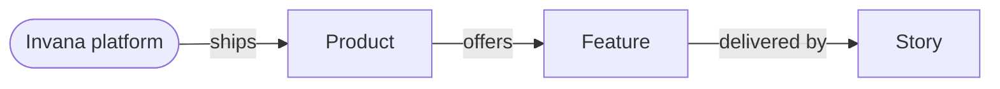

# Platform map

The map is the specs, drawn. `specs/` is the only source; the dataset is generated from it and never edited by hand.

| Piece | Where | Owns |
|---|---|---|
| Generator | `.claude/skills/platform-map/gen.py` | Reading `specs/` into nodes and edges |
| Dataset | `~/Projects/invana/canvas/packages/graph-datasets/src/usecase-demos/invana-platform/data.ts` (`invanaPlatform`) | What is true — generated, carries no style |
| Story | `~/Projects/invana/canvas/apps/storybook/stories/canvas-demos/by-casestudies/invana-platform/PlatformMap.stories.tsx` | The look — four composite cards, layouts, controls |

## 1. The graph



| Node `type` | Read from | `data` |
|---|---|---|
| `platform` | `specs/vision.md` | `name` · `summary` (the bold tagline) · `counts` |
| `product` | `products/*/product.md` | `code` · `name` · `status` · `summary` (first sentence of the blockquote) · `hue` · `p` · `counts` |
| `feature` | `features/*/feature.md` | `code` · `name` · `status` · `product` · `hue` · `p` · `access` · `grants` · `stories` |
| `story` | `stories/*/story.md` | `code` · `name` · `status` · `feature` · `hue` · `p` |

| Field | Meaning |
|---|---|
| `p` | `{ persona: 1 }` for each key in the front matter's `personas:` — keys of `specs/personas.md` |
| `access` / `grants` | Grants named in the feature's `## Access` Role column: Operator · Can work on projects · Can build agents · Can shape the model · Owner · Can manage people · Admin; *Self only* when only the person themselves may act |
| `hue` | The product's 1-based slot in the theme's categorical ramp, inherited down its subtree |

## 2. Regenerate

```bash
python3 .claude/skills/platform-map/gen.py           # write the dataset
python3 .claude/skills/platform-map/gen.py --check   # exit 1 when specs/ moved and the dataset is stale
pnpm --dir ~/Projects/invana/canvas --filter @invana/graph-datasets build   # Storybook reads dist/
```

- Re-check `git status` in the canvas repo before writing — another session may hold changes there.
- A new persona or grant changes `PERSONAS` / `GRANTS` in `gen.py` **and** the story's `PERSONAS` (chip slot, colour, legend) in the same change.
- A spec that fails to parse is a spec to fix (`product-spec`), not a special case in `gen.py`.

## 3. The story

`canvas-demos/by-casestudies/invana-platform/PlatformMap` — run the canvas Storybook (`pnpm --dir ~/Projects/invana/canvas/apps/storybook dev`).

| Card | Shows |
|---|---|
| Platform | Name, tagline, counts, the persona legend |
| Product | Code, name, summary, counts, persona chips |
| Feature | Code, name, story count, **Access**, persona chips |
| Story | Code, name, status, persona chips |

| Act | Does |
|---|---|
| Right-click a product or feature | *Expand* its children · *Expand only this* (folds its siblings) · *Collapse* (folds everything below) |
| Right-click the platform | *Collapse all* — back to the platform and its products |
| Layout | *Radial* — placed by the story: products on a fixed ring, an open node's children on an arc around it, so a step never moves what was there · *Layered* — ELK, left to right |
| Persona | Fade every card not tagged for that persona |

- Persona chips are **seven fixed slots** (AN · DM · MO · CU · BU · OW · AD, the order of `personas.md`); a slot draws only where its persona is tagged (`requires: data.p.<key>`), so each persona reads as a column.
- The story follows the canvas Storybook's rules (`apps/storybook/CLAUDE.md`): one story per file, all code in `render`, no shared helper.
