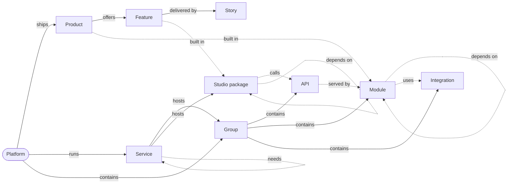

# Platform map

The map is the specs and the code, drawn. They are the only sources; the dataset is generated from them and never
edited by hand.

| Piece | Where | Owns |
|---|---|---|
| Generator | `.claude/skills/platform-map/gen.py` | Reading `specs/` into the product layer, joining the rest, `--check`, `--report` |
| System reader | `.claude/skills/platform-map/system.py` | Reading the code into the system and code layers — its docstring is their node and edge table |
| Dataset | `~/Projects/invana/canvas/packages/graph-datasets/src/usecase-demos/invana-platform/data.ts` (`invanaPlatform`) | What is true — generated, carries no style |
| Story | `~/Projects/invana/canvas/apps/storybook/stories/canvas-demos/by-casestudies/invana-platform/PlatformMap.stories.tsx` | The look — four composite cards, layouts, controls |

## 1. The graph

Three layers under one platform. Every node has one **tree** parent (placement and expand); **cross** edges point
dependent → dependency, so what depends on a node is what reaches it backwards.



| `data.layer` | Node types | Source |
|---|---|---|
| `product` | `product` · `feature` · `story` | `specs/` (below) |
| `system` | `service` · `api` · `package` · `integration` | The code — `system.py` |
| `code` | `module` | The code — `system.py` |
| `view` | `group` | Nothing — a layout node; never part of an export or an ontology |

| Rule | Detail |
|---|---|
| Grain | API area and module (`apps/*`, `core/*`, top-level engine packages) — never file or endpoint |
| Read, not kept | Every system and code node and edge is read from the code. The one declared link is `built in` |
| `built in` | Optional front matter on `product.md` or `feature.md`: `engine: [apps/agents, core/policy]` (module ids as `system.py` names them) · `studio: [agents]` (package dirs). A feature with none inherits its product's |
| `uses` | A fixed rule, not an import: `llm_providers` → each LLM provider, `graph` → each connector, `plugins` → each tool kind |

### Product layer

| Node `type` | Read from | `data` |
|---|---|---|
| `platform` | `specs/vision.md` | `name` · `summary` (the bold tagline) · `counts` · `system` (the system and code counts) |
| `product` | `products/*/product.md` | `code` · `name` · `status` · `summary` (first sentence of the blockquote) · `hue` · `p` · `counts` |
| `feature` | `features/*/feature.md` | `code` · `name` · `status` · `product` · `hue` · `p` · `access` · `grants` · `stories` |
| `story` | `stories/*/story.md` | `code` · `name` · `status` · `feature` · `hue` · `p` |

| Field | Meaning |
|---|---|
| `p` | `{ persona: 1 }` for each key in the front matter's `personas:` — keys of `specs/personas.md` |
| `access` / `grants` | Grants named in the feature's `## Access` Role column: Operator · Can work on projects · Can build agents · Can shape the model · Owner · Can manage people · Admin; *Self only* when only the person themselves may act |
| `hue` | The product's 1-based slot in the theme's categorical ramp, inherited down its subtree |

## 2. Regenerate

```bash
python3 .claude/skills/platform-map/gen.py           # write the dataset
python3 .claude/skills/platform-map/gen.py --check   # exit 1 when specs/ or the code moved and the dataset is stale
python3 .claude/skills/platform-map/gen.py --report  # drift: APIs no Studio package calls, declared code that does not exist, features that claim no code
pnpm --dir ~/Projects/invana/canvas --filter @invana/graph-datasets build   # Storybook reads dist/
```

- The generator reads the working tree — a peer's uncommitted spec or code edits land in the dataset; say so when reporting.
- A `calls` edge needs a URL the reader can see: `/api/v1/u/${…}/${…}/seg` literally, or `${base}/seg` in a file that builds the bare graph base. A package that builds URLs another way calls nothing on the map — fix the reader, not the package.

- Re-check `git status` in the canvas repo before writing — another session may hold changes there.
- A new persona or grant changes `PERSONAS` / `GRANTS` in `gen.py` **and** the story's `PERSONAS` (chip slot, colour, legend) in the same change.
- A spec that fails to parse is a spec to fix (`product-spec`), not a special case in `gen.py`.

## 3. The story

`canvas-demos/by-casestudies/invana-platform/PlatformMap` — run the canvas Storybook (`pnpm --dir ~/Projects/invana/canvas/apps/storybook dev`).

| Card | Shows |
|---|---|
| Platform | Name, tagline, counts, the persona legend |
| Product | Code, name, summary, counts, persona chips |
| Feature | Code, name, story count, **Access**, persona chips |
| Story | Code, name, status, persona chips |
| System (service · group · api · module · package · integration) | Kind, name, `sub`, `stats`, accent by type; *No Studio caller* on an unclaimed API |

| Act | Does |
|---|---|
| Right-click any card with children | *Expand* its children · *Expand only this* (folds its siblings) · *Collapse* (folds everything below) |
| Right-click a system or code card | *Show what depends on this* — blast radius, below · *Clear* |
| Right-click the platform | *Collapse all* — back to the platform and ring 1 |
| View | Ring 1: *Product* (the products) · *System* (the services and the integrations group) · *All* |
| Layout | *Radial* — placed by the story: ring 1 at equal angles, an open node's children on an arc around it, so a step never moves what was there · *Layered* — ELK, left to right |
| Persona | Fade every product-layer card not tagged for that persona |
| Dependencies | Draw the cross edges between the cards that show (dashed); off by default |

- **Blast radius** walks the cross edges backwards with **at most one `depends on` step** — the engine's imports form one large cycle (R096), so a transitive walk reaches nearly every module from any root. It shows only what it reaches and the tree path to each; *Clear* returns to what was open. It reaches products and features only once their spec declares `engine:` / `studio:`.

- Persona chips are **seven fixed slots** (AN · DM · MO · CU · BU · OW · AD, the order of `personas.md`); a slot draws only where its persona is tagged (`requires: data.p.<key>`), so each persona reads as a column.
- The story follows the canvas Storybook's rules (`apps/storybook/CLAUDE.md`): one story per file, all code in `render`, no shared helper.
