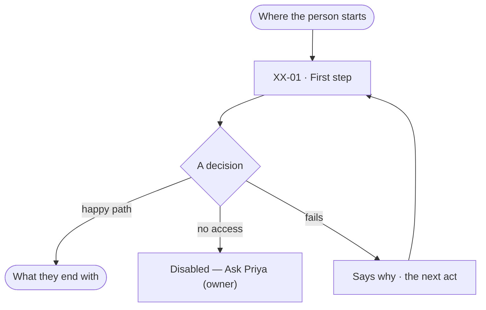
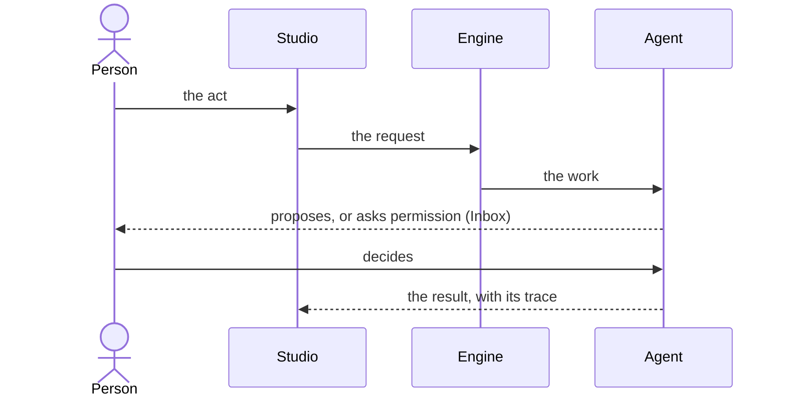

# Feature name

> One or two lines: what the feature does for a person, and the decision it helps them make.

## User journey

How a person moves through this feature, every story on it. Each node a story covers carries its ID.

When an agent, a background run or a permission ask is involved, add the timing between the person, Studio, the
engine and the agent:

## Stories

Each story is a folder under `stories/` — `story.md` from `templates/story.md`, `task.md` from `templates/task.md` —
listed here in the order the user journey reaches them.

| ID | Story | Status |
|---|---|---|
| XX-01 | [Story title](stories/XX-01-story-slug/story.md) | idea |

## Access

Each act in this feature and the role that may do it — the code's view of every story's *Who can*.

| Act | Role (`.claude/team/TEAM.md` §7) | Everyone else sees |
|---|---|---|
| | `modeller` · shown as *Can shape the model* | Disabled — *Ask Priya (owner)* |

## States

What each state means across this feature's screens.

| State | What the person sees |
|---|---|
| First use | Nothing exists yet: why, and the one act that starts it |
| Empty after a filter | Nothing matches: the filter named, and how to clear it |
| Loading | |
| Has data | |
| Failed | What failed, in a sentence, and the next act |
| Agent working or proposing | What the agent is doing, and the decision it brings back |
| No access | Hidden, disabled with its reason, or *Ask <owner>* |

## Rules

| Rule | Detail |
|---|---|
| | |

## Engine

The low-level design: what this feature stores, serves and refuses. Conventions — naming, errors, lists, events — are
[system-design.md](../../../../system-design.md) §§ 6–8; this section only fills them in. A record another feature
owns is linked under *Reads*, never copied.

### Records

| Table | Columns | Notes |
|---|---|---|
| `xx_records` | `graph_id` · `key` · … | Unique, defaults, what derives from it |

### Reads

| Record | Owner |
|---|---|
| | [XX-Fnn › Engine](…) |

### Routes

| Route, after `/api/v1/u/{u}/{g}/xx` | Does | Story |
|---|---|---|
| | | XX-01 |

### Events

| Event | When |
|---|---|
| `xx.records.create` | |

### Refusals

| Status | When | Sentence | Criterion |
|---|---|---|---|
| 409 | | | XX-01.n |

### CLI

| Command | Does |
|---|---|
| — | |

### Mechanisms

| Mechanism | How |
|---|---|
| | What is derived, ordered, counted or locked, and how |

## System impact

`None`, or:

| HLD section | Change | NFRs |
|---|---|---|
| § n | | NFR-… |

## Decisions

| Decision | Detail |
|---|---|
| | |

## Open questions

| Question | Who answers |
|---|---|
| | |

## Not building

| Item | Why not |
|---|---|
| | |
