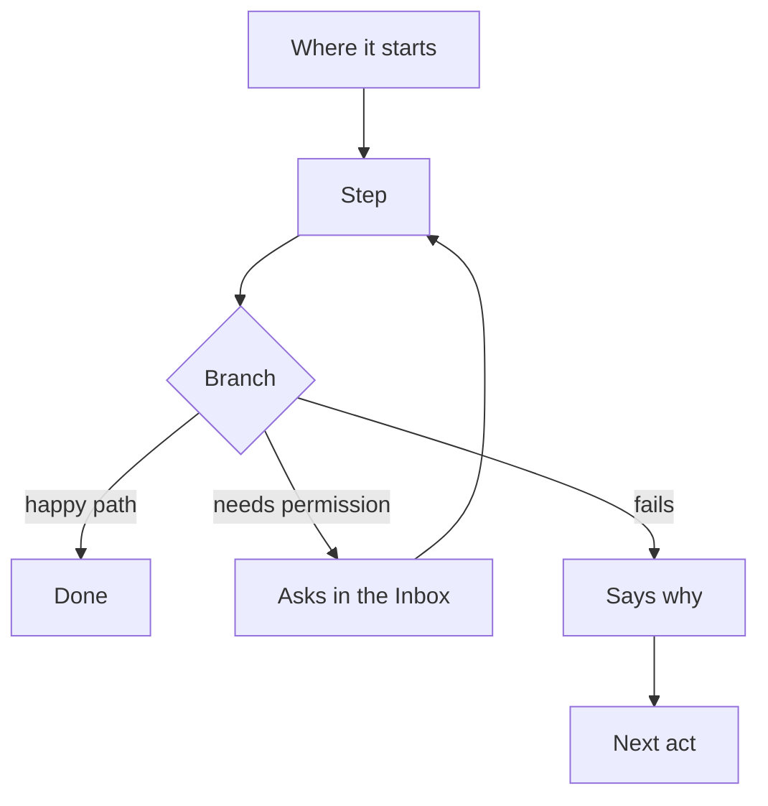

# Journey name

> **Name**, a persona, wants an outcome — one sentence of who and why.

## The journey

## Steps

| # | Step | Product · surface | Story | Board |
|---|---|---|---|---|
| 1 | | | | |

## Branches

| When | What happens | Story | Board |
|---|---|---|---|
| It needs permission | | | |
| It fails | | | |
| The person has no access | | | |

## Done when

- The end state a person reaches, stated as a check.
