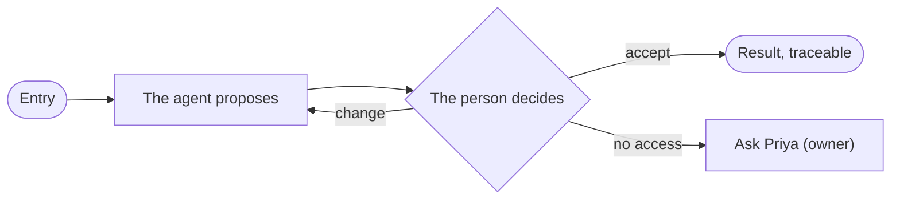

# XX-01 · Story title

**As** a persona **I want** an outcome **so that** a reason.

Tasks: [task.md](task.md) · Feature: [XX-F01](../../feature.md)

## Who can

| Lens | Can | Otherwise sees |
|---|---|---|
| Admin | What an admin does in this story | — |
| Operator | What an operator does, or `—` | Hidden · disabled with its reason · *Ask Priya (owner)*. A grant that lets them do more: *with Can shape the model: as Admin* |

## Flow

## Acceptance criteria

| # | Given | When | Then |
|---|---|---|---|
| XX-01.1 | | | |
| XX-01.2 | An operator without the grant | they reach the act | they see *Ask Priya (owner)* |

## Screens

Every surface this story shows × every state × both lenses. A cell names the board (`board` or `board · State`), or
`—` when that state cannot happen for that lens. No cell is empty.

| Surface | Lens | First use | Empty after a filter | Loading | Has data | Failed | Agent working or proposing | No access |
|---|---|---|---|---|---|---|---|---|
| area.feature.surface | Admin | | | | | | | — |
| area.feature.surface | Operator | | | | | | | |
