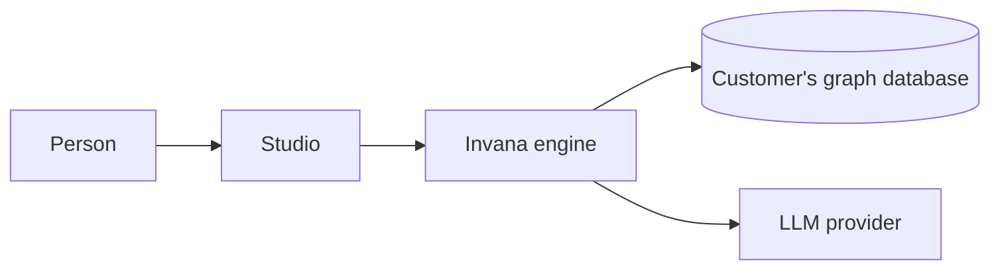

# System design

> How Invana's technology delivers its stories, and how well. What a person can do is the stories in
> [capabilities](capabilities/) and [os](os/); this file is the high-level design. Each feature's low-level design is
> its `feature.md` › `## Engine`.

| § | Section | Answers |
|---|---|---|
| 1 | [Context and scope](#1-context-and-scope) | What the system is, who and what it talks to |
| 2 | [Functional requirements](#2-functional-requirements) | What it does — by link to the stories |
| 3 | [Non-functional requirements](#3-non-functional-requirements) | How well, as numbers |
| 4 | [Constraints](#4-constraints) | What the design may not change |
| 5 | [Capacity estimates](#5-capacity-estimates) | How big it gets |
| 6 | [Data and storage](#6-data-and-storage) | Where facts are kept, and who owns each |
| 7 | [Architecture and components](#7-architecture-and-components) | The parts and their boundaries |
| 8 | [APIs and events](#8-apis-and-events) | How the parts and the outside talk |
| 9 | [Distributed execution](#9-distributed-execution) | How work runs across processes and machines |
| 10 | [AI and agents](#10-ai-and-agents) | How agents plan, act, are bounded and are judged |
| 11 | [Failure modes and the outside boundary](#11-failure-modes-and-the-outside-boundary) | What breaks, and what Invana does |
| 12 | [Qualities](#12-qualities) | Consistency · scalability · reliability · security · privacy · observability · accessibility |
| 13 | [Delivery and operations](#13-delivery-and-operations) | How it ships, installs, upgrades and is developed |
| 14 | [Evaluation](#14-evaluation) | Does the design meet each NFR |
| 15 | [Decisions, risks and not building](#15-decisions-risks-and-not-building) | System-level choices, open risks, non-goals |

## 1. Context and scope

| Quality goal (top 5) | Why it matters to the person deciding |
|---|---|
| | |

## 2. Functional requirements

| Product | Features | Stories |
|---|---|---|
| [XX](capabilities/xx/product.md) | XX-F01 … | n |

## 3. Non-functional requirements

| ID | Quality | Target | Measured by | Enforced by | Constrains |
|---|---|---|---|---|---|
| NFR-PERF-1 | | | | test · CI gate · eval · `review` | stories / features |

## 4. Constraints

| Constraint | Because |
|---|---|
| | |

## 5. Capacity estimates

| Quantity | Estimate | Reached by | Sizes |
|---|---|---|---|
| | | | NFR-… |

## 6. Data and storage

| Store | Holds | Consistency | Owner of each record |
|---|---|---|---|
| | | | Link to the feature's `## Engine` |

| Decision | Choice | Trade-off | Detail in |
|---|---|---|---|
| | | | |

## 7. Architecture and components

C4 container view, then one row per component.

| Component | Responsible for | Owns | Serves |
|---|---|---|---|
| | | | Features |

## 8. APIs and events

| Convention | Rule | Detail in |
|---|---|---|
| | | |

## 9. Distributed execution

| Decision | Choice | Trade-off | Detail in |
|---|---|---|---|
| | | | |

## 10. AI and agents

| Decision | Choice | Trade-off | Detail in |
|---|---|---|---|
| | | | |

## 11. Failure modes and the outside boundary

| Fails | The person sees | Invana does | Proven by |
|---|---|---|---|
| | | | Criterion · NFR |

| Outside system | Invana guarantees | Inherited from it |
|---|---|---|
| | | |

## 12. Qualities

One table per quality: consistency · scalability · reliability · security · privacy · observability · accessibility.

| Decision | Choice | Trade-off | Detail in |
|---|---|---|---|
| | | | |

## 13. Delivery and operations

| Decision | Choice | Trade-off | Detail in |
|---|---|---|---|
| | | | |

## 14. Evaluation

| NFR | Met by | Verdict | Gap |
|---|---|---|---|
| NFR-… | § n | meets · at risk · gap | `R…` |

## 15. Decisions, risks and not building

| Decision | Choice | Trade-off |
|---|---|---|
| | | |

| Risk | Impact | Owner | Mitigation |
|---|---|---|---|
| | | | |

| Not building | Why not |
|---|---|
| | |
