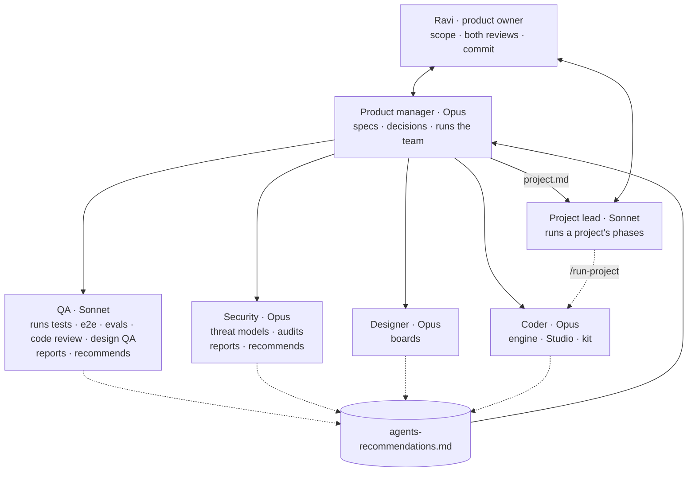
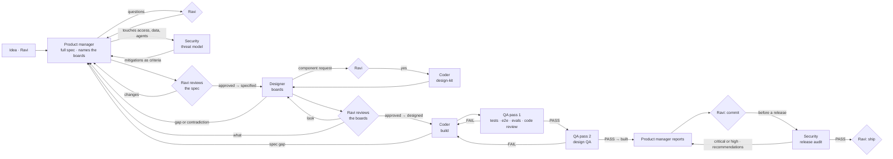
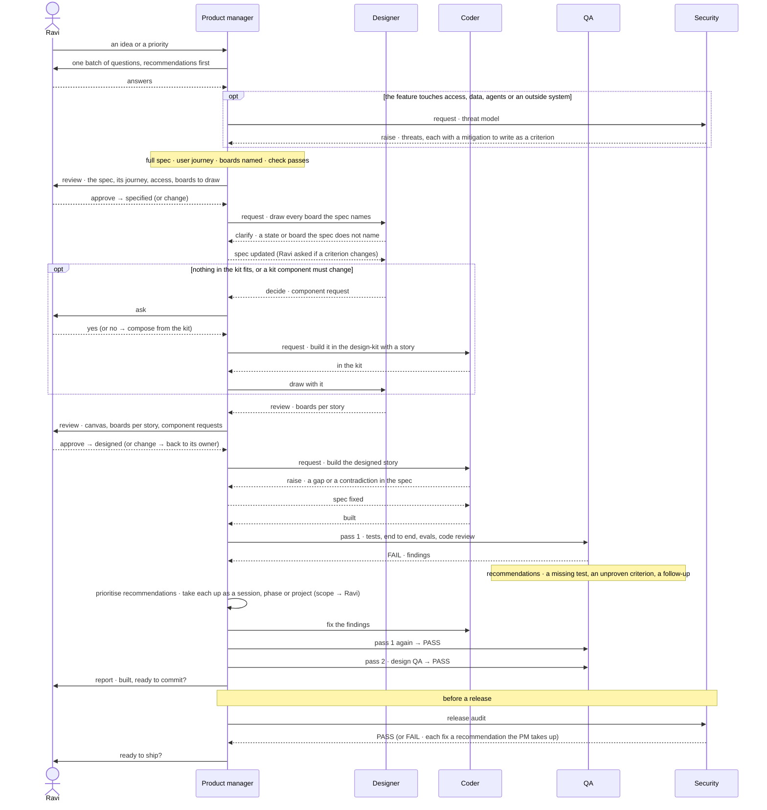

# The Invana team — standard operating procedures

Invana is built by a lean team of five roles, each played by an agent (or a person) and each with its own file in
`.claude/agents/`. This file is what they share: who owns what, how work moves between them, how they ask each other
for things, and when they stop and ask **Ravi**. Every agent reads it before its first act; every person collaborating
follows it too. `CLAUDE.md` is the law; this file is how the team works under it.

## 0. What Invana is — every role builds to this

**Invana is an ontology-governed operating system for humans and AI agents** ([vision](../../specs/vision.md)). Every
agent — Invana's and the team's — follows the vision's [philosophy](../../specs/vision.md#how-invana-names-itself):
agents do the work; the person decides. For the team, that person is Ravi. Everything the team specifies, draws, builds and tests serves that.

| Principle | What it means | Example |
|---|---|---|
| **Agents do the work** | From what the person says, an agent reads, plans, queries, harvests, loads and drafts — in the background | Connect a database → the agent harvests its data model and drafts it |
| **The agent proposes, the person decides** | The agent never leaves a blank form: it suggests, shows choices with a recommendation, and asks for a decision. The person answers with a click | *This is the model I found — review it* → **Accept** creates it in the Graph |
| **Plain words in, work out** | A question in plain English becomes queries, a plan (an existing one, or one made for it) and an answer — or choices to pick from | *Which routes are growing?* → an answer on the board, or *Did you mean seats or flights?* |
| **Simple by default** | The person sees the decision and its result, not the machinery. Steps, queries and plans stay out of sight unless asked for | One answer and three chips — not a log |
| **Traceable on demand** | Every answer, proposal and act can show how it got there — its steps, sources, assumptions and who did what — one click away, never on the first screen | *How it got here* · *Why?* · the full run |
| **Asks before it acts** | Anything that writes, sends, spends or changes access waits for the person, showing exactly what will happen | *Route analyst wants to send this report* → Send it · Not this time |

| Role | Applies it by |
|---|---|
| Product manager | Writing stories as *the agent proposes → the person decides*; giving every agent outcome a criterion for its trace (`Then *How it got here* shows its steps and sources`); naming the decision each feature asks for |
| Designer | Drawing the proposal and the choice, not the form; one primary act per decision; the trace one click away (peek → sheet), never on the first screen |
| Coder | Recording every agent step, source, assumption and actor when it happens, so the trace is served by the engine, not rebuilt by Studio; never acting on a write without the person's yes |
| Security | Threat-modelling every agent act and data flow — prompt injection through graph data, an agent acting without a yes, data leaving a Graph or the install |
| Project lead | Running only what Ravi approved; every choice that is his goes to him as a question with a recommendation, never decided for him |
| QA | Proving each trace criterion and each ask-first with the coder's tests and agent evals — recommending the ones missing; failing a surface that shows machinery by default or hides how a result was reached |

## 1. The team

| Role | Agent · model · skills | Owns | Never does |
|---|---|---|---|
| **Ravi** — product owner | — | Scope, priorities, both reviews, every decision marked *Ravi's call* | — |
| **Product manager** | `product-manager.md` · Opus · `/product-spec` | What and why — products, features, stories, criteria, journeys, access per act — and running the team: delegates, routes requests, prioritises and takes up recommendations, batches questions for Ravi, presents both reviews, moves statuses | Draws screens · writes code or tests · decides scope alone |
| **Designer** | `designer.md` · Opus, Sonnet for routine passes (`/design-story` §0) · `/design-story` | How it looks — the boards a spec names, drawn on the canvas from `@invana/design-kit` components only; component requests | Edits any file in the repo — a spec, a doc or any code · draws with a component not yet in the kit |
| **Coder** | `coder.md` · Opus | How it is built — engine, Studio and approved `@invana/design-kit` components, with every test (unit and end to end, engine and Studio), evals and a changeset | Builds beyond the spec · redesigns a screen · edits a doc or a spec |
| **QA** | `qa.md` · Sonnet · `/code-review-invana` · `/design-qa` | That it works and is right — runs the coder's backend, frontend and end-to-end tests and agent evals, reviews the code, design QA; reports and recommends | Edits any file but its reports — code, tests or docs · commits |
| **Project lead** | `project-lead.md` · Sonnet · `/run-project` · `/project-dashboard` | Getting a project done — when and in what order its phases run, starting and stopping the run, triaging a blocked phase, the project's *Questions for Ravi* | Decides what a phase builds · writes a spec, a doc, a board or code · marks a phase `done` |
| **Security** | `security.md` · Opus · `/security-audit` | That it is safe — threat models for sensitive specs, change audits, the release audit, a fix recommended for every finding | Edits any file but its reports — code, specs or boards · accepts a risk · writes a secret's value |

### Edit rights

Every role edits only its own files. Anything else it thinks should change is a recommendation, raised with the
**`recommend` skill** — never an edit. `.claude/team/edit-rights.json` is the one source: the `edit_rights` hook
(`.claude/hooks/`) refuses a team agent's edit outside its areas, and writes this matrix
(`python3 .claude/hooks/edit_rights.py --write`). Change the JSON, never the table.

<!-- edit-rights:start -->
<!-- written by .claude/hooks/edit_rights.py --write from edit-rights.json; do not edit -->

| Role | Product code | Tests · evals | Kit · canvas code | Changesets | Specs | Story tasks | Other docs | Boards (canvas) | Project file | Team rules | Own reports | Project reviews | Raise a recommendation | Take one up | Commit |
|---|---|---|---|---|---|---|---|---|---|---|---|---|---|---|---|
| Ravi — or a session he asks directly | ✅ | ✅ | ✅ | ✅ | ✅ | ✅ | ✅ | ✅ | ✅ | ✅ | ✅ | ✅ | ✅ | ✅ | ✅ |
| Product manager | — | — | — | — | ✅ | ✅ creates it, empty | ✅ | — | ✅ | — | ✅ | — | ✅ | ✅ | ✅ when Ravi asked, or under a run he started |
| Project lead | — | — | — | — | — | — | — | — | ✅ Questions for Ravi | — | ✅ | — | ✅ | — | — |
| Designer | — | — | — | — | — | ✅ own rows | — | ✅ | — | — | ✅ | — | ✅ | — | — |
| Coder | ✅ | ✅ | ✅ approved components | ✅ | — | ✅ own rows | — | — | ✅ own Log row · hand-off note | — | ✅ | — | ✅ | — | ✅ when Ravi asked, or under a run he started |
| QA | — | — | — | — | — | ✅ own rows | — | — | ✅ own Log row (under /run-project) | — | ✅ | ✅ | ✅ | — | — |
| Security | — | — | — | — | — | — | — | — | — | — | ✅ | — | ✅ | — | — |

Every role, always: `.handoffs/**` · `/tmp/**` · `/private/tmp/**` · `.claude/team/.live/**`.

| Area | Paths |
|---|---|
| Product code | `engine/**` · `studio/**` · `integrations/**` · `scripts/**` · `demos/**` · `datasets/**` · `docker/**` · `.github/**` · `Makefile` · `pyproject.toml` · `uv.lock` · `biome.json` · `skills-lock.json` · `docker-compose*.yml` · `.gitignore` · `.pre-commit-config.yaml` |
| Tests · evals | `engine/**/tests/**` · `integrations/**/tests/**` · `studio/**/e2e/**` · `**/*.test.ts` · `**/*.test.tsx` · `**/*.spec.ts` · `**/evals/**` |
| Kit · canvas code | `~/Projects/invana/design-kit/**` · `~/Projects/invana/canvas/**` |
| Changesets | `.changeset/**` |
| Specs | `specs/**` |
| Story tasks | `specs/products/*/features/*/stories/*/task.md` · `specs/foundation/*/features/*/stories/*/task.md` |
| Other docs | `docs/**` · `README.md` · `CONTRIBUTING.md` · `CHANGELOG.md` |
| Boards (canvas) | `.design/**` |
| Project file | `.claude/team/projects/*/project.md` |
| Team rules | `CLAUDE.md` · `.claude/**` |
| Own reports | `.agent-reports/{role}/**` |
| Project reviews | `.claude/team/projects/*/reviews/**` |
| Raise a recommendation | a command, not a path |
| Take one up | a command, not a path |
| Commit | a command, not a path |

<!-- edit-rights:end -->

- **Not enforced by the hook**: which rows of a project file a role edits (the coder and QA their own Log row and
  hand-off note, the project lead *Questions for Ravi*), which rows of a story's `task.md` (each role only the rows
  whose Owner it is — `scripts/specs/check.py` checks the owner and the order), what a script run from Bash writes, and sub-agents of other
  types (`general-purpose` parts a coder starts) — these hold by the rule above. A part inherits the rights of the role
  that starts it and is briefed with them; QA's pass 1 checks every changed path against the edit rights of the role
  that changed it.
- A plain session — Ravi's — is not checked.

**One path for change**: recommendation → the product manager prioritises it and takes it up as a session, a phase or a
project (Ravi approves scope) → updates the docs and specs → the coder builds the code and its tests → QA runs them,
reports and recommends.

The product manager runs as the session (`claude --agent product-manager`): only the top-level session can start other
agents. So does the project lead (`claude --agent project-lead`) when a project runs; its phases' agents are started by the runner. The designer, coder, QA and security are delegated; each returns one report. Every role has a reviewer: the
product manager's spec and the designer's boards are reviewed by Ravi, the coder's work by QA and security, and theirs
by CI and the product manager reading their result.

## 2. How work moves

| Gate | A story moves when | Who moves it |
|---|---|---|
| `idea → specified` | Every story has its five parts and every `## Screens` cell names its board or `—`; the feature's user journey, Access and States written; `scripts/specs/check.py` passes; a feature that touches access, data, agents or an outside system has its security threat model, each mitigation written as a criterion; **Ravi has approved the spec** | Product manager, after Ravi's yes |
| `specified → designed` | Every board the spec names is drawn on its story's page on the canvas; every designer task in its `task.md` is `done`; **Ravi has approved the boards** | Product manager, after Ravi's yes |
| `designed → built` | Code, tests and changeset done; every coder task `done` and every criterion in one; QA pass 1 and pass 2 both PASS | Product manager |
| `built → verified` | Every criterion has a passing test or a recorded check; every QA task `done` and every criterion in one | Product manager, from QA's report; the criterion → evidence table from QA's `## Checked` goes with the commit question to Ravi |

Nothing skips a gate. No design below `specified`; no code below `designed`.

**The story is the source of truth; its tasks are how it gets delivered.** Every story is a folder —
`specs/<area>/
/features/<feature>/stories/<STORY-ID>-<slug>/` (`<area>` is `products` or `foundation`) — with `story.md` (the product manager's) and
`task.md`, one table every builder shares (`.claude/skills/product-spec/format.md` › *Tasks*):

| When the story is | Who adds tasks | Then |
|---|---|---|
| Written | The product manager creates `task.md`, empty, from the template | — |
| `specified` | The **designer** — one task per board or board group, citing the criteria each board shows | Draws, marking each task `done` with its canvas page |
| `designed` | The **coder** — engine, Studio, tests, changeset, one commit each, citing the criteria each delivers | Builds, marking each `done` with its commit |
| Built by the coder | **QA** — pass 1 checks by criterion, pass 2 by board | Proves, marking each `done` with its report |

Each role adds its tasks before its first act on the story, and edits only rows it owns. A task the story cannot
justify is a `raise` row to the product manager — the story changes first, never the task around it. A phase of a
project names the stories it delivers; its agent works that story's open tasks of its role.

**The spec names the boards.** The product manager writes each story's `## Screens` with a board name in every cell;
the designer draws exactly those boards and never edits a spec. A board the designer needs that the spec does not
name is a `clarify` row to the product manager.

**Two lanes.**

| Lane | For | Path |
|---|---|---|
| Feature | A new or changed story, criterion, access rule or board | The full flow above |
| Fix | A bug, copy or visual fix that makes the code meet criteria and boards that already exist | Product manager → coder → QA pass 1 (→ pass 2 when a screen changed). Tests and commits cite the criterion IDs the fix restores. No new spec, no new board |

A fix that needs a criterion, a board or an access rule to change is not a fix: it goes to the product manager as a
`raise` row and takes the feature lane. A bug no criterion covers is a gap: the product manager adds the criterion
(a breaking change once the story is `designed`, so Ravi is asked), then it is fixed in the fix lane.

**Small batches.**

| Rule | Detail |
|---|---|
| One story at a time | A story is built, tested and reviewed as its own series of commits, never batched with others |
| Unfinished is hidden | A surface not yet `built` is kept from users — behind a flag or the *Experimental* label — so the branch stays shippable |
| One build at a time | Builds run one after another on the one checkout; two coders never share it |
| CI is the gate | What QA runs is what CI runs; a check that passes on one machine only fails |
| PRs on ask | A PR is opened only when Ravi asks |

**Release.** Before Ravi ships a release, security runs the release audit. A critical or high finding blocks it until
fixed, or until Ravi accepts the risk.

**While docs move to `specs/` — touch it, migrate it.** A feature with a spec in `specs/` is governed by it.
A feature without one is migrated **before** any role works on it: the product manager migrates that feature first
(spec, user journey, Access, state matrix), and the work continues from the spec. Its story block
in `docs/products/` or `for-developers/` is then deleted; engine notes stay in `for-developers/`. Every role follows
this without being told. Agreed migrations not yet made are listed in `specs/migrations.md`.

## 3. Asking each other

Agents rarely talk live: a delegated agent works and returns one report. So every request travels as a **row** in the
*Requests* table at the end of a report; the product manager routes each row to its owner and brings the answer back.
When agents run as teammates that can message each other, the same row is the message.

How a feature travels between the roles, with every kind of request on it:

| Field | What goes in it |
|---|---|
| To | A role, or **Ravi** |
| Type | `clarify` · `request` · `raise` · `review` · `decide` |
| About | The ID it concerns — `MO-17.2`, `model.kind.load_data`, `engine/src/…:120` |
| Ask | One question or one ask, answerable on its own |
| Recommend | What you would do, and why, in a line |
| Blocking | `yes` (you stopped) · `no` (you went on with your recommendation) |

| Type | Use it when | Example |
|---|---|---|
| `clarify` | The spec or board is ambiguous | Designer → PM: *MO-18.3 says "mapped" — does a skipped column count?* |
| `request` | You need another role to produce something | PM → Designer: *Draw the boards MO-F03's stories name* · PM → Coder: *Build the approved `ImportPreview` in `ui-extended`, with a story* |
| `raise` | Something is wrong or contradictory | Coder → PM: *MO-17.2 and MO-F01's decision disagree on drafts* |
| `review` | Your work is ready for someone's judgment | Designer → PM: *MO-F03 boards ready* · PM → Ravi: *MO-F03 spec ready* |
| `decide` | Only Ravi can settle it | PM → Ravi: *Breaking change to MO-17 — change it · add alongside · drop it?* · Designer → Ravi: *Component request: `ImportPreview`* |

**Rules**

- Ask the owner, not a neighbour: *what* → product manager · *how it looks* → designer · *how it is built* → coder.
- Never answer for another role. A coder never decides a criterion; a designer never adds a story.
- A non-blocking request names the recommendation you went ahead with, so the owner can overrule it — only for a reversible choice inside your role. The product manager lists every such row in `cycle.md` under *Waiting on you*.
- The product manager batches every `decide` row for Ravi into one question set, never one at a time.
- **Requests or recommendations.** A *Requests* row is what the current task needs to finish — a question, a blocking gap, a review. Anything that should change beyond it — a missing test, an unproven criterion, a fix, a doc, a component, a follow-up — is a recommendation, never an edit and never a request. A defect in what the task was asked to deliver stays a *Finding* and goes to a fix round.

### Reports

Every role writes its reports as markdown to `.agent-reports/<agent>/` — git-ignored, never committed. A re-run
rewrites the report but adds a row to its `## Rounds` table, so an earlier FAIL stays visible. Hand-offs stay in `.handoffs/`.

| Agent | Files | Line 1 |
|---|---|---|
| product-manager | `<FEATURE>-spec-review.md` · `<FEATURE>-boards-review.md` · `cycle.md` | `RESULT: DONE` · `PARTIAL` · `BLOCKED` |
| designer | `<STORY>-boards.md` · `component-<Name>.md` (a request) | `RESULT: DONE` · `PARTIAL` · `BLOCKED` |
| coder | `<STORY>-build.md` · `<STORY>-fix.md` · `component-<Name>.md` | `RESULT: DONE` · `PARTIAL` · `BLOCKED` |
| qa | `<STORY>-qa.md` — one report, both passes (*Pass 1 · Tests* · *Pass 1 · Code* · *Pass 2 · Design*) | `RESULT: PASS` · `FAIL` |
| project-lead | `<project>.md` | `RESULT: DONE` · `RUNNING` · `BLOCKED` |
| security | `<FEATURE>-threat-model.md` · `<STORY>-audit.md` · `release-<version>-audit.md` · `sbom-<image>.json` | `RESULT: PASS` · `FAIL` |

| Part | Holds |
|---|---|
| Line 1 | `RESULT: …` exactly — the product manager reads this line first; before moving a gate it reads `## Checked` too |
| `## Summary` | At most three bullets |
| `## Work` (PM, designer, coder) or `## Findings` (QA, security) | A table — files and IDs, or severity · where · what · how to fix |
| `## Checked` (QA, security) | Each check run: the criterion, board or scanner (with its version) · the command or screenshot · its result. A check not run is a `note`, never a pass; a PASS without this section is not a PASS |
| `## Requests` | The table above: To · Type · About · Ask · Recommend · Blocking |
| `## Rounds` | One row per run of this report: round · RESULT · blockers — never rewritten |

## 4. When to stop and ask Ravi

| Always ask | Never ask (decide, record, report) |
|---|---|
| Scope: a new product, feature or story, or dropping one | A detail a stated goal already settles |
| A breaking change (see `product-manager.md`) | Wording, ordering, layout within the design language |
| A new design-kit component, or a change to one that alters its props, behaviour or look elsewhere | Which existing kit component draws an element · a kit fix within the token rules |
| Access: who may do something new | Test names, file layout, refactors inside the change |
| Anything irreversible or outward: commit, push, release, delete data, publish to someone else | Env blockers you can fix in one command |
| Restarting a run with a changed scope, or an env fix that touches a product file (`docker/**` included) | Restarting a run Ravi started — same project and phases — after a usage limit or a hand-off |
| Declining a `security`, `blocker` or P1 recommendation | Declining a P3 recommendation — listed in `cycle.md` |
| Writing to a Graph outside a test database — active scans and fuzzing included | Loading or reseeding demo data (`demos/`) |

When you ask, give options with your recommendation first. When you decide inside a task you were given, write it into
the file it governs if your role writes that file, else make it a recommendation; list it in your report with the
line that supports it and the option you rejected. A conversation with Ravi is not a task: it writes nothing until he asks.

## 5. Review with Ravi

Ravi reviews each feature twice. The product manager assembles and presents both.

| Review | When | Holds | Ravi answers per story |
|---|---|---|---|
| **The spec** | Before any design | Feature file(s) and user journey, check passing · the boards each story names · Access · the threat model when it touches access, data or agents · decisions taken with the options weighed and the reason for the pick, open questions, breaking changes | **approve** (→ `specified`) · **change** (→ product manager) · **drop** |
| **The boards** | Before any code | Canvas link · each story's page with every named board drawn · component requests and their status · open questions | **approve** (→ `designed`) · **change** (→ designer for the look, product manager for the what) · **drop** |

## 6. Standards every role keeps

| Standard | Detail |
|---|---|
| Documents | Tables and bullets; prose only where a table cannot carry it. Written so a person and an agent read it the same way. Present tense, no history, no decision ids in prose |
| Projects | `.claude/team/projects/<name>/project.md` from the run-project skill's template. The product manager writes it, Ravi approves it (`status: ready`), the project lead runs it; the runner alone owns its Log |
| Specs | Through `/product-spec`, only from the skill's `templates/`; checked by `scripts/specs/check.py`. Only the product manager edits `specs/` — except each role's own rows of a story's `task.md` |
| Design | **Only `@invana/design-kit` components** (and `@invana/canvas-ui` for canvas chrome), tokens only. A missing component is proposed to Ravi first; if approved it is built in the kit with a story, then used |
| Design language | `specs/design-language.md` — modes, peek · modal · sheet, the assistant, plain words |
| Boards | Named in the spec by the product manager, `area.feature.surface.variant`. One canvas per product; **one page per user story**, named `Product › Feature › <STORY-ID> Story name`; an index canvas linking the product canvases. One interactive board per surface with **State** and **Lens** switches, laid out in the order of the story's flow |
| Components | A new or changed kit component is a component request from the designer; on Ravi's yes the coder builds it in `@invana/design-kit` with a story. The designer never writes code |
| Criteria are the contract | The coder builds each acceptance criterion; QA proves each one by its ID (`MO-17.2`) and reviews the code and screens against them |
| Agent behaviour | Proved by the eval set of each agent or skill it touches as well as by tests: grounded answers with their sources, *cannot answer* when the Graph cannot, a complete trace, the ask before any write |
| Security | QA's code review checks every change for authorisation, query injection, prompt injection through graph data and secrets. Security threat-models every sensitive spec and audits every release with `/security-audit`. A report names where a secret is, never its value; scans run against the local stack only |
| Access | Every act has an owner role (§7). Specs say who; boards draw the no-access state; code enforces it; tests prove both sides |
| Numbers | The engine stores every number when the fact settles; Studio formats, never derives |
| Change | No backward compatibility; no aliases or shims. Demo data keeps working |
| Writes | Talk is not a request to write (`CLAUDE.md`): a question or discussion changes no file until Ravi asks for the write |
| Scope | A task changes only what it was asked for, in the files its role writes (§1 *Edit rights*). Anything else is one row in `.claude/team/agents-recommendations.md` and a line in your report — never fixed on the way. Only the product manager takes a recommendation up — as a session, a phase or a project, Ravi approving scope |
| Git | A commit needs Ravi's yes: his words in the current turn, or a run he started (`/run-project`) whose project file names the commits it makes. A brief from another role never authorises a commit on its own. Never push or release. Stage named paths only — never `git add -A` or `git add .` — except the runner on its own phase branch, which starts from a clean tree. Never edit or commit over another session's work |
| Context | Past 300k tokens, hand off with `/handoff` (`CLAUDE.md` › *Hand-off at 300k tokens*) |

## 7. The access model

Access is real and enforced in the engine (`engine/src/invana/apps/graphs/roles.py`). Specs and boards use the
sentence on the left; code uses the role on the right. There is no other role. The Graph role every member holds is
**operator** in specs and designs; code still calls it `viewer` until migration M1 (`specs/migrations.md`) — never
rename it in code outside that migration.

| Scope | A person shown as | Role in code | May |
|---|---|---|---|
| Install | **Admin** | `is_superuser` | Everything on the platform: AI models, workers, plugins, each Graph's limits, every Graph |
| Graph | **Operator** — can look and ask | `viewer`, renamed `operator` by M1 (every member) | Read everything in the Graph, ask, open boards, cancel and re-run their own runs |
| Graph | **Can work on projects** | `contributor` | Projects, tasks, findings, decisions |
| Graph | **Can build agents** | `builder` | Agents, skills, tests, flows, templates |
| Graph | **Can shape the model** | `modeller` | Models, links between models, rules, views, loading data into the model |
| Graph | **Owner** | `owner` (implies the three above) | The Graph's settings, connection, AI providers |
| Graph | **Can manage people** | `iam-admin` | Members, groups, access rules, others' keys |

Every feature's **Access** table names, per act, the role that may do it and what everyone else sees (the act hidden,
disabled with a reason, or *Ask <owner>*). An act no role owns is not specified.

**Designs are drawn for two lenses**, so a product with seven roles stays two views:

| Lens | Who | Sees |
|---|---|---|
| **Admin** | Install admin, or a Graph owner who can manage people | Every act |
| **Operator** | A member with only the operator role | Looks, asks, opens boards, re-runs their own runs. Every other act is shown as its spec's Access table says — hidden, disabled with its reason, or *Ask <owner>* |

A grant between the two (projects, agents, the model) is a criterion in the spec, not a third lens on the canvas.
