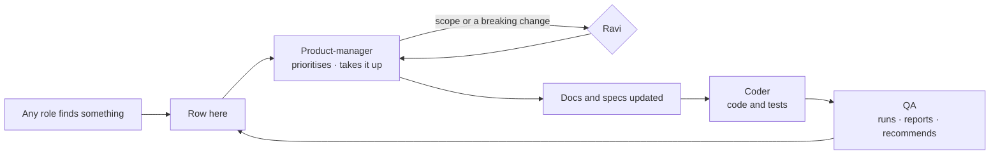

# Agents' recommendations

The one path for any change nobody asked for. Every role — person or agent — that finds something that should change
writes it here instead of changing it. **Nobody works a row until the product-manager takes it up** as a session, a
phase or a project.

| Rule | Detail |
|---|---|
| Who adds | Any session or agent, the one write allowed without asking (`CLAUDE.md` › *Talk is not a request to write*) — always with the **`recommend` skill** (`.claude/skills/recommend/add.py add`), never by editing this file; the `edit_rights` hook refuses a hand edit |
| One row per recommendation | Newest last. Check for an existing row first; add to its *Description* rather than repeat it |
| Who acts | The product-manager, with Ravi: sets *Priority* and *Taken up as* with `add.py take`, marks a row done with `add.py done`. A new project, a new phase or a scope change waits for Ravi's yes |
| Status | `open` until taken up · `taken` once taken up as work · `declined` with its reason · `done` once that work is done. Rows are never deleted, so nothing is raised twice and no ID is reused; the counts line above the table is rewritten by `add.py` |
| No pipes | A cell never holds a `\|`; write `·` instead |

| Field | Holds |
|---|---|
| ID | `R<nnn>` — the next free number |
| Status | `open` · `taken` · `declined` · `done` — set by `add.py`, never by hand |
| Date | The day it was raised, `YYYY-MM-DD` |
| From | The role that raised it: `product-manager` · `project-lead` · `designer` · `coder` · `qa` · `security` · `ravi` |
| Raised in | `session` · `phase <project>/<ID>` · `project <name>` |
| Kind | `bug` · `test` · `docs` · `security` · `component` · `debt` · `idea` |
| Severity | `blocker` · `high` · `medium` · `low` — the raiser's view |
| Title | One line |
| Description | What and where (file:line, criterion ID, board) · the change recommended |
| Priority | The product-manager's: `P1` · `P2` · `P3` |
| Taken up as | The product-manager's: `session` · `phase <project>/<ID>` · `project <name>` · `declined — <reason>` |

<!-- stats: written by add.py -->
**286 recommendations** · 136 open · 112 taken · 20 declined · 18 done

| ID | Status | Date | From | Raised in | Kind | Severity | Title | Description | Priority | Taken up as |
|---|---|---|---|---|---|---|---|---|---|---|
| R001 | open | 2026-11-02 | ravi | session | bug | medium | run.py entry() splits a phase cell at an escaped \· pipe | .claude/skills/run-project/run.py Project.entry(): cells split on every '·', so an escaped '\·' inside a cell (two-places T01 Steps: `scope: "platform" \· "graph"`) cuts the cell — the runner and dashboard saw only the start of T01's step 1. Split on unescaped pipes only (re.split(r'(?<!\\)\·', ...)) and unescape after. |  |  |
| R002 | open | 2026-11-02 | product-manager | phase specs-migration/P01 | docs | blocker | Apply P01's phase split and log rows to the specs-migration project file | P01 could not edit .claude/team/projects/specs-migration/project.md (harness refuses it as a sensitive file unattended). Apply .agent-reports/product-manager/specs-migration/project-changes.md: split P11/P15/P18/P19/P20 into b phases, new Needs, Read additions; also add P01's hand-off note from .agent-reports/product-manager/specs-migration/p01-report.md |  |  |
| R003 | open | 2026-11-02 | product-manager | phase specs-migration/P01 | debt | high | The specs-migration mapping lives in a git-ignored folder | .gitignore:72 ignores .agent-reports/, so mapping.md (the file every specs-migration phase is governed by) is never committed and is lost on a clean checkout. Un-ignore .agent-reports/product-manager/specs-migration/ or move the mapping under .claude/team/projects/specs-migration/ and update the project rules |  |  |
| R004 | open | 2026-11-02 | product-manager | phase specs-migration/P01 | docs | medium | Relabel Agent-version canvas frames with the new story IDs | The canvas (.design/canvas-agent-version av.py, p_*.py) labels boards with DS-, AF-, AB-, GS-, AC-, ON-, SO-, IAM- IDs that specs/ renumbers. Use the old to new table in mapping.md (Story IDs) to relabel frames once the features are migrated — designer work |  |  |
| R005 | open | 2026-11-02 | product-manager | phase specs-migration/P02 | docs | medium | design-language §6 duplicates the glossary's Not on screen table | specs/design-language.md §6 and specs/glossary.md › Not on screen hold the same list; check.py reads only the glossary. Make §6 a one-line pointer to glossary.md. |  |  |
| R006 | open | 2026-11-02 | product-manager | phase specs-migration/P02 | docs | low | Point TEAM.md §0 and CLAUDE.md at specs/vision.md and specs/glossary.md | TEAM.md §0 restates what Invana is and CLAUDE.md names terminology.md as the product's words; specs/vision.md now owns the product statement and specs/glossary.md the screen words. Link both instead of restating (Ravi edits .claude/ and CLAUDE.md). |  |  |
| R007 | open | 2026-11-02 | product-manager | phase specs-migration/P02 | docs | low | SH-F03's title names a launcher the design language removes | mapping.md and specs/products/shell/product.md: SH-F03 'Find your way — launcher, ⌘K, search, no access'; design-language §2 says no launcher. P19 should retitle it (e.g. 'Find your way — ⌘K, search, no access'). |  |  |
| R008 | open | 2026-11-02 | qa | phase specs-migration/P03 | test | medium | Prove the P03 ✅ rows by a run, not only by reading | reviews/P03-audit.md is a static audit; run tests/modeller tests/govern tests/datasets tests/explorer tests/annotations tests/boards on the isolated Neo4j and the Studio e2e specs, and record the result before the specs for EX/MO/DA are approved. |  |  |
| R009 | open | 2026-11-02 | qa | phase specs-migration/P03 | idea | low | EX-F05/EX-F07 stories need a built-ness note: act-as, fork-a-session, memory are unbuilt | Audit P03 §2-3: no code for act-as, session fork, assistant-opens-boards (EX-28), memory evidence/proposals/consolidation (EX-29..32) and the walkthrough per-answer steps. Keep as specified stories; P06-P08 should not describe them as shipped. |  |  |
| R010 | open | 2026-11-02 | qa | phase specs-migration/P04 | test | medium | Agent-built P04 gaps: add tests for agent-scoped guardrails, tightening-only envelope proposals and unroutable worker steps | P04 audit (author-an-agent C2 · envelope-and-budget C8 · workers C10): the code exists or is claimed but no test names the behaviour. Add one positive and one negative test each in engine/tests/agents and tests/workers. |  |  |
| R011 | open | 2026-11-02 | qa | phase specs-migration/P04 | docs | low | Feature-file status rows lag the build: workers, pinned-model-versions, instructions-publish-rollback, the-agents-shell | P04 audit: the API / CLI / Studio rows in modules/agents and modules/skills feature files say 🔵/🟡 where the code and tests are built; author-an-agent C10 shows dollars where the build counts tokens. P12-P14 should write stories at the built state. |  |  |
| R012 | open | 2026-11-02 | qa | phase specs-migration/P04 | idea | low | Ungrounded AG/PJ stories: remote agents, agent import-export, install-wide agents, run-a-workflow, objectives, recurring Todos, review queue are all unbuilt | P04 audit marks these features entirely or mostly unbuilt (no code). Their stories migrate as status specified; no tasks invented. Also unbuilt: plan version retire, catalogue used-by and granted-to, skill SKILL.md folder and library-to-functions, project criteria. |  |  |
| R013 | done | 2026-11-02 | qa | phase specs-migration/P04 | debt | low | Reviews folder under .claude is refused to QA, so audits land in .agent-reports/qa | P03 and P04 audits could not be written to .claude/team/projects/specs-migration/reviews/ (sensitive path). Either allow qa to write that folder in edit-rights or change the phases to name .agent-reports/qa/specs-migration-<phase>-audit.md. | P3 | superseded by R050 |
| R014 | open | 2026-11-02 | qa | phase specs-migration/P05 | test | medium | No test for sign-up, login, refresh rotation, username rules or cooldown | engine/src/invana/core/auth/managers/auth.py (register, login, refresh, _validate_username_format, cooldown at :311) has no test under engine/tests/auth; accounts/usernames/sessions C1-C8 are built but unproven. Add positive+negative tests. |  |  |
| R015 | open | 2026-11-02 | qa | phase specs-migration/P05 | bug | medium | Refresh-token reuse is refused but not recorded; no sign-out-everywhere | sessions.md C4 and C7: AuthManager.refresh (core/auth/managers/auth.py:263) raises on a revoked token with no event; POST /auth/logout (server/routes/auth.py:77) revokes one refresh token only. Add a reuse event and an all-devices logout, or reword the spec as not yet built. |  |  |
| R016 | open | 2026-11-02 | qa | phase specs-migration/P05 | debt | medium | Packages invana-arcadedb and invana-tinkergraph are empty; no Neptune package | integrations/invana-arcadedb/src/invana_arcadedb/__init__.py and invana-tinkergraph __init__.py are 0 bytes; no integrations/invana-neptune; no tests in memgraph, janusgraph, arcadedb, tinkergraph. CLAUDE.md lists them as supported. Build them or mark them planned in the graph-connectors spec. |  |  |
| R017 | open | 2026-11-02 | qa | phase specs-migration/P05 | debt | low | Operate gaps: per-token rate ceiling, audit retention purge, liveness vs readiness | external-agent-api C8 (token rate/cost ceiling), audit-and-activity C9 (purge by window; only ledger RETENTION_DAYS=365 declared), admin-and-health C5 (only /health in server/health.py). Keep as specified stories; no code found. |  |  |
| R018 | open | 2026-11-02 | product-manager | phase specs-migration/P06 | docs | low | Docs and code still cite explore decision ids cut in P06 | P06 cut the product decision rows GC1-3 GC5 GC8 GC13 GC19 GC21 GC23 GC24 · CV2-5 · SP1 SP3-5 · CO1-2 CO4-11 CO13-17 · SA5-12 · WT2-6 WT8 · DE2 DE4-6 DE9-10 · AN1-8 from docs/for-developers/modules/explore/features/*.md; about 20 files (the-screens.md, boards-migration.md, the-skill-page.md, distributed-execution.md, explore feature files' own Surfaces, a few engine modules) still cite them. Repoint each to its EX-F01 · EX-F02 · EX-F06 feature.md row in P21 (code) and P22 (docs). |  |  |
| R019 | open | 2026-11-02 | product-manager | phase specs-migration/P07 | docs | low | Docs and code still cite ask decision ids cut in P07 | P07 cut the product decision rows WQ2-4 · NL1 NL3-5 NL12 NL14 · CQ1-7 CQ10 CQ12 · AD1-4 AD8 AD11 AD13 AD15-18 AD22-27 · OB1 OB3-5 · AS1 AS3-9 AS13 AS14 AS16 AS17 · P1-12 · SW1-3 · RT1-7 · AW2 AW5 from docs/for-developers/modules/ask/features/*.md (the rows that stayed are logged in the mapping's Stayed table). About 25 docs (the-screens.md, the-sequence.md, governance.md, modules/ask/spec.md, explore and govern feature files) and about 30 engine/Studio files and tests still cite them. Repoint each to its EX-F03 or EX-F04 feature.md or story criterion in P21 (code) and P22 (docs), alongside R018. |  |  |
| R020 | open | 2026-11-02 | product-manager | phase specs-migration/P07 | bug | medium | A re-run orphans the earlier answer instead of leaving it beside the new one | EX-02.9 (specs/products/explore/features/EX-F04-the-answer/stories/EX-02-watch-the-answer-arrive-on-the-board/story.md): a re-run is a new run and the earlier answer stays; a failed re-run shows beside it. Today a re-run re-points the reply at the new run, orphaning the earlier parts, so a failed re-run leaves the reply empty (note in docs/for-developers/modules/ask/features/the-answer-surface.md). Fix lane for the coder: make a re-run additive and put when the records were read, with Re-run, on each part's header; a test that a failed re-run keeps the earlier answer. |  |  |
| R021 | open | 2026-11-02 | product-manager | phase specs-migration/P09 | docs | low | Docs and code still cite connect-and-model decision ids cut in P09 | Cut in P09: ID1–3 · DM1–5, DM10–12 · SR1–4 · OI1, OI3–9, OI12–17 · ME1–5, ME7, ME9 · PB1, 2, 4–9, 12, 13, 15, 16 · PC3–9, PC11 · SM1–4 · ST1–4, 8, 10, 11, 18, 19, 26–28, 35–38, 50, 58–61 · MP1–3, 7–14, 22, 49, 51–53 · CM1–6, CM12. Still cited e.g. engine/src/invana/apps/modeller/models.py:76 and portability.py:7 (SM2), docs/for-developers/the-screens.md:708 (OI13–OI17), docs/products/modeller.md Studio-today rows. Repoint each to its specs/products/model feature (P21 code · P22 docs). |  |  |
| R022 | open | 2026-11-02 | product-manager | phase specs-migration/P10 | idea | medium | model.rules board: states for MO-10/11/12/13 and two rows MO-F06 cannot check | MO-10, MO-11, MO-12 and MO-13 Screens name state variants on model.rules (No views, View on the model, View page, Property rule, Rule impact, Rule evidence, Requests, Allow in a view, ...) that the Agent-version board does not draw yet; it draws one sheet. The board's sample rules 'Reports name no passengers - any report written by an agent' and 'Retracted data is never cited - answers, reports and boards' are checked at acts MO-F06 does not have (its checks read dataset share, add to this graph, project decision). Recommend: after the spec review, a designer request to draw the named states on model.rules, and either change the two sample rows to checks MO-F06 has or a spec change adding report and answer acts (Ravi decides). |  |  |
| R023 | open | 2026-11-02 | product-manager | phase specs-migration/P11 | security | medium | Loading into a model needs Can shape the model | DA-F02 and DA-F03 Access say loading into a model (records import, a bundle, Add to this graph) is modeller — Can shape the model (TEAM.md §7). engine/src/invana/server/datasets/views.py bind route depends only on require_graph_member, so any Operator can add a dataset version to a graph. Coder: require the modeller role on POST …/dataset-bindings and on the import routes, with a refusal test each. |  |  |
| R024 | open | 2026-11-02 | product-manager | phase specs-migration/P12 | docs | low | Docs and code still cite agents decision ids cut in P12 | AG1–AG25 · EB1–EB5 · EB14 · LC1–LC7 · LC10 · SO2–SO9 · PV2–PV6 · PV11 · AP3–AP29 · WD2–WD17 · IE1–IE4 were cut from modules/agents/features/*.md; other docs and code comments citing them should point at AG-F01 / AG-F02 (P21) |  |  |
| R025 | open | 2026-11-02 | product-manager | phase specs-migration/P12 | docs | low | Glossary lacks the agent words AG-F01 shows: Voice, Practice graph, Flow | specs/glossary.md: add Voice (an agent's soul + dials), Practice graph (the eval graph an Admin names), and Flow as the screen word for what an agent's instructions resolve to (glossary lists Flow only as a code term under Plan) |  |  |
| R026 | open | 2026-11-02 | product-manager | phase specs-migration/P13 | idea | medium | Agents run, runs, inbox and settings.ai boards: states AG-F03 and AG-F05 name | AG-17, AG-22, AG-23, AG-25, AG-27, AG-28, AG-32, AG-41, AG-43, AG-24, AG-33 and AG-34 Screens name state variants the Agent-version boards do not draw yet — agents.runs (Nothing ran, No runs match, Filtered), agents.run (Many agents, By role, Re-run, Compare, Who did what, Step failed, Request a change, Outside task …), agents (How they are doing, Degraded), settings.ai (Outside agents, Add an outside agent, Card read), inbox (Delegation ask, Outside agent ask, Request a change) — designer work once the spec review approves |  |  |
| R027 | open | 2026-11-02 | product-manager | phase specs-migration/P13 | docs | low | Docs and code still cite runs, fleet and delegation decision ids cut in P13 | FP3–FP6 · FP8 · FP9a · FP11 · FP14 · the second FP17 · RP1–RP3 · RP5–RP9 · RP11–RP14 · RP17 · RP18 · RP20 · OB2 · OB3 · OB5 · DG1–DG8 · DG12–DG16 · LN1–LN6 · RA2–RA11 · A1–A6 · AP26 · AP28 · WD20 were cut from modules/agents and operate/observability; docs and code comments citing them should point at AG-F03 / AG-F05 / AG product.md (P21, P22) |  |  |
| R028 | open | 2026-11-02 | product-manager | phase specs-migration/P14 | idea | medium | Agents skills, skill, schedules, run and inbox boards: states AG-F04, AG-F06 and AG-F07 name | AG-19, AG-20, AG-30, AG-37, AG-18, AG-31, AG-38, AG-44 and AG-42 Screens name state variants not yet drawn on agents.skills (plans list, a plan's page, Run a plan, Tools they call, a function), agents.skill (Draft, Drawing, Flow, Flow gap, Publish refused, Tests, Evals, Exceptions, Adopt, Agents, Usage, Too few to read), agents.schedules (Nothing is scheduled, New schedule, A schedule, Running), agents.agent, agents.run (Plan picked, Plan refused, Promote this plan, Started by name, Promote to eval), inbox and settings.usage. Draw each as a State on its board. |  |  |
| R029 | open | 2026-11-02 | product-manager | phase specs-migration/P14 | docs | low | Docs and code still cite skills, workflows and schedules decision ids cut in P14 | Cut in P14: S1 · S3 · F1 · F2 · F4 · F5 · F8–F13 · F15–F18 · SC1 · SC2 · SC4–SC10 and the product rows of SK · BN · EL · IS · SP · US · LB · PS · EV · PR · RW · CA (e.g. LB1, LB6, LB16, CA6 cited in authoring-a-skill.md, a-skill-uses-a-plan.md, the-agents-shell.md, graph-detail-page.md, the-screens.md). Repoint citations to AG-F04 · AG-F06 · AG-F07 (P21); also renumber the duplicate SK23 · SK24 · SK25 rows in authoring-a-skill.md. |  |  |
| R030 | open | 2026-11-02 | product-manager | phase specs-migration/P14 | security | medium | Any graph member can change the eval token budget | PUT …/evals/budget only requires graph membership (put_budget). AG-F04 Open questions recommend Owner · Admin. Security to confirm; coder to gate it once Ravi answers. |  |  |
| R031 | open | 2026-11-02 | product-manager | phase specs-migration/P15 | component | medium | Designer: board variants PJ-F01–PJ-F05 name on projects.* and inbox | PJ-F01–F05 Screens name variants not on the Agent-version canvas: projects.project · Pick-up/Order/Details/Archived/People; projects.task · Claimed/Waiting on/Will not run/Criteria/Result to accept; projects.decide · Lineage/Every decision/Impact; projects.options · Fork/Merge/Simulate/Simulation result; projects.report · Edit/Version; inbox · Start this task?/A pass to judge/Project work. Draw them at the spec review's yes. |  |  |
| R032 | open | 2026-11-02 | product-manager | phase specs-migration/P15 | docs | low | projects.report board draws an agent drafting the report; PJ-F05 says a template drafts it | .design/canvas-agent-version/p_projects.py projects.report caption 'drafted from the records by Route analyst' contradicts PJ-F05 Rules (template, no AI model). Redraw, pending Ravi's answer in PJ-F05 › Open questions. |  |  |
| R034 | open | 2026-11-02 | product-manager | phase specs-migration/P16 | component | medium | Designer: board states IN-F01–IN-F03 name on inbox, inbox.history and settings.notifications | IN-01–IN-06 Screens name states the Agent-version boards do not draw yet: inbox (Updates · Done · Toast · Expired, not sent · See all it will send · Already decided · Not yours to answer · Nothing of yours), inbox.history (Row · By actor/record · Refused · Export · Compare · Chain broken · Counted, not shown), settings.notifications (New rule · Rule refused · Read only · In app only · Channel failed). Draw them after the spec review. |  |  |
| R035 | open | 2026-11-02 | product-manager | phase specs-migration/P16 | docs | low | Studio still draws approvals, rules and the ledger as Activity tabs and an Agents section | IN-F01 puts asks in Inbox › Needs you (acts in the row), rules and channels in Settings › Notifications; IN-F03 puts the ledger and change log in Inbox › History. Studio's agents.approvals, the bell tray, Activity › Rules/Channels/Events and agents.ledger are the retired surfaces (for-developers operate Surfaces sections). A build phase moves them once the boards are designed. |  |  |
| R036 | declined | 2026-11-02 | product-manager | phase specs-migration/P17 | docs | medium | P17 hand-off note refused: project.md is a sensitive file | The Edit tool refused adding P17's Hand-off notes row to .claude/team/projects/specs-migration/project.md. The note is in .agent-reports/product-manager/ST-F02-spec-review.md › Hand-off note; copy it into the project file's Hand-off notes table. | P3 | declined — specs-migration is done; the note stays in .agent-reports/product-manager/ST-F02-spec-review.md |
| R037 | open | 2026-11-02 | product-manager | phase specs-migration/P17 | docs | low | Settings boards lack ST-F02/F03 surfaces: Keys tab, username, sessions | settings.access draws tabs Access rules · People and groups · Agents (no Keys); settings.me draws profile and keys but not username, password or sessions; limits read Tokens a day. ST-F02 › Open questions and ST-15 Screens name these. Designer work once Ravi approves the spec. |  |  |
| R038 | open | 2026-11-02 | product-manager | phase specs-migration/P18 | docs | medium | Designer: Settings boards and states P18 names (General, Connection, Plugins, Workers views) | ST-F01 names General and Connection as states of settings.people (no board of their own); ST-29 Plugins has no board (all cells —); ST-F04/F05/F06 name states on settings.ai, settings.usage, settings.workers (Where work is, Order, Coordinators, Starts, AI model limits, Add workers) and agents.run · Held by a limit that are not drawn. Recommend boards settings.general · settings.connection · settings.plugins, then rename the ST-14 and ST-29 cells. |  |  |
| R039 | open | 2026-11-02 | product-manager | phase specs-migration/P18 | docs | low | TEAM.md §7 gives AI providers to a Graph Owner; specs make AI models the install Admin's | .claude/team/TEAM.md §7 Owner row says 'The Graph's settings, connection, AI providers' and specs/personas.md repeats it; ST-F05 (from providers-and-models PM1 · PM21) makes AI models install-wide and Admin-only. Recommend dropping 'AI providers' from the Owner row in TEAM.md §7 and personas.md. |  |  |
| R040 | open | 2026-11-02 | product-manager | phase specs-migration/P19 | docs | low | Repoint for-developers citations of setup decisions cut in P19 | terminology.md:269 (SU1 · SU7) · the-screens.md:311-318 (SU2–SU22) · graph-detail-page.md G28 (SU13) · design-kit-coverage.md:549 (SU19) cite setup.md rows now in SH-F02 · repoint each to specs/products/shell/features/SH-F02-create-a-graph/feature.md, or mark retired where it cites SU7 · SU16 · SU19 (P22) |  |  |
| R041 | open | 2026-11-02 | product-manager | phase specs-migration/P19 | idea | medium | Draw the Shell states SH-F01–F03 name, and a set-up board | SH-01 · 02 · 03 · 19 · 21 · 24 · 25 · 26 · 04–07 · 20 name states on start.* · shell.* boards the canvas draws once (e.g. start.signin · Could not sign in, start.home · First run · Archived, start.new_graph.files · A column asked); set-up after Ready has no board — recommend start.setup as a peek from Ready and Home (SH-F02 open question) |  |  |
| R042 | open | 2026-11-02 | product-manager | phase specs-migration/P20 | docs | low | Repoint for-developers links to cut orchestration §0 and governance sections | 37 files under docs/for-developers/ link to orchestration.md#0-… anchors, and building-engine/lens-migration.md to cut governance.md sections; P20 moved them to specs/system-design/orchestration.md and governance-and-lens.md. links.py checks files, not anchors, so the gate stays green. Repoint in P22's review pass. |  |  |
| R043 | open | 2026-11-02 | product-manager | phase specs-migration/P20 | debt | low | Drop the currency cost metric and dashboard tile | specs/system-design/observability.md keeps invana.llms.cost and the LLM dashboard's cost tile (moved from platform telemetry); budgets are tokens only. Recommend: drop both in engine telemetry and docker/hyperdx dashboards, then remove them from observability.md. |  |  |
| R044 | open | 2026-11-02 | coder | phase specs-migration/P21 | debt | low | Code cites for-developers files that never existed | engine/src/invana/apps/__init__.py:2 · core/__init__.py:1 · core/models.py:2 cite building-engine/code-shape.md (only building-studio/code-shape.md exists); engine/tests/sessions/test_services.py:249 cites explore/features/canvases.md; engine/src/invana/apps/flows/dag.py:214 cites selection-and-the-panel.md-D3 (no D3). Broken before the migration, so P21 left them — point each at its real home or drop it. |  |  |
| R045 | open | 2026-11-02 | coder | phase specs-migration/P21 | debt | low | Retired decision ids still read in code comments after P21 | P21 repointed paths and dropped ids next to a repointed citation, but ids stay as link labels and in prose (e.g. engine/src/invana/apps/govern/rules.py:22-25 [GV5]…[GV23] ref labels, engine/tests/graphs/test_setup_state.py:136/153 SU11 · SU12, SR41 in runtime/schemas.py:702). specs/ has no decision ids and CLAUDE.md rule 12 bars them in code — a sweep should drop the ids once R018–R042 settle the docs side. |  |  |
| R046 | open | 2026-11-02 | qa | phase specs-migration/P21 | docs | low | Two code citations point at docs deleted before the migration | engine/src/invana/apps/__init__.py:2, core/__init__.py:1, core/models.py:2 cite docs/for-developers/building-engine/code-shape.md (deleted in a35637be; replaced by migration-plan.md); engine/tests/sessions/test_services.py:249 cites modules/explore/features/canvases.md (deleted in 461bdae0, canvases are boards). Repoint to migration-plan.md / boards.md or drop the citation. |  |  |
| R047 | open | 2026-11-02 | qa | phase specs-migration/P21 | test | low | Add a check that code citations of docs and specs paths resolve | P21 repointed 1,597 citations by script; nothing in the gates fails when a cited docs/ or specs/ path or anchor stops existing (R044/R046 slipped through earlier). Add a lint or test that scans engine, studio and integrations for docs/ and specs/ .md paths and #anchors and fails on a missing target. Also: engine/tests/work/test_tasks.py::TestAssignment::test_assigning_to_an_agent_opens_exactly_one_thinking fails here with UndefinedTableError ledger_rows in the per-test Postgres schema (environment/migration lag, not P21: the file differs by one comment). |  |  |
| R048 | open | 2026-11-02 | coder | phase specs-migration/P21 | docs | low | IN-02 has no criterion for the History live tail | audit-and-activity.md capability C7 (live tail — new events appear as they happen) was cut in P16 but no IN-02 criterion or IN-F03 rule carries it; studio/packages/core/src/hooks/useEventStream.ts now cites IN-F03 feature.md. Add the live-tail criterion to IN-02 (or log it in the mapping's Stayed table). |  |  |
| R049 | open | 2026-11-02 | qa | phase specs-migration/P21 | docs | low | engine/Dockerfile cites a docs path that does not exist | engine/Dockerfile:3 cites docs/internal/mvp/engine.md §7.1, which is not in the repo (the only cited docs/specs path that fails to resolve). Repoint it to the specs/system-design home or drop the citation. |  |  |
| R050 | taken | 2026-11-02 | project-lead | project specs-migration | debt | high | Runner QA reports fail under .claude/: write refused as sensitive file | run-project QA sessions cannot write .claude/team/projects/<name>/reviews/<ID>-qa.md (harness refuses .claude/ as sensitive; allow rules do not lift it), so a QA PASS counts as a failure and the phase blocks after 3 fix rounds (specs-migration P21). Recommend: write QA reports to .agent-reports/qa/ (runner reads them there) or have the runner write them from QA's output. | P1 | session — runner fix in Ravi's session (.claude/** is team rules; no role may edit it) |
| R051 | open | 2026-11-02 | product-manager | phase specs-migration/P22 | docs | medium | Repoint .claude/ and CLAUDE.md citations of paths the specs migration cut | Each cites a docs/ path whose content moved to specs/ (Ravi edits these). CLAUDE.md:37 and build-feature/SKILL.md:31 — terminology.md as the product's words: screen words are specs/glossary.md, terminology.md keeps domain terms only (overlaps R006). build-feature/SKILL.md:3, 13-18, 38 — for-developers/README.md as the feature index and 'build only what the index lists', docs/system-design.md, a feature file plus its index row: the index is now the review index of leftovers; scope is specs/ (specs/products/*/product.md Features tables), the engine shape specs/system-design/. build-feature/SKILL.md:34 — the product split 'planned in docs/products/': specs/products/. build-studio/SKILL.md:27 — 'what for-developers/README.md is to features': specs/README.md. design-qa/screen_map.py:4-5 — stories read from the tables in docs/products/<product>.md: those tables are cut; stories are specs/products/*/features/*/stories/*/story.md. agents/qa.md:44 — evals as modules/skills/features/evals.md: the product half is AG-F04 (specs/products/agents/features/AG-F04-skills/feature.md); the file keeps engine detail. team/projects/specs-migration/project.md:31 — 'Orchestration is docs/for-developers/orchestration.md §0': §0 is cut; it is specs/system-design/orchestration.md. Still valid, no change: security-audit:16, product-spec:118-120, TEAM.md:204, design-story:43 and 90, designer.md:39, build-studio:26 and 28-29, build-feature:69 (module-structure §5b exists). Archived projects are left as history. |  |  |
| R052 | open | 2026-11-02 | product-manager | phase specs-migration/P22 | docs | low | Cut the EX-F05 and EX-F07 sources the migration moved but never cut | docs/for-developers/modules/ask/features/act-as.md, beyond-the-graph.md, fork-a-session.md, when-it-cannot-answer.md and modules/memory/features/evidence.md, recall-by-query.md, proposals.md, consolidation.md still hold every section (story, capabilities, journey, seams, surfaces, decisions, not building), and memory/spec.md keeps 6 Flows — all moved into EX-F05 (EX-05 · EX-06 · EX-24 · EX-26 · EX-27) and EX-F07 (EX-29–EX-32). Cut all but Engine (and proposals' Shape and Open), add a Product spec: line to each, as the other module files have. The review index (docs/for-developers/README.md) lists them as 'moved, not cut'. |  |  |
| R055 | open | 2026-11-04 | ravi | session | debt | low | Per-phase model choice in /run-project builds | .claude/skills/run-project/run.py builds every phase on the agent's model (LEAD_MODEL), so a pure port/regenerate/republish designer phase runs on Opus. Add an optional Model row to project-template.md, read by run.py for the build step, defaulting to the agent's model; then point design-story §0's runner row at it. |  |  |
| R065 | open | 2026-11-04 | product-manager | session | idea | medium | Engine prompts recommend, show assumptions and badge outside facts | Philosophy review (E1 · E2 · E3 · E4), .agent-reports/product-manager/philosophy-review/index.html. engine/src/invana/apps/llm intent.py, translate.py, propose.py, planner.py, voice.py: a recommended field on clarify and propose, assumptions and alternatives on a drafted model, one shared grounding sentence (no own knowledge; third-party badged). |  |  |
| R066 | taken | 2026-11-04 | product-manager | session | bug | high | Studio copy still shows Not-on-screen words | Philosophy review (E7 · E8 · E9 · E10 · E11), .agent-reports/product-manager/philosophy-review/index.html. setupSteps.ts:117, CastRefusal.tsx, WorldPicker.tsx, agents ledger/runs/evals pages, FirstRun.tsx:60: ontology, stitch, world, guardrail, Ledger, Fleet, Modeller to glossary words; the assistant's welcome says it proposes and the person decides. (Sign-in copy is R056.) | P2 | session — sign-in, setup, first run, assistant picker and refusal done; agents ledger/runs/evals and Govern worlds pages remain |
| R067 | open | 2026-11-07 | product-manager | session | docs | medium | Team rules still state the old philosophy and Asks before it acts | TEAM.md:12 and :21, design-story SKILL.md:89, build-studio SKILL.md:16 quote 'agents do the work; the person decides' and 'Asks before it acts'. Bring them in step with specs/vision.md: philosophy 'Help thinkers decide: agents think alongside, and act only as far as the person allows'; principle 'Acts only as far as the person allows' (Allow · Ask first · Block, settings/product.md Decisions) |  |  |
| R068 | open | 2026-11-07 | product-manager | session | docs | low | README and docs home quote the old philosophy | README.md:8 and docs/docs/index.md say 'agents do the work, the person decides'. Align with specs/vision.md's new philosophy line once Ravi wants public copy changed; docs/ must not cite .claude/ |  |  |
| R069 | open | 2026-11-07 | product-manager | session | idea | low | Studio copy for agent modes: Allow · Ask first · Block | Studio has no mode copy yet; when ST-30/ST-31/AG-21.25-27 are built, use the glossary words Allow · Ask first · Block and the new Agent meaning ('acts only as far as a person allows'); check any existing 'asks before acting' copy |  |  |
| R070 | open | 2026-11-07 | product-manager | session | idea | low | Install-wide agent modes for an install or platform admin | Modes are set per Graph and per agent only (specs/products/settings/product.md Decisions 'Levels only tighten', Not building 'Install-wide modes'). A later feature of its own: an install or platform admin sets Allow · Ask · Deny across every Graph. Needs its own spec — access is per Graph today, so it needs a new install-wide record and a ceiling rule over Graph modes |  |  |
| R071 | open | 2026-11-07 | product-manager | session | docs | low | Rename ST-31's folder slug to a-denied-agent-asks-for-more | specs/products/settings/features/ST-F02-people-and-access/stories/ST-31-a-blocked-agent-asks-for-more/: the story's title is now 'A denied agent asks for more' (mode words Allow · Ask · Deny), but the edit_rights hook refuses a folder rename by the product-manager. Rename the folder (git mv), update the link in ST-F02 feature.md Stories, and rerun scripts/specs/check.py --index |  |  |
| R072 | open | 2026-11-07 | product-manager | session | bug | medium | add.py reuses the ID of a closed row | .claude/skills/recommend/add.py: done deletes the row, and add numbers from the max ID still in the file (line 80), so closing the highest row and then adding reuses its ID. It happened: R070 (May delegate to words, closed this session) was reused for 'Install-wide agent modes'. Fix: number from the highest ID ever issued (e.g. scan git history or keep a counter line in the file), and decide whether the reused R070 is renumbered |  |  |
| R092 | open | 2026-11-07 | product-manager | session | security | high | Build detail: a worker acts only on a one-use grant per step | From ST-F02 threat model H5, kept out of the spec by Ravi. When building ST-30.11 and IN-01.23 (permissions checked when each step runs), the engine should issue a worker a single-use grant per step rather than let a worker cache values. For the coder, under build-feature. |  |  |
| R093 | open | 2026-11-07 | product-manager | session | docs | medium | TEAM.md §7: grants are built-in rules with editable starting lines | .claude/team/TEAM.md §7 says Operator may read everything and each grant may do its area. specs/products/settings/product.md › Decisions now makes every permission an access-rule line (Deny · Ask · Allow) for people, agents and keys, with the grants as built-in rules whose starting lines are shown and editable, and a sixth rule kind, A person's own. Recommend: §7 says the roles are the built-in rules' starting lines and links to settings Decisions. |  |  |
| R094 | open | 2026-11-07 | product-manager | session | docs | low | IN-F01 says Allow always exists only on a delegation; ST-31 offers N days, always and Decline for N days | IN-F01 Rules › Allowed for this run and IN-01.8 offer Allow always on a delegation only; ST-31.6 sets a line for N days or always and ST-31.17 offers Decline for N days on an ask for more. Recommend: IN-F01 and IN-01.8 name the ask for more as the other kind with these choices. |  |  |
| R095 | open | 2026-11-07 | product-manager | session | docs | low | terminology.md still says Personal access token, not key | docs/for-developers/terminology.md:221 and :268 name the credential *Personal access token* and say it is 'not a key'; specs/glossary.md now shows it as *Key* on screen (ST-F02). Align terminology.md: Key on screen, personal access token as the domain term. |  |  |
| R096 | open | 2026-11-07 | coder | session | debt | medium | Engine modules form one 21-module import cycle | engine/src/invana: apps/{agents,datasets,explorer,flows,govern,graphs,iam,llm,llm_providers,modeller,semantic,sessions,setup,skills,standards,work,workers}, core/auth, core/events, plugins, runtime import each other transitively (Tarjan SCC over module imports, found by .claude/skills/platform-map/system.py) · break it into layers (core → integrations → apps → server), e.g. move shared schemas down and invert app→app calls through core/events |  |  |
| R097 | open | 2026-11-07 | coder | session | docs | medium | Declare engine: / studio: front matter on the 8 product.md files | specs/products/*/product.md: add optional engine: [module ids, e.g. apps/agents, core/policy] and studio: [package dirs, e.g. agents] — the platform map's only declared link (built in); features inherit until they declare their own. Today gen.py --report lists all 41 features as claiming no code, so blast radius stops at Studio packages and never reaches a product. Ids: .claude/skills/platform-map/system.py docstring; check with gen.py --report |  |  |
| R098 | taken | 2026-11-09 | product-manager | project specs-m3 | idea | medium | RT-F05 Graph database connectors has no spec | specs/os/runtime/ has no feature for the graph database connectors (invana-neo4j etc., registered via Python entry points; connectors → runtime/connectors). Write RT-F05 through /product-spec after specs-m3 P05. | P2 | session — spec (product-spec), queued, not worked |
| R099 | declined | 2026-11-09 | coder | phase specs-m3/P02 | test | low | Run scripts/specs tests in pre-commit and CI | scripts/specs/test_check.py (python3 -m unittest discover -s scripts/specs) runs in no gate · add it beside the check.py hook in .pre-commit-config.yaml and to the specs-m3 Gates table | P3 | declined — duplicate of R103 |
| R100 | taken | 2026-11-09 | coder | phase specs-m3/P02 | docs | medium | format.md: os/ and capabilities/ areas and the _stale/ rule | .claude/skills/product-spec/format.md › Files and the 'Two areas, one format' row still name products/ and foundation/ · after P03 they should name os/ (GR · AC · RT) and capabilities/, and state that specs/_stale/ is never checked and never linked (check.py refuses the link) | P2 | decide — Ravi, batched with the specs-m3 follow-ups |
| R101 | declined | 2026-11-09 | qa | phase specs-m3/P02 | test | low | check.py: stale-link check misses reference-style links and has no end-to-end test | check_stale_links only matches inline [text](path) links; reference definitions ([id]: ../_stale/x.md) and autolinks pass silently. Tests call check_stale_links directly; none runs main() on a tree containing specs/_stale/ to prove stale files are skipped and a live link fails the whole check (exit code). Add one case each. | P3 | declined — fixed in P02 fix rounds (reference links and main() run tested) |
| R102 | taken | 2026-11-09 | qa | phase specs-m3/P02 | test | low | check.py: a full main() pass over a valid os/ and capabilities/ tree | scripts/specs/test_check.py proves os/ and capabilities/ only at kind_of and index level; 'passes after the move' (product, feature, story, task under os/) has no full-run test. Add one main() test with a minimal valid os/ story tree returning 0. | P3 | project m3-code — follow-up code project, awaits Ravi's yes |
| R103 | taken | 2026-11-09 | qa | phase specs-m3/P02 | test | medium | Wire scripts/specs/test_check.py into pre-commit or CI | scripts/specs/test_check.py (7 unittest tests) runs nowhere automatic; .pre-commit-config.yaml only runs check.py. Add a hook running python3 -m unittest discover -s scripts/specs. | P2 | project m3-code — follow-up code project, awaits Ravi's yes |
| R104 | declined | 2026-11-09 | qa | phase specs-m3/P02 | debt | medium | links.py should skip specs/_stale/ and check.py should refuse angle-bracket stale links | scripts/specs/links.py:36 rglobs every .md under specs, so stale files with dead links will fail the link check once P03 moves material to _stale/. check.py LINK skips targets starting with '<', so [x](<../_stale/a.md>) is not refused. Skip _stale in links.py; strip the angle brackets in check_stale_links. | P3 | declined — fixed in P02 fix rounds (links.py skips _stale; angle links refused) |
| R105 | declined | 2026-11-09 | qa | phase specs-m3/P02 | docs | low | Regenerate specs/README.md index after check.py intro change | check.py --index now writes 'the operating system, the capabilities' in the intro; specs/README.md still says 'products, the foundation'. Regenerate with check.py --index (P03 does this anyway). | P3 | declined — done in P03 (index regenerated) |
| R106 | declined | 2026-11-09 | qa | phase specs-m3/P02 | test | low | check.py stale-link test: space-padded and wrapped link forms | scripts/specs/check.py LINK: a link written [a]( ../_stale/x.md ) (padded) is not matched, so it escapes the stale-link refusal; add the form to the regex and a case in StaleLinks in test_check.py. Also links.py (unchanged) still walks specs/_stale/ when given 'specs'; skip it there if P03 runs it on specs. | P3 | declined — fixed in P02 fix rounds (padded links tested) |
| R107 | declined | 2026-11-09 | qa | phase specs-m3/P02 | test | low | check.py stale-link test: angle-bracket paths with spaces and coverage tooling | scripts/specs/check.py LINK regex stops at whitespace, so [x](<../_stale/a b.md>) escapes the stale-link check; add a negative test or handle it. Also scripts/specs has no coverage tool (coverage module absent), so the 80% target cannot be measured: add coverage to the dev tooling. | P3 | declined — spaced angle links fixed in P02; coverage is R109 |
| R108 | declined | 2026-11-09 | qa | phase specs-m3/P02 | test | low | check.py: angle-bracket stale link with a space and an anchor is not refused | scripts/specs/check.py:35 LINK: [a](<_stale/x y.md#h>) captures '<_stale/x' which the '<' guard skips, so a live spec can link into specs/_stale/. Allow # inside the angle group (strip the anchor after) and add a test case to test_check.py StaleLinks. | P3 | declined — fixed in P02 fix rounds (anchor case tested) |
| R109 | taken | 2026-11-09 | qa | phase specs-m3/P02 | test | low | scripts/specs has no coverage run | coverage is not installed for scripts/specs, so the 80% target cannot be measured for check.py/links.py; add coverage to the dev tooling or record the target as not applicable. | P3 | project m3-code — follow-up code project, awaits Ravi's yes |
| R110 | taken | 2026-11-09 | product-manager | phase specs-m3/P03 | docs | medium | AC-F01 says single sign-on is not built while AC-01 signs in with it | specs/os/access/features/AC-F01-sign-in-account-and-sessions/feature.md › Not building lists *Single sign-on · Later*, and AC-F02 › Not building lists *Sign-in providers*; AC-01's story, flow and criteria sign in with single sign-on. Both came over unchanged in the M3 move. Decide one: drop single sign-on from AC-01, or drop the Not-building rows | P2 | decide — Ravi, batched with the specs-m3 follow-ups |
| R111 | declined | 2026-11-09 | product-manager | phase specs-m3/P03 | docs | high | docs still cite retired Shell IDs no M3 row maps | SH-11 · SH-12 · SH-13 · SH-14 · SH-15 · SH-16 · SH-17 · SH-18 · SH-23 are in docs/products/{platform,agents,README,shell,agent-fabric}.md, docs/for-developers/the-screens.md and docs/for-developers/modules/** (old-doc IDs never migrated to specs/, so the M3 map has no row for them). P04's Done-when wants no old SH/ST/IN ID in docs/ — but P04 is a coder phase and cannot edit docs. Recommend: P04 checks only engine/, studio/, integrations/ and scripts/; the docs that carry these IDs are P07's to move to specs/_stale/ | P3 | declined — resolved by P07/P09; no SH-11..SH-23 left outside specs/_stale/ |
| R112 | declined | 2026-11-09 | coder | phase specs-m3/P04 | docs | low | Confirm the stories P04 gave retired Shell IDs in Studio e2e | No M3 row maps SH-13 (schedules) or SH-14 (change log); P04 cited them as AG-42 (studio/apps/studio/e2e/schedules.spec.ts) and AC-17 (e2e/change-log.spec.ts). Rejected: dropping the ID. Also ST-F06 citations were split sentence by sentence: an agent's own bound → RT-F04 § Rules (contention.py, interpreter/loop.py, apps/agents/models.py), the pool and workers → RT-F03. PM to confirm or correct. | P3 | declined — confirmed: AG-42 schedules, AC-17 history, ST-F06 split as P03 mapped |
| R113 | taken | 2026-11-09 | qa | phase specs-m3/P04 | test | low | Graph-database engine tests were skipped in the P04 QA environment | P04 QA: 1241 engine tests passed, 244 skipped (graph-database tests need INVANA_ALL and NEO4J_URI, unset). P04 changed only docstrings/golden text, but run the suite against the isolated Neo4j (bolt://localhost:27687) in the runner's QA setup so skips are not silent. | P3 | project m3-code — follow-up code project, awaits Ravi's yes |
| R114 | done | 2026-11-09 | product-manager | phase specs-m3/P05 | docs | medium | graph-connectors.md refuses a discovery registry; integrations.md now registers connectors by entry point | specs/system-design/modules/graph-connectors.md (Not building: 'A plugin or discovery registry') contradicts the standard pinned in P05: connectors register under the Python entry-point group invana.connectors (specs/system-design/integrations.md › Graph databases, Standards). Rewrite the module spec's registration section to the entry-point group; fits P09 (system-design/modules) or RT-F05. | P2 | session — spec (product-spec), queued, not worked |
| R115 | taken | 2026-11-09 | product-manager | phase specs-m3/P05 | docs | medium | skills.md module spec predates guided skills, plan-as-cache and metadata: | specs/system-design/modules/skills.md has skill_versions.plan_id NOT NULL and when_to_use as a column. AG-F04 now says: a skill is guided (no plan) or planned; the plan is a cache compiled from text + answers + pinned function versions; Invana's fields (when to use, how it runs, model version) ride under metadata: in SKILL.md. Update the module spec before S02 builds; also scripts/ run unchanged after Admin approval (RT-F06), not as functions. | P2 | session — spec (product-spec), queued, not worked |
| R116 | done | 2026-11-09 | product-manager | phase specs-m3/P05 | docs | low | for-developers import-export and install-wide pages cite AG-F02 for AG-39, AG-40 | docs/for-developers/modules/agents/features/import-export.md and install-wide-agents-and-skills.md say AG-39 and AG-40 live in AG-F02; they moved to AG-F08 Portable agents and skills. Links still resolve (AG-F02 exists). Repoint or move with P07/P09. Also terminology.md 'Skill': its plan is a cache and guided skills have none. | P3 | session — spec (product-spec), queued, not worked |
| R117 | taken | 2026-11-09 | qa | phase specs-m3/P06 | debt | high | R03 collides with the run-engine runtime directory | engine/src/invana/runtime/ is the run engine that moves to agents in R05, but R03 creates the new runtime package at the same path. Move the run engine first or rename it out in R03. Audit section 1. | P2 | project m3-code — follow-up code project, awaits Ravi's yes |
| R118 | taken | 2026-11-09 | qa | phase specs-m3/P06 | debt | medium | Decide the owner of graph_query_log and core/querylog.py | No story names the graph_query_log table. Decide model or core before R04. | P2 | decide — Ravi, batched with the specs-m3 follow-ups |
| R119 | done | 2026-11-09 | qa | phase specs-m3/P06 | debt | medium | plugins/tools mail and science serve no story | No story names them. Specify one or delete in a later project; not proposed for deletion in P06. | P3 | decide — Ravi, batched with the specs-m3 follow-ups |
| R120 | done | 2026-11-09 | qa | phase specs-m3/P06 | debt | low | server/admin starlette-admin serves no story | 580-line dev admin with no story. Keep as a dev tool or specify. Audit section 1. | P3 | decide — Ravi, batched with the specs-m3 follow-ups |
| R121 | taken | 2026-11-09 | qa | phase specs-m3/P06 | debt | medium | Studio canvases package holds canvas bodies | studio/packages/canvases (layered, model, taskflow) wrap canvas logic; CLAUDE.md says generic canvas logic lives in @invana/canvas. Split per package in the R phases. | P3 | project m3-code — follow-up code project, awaits Ravi's yes |
| R122 | taken | 2026-11-09 | qa | phase specs-m3/P06 | docs | low | docs/api/openapi.yaml is stale | 66 lines against 49 mounted routers, referenced only from specs/vision.md. Regenerate from the app or delete. | P3 | project m3-code — follow-up code project, awaits Ravi's yes |
| R123 | taken | 2026-11-09 | qa | phase specs-m3/P06 | bug | high | Package cycle between projects and agents at the work split | apps/work start_agent_work and plugins work_write spawn_agent/delegate use agents code; runtime/delegation.py imports apps.work. Make the dependency one-way, projects to agents, before R05 and R09. | P2 | project m3-code — follow-up code project, awaits Ravi's yes |
| R124 | taken | 2026-11-09 | qa | phase specs-m3/P06 | debt | high | R07 data has no source slice | No apps/data or Studio data package exists; DA stories are served by explore, model and data_edits. Define what R07 builds from or drop it. | P2 | decide — Ravi, batched with the specs-m3 follow-ups |
| R125 | taken | 2026-11-09 | qa | phase specs-m3/P06 | test | medium | Connectors register no invana.connectors entry points | integrations/*/pyproject.toml have none; the engine loads connector_class by dotted path (apps/graphs/compatibility.py:33). Spec RT-F05 and add a test; only invana-neo4j has tests. | P2 | project m3-code — follow-up code project, awaits Ravi's yes |
| R126 | declined | 2026-11-09 | qa | phase specs-m3/P06 | debt | medium | AG-33 A2A has no code | No A2A card reader or version check in engine or studio; AG-33 and AG-34 are unbuilt. Track for the agents build. | P3 | declined — AG-33/AG-34 are idea stories; their status tracks that they are unbuilt |
| R127 | done | 2026-11-09 | product-manager | phase specs-m3/P07 | docs | medium | Carry the still-live parts of four moved docs into the specs | P07 moved these to specs/_stale/ per the audit delete list and dropped the spec sentences that cited them: docs/for-developers/orchestration.md §§4–11 (plan grammar, repetition, pauses, triggers, pool bounds, worked examples; audit §5 says 'rest to specs/system-design/orchestration.md') · governance.md (the loop, sub-world reasoning, cost, run drawings) · architecture.svg (services and engine bands; audit: delete after architecture.md carries the diagram) · building-engine/govern-and-agents-data-model.md (column list, ER, migration order, cited by modules/agents.md and govern.md). Write what still holds into specs/system-design/{orchestration,governance-and-lens,architecture,data-model}.md within one release, before _stale/ deletes them. | P2 | session — spec (product-spec), queued, not worked |
| R128 | taken | 2026-11-09 | product-manager | phase specs-m3/P07 | docs | low | Code and engine/CLAUDE.md cite docs moved to _stale/ | engine/CLAUDE.md links docs/system-design.md and building-engine/migration-plan.md; engine/pyproject.toml, engine/src/invana/core/{__init__,models}.py and engine/tests/{golden,boards,skills,graph/connectors}/* cite building-engine/*.md in docstrings and comments. All now under specs/_stale/. P08 step 3 'repoint citations of moved docs' covers the code; engine/CLAUDE.md has no owner in the phase list — assign it. | P2 | project m3-code — follow-up code project, awaits Ravi's yes |
| R129 | taken | 2026-11-09 | product-manager | phase specs-m3/P09 | docs | medium | for-developers review and plan docs still use retired product and module names | docs/for-developers/{README.md,building-studio/*,modules/**} — ~300 lines in ~60 files say Agent Builder · Fleet · IAM · Explorer · Activity · Platform · Connect and model · Identity and access · Operate · Govern · Workflows (grep in .agent-reports/product-manager/specs-m3/P09-report.md). They describe today's code, so rewrite them with the package renames follow-up (or delete them as the README's review says), not before | P3 | project m3-code — follow-up code project, awaits Ravi's yes |
| R130 | done | 2026-11-09 | product-manager | phase specs-m3/P09 | docs | low | Journeys and architecture layers still name the Shell product and the Operate module | specs/journeys/J01 (rows 1–7), J02 row 1, J05 rows 1,2,5: 'Shell ·' in the Where column → 'Graph ·'; specs/system-design/architecture.md lines 34 and 48: layer '8 · Operate' → the packages it maps to (access · graphs · agents) | P3 | session — spec (product-spec), queued, not worked |
| R131 | taken | 2026-11-09 | product-manager | phase specs-m3/P09 | debt | low | Module spec filenames are old module slugs, cited by ~100 engine docstrings | specs/system-design/modules/{ask,bring-data-in,connect-and-model,govern,identity-and-access,operate,work,workflows}.md keep old slugs because engine/src cites them; P09 retitled each with its package. Rename the files (e.g. explore-questions, datasets-loads, model-lenses, access, projects, agents-plans) in the package-rename follow-up and repoint the code citations in the same commit | P3 | project m3-code — follow-up code project, awaits Ravi's yes |
| R132 | open | 2026-11-09 | product-manager | session | docs | high | Repoint CLAUDE.md, .claude and CONTRIBUTING citations of the removed docs/for-developers | docs/for-developers is gone (terminology -> specs/glossary.md#domain-terms; building-studio coverage + canvas docs -> specs/system-design/studio/; the rest -> specs/_stale/docs/for-developers/). CLAUDE.md:39, engine/CLAUDE.md:8-10,26,58,124, CONTRIBUTING.md:57,202,219,221,224,225, .claude/skills/{build-feature,build-studio,design-story,product-spec,security-audit}, .claude/agents/{designer,qa,product-manager}, TEAM.md:208 still cite it. Exact edits: .agent-reports/product-manager/for-developers-citations.md |  |  |
| R133 | open | 2026-11-09 | product-manager | session | debt | low | Repoint code, test, config and demo comments that cite docs/for-developers | ~1,300 hits: engine/src 331 files, engine/tests 60, studio 153, golden files, ci.yml, .pre-commit-config.yaml, engine/pyproject.toml, docker-compose.yml, .env.example, docker/hyperdx/README.md, demos/airways READMEs, scripts/. Repoint each to its live spec (specs/capabilities·os feature, specs/system-design/*) or drop the citation; never into specs/_stale. Grouped list: .agent-reports/product-manager/for-developers-citations.md |  |  |
| R134 | open | 2026-11-09 | product-manager | project m3-code | bug | medium | run.py ignores a Budget cell that carries its reason, as the template shows | .claude/skills/run-project/run.py budget() fullmatches '(\d+)(k·m)?' on the whole cell, so the template's own example '400k — one migration touches every model' (project-template.md, Budget row) falls back to 300k silently. Match the leading number (re.match) or change the template to a bare number with the reason elsewhere. m3-code works around it with bare '400k' cells. |  |  |
| R135 | open | 2026-11-09 | product-manager | project m3-code | docs | low | .env.example still cites docs/for-developers and no role may edit it | .env.example is in no area of .claude/team/edit-rights.json, so neither the coder nor the product-manager can repoint its docs/for-developers citation (R133). Add .env.example (and other root dotfiles) to the code area, or Ravi repoints it by hand. |  |  |
| R136 | open | 2026-11-09 | product-manager | phase m3-code/D01 | debt | medium | Code cites module spec files by their old names after D01 renamed them | D01 renamed specs/system-design/modules/{ask,bring-data-in,connect-and-model,explore,govern,graph-connectors,identity-and-access,memory,operate,skills,work,workflows}.md to explore-questions, datasets-loads, model, explore-boards, model-lenses, runtime-connectors, access, explore-memory, access-events, agents-skills, projects, agents-plans (.md). ~176 citations in engine/, studio/, integrations/ still name the old files. Repoint them in C05a/C05b/C05c alongside the docs/for-developers citations, and add a guard like the for-developers ones. |  |  |
| R137 | open | 2026-11-09 | product-manager | phase m3-code/D01 | docs | low | The API description carries no positioning line | engine/src/invana/server/app.py:260 builds FastAPI with only a title, so engine/tests/golden/openapi.json has no info.description. Set description to the positioning in specs/vision.md (An ontology-governed decision intelligence platform for humans and AI agents) and regenerate the golden; then the product-manager sets the vision row's Headline back to Positioning. |  |  |
| R138 | declined | 2026-11-09 | product-manager | phase specs-m4/P02 | security | high | Projects writes check Graph membership only, not Can work on projects | engine/src/invana/server/work/views.py: every write (create/edit/archive/delete a project, staff, create/assign/start/accept/reject/cancel a task, dependencies, fork, add or review a finding, decide, accept or reject a proposal, report draft/edit/publish, simulate) depends only on require_graph_member, so an Operator can do what PJ-F01..PJ-F05 Access give to Can work on projects (contributor) and Admin. Add the contributor check to each write and an Operator-refused test per act (PJ-01.13, PJ-02.15, PJ-12.22, PJ-04.12, PJ-05.14, PJ-06.11, PJ-07.16, PJ-08.12, PJ-09.16, PJ-14.13). | P3 | declined — already enforced: require_graph_member maps projects/tasks writes to contributor (apps/graphs/roles.py _POLICY) |
| R139 | taken | 2026-11-09 | product-manager | phase specs-m4/P02 | bug | medium | DELETE project and DELETE task hard-delete what the projects spec keeps | engine/src/invana/server/work/routes.py exposes DELETE /projects/{key} and DELETE /tasks/{id} (views.delete_project, delete_task: cancel then session.delete). PJ product Not building says archiving covers deletes, and PJ-F03 says decisions and findings are append-only; a project delete cascades them. No story holds a delete. Recommend: drop both routes and their Studio/CLI callers, keeping archive and cancel (flagged for Ravi in specs-m4-projects.md Flags). | P2 | decide — Ravi, batched with the specs-m4 follow-ups; then project m3-code — R09 projects |
| R140 | taken | 2026-11-09 | product-manager | phase specs-m4/P02 | debt | medium | Tasks still store status, acceptance and blocked_reason the spec derives | engine/src/invana/apps/work/models.py Task (table todos) has status, acceptance and blocked_reason columns and a finish_to_start-only DependencyKind; specs/system-design/modules/projects.md says a task has no status column (state read off its latest run, closed_at/outcome written only by a person) and dependencies carry on success / on failure / any outcome (PJ-18). Derive state from agents_runs, drop the columns, and add the dependency condition in the projects rename (R09). | P2 | project m3-code — R09 projects |
| R141 | taken | 2026-11-09 | product-manager | phase specs-m4/P02 | bug | low | Studio Projects says My todos and Todos; the glossary word is task | studio/packages/projects/src/product.tsx leftNav item and route crumb 'My todos', TodosSection header 'Todos', TodoActivityTree empty line; specs/glossary.md lists Todo as never shown and PJ-12.2 says My tasks. Rename the screen words (and the route projects/todos -> projects/tasks per architecture.md rename map). | P3 | project m3-code — R09 projects |
| R142 | taken | 2026-11-09 | product-manager | phase specs-m4/P03 | debt | medium | Set-up has three gates and stores a complete stamp; GR-F02 has four gates and stores only a skip | engine/src/invana/apps/graphs/schemas.py SETUP_GATES folds modelled into grounded (connected · grounded · answering) and server/graphs/deps.py has no require_graph_modelled; apps/setup/sections.py _mark_section stores completed_at for 'complete'. GR-F02 Rules (Four gates, each a lock · Set-up is derived, never ticked) and specs/system-design/modules/graphs.md › Set-up: add the modelled gate (imports wait on it), drop the 'complete' action and the setup.complete event. | P2 | project m3-code — R02 graphs |
| R143 | taken | 2026-11-09 | product-manager | phase specs-m4/P03 | security | low | Read the database's types again checks Can shape the model; GR-F04 gives it to the Owner | engine/src/invana/apps/graphs/roles.py _POLICY maps ('connection','introspect') to MODEL (modeller). GR-F04 Access and GR-15.19 give Read the database's types again to owner, as every other connection act. Move the row to SETTINGS (or drop it so the ('connection',) row applies) and update the golden policy test. | P3 | project m3-code — R02 graphs |
| R144 | taken | 2026-11-09 | product-manager | phase specs-m4/P03 | bug | medium | DELETE connection leaves a Graph with no database, which the graph spec excludes | engine/src/invana/server/graphs/routes.py DELETE /u/{u}/{g}/connection (views.delete_connection, GraphManager.delete_graph_connection) and studio/packages/core/src/services/api/graphs.ts deleteConnection. GR-F04 Rules (One Graph, one graph database — no Graph without one once it is made) and GR-F02 Not building (A Graph with a name and no data). Remove the route, the manager method and the client call; a Graph moves database by changing its connection (GR-15), or is deleted (GR-15.17). | P2 | decide — Ravi, batched with the specs-m4 follow-ups; then project m3-code — R02 graphs |
| R145 | taken | 2026-11-09 | product-manager | phase specs-m4/P03 | debt | low | Studio's shell still draws the frame GR-F01 to GR-F05 replace | studio/packages/shell: header Launcher (GR-F03 No launcher), GraphsListPage at /graphs (GR-F01: Home plus the Graph picker replace a Graphs page), GraphConnectPage at /graphs/new as a page (GR-F02: one modal of steps), OnboardingWizard as a page (GR-F02: set-up lives in Settings › This graph › General), NotificationTray (GR-F05: the Inbox modal), SaturationControl (GR-F03 Not building: a theme editor). Rebuild on the design language once GR stories are designed; drop SaturationControl. Activity tabs are R035. | P3 | project m3-code — Studio shell, once GR-F01–F05 are designed |
| R146 | taken | 2026-11-09 | product-manager | phase specs-m4/P04 | debt | high | Access rules are allow-only; the one access model (Allow · Ask · Deny) is not built | engine/src/invana/core/policy.py refuses any statement whose effect is not allow, and apps/iam has no person's or agent's own rule, locked Deny line, agent-operated mark on keys and service accounts, one-Owner 24-hour delay, 15-minute fresh sign-in, or daily caps on asks for more. specs/os/access/product.md › Decisions and AC-04 · AC-10.18 · AC-11.10 · AC-14 specify each; specs/system-design/modules/access.md › Access rules lists them as designed, not built. Build them once AC is designed. | P2 | decide — Ravi, batched with the specs-m4 follow-ups (own project once AC is designed) |
| R147 | taken | 2026-11-09 | product-manager | phase specs-m4/P04 | bug | low | No Sign out everywhere route | engine/src/invana/server/routes/auth.py has logout for one refresh token only; AC-02.10 and the glossary's Sign out everywhere retire every session. core/auth/tokens.py already has revoke_all_refresh_tokens_for_user — expose it as a session-only route and in Studio. | P3 | project m3-code — R01 access |
| R148 | taken | 2026-11-09 | product-manager | phase specs-m4/P04 | bug | medium | Studio draws IAM as a product and the account as a /profile page | studio/packages/iam is a launcher product with a rail (Home · People · Groups · Agents · Policies · Tokens · Settings) and says policy and token; studio/packages/shell/src/pages/settings/ProfileSettingsPage.tsx is a page of its own. AC-F02 › Decisions puts access in Settings › People and access as a sheet (Access rules · People and groups · Agents · Keys) and AC-F01 › Decisions puts the account in Settings › You; glossary words are access rule and key. Rebuild on the design language once AC is designed. | P3 | project m3-code — R01 access, once AC is designed |
| R149 | taken | 2026-11-09 | product-manager | phase specs-m4/P04 | debt | low | Install-wide events page and /api/v1/events serve no story | studio route /platform/events (PlatformEventsPage) and engine/src/invana/server/routes/events.py events_router (list and stream across every Graph, superuser) are install administration as a product surface, which specs/os/access/product.md › Not building excludes, and AC-F06 reads History per Graph. Remove both, or Ravi adds a story. | P3 | decide — Ravi, batched with the specs-m4 follow-ups; then project m3-code — R01 access |
| R150 | declined | 2026-11-09 | product-manager | phase specs-m4/P04 | security | medium | The generated admin can delete audit events | engine/src/invana/server/events/admin.py EventView allows delete; AC-F06 › Rules says History is never edited or deleted one row at a time, and architecture.md says every write is an append-only event. Set can_delete = False as server/ledger/admin.py does. | P2 | declined — merged into R196 |
| R151 | taken | 2026-11-09 | product-manager | phase specs-m4/P05 | security | high | AI models are per Graph and any member can write them | engine/src/invana/server/llm_providers/views.py: every route (create, edit, delete, ping, add or remove a model version) takes require_graph_member only, so an Operator can add, change or delete an endpoint and its key. Tables llm_providers/llm_models carry graph_id; RT-F01 makes AI models the install's, written by an install Admin only (RT-01.12), with a clearance per endpoint (RT-01.14-17) the code lacks. Change: install-wide endpoints at /api/v1/runtime/llms (specs/system-design/modules/runtime.md), install-Admin writes, a clearance column. | P2 | project m3-code — R03b runtime LLM providers (route writes already need owner; remains install-wide models, install Admin, clearance) |
| R152 | taken | 2026-11-09 | product-manager | phase specs-m4/P05 | security | medium | Serving over this Graph's MCP server needs no Can build agents | engine/src/invana/server/mcp_server/views.py set_served and runtime/managers/mcp_server.py set_served check membership only; RT-F02 Access and RT-03.13 give serving an agent or a function to builder (Can build agents). Add the grant check and a refusal test. | P2 | project m3-code — R03b runtime |
| R153 | taken | 2026-11-09 | product-manager | phase specs-m4/P05 | bug | medium | Plugin, MCP server and worker acts write no History row | runtime/managers/plugins.py set_enabled, runtime/managers/mcp.py add/refresh and apps/workers (pools, join keys, drain, join) only stamp changed_by_id/added_by_id; RT-02.13, RT-04.14, RT-09.11 and RT-10.11 need a History row (AC-F06). Emit runtime.plugins.*, runtime.mcp_servers.*, runtime.workers.* events (specs/system-design/modules/runtime.md › Routes and events). | P2 | project m3-code — R03b runtime |
| R154 | taken | 2026-11-09 | product-manager | phase specs-m4/P05 | security | medium | MCP tools lack per-revision read-only confirmation and a mode per Graph | runtime_mcp_servers stores the frozen tools but no Admin confirmation of a tool's read-only hint per revision and no Allow/Ask/Deny mode per Graph; RT-02.7, RT-02.14-16 and RT-04.15 need both, and a changed tool returning to Ask. Until then every unconfirmed tool must be treated as a send. | P2 | project m3-code — R03b runtime |
| R155 | taken | 2026-11-09 | product-manager | phase specs-m4/P05 | debt | medium | Shipped web, mail and science tools are Python functions, not MCP servers | engine/src/invana/plugins/tools/{web,mail,science} are manifest.toml + run.py task types; RT-F02 Rules and RT-04.17 make every tool plugin an MCP server Invana runs on its workers, frozen and versioned like an added server. Rebuild them as MCP servers in a later code project. | P3 | decide — Ravi, batched with the specs-m4 follow-ups (with R119); then project m3-code — R03b runtime |
| R156 | taken | 2026-11-09 | product-manager | phase specs-m4/P05 | bug | medium | Studio's connect step hard-codes connector paths, one that does not exist | studio/packages/core/src/types/graphs.ts CONNECTOR_OPTIONS and GraphConnectPage.tsx ENGINES list dotted paths, including invana_arcadedb.connector.ArcadeDBCypherConnector, which no package provides. RT-17.3/RT-17.4 offer only connectors installed and registered under invana.connectors; the engine should list them (e.g. a route beside invana version) and Studio read it. Goes with R125. | P2 | project m3-code — C04 connector entry points (with R125) |
| R157 | taken | 2026-11-09 | product-manager | phase specs-m4/P05 | bug | low | Workers in Studio say Fleet, Pools, Join tokens, Capacity; MCP pages say Token and Side effect | studio/packages/platform/src/fleet (product.tsx, section.ts, AddWorkersModal, WorkerPoolPage) and studio/packages/agents/src/connections (ThisGraphServerTab, McpServersTab). Glossary: Settings › Workers, Worker group, Join key, Where steps wait, Key, sends or reads (RT-F03, RT-03.12, RT-04.2). Also the worker log is held in process memory (apps/workers/logs.py), so RT-09.5 reads empty on another engine process. | P3 | project m3-code — R03b runtime |
| R158 | done | 2026-11-09 | product-manager | phase specs-m4/P05 | docs | low | Glossary defines tool plugin and MCP plugin as two kinds | specs/glossary.md › Tool plugin and MCP plugin say a tool plugin is kind tool run in a worker and an MCP plugin a separate kind mcp; RT-F02 Rules, RT-04.17 and integrations.md make every tool plugin an MCP server. A glossary change is breaking: Ravi decides at the spec review (specs-m4-runtime.md › Flags). | P3 | decide — Ravi, batched with the specs-m4 follow-ups; then spec session (glossary) |
| R159 | declined | 2026-11-09 | product-manager | phase specs-m4/P06 | security | high | Model CLI commands check no membership or Graph role | engine/src/invana/cli/commands/{govern,models,requests}.py act as --user or the Graph's owner with no membership check, and govern/requests pass may_edit=True / may_resolve=True. MO-F02, MO-F05 and MO-F06 Access give every write to Can shape the model. Recommend: resolve the actor as a member and check the same area role the routes check (apps/graphs/roles.py) before any write; refuse non-members. | P1 | declined — merged into R168 (one CLI member and role guard) |
| R160 | taken | 2026-11-09 | product-manager | phase specs-m4/P06 | docs | medium | Studio draws Model as the Modeller product with Worlds, Guardrails and Stitches | studio/packages/modeller: product name Modeller, rail Global model · Models · Stitches · Requests · Worlds · Guardrails · Rules · Graph settings; buttons Introspect, Declare a stitch, Stage this stitch, Allow in a world, Model it, New world; rule scopes Install · Graph · Project; kinds shown as node types and edge types. MO-F03/MO-F04/MO-F05 and specs/glossary.md: Model mode with Map · Health · History tabs, the Rules and views sheet (Rules · Views · Requests), Link between models, A view of the graph, Rule, Read the database, Draft it, Everywhere · This graph · A project, Kind. Recommend renaming the copy and moving to the specified surfaces when MO is designed (package to @invana-studio/model per architecture.md). | P3 | project m3-code — R04 model, once MO stories are designed |
| R161 | taken | 2026-11-09 | product-manager | phase specs-m4/P06 | debt | medium | Three ways to publish a model draft: commit, publish and activate | engine/src/invana/server/routes/models.py: POST /models/{id}/commit (Studio; refuses breaking), POST /models/{id}/publish (CLI and the publish dialog; breaking opens a review) and POST …/versions/{vid}/activate. MO-F02: one way past a breaking change, one publish. Recommend: keep POST …/publish as the only publish and remove /commit and /activate (no backward compatibility). | P2 | project m3-code — R04 model |
| R162 | taken | 2026-11-09 | product-manager | phase specs-m4/P06 | bug | low | Model reads sent as POST need Can shape the model | POST …/govern/lenses/validate, …/lenses/impact, …/guardrails/impact, …/rules/impact, …/model-links/preview, …/property-constraints/check and …/models/import/ontology with dry_run fall in area model and need modeller. They write nothing; the counts MO-03.3, MO-08.5 and MO-11.3 show are only seen by a modeller anyway, but an Operator opening a read-only dialog gets 403. Recommend: mark these paths as reads in apps/graphs/roles.py, or confirm they stay modeller-only and say so in specs/system-design/modules/model.md. | P3 | decide — Ravi, batched with the specs-m4 follow-ups (access); then project m3-code — R04 model |
| R163 | done | 2026-11-09 | product-manager | phase specs-m4/P06 | docs | medium | Glossary and governance-and-lens say links between models write nothing | specs/glossary.md › Stitch (domain terms) and specs/system-design/governance-and-lens.md (stitch means two things) say declared stitches are read-time and write nothing; MO-F03 rules, MO-03.10 · MO-03.15 and the code (apps/modeller/links.py commit writes edges marked _inv_stitch_id) write each link's relationships and withdraw them on removal. Also governance-and-lens's guardrail-shape table lists layered Graph guardrails; MO-F05 allows only rules on a property on the Graph. A glossary change is Ravi's: recommend correcting both to MO-F03 and MO-F05. | P2 | decide — Ravi, batched with the specs-m4 follow-ups; then spec session (glossary, governance-and-lens) |
| R164 | taken | 2026-11-09 | product-manager | phase specs-m4/P06 | idea | low | GR-15: a Capabilities row on Connection | The stale Modeller product listed a collapsed Capabilities row on the connection (the property types and features this server version holds); no GR-15 criterion holds it. Recommend GR-15.24: Given a connection · When Connection opens · Then a collapsed Capabilities row lists what this server version holds. Outside P06's lands (specs/os/graph). | P3 | decide — Ravi, batched with the specs-m4 follow-ups (new criterion GR-15.24); then spec session |
| R165 | declined | 2026-11-09 | product-manager | phase specs-m4/P07 | security | high | The load and add commands check no Graph membership or role | engine/src/invana/cli/commands/{records,loader,datasets,stitches}.py: records import, loader --graph, datasets bind and every stitches command find the Graph by owner/slug and act with no membership or modeller check; --user only names who ran it (datasets bind defaults it to the Graph's owner). DS-F02 and DS-F03 Access give loading and adding to Can shape the model (modeller). Coder: resolve --user to a member and require modeller before opening the run, with a refusal test each. Sibling of R159 (model CLI) and R023 (bind API). | P1 | declined — merged into R168 (one CLI member and role guard) |
| R166 | taken | 2026-11-09 | product-manager | phase specs-m4/P07 | debt | medium | Studio draws Datasets as its own product with words the glossary does not show | studio/packages/datasets: a rail Catalogue · Validation · Standards · Imports and pages, where DS-F01-F04 draw Data with Catalogue, Upload, Checks and Collect as modals and a dataset as a sheet (About · Versions · Records · Sharing). Words: Bind to a Graph (glossary: Add to this graph), Conformance (Checks), Validation and To review (To decide), Add observations (Add rows), Overview (About). No Upload a CSV (DS-16), no Detach confirm. Coder, once the DS stories are designed: follow the boards and the glossary. | P3 | project m3-code — R08 datasets, once DS stories are designed |
| R167 | taken | 2026-11-09 | product-manager | phase specs-m4/P07 | bug | medium | Datasets: no report mode, no scheduled refresh, no export | engine/src/invana/apps/datasets: a claim's mode is warn or block only, but DS-09.8 and DS-F04 need report; refresh_schedule is stored, yet nothing fires it except datasets refresh --now (DS-03.7, DS-F01 Refresh is a scheduled import); no route or command exports a version with its provenance (DS-17). Also dataset.import is defined in core/events/actions.py and never emitted. Coder, when DS-F01/DS-F04 are taken up: add the report mode, fire refreshes from the schedule runner, add the export; drop the unused action. | P3 | project m3-code — R08 datasets |
| R168 | taken | 2026-11-09 | product-manager | phase specs-m4/P08a | security | high | invana agents and invana evals check no Graph role | engine/src/invana/cli/commands/agents.py and evals.py go straight to the database through cli/context.py on_graph; the actor is --user or else the Graph owner, and no membership or role is checked. AG-36.17 and AG-29.24 say push, publish, pin and evals need Can build agents, as Studio does. Check the actor's membership and builder grant in each command, and refuse naming it. | P1 | project m3-code — first code phase: one CLI guard (cli/context.py) checking membership and the route's area role, for every CLI write; carries R159 R165 R176 |
| R169 | taken | 2026-11-09 | product-manager | phase specs-m4/P08a | security | medium | Any member can stop or re-run a run that has no conversation | server/runtime/runs.py: cancel, rerun, resume and answer need only viewer; services.get_run_or_404 guards by the run's session, so a schedule's, a task's or a delegated run (no session) is open to every member. AG-23.30 and AG-F03 Access: its author, or for a run a schedule, task or agent started, the person it runs on behalf of (on_behalf_of_user_id), or an Admin. Check that in the runs routes. | P2 | project m3-code — R05a agents engine |
| R170 | taken | 2026-11-09 | product-manager | phase specs-m4/P08a | security | low | The eval token budget is set by Can build agents, not the Owner | PUT /api/v1/u/{u}/{g}/evals/budget takes the builder role through apps/graphs/roles.py _POLICY (evals/*). AG-20.21 gives it to the Graph's Owner or an Admin. Map evals/budget to the owner's settings role. | P3 | project m3-code — R05a agents engine |
| R171 | taken | 2026-11-09 | product-manager | phase specs-m4/P08a | debt | medium | Studio draws Agent Builder, Fleet and an eleven-tab agent page | studio/packages/agents: product named Agent Builder with Fleet, Performance and Settings sections; the agent page has 11 tabs (Overview, Runs, Instructions, Soul, Model, Flow, Access, Limits, Deploy, Evals, History) and words Soul, Envelope, Lineage, Unattended; runs live under Activity with tabs Stages, Assets, Ledger. The glossary lists Agent Builder, Fleet and Activity as never shown; AG-F01 draws the agent as a sheet Setup · Flow · Versions; AG-23 names the run's parts steps, what it produced, data touched, history. Rename and regroup to the specs. | P3 | project m3-code — R05b agents Studio, once AG stories are designed; carries R183 |
| R172 | taken | 2026-11-09 | product-manager | phase specs-m4/P08a | debt | medium | Runs store cost_usd and llms prices calls in dollars | engine/src/invana/runtime/models.py task_runs.cost_usd and apps/llm/pricing.py price a call in dollars. Agents product and AG-F03 decide spend in tokens, never currency; RT-F01 keeps a provider's rate only to rank a model. Drop cost_usd from runs and keep pricing to ranks. | P2 | project m3-code — R05a agents engine; carries R180 |
| R173 | taken | 2026-11-09 | product-manager | phase specs-m4/P08a | bug | low | The run sheet lacks attempts, bounds reached, created vs updated and a step link | AG-23.23-AG-23.29: each attempt of a step with its own clock, a step's state when it recorded nothing, Bounds reached, records created apart from updated, files by digest, a link that opens a step, and a running step against its stored p50. Build them on the run sheet (studio/packages/shell/src/activity/runs, runtime/managers/run_pages.py) from stored numbers. | P3 | project m3-code — R05b agents Studio |
| R174 | taken | 2026-11-09 | product-manager | phase specs-m4/P08a | bug | low | Delete-agent refusal reads has already run_ask | runtime/managers/agent_lifecycle.py delete_agent: the refusal for an agent with runs carries a broken word (run_ask). Make it say the agent has run and must be retired (AG-F01 Discard a draft). | P3 | project m3-code — R05a agents engine |
| R175 | taken | 2026-11-09 | product-manager | phase specs-m4/P08b | bug | medium | Deleting a skill deletes its published versions | engine/src/invana/apps/skills managers/skill.py SkillManager.delete removes any skill that did not ship and cascades skill_versions, so runs lose the version they named. AG-37.18 and .19 allow deleting only a skill that never published; refuse a published one and point to Remove it from its agents. | P2 | project m3-code — R05a agents engine |
| R176 | declined | 2026-11-09 | product-manager | phase specs-m4/P08b | security | high | Skill, plan and schedule writes skip their grants | cli/commands/skills.py push, publish, rollback check no role (AG-19.26 needs Can build agents; extends R168). server/flows/views.py promote takes require_graph_member; AG-31.13 needs Can build agents or Admin. server/schedules/views.py create, update, delete, pause, resume, run take require_graph_member; AG-42.18 needs Can work on projects or Admin. invana plans and invana schedules check no role; each should take its route's grant. | P1 | declined — merged into R168 (CLI part); flows and schedules routes already need builder and contributor via the area policy |
| R177 | taken | 2026-11-09 | product-manager | phase specs-m4/P08b | debt | medium | The skill catalogue lags AG-F04 | apps/skills: name lowercase, hyphenated, up to 64 chars, unique per install (AG-37.3); refuse publish without when to use (AG-37.4); mode guided or planned with a nullable plan (AG-37.16, AG-19.21-.22, AG-30.21); store the SKILL.md folder and metadata (AG-37.8); a version's model pin (AG-19.25). Shapes in specs/system-design/modules/agents-skills.md > Designed, not built. | P3 | project m3-code — R05a agents engine |
| R178 | taken | 2026-11-09 | product-manager | phase specs-m4/P08b | debt | medium | Skill usage and exceptions are counted on read | runtime/managers/skill_usage.py counts task_runs on every read. CLAUDE.md rule 13 and agents-skills.md: store offered and applied per skill version when a step settles; Studio and the routes read the stored counts (AG-30.12-.15, AG-20.19). | P2 | project m3-code — R05a agents engine |
| R179 | taken | 2026-11-09 | product-manager | phase specs-m4/P08b | debt | medium | Build AG-F06's missing plan acts | Retire a plan version (status, retired_at, POST /agents/plans/{key}/versions/{v}/retire, AG-18.13). Run a plan and dry run it (POST /agents/plans/{key}/runs with idem_key, invana plans run, AG-44). Promote's trim, pin and discard, matched by intent (AG-31.2, .4, .6). Shapes in specs/system-design/modules/agents-plans.md > Designed, not built. | P3 | project m3-code — R05a agents engine |
| R180 | declined | 2026-11-09 | product-manager | phase specs-m4/P08b | bug | medium | Plan performance reads dollars, not tokens | runtime/managers/plan_performance.py and apps/flows/schemas.py cost_per_run read cost_usd. AG-18.5 and the plan's runs rows show tokens per run; budgets are never in currency (see R172). | P2 | declined — merged into R172 |
| R181 | taken | 2026-11-09 | product-manager | phase specs-m4/P08b | debt | low | Plans held as code constants in runtime/workflows.py | nl-query, ql-query and modeller-generate are constants used by runtime/services.py, interpreter/loop.py and server/runtime/runs.py. agents-plans.md > The product's own plans says only the library holds a plan: seed them as packaged plan files, or retire them for nl-single and ql-direct; keep only the retry policy there. Also align plan_origin values between runtime/models.py and runtime/schemas.py comments (code writes template:<key>@<v> and generated). | P3 | project m3-code — R05a agents engine |
| R182 | taken | 2026-11-09 | product-manager | phase specs-m4/P08b | security | high | Schedule outward Allow has no setter and no editor bound | activity/managers/schedules.py: approve_outward=false sends with no record of who allowed it. Add allow_set_by and allow_set_at; return to Ask on an edit or when the setter loses the right (AG-42.11, .19). Add editor ids that bound the firing's run (AG-42.21). | P1 | project m3-code — R05a agents engine |
| R183 | declined | 2026-11-09 | product-manager | phase specs-m4/P08b | debt | low | Studio puts plans under Agents > Functions | studio/packages/agents/src/functions splits plans into Packaged and Promoted tabs under /agents/functions. AG-F06 wants Agents > Skills > Plans as one list with origin as a badge and filter, beside Tools they call and Answer templates. Fold into R171. | P3 | declined — merged into R171 |
| R184 | taken | 2026-11-09 | product-manager | phase specs-m4/P09a | bug | high | Removing a person deletes every board and version they made | engine/src/invana/apps/boards/models.py:111,198 — boards.created_by_id and board_versions.created_by_id are ondelete=CASCADE to users, so deleting a user deletes shared boards and their history. EX-F01 › Decisions (Boards belong to the Graph) and explore-boards.md › What it owns say a board outlives its maker. Change to SET NULL (or keep the user row) with a migration and a test. | P1 | project m3-code — R06 explore (migration and test) |
| R185 | taken | 2026-11-09 | product-manager | phase specs-m4/P09a | debt | medium | Studio's board lags EX-F01, EX-F02 and EX-F06 | studio/packages/explorer and studio/apps/studio/src/host/boards: a header toolbar (Click/Brush/Lasso, Force/Layered/Stress, Run layout, Re-render, grid, WebGL/WebGPU switch, Highlight neighbours) where EX-18.1 and EX-F01 › The row draw a quiet row, presets (EX-16) and right-click menus; the Explorer left panel (Node types · Relationships · Selected) where EX-F01 puts the Legend on the rail; a Versions panel beside History (EX-09.7); Present and authored steps not built (EX-17, EX-22); words on screen: 'Edit session', 'Open as new canvas', 'Failed to save canvas', 'Sessions' crumb (glossary: board, conversation); SessionTutorialModal 'Welcome to the Explorer' where EX-18.8 makes first use the question box; Schedule this toast 'Open in Activity' where EX-07.7 says Agents › Schedules. Build to the specs once EX is designed. | P3 | project m3-code — R06 explore, once EX stories are designed |
| R186 | taken | 2026-11-09 | product-manager | phase specs-m4/P09a | bug | medium | Board edits save edit by edit on Cypher databases | engine/src/invana/server/data_edits and runtime/services.py open_data_edit_run → graph.write.edits apply one edit at a time on every database; a failure part-way leaves earlier edits written. EX-F06 › Decisions (Edits stage, then save as one run) and EX-20.8 say a Cypher database writes the batch in one transaction and nothing is half-saved. Write the batch in one transaction where the connector supports it; keep edit-by-edit with 'what was applied' for Gremlin. Test on Neo4j and a Gremlin database. | P2 | project m3-code — R06 explore |
| R187 | taken | 2026-11-09 | product-manager | phase specs-m4/P09a | debt | medium | Restore opens a new board instead of a new version | studio/apps/studio/src/host useDataBoards.ts:859 (Open as new canvas) forks a version into a new board and a new conversation. EX-09.8 and EX-F01 › Decisions say restoring makes a new version of the same board, every earlier version kept. Add Restore on a History version (a new version on this board); keep 'open as its own board' only if Ravi wants both (explore-boards.md › Restore forks). | P3 | decide — Ravi, batched with the specs-m4 follow-ups; then project m3-code — R06 explore |
| R188 | taken | 2026-11-09 | product-manager | phase specs-m4/P09a | debt | medium | The assistant cannot write its own annotations | engine/src/invana/apps/annotations/managers/annotation.py:78 always writes reach=graph and author_kind=user; nothing writes reach=session or author_kind=assistant, so EX-19.9–EX-19.11 and EX-19.18 (proposals, evidence, gap annotations, Add to the graph) are reachable only through seeded data. Add the assistant's write path (a tool a run calls, with evidence) and Studio's Add to the graph · Dismiss. explore-boards.md › Annotations marks it not built. | P3 | project m3-code — R06 explore |
| R189 | taken | 2026-11-09 | product-manager | phase specs-m4/P09a | debt | low | Explore's engine names: three expand routes, 'board' for lists, unused board flags | (1) server/explorer views.py:36/47/58 — three expand routes with one body; explore-boards.md › Routes makes it one POST …/explore/expand with the variant as a field. (2) runtime/managers/board_open.py and activity/managers/boards.py call the assistant's lists (Runs, Agents, Approvals, Ledger) boards; rename to lists so they never read as Explore boards (EX-28). (3) boards.pinned and boards.archived have no Studio caller and no criterion (EX-F01 › Not building: Folders of boards); drop them. (4) The drawn kind 'workflow' uses a retired word; name it for a plan's steps. (5) Annotation and data-edit refusals name the WORK area 'Projects and tasks' (apps/graphs/roles.py); name the act instead. | P3 | project m3-code — R06 explore |
| R190 | taken | 2026-11-09 | product-manager | phase specs-m4/P09b | debt | medium | Studio's assistant says Session, not Conversation | studio/packages/assistant (AssistantViewPanel header 'New session', 'Sessions', 'Session settings', 'Search sessions…', SessionThreadWelcome 'Explore your graph in this session') and the explorer crumb 'Sessions'. The glossary word is Conversation (specs/glossary.md); ⌘K already says 'New conversation'. Change the screen words to Conversation · Conversations · Conversation settings; component names may stay. | P3 | project m3-code — R06 explore |
| R191 | taken | 2026-11-09 | product-manager | phase specs-m4/P09b | debt | medium | Answer template acts lag EX-03 and EX-F04 Access | engine/src/invana/server/runtime/runs.py:432 switching an emission's template needs builder; EX-F04 › Access gives it to every member (EX-03.5). server/runtime/templates.py:293 deletes any non-shipped template, published ones included; EX-03.15 deletes only a never-published draft and EX-03.14 makes a change to a published one a new draft version. The docstring at templates.py:23 names a GET /{id}/usage route that does not exist. Fix the grants and the delete; drop or build the usage route. | P2 | project m3-code — R06 explore |
| R192 | taken | 2026-11-09 | product-manager | phase specs-m4/P10 | bug | medium | A board's save stamps no run on the records it writes, so lineage cannot name it | engine/src/invana/apps/modeller/managers/data_edit.py apply_edits writes no _inv_run_id (only plugins/core/ingest/records.py stamps). DA-05.1 and DA-F05 › Written once need every record Invana writes to carry the run that wrote it. Stamp the save's run id on each node and relationship it creates or changes. | P2 | project m3-code — R06 explore (with R186) |
| R193 | taken | 2026-11-09 | product-manager | phase specs-m4/P10 | bug | low | The Element panel says invana loader wrote every node with no source record | studio/packages/explorer/src/ProvenanceBlock.tsx reads any node without _inv_model_id/_inv_record_id as written by invana loader — also a board-saved node, the database's own node and a link's relationship (_inv_origin stitch). DA-F05 › The database's own records says never a guess; DS-13.15 and MO-03.16 hold the true words. Say there is no record of what wrote it unless a stamp says which. | P3 | project m3-code — R06 explore |
| R194 | done | 2026-11-09 | product-manager | phase specs-m4/P11 | docs | low | Board names start.* and shell.* still carry the retired Shell, not a package name | Journeys J01, J02, J05 and the AC and GR stories they cite name boards start.signin, start.home, start.new_graph.*, start.graph_picker, shell.command and shell.locked. Package names say <pkg>.<surface>.<variant> (architecture.md, One name across layers). Recommend renaming them under their owners (access.signin, access.locked, graphs.home, graphs.new_graph.*, graphs.graph_picker, graphs.command) in every story Screens table, feature boards key and journey in one pass, after Ravi checks which are already drawn on the canvas (R041 names them). P11 changed only the Product column of the journeys | P3 | decide — Ravi, batched with the specs-m4 follow-ups; then spec session (board renames) |
| R195 | taken | 2026-11-09 | product-manager | phase specs-m4/P12a | debt | low | CLI nouns iam, govern and stitches are not package or glossary words | engine/src/invana/cli/commands/{iam,govern,stitches}.py name their commands invana iam, invana govern and invana stitches; the packages and glossary say access rules, lenses and links (specs/system-design/api-and-cli.md lists them as built today). Rename them with their package's m3-code phase (e.g. invana access rules, invana model lenses, invana model links) and update api-and-cli.md in the same change; no alias. | P3 | project m3-code — each package's R phase |
| R196 | taken | 2026-11-09 | product-manager | phase specs-m4/P12b | security | medium | Generated admin writes emit no event and delete records the product keeps | engine/src/invana/server/*/admin.py: starlette-admin views write rows directly (no emit), so an admin edit leaves no History; most views allow delete on records the product keeps (runs, datasets, versions, claims, skills, boards, annotations, approvals). specs/system-design/runtime.md › The generated admin: writes are events attributed to the person; read-only for append-only records; delete only where the product deletes. Group views by package name (code says IAM, Govern, Modeller, Agents at work). Extends R120 and R150. | P2 | project m3-code — R01 access; carries R150 |
| R197 | taken | 2026-11-09 | product-manager | phase specs-m4/P12b | debt | low | /health does not split liveness from readiness or name graph connections | engine/src/invana/server/health.py checks only the app database (SELECT 1) in one probe. specs/system-design/runtime.md › Install, run and health: distinguish liveness from readiness and name the component that is down (app database, graph connections, collector when on). Add a readiness probe; keep /health cheap. | P3 | project m3-code — R03b runtime |
| R198 | taken | 2026-11-09 | product-manager | phase specs-m4/P12b | component | low | Kit owes a control-height token and FieldConfig validation | @invana/styling defines no --control-h, so Studio hard-codes h-7/h-8/h-9 on controls (about 54 sites per the retired build plan); @invana/forms FieldConfig has no required or rules, so Studio hand-writes form validation. Add both to the design-kit, then move Studio onto them. specs/system-design/studio/design-kit-coverage.md › 6d records the forms gap. | P3 | session — coder, design-kit, then Studio moves onto it (queued) |
| R199 | taken | 2026-11-09 | product-manager | phase specs-m4/P12b | debt | low | Studio lacks the kit-overlap and names guard scripts | The retired Studio build plan listed check-kit-overlap.mjs and check-names.mjs (no Studio component shadows a kit export; tokens only; no PixiJS in Studio) beside check-boundaries.mjs; only check-boundaries.mjs and knip exist in studio/. Add the guards to the Studio checks or decide they are covered by Biome and check-boundaries (design-kit-coverage.md › 6c). | P3 | project m3-code — C05c Studio |
| R200 | taken | 2026-11-09 | product-manager | phase specs-m4/P13 | docs | medium | m3-code D04 reads stale for-developers docs that P13 deleted | m3-code project.md D04 Read lists specs/_stale/docs/for-developers/ to learn what each old path covered; specs-m4 P13 deleted every stale doc (all merged or retired). Point D04 Read at the specs-m4 coverage files (.agent-reports/product-manager/specs-m4-*.md, Stale tables: old path -> live home) and git history at chore/specs-m4 for the old text. | P2 | session — spec session, m3-code D04 Read (queued) |
| R201 | taken | 2026-11-09 | product-manager | phase specs-m4/P13 | docs | low | design-kit-coverage.md history rows still say TaskRun, Flow and text-meta | specs/system-design/studio/design-kit-coverage.md keeps TaskRun, Flow and text-meta in its history rows (sections 2.7-3.8 and the shipped phases), while its rules (D7, section 1.2) are fixed. Outside P13's Lands. Delete the history rows (specs hold no history) in a spec session. | P3 | session — spec session, design-kit-coverage.md (queued) |
| R202 | open | 2026-11-10 | qa | phase specs-m5/P01 | docs | low | build-feature skill: a package converts with its graph-DB suite run | REM23 · skills/build-feature § tests: from the old migration plan, 312 tests and an empty OpenAPI diff passed over a 500 on every gated route because the suite that exercises them needs a database the default run lacks. State that a cross-package move runs the graph-DB suites before it is called done. |  |  |
| R203 | open | 2026-11-10 | qa | phase specs-m5/P01 | docs | low | build-feature skill: per-commit rules for moving code | REM24 · skills/build-feature § finishing: from the old refactor plan — one commit is one move or one fold, a move and its import rewrite are the same commit, no shims, search integrations/ as well as engine/, and a red golden diff is never fixed by rerunning tests.golden.update. |  |  |
| R204 | open | 2026-11-10 | product-manager | phase specs-m5/P02 | bug | medium | A Graph owner can set its run limits through PATCH | engine/src/invana/apps/graphs/schemas.py GraphUpdate takes max_concurrent_runs and concurrency_policy on PATCH /api/v1/u/{u}/{g} (settings · owner), and introspect is checked as modeller in apps/graphs/roles.py. specs/system-design/modules/graphs.md and GR-F04 say each Graph's limits are set only by the install Admin (RT-11) and introspect is owner's. Coder: move the limit fields to the runtime's Admin-only limits route and map connection/introspect to settings, with a negative test each. |  |  |
| R205 | open | 2026-11-10 | product-manager | phase specs-m5/P03 | bug | medium | Asks and refresh reuse lag their access spec | modules/access.md › Designed, not built: (1) a retired refresh token presented again is refused but not recorded — emit access.auth.reuse_detected (core/auth/managers/auth.py refresh); (2) ask routing writes only routed_reason 'agent owner' and the send gate routes to the run's actor else the Graph creator (runtime/interpreter/loop.py), where AC-15.4 routes a send to the target agent's owner and names five reasons; (3) invana approvals approve records the decision but does not resume the run (cli/commands/approvals.py) — call resume_after_decision as the API view does. Coder: align the code with AC-15.4 / AC-15.29 and AC-F01 'Reusing a retired session is a signal', with a test each. |  |  |
| R206 | open | 2026-11-10 | product-manager | phase specs-m5/P04 | bug | low | This Graph's MCP server speaks older protocol versions than the pin | engine/src/invana/runtime/managers/mcp_server.py PROTOCOL_VERSIONS is 2025-06-18 · 2025-03-26 · 2024-11-05; specs/system-design/integrations.md › Standards pins Model Context Protocol 2026-07-28 for the client and the server. Coder: answer initialize at the pinned version (and the client side in plugins/mcp/client.py), with a positive and a negative test. |  |  |
| R207 | open | 2026-11-10 | product-manager | phase specs-m5/P04 | debt | low | A re-run on a changed MCP tool's previous version fails as unknown | RT-F02 › Decisions: a changed MCP tool keeps its previous version for re-runs, as every function does. engine/src/invana/plugins/mcp/plugin.py to_plugin loads only the stored revision's tools, so a re-run pinned to the previous version fails defect · unknown_task_type (plugins/worker.py:90). Coder: keep the previous version of a changed tool callable for re-runs, with a test; modules/runtime.md › MCP servers lists it as designed, not built. |  |  |
| R208 | open | 2026-11-10 | product-manager | phase specs-m5/P06 | security | medium | A crossing a rule reached without may_send is unbounded in code | specs/system-design/governance-and-lens.md › The lens (egress row) designs a lens-level egress default of [] for a crossing a rule reached without stating may_send; apps/govern/rules.py Verdict.egress_unbounded and runtime/governing.py Governor.egress_for treat it as unbounded, and LensCreate has no lens-level egress field. Under the Privacy goal, recommend building the lens-level default (and its field) so a reached crossing sends nothing unless a rule says what; also select.time is between/since/at in the spec but from/to in apps/govern/rules.py _validate_select — align one way. |  |  |
| R209 | open | 2026-11-10 | product-manager | phase specs-m5/P09 | bug | low | Runs origin filter says Todo; the product word is Task | engine/src/invana/runtime/schemas.py RUN_ORIGINS is ('Explorer','Todo','Schedule','Project','API'); AG-F03 Rules › From names Explore · Task · Schedule · Project · API and glossary.md uses task. Rename the origin values (no backward compatibility) and keep modules/agents.md › Run reads in step. |  |  |
| R210 | open | 2026-11-10 | product-manager | phase specs-m5/P10 | docs | low | build-feature: state the golden guards | OWE89 (refactor-plan golden guards) has no live home. The build-feature skill names only the OpenAPI golden file. Add: three golden files pinned separately (tests/golden/openapi.json, schema.models.sql, schema.migrated.sql, not asked to agree); integrations/ imports only invana.graph (grep guard); regenerate with tests.golden.update only when a contract change is intended. Home: .claude/skills/build-feature/SKILL.md (tests section). |  |  |
| R211 | open | 2026-11-10 | product-manager | phase specs-m5/P11 | debt | low | Drop max_cost_usd_run from sessions and runs | engine/src/invana/apps/sessions/managers/session.py (_set_bounds) still stores max_cost_usd_run on explore_sessions, and server/runtime/runs.py accepts it; budgets are tokens, never currency, and the spec's explore_sessions has only max_tokens_run. Remove the column, the bound and its event field (coder, with a migration). |  |  |
| R212 | open | 2026-11-10 | product-manager | phase specs-m5/P14 | security | medium | Enforce the AI-model gateway and secrets import rules | architecture.md › Inside a module says only the AI model client (apps/llm → agents/llms) imports the provider SDKs and only core/secrets holds keys. Neither is an import-linter contract; apps/llm_providers/ping.py imports anthropic and openai itself, and Fernet encryption lives in apps/graphs/encryption.py with no core/secrets module. Recommend: route ping through the client, add core/secrets, and add two forbidden contracts to engine/pyproject.toml [tool.importlinter]. |  |  |
| R213 | open | 2026-11-10 | product-manager | phase specs-m5/P14 | debt | low | check-names.mjs scans only the app, not the Studio packages | apps/studio/scripts/check-names.mjs reads apps/studio/src only (host/), so the retired suffixes and words, decision-id comments, tokens-only and no-PixiJS checks never run over studio/packages/*/src, where nearly all Studio code now lives. Its module map (host/<m> → engine server/<m>) has two entries. Recommend: run its checks over every workspace package's src/ and drop or redo the host module map against architecture.md › One name across layers. |  |  |
| R214 | open | 2026-11-10 | product-manager | phase specs-m5/P14 | debt | low | Add the 400-line file-size warning to Studio's lint | architecture.md › Inside a Studio package › Guardrails keeps 'a file over 400 lines is a warning, not an error'; no Biome rule or script in studio/ checks it today. Recommend a small warning-only check in pnpm lint (or Biome's equivalent rule as warn), never failing the build. |  |  |
| R215 | open | 2026-11-10 | product-manager | phase specs-m5/P14 | docs | low | Guards cite deleted docs instead of architecture.md | studio/scripts/check-boundaries.mjs (header and failure message: docs/products/migration-plan.md §2), engine/pyproject.toml [tool.importlinter] comments and engine/tests/golden/test_code_shape.py (docs/for-developers/building-engine/migration-plan.md, refactor-plan.md) point at docs that no longer exist. Recommend pointing each at specs/system-design/architecture.md › Allowed imports, › Inside a module and › Engine guardrails. |  |  |
| R216 | open | 2026-11-10 | product-manager | phase specs-m5/P15 | bug | medium | invana start does not refuse on pending migrations | api-and-cli.md › CLI conventions (seam table) designs: migrations pending at start → refuse to start, naming the command to run. engine/src/invana/cli/commands/start.py runs uvicorn with no revision check, so an engine on a lagging DB serves 500s (UndefinedColumnError). Recommend: at start, compare the DB revision with the Alembic head and refuse with 'run invana migrate'; then drop the 'not built' mark from the seam row. |  |  |
| R217 | open | 2026-11-10 | product-manager | phase specs-m5/P16 | debt | low | Plugin kinds still split tool and mcp | engine/src/invana/runtime/schemas.py (plugin kind filter core · simulator · tool · mcp) and runtime/managers/plugins.py keep MCP servers a kind apart, and web/mail/science ship as kind tool. RT-F02 › Decisions and glossary.md › Tool plugin: every tool plugin is an MCP server. Recommend the coder fold the two kinds when web/mail/science move to MCP servers (R119's build). |  |  |
| R218 | open | 2026-11-10 | product-manager | phase specs-m5/P17 | debt | low | Studio imports CodeMirror and useForm around the kit | design-kit-coverage.md › 6d says CodeMirror lives only in @invana/editor and Studio takes form hooks from @invana/forms. Code: studio/packages/assistant/src/SessionComposer.tsx imports @codemirror/* (five @codemirror deps in apps/studio/package.json), and two Studio files import useForm from react-hook-form. Move the composer onto @invana/editor (or add what it needs to the editor), drop the direct deps, and take useForm from @invana/forms once the kit re-exports it (components-todo.md › Forms F1). Also: vite.config.ts comments still say 'seven packages' (the hatch has nine) and cite design-system.md DS3/DS10, a deleted doc; @invana/assistant is not in the kit hatch's alias list. |  |  |
| R219 | open | 2026-11-10 | product-manager | phase specs-m5/P18 | debt | low | Rename the start.* and shell.* boards on the canvas to their package names | The specs now name the boards under their packages (R194, done in specs-m5/P18): start.signin → access.signin · shell.locked → access.locked · start.home → graphs.home · start.new_graph(.*) → graphs.new_graph(.*) · start.graph_picker → graphs.graph_picker · start.setup → graphs.setup · shell.command → graphs.command · shell.launcher(.*) → graphs.launcher(.*) · shell.graph.new.* → graphs.new_graph.*. Designer: rename the drawn artboards on the canvas the same way so check.py finds them; the full table is .agent-reports/product-manager/specs-m5-P18.md › Board rename |  |  |
| R220 | open | 2026-11-10 | product-manager | phase specs-m5/P18 | debt | medium | Carry out migration M1 in code: the Graph role viewer becomes operator | specs/migrations.md M1 is agreed and every spec now writes operator (graphs.md › Who may write what, The floor role is operator). The code still says viewer: apps/graphs/roles.py GraphRole.viewer, the graph_members server default ["viewer"] (apps/graphs/models.py), the viewer built-in access rule (apps/iam), cli/commands/members.py --role help, Studio. Coder: rename per M1 — one migration rewriting stored roles and the managed rule name, no aliases |  |  |
| R221 | open | 2026-11-10 | product-manager | phase specs-m5/P18 | bug | low | Studio's board kind registry disagrees with the engine's and the spec's | explore-boards.md › Six kinds, one set of gestures is the one list: six drawn + twelve declared, exactly apps/boards/kinds.py BoardKindName, and data writes from a gesture in Edit mode. studio/packages/shell/src/boards/boardKinds.ts sets data.writesFromGesture false, lacks workflow and skill_usage, and its DeclaredKind adds fifteen page kinds the engine refuses with 422 (plan_versions · plan_arguments · plan_export · rules · settings · agent · global_model · stitches · project · decisions · function · template · policy · iam_agent · iam_group). Coder: align the registry with the spec — page kinds that are not board kinds must never be saved as boards |  |  |
| R222 | open | 2026-11-10 | product-manager | phase specs-m5/P18 | bug | low | A service account's username skips the username rule | access.md › Accounts, sessions and keys: a username is 2–64 characters, lowercase letters, digits and single hyphens, never starting or ending with a hyphen, only u reserved. apps/iam/managers/service_accounts.py create() accepts underscores and checks no hyphen placement, double hyphen or reserved u (only apps/iam/schemas.py's 2–64 length). Coder: validate a service account's username with core/auth's one rule |  |  |
| R223 | open | 2026-11-10 | product-manager | phase specs-m5/P19 | bug | medium | The generated admin lets an Admin delete events | engine/src/invana/server/events/admin.py overrides can_create and can_edit but not can_delete, so the events view deletes rows. specs/system-design/runtime.md › The generated admin lists events as read-only (History is never edited). Set can_delete False on the events view, as server/ledger/admin.py does, with a test. |  |  |
| R224 | open | 2026-11-10 | product-manager | phase specs-m5/P21 | docs | low | Studio canvas specs lag the code beyond the re-audit's rows | specs/system-design/studio/graph-model-canvas.md › The component lists props (message · height · stitching) that GlobalModelBoardProps in studio/packages/canvases/src/model/GlobalModelBoard.tsx does not have, and lacks summary · selects · subtitle · children; design-kit-coverage.md still names studio/src/ui/Eyebrow.tsx and ClampedText.tsx, and the dead docs the-screens.md (components-todo.md, design-kit-coverage.md §4a/§7) — recommend a P22/P23 or follow-up spec pass reads each against the code and the live specs |  |  |
| R225 | open | 2026-11-10 | product-manager | phase specs-m5/P23 | debt | medium | m3-code C02 must not delete plugins/tools/mail or science | R119 is decided: web, mail and science stay, each as an MCP server (RT-F02 › Decisions *Every tool plugin is an MCP server*; modules/runtime.md › Plugins). specs/_stale/code.md › Deleted no longer lists them (specs-m5/P23). .claude/team/projects/m3-code/project.md › C02 *Dead plugins* still reads them as deleted (Done when · Read · Lands): rewrite C02 before it runs — drop the deletion, or retire the phase if nothing else in Deleted remains |  |  |
| R226 | open | 2026-11-10 | product-manager | phase specs-m5/P23 | test | medium | Nightly e2e runs with no graph database, no demo data and no E2E_GRAPH_PATH | ST74 (old building-studio/cleanup.md row 11), still true: .github/workflows/nightly.yml job e2e starts the engine (invana start) with no neo4j service, loads no demo data (demos/airways) and sets no E2E_GRAPH_PATH, so the Studio e2e specs that need a Graph cannot pass in CI. Give the job the integration job's neo4j service, load the airways demo, and set E2E_GRAPH_PATH=/u/admin/airways |  |  |
| R227 | open | 2026-11-11 | product-manager | session | docs | medium | Skills still point at removed docs/for-developers and products/foundation paths | build-feature §1–2 and §7 route scope to docs/for-developers (removed in 7899dbc6); product-spec format.md › Files and its two-areas row name specs/products and specs/foundation, but the tree is specs/capabilities and specs/os. Update the paths to the current tree. |  |  |
| R228 | open | 2026-11-11 | coder | phase spec-site/P01 | docs | medium | Placeholder NFR ids: NFR-<PILLAR>-00, not REL-00 | project.md P02 names REL-00 · SEC-00 …; format.md › IDs and system-design SKILL say NFR-<PILLAR>-<n>. check.py --placeholders writes NFR-REL-00 … NFR-UX-00 (format wins). Recommend P02's Done-when read NFR-<PILLAR>-00, or Ravi picks bare REL-00 and the parser's NFR regex changes. |  |  |
| R229 | open | 2026-11-11 | coder | phase spec-site/P01 | docs | medium | Board and task placeholder stubs have no file home | P02 asks for a placeholder stub for every referenced board or task with no file. Boards live on the canvas (.design/, untracked, designer's); task rows belong to their role. check.py --placeholders lists them (17 undrawn boards today, 0 tasks) and the graph flags undrawn boards placeholder, but writes no stub. Recommend P02's Done-when say so, or the PM names a file home (e.g. specs/boards/) first. |  |  |
| R230 | open | 2026-11-11 | coder | phase spec-site/P01 | docs | low | format.md Files tree names products/ and foundation/, the check uses capabilities/ and os/ | .claude/skills/product-spec/format.md › Files and the 'Two areas' rule name specs/products/ and foundation/; check.py and specs/ use capabilities/ and os/ (and build-feature §2 says products or foundation). Recommend the skill docs match the tree. |  |  |
| R231 | open | 2026-11-11 | coder | phase spec-site/P01 | test | medium | check.py does not yet enforce Engine, System impact and NFR ids | system-design SKILL §4 says check.py checks every NFR id is unique and well-formed, every nfrs: entry exists, every feature has ## System impact and ## Engine. It does not; check.py --graph reports them as analysis.gaps and dangling instead. Recommend enforcing them once P02's placeholders land (enforcing now fails all 54 features). |  |  |
| R232 | open | 2026-11-11 | qa | phase spec-site/P01 | test | low | Test the --graph/--placeholders CLI entry and determinism | test_graph.py drives graph.py directly; nothing runs check.py --graph --out, --placeholders --write on a tree copy then check.py (0 errors), or builds the graph twice and compares bytes. Also 'check.py --graph --out' with no value silently writes specs-graph.json at the repo root instead of failing. |  |  |
| R233 | open | 2026-11-11 | qa | phase spec-site/P01 | test | low | graph.py: no test for MUST_MEET, CHANGES, blockers via them, or the check.py --graph/--out flags | test_graph.py never asserts MUST_MEET or CHANGES edges (nor a blocker through them); QA proved them by a throwaway probe only. The CLI wiring (--graph --out PATH, --placeholders) in check.py main block is untested (coverage 93% on graph.py, 62% on check.py's lines). Add one positive fixture test for each edge type and a subprocess test of the flags. |  |  |
| R234 | open | 2026-11-11 | qa | phase spec-site/P01 | docs | low | spec-site P02 expects stubs for boards and tasks; --placeholders --write only lists them | P02 Done-when says every referenced journey, board or task ID with no file gets a placeholder stub. graph.py (by design, documented) creates only journeys and lists boards (17) and tasks. Either amend P02 to accept the list, or extend --write. Also: --out with no value is silently ignored and --graph wins over --placeholders when both are given. |  |  |
| R235 | open | 2026-11-11 | qa | phase spec-site/P01 | test | low | Spec tooling has no coverage run or real-tree smoke test | scripts/specs tests run on fixture trees only and the 80% target is not measured (coverage is not installed for python3). Add a test that check.py --graph on the real specs/ exits 0 with 0 dangling, and a coverage command to the spec tooling gates. |  |  |
| R236 | open | 2026-11-11 | qa | phase spec-site/P01 | debt | low | Board nodes in specs-graph.json differ per machine | graph.py marks a Board placeholder only when the local .design canvas exists, so the same specs/ yields different Board status/placeholder and different --placeholders lists on a clone without .design. Consider always status null for boards, or a flag, so the JSON and P02's --write review are reproducible. Documented in the graph.py docstring but not in the project Rules. |  |  |
| R237 | open | 2026-11-11 | qa | phase spec-site/P01 | debt | medium | Remove stray .qa-tmp/g.json and g2.json committed in P01 fix 3 | Commit 314e87e6 added .qa-tmp/g.json and g2.json (~27k lines each, generated graph output) to git. Delete them from the tree and ignore .qa-tmp/. The graph JSON is a parse and is never committed (project Rules). |  |  |
| R238 | open | 2026-11-11 | qa | phase spec-site/P01 | test | low | Graph parser: real-tree check for Task, NFR and DesignSection nodes | The real specs/ has no tasks and no system-design.md, so Task/NFR/DesignSection nodes and MUST_MEET/CHANGES edges are proved only on fixtures. After P02, add a check against the real tree so these typed counts do not silently drop. |  |  |
| R239 | taken | 2026-11-11 | product-manager | session | debt | high | Blocked-phase loop: lead triages from reports, PM investigates once, final stop to Ravi | project-lead.md triage restarts a blocked phase; product-manager.md has no blocked-phase procedure. Recommend: lead writes a triage note (cause · evidence · owner coder/pm/env) from .agent-reports/qa and routes it, restarts only after the action lands; PM procedure — clarify (same meaning), add ONE read-only investigate step, or split; weakening/removing/reinterpreting a criterion is a decide row; PM takes up P1 rows at each blocked phase, not run end; after one investigate re-run still fails = final stop: lead sends Ravi one page (frozen requirement · repeated findings · attempts · options accept-with-gap/descope/redesign/park/drop) + PM recommendation. Runner side is R050 brief E1-E6. | P1 | session — team-rules change in Ravi's session, after R050 lands |
| R240 | taken | 2026-11-11 | ravi | project spec-site | debt | high | Headless coder writes to project.md are refused as a sensitive file | spec-site P01: all 8 coder sessions (build + fix 1-3, two runs) had every Edit of .claude/team/projects/spec-site/project.md (own Log row, hand-off note H1) refused 'sensitive file'; the allow rule in settings.local.json does not lift it. Edit-rights grants the coder that right and prompts/build.md·fix.md·continue.md ask for it. Recommend the R050 pattern: hand-off notes go to .agent-reports/coder/<project>-<ID>-handoff.md and run.py copies them into project.md (it already writes every Log status) — or drop the coder's project-file right. | P1 | session — runner signal fix in Ravi's session (.handoffs/R240-runner-session-signals.md), before P02 |
| R241 | open | 2026-11-11 | qa | phase spec-site/P01 | debt | low | Untrack .qa-tmp/g.json and g2.json (54k lines of scratch graph output) | Commit 314e87e6 added .qa-tmp/g.json and g2.json, scratch outputs of check.py --graph, 27k lines each. Remove them from git and ignore .qa-tmp/ in .gitignore (P01 Lands names .gitignore). |  |  |
| R242 | open | 2026-11-11 | product-manager | phase spec-site/P02 | test | low | Test that specs/ontology.md v0 types match graph.py's node kinds and edge types | specs/ontology.md (Node types, Edge types tables) restates the kinds and edge types of scripts/specs/graph.py's docstring. Add one test in scripts/specs/test_graph.py that the first column of each table equals the parser's kind and edge-type sets, so the two cannot drift. |  |  |
| R243 | open | 2026-11-11 | coder | phase spec-site/P03 | docs | medium | PJ-F01 sequence diagram fails to parse (wrapped message line) | specs/capabilities/projects/features/PJ-F01-projects-and-tasks/feature.md:74 — a P->>E message wraps onto the next line, so mermaid reads 'loop' as a keyword and the diagram does not render on the spec site. Join the message onto one line; worth a site-wide pass over every spec's mermaid (P06 or a check.py mermaid lint). |  |  |
| R244 | open | 2026-11-11 | qa | phase spec-site/P03 | test | low | Test the spec site build and diagram zoom end to end | scripts/specs/test_site.py covers the hook's pure functions only. Add one test that runs mkdocs build over a fixture tree and asserts the Graph tabs, placeholder banner, tags and /loops /gaps /orphans pages exist, and one browser check that a rendered mermaid diagram gets the .spec-zoom frame and its buttons change the transform. QA could not render in a browser on this host (no playwright on the host). |  |  |
| R245 | open | 2026-11-11 | qa | phase spec-site/P04 | test | medium | Graph app e2e: layouts, filters, Find and Open spec page unproved | scripts/specs/site/graph/e2e/graph.spec.ts has 4 specs (load, focus, Show in graph link, unknown focus). P04 criteria with no automated proof: the four layouts (elk, d3-hierarchy, d3-force, geometric), kind/status/persona/product filters on the canvas, Find, legend, minimap, and click -> Element panel -> Open spec page. QA proved each once by hand on the built site. Add one positive spec per group, and a vitest for src/nav.ts. Also add a test:e2e script to package.json (playwright.config.ts says pnpm test:e2e) and @vitest/coverage-v8 so the 80% target on changed files can be measured; App.tsx and FiltersPanel.tsx have no unit coverage. |  |  |
| R246 | open | 2026-11-11 | qa | phase spec-site/P04 | bug | low | Graph page polish: force fit, clipped header, raw edge ids in Find | (1) Force layout: fitView frames disconnected nodes flung far out, so the graph fills ~20% of the view at 13% zoom. (2) At 1600px the toolbar overflows the iframe: with Radial the minimap toggle is clipped. (3) Find lists edges by raw id like AC-01·PART_OF·AC-F01. (4) graph_page() in scripts/specs/site/hooks.py emits iframe class=spec-graph-app immediately followed by src= with no space between attributes; browsers tolerate it, add the space. |  |  |
| R247 | open | 2026-11-11 | coder | phase spec-site/P05 | component | medium | DensityContourLayer: weigh only the nodes a filter keeps | canvas packages/graph-layer-d3-contour: computeAndPaint reads every node of the source GraphLayer, no filter or weight. scripts/specs/site/graph/src/overlays.ts mirrors the idea/placeholder nodes into a hidden GraphLayer to draw their density. Add a nodeFilter (or weight) option; then drop the mirror layer. |  |  |
| R248 | open | 2026-11-11 | coder | phase spec-site/P05 | component | low | Canvas: typed reach and shortest-path behaviours | @invana/graph has hover degree/direction but no reach over chosen edge types (blast radius) and no path between two picked nodes. scripts/specs/site/graph/src/thinking.ts computes both and draws them with FocusBehaviour. Add a ReachBehaviour (edge types, direction) and a PathBehaviour (two picks → highlighted path) with stories; the site then configures them. |  |  |
| R249 | open | 2026-11-11 | coder | phase spec-site/P05 | docs | medium | No MUST_MEET edges: the spec graph's sankey NFR column stands apart | specs-graph.json has 0 MUST_MEET and 0 CHANGES edges (no feature names nfrs: or a § in System impact), so the /graph Flow view draws story → feature and NFR → design section as two unjoined flows. Filling nfrs: and System impact (the later placeholder cleanup) joins them; no code change needed. |  |  |
| R250 | open | 2026-11-11 | qa | phase spec-site/P05 | test | medium | Graph telemetry: prove spans reach a collector that is up | thinking.test.ts proves only the probe (collectorUp POST /v1/traces, down and up). Nothing proves otelTelemetry then sends canvas spans, or that a down collector leaves the page silent beyond no pageerror. Add one e2e that starts a stub OTLP/HTTP server with CORS on :4318, opens /graph and asserts a trace export arrives; and one with none up asserting no export request is made. |  |  |
| R251 | open | 2026-11-11 | qa | phase spec-site/P05 | test | low | Graph thinking e2e asserts no error, not what is drawn | thinking.spec.ts: the sankey, product groups and unready contour specs only assert no pageerror; Group by loop and Find/Path end states are untested; Analysis panel links to /loops /gaps /orphans are not clicked. Add assertions that the layout has story->feature->NFR->section columns (node positions in order), a bubble-set exists per loop, the contour layer is added to the canvas, and each panel link href ends loops/ gaps/ orphans/. Also vitest has no coverage provider so 80% on App.tsx, AnalysisPanel.tsx, overlays.ts is unmeasured (see R245). |  |  |
| R252 | open | 2026-11-11 | qa | phase spec-site/P06 | docs | medium | Eight spec mermaid diagrams fail to parse on the site | Mermaid parse errors in the source diagrams of DS-F01, DS-F02, MO-F05, PJ-F01 (line 74 'loop' is a reserved word), AC-F04, RT-F02 and RT-03 feature/story pages and system-design/modules/agents-skills. Likely cause: reserved words (loop, end) and ';' in sequence messages or labels. Fix the .md diagrams (quote or reword). |  |  |
| R253 | open | 2026-11-11 | qa | phase spec-site/P06 | test | medium | Spec site has no test that every mermaid diagram parses | P06 found 8 diagrams that fail only in the browser; mkdocs --strict and the unit tests pass. Add a check (check.py or a Playwright sweep over the built site) that fails on mermaid parse errors. |  |  |
| R254 | done | 2026-11-11 | qa | phase spec-site/P06 | docs | medium | No feature declares nfrs: so the sankey and design-section links are empty | Parse has 0 MUST_MEET/CHANGES edges and 14 of 15 DesignSection nodes are orphans. Sankey (story to feature to NFR to design section) draws only story to feature; system design reaches features and stories only through old-doc MENTIONS. Cleanup phase should fill nfrs: and design links on features. | P2 | phase spec-cleanup/P11 |
| R255 | open | 2026-11-11 | qa | phase spec-site/P06 | debt | low | Spec site build: empty sitemap, unused maplibre dependency, stale layout chip | sitemap.xml is empty (no site_url); graph/package.json lists @invana/graph-layer-maplibre though the project excludes it and no source uses it; the toolbar chip still reads Force (d3) after switching to the sankey layout. |  |  |
| R256 | open | 2026-11-11 | coder | session | idea | low | Spec site nav labels come from folder slugs | scripts/specs/site: with the left tree, sections read as slugs ('Os', 'AC F04 what an agent may touch', 'AC 12 see why…') and a story's page repeats under its folder node. Recommend hooks.py (or a nav plugin) title each section from its index page/title (e.g. 'AC-F04 · What an agent may touch') and flatten the story folder onto story.md. |  |  |
| R257 | open | 2026-11-12 | product-manager | session | debt | medium | Boards follow Semantics and Records; Datasets boards retire | Designer: the specs now name products Semantics (SE, specs/capabilities/semantics) and Records (RC, specs/capabilities/records); Datasets is deleted. Board ids (model.*, data.*, datasets.*) were kept as they are. Rename or retire boards on the canvas to match (model.* -> Semantics surfaces, data.* -> Records incl. Loads, drop every datasets.* board), then hand the PM the id map so the specs' boards: keys and Screens cells follow in one change. |  |  |
| R258 | open | 2026-11-12 | product-manager | session | debt | medium | Rename engine modules to match the products (migration M5) | Coder: engine modules follow products — semantics <- modeller+semantic+standards, records, explore <- explorer+boards+sessions, projects <- work, access <- iam+govern, runtime <- flows+workers+llm+llm_providers+mcp_server; datasets code has no product. specs/migrations.md M5. Code on these modules is frozen until the spec restructure passes check.py; take up only when the PM schedules it. |  |  |
| R259 | done | 2026-11-12 | product-manager | session | docs | low | simulations.md names a genomic simulator and datasets | docs/docs/concepts/simulations.md:3,15,25,28,37 cites pinned dataset versions, a retracted version and 'Save as a derived dataset'. Rewrite to loads (pinned by id + content hash), 'a load undone', and saving ranked rows as derived records in a kind (PJ-F04); keep the page domain-neutral (no genomic example). | P2 | session |
| R260 | open | 2026-11-12 | product-manager | session | docs | low | Genomic simulator documents its method in its own README | Coder: engine/src/invana/plugins/simulators/genomic/ needs a README.md stating the simulator's method, inputs and outputs, so platform specs and docs stay domain-neutral and link to the plugin instead of describing genetics. |  |  |
| R261 | done | 2026-11-12 | product-manager | session | docs | medium | Team rules still name Model, Data and Datasets products | format.md (Two areas row: Model MO · Data DA · Datasets DS), TEAM.md, product-spec/SKILL.md, design-story/SKILL.md, build-feature/SKILL.md, run-project/project-template.md and design-qa/screen-map.json cite MO-/DA-/DS- ids and capabilities/model·data·datasets. Update to Semantics SE and Records RC (capabilities/semantics, capabilities/records); Datasets retired. | P2 | session main |
| R262 | open | 2026-11-12 | product-manager | session | idea | medium | Draw the boards the restructure added and the states it renamed | Designer, once the stories are specified: new boards model.meaning (SE-20), model.taxonomies (SE-21), model.inference (SE-22), projects.alerts (PJ-19), settings.plugins (RT-20). Renamed states: data.record · Provenance; data.upload and data.collect · Needs the model grant; data.checks per kind; agents.run · Load …; projects.options · Save as records / Save as records refused; projects.finding · Load undone; projects.decide · Lineage · Load undone; projects.new type picker (4 types + pack types) and key field. |  |  |
| R263 | open | 2026-11-12 | product-manager | session | idea | low | Build the restructure's engine changes when M5 unfreezes | Coder, after specs pass and M5 is scheduled: record_loads + record_load_rejections tables, routes and the invana load CLI (RC-F02 › Engine); derived_facts store and inference worker (SE-F08); MCP Push a draft version becomes Load records (RT-03); sub-task depth/count bounded by run limits, sibling-only dependencies, reserved project keys tasks/decisions (PJ-02, PJ-12, PJ-18). |  |  |
| R264 | open | 2026-11-12 | product-manager | session | idea | low | A story for standard-to-standard mappings (SE-F06) | SE-F06 holds the rule and record for mapping one standard's terms to another's but no story; write one before SE-F06 goes to spec review (its open question). |  |  |
| R265 | open | 2026-11-12 | product-manager | session | docs | low | README Plugins rows still say datasets | README.md:132 (Web ships the 'collect a dataset' skill) and :136 (Genomic prediction over pinned datasets, 'trait outcomes for a cross'). Reword to loads and domain-neutral text once the code follows (M5); the genomic method belongs in the plugin's own README. |  |  |
| R266 | done | 2026-11-12 | product-manager | session | debt | low | system-design.md has only placeholder NFR ids | SE-F08 cites NFR-PERF-00 · NFR-REL-00 · NFR-OPS-00 because specs/system-design.md defines no real NFRs; give inference (worker kind, derived-fact store) real NFRs when the system-design phase dissolves specs/system-design/. | P2 | phase spec-cleanup/P11 |
| R267 | open | 2026-11-12 | coder | session | component | low | LegendItem has no diamond or stadium swatch | design-kit @invana/ui LegendItem (LegendSwatchKind) lacks a diamond and a stadium (pill) swatch, so the spec site's Journeys legend (scripts/specs/site/graph/src/JourneysView.tsx, CanvasLegend 'Kinds') draws Decision as 'outline' and Start/End as 'ring' — approximations of the canvas shapes. Add 'diamond' and 'stadium' kinds to LegendItem with a story; then switch the two entries. |  |  |
| R268 | done | 2026-11-12 | coder | session | debt | high | Release canvas so the spec site builds from published @invana/graph and canvas-ui | scripts/specs/site/graph needs unreleased canvas work: ZoomStateBehaviour (packages/graph) and CanvasLegend/TreeFilterPanel (packages/canvas-ui). Locally node_modules/@invana/graph and canvas-ui are symlinks to ~/Projects/invana/canvas; a pnpm install reverts them and a clean checkout fails to type-check. Release canvas (graph + canvas-ui) and bump the site's pins. | P2 | session |
| R269 | open | 2026-11-12 | coder | session | component | low | Canvas: register ZoomStateBehaviour in the settings registry and canvas-react | canvas packages/canvas-ui/src/editor-panels/canvas-settings/registry.ts and packages/canvas-react/src/behaviours lack a 'zoom-state' entry/wrapper like node-label-lod has; add them so the settings editor can tune it. |  |  |
| R270 | done | 2026-11-12 | product-manager | session | docs | medium | RC-F02 has no load source for derived records saved from a simulation | specs/capabilities/records/features/RC-F02-bring-records-in/feature.md › Engine › record_loads.source lists upload·cli·api·bundle·by_hand·bulk; PJ-F04 Save as records (PJ-09.12) is one load of derived records whose provenance is a run and its pinned loads. Add a source (e.g. run) and say how a derived load's provenance is stored. | P2 | phase spec-cleanup/P04 |
| R271 | done | 2026-11-12 | product-manager | session | docs | medium | RT-F04 does not define the sub-task depth and count limits PJ-F01 relies on | PJ-F01 Rules and PJ-12.28 bound an agent's sub-tasks by its run's limits — depth, count and tokens (RT-F04); RT-F04 Rules define tokens and runs at once only. Add depth and count limits (defaults, who sets them) to RT-F04, or narrow PJ-12.28 to tokens. | P2 | phase spec-cleanup/P09 |
| R272 | open | 2026-11-12 | ravi | session | debt | medium | design-qa screen map reads a retired source and old story ids | .claude/skills/design-qa/screen_map.py reads docs/products/*.md, which no longer exists, so screen-map.json cannot be regenerated; its boards cite prototype ids (SH, AF, IA, AB, GS, MO, DS). Rebuild it from each story's ## Screens in specs/ (SE, RC, GR, AC, RT, ...), dropping Datasets boards no story names. |  |  |
| R273 | open | 2026-11-12 | ravi | session | bug | medium | platform-map reads specs/products and specs/foundation, which no longer exist | .claude/skills/platform-map/gen.py:117 and SKILL.md:64-65 glob products/*/product.md and foundation/*/product.md; the specs are now capabilities/ and os/. Point the generator and its doc at those, so the map is not empty. |  |  |
| R274 | taken | 2026-11-12 | product-manager | phase spec-cleanup/P01 | docs | medium | Engine has no subsection for agent functions | .claude/skills/system-design/SKILL.md §3 names Records · Reads · Routes · Events · Refusals · CLI · Mechanisms but no home for agent functions (projects.tasks.create, projects.tasks.claim). PJ-F01 lists them as Mechanisms rows with the function name in backticks; add a *Functions* subsection (first column the function) so P19 parses them as their own kind, then move PJ-F01's two rows into it | P3 | project spec-followups (proposed, awaits Ravi's yes) — phase C: Engine table shape for the graph; skill change in Ravi's session first |
| R275 | taken | 2026-11-12 | product-manager | phase spec-cleanup/P02 | docs | medium | migrations.md: bring the Semantics engine to its ## Engine sections | specs/migrations.md needs an M-row (like M6 for Projects) for SE-F01/F02/F06/F07/F09/F10 ## Engine: tables model_* and routes /model/... (code: graph_models, graph_versions, node_type_definitions, graph_query_log, rules, lenses, run_touches, requests under /models, /model-links, /global-model, /schema, /rules, /govern, /requests); one publish route (code also publishes via POST …/commit and …/versions/{vid}/activate); a rename recorded in History; model.lenses.* events (code: lens.* / request.*); checks load.conforms/load.licence (code: dataset.*); invana models/govern/requests under membership and role checks; invana rebuild-touches; a lens-level egress default. P02 lands only specs/capabilities/semantics/** | P2 | project spec-followups (proposed, awaits Ravi's yes) — phase A: migrations.md code-lag rows |
| R276 | open | 2026-11-12 | product-manager | phase spec-cleanup/P03 | idea | medium | A story for what left the deployment across the Graph | The old governance design promised 'did anything about customer X leave this deployment, with the runs listed' (privacy goal); SE-F09 indexes model_run_touches (graph_id, address) but no story, criterion or route answers it across runs. Recommend a SE-F09 story and route, or a Not building row |  |  |
| R277 | open | 2026-11-12 | product-manager | phase spec-cleanup/P03 | docs | low | SE-10.19 says cannot answer for a refused cast, the glossary keeps it for what the Graph lacks | specs/glossary.md › Cannot answer says it is distinct from outside the lens; SE-10.19 and SE-F09 › Rules word a refused cast as cannot answer. Recommend one wording (outside this view, naming the rule) — a criterion change for Ravi |  |  |
| R278 | taken | 2026-11-12 | product-manager | phase spec-cleanup/P04 | docs | medium | SE-F05 Engine is a placeholder; the standards facts of datasets.md have no home | specs/capabilities/semantics/features/SE-F05-standards/feature.md › Engine is a placeholder and no spec-cleanup phase lands it. specs/system-design/modules/datasets.md › Standards, claims and checks and › SKOS import hold the standard and version tables (terms, content hash, origin pack/authored), invana standards apply --file, the SKOS import route and its mapping, result and report, and the standards routes and events. Write SE-F05's Engine from them (a phase of spec-cleanup before P12a); claims and conformance are retired or RC-F03's (see .agent-reports/product-manager/spec-cleanup-P04.md). | P2 | project spec-followups (proposed, awaits Ravi's yes) — phase B: homeless facts from spec-cleanup/start into their Engines |
| R279 | taken | 2026-11-12 | product-manager | phase spec-cleanup/P04 | docs | low | Glossary names invana loader for a bulk load; RC-F02 says invana load --bulk | specs/glossary.md rows Bulk load and Bulk run name the command invana loader; RC-F02 › Engine › CLI is invana load --bulk (one command, invana load, for every load). Change both glossary rows to invana load --bulk. | P3 | session — PM spec session: one-line spec fix |
| R280 | taken | 2026-11-12 | product-manager | phase spec-cleanup/P04 | docs | medium | No migration row brings the datasets code to the Records Engine | specs/migrations.md has M5 (rename modules) and M6 (Projects engine) but no row for Records: the code keeps datasets, dataset_versions, dataset_records, dataset_bindings, dataset_standards, dataset_conformance, routes /datasets and /u/{u}/{g}/dataset-bindings, events dataset.*, and the commands invana records import, invana records check and invana loader. Target: RC-F02, RC-F03 and RC-F06 › Engine — record_loads, record_load_inputs, record_load_rejections, record_checks, record_check_scores, record_check_problems, /records/loads, /records/checks, /records/problems, events records.load.*, records.check.*, records.problem.fix, the stamp _inv_load_id, and invana load (--bundle, --bulk); the dataset catalogue tables and routes retired. Add it as M7, after M5. | P2 | project spec-followups (proposed, awaits Ravi's yes) — phase A: migrations.md code-lag rows |
| R281 | taken | 2026-11-12 | product-manager | phase spec-cleanup/P05 | docs | medium | RC-F07 Engine is a placeholder; the annotation facts of explore-boards.md have no home | specs/system-design/modules/explore-boards.md › What it owns (explore_annotations, explore_annotation_anchors) and › Annotations (shape on create, reach session→graph only widens, promoted_by_id, author-only 403, another's session annotation 404, list query record·session·scope·limit 200/1000·offset, create/update contract, routes GET·POST /explore/annotations · PATCH·DELETE /{annotation}, events explore.annotations.create·update·delete) → write RC-F07 › Engine before P12a; also settle 'built-in Annotation kind' vs Invana's tables. EX-F06 › Reads already links RC-F07 | P2 | project spec-followups (proposed, awaits Ravi's yes) — phase B: homeless facts from spec-cleanup/start into their Engines |
| R282 | taken | 2026-11-12 | product-manager | phase spec-cleanup/P05 | docs | medium | No migration row brings the Explore code to its Engine sections | specs/migrations.md: add a row for Explore — routes /explorer/expand/neighbors·by-edge-type·by-node-type → POST /explore/expand; /explorer/resolve·type-counts; /data-edits → /explore/edits; events board.*·annotation.*·graph.expand·session.*·llm.translate·projection_template.*·emission.produced → explore.*; board created_by cascade must not delete boards; Cypher edits in one transaction (code writes edit by edit); template switch asks builder (EX-F04 Access: every member); html template renders as table; not built: walkthrough, fork, approaches, search providers, nl-outside, Keep, Answer step, evidence/suggested changes | P2 | project spec-followups (proposed, awaits Ravi's yes) — phase A: migrations.md code-lag rows |
| R283 | taken | 2026-11-12 | product-manager | phase spec-cleanup/P06 | debt | medium | migrations.md: bring the Agents and Skills code to the AG-F01, F02, F04, F05, F08 Engines | specs/migrations.md has no row for the code lag the old agents.md and agents-skills.md listed as designed, not built: tables and events under agents_ / agents.skills.* (code: skills, skill_versions, skill.*, agent.skill_bound); routes under /agents/… (code: /runs, /evals, /default-agent, skills-and-callables, lineage, soul/preview); agents_members and its routes; agents_remote_*, work.delegate_remote and the A2A client; /api/v1/catalogue import and export; skill name rules, publish refused without when_to_use, delete only never-published; guided skills (mode, null plan_id), the SKILL.md folder and metadata; usage stored on settle; handlers recorded on runs; eval runs on a graph snapshot; the CLI checking the route's grant; eval budget for Owner·Admin; stop and re-run for the person a run is on behalf of. Add one migrations row (as M6 for Projects) linking the five Engines | P2 | project spec-followups (proposed, awaits Ravi's yes) — phase A: migrations.md code-lag rows |
| R284 | taken | 2026-11-12 | product-manager | phase spec-cleanup/P06 | docs | medium | EX-F03 Asked back lacks the translation's options query from the graph | agents-skills.md › Ambiguity stops and asks: nl.translate may answer clarify with fixed options and an options_query — a read-only query returning up to 10 distinct readable labels; its rows reach the person as choices and never the model; it runs inside the llm-bound entry with the lens crossing opened and the touch recorded, and a lens that refuses leaves the fixed options; the validator cannot see it until it is a graph_read step. P06 lands agents/** only — add it to EX-F03 › Engine › Mechanisms *Asked back* (and AG-F06's nl.translate in P07) before P12a deletes the file | P2 | project spec-followups (proposed, awaits Ravi's yes) — phase B: homeless facts from spec-cleanup/start into their Engines |
| R285 | taken | 2026-11-12 | product-manager | phase spec-cleanup/P07 | debt | medium | migrations.md: bring the plans, runs and schedules code to the AG-F03, AG-F06, AG-F07 Engines | agents-plans.md and agents.md › Designed, not built: routes under /agents/plans · /agents/functions · /agents/schedules · /agents/runs (today /flows · /catalogue · /schedules · /runs); tables agents_plans · agents_plan_steps · agents_schedules · agents_schedule_firings (today flows · tasks · schedules · schedule_firings); retire, run by name, discard, the refusal event, plan-a-todo · check-criteria · bundle-import packaged, nl-query/ql-query/modeller-generate constants as rows, manifest timeout/retries applied, allow_set_by/editor_ids, event triggers, run tasks/{task_key} and chain reads, re-run of a non-current agent version. Add one migrations.md row per gap before P12a deletes the old files | P2 | project spec-followups (proposed, awaits Ravi's yes) — phase A: migrations.md code-lag rows |
| R286 | taken | 2026-11-12 | product-manager | phase spec-cleanup/P07 | docs | low | EX-F05 names search_web and fetch_source, not namespace.verb functions | EX-F05 feature.md Reads and Mechanisms *Outside facts* cite search_web · fetch_source; AG-F06 Rules › function library names web.search · web.read_url and every function is namespace.verb. Repoint EX-F05 to the AG-F06 names | P3 | session — PM spec session: one-line spec fix |
| R287 | open | 2026-11-12 | product-manager | phase spec-cleanup/P07 | idea | low | todo_id on agents_plans and agents_runs names a project task; task_id on agents_runs names a plan step | AG-F03 and AG-F06 Records keep the engine's column names: todo_id is the projects_tasks row, task_id a run row's plan step. The screen word for both is task. Decide whether to rename (todo_id to project_task_id, task_id to plan_step_id) — a migrations.md row if yes |  |  |
| R288 | taken | 2026-11-12 | product-manager | phase spec-cleanup/P09 | debt | medium | migrations.md: bring the runtime code to the RT-F01–F06 Engines | RT-F01–F06 › Engine (P09) design what the code lacks: AI models served per Graph, not install-wide /api/v1/runtime/llms · this Graph's MCP server serves validate_records/push_draft_version over retired datasets, not check_records/load_records · limits as max_concurrent_runs/concurrency_policy/pools on graphs, not runtime_graph_limits, capacity pools, rate limits or grants · no runtime.plugins/mcp_servers/workers/join_keys events · no runtime_coordinators, worker logs, pool min/max, pack install, script approvals or sandbox · shipped tool plugins are Python, not MCP servers · previous MCP tool versions not served to re-runs. Add one migrations.md row listing them. | P2 | project spec-followups (proposed, awaits Ravi's yes) — phase A: migrations.md code-lag rows |
| R289 | done | 2026-11-12 | product-manager | phase spec-cleanup/P09 | docs | high | integrations.md and runtime.md HLD facts have no reader before P12a deletes them | P11 reads architecture, data-model, api-and-cli and observability only. Still homeless after P09: integrations.md › Outside systems table and Standards rows for Agent Skills, the Claude agent file, AGENTS.md, Codex TOML, the Claude plugin bundle and A2A 1.0 (AG-F04, AG-F05, AG-F08 cite integrations.md for their pins) · runtime.md › procrastinate choice, the executor benchmark and its acceptance tests, What the executor must meet, Install run and health (/, /health, migrations explicit, one image or two), The generated admin, Six outputs and Auditability, artifact storage and retention. Add both files to P11's Read (system-design.md §§ 4, 8, 9, 12, 13, 15) and move the agent-format pins into AG-F04/AG-F05/AG-F08 Engines. | P1 | phase spec-cleanup/P11 |
| R290 | taken | 2026-11-12 | product-manager | phase spec-cleanup/P09 | docs | medium | AG-F01, AG-F03, AG-F06 Engines lack the runtime's envelope bounds and run columns | runtime.md › What the runtime adds and Bounds: envelope requires_approval, approval thresholds (projected tokens, fan-out size, write volume), max_concurrent_steps, run deadline, approval and verdict deadlines, max_iterations ceiling, chain depth (AG-F01) · run columns priority, deadline_at, opened_by_event_id, pool, pool_slots, cached, root_span_id and statuses skipped, interrupted, awaiting_verdict (AG-F03) · max_concurrent_runs on a reusable plan (AG-F06). RT-F03/RT-F04 Mechanisms use them; add them to their owners' Records or drop them. | P2 | project spec-followups (proposed, awaits Ravi's yes) — phase B: homeless facts from spec-cleanup/start into their Engines |
| R291 | taken | 2026-11-12 | product-manager | phase spec-cleanup/P10 | docs | medium | Move design-kit-coverage.md out of specs into the design-kit repo's docs | specs/system-design/studio/design-kit-coverage.md (board element → @invana/design-kit map, kit decisions, build order) is a kit inventory, not a product spec; P12a deletes the folder. Move it to ~/Projects/invana/design-kit docs and repoint .claude/skills/build-studio/SKILL.md:27,47 · design-story/SKILL.md:61 · design-qa/SKILL.md:29 (they cite a stale docs/for-developers path) and specs/migrations.md:161 to it | P2 | session — coder restores from spec-cleanup/start into the kit/canvas repo docs; skill repoints in Ravi's session |
| R292 | taken | 2026-11-12 | product-manager | phase spec-cleanup/P10 | docs | medium | Move canvas-ui-coverage.md out of specs into the canvas repo's docs | specs/system-design/studio/canvas-ui-coverage.md (every Studio canvas surface → its @invana/canvas-ui component, incl. B5 RendererCapabilityBanner) is a canvas inventory, not a product spec; P12a deletes the folder. Move it to ~/Projects/invana/canvas docs; design-language.md › Canvases states the rules Studio keeps | P2 | session — coder restores from spec-cleanup/start into the kit/canvas repo docs; skill repoints in Ravi's session |
| R293 | taken | 2026-11-12 | product-manager | phase spec-cleanup/P10 | docs | medium | Move components-todo.md out of specs into the design-kit and canvas repos' docs | specs/system-design/studio/components-todo.md (components the drawn screens need and the kits lack, with status and story) is a build backlog, not a product spec; P12a deletes the folder. Move each row to the docs (or issues) of the repo that builds it — design-kit or canvas | P2 | session — coder restores from spec-cleanup/start into the kit/canvas repo docs; skill repoints in Ravi's session |
| R294 | taken | 2026-11-12 | product-manager | phase spec-cleanup/P11 | test | medium | Reliability NFRs have no check: worker and coordinator killed, reconnect, chain verify, telemetry down | specs/system-design.md § 3 NFR-REL-1..5 are enforced by review. Add CI checks: the executor acceptance tests (SIGKILL a worker mid-run: 0 lost, 0 duplicates, redelivered within 35 s; kill the coordinator: run finishes, 0 duplicates), a graph database reconnect test, a History chain tamper test, and a request test with the collector down | P3 | project nfr-checks (proposed, awaits Ravi's yes) |
| R295 | taken | 2026-11-12 | product-manager | phase spec-cleanup/P11 | security | high | Security NFRs have no check: route access, redaction, gateway and secrets import contracts, fresh sign-in, view leaks | specs/system-design.md § 3 NFR-SEC-1..5 are enforced by review. Add: a route-table test that every Graph route declares its access action; redaction tests over events, logs and spans; the two designed import-linter contracts (only agents/llms imports a provider SDK, only core/secrets reads keys); a fresh-sign-in test; an eval that an agent reads nothing outside its view | P2 | project nfr-checks (proposed, awaits Ravi's yes) — security checks |
| R296 | taken | 2026-11-12 | product-manager | phase spec-cleanup/P11 | test | medium | Performance NFRs have no check: queue wait, dispatch, fan-out, list latency, board layout | specs/system-design.md § 3 NFR-PERF-1..5 are enforced by review. Add: the executor benchmark (engine/benchmarks/executors) as a nightly gate within 15% of its stored numbers, the 700-agent fan-out efficiency test, a list-route latency budget on the demo Graph, and a canvas layout timing assertion from ui.canvas.layout.duration | P3 | project nfr-checks (proposed, awaits Ravi's yes) |
| R297 | taken | 2026-11-12 | product-manager | phase spec-cleanup/P11 | test | medium | Cost NFRs have no check: tokens held before each call, no currency, idle cost | specs/system-design.md § 3 NFR-COST-1..3 are enforced by review. Add: a test that a run past its token budget is held before the next AI model call (RT-F04); a schema check that no record, route or Studio string carries a currency amount; a test that no exporter starts without a telemetry endpoint | P3 | project nfr-checks (proposed, awaits Ravi's yes) |
| R298 | taken | 2026-11-12 | product-manager | phase spec-cleanup/P11 | test | high | Operability NFRs: engine coverage has no 80% gate and engine tests run only on manual dispatch | .github/workflows/ci.yml: engine-tests and engine-guards run only on workflow_dispatch and pytest has no --cov-fail-under 80 (CLAUDE.md rule 6); no CI matrix proves the dev setup on macOS, Linux and Windows (rule 3); no test asserts one trace per action. specs/system-design.md § 3 NFR-OPS-1, NFR-OPS-3, NFR-OPS-4 cite this row | P2 | session — coder: engine tests on push/PR with --cov-fail-under 80; OS matrix and trace test |
| R299 | taken | 2026-11-12 | product-manager | phase spec-cleanup/P11 | test | medium | Usability NFRs have no check: accessibility, stored numbers, the three screen states | specs/system-design.md § 3 NFR-UX-1..3 are enforced by review. Add axe-core to the Playwright suite (WCAG 2.2 AA, every control named); a code-review checklist line or lint that Studio computes no rate, share, change or percentile; one e2e per surface for its empty and error states | P3 | project nfr-checks (proposed, awaits Ravi's yes) |
| R300 | taken | 2026-11-12 | product-manager | phase spec-cleanup/P11 | test | low | File-size NFR has no check: engine and Studio files over 400 lines | specs/system-design.md § 3 NFR-SUS-3 is enforced by review. Add a warning check (engine module and Studio file over 400 lines, an allow-list for canvas files) to CI's lint job | P3 | project nfr-checks (proposed, awaits Ravi's yes) |
| R301 | taken | 2026-11-12 | product-manager | phase spec-cleanup/P11 | docs | high | The rename map in architecture.md has no home before P12a deletes it; m3-code reads it | specs/system-design/architecture.md › The rename map (engine modules, tables, routes, events, Studio packages and routes, old → new, by m3-code phase) is a change not yet made, so its home is specs/migrations.md; m3-code/project.md cites architecture.md 21 times. It also disagrees with M5 (semantics · records, not model · datasets). Reconcile with M5 and move it into migrations.md as M3/M5's code map, and repoint m3-code, before P12a | P1 | session — PM spec session: rename map into migrations.md from spec-cleanup/start (naming per R302), with R305 |
| R302 | open | 2026-11-12 | product-manager | phase spec-cleanup/P11 | docs | medium | Semantics and Records Engine tables are prefixed model_ and record_, not their package names | specs/system-design.md § 8 names tables <package>_<records> with packages semantics and records (migrations.md M5). SE-F01..F10 Engines name model_* tables and RC-F02/F03 name record_* (singular). Pick one: rename the Engine records to semantics_* and records_*, or name the packages model and record in § 8 and M5 |  |  |
| R303 | taken | 2026-11-12 | product-manager | phase spec-cleanup/P11 | docs | medium | Code-layout rules of architecture.md belong in build-feature and build-studio | specs/system-design/architecture.md › Inside a module (part table, file-shape rules, engine guardrails), Inside a Studio package (parts, symbol naming, suffix table, how the code is written, allowed imports, testing, guardrails) are build standards. specs/system-design.md § 13 keeps the decisions only; copy the detail into .claude/skills/build-feature and build-studio before P12a deletes the file | P2 | session — team-rules change in Ravi's session: build-feature/build-studio get the code-layout rules from spec-cleanup/start |
| R304 | taken | 2026-11-12 | product-manager | phase spec-cleanup/P12a | debt | low | Code comments cite specs/system-design/ files P12a deleted | About 110 files in engine/src, engine/tests (golden openapi.json included), studio/packages, studio/apps, integrations/invana-{neo4j,janusgraph,memgraph}, engine/pyproject.toml and .design/agent-system/paths.py cite paths under specs/system-design/, which no longer exist. Repoint each to the feature's ## Engine or specs/system-design.md section that now owns the fact (the P02–P11 reports' 'Every fact' tables map old section to new home), when code unfreezes after M5 — by the coder. | P2 | phase m3-code/C05a (with C05b, C05c) — citations repointed when code unfreezes |
| R305 | taken | 2026-11-12 | product-manager | phase spec-cleanup/P12a | docs | medium | Running projects m3-code and specs-m5 read specs/system-design/ files P12a deleted | .claude/team/projects/m3-code/project.md (17 citations, running) and specs-m5/project.md (48, running) name files under specs/system-design/ in their Read cells and steps; a phase that reads one finds nothing. Repoint each to the owning feature's ## Engine or specs/system-design.md, or to git show spec-cleanup/start:<path> where only the old text will do (the rename map, R301). Done projects (specs-m3, specs-m4, specs-migration, spec-site) can keep theirs as history. | P1 | session — PM spec session: repoint m3-code Read cells and steps off specs/system-design/; specs-m5 (all phases done) keeps history |
| R306 | taken | 2026-11-12 | coder | phase spec-cleanup/P12b | docs | low | system-design.md links to folders capabilities/ and os/ that the spec site cannot resolve | specs/system-design.md links 'capabilities/' and 'os/' (bare folders); mkdocs leaves them as is (INFO on every site build) so they 404 on the site · link each to its index page or the capability's product.md | P3 | session — PM spec session: one-line spec fix |
| R307 | open | 2026-11-12 | qa | phase spec-cleanup/P13 | docs | medium | Old CLI command list has no home: projects, runs, explore, standards, login, pack commands | git show spec-cleanup/start:specs/system-design/api-and-cli.md › Commands lists invana projects/branches/findings/proposals/tasks/reports/lineage/simulate, runs list/show/cancel/rerun, ask/query/sessions/boards, standards list/attach/check/import, validation, events/changes, graphs list, login/whoami, performance, pack/unpack, rules; none is in any feature CLI (PJ-F01..F05 say 'No command of its own'); P11 report claims 'already'. Decide per command: add to the owning feature CLI as designed, or list it in Not building with a reason. |  |  |
| R308 | taken | 2026-11-12 | qa | phase spec-cleanup/P13 | docs | medium | The 12 lists (search fields, filters, default sorts) of api-and-cli.md have no home | git show spec-cleanup/start:specs/system-design/api-and-cli.md › The lists: Agents, Skills, Plans, Runs, AI models, Plugins, Templates, Functions, Approvals, Schedules, Members each name q fields, filters and sorts (e.g. Agents ephemeral=shown, status leaves out retired). Only plugins/plans/functions routes partly carry them; P11 report says 'each owning feature Routes (already)'. Add the list's q/filters/sort to each owning Routes row. | P2 | project spec-followups (proposed, awaits Ravi's yes) — phase B: homeless facts from spec-cleanup/start into their Engines |
| R309 | taken | 2026-11-12 | qa | phase spec-cleanup/P16 | test | low | Diagram test: prove the tree walk fails on a broken file | diagrams.test.ts proves the parser refuses a broken source, but not that the walk over specs/ reports a broken page (SPECS_DIR fixture). Add a test that runs the walk on a temp tree holding one bad diagram and one under _stale/. | P3 | session — coder: one test |
| R310 | taken | 2026-11-12 | qa | phase spec-cleanup/P18 | test | low | Journeys Group by e2e: tree hiding and capability/feature hulls | scripts/specs/site/graph/e2e/graph.spec.ts drives only persona and journey; add an e2e that unticking a story in the Journeys tree removes it from its hulls, and that capability and feature Group by draw hulls (hiding is unit-tested only) | P3 | session — coder: one test |
| R311 | taken | 2026-11-12 | coder | phase spec-cleanup/P19 | docs | medium | Engine Reads rows name no record: 343 of 352 give no READS edge | Every feature's ## Engine › Reads: the Record cell is prose (e.g. PJ-F01 'Runs, their prompts…'), so graph.py reads a READS edge only where a cell backticks a record table (9 rows). Recommend each Reads row name the record tables it reads in backticks (`agents_runs` · `agents_run_prompts`); the 343 rows are listed in specs-graph.json analysis.dangling (via Engine Reads). | P3 | project spec-followups (proposed, awaits Ravi's yes) — phase C: Engine table shape for the graph; skill change in Ravi's session first |
| R312 | taken | 2026-11-12 | coder | phase spec-cleanup/P19 | docs | medium | Engine Events and Refusals do not name their route: no EMITS, 3 REFUSES | No Events row and only 3 Refusals rows (AG-F01, AG-F08, AC-F01) name the route in their When cell, so the graph has 0 Route EMITS Event and 3 Route REFUSES Refusal edges. Recommend a Route column (backticked METHOD /path, relative to the feature's Routes prefix) on Events and Refusals tables, as system-design SKILL §3 lists them; graph.py already reads a Route column when present. | P3 | project spec-followups (proposed, awaits Ravi's yes) — phase C: Engine table shape for the graph; skill change in Ravi's session first |
| R313 | taken | 2026-11-12 | coder | phase spec-cleanup/P19 | docs | low | 91 Engine _id columns name no single record | Records columns such as created_by_id (no created_by_kind beside it), parent_id, todo_id, type_id, criterion_id (plural criteria), count_id, and run_id/rule_id read by two modules resolve to no record or several, so graph.py lists them in analysis.dangling (via Records _id). Recommend each be named for its record (parent_task_id, node_type_id…) or paired with a _kind column. | P3 | project spec-followups (proposed, awaits Ravi's yes) — phase C: Engine table shape for the graph; skill change in Ravi's session first |
| R314 | taken | 2026-11-12 | coder | phase spec-cleanup/P19 | docs | low | Engine rows owned twice or unreadable: AG-F08 events, AG-F06 route, PJ-F02, SE-F02, SE-F07 | agents.create and agents.skills.create are Events of both AG-F01 and AG-F08; POST /api/v1/u/{u}/{g}/agents/plans/{key}/runs is a Route of two features (AG-F06 second). PJ-F02 Routes cells give paths with no method and its Events use wildcards (projects.objectives.*); SE-F02 and SE-F07 Routes rows are prose. One home per fact: link the second owner to the first, and write one METHOD /path per backtick. | P3 | project spec-followups (proposed, awaits Ravi's yes) — phase C: Engine table shape for the graph; skill change in Ravi's session first |
| R315 | taken | 2026-11-12 | coder | phase spec-cleanup/P19 | debt | medium | Point platform-map's spec layer at specs-graph.json; keep only its code layer | specs-graph.json now holds products, features, stories, personas, criteria and each feature's records, routes, events and refusals. .claude/skills/platform-map should read that layer from check.py --graph instead of parsing specs/ itself (which also fixes R273), and keep parsing only what the specs lack: services, Studio packages, integrations, engine modules and Studio's API calls — until the code layer (IMPLEMENTED_IN) lands in the graph. | P3 | session — team-rules change in Ravi's session: platform-map reads its spec layer from check.py --graph |
| R316 | declined | 2026-11-12 | qa | phase spec-cleanup/P19 | docs | low | platform-map skill still draws the spec layer by hand; point it at specs-graph.json | P19 Done-when asks to retire platform-map or point it at specs-graph.json. The coder kept it and wrote the intent in the report only; .claude/skills/platform-map/SKILL.md is unchanged and never mentions specs-graph.json. Point its spec layer at check.py --graph, or retire it. | P3 | declined — duplicate of R315 |
| R317 | declined | 2026-11-12 | qa | phase spec-cleanup/P19 | docs | low | 343 Engine Reads rows are prose, so READS has 9 edges; REFUSES 3 of 355 refusals | graph.py reads READS only from backticked record names, so 343 Reads rows land in analysis.dangling (Engine Reads) and 9 READS edges exist; only 3 REFUSES edges because refusals rarely name a route. Specs would need a Record-name column in Reads and a Route column in Refusals (coder notes R312). PM to decide the spec shape. | P3 | declined — duplicate of R311 and R312 |
