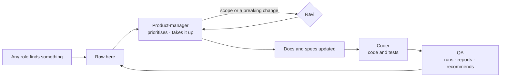

# Agents' recommendations

The one path for any change nobody asked for. Every role — person or agent — that finds something that should change
writes it here instead of changing it. **Nobody works a row until the product-manager takes it up** as a session, a
phase or a project.

| Rule | Detail |
|---|---|
| Who adds | Any session or agent, the one write allowed without asking (`CLAUDE.md` › *Talk is not a request to write*) — always with the **`recommend` skill** (`.claude/skills/recommend/add.py add`), never by editing this file; the `edit_rights` hook refuses a hand edit |
| One row per recommendation | Newest last. Check for an existing row first; add to its *Description* rather than repeat it |
| Who acts | The product-manager, with Ravi: sets *Priority* and *Taken up as* with `add.py take`, marks a row done with `add.py done`. A new project, a new phase or a scope change waits for Ravi's yes |
| Status | `open` until taken up · `taken` once taken up as work · `declined` with its reason · `done` once that work is done. Rows are never deleted, so nothing is raised twice and no ID is reused; the counts line above the table is rewritten by `add.py` |
| No pipes | A cell never holds a `\|`; write `·` instead |

| Field | Holds |
|---|---|
| ID | `R<nnn>` — the next free number |
| Status | `open` · `taken` · `declined` · `done` — set by `add.py`, never by hand |
| Date | The day it was raised, `YYYY-MM-DD` |
| From | The role that raised it: `product-manager` · `project-lead` · `designer` · `coder` · `qa` · `security` · `ravi` |
| Raised in | `session` · `phase <project>/<ID>` · `project <name>` |
| Kind | `bug` · `test` · `docs` · `security` · `component` · `debt` · `idea` |
| Severity | `blocker` · `high` · `medium` · `low` — the raiser's view |
| Title | One line |
| Description | What and where (file:line, criterion ID, board) · the change recommended |
| Priority | The product-manager's: `P1` · `P2` · `P3` |
| Taken up as | The product-manager's: `session` · `phase <project>/<ID>` · `project <name>` · `declined — <reason>` |

<!-- stats: written by add.py -->
**66 recommendations** · 65 open · 1 taken · 0 declined · 0 done

| ID | Status | Date | From | Raised in | Kind | Severity | Title | Description | Priority | Taken up as |
|---|---|---|---|---|---|---|---|---|---|---|
| R001 | open | 2026-11-02 | ravi | session | bug | medium | run.py entry() splits a phase cell at an escaped \· pipe | .claude/skills/run-project/run.py Project.entry(): cells split on every '·', so an escaped '\·' inside a cell (two-places T01 Steps: `scope: "platform" \· "graph"`) cuts the cell — the runner and dashboard saw only the start of T01's step 1. Split on unescaped pipes only (re.split(r'(?<!\\)\·', ...)) and unescape after. |  |  |
| R002 | open | 2026-11-02 | product-manager | phase specs-migration/P01 | docs | blocker | Apply P01's phase split and log rows to the specs-migration project file | P01 could not edit .claude/team/projects/specs-migration/project.md (harness refuses it as a sensitive file unattended). Apply .agent-reports/product-manager/specs-migration/project-changes.md: split P11/P15/P18/P19/P20 into b phases, new Needs, Read additions; also add P01's hand-off note from .agent-reports/product-manager/specs-migration/p01-report.md |  |  |
| R003 | open | 2026-11-02 | product-manager | phase specs-migration/P01 | debt | high | The specs-migration mapping lives in a git-ignored folder | .gitignore:72 ignores .agent-reports/, so mapping.md (the file every specs-migration phase is governed by) is never committed and is lost on a clean checkout. Un-ignore .agent-reports/product-manager/specs-migration/ or move the mapping under .claude/team/projects/specs-migration/ and update the project rules |  |  |
| R004 | open | 2026-11-02 | product-manager | phase specs-migration/P01 | docs | medium | Relabel Agent-version canvas frames with the new story IDs | The canvas (.design/canvas-agent-version av.py, p_*.py) labels boards with DS-, AF-, AB-, GS-, AC-, ON-, SO-, IAM- IDs that specs/ renumbers. Use the old to new table in mapping.md (Story IDs) to relabel frames once the features are migrated — designer work |  |  |
| R005 | open | 2026-11-02 | product-manager | phase specs-migration/P02 | docs | medium | design-language §6 duplicates the glossary's Not on screen table | specs/design-language.md §6 and specs/glossary.md › Not on screen hold the same list; check.py reads only the glossary. Make §6 a one-line pointer to glossary.md. |  |  |
| R006 | open | 2026-11-02 | product-manager | phase specs-migration/P02 | docs | low | Point TEAM.md §0 and CLAUDE.md at specs/vision.md and specs/glossary.md | TEAM.md §0 restates what Invana is and CLAUDE.md names terminology.md as the product's words; specs/vision.md now owns the product statement and specs/glossary.md the screen words. Link both instead of restating (Ravi edits .claude/ and CLAUDE.md). |  |  |
| R007 | open | 2026-11-02 | product-manager | phase specs-migration/P02 | docs | low | SH-F03's title names a launcher the design language removes | mapping.md and specs/products/shell/product.md: SH-F03 'Find your way — launcher, ⌘K, search, no access'; design-language §2 says no launcher. P19 should retitle it (e.g. 'Find your way — ⌘K, search, no access'). |  |  |
| R008 | open | 2026-11-02 | qa | phase specs-migration/P03 | test | medium | Prove the P03 ✅ rows by a run, not only by reading | reviews/P03-audit.md is a static audit; run tests/modeller tests/govern tests/datasets tests/explorer tests/annotations tests/boards on the isolated Neo4j and the Studio e2e specs, and record the result before the specs for EX/MO/DA are approved. |  |  |
| R009 | open | 2026-11-02 | qa | phase specs-migration/P03 | idea | low | EX-F05/EX-F07 stories need a built-ness note: act-as, fork-a-session, memory are unbuilt | Audit P03 §2-3: no code for act-as, session fork, assistant-opens-boards (EX-28), memory evidence/proposals/consolidation (EX-29..32) and the walkthrough per-answer steps. Keep as specified stories; P06-P08 should not describe them as shipped. |  |  |
| R010 | open | 2026-11-02 | qa | phase specs-migration/P04 | test | medium | Agent-built P04 gaps: add tests for agent-scoped guardrails, tightening-only envelope proposals and unroutable worker steps | P04 audit (author-an-agent C2 · envelope-and-budget C8 · workers C10): the code exists or is claimed but no test names the behaviour. Add one positive and one negative test each in engine/tests/agents and tests/workers. |  |  |
| R011 | open | 2026-11-02 | qa | phase specs-migration/P04 | docs | low | Feature-file status rows lag the build: workers, pinned-model-versions, instructions-publish-rollback, the-agents-shell | P04 audit: the API / CLI / Studio rows in modules/agents and modules/skills feature files say 🔵/🟡 where the code and tests are built; author-an-agent C10 shows dollars where the build counts tokens. P12-P14 should write stories at the built state. |  |  |
| R012 | open | 2026-11-02 | qa | phase specs-migration/P04 | idea | low | Ungrounded AG/PJ stories: remote agents, agent import-export, install-wide agents, run-a-workflow, objectives, recurring Todos, review queue are all unbuilt | P04 audit marks these features entirely or mostly unbuilt (no code). Their stories migrate as status specified; no tasks invented. Also unbuilt: plan version retire, catalogue used-by and granted-to, skill SKILL.md folder and library-to-functions, project criteria. |  |  |
| R013 | open | 2026-11-02 | qa | phase specs-migration/P04 | debt | low | Reviews folder under .claude is refused to QA, so audits land in .agent-reports/qa | P03 and P04 audits could not be written to .claude/team/projects/specs-migration/reviews/ (sensitive path). Either allow qa to write that folder in edit-rights or change the phases to name .agent-reports/qa/specs-migration-<phase>-audit.md. |  |  |
| R014 | open | 2026-11-02 | qa | phase specs-migration/P05 | test | medium | No test for sign-up, login, refresh rotation, username rules or cooldown | engine/src/invana/core/auth/managers/auth.py (register, login, refresh, _validate_username_format, cooldown at :311) has no test under engine/tests/auth; accounts/usernames/sessions C1-C8 are built but unproven. Add positive+negative tests. |  |  |
| R015 | open | 2026-11-02 | qa | phase specs-migration/P05 | bug | medium | Refresh-token reuse is refused but not recorded; no sign-out-everywhere | sessions.md C4 and C7: AuthManager.refresh (core/auth/managers/auth.py:263) raises on a revoked token with no event; POST /auth/logout (server/routes/auth.py:77) revokes one refresh token only. Add a reuse event and an all-devices logout, or reword the spec as not yet built. |  |  |
| R016 | open | 2026-11-02 | qa | phase specs-migration/P05 | debt | medium | Packages invana-arcadedb and invana-tinkergraph are empty; no Neptune package | integrations/invana-arcadedb/src/invana_arcadedb/__init__.py and invana-tinkergraph __init__.py are 0 bytes; no integrations/invana-neptune; no tests in memgraph, janusgraph, arcadedb, tinkergraph. CLAUDE.md lists them as supported. Build them or mark them planned in the graph-connectors spec. |  |  |
| R017 | open | 2026-11-02 | qa | phase specs-migration/P05 | debt | low | Operate gaps: per-token rate ceiling, audit retention purge, liveness vs readiness | external-agent-api C8 (token rate/cost ceiling), audit-and-activity C9 (purge by window; only ledger RETENTION_DAYS=365 declared), admin-and-health C5 (only /health in server/health.py). Keep as specified stories; no code found. |  |  |
| R018 | open | 2026-11-02 | product-manager | phase specs-migration/P06 | docs | low | Docs and code still cite explore decision ids cut in P06 | P06 cut the product decision rows GC1-3 GC5 GC8 GC13 GC19 GC21 GC23 GC24 · CV2-5 · SP1 SP3-5 · CO1-2 CO4-11 CO13-17 · SA5-12 · WT2-6 WT8 · DE2 DE4-6 DE9-10 · AN1-8 from docs/for-developers/modules/explore/features/*.md; about 20 files (the-screens.md, boards-migration.md, the-skill-page.md, distributed-execution.md, explore feature files' own Surfaces, a few engine modules) still cite them. Repoint each to its EX-F01 · EX-F02 · EX-F06 feature.md row in P21 (code) and P22 (docs). |  |  |
| R019 | open | 2026-11-02 | product-manager | phase specs-migration/P07 | docs | low | Docs and code still cite ask decision ids cut in P07 | P07 cut the product decision rows WQ2-4 · NL1 NL3-5 NL12 NL14 · CQ1-7 CQ10 CQ12 · AD1-4 AD8 AD11 AD13 AD15-18 AD22-27 · OB1 OB3-5 · AS1 AS3-9 AS13 AS14 AS16 AS17 · P1-12 · SW1-3 · RT1-7 · AW2 AW5 from docs/for-developers/modules/ask/features/*.md (the rows that stayed are logged in the mapping's Stayed table). About 25 docs (the-screens.md, the-sequence.md, governance.md, modules/ask/spec.md, explore and govern feature files) and about 30 engine/Studio files and tests still cite them. Repoint each to its EX-F03 or EX-F04 feature.md or story criterion in P21 (code) and P22 (docs), alongside R018. |  |  |
| R020 | open | 2026-11-02 | product-manager | phase specs-migration/P07 | bug | medium | A re-run orphans the earlier answer instead of leaving it beside the new one | EX-02.9 (specs/products/explore/features/EX-F04-the-answer/stories/EX-02-watch-the-answer-arrive-on-the-board/story.md): a re-run is a new run and the earlier answer stays; a failed re-run shows beside it. Today a re-run re-points the reply at the new run, orphaning the earlier parts, so a failed re-run leaves the reply empty (note in docs/for-developers/modules/ask/features/the-answer-surface.md). Fix lane for the coder: make a re-run additive and put when the records were read, with Re-run, on each part's header; a test that a failed re-run keeps the earlier answer. |  |  |
| R021 | open | 2026-11-02 | product-manager | phase specs-migration/P09 | docs | low | Docs and code still cite connect-and-model decision ids cut in P09 | Cut in P09: ID1–3 · DM1–5, DM10–12 · SR1–4 · OI1, OI3–9, OI12–17 · ME1–5, ME7, ME9 · PB1, 2, 4–9, 12, 13, 15, 16 · PC3–9, PC11 · SM1–4 · ST1–4, 8, 10, 11, 18, 19, 26–28, 35–38, 50, 58–61 · MP1–3, 7–14, 22, 49, 51–53 · CM1–6, CM12. Still cited e.g. engine/src/invana/apps/modeller/models.py:76 and portability.py:7 (SM2), docs/for-developers/the-screens.md:708 (OI13–OI17), docs/products/modeller.md Studio-today rows. Repoint each to its specs/products/model feature (P21 code · P22 docs). |  |  |
| R022 | open | 2026-11-02 | product-manager | phase specs-migration/P10 | idea | medium | model.rules board: states for MO-10/11/12/13 and two rows MO-F06 cannot check | MO-10, MO-11, MO-12 and MO-13 Screens name state variants on model.rules (No views, View on the model, View page, Property rule, Rule impact, Rule evidence, Requests, Allow in a view, ...) that the Agent-version board does not draw yet; it draws one sheet. The board's sample rules 'Reports name no passengers - any report written by an agent' and 'Retracted data is never cited - answers, reports and boards' are checked at acts MO-F06 does not have (its checks read dataset share, add to this graph, project decision). Recommend: after the spec review, a designer request to draw the named states on model.rules, and either change the two sample rows to checks MO-F06 has or a spec change adding report and answer acts (Ravi decides). |  |  |
| R023 | open | 2026-11-02 | product-manager | phase specs-migration/P11 | security | medium | Loading into a model needs Can shape the model | DA-F02 and DA-F03 Access say loading into a model (records import, a bundle, Add to this graph) is modeller — Can shape the model (TEAM.md §7). engine/src/invana/server/datasets/views.py bind route depends only on require_graph_member, so any Operator can add a dataset version to a graph. Coder: require the modeller role on POST …/dataset-bindings and on the import routes, with a refusal test each. |  |  |
| R024 | open | 2026-11-02 | product-manager | phase specs-migration/P12 | docs | low | Docs and code still cite agents decision ids cut in P12 | AG1–AG25 · EB1–EB5 · EB14 · LC1–LC7 · LC10 · SO2–SO9 · PV2–PV6 · PV11 · AP3–AP29 · WD2–WD17 · IE1–IE4 were cut from modules/agents/features/*.md; other docs and code comments citing them should point at AG-F01 / AG-F02 (P21) |  |  |
| R025 | open | 2026-11-02 | product-manager | phase specs-migration/P12 | docs | low | Glossary lacks the agent words AG-F01 shows: Voice, Practice graph, Flow | specs/glossary.md: add Voice (an agent's soul + dials), Practice graph (the eval graph an Admin names), and Flow as the screen word for what an agent's instructions resolve to (glossary lists Flow only as a code term under Plan) |  |  |
| R026 | open | 2026-11-02 | product-manager | phase specs-migration/P13 | idea | medium | Agents run, runs, inbox and settings.ai boards: states AG-F03 and AG-F05 name | AG-17, AG-22, AG-23, AG-25, AG-27, AG-28, AG-32, AG-41, AG-43, AG-24, AG-33 and AG-34 Screens name state variants the Agent-version boards do not draw yet — agents.runs (Nothing ran, No runs match, Filtered), agents.run (Many agents, By role, Re-run, Compare, Who did what, Step failed, Request a change, Outside task …), agents (How they are doing, Degraded), settings.ai (Outside agents, Add an outside agent, Card read), inbox (Delegation ask, Outside agent ask, Request a change) — designer work once the spec review approves |  |  |
| R027 | open | 2026-11-02 | product-manager | phase specs-migration/P13 | docs | low | Docs and code still cite runs, fleet and delegation decision ids cut in P13 | FP3–FP6 · FP8 · FP9a · FP11 · FP14 · the second FP17 · RP1–RP3 · RP5–RP9 · RP11–RP14 · RP17 · RP18 · RP20 · OB2 · OB3 · OB5 · DG1–DG8 · DG12–DG16 · LN1–LN6 · RA2–RA11 · A1–A6 · AP26 · AP28 · WD20 were cut from modules/agents and operate/observability; docs and code comments citing them should point at AG-F03 / AG-F05 / AG product.md (P21, P22) |  |  |
| R028 | open | 2026-11-02 | product-manager | phase specs-migration/P14 | idea | medium | Agents skills, skill, schedules, run and inbox boards: states AG-F04, AG-F06 and AG-F07 name | AG-19, AG-20, AG-30, AG-37, AG-18, AG-31, AG-38, AG-44 and AG-42 Screens name state variants not yet drawn on agents.skills (plans list, a plan's page, Run a plan, Tools they call, a function), agents.skill (Draft, Drawing, Flow, Flow gap, Publish refused, Tests, Evals, Exceptions, Adopt, Agents, Usage, Too few to read), agents.schedules (Nothing is scheduled, New schedule, A schedule, Running), agents.agent, agents.run (Plan picked, Plan refused, Promote this plan, Started by name, Promote to eval), inbox and settings.usage. Draw each as a State on its board. |  |  |
| R029 | open | 2026-11-02 | product-manager | phase specs-migration/P14 | docs | low | Docs and code still cite skills, workflows and schedules decision ids cut in P14 | Cut in P14: S1 · S3 · F1 · F2 · F4 · F5 · F8–F13 · F15–F18 · SC1 · SC2 · SC4–SC10 and the product rows of SK · BN · EL · IS · SP · US · LB · PS · EV · PR · RW · CA (e.g. LB1, LB6, LB16, CA6 cited in authoring-a-skill.md, a-skill-uses-a-plan.md, the-agents-shell.md, graph-detail-page.md, the-screens.md). Repoint citations to AG-F04 · AG-F06 · AG-F07 (P21); also renumber the duplicate SK23 · SK24 · SK25 rows in authoring-a-skill.md. |  |  |
| R030 | open | 2026-11-02 | product-manager | phase specs-migration/P14 | security | medium | Any graph member can change the eval token budget | PUT …/evals/budget only requires graph membership (put_budget). AG-F04 Open questions recommend Owner · Admin. Security to confirm; coder to gate it once Ravi answers. |  |  |
| R031 | open | 2026-11-02 | product-manager | phase specs-migration/P15 | component | medium | Designer: board variants PJ-F01–PJ-F05 name on projects.* and inbox | PJ-F01–F05 Screens name variants not on the Agent-version canvas: projects.project · Pick-up/Order/Details/Archived/People; projects.task · Claimed/Waiting on/Will not run/Criteria/Result to accept; projects.decide · Lineage/Every decision/Impact; projects.options · Fork/Merge/Simulate/Simulation result; projects.report · Edit/Version; inbox · Start this task?/A pass to judge/Project work. Draw them at the spec review's yes. |  |  |
| R032 | open | 2026-11-02 | product-manager | phase specs-migration/P15 | docs | low | projects.report board draws an agent drafting the report; PJ-F05 says a template drafts it | .design/canvas-agent-version/p_projects.py projects.report caption 'drafted from the records by Route analyst' contradicts PJ-F05 Rules (template, no AI model). Redraw, pending Ravi's answer in PJ-F05 › Open questions. |  |  |
| R034 | open | 2026-11-02 | product-manager | phase specs-migration/P16 | component | medium | Designer: board states IN-F01–IN-F03 name on inbox, inbox.history and settings.notifications | IN-01–IN-06 Screens name states the Agent-version boards do not draw yet: inbox (Updates · Done · Toast · Expired, not sent · See all it will send · Already decided · Not yours to answer · Nothing of yours), inbox.history (Row · By actor/record · Refused · Export · Compare · Chain broken · Counted, not shown), settings.notifications (New rule · Rule refused · Read only · In app only · Channel failed). Draw them after the spec review. |  |  |
| R035 | open | 2026-11-02 | product-manager | phase specs-migration/P16 | docs | low | Studio still draws approvals, rules and the ledger as Activity tabs and an Agents section | IN-F01 puts asks in Inbox › Needs you (acts in the row), rules and channels in Settings › Notifications; IN-F03 puts the ledger and change log in Inbox › History. Studio's agents.approvals, the bell tray, Activity › Rules/Channels/Events and agents.ledger are the retired surfaces (for-developers operate Surfaces sections). A build phase moves them once the boards are designed. |  |  |
| R036 | open | 2026-11-02 | product-manager | phase specs-migration/P17 | docs | medium | P17 hand-off note refused: project.md is a sensitive file | The Edit tool refused adding P17's Hand-off notes row to .claude/team/projects/specs-migration/project.md. The note is in .agent-reports/product-manager/ST-F02-spec-review.md › Hand-off note; copy it into the project file's Hand-off notes table. |  |  |
| R037 | open | 2026-11-02 | product-manager | phase specs-migration/P17 | docs | low | Settings boards lack ST-F02/F03 surfaces: Keys tab, username, sessions | settings.access draws tabs Access rules · People and groups · Agents (no Keys); settings.me draws profile and keys but not username, password or sessions; limits read Tokens a day. ST-F02 › Open questions and ST-15 Screens name these. Designer work once Ravi approves the spec. |  |  |
| R038 | open | 2026-11-02 | product-manager | phase specs-migration/P18 | docs | medium | Designer: Settings boards and states P18 names (General, Connection, Plugins, Workers views) | ST-F01 names General and Connection as states of settings.people (no board of their own); ST-29 Plugins has no board (all cells —); ST-F04/F05/F06 name states on settings.ai, settings.usage, settings.workers (Where work is, Order, Coordinators, Starts, AI model limits, Add workers) and agents.run · Held by a limit that are not drawn. Recommend boards settings.general · settings.connection · settings.plugins, then rename the ST-14 and ST-29 cells. |  |  |
| R039 | open | 2026-11-02 | product-manager | phase specs-migration/P18 | docs | low | TEAM.md §7 gives AI providers to a Graph Owner; specs make AI models the install Admin's | .claude/team/TEAM.md §7 Owner row says 'The Graph's settings, connection, AI providers' and specs/personas.md repeats it; ST-F05 (from providers-and-models PM1 · PM21) makes AI models install-wide and Admin-only. Recommend dropping 'AI providers' from the Owner row in TEAM.md §7 and personas.md. |  |  |
| R040 | open | 2026-11-02 | product-manager | phase specs-migration/P19 | docs | low | Repoint for-developers citations of setup decisions cut in P19 | terminology.md:269 (SU1 · SU7) · the-screens.md:311-318 (SU2–SU22) · graph-detail-page.md G28 (SU13) · design-kit-coverage.md:549 (SU19) cite setup.md rows now in SH-F02 · repoint each to specs/products/shell/features/SH-F02-create-a-graph/feature.md, or mark retired where it cites SU7 · SU16 · SU19 (P22) |  |  |
| R041 | open | 2026-11-02 | product-manager | phase specs-migration/P19 | idea | medium | Draw the Shell states SH-F01–F03 name, and a set-up board | SH-01 · 02 · 03 · 19 · 21 · 24 · 25 · 26 · 04–07 · 20 name states on start.* · shell.* boards the canvas draws once (e.g. start.signin · Could not sign in, start.home · First run · Archived, start.new_graph.files · A column asked); set-up after Ready has no board — recommend start.setup as a peek from Ready and Home (SH-F02 open question) |  |  |
| R042 | open | 2026-11-02 | product-manager | phase specs-migration/P20 | docs | low | Repoint for-developers links to cut orchestration §0 and governance sections | 37 files under docs/for-developers/ link to orchestration.md#0-… anchors, and building-engine/lens-migration.md to cut governance.md sections; P20 moved them to specs/system-design/orchestration.md and governance-and-lens.md. links.py checks files, not anchors, so the gate stays green. Repoint in P22's review pass. |  |  |
| R043 | open | 2026-11-02 | product-manager | phase specs-migration/P20 | debt | low | Drop the currency cost metric and dashboard tile | specs/system-design/observability.md keeps invana.llms.cost and the LLM dashboard's cost tile (moved from platform telemetry); budgets are tokens only. Recommend: drop both in engine telemetry and docker/hyperdx dashboards, then remove them from observability.md. |  |  |
| R044 | open | 2026-11-02 | coder | phase specs-migration/P21 | debt | low | Code cites for-developers files that never existed | engine/src/invana/apps/__init__.py:2 · core/__init__.py:1 · core/models.py:2 cite building-engine/code-shape.md (only building-studio/code-shape.md exists); engine/tests/sessions/test_services.py:249 cites explore/features/canvases.md; engine/src/invana/apps/flows/dag.py:214 cites selection-and-the-panel.md-D3 (no D3). Broken before the migration, so P21 left them — point each at its real home or drop it. |  |  |
| R045 | open | 2026-11-02 | coder | phase specs-migration/P21 | debt | low | Retired decision ids still read in code comments after P21 | P21 repointed paths and dropped ids next to a repointed citation, but ids stay as link labels and in prose (e.g. engine/src/invana/apps/govern/rules.py:22-25 [GV5]…[GV23] ref labels, engine/tests/graphs/test_setup_state.py:136/153 SU11 · SU12, SR41 in runtime/schemas.py:702). specs/ has no decision ids and CLAUDE.md rule 12 bars them in code — a sweep should drop the ids once R018–R042 settle the docs side. |  |  |
| R046 | open | 2026-11-02 | qa | phase specs-migration/P21 | docs | low | Two code citations point at docs deleted before the migration | engine/src/invana/apps/__init__.py:2, core/__init__.py:1, core/models.py:2 cite docs/for-developers/building-engine/code-shape.md (deleted in a35637be; replaced by migration-plan.md); engine/tests/sessions/test_services.py:249 cites modules/explore/features/canvases.md (deleted in 461bdae0, canvases are boards). Repoint to migration-plan.md / boards.md or drop the citation. |  |  |
| R047 | open | 2026-11-02 | qa | phase specs-migration/P21 | test | low | Add a check that code citations of docs and specs paths resolve | P21 repointed 1,597 citations by script; nothing in the gates fails when a cited docs/ or specs/ path or anchor stops existing (R044/R046 slipped through earlier). Add a lint or test that scans engine, studio and integrations for docs/ and specs/ .md paths and #anchors and fails on a missing target. Also: engine/tests/work/test_tasks.py::TestAssignment::test_assigning_to_an_agent_opens_exactly_one_thinking fails here with UndefinedTableError ledger_rows in the per-test Postgres schema (environment/migration lag, not P21: the file differs by one comment). |  |  |
| R048 | open | 2026-11-02 | coder | phase specs-migration/P21 | docs | low | IN-02 has no criterion for the History live tail | audit-and-activity.md capability C7 (live tail — new events appear as they happen) was cut in P16 but no IN-02 criterion or IN-F03 rule carries it; studio/packages/core/src/hooks/useEventStream.ts now cites IN-F03 feature.md. Add the live-tail criterion to IN-02 (or log it in the mapping's Stayed table). |  |  |
| R049 | open | 2026-11-02 | qa | phase specs-migration/P21 | docs | low | engine/Dockerfile cites a docs path that does not exist | engine/Dockerfile:3 cites docs/internal/mvp/engine.md §7.1, which is not in the repo (the only cited docs/specs path that fails to resolve). Repoint it to the specs/system-design home or drop the citation. |  |  |
| R050 | open | 2026-11-02 | project-lead | project specs-migration | debt | high | Runner QA reports fail under .claude/: write refused as sensitive file | run-project QA sessions cannot write .claude/team/projects/<name>/reviews/<ID>-qa.md (harness refuses .claude/ as sensitive; allow rules do not lift it), so a QA PASS counts as a failure and the phase blocks after 3 fix rounds (specs-migration P21). Recommend: write QA reports to .agent-reports/qa/ (runner reads them there) or have the runner write them from QA's output. |  |  |
| R051 | open | 2026-11-02 | product-manager | phase specs-migration/P22 | docs | medium | Repoint .claude/ and CLAUDE.md citations of paths the specs migration cut | Each cites a docs/ path whose content moved to specs/ (Ravi edits these). CLAUDE.md:37 and build-feature/SKILL.md:31 — terminology.md as the product's words: screen words are specs/glossary.md, terminology.md keeps domain terms only (overlaps R006). build-feature/SKILL.md:3, 13-18, 38 — for-developers/README.md as the feature index and 'build only what the index lists', docs/system-design.md, a feature file plus its index row: the index is now the review index of leftovers; scope is specs/ (specs/products/*/product.md Features tables), the engine shape specs/system-design/. build-feature/SKILL.md:34 — the product split 'planned in docs/products/': specs/products/. build-studio/SKILL.md:27 — 'what for-developers/README.md is to features': specs/README.md. design-qa/screen_map.py:4-5 — stories read from the tables in docs/products/<product>.md: those tables are cut; stories are specs/products/*/features/*/stories/*/story.md. agents/qa.md:44 — evals as modules/skills/features/evals.md: the product half is AG-F04 (specs/products/agents/features/AG-F04-skills/feature.md); the file keeps engine detail. team/projects/specs-migration/project.md:31 — 'Orchestration is docs/for-developers/orchestration.md §0': §0 is cut; it is specs/system-design/orchestration.md. Still valid, no change: security-audit:16, product-spec:118-120, TEAM.md:204, design-story:43 and 90, designer.md:39, build-studio:26 and 28-29, build-feature:69 (module-structure §5b exists). Archived projects are left as history. |  |  |
| R052 | open | 2026-11-02 | product-manager | phase specs-migration/P22 | docs | low | Cut the EX-F05 and EX-F07 sources the migration moved but never cut | docs/for-developers/modules/ask/features/act-as.md, beyond-the-graph.md, fork-a-session.md, when-it-cannot-answer.md and modules/memory/features/evidence.md, recall-by-query.md, proposals.md, consolidation.md still hold every section (story, capabilities, journey, seams, surfaces, decisions, not building), and memory/spec.md keeps 6 Flows — all moved into EX-F05 (EX-05 · EX-06 · EX-24 · EX-26 · EX-27) and EX-F07 (EX-29–EX-32). Cut all but Engine (and proposals' Shape and Open), add a Product spec: line to each, as the other module files have. The review index (docs/for-developers/README.md) lists them as 'moved, not cut'. |  |  |
| R055 | open | 2026-11-04 | ravi | session | debt | low | Per-phase model choice in /run-project builds | .claude/skills/run-project/run.py builds every phase on the agent's model (LEAD_MODEL), so a pure port/regenerate/republish designer phase runs on Opus. Add an optional Model row to project-template.md, read by run.py for the build step, defaulting to the agent's model; then point design-story §0's runner row at it. |  |  |
| R065 | open | 2026-11-04 | product-manager | session | idea | medium | Engine prompts recommend, show assumptions and badge outside facts | Philosophy review (E1 · E2 · E3 · E4), .agent-reports/product-manager/philosophy-review/index.html. engine/src/invana/apps/llm intent.py, translate.py, propose.py, planner.py, voice.py: a recommended field on clarify and propose, assumptions and alternatives on a drafted model, one shared grounding sentence (no own knowledge; third-party badged). |  |  |
| R066 | taken | 2026-11-04 | product-manager | session | bug | high | Studio copy still shows Not-on-screen words | Philosophy review (E7 · E8 · E9 · E10 · E11), .agent-reports/product-manager/philosophy-review/index.html. setupSteps.ts:117, CastRefusal.tsx, WorldPicker.tsx, agents ledger/runs/evals pages, FirstRun.tsx:60: ontology, stitch, world, guardrail, Ledger, Fleet, Modeller to glossary words; the assistant's welcome says it proposes and the person decides. (Sign-in copy is R056.) | P2 | session — sign-in, setup, first run, assistant picker and refusal done; agents ledger/runs/evals and Govern worlds pages remain |
| R067 | open | 2026-11-07 | product-manager | session | docs | medium | Team rules still state the old philosophy and Asks before it acts | TEAM.md:12 and :21, design-story SKILL.md:89, build-studio SKILL.md:16 quote 'agents do the work; the person decides' and 'Asks before it acts'. Bring them in step with specs/vision.md: philosophy 'Help thinkers decide: agents think alongside, and act only as far as the person allows'; principle 'Acts only as far as the person allows' (Allow · Ask first · Block, settings/product.md Decisions) |  |  |
| R068 | open | 2026-11-07 | product-manager | session | docs | low | README and docs home quote the old philosophy | README.md:8 and docs/docs/index.md say 'agents do the work, the person decides'. Align with specs/vision.md's new philosophy line once Ravi wants public copy changed; docs/ must not cite .claude/ |  |  |
| R069 | open | 2026-11-07 | product-manager | session | idea | low | Studio copy for agent modes: Allow · Ask first · Block | Studio has no mode copy yet; when ST-30/ST-31/AG-21.25-27 are built, use the glossary words Allow · Ask first · Block and the new Agent meaning ('acts only as far as a person allows'); check any existing 'asks before acting' copy |  |  |
| R070 | open | 2026-11-07 | product-manager | session | idea | low | Install-wide agent modes for an install or platform admin | Modes are set per Graph and per agent only (specs/products/settings/product.md Decisions 'Levels only tighten', Not building 'Install-wide modes'). A later feature of its own: an install or platform admin sets Allow · Ask · Deny across every Graph. Needs its own spec — access is per Graph today, so it needs a new install-wide record and a ceiling rule over Graph modes |  |  |
| R071 | open | 2026-11-07 | product-manager | session | docs | low | Rename ST-31's folder slug to a-denied-agent-asks-for-more | specs/products/settings/features/ST-F02-people-and-access/stories/ST-31-a-blocked-agent-asks-for-more/: the story's title is now 'A denied agent asks for more' (mode words Allow · Ask · Deny), but the edit_rights hook refuses a folder rename by the product-manager. Rename the folder (git mv), update the link in ST-F02 feature.md Stories, and rerun scripts/specs/check.py --index |  |  |
| R072 | open | 2026-11-07 | product-manager | session | bug | medium | add.py reuses the ID of a closed row | .claude/skills/recommend/add.py: done deletes the row, and add numbers from the max ID still in the file (line 80), so closing the highest row and then adding reuses its ID. It happened: R070 (May delegate to words, closed this session) was reused for 'Install-wide agent modes'. Fix: number from the highest ID ever issued (e.g. scan git history or keep a counter line in the file), and decide whether the reused R070 is renumbered |  |  |
| R092 | open | 2026-11-07 | product-manager | session | security | high | Build detail: a worker acts only on a one-use grant per step | From ST-F02 threat model H5, kept out of the spec by Ravi. When building ST-30.11 and IN-01.23 (permissions checked when each step runs), the engine should issue a worker a single-use grant per step rather than let a worker cache values. For the coder, under build-feature. |  |  |
| R093 | open | 2026-11-07 | product-manager | session | docs | medium | TEAM.md §7: grants are built-in rules with editable starting lines | .claude/team/TEAM.md §7 says Operator may read everything and each grant may do its area. specs/products/settings/product.md › Decisions now makes every permission an access-rule line (Deny · Ask · Allow) for people, agents and keys, with the grants as built-in rules whose starting lines are shown and editable, and a sixth rule kind, A person's own. Recommend: §7 says the roles are the built-in rules' starting lines and links to settings Decisions. |  |  |
| R094 | open | 2026-11-07 | product-manager | session | docs | low | IN-F01 says Allow always exists only on a delegation; ST-31 offers N days, always and Decline for N days | IN-F01 Rules › Allowed for this run and IN-01.8 offer Allow always on a delegation only; ST-31.6 sets a line for N days or always and ST-31.17 offers Decline for N days on an ask for more. Recommend: IN-F01 and IN-01.8 name the ask for more as the other kind with these choices. |  |  |
| R095 | open | 2026-11-07 | product-manager | session | docs | low | terminology.md still says Personal access token, not key | docs/for-developers/terminology.md:221 and :268 name the credential *Personal access token* and say it is 'not a key'; specs/glossary.md now shows it as *Key* on screen (ST-F02). Align terminology.md: Key on screen, personal access token as the domain term. |  |  |
| R096 | open | 2026-11-07 | coder | session | debt | medium | Engine modules form one 21-module import cycle | engine/src/invana: apps/{agents,datasets,explorer,flows,govern,graphs,iam,llm,llm_providers,modeller,semantic,sessions,setup,skills,standards,work,workers}, core/auth, core/events, plugins, runtime import each other transitively (Tarjan SCC over module imports, found by .claude/skills/platform-map/system.py) · break it into layers (core → integrations → apps → server), e.g. move shared schemas down and invert app→app calls through core/events |  |  |
| R097 | open | 2026-11-07 | coder | session | docs | medium | Declare engine: / studio: front matter on the 8 product.md files | specs/products/*/product.md: add optional engine: [module ids, e.g. apps/agents, core/policy] and studio: [package dirs, e.g. agents] — the platform map's only declared link (built in); features inherit until they declare their own. Today gen.py --report lists all 41 features as claiming no code, so blast radius stops at Studio packages and never reaches a product. Ids: .claude/skills/platform-map/system.py docstring; check with gen.py --report |  |  |
