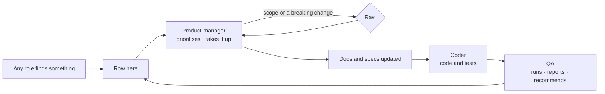

# Agents' recommendations

The one path for any change nobody asked for. Every role — person or agent — that finds something that should change
writes it here instead of changing it. **Nobody works a row until the product-manager takes it up** as a session, a
phase or a project.

| Rule | Detail |
|---|---|
| Who adds | Any session or agent, the one write allowed without asking (`CLAUDE.md` › *Talk is not a request to write*) — always with the **`recommend` skill** (`.claude/skills/recommend/add.py add`), never by editing this file; the `edit_rights` hook refuses a hand edit |
| One row per recommendation | Newest last. Check for an existing row first; add to its *Description* rather than repeat it |
| Who acts | The product-manager, with Ravi: sets *Priority* and *Taken up as* with `add.py take`, marks a row done with `add.py done`. A new project, a new phase or a scope change waits for Ravi's yes |
| Status | `open` until taken up · `taken` once taken up as work · `declined` with its reason · `done` once that work is done. Rows are never deleted, so nothing is raised twice and no ID is reused; the counts line above the table is rewritten by `add.py` |
| No pipes | A cell never holds a `\|`; write `·` instead |

| Field | Holds |
|---|---|
| ID | `R<nnn>` — the next free number |
| Status | `open` · `taken` · `declined` · `done` — set by `add.py`, never by hand |
| Date | The day it was raised, `YYYY-MM-DD` |
| From | The role that raised it: `product-manager` · `project-lead` · `designer` · `coder` · `qa` · `security` · `ravi` |
| Raised in | `session` · `phase <project>/<ID>` · `project <name>` |
| Kind | `bug` · `test` · `docs` · `security` · `component` · `debt` · `idea` |
| Severity | `blocker` · `high` · `medium` · `low` — the raiser's view |
| Title | One line |
| Description | What and where (file:line, criterion ID, board) · the change recommended |
| Priority | The product-manager's: `P1` · `P2` · `P3` |
| Taken up as | The product-manager's: `session` · `phase <project>/<ID>` · `project <name>` · `declined — <reason>` |

<!-- stats: written by add.py -->
**543 recommendations** · 342 open · 121 taken · 23 declined · 57 done

| ID | Status | Date | From | Raised in | Kind | Severity | Title | Description | Priority | Taken up as |
|---|---|---|---|---|---|---|---|---|---|---|
| R001 | open | 2026-11-02 | ravi | session | bug | medium | run.py entry() splits a phase cell at an escaped \· pipe | .claude/skills/run-project/run.py Project.entry(): cells split on every '·', so an escaped '\·' inside a cell (two-places T01 Steps: `scope: "platform" \· "graph"`) cuts the cell — the runner and dashboard saw only the start of T01's step 1. Split on unescaped pipes only (re.split(r'(?<!\\)\·', ...)) and unescape after. |  |  |
| R002 | open | 2026-11-02 | product-manager | phase specs-migration/P01 | docs | blocker | Apply P01's phase split and log rows to the specs-migration project file | P01 could not edit .claude/team/projects/specs-migration/project.md (harness refuses it as a sensitive file unattended). Apply .agent-reports/product-manager/specs-migration/project-changes.md: split P11/P15/P18/P19/P20 into b phases, new Needs, Read additions; also add P01's hand-off note from .agent-reports/product-manager/specs-migration/p01-report.md |  |  |
| R003 | open | 2026-11-02 | product-manager | phase specs-migration/P01 | debt | high | The specs-migration mapping lives in a git-ignored folder | .gitignore:72 ignores .agent-reports/, so mapping.md (the file every specs-migration phase is governed by) is never committed and is lost on a clean checkout. Un-ignore .agent-reports/product-manager/specs-migration/ or move the mapping under .claude/team/projects/specs-migration/ and update the project rules |  |  |
| R004 | open | 2026-11-02 | product-manager | phase specs-migration/P01 | docs | medium | Relabel Agent-version canvas frames with the new story IDs | The canvas (.design/canvas-agent-version av.py, p_*.py) labels boards with DS-, AF-, AB-, GS-, AC-, ON-, SO-, IAM- IDs that specs/ renumbers. Use the old to new table in mapping.md (Story IDs) to relabel frames once the features are migrated — designer work |  |  |
| R005 | open | 2026-11-02 | product-manager | phase specs-migration/P02 | docs | medium | design-language §6 duplicates the glossary's Not on screen table | specs/design-language.md §6 and specs/glossary.md › Not on screen hold the same list; check.py reads only the glossary. Make §6 a one-line pointer to glossary.md. |  |  |
| R006 | open | 2026-11-02 | product-manager | phase specs-migration/P02 | docs | low | Point TEAM.md §0 and CLAUDE.md at specs/vision.md and specs/glossary.md | TEAM.md §0 restates what Invana is and CLAUDE.md names terminology.md as the product's words; specs/vision.md now owns the product statement and specs/glossary.md the screen words. Link both instead of restating (Ravi edits .claude/ and CLAUDE.md). |  |  |
| R007 | open | 2026-11-02 | product-manager | phase specs-migration/P02 | docs | low | SH-F03's title names a launcher the design language removes | mapping.md and specs/products/shell/product.md: SH-F03 'Find your way — launcher, ⌘K, search, no access'; design-language §2 says no launcher. P19 should retitle it (e.g. 'Find your way — ⌘K, search, no access'). |  |  |
| R008 | open | 2026-11-02 | qa | phase specs-migration/P03 | test | medium | Prove the P03 ✅ rows by a run, not only by reading | reviews/P03-audit.md is a static audit; run tests/modeller tests/govern tests/datasets tests/explorer tests/annotations tests/boards on the isolated Neo4j and the Studio e2e specs, and record the result before the specs for EX/MO/DA are approved. |  |  |
| R009 | open | 2026-11-02 | qa | phase specs-migration/P03 | idea | low | EX-F05/EX-F07 stories need a built-ness note: act-as, fork-a-session, memory are unbuilt | Audit P03 §2-3: no code for act-as, session fork, assistant-opens-boards (EX-28), memory evidence/proposals/consolidation (EX-29..32) and the walkthrough per-answer steps. Keep as specified stories; P06-P08 should not describe them as shipped. |  |  |
| R010 | open | 2026-11-02 | qa | phase specs-migration/P04 | test | medium | Agent-built P04 gaps: add tests for agent-scoped guardrails, tightening-only envelope proposals and unroutable worker steps | P04 audit (author-an-agent C2 · envelope-and-budget C8 · workers C10): the code exists or is claimed but no test names the behaviour. Add one positive and one negative test each in engine/tests/agents and tests/workers. |  |  |
| R011 | open | 2026-11-02 | qa | phase specs-migration/P04 | docs | low | Feature-file status rows lag the build: workers, pinned-model-versions, instructions-publish-rollback, the-agents-shell | P04 audit: the API / CLI / Studio rows in modules/agents and modules/skills feature files say 🔵/🟡 where the code and tests are built; author-an-agent C10 shows dollars where the build counts tokens. P12-P14 should write stories at the built state. |  |  |
| R012 | open | 2026-11-02 | qa | phase specs-migration/P04 | idea | low | Ungrounded AG/PJ stories: remote agents, agent import-export, install-wide agents, run-a-workflow, objectives, recurring Todos, review queue are all unbuilt | P04 audit marks these features entirely or mostly unbuilt (no code). Their stories migrate as status specified; no tasks invented. Also unbuilt: plan version retire, catalogue used-by and granted-to, skill SKILL.md folder and library-to-functions, project criteria. |  |  |
| R013 | done | 2026-11-02 | qa | phase specs-migration/P04 | debt | low | Reviews folder under .claude is refused to QA, so audits land in .agent-reports/qa | P03 and P04 audits could not be written to .claude/team/projects/specs-migration/reviews/ (sensitive path). Either allow qa to write that folder in edit-rights or change the phases to name .agent-reports/qa/specs-migration-<phase>-audit.md. | P3 | superseded by R050 |
| R014 | open | 2026-11-02 | qa | phase specs-migration/P05 | test | medium | No test for sign-up, login, refresh rotation, username rules or cooldown | engine/src/invana/core/auth/managers/auth.py (register, login, refresh, _validate_username_format, cooldown at :311) has no test under engine/tests/auth; accounts/usernames/sessions C1-C8 are built but unproven. Add positive+negative tests. |  |  |
| R015 | open | 2026-11-02 | qa | phase specs-migration/P05 | bug | medium | Refresh-token reuse is refused but not recorded; no sign-out-everywhere | sessions.md C4 and C7: AuthManager.refresh (core/auth/managers/auth.py:263) raises on a revoked token with no event; POST /auth/logout (server/routes/auth.py:77) revokes one refresh token only. Add a reuse event and an all-devices logout, or reword the spec as not yet built. |  |  |
| R016 | open | 2026-11-02 | qa | phase specs-migration/P05 | debt | medium | Packages invana-arcadedb and invana-tinkergraph are empty; no Neptune package | integrations/invana-arcadedb/src/invana_arcadedb/__init__.py and invana-tinkergraph __init__.py are 0 bytes; no integrations/invana-neptune; no tests in memgraph, janusgraph, arcadedb, tinkergraph. CLAUDE.md lists them as supported. Build them or mark them planned in the graph-connectors spec. |  |  |
| R017 | open | 2026-11-02 | qa | phase specs-migration/P05 | debt | low | Operate gaps: per-token rate ceiling, audit retention purge, liveness vs readiness | external-agent-api C8 (token rate/cost ceiling), audit-and-activity C9 (purge by window; only ledger RETENTION_DAYS=365 declared), admin-and-health C5 (only /health in server/health.py). Keep as specified stories; no code found. |  |  |
| R018 | open | 2026-11-02 | product-manager | phase specs-migration/P06 | docs | low | Docs and code still cite explore decision ids cut in P06 | P06 cut the product decision rows GC1-3 GC5 GC8 GC13 GC19 GC21 GC23 GC24 · CV2-5 · SP1 SP3-5 · CO1-2 CO4-11 CO13-17 · SA5-12 · WT2-6 WT8 · DE2 DE4-6 DE9-10 · AN1-8 from docs/for-developers/modules/explore/features/*.md; about 20 files (the-screens.md, boards-migration.md, the-skill-page.md, distributed-execution.md, explore feature files' own Surfaces, a few engine modules) still cite them. Repoint each to its EX-F01 · EX-F02 · EX-F06 feature.md row in P21 (code) and P22 (docs). |  |  |
| R019 | open | 2026-11-02 | product-manager | phase specs-migration/P07 | docs | low | Docs and code still cite ask decision ids cut in P07 | P07 cut the product decision rows WQ2-4 · NL1 NL3-5 NL12 NL14 · CQ1-7 CQ10 CQ12 · AD1-4 AD8 AD11 AD13 AD15-18 AD22-27 · OB1 OB3-5 · AS1 AS3-9 AS13 AS14 AS16 AS17 · P1-12 · SW1-3 · RT1-7 · AW2 AW5 from docs/for-developers/modules/ask/features/*.md (the rows that stayed are logged in the mapping's Stayed table). About 25 docs (the-screens.md, the-sequence.md, governance.md, modules/ask/spec.md, explore and govern feature files) and about 30 engine/Studio files and tests still cite them. Repoint each to its EX-F03 or EX-F04 feature.md or story criterion in P21 (code) and P22 (docs), alongside R018. |  |  |
| R020 | open | 2026-11-02 | product-manager | phase specs-migration/P07 | bug | medium | A re-run orphans the earlier answer instead of leaving it beside the new one | EX-02.9 (specs/products/explore/features/EX-F04-the-answer/stories/EX-02-watch-the-answer-arrive-on-the-board/story.md): a re-run is a new run and the earlier answer stays; a failed re-run shows beside it. Today a re-run re-points the reply at the new run, orphaning the earlier parts, so a failed re-run leaves the reply empty (note in docs/for-developers/modules/ask/features/the-answer-surface.md). Fix lane for the coder: make a re-run additive and put when the records were read, with Re-run, on each part's header; a test that a failed re-run keeps the earlier answer. |  |  |
| R021 | open | 2026-11-02 | product-manager | phase specs-migration/P09 | docs | low | Docs and code still cite connect-and-model decision ids cut in P09 | Cut in P09: ID1–3 · DM1–5, DM10–12 · SR1–4 · OI1, OI3–9, OI12–17 · ME1–5, ME7, ME9 · PB1, 2, 4–9, 12, 13, 15, 16 · PC3–9, PC11 · SM1–4 · ST1–4, 8, 10, 11, 18, 19, 26–28, 35–38, 50, 58–61 · MP1–3, 7–14, 22, 49, 51–53 · CM1–6, CM12. Still cited e.g. engine/src/invana/apps/modeller/models.py:76 and portability.py:7 (SM2), docs/for-developers/the-screens.md:708 (OI13–OI17), docs/products/modeller.md Studio-today rows. Repoint each to its specs/products/model feature (P21 code · P22 docs). |  |  |
| R022 | open | 2026-11-02 | product-manager | phase specs-migration/P10 | idea | medium | model.rules board: states for MO-10/11/12/13 and two rows MO-F06 cannot check | MO-10, MO-11, MO-12 and MO-13 Screens name state variants on model.rules (No views, View on the model, View page, Property rule, Rule impact, Rule evidence, Requests, Allow in a view, ...) that the Agent-version board does not draw yet; it draws one sheet. The board's sample rules 'Reports name no passengers - any report written by an agent' and 'Retracted data is never cited - answers, reports and boards' are checked at acts MO-F06 does not have (its checks read dataset share, add to this graph, project decision). Recommend: after the spec review, a designer request to draw the named states on model.rules, and either change the two sample rows to checks MO-F06 has or a spec change adding report and answer acts (Ravi decides). |  |  |
| R023 | open | 2026-11-02 | product-manager | phase specs-migration/P11 | security | medium | Loading into a model needs Can shape the model | DA-F02 and DA-F03 Access say loading into a model (records import, a bundle, Add to this graph) is modeller — Can shape the model (TEAM.md §7). engine/src/invana/server/datasets/views.py bind route depends only on require_graph_member, so any Operator can add a dataset version to a graph. Coder: require the modeller role on POST …/dataset-bindings and on the import routes, with a refusal test each. |  |  |
| R024 | open | 2026-11-02 | product-manager | phase specs-migration/P12 | docs | low | Docs and code still cite agents decision ids cut in P12 | AG1–AG25 · EB1–EB5 · EB14 · LC1–LC7 · LC10 · SO2–SO9 · PV2–PV6 · PV11 · AP3–AP29 · WD2–WD17 · IE1–IE4 were cut from modules/agents/features/*.md; other docs and code comments citing them should point at AG-F01 / AG-F02 (P21) |  |  |
| R025 | open | 2026-11-02 | product-manager | phase specs-migration/P12 | docs | low | Glossary lacks the agent words AG-F01 shows: Voice, Practice graph, Flow | specs/glossary.md: add Voice (an agent's soul + dials), Practice graph (the eval graph an Admin names), and Flow as the screen word for what an agent's instructions resolve to (glossary lists Flow only as a code term under Plan) |  |  |
| R026 | open | 2026-11-02 | product-manager | phase specs-migration/P13 | idea | medium | Agents run, runs, inbox and settings.ai boards: states AG-F03 and AG-F05 name | AG-17, AG-22, AG-23, AG-25, AG-27, AG-28, AG-32, AG-41, AG-43, AG-24, AG-33 and AG-34 Screens name state variants the Agent-version boards do not draw yet — agents.runs (Nothing ran, No runs match, Filtered), agents.run (Many agents, By role, Re-run, Compare, Who did what, Step failed, Request a change, Outside task …), agents (How they are doing, Degraded), settings.ai (Outside agents, Add an outside agent, Card read), inbox (Delegation ask, Outside agent ask, Request a change) — designer work once the spec review approves |  |  |
| R027 | open | 2026-11-02 | product-manager | phase specs-migration/P13 | docs | low | Docs and code still cite runs, fleet and delegation decision ids cut in P13 | FP3–FP6 · FP8 · FP9a · FP11 · FP14 · the second FP17 · RP1–RP3 · RP5–RP9 · RP11–RP14 · RP17 · RP18 · RP20 · OB2 · OB3 · OB5 · DG1–DG8 · DG12–DG16 · LN1–LN6 · RA2–RA11 · A1–A6 · AP26 · AP28 · WD20 were cut from modules/agents and operate/observability; docs and code comments citing them should point at AG-F03 / AG-F05 / AG product.md (P21, P22) |  |  |
| R028 | open | 2026-11-02 | product-manager | phase specs-migration/P14 | idea | medium | Agents skills, skill, schedules, run and inbox boards: states AG-F04, AG-F06 and AG-F07 name | AG-19, AG-20, AG-30, AG-37, AG-18, AG-31, AG-38, AG-44 and AG-42 Screens name state variants not yet drawn on agents.skills (plans list, a plan's page, Run a plan, Tools they call, a function), agents.skill (Draft, Drawing, Flow, Flow gap, Publish refused, Tests, Evals, Exceptions, Adopt, Agents, Usage, Too few to read), agents.schedules (Nothing is scheduled, New schedule, A schedule, Running), agents.agent, agents.run (Plan picked, Plan refused, Promote this plan, Started by name, Promote to eval), inbox and settings.usage. Draw each as a State on its board. |  |  |
| R029 | open | 2026-11-02 | product-manager | phase specs-migration/P14 | docs | low | Docs and code still cite skills, workflows and schedules decision ids cut in P14 | Cut in P14: S1 · S3 · F1 · F2 · F4 · F5 · F8–F13 · F15–F18 · SC1 · SC2 · SC4–SC10 and the product rows of SK · BN · EL · IS · SP · US · LB · PS · EV · PR · RW · CA (e.g. LB1, LB6, LB16, CA6 cited in authoring-a-skill.md, a-skill-uses-a-plan.md, the-agents-shell.md, graph-detail-page.md, the-screens.md). Repoint citations to AG-F04 · AG-F06 · AG-F07 (P21); also renumber the duplicate SK23 · SK24 · SK25 rows in authoring-a-skill.md. |  |  |
| R030 | open | 2026-11-02 | product-manager | phase specs-migration/P14 | security | medium | Any graph member can change the eval token budget | PUT …/evals/budget only requires graph membership (put_budget). AG-F04 Open questions recommend Owner · Admin. Security to confirm; coder to gate it once Ravi answers. |  |  |
| R031 | open | 2026-11-02 | product-manager | phase specs-migration/P15 | component | medium | Designer: board variants PJ-F01–PJ-F05 name on projects.* and inbox | PJ-F01–F05 Screens name variants not on the Agent-version canvas: projects.project · Pick-up/Order/Details/Archived/People; projects.task · Claimed/Waiting on/Will not run/Criteria/Result to accept; projects.decide · Lineage/Every decision/Impact; projects.options · Fork/Merge/Simulate/Simulation result; projects.report · Edit/Version; inbox · Start this task?/A pass to judge/Project work. Draw them at the spec review's yes. |  |  |
| R032 | open | 2026-11-02 | product-manager | phase specs-migration/P15 | docs | low | projects.report board draws an agent drafting the report; PJ-F05 says a template drafts it | .design/canvas-agent-version/p_projects.py projects.report caption 'drafted from the records by Route analyst' contradicts PJ-F05 Rules (template, no AI model). Redraw, pending Ravi's answer in PJ-F05 › Open questions. |  |  |
| R034 | open | 2026-11-02 | product-manager | phase specs-migration/P16 | component | medium | Designer: board states IN-F01–IN-F03 name on inbox, inbox.history and settings.notifications | IN-01–IN-06 Screens name states the Agent-version boards do not draw yet: inbox (Updates · Done · Toast · Expired, not sent · See all it will send · Already decided · Not yours to answer · Nothing of yours), inbox.history (Row · By actor/record · Refused · Export · Compare · Chain broken · Counted, not shown), settings.notifications (New rule · Rule refused · Read only · In app only · Channel failed). Draw them after the spec review. |  |  |
| R035 | open | 2026-11-02 | product-manager | phase specs-migration/P16 | docs | low | Studio still draws approvals, rules and the ledger as Activity tabs and an Agents section | IN-F01 puts asks in Inbox › Needs you (acts in the row), rules and channels in Settings › Notifications; IN-F03 puts the ledger and change log in Inbox › History. Studio's agents.approvals, the bell tray, Activity › Rules/Channels/Events and agents.ledger are the retired surfaces (for-developers operate Surfaces sections). A build phase moves them once the boards are designed. |  |  |
| R036 | declined | 2026-11-02 | product-manager | phase specs-migration/P17 | docs | medium | P17 hand-off note refused: project.md is a sensitive file | The Edit tool refused adding P17's Hand-off notes row to .claude/team/projects/specs-migration/project.md. The note is in .agent-reports/product-manager/ST-F02-spec-review.md › Hand-off note; copy it into the project file's Hand-off notes table. | P3 | declined — specs-migration is done; the note stays in .agent-reports/product-manager/ST-F02-spec-review.md |
| R037 | open | 2026-11-02 | product-manager | phase specs-migration/P17 | docs | low | Settings boards lack ST-F02/F03 surfaces: Keys tab, username, sessions | settings.access draws tabs Access rules · People and groups · Agents (no Keys); settings.me draws profile and keys but not username, password or sessions; limits read Tokens a day. ST-F02 › Open questions and ST-15 Screens name these. Designer work once Ravi approves the spec. |  |  |
| R038 | open | 2026-11-02 | product-manager | phase specs-migration/P18 | docs | medium | Designer: Settings boards and states P18 names (General, Connection, Plugins, Workers views) | ST-F01 names General and Connection as states of settings.people (no board of their own); ST-29 Plugins has no board (all cells —); ST-F04/F05/F06 name states on settings.ai, settings.usage, settings.workers (Where work is, Order, Coordinators, Starts, AI model limits, Add workers) and agents.run · Held by a limit that are not drawn. Recommend boards settings.general · settings.connection · settings.plugins, then rename the ST-14 and ST-29 cells. |  |  |
| R039 | open | 2026-11-02 | product-manager | phase specs-migration/P18 | docs | low | TEAM.md §7 gives AI providers to a Graph Owner; specs make AI models the install Admin's | .claude/team/TEAM.md §7 Owner row says 'The Graph's settings, connection, AI providers' and specs/personas.md repeats it; ST-F05 (from providers-and-models PM1 · PM21) makes AI models install-wide and Admin-only. Recommend dropping 'AI providers' from the Owner row in TEAM.md §7 and personas.md. |  |  |
| R040 | open | 2026-11-02 | product-manager | phase specs-migration/P19 | docs | low | Repoint for-developers citations of setup decisions cut in P19 | terminology.md:269 (SU1 · SU7) · the-screens.md:311-318 (SU2–SU22) · graph-detail-page.md G28 (SU13) · design-kit-coverage.md:549 (SU19) cite setup.md rows now in SH-F02 · repoint each to specs/products/shell/features/SH-F02-create-a-graph/feature.md, or mark retired where it cites SU7 · SU16 · SU19 (P22) |  |  |
| R041 | open | 2026-11-02 | product-manager | phase specs-migration/P19 | idea | medium | Draw the Shell states SH-F01–F03 name, and a set-up board | SH-01 · 02 · 03 · 19 · 21 · 24 · 25 · 26 · 04–07 · 20 name states on start.* · shell.* boards the canvas draws once (e.g. start.signin · Could not sign in, start.home · First run · Archived, start.new_graph.files · A column asked); set-up after Ready has no board — recommend start.setup as a peek from Ready and Home (SH-F02 open question) |  |  |
| R042 | open | 2026-11-02 | product-manager | phase specs-migration/P20 | docs | low | Repoint for-developers links to cut orchestration §0 and governance sections | 37 files under docs/for-developers/ link to orchestration.md#0-… anchors, and building-engine/lens-migration.md to cut governance.md sections; P20 moved them to specs/system-design/orchestration.md and governance-and-lens.md. links.py checks files, not anchors, so the gate stays green. Repoint in P22's review pass. |  |  |
| R043 | open | 2026-11-02 | product-manager | phase specs-migration/P20 | debt | low | Drop the currency cost metric and dashboard tile | specs/system-design/observability.md keeps invana.llms.cost and the LLM dashboard's cost tile (moved from platform telemetry); budgets are tokens only. Recommend: drop both in engine telemetry and docker/hyperdx dashboards, then remove them from observability.md. |  |  |
| R044 | open | 2026-11-02 | coder | phase specs-migration/P21 | debt | low | Code cites for-developers files that never existed | engine/src/invana/apps/__init__.py:2 · core/__init__.py:1 · core/models.py:2 cite building-engine/code-shape.md (only building-studio/code-shape.md exists); engine/tests/sessions/test_services.py:249 cites explore/features/canvases.md; engine/src/invana/apps/flows/dag.py:214 cites selection-and-the-panel.md-D3 (no D3). Broken before the migration, so P21 left them — point each at its real home or drop it. |  |  |
| R045 | open | 2026-11-02 | coder | phase specs-migration/P21 | debt | low | Retired decision ids still read in code comments after P21 | P21 repointed paths and dropped ids next to a repointed citation, but ids stay as link labels and in prose (e.g. engine/src/invana/apps/govern/rules.py:22-25 [GV5]…[GV23] ref labels, engine/tests/graphs/test_setup_state.py:136/153 SU11 · SU12, SR41 in runtime/schemas.py:702). specs/ has no decision ids and CLAUDE.md rule 12 bars them in code — a sweep should drop the ids once R018–R042 settle the docs side. |  |  |
| R046 | open | 2026-11-02 | qa | phase specs-migration/P21 | docs | low | Two code citations point at docs deleted before the migration | engine/src/invana/apps/__init__.py:2, core/__init__.py:1, core/models.py:2 cite docs/for-developers/building-engine/code-shape.md (deleted in a35637be; replaced by migration-plan.md); engine/tests/sessions/test_services.py:249 cites modules/explore/features/canvases.md (deleted in 461bdae0, canvases are boards). Repoint to migration-plan.md / boards.md or drop the citation. |  |  |
| R047 | open | 2026-11-02 | qa | phase specs-migration/P21 | test | low | Add a check that code citations of docs and specs paths resolve | P21 repointed 1,597 citations by script; nothing in the gates fails when a cited docs/ or specs/ path or anchor stops existing (R044/R046 slipped through earlier). Add a lint or test that scans engine, studio and integrations for docs/ and specs/ .md paths and #anchors and fails on a missing target. Also: engine/tests/work/test_tasks.py::TestAssignment::test_assigning_to_an_agent_opens_exactly_one_thinking fails here with UndefinedTableError ledger_rows in the per-test Postgres schema (environment/migration lag, not P21: the file differs by one comment). |  |  |
| R048 | open | 2026-11-02 | coder | phase specs-migration/P21 | docs | low | IN-02 has no criterion for the History live tail | audit-and-activity.md capability C7 (live tail — new events appear as they happen) was cut in P16 but no IN-02 criterion or IN-F03 rule carries it; studio/packages/core/src/hooks/useEventStream.ts now cites IN-F03 feature.md. Add the live-tail criterion to IN-02 (or log it in the mapping's Stayed table). |  |  |
| R049 | open | 2026-11-02 | qa | phase specs-migration/P21 | docs | low | engine/Dockerfile cites a docs path that does not exist | engine/Dockerfile:3 cites docs/internal/mvp/engine.md §7.1, which is not in the repo (the only cited docs/specs path that fails to resolve). Repoint it to the specs/system-design home or drop the citation. |  |  |
| R050 | taken | 2026-11-02 | project-lead | project specs-migration | debt | high | Runner QA reports fail under .claude/: write refused as sensitive file | run-project QA sessions cannot write .claude/team/projects/<name>/reviews/<ID>-qa.md (harness refuses .claude/ as sensitive; allow rules do not lift it), so a QA PASS counts as a failure and the phase blocks after 3 fix rounds (specs-migration P21). Recommend: write QA reports to .agent-reports/qa/ (runner reads them there) or have the runner write them from QA's output. | P1 | session — runner fix in Ravi's session (.claude/** is team rules; no role may edit it) |
| R051 | open | 2026-11-02 | product-manager | phase specs-migration/P22 | docs | medium | Repoint .claude/ and CLAUDE.md citations of paths the specs migration cut | Each cites a docs/ path whose content moved to specs/ (Ravi edits these). CLAUDE.md:37 and build-feature/SKILL.md:31 — terminology.md as the product's words: screen words are specs/glossary.md, terminology.md keeps domain terms only (overlaps R006). build-feature/SKILL.md:3, 13-18, 38 — for-developers/README.md as the feature index and 'build only what the index lists', docs/system-design.md, a feature file plus its index row: the index is now the review index of leftovers; scope is specs/ (specs/products/*/product.md Features tables), the engine shape specs/system-design/. build-feature/SKILL.md:34 — the product split 'planned in docs/products/': specs/products/. build-studio/SKILL.md:27 — 'what for-developers/README.md is to features': specs/README.md. design-qa/screen_map.py:4-5 — stories read from the tables in docs/products/<product>.md: those tables are cut; stories are specs/products/*/features/*/stories/*/story.md. agents/qa.md:44 — evals as modules/skills/features/evals.md: the product half is AG-F04 (specs/products/agents/features/AG-F04-skills/feature.md); the file keeps engine detail. team/projects/specs-migration/project.md:31 — 'Orchestration is docs/for-developers/orchestration.md §0': §0 is cut; it is specs/system-design/orchestration.md. Still valid, no change: security-audit:16, product-spec:118-120, TEAM.md:204, design-story:43 and 90, designer.md:39, build-studio:26 and 28-29, build-feature:69 (module-structure §5b exists). Archived projects are left as history. |  |  |
| R052 | open | 2026-11-02 | product-manager | phase specs-migration/P22 | docs | low | Cut the EX-F05 and EX-F07 sources the migration moved but never cut | docs/for-developers/modules/ask/features/act-as.md, beyond-the-graph.md, fork-a-session.md, when-it-cannot-answer.md and modules/memory/features/evidence.md, recall-by-query.md, proposals.md, consolidation.md still hold every section (story, capabilities, journey, seams, surfaces, decisions, not building), and memory/spec.md keeps 6 Flows — all moved into EX-F05 (EX-05 · EX-06 · EX-24 · EX-26 · EX-27) and EX-F07 (EX-29–EX-32). Cut all but Engine (and proposals' Shape and Open), add a Product spec: line to each, as the other module files have. The review index (docs/for-developers/README.md) lists them as 'moved, not cut'. |  |  |
| R055 | open | 2026-11-04 | ravi | session | debt | low | Per-phase model choice in /run-project builds | .claude/skills/run-project/run.py builds every phase on the agent's model (LEAD_MODEL), so a pure port/regenerate/republish designer phase runs on Opus. Add an optional Model row to project-template.md, read by run.py for the build step, defaulting to the agent's model; then point design-story §0's runner row at it. |  |  |
| R065 | open | 2026-11-04 | product-manager | session | idea | medium | Engine prompts recommend, show assumptions and badge outside facts | Philosophy review (E1 · E2 · E3 · E4), .agent-reports/product-manager/philosophy-review/index.html. engine/src/invana/apps/llm intent.py, translate.py, propose.py, planner.py, voice.py: a recommended field on clarify and propose, assumptions and alternatives on a drafted model, one shared grounding sentence (no own knowledge; third-party badged). |  |  |
| R066 | taken | 2026-11-04 | product-manager | session | bug | high | Studio copy still shows Not-on-screen words | Philosophy review (E7 · E8 · E9 · E10 · E11), .agent-reports/product-manager/philosophy-review/index.html. setupSteps.ts:117, CastRefusal.tsx, WorldPicker.tsx, agents ledger/runs/evals pages, FirstRun.tsx:60: ontology, stitch, world, guardrail, Ledger, Fleet, Modeller to glossary words; the assistant's welcome says it proposes and the person decides. (Sign-in copy is R056.) | P2 | session — sign-in, setup, first run, assistant picker and refusal done; agents ledger/runs/evals and Govern worlds pages remain |
| R067 | open | 2026-11-07 | product-manager | session | docs | medium | Team rules still state the old philosophy and Asks before it acts | TEAM.md:12 and :21, design-story SKILL.md:89, build-studio SKILL.md:16 quote 'agents do the work; the person decides' and 'Asks before it acts'. Bring them in step with specs/vision.md: philosophy 'Help thinkers decide: agents think alongside, and act only as far as the person allows'; principle 'Acts only as far as the person allows' (Allow · Ask first · Block, settings/product.md Decisions) |  |  |
| R068 | open | 2026-11-07 | product-manager | session | docs | low | README and docs home quote the old philosophy | README.md:8 and docs/docs/index.md say 'agents do the work, the person decides'. Align with specs/vision.md's new philosophy line once Ravi wants public copy changed; docs/ must not cite .claude/ |  |  |
| R069 | open | 2026-11-07 | product-manager | session | idea | low | Studio copy for agent modes: Allow · Ask first · Block | Studio has no mode copy yet; when ST-30/ST-31/AG-21.25-27 are built, use the glossary words Allow · Ask first · Block and the new Agent meaning ('acts only as far as a person allows'); check any existing 'asks before acting' copy |  |  |
| R070 | open | 2026-11-07 | product-manager | session | idea | low | Install-wide agent modes for an install or platform admin | Modes are set per Graph and per agent only (specs/products/settings/product.md Decisions 'Levels only tighten', Not building 'Install-wide modes'). A later feature of its own: an install or platform admin sets Allow · Ask · Deny across every Graph. Needs its own spec — access is per Graph today, so it needs a new install-wide record and a ceiling rule over Graph modes |  |  |
| R071 | open | 2026-11-07 | product-manager | session | docs | low | Rename ST-31's folder slug to a-denied-agent-asks-for-more | specs/products/settings/features/ST-F02-people-and-access/stories/ST-31-a-blocked-agent-asks-for-more/: the story's title is now 'A denied agent asks for more' (mode words Allow · Ask · Deny), but the edit_rights hook refuses a folder rename by the product-manager. Rename the folder (git mv), update the link in ST-F02 feature.md Stories, and rerun scripts/specs/check.py --index |  |  |
| R072 | open | 2026-11-07 | product-manager | session | bug | medium | add.py reuses the ID of a closed row | .claude/skills/recommend/add.py: done deletes the row, and add numbers from the max ID still in the file (line 80), so closing the highest row and then adding reuses its ID. It happened: R070 (May delegate to words, closed this session) was reused for 'Install-wide agent modes'. Fix: number from the highest ID ever issued (e.g. scan git history or keep a counter line in the file), and decide whether the reused R070 is renumbered |  |  |
| R092 | open | 2026-11-07 | product-manager | session | security | high | Build detail: a worker acts only on a one-use grant per step | From ST-F02 threat model H5, kept out of the spec by Ravi. When building ST-30.11 and IN-01.23 (permissions checked when each step runs), the engine should issue a worker a single-use grant per step rather than let a worker cache values. For the coder, under build-feature. |  |  |
| R093 | open | 2026-11-07 | product-manager | session | docs | medium | TEAM.md §7: grants are built-in rules with editable starting lines | .claude/team/TEAM.md §7 says Operator may read everything and each grant may do its area. specs/products/settings/product.md › Decisions now makes every permission an access-rule line (Deny · Ask · Allow) for people, agents and keys, with the grants as built-in rules whose starting lines are shown and editable, and a sixth rule kind, A person's own. Recommend: §7 says the roles are the built-in rules' starting lines and links to settings Decisions. |  |  |
| R094 | open | 2026-11-07 | product-manager | session | docs | low | IN-F01 says Allow always exists only on a delegation; ST-31 offers N days, always and Decline for N days | IN-F01 Rules › Allowed for this run and IN-01.8 offer Allow always on a delegation only; ST-31.6 sets a line for N days or always and ST-31.17 offers Decline for N days on an ask for more. Recommend: IN-F01 and IN-01.8 name the ask for more as the other kind with these choices. |  |  |
| R095 | open | 2026-11-07 | product-manager | session | docs | low | terminology.md still says Personal access token, not key | docs/for-developers/terminology.md:221 and :268 name the credential *Personal access token* and say it is 'not a key'; specs/glossary.md now shows it as *Key* on screen (ST-F02). Align terminology.md: Key on screen, personal access token as the domain term. |  |  |
| R096 | open | 2026-11-07 | coder | session | debt | medium | Engine modules form one 21-module import cycle | engine/src/invana: apps/{agents,datasets,explorer,flows,govern,graphs,iam,llm,llm_providers,modeller,semantic,sessions,setup,skills,standards,work,workers}, core/auth, core/events, plugins, runtime import each other transitively (Tarjan SCC over module imports, found by .claude/skills/platform-map/system.py) · break it into layers (core → integrations → apps → server), e.g. move shared schemas down and invert app→app calls through core/events |  |  |
| R097 | open | 2026-11-07 | coder | session | docs | medium | Declare engine: / studio: front matter on the 8 product.md files | specs/products/*/product.md: add optional engine: [module ids, e.g. apps/agents, core/policy] and studio: [package dirs, e.g. agents] — the platform map's only declared link (built in); features inherit until they declare their own. Today gen.py --report lists all 41 features as claiming no code, so blast radius stops at Studio packages and never reaches a product. Ids: .claude/skills/platform-map/system.py docstring; check with gen.py --report |  |  |
| R098 | taken | 2026-11-09 | product-manager | project specs-m3 | idea | medium | RT-F05 Graph database connectors has no spec | specs/os/runtime/ has no feature for the graph database connectors (invana-neo4j etc., registered via Python entry points; connectors → runtime/connectors). Write RT-F05 through /product-spec after specs-m3 P05. | P2 | session — spec (product-spec), queued, not worked |
| R099 | declined | 2026-11-09 | coder | phase specs-m3/P02 | test | low | Run scripts/specs tests in pre-commit and CI | scripts/specs/test_check.py (python3 -m unittest discover -s scripts/specs) runs in no gate · add it beside the check.py hook in .pre-commit-config.yaml and to the specs-m3 Gates table | P3 | declined — duplicate of R103 |
| R100 | taken | 2026-11-09 | coder | phase specs-m3/P02 | docs | medium | format.md: os/ and capabilities/ areas and the _stale/ rule | .claude/skills/product-spec/format.md › Files and the 'Two areas, one format' row still name products/ and foundation/ · after P03 they should name os/ (GR · AC · RT) and capabilities/, and state that specs/_stale/ is never checked and never linked (check.py refuses the link) | P2 | decide — Ravi, batched with the specs-m3 follow-ups |
| R101 | declined | 2026-11-09 | qa | phase specs-m3/P02 | test | low | check.py: stale-link check misses reference-style links and has no end-to-end test | check_stale_links only matches inline [text](path) links; reference definitions ([id]: ../_stale/x.md) and autolinks pass silently. Tests call check_stale_links directly; none runs main() on a tree containing specs/_stale/ to prove stale files are skipped and a live link fails the whole check (exit code). Add one case each. | P3 | declined — fixed in P02 fix rounds (reference links and main() run tested) |
| R102 | taken | 2026-11-09 | qa | phase specs-m3/P02 | test | low | check.py: a full main() pass over a valid os/ and capabilities/ tree | scripts/specs/test_check.py proves os/ and capabilities/ only at kind_of and index level; 'passes after the move' (product, feature, story, task under os/) has no full-run test. Add one main() test with a minimal valid os/ story tree returning 0. | P3 | project m3-code — follow-up code project, awaits Ravi's yes |
| R103 | taken | 2026-11-09 | qa | phase specs-m3/P02 | test | medium | Wire scripts/specs/test_check.py into pre-commit or CI | scripts/specs/test_check.py (7 unittest tests) runs nowhere automatic; .pre-commit-config.yaml only runs check.py. Add a hook running python3 -m unittest discover -s scripts/specs. | P2 | project m3-code — follow-up code project, awaits Ravi's yes |
| R104 | declined | 2026-11-09 | qa | phase specs-m3/P02 | debt | medium | links.py should skip specs/_stale/ and check.py should refuse angle-bracket stale links | scripts/specs/links.py:36 rglobs every .md under specs, so stale files with dead links will fail the link check once P03 moves material to _stale/. check.py LINK skips targets starting with '<', so [x](<../_stale/a.md>) is not refused. Skip _stale in links.py; strip the angle brackets in check_stale_links. | P3 | declined — fixed in P02 fix rounds (links.py skips _stale; angle links refused) |
| R105 | declined | 2026-11-09 | qa | phase specs-m3/P02 | docs | low | Regenerate specs/README.md index after check.py intro change | check.py --index now writes 'the operating system, the capabilities' in the intro; specs/README.md still says 'products, the foundation'. Regenerate with check.py --index (P03 does this anyway). | P3 | declined — done in P03 (index regenerated) |
| R106 | declined | 2026-11-09 | qa | phase specs-m3/P02 | test | low | check.py stale-link test: space-padded and wrapped link forms | scripts/specs/check.py LINK: a link written [a]( ../_stale/x.md ) (padded) is not matched, so it escapes the stale-link refusal; add the form to the regex and a case in StaleLinks in test_check.py. Also links.py (unchanged) still walks specs/_stale/ when given 'specs'; skip it there if P03 runs it on specs. | P3 | declined — fixed in P02 fix rounds (padded links tested) |
| R107 | declined | 2026-11-09 | qa | phase specs-m3/P02 | test | low | check.py stale-link test: angle-bracket paths with spaces and coverage tooling | scripts/specs/check.py LINK regex stops at whitespace, so [x](<../_stale/a b.md>) escapes the stale-link check; add a negative test or handle it. Also scripts/specs has no coverage tool (coverage module absent), so the 80% target cannot be measured: add coverage to the dev tooling. | P3 | declined — spaced angle links fixed in P02; coverage is R109 |
| R108 | declined | 2026-11-09 | qa | phase specs-m3/P02 | test | low | check.py: angle-bracket stale link with a space and an anchor is not refused | scripts/specs/check.py:35 LINK: [a](<_stale/x y.md#h>) captures '<_stale/x' which the '<' guard skips, so a live spec can link into specs/_stale/. Allow # inside the angle group (strip the anchor after) and add a test case to test_check.py StaleLinks. | P3 | declined — fixed in P02 fix rounds (anchor case tested) |
| R109 | taken | 2026-11-09 | qa | phase specs-m3/P02 | test | low | scripts/specs has no coverage run | coverage is not installed for scripts/specs, so the 80% target cannot be measured for check.py/links.py; add coverage to the dev tooling or record the target as not applicable. | P3 | project m3-code — follow-up code project, awaits Ravi's yes |
| R110 | taken | 2026-11-09 | product-manager | phase specs-m3/P03 | docs | medium | AC-F01 says single sign-on is not built while AC-01 signs in with it | specs/os/access/features/AC-F01-sign-in-account-and-sessions/feature.md › Not building lists *Single sign-on · Later*, and AC-F02 › Not building lists *Sign-in providers*; AC-01's story, flow and criteria sign in with single sign-on. Both came over unchanged in the M3 move. Decide one: drop single sign-on from AC-01, or drop the Not-building rows | P2 | decide — Ravi, batched with the specs-m3 follow-ups |
| R111 | declined | 2026-11-09 | product-manager | phase specs-m3/P03 | docs | high | docs still cite retired Shell IDs no M3 row maps | SH-11 · SH-12 · SH-13 · SH-14 · SH-15 · SH-16 · SH-17 · SH-18 · SH-23 are in docs/products/{platform,agents,README,shell,agent-fabric}.md, docs/for-developers/the-screens.md and docs/for-developers/modules/** (old-doc IDs never migrated to specs/, so the M3 map has no row for them). P04's Done-when wants no old SH/ST/IN ID in docs/ — but P04 is a coder phase and cannot edit docs. Recommend: P04 checks only engine/, studio/, integrations/ and scripts/; the docs that carry these IDs are P07's to move to specs/_stale/ | P3 | declined — resolved by P07/P09; no SH-11..SH-23 left outside specs/_stale/ |
| R112 | declined | 2026-11-09 | coder | phase specs-m3/P04 | docs | low | Confirm the stories P04 gave retired Shell IDs in Studio e2e | No M3 row maps SH-13 (schedules) or SH-14 (change log); P04 cited them as AG-42 (studio/apps/studio/e2e/schedules.spec.ts) and AC-17 (e2e/change-log.spec.ts). Rejected: dropping the ID. Also ST-F06 citations were split sentence by sentence: an agent's own bound → RT-F04 § Rules (contention.py, interpreter/loop.py, apps/agents/models.py), the pool and workers → RT-F03. PM to confirm or correct. | P3 | declined — confirmed: AG-42 schedules, AC-17 history, ST-F06 split as P03 mapped |
| R113 | taken | 2026-11-09 | qa | phase specs-m3/P04 | test | low | Graph-database engine tests were skipped in the P04 QA environment | P04 QA: 1241 engine tests passed, 244 skipped (graph-database tests need INVANA_ALL and NEO4J_URI, unset). P04 changed only docstrings/golden text, but run the suite against the isolated Neo4j (bolt://localhost:27687) in the runner's QA setup so skips are not silent. | P3 | project m3-code — follow-up code project, awaits Ravi's yes |
| R114 | done | 2026-11-09 | product-manager | phase specs-m3/P05 | docs | medium | graph-connectors.md refuses a discovery registry; integrations.md now registers connectors by entry point | specs/system-design/modules/graph-connectors.md (Not building: 'A plugin or discovery registry') contradicts the standard pinned in P05: connectors register under the Python entry-point group invana.connectors (specs/system-design/integrations.md › Graph databases, Standards). Rewrite the module spec's registration section to the entry-point group; fits P09 (system-design/modules) or RT-F05. | P2 | session — spec (product-spec), queued, not worked |
| R115 | taken | 2026-11-09 | product-manager | phase specs-m3/P05 | docs | medium | skills.md module spec predates guided skills, plan-as-cache and metadata: | specs/system-design/modules/skills.md has skill_versions.plan_id NOT NULL and when_to_use as a column. AG-F04 now says: a skill is guided (no plan) or planned; the plan is a cache compiled from text + answers + pinned function versions; Invana's fields (when to use, how it runs, model version) ride under metadata: in SKILL.md. Update the module spec before S02 builds; also scripts/ run unchanged after Admin approval (RT-F06), not as functions. | P2 | session — spec (product-spec), queued, not worked |
| R116 | done | 2026-11-09 | product-manager | phase specs-m3/P05 | docs | low | for-developers import-export and install-wide pages cite AG-F02 for AG-39, AG-40 | docs/for-developers/modules/agents/features/import-export.md and install-wide-agents-and-skills.md say AG-39 and AG-40 live in AG-F02; they moved to AG-F08 Portable agents and skills. Links still resolve (AG-F02 exists). Repoint or move with P07/P09. Also terminology.md 'Skill': its plan is a cache and guided skills have none. | P3 | session — spec (product-spec), queued, not worked |
| R117 | taken | 2026-11-09 | qa | phase specs-m3/P06 | debt | high | R03 collides with the run-engine runtime directory | engine/src/invana/runtime/ is the run engine that moves to agents in R05, but R03 creates the new runtime package at the same path. Move the run engine first or rename it out in R03. Audit section 1. | P2 | project m3-code — follow-up code project, awaits Ravi's yes |
| R118 | taken | 2026-11-09 | qa | phase specs-m3/P06 | debt | medium | Decide the owner of graph_query_log and core/querylog.py | No story names the graph_query_log table. Decide model or core before R04. | P2 | decide — Ravi, batched with the specs-m3 follow-ups |
| R119 | done | 2026-11-09 | qa | phase specs-m3/P06 | debt | medium | plugins/tools mail and science serve no story | No story names them. Specify one or delete in a later project; not proposed for deletion in P06. | P3 | decide — Ravi, batched with the specs-m3 follow-ups |
| R120 | done | 2026-11-09 | qa | phase specs-m3/P06 | debt | low | server/admin starlette-admin serves no story | 580-line dev admin with no story. Keep as a dev tool or specify. Audit section 1. | P3 | decide — Ravi, batched with the specs-m3 follow-ups |
| R121 | taken | 2026-11-09 | qa | phase specs-m3/P06 | debt | medium | Studio canvases package holds canvas bodies | studio/packages/canvases (layered, model, taskflow) wrap canvas logic; CLAUDE.md says generic canvas logic lives in @invana/canvas. Split per package in the R phases. | P3 | project m3-code — follow-up code project, awaits Ravi's yes |
| R122 | taken | 2026-11-09 | qa | phase specs-m3/P06 | docs | low | docs/api/openapi.yaml is stale | 66 lines against 49 mounted routers, referenced only from specs/vision.md. Regenerate from the app or delete. | P3 | project m3-code — follow-up code project, awaits Ravi's yes |
| R123 | taken | 2026-11-09 | qa | phase specs-m3/P06 | bug | high | Package cycle between projects and agents at the work split | apps/work start_agent_work and plugins work_write spawn_agent/delegate use agents code; runtime/delegation.py imports apps.work. Make the dependency one-way, projects to agents, before R05 and R09. | P2 | project m3-code — follow-up code project, awaits Ravi's yes |
| R124 | taken | 2026-11-09 | qa | phase specs-m3/P06 | debt | high | R07 data has no source slice | No apps/data or Studio data package exists; DA stories are served by explore, model and data_edits. Define what R07 builds from or drop it. | P2 | decide — Ravi, batched with the specs-m3 follow-ups |
| R125 | taken | 2026-11-09 | qa | phase specs-m3/P06 | test | medium | Connectors register no invana.connectors entry points | integrations/*/pyproject.toml have none; the engine loads connector_class by dotted path (apps/graphs/compatibility.py:33). Spec RT-F05 and add a test; only invana-neo4j has tests. | P2 | project m3-code — follow-up code project, awaits Ravi's yes |
| R126 | declined | 2026-11-09 | qa | phase specs-m3/P06 | debt | medium | AG-33 A2A has no code | No A2A card reader or version check in engine or studio; AG-33 and AG-34 are unbuilt. Track for the agents build. | P3 | declined — AG-33/AG-34 are idea stories; their status tracks that they are unbuilt |
| R127 | done | 2026-11-09 | product-manager | phase specs-m3/P07 | docs | medium | Carry the still-live parts of four moved docs into the specs | P07 moved these to specs/_stale/ per the audit delete list and dropped the spec sentences that cited them: docs/for-developers/orchestration.md §§4–11 (plan grammar, repetition, pauses, triggers, pool bounds, worked examples; audit §5 says 'rest to specs/system-design/orchestration.md') · governance.md (the loop, sub-world reasoning, cost, run drawings) · architecture.svg (services and engine bands; audit: delete after architecture.md carries the diagram) · building-engine/govern-and-agents-data-model.md (column list, ER, migration order, cited by modules/agents.md and govern.md). Write what still holds into specs/system-design/{orchestration,governance-and-lens,architecture,data-model}.md within one release, before _stale/ deletes them. | P2 | session — spec (product-spec), queued, not worked |
| R128 | taken | 2026-11-09 | product-manager | phase specs-m3/P07 | docs | low | Code and engine/CLAUDE.md cite docs moved to _stale/ | engine/CLAUDE.md links docs/system-design.md and building-engine/migration-plan.md; engine/pyproject.toml, engine/src/invana/core/{__init__,models}.py and engine/tests/{golden,boards,skills,graph/connectors}/* cite building-engine/*.md in docstrings and comments. All now under specs/_stale/. P08 step 3 'repoint citations of moved docs' covers the code; engine/CLAUDE.md has no owner in the phase list — assign it. | P2 | project m3-code — follow-up code project, awaits Ravi's yes |
| R129 | taken | 2026-11-09 | product-manager | phase specs-m3/P09 | docs | medium | for-developers review and plan docs still use retired product and module names | docs/for-developers/{README.md,building-studio/*,modules/**} — ~300 lines in ~60 files say Agent Builder · Fleet · IAM · Explorer · Activity · Platform · Connect and model · Identity and access · Operate · Govern · Workflows (grep in .agent-reports/product-manager/specs-m3/P09-report.md). They describe today's code, so rewrite them with the package renames follow-up (or delete them as the README's review says), not before | P3 | project m3-code — follow-up code project, awaits Ravi's yes |
| R130 | done | 2026-11-09 | product-manager | phase specs-m3/P09 | docs | low | Journeys and architecture layers still name the Shell product and the Operate module | specs/journeys/J01 (rows 1–7), J02 row 1, J05 rows 1,2,5: 'Shell ·' in the Where column → 'Graph ·'; specs/system-design/architecture.md lines 34 and 48: layer '8 · Operate' → the packages it maps to (access · graphs · agents) | P3 | session — spec (product-spec), queued, not worked |
| R131 | taken | 2026-11-09 | product-manager | phase specs-m3/P09 | debt | low | Module spec filenames are old module slugs, cited by ~100 engine docstrings | specs/system-design/modules/{ask,bring-data-in,connect-and-model,govern,identity-and-access,operate,work,workflows}.md keep old slugs because engine/src cites them; P09 retitled each with its package. Rename the files (e.g. explore-questions, datasets-loads, model-lenses, access, projects, agents-plans) in the package-rename follow-up and repoint the code citations in the same commit | P3 | project m3-code — follow-up code project, awaits Ravi's yes |
| R132 | open | 2026-11-09 | product-manager | session | docs | high | Repoint CLAUDE.md, .claude and CONTRIBUTING citations of the removed docs/for-developers | docs/for-developers is gone (terminology -> specs/glossary.md#domain-terms; building-studio coverage + canvas docs -> specs/system-design/studio/; the rest -> specs/_stale/docs/for-developers/). CLAUDE.md:39, engine/CLAUDE.md:8-10,26,58,124, CONTRIBUTING.md:57,202,219,221,224,225, .claude/skills/{build-feature,build-studio,design-story,product-spec,security-audit}, .claude/agents/{designer,qa,product-manager}, TEAM.md:208 still cite it. Exact edits: .agent-reports/product-manager/for-developers-citations.md |  |  |
| R133 | open | 2026-11-09 | product-manager | session | debt | low | Repoint code, test, config and demo comments that cite docs/for-developers | ~1,300 hits: engine/src 331 files, engine/tests 60, studio 153, golden files, ci.yml, .pre-commit-config.yaml, engine/pyproject.toml, docker-compose.yml, .env.example, docker/hyperdx/README.md, demos/airways READMEs, scripts/. Repoint each to its live spec (specs/capabilities·os feature, specs/system-design/*) or drop the citation; never into specs/_stale. Grouped list: .agent-reports/product-manager/for-developers-citations.md |  |  |
| R134 | open | 2026-11-09 | product-manager | project m3-code | bug | medium | run.py ignores a Budget cell that carries its reason, as the template shows | .claude/skills/run-project/run.py budget() fullmatches '(\d+)(k·m)?' on the whole cell, so the template's own example '400k — one migration touches every model' (project-template.md, Budget row) falls back to 300k silently. Match the leading number (re.match) or change the template to a bare number with the reason elsewhere. m3-code works around it with bare '400k' cells. |  |  |
| R135 | open | 2026-11-09 | product-manager | project m3-code | docs | low | .env.example still cites docs/for-developers and no role may edit it | .env.example is in no area of .claude/team/edit-rights.json, so neither the coder nor the product-manager can repoint its docs/for-developers citation (R133). Add .env.example (and other root dotfiles) to the code area, or Ravi repoints it by hand. |  |  |
| R136 | open | 2026-11-09 | product-manager | phase m3-code/D01 | debt | medium | Code cites module spec files by their old names after D01 renamed them | D01 renamed specs/system-design/modules/{ask,bring-data-in,connect-and-model,explore,govern,graph-connectors,identity-and-access,memory,operate,skills,work,workflows}.md to explore-questions, datasets-loads, model, explore-boards, model-lenses, runtime-connectors, access, explore-memory, access-events, agents-skills, projects, agents-plans (.md). ~176 citations in engine/, studio/, integrations/ still name the old files. Repoint them in C05a/C05b/C05c alongside the docs/for-developers citations, and add a guard like the for-developers ones. |  |  |
| R137 | open | 2026-11-09 | product-manager | phase m3-code/D01 | docs | low | The API description carries no positioning line | engine/src/invana/server/app.py:260 builds FastAPI with only a title, so engine/tests/golden/openapi.json has no info.description. Set description to the positioning in specs/vision.md (An ontology-governed decision intelligence platform for humans and AI agents) and regenerate the golden; then the product-manager sets the vision row's Headline back to Positioning. |  |  |
| R138 | declined | 2026-11-09 | product-manager | phase specs-m4/P02 | security | high | Projects writes check Graph membership only, not Can work on projects | engine/src/invana/server/work/views.py: every write (create/edit/archive/delete a project, staff, create/assign/start/accept/reject/cancel a task, dependencies, fork, add or review a finding, decide, accept or reject a proposal, report draft/edit/publish, simulate) depends only on require_graph_member, so an Operator can do what PJ-F01..PJ-F05 Access give to Can work on projects (contributor) and Admin. Add the contributor check to each write and an Operator-refused test per act (PJ-01.13, PJ-02.15, PJ-12.22, PJ-04.12, PJ-05.14, PJ-06.11, PJ-07.16, PJ-08.12, PJ-09.16, PJ-14.13). | P3 | declined — already enforced: require_graph_member maps projects/tasks writes to contributor (apps/graphs/roles.py _POLICY) |
| R139 | taken | 2026-11-09 | product-manager | phase specs-m4/P02 | bug | medium | DELETE project and DELETE task hard-delete what the projects spec keeps | engine/src/invana/server/work/routes.py exposes DELETE /projects/{key} and DELETE /tasks/{id} (views.delete_project, delete_task: cancel then session.delete). PJ product Not building says archiving covers deletes, and PJ-F03 says decisions and findings are append-only; a project delete cascades them. No story holds a delete. Recommend: drop both routes and their Studio/CLI callers, keeping archive and cancel (flagged for Ravi in specs-m4-projects.md Flags). | P2 | decide — Ravi, batched with the specs-m4 follow-ups; then project m3-code — R09 projects |
| R140 | taken | 2026-11-09 | product-manager | phase specs-m4/P02 | debt | medium | Tasks still store status, acceptance and blocked_reason the spec derives | engine/src/invana/apps/work/models.py Task (table todos) has status, acceptance and blocked_reason columns and a finish_to_start-only DependencyKind; specs/system-design/modules/projects.md says a task has no status column (state read off its latest run, closed_at/outcome written only by a person) and dependencies carry on success / on failure / any outcome (PJ-18). Derive state from agents_runs, drop the columns, and add the dependency condition in the projects rename (R09). | P2 | project m3-code — R09 projects |
| R141 | taken | 2026-11-09 | product-manager | phase specs-m4/P02 | bug | low | Studio Projects says My todos and Todos; the glossary word is task | studio/packages/projects/src/product.tsx leftNav item and route crumb 'My todos', TodosSection header 'Todos', TodoActivityTree empty line; specs/glossary.md lists Todo as never shown and PJ-12.2 says My tasks. Rename the screen words (and the route projects/todos -> projects/tasks per architecture.md rename map). | P3 | project m3-code — R09 projects |
| R142 | taken | 2026-11-09 | product-manager | phase specs-m4/P03 | debt | medium | Set-up has three gates and stores a complete stamp; GR-F02 has four gates and stores only a skip | engine/src/invana/apps/graphs/schemas.py SETUP_GATES folds modelled into grounded (connected · grounded · answering) and server/graphs/deps.py has no require_graph_modelled; apps/setup/sections.py _mark_section stores completed_at for 'complete'. GR-F02 Rules (Four gates, each a lock · Set-up is derived, never ticked) and specs/system-design/modules/graphs.md › Set-up: add the modelled gate (imports wait on it), drop the 'complete' action and the setup.complete event. | P2 | project m3-code — R02 graphs |
| R143 | taken | 2026-11-09 | product-manager | phase specs-m4/P03 | security | low | Read the database's types again checks Can shape the model; GR-F04 gives it to the Owner | engine/src/invana/apps/graphs/roles.py _POLICY maps ('connection','introspect') to MODEL (modeller). GR-F04 Access and GR-15.19 give Read the database's types again to owner, as every other connection act. Move the row to SETTINGS (or drop it so the ('connection',) row applies) and update the golden policy test. | P3 | project m3-code — R02 graphs |
| R144 | taken | 2026-11-09 | product-manager | phase specs-m4/P03 | bug | medium | DELETE connection leaves a Graph with no database, which the graph spec excludes | engine/src/invana/server/graphs/routes.py DELETE /u/{u}/{g}/connection (views.delete_connection, GraphManager.delete_graph_connection) and studio/packages/core/src/services/api/graphs.ts deleteConnection. GR-F04 Rules (One Graph, one graph database — no Graph without one once it is made) and GR-F02 Not building (A Graph with a name and no data). Remove the route, the manager method and the client call; a Graph moves database by changing its connection (GR-15), or is deleted (GR-15.17). | P2 | decide — Ravi, batched with the specs-m4 follow-ups; then project m3-code — R02 graphs |
| R145 | taken | 2026-11-09 | product-manager | phase specs-m4/P03 | debt | low | Studio's shell still draws the frame GR-F01 to GR-F05 replace | studio/packages/shell: header Launcher (GR-F03 No launcher), GraphsListPage at /graphs (GR-F01: Home plus the Graph picker replace a Graphs page), GraphConnectPage at /graphs/new as a page (GR-F02: one modal of steps), OnboardingWizard as a page (GR-F02: set-up lives in Settings › This graph › General), NotificationTray (GR-F05: the Inbox modal), SaturationControl (GR-F03 Not building: a theme editor). Rebuild on the design language once GR stories are designed; drop SaturationControl. Activity tabs are R035. | P3 | project m3-code — Studio shell, once GR-F01–F05 are designed |
| R146 | taken | 2026-11-09 | product-manager | phase specs-m4/P04 | debt | high | Access rules are allow-only; the one access model (Allow · Ask · Deny) is not built | engine/src/invana/core/policy.py refuses any statement whose effect is not allow, and apps/iam has no person's or agent's own rule, locked Deny line, agent-operated mark on keys and service accounts, one-Owner 24-hour delay, 15-minute fresh sign-in, or daily caps on asks for more. specs/os/access/product.md › Decisions and AC-04 · AC-10.18 · AC-11.10 · AC-14 specify each; specs/system-design/modules/access.md › Access rules lists them as designed, not built. Build them once AC is designed. | P2 | decide — Ravi, batched with the specs-m4 follow-ups (own project once AC is designed) |
| R147 | taken | 2026-11-09 | product-manager | phase specs-m4/P04 | bug | low | No Sign out everywhere route | engine/src/invana/server/routes/auth.py has logout for one refresh token only; AC-02.10 and the glossary's Sign out everywhere retire every session. core/auth/tokens.py already has revoke_all_refresh_tokens_for_user — expose it as a session-only route and in Studio. | P3 | project m3-code — R01 access |
| R148 | taken | 2026-11-09 | product-manager | phase specs-m4/P04 | bug | medium | Studio draws IAM as a product and the account as a /profile page | studio/packages/iam is a launcher product with a rail (Home · People · Groups · Agents · Policies · Tokens · Settings) and says policy and token; studio/packages/shell/src/pages/settings/ProfileSettingsPage.tsx is a page of its own. AC-F02 › Decisions puts access in Settings › People and access as a sheet (Access rules · People and groups · Agents · Keys) and AC-F01 › Decisions puts the account in Settings › You; glossary words are access rule and key. Rebuild on the design language once AC is designed. | P3 | project m3-code — R01 access, once AC is designed |
| R149 | taken | 2026-11-09 | product-manager | phase specs-m4/P04 | debt | low | Install-wide events page and /api/v1/events serve no story | studio route /platform/events (PlatformEventsPage) and engine/src/invana/server/routes/events.py events_router (list and stream across every Graph, superuser) are install administration as a product surface, which specs/os/access/product.md › Not building excludes, and AC-F06 reads History per Graph. Remove both, or Ravi adds a story. | P3 | decide — Ravi, batched with the specs-m4 follow-ups; then project m3-code — R01 access |
| R150 | declined | 2026-11-09 | product-manager | phase specs-m4/P04 | security | medium | The generated admin can delete audit events | engine/src/invana/server/events/admin.py EventView allows delete; AC-F06 › Rules says History is never edited or deleted one row at a time, and architecture.md says every write is an append-only event. Set can_delete = False as server/ledger/admin.py does. | P2 | declined — merged into R196 |
| R151 | taken | 2026-11-09 | product-manager | phase specs-m4/P05 | security | high | AI models are per Graph and any member can write them | engine/src/invana/server/llm_providers/views.py: every route (create, edit, delete, ping, add or remove a model version) takes require_graph_member only, so an Operator can add, change or delete an endpoint and its key. Tables llm_providers/llm_models carry graph_id; RT-F01 makes AI models the install's, written by an install Admin only (RT-01.12), with a clearance per endpoint (RT-01.14-17) the code lacks. Change: install-wide endpoints at /api/v1/runtime/llms (specs/system-design/modules/runtime.md), install-Admin writes, a clearance column. | P2 | project m3-code — R03b runtime LLM providers (route writes already need owner; remains install-wide models, install Admin, clearance) |
| R152 | taken | 2026-11-09 | product-manager | phase specs-m4/P05 | security | medium | Serving over this Graph's MCP server needs no Can build agents | engine/src/invana/server/mcp_server/views.py set_served and runtime/managers/mcp_server.py set_served check membership only; RT-F02 Access and RT-03.13 give serving an agent or a function to builder (Can build agents). Add the grant check and a refusal test. | P2 | project m3-code — R03b runtime |
| R153 | taken | 2026-11-09 | product-manager | phase specs-m4/P05 | bug | medium | Plugin, MCP server and worker acts write no History row | runtime/managers/plugins.py set_enabled, runtime/managers/mcp.py add/refresh and apps/workers (pools, join keys, drain, join) only stamp changed_by_id/added_by_id; RT-02.13, RT-04.14, RT-09.11 and RT-10.11 need a History row (AC-F06). Emit runtime.plugins.*, runtime.mcp_servers.*, runtime.workers.* events (specs/system-design/modules/runtime.md › Routes and events). | P2 | project m3-code — R03b runtime |
| R154 | taken | 2026-11-09 | product-manager | phase specs-m4/P05 | security | medium | MCP tools lack per-revision read-only confirmation and a mode per Graph | runtime_mcp_servers stores the frozen tools but no Admin confirmation of a tool's read-only hint per revision and no Allow/Ask/Deny mode per Graph; RT-02.7, RT-02.14-16 and RT-04.15 need both, and a changed tool returning to Ask. Until then every unconfirmed tool must be treated as a send. | P2 | project m3-code — R03b runtime |
| R155 | taken | 2026-11-09 | product-manager | phase specs-m4/P05 | debt | medium | Shipped web, mail and science tools are Python functions, not MCP servers | engine/src/invana/plugins/tools/{web,mail,science} are manifest.toml + run.py task types; RT-F02 Rules and RT-04.17 make every tool plugin an MCP server Invana runs on its workers, frozen and versioned like an added server. Rebuild them as MCP servers in a later code project. | P3 | decide — Ravi, batched with the specs-m4 follow-ups (with R119); then project m3-code — R03b runtime |
| R156 | taken | 2026-11-09 | product-manager | phase specs-m4/P05 | bug | medium | Studio's connect step hard-codes connector paths, one that does not exist | studio/packages/core/src/types/graphs.ts CONNECTOR_OPTIONS and GraphConnectPage.tsx ENGINES list dotted paths, including invana_arcadedb.connector.ArcadeDBCypherConnector, which no package provides. RT-17.3/RT-17.4 offer only connectors installed and registered under invana.connectors; the engine should list them (e.g. a route beside invana version) and Studio read it. Goes with R125. | P2 | project m3-code — C04 connector entry points (with R125) |
| R157 | taken | 2026-11-09 | product-manager | phase specs-m4/P05 | bug | low | Workers in Studio say Fleet, Pools, Join tokens, Capacity; MCP pages say Token and Side effect | studio/packages/platform/src/fleet (product.tsx, section.ts, AddWorkersModal, WorkerPoolPage) and studio/packages/agents/src/connections (ThisGraphServerTab, McpServersTab). Glossary: Settings › Workers, Worker group, Join key, Where steps wait, Key, sends or reads (RT-F03, RT-03.12, RT-04.2). Also the worker log is held in process memory (apps/workers/logs.py), so RT-09.5 reads empty on another engine process. | P3 | project m3-code — R03b runtime |
| R158 | done | 2026-11-09 | product-manager | phase specs-m4/P05 | docs | low | Glossary defines tool plugin and MCP plugin as two kinds | specs/glossary.md › Tool plugin and MCP plugin say a tool plugin is kind tool run in a worker and an MCP plugin a separate kind mcp; RT-F02 Rules, RT-04.17 and integrations.md make every tool plugin an MCP server. A glossary change is breaking: Ravi decides at the spec review (specs-m4-runtime.md › Flags). | P3 | decide — Ravi, batched with the specs-m4 follow-ups; then spec session (glossary) |
| R159 | declined | 2026-11-09 | product-manager | phase specs-m4/P06 | security | high | Model CLI commands check no membership or Graph role | engine/src/invana/cli/commands/{govern,models,requests}.py act as --user or the Graph's owner with no membership check, and govern/requests pass may_edit=True / may_resolve=True. MO-F02, MO-F05 and MO-F06 Access give every write to Can shape the model. Recommend: resolve the actor as a member and check the same area role the routes check (apps/graphs/roles.py) before any write; refuse non-members. | P1 | declined — merged into R168 (one CLI member and role guard) |
| R160 | taken | 2026-11-09 | product-manager | phase specs-m4/P06 | docs | medium | Studio draws Model as the Modeller product with Worlds, Guardrails and Stitches | studio/packages/modeller: product name Modeller, rail Global model · Models · Stitches · Requests · Worlds · Guardrails · Rules · Graph settings; buttons Introspect, Declare a stitch, Stage this stitch, Allow in a world, Model it, New world; rule scopes Install · Graph · Project; kinds shown as node types and edge types. MO-F03/MO-F04/MO-F05 and specs/glossary.md: Model mode with Map · Health · History tabs, the Rules and views sheet (Rules · Views · Requests), Link between models, A view of the graph, Rule, Read the database, Draft it, Everywhere · This graph · A project, Kind. Recommend renaming the copy and moving to the specified surfaces when MO is designed (package to @invana-studio/model per architecture.md). | P3 | project m3-code — R04 model, once MO stories are designed |
| R161 | taken | 2026-11-09 | product-manager | phase specs-m4/P06 | debt | medium | Three ways to publish a model draft: commit, publish and activate | engine/src/invana/server/routes/models.py: POST /models/{id}/commit (Studio; refuses breaking), POST /models/{id}/publish (CLI and the publish dialog; breaking opens a review) and POST …/versions/{vid}/activate. MO-F02: one way past a breaking change, one publish. Recommend: keep POST …/publish as the only publish and remove /commit and /activate (no backward compatibility). | P2 | project m3-code — R04 model |
| R162 | taken | 2026-11-09 | product-manager | phase specs-m4/P06 | bug | low | Model reads sent as POST need Can shape the model | POST …/govern/lenses/validate, …/lenses/impact, …/guardrails/impact, …/rules/impact, …/model-links/preview, …/property-constraints/check and …/models/import/ontology with dry_run fall in area model and need modeller. They write nothing; the counts MO-03.3, MO-08.5 and MO-11.3 show are only seen by a modeller anyway, but an Operator opening a read-only dialog gets 403. Recommend: mark these paths as reads in apps/graphs/roles.py, or confirm they stay modeller-only and say so in specs/system-design/modules/model.md. | P3 | decide — Ravi, batched with the specs-m4 follow-ups (access); then project m3-code — R04 model |
| R163 | done | 2026-11-09 | product-manager | phase specs-m4/P06 | docs | medium | Glossary and governance-and-lens say links between models write nothing | specs/glossary.md › Stitch (domain terms) and specs/system-design/governance-and-lens.md (stitch means two things) say declared stitches are read-time and write nothing; MO-F03 rules, MO-03.10 · MO-03.15 and the code (apps/modeller/links.py commit writes edges marked _inv_stitch_id) write each link's relationships and withdraw them on removal. Also governance-and-lens's guardrail-shape table lists layered Graph guardrails; MO-F05 allows only rules on a property on the Graph. A glossary change is Ravi's: recommend correcting both to MO-F03 and MO-F05. | P2 | decide — Ravi, batched with the specs-m4 follow-ups; then spec session (glossary, governance-and-lens) |
| R164 | taken | 2026-11-09 | product-manager | phase specs-m4/P06 | idea | low | GR-15: a Capabilities row on Connection | The stale Modeller product listed a collapsed Capabilities row on the connection (the property types and features this server version holds); no GR-15 criterion holds it. Recommend GR-15.24: Given a connection · When Connection opens · Then a collapsed Capabilities row lists what this server version holds. Outside P06's lands (specs/os/graph). | P3 | decide — Ravi, batched with the specs-m4 follow-ups (new criterion GR-15.24); then spec session |
| R165 | declined | 2026-11-09 | product-manager | phase specs-m4/P07 | security | high | The load and add commands check no Graph membership or role | engine/src/invana/cli/commands/{records,loader,datasets,stitches}.py: records import, loader --graph, datasets bind and every stitches command find the Graph by owner/slug and act with no membership or modeller check; --user only names who ran it (datasets bind defaults it to the Graph's owner). DS-F02 and DS-F03 Access give loading and adding to Can shape the model (modeller). Coder: resolve --user to a member and require modeller before opening the run, with a refusal test each. Sibling of R159 (model CLI) and R023 (bind API). | P1 | declined — merged into R168 (one CLI member and role guard) |
| R166 | taken | 2026-11-09 | product-manager | phase specs-m4/P07 | debt | medium | Studio draws Datasets as its own product with words the glossary does not show | studio/packages/datasets: a rail Catalogue · Validation · Standards · Imports and pages, where DS-F01-F04 draw Data with Catalogue, Upload, Checks and Collect as modals and a dataset as a sheet (About · Versions · Records · Sharing). Words: Bind to a Graph (glossary: Add to this graph), Conformance (Checks), Validation and To review (To decide), Add observations (Add rows), Overview (About). No Upload a CSV (DS-16), no Detach confirm. Coder, once the DS stories are designed: follow the boards and the glossary. | P3 | project m3-code — R08 datasets, once DS stories are designed |
| R167 | taken | 2026-11-09 | product-manager | phase specs-m4/P07 | bug | medium | Datasets: no report mode, no scheduled refresh, no export | engine/src/invana/apps/datasets: a claim's mode is warn or block only, but DS-09.8 and DS-F04 need report; refresh_schedule is stored, yet nothing fires it except datasets refresh --now (DS-03.7, DS-F01 Refresh is a scheduled import); no route or command exports a version with its provenance (DS-17). Also dataset.import is defined in core/events/actions.py and never emitted. Coder, when DS-F01/DS-F04 are taken up: add the report mode, fire refreshes from the schedule runner, add the export; drop the unused action. | P3 | project m3-code — R08 datasets |
| R168 | taken | 2026-11-09 | product-manager | phase specs-m4/P08a | security | high | invana agents and invana evals check no Graph role | engine/src/invana/cli/commands/agents.py and evals.py go straight to the database through cli/context.py on_graph; the actor is --user or else the Graph owner, and no membership or role is checked. AG-36.17 and AG-29.24 say push, publish, pin and evals need Can build agents, as Studio does. Check the actor's membership and builder grant in each command, and refuse naming it. | P1 | project m3-code — first code phase: one CLI guard (cli/context.py) checking membership and the route's area role, for every CLI write; carries R159 R165 R176 |
| R169 | taken | 2026-11-09 | product-manager | phase specs-m4/P08a | security | medium | Any member can stop or re-run a run that has no conversation | server/runtime/runs.py: cancel, rerun, resume and answer need only viewer; services.get_run_or_404 guards by the run's session, so a schedule's, a task's or a delegated run (no session) is open to every member. AG-23.30 and AG-F03 Access: its author, or for a run a schedule, task or agent started, the person it runs on behalf of (on_behalf_of_user_id), or an Admin. Check that in the runs routes. | P2 | project m3-code — R05a agents engine |
| R170 | taken | 2026-11-09 | product-manager | phase specs-m4/P08a | security | low | The eval token budget is set by Can build agents, not the Owner | PUT /api/v1/u/{u}/{g}/evals/budget takes the builder role through apps/graphs/roles.py _POLICY (evals/*). AG-20.21 gives it to the Graph's Owner or an Admin. Map evals/budget to the owner's settings role. | P3 | project m3-code — R05a agents engine |
| R171 | taken | 2026-11-09 | product-manager | phase specs-m4/P08a | debt | medium | Studio draws Agent Builder, Fleet and an eleven-tab agent page | studio/packages/agents: product named Agent Builder with Fleet, Performance and Settings sections; the agent page has 11 tabs (Overview, Runs, Instructions, Soul, Model, Flow, Access, Limits, Deploy, Evals, History) and words Soul, Envelope, Lineage, Unattended; runs live under Activity with tabs Stages, Assets, Ledger. The glossary lists Agent Builder, Fleet and Activity as never shown; AG-F01 draws the agent as a sheet Setup · Flow · Versions; AG-23 names the run's parts steps, what it produced, data touched, history. Rename and regroup to the specs. | P3 | project m3-code — R05b agents Studio, once AG stories are designed; carries R183 |
| R172 | taken | 2026-11-09 | product-manager | phase specs-m4/P08a | debt | medium | Runs store cost_usd and llms prices calls in dollars | engine/src/invana/runtime/models.py task_runs.cost_usd and apps/llm/pricing.py price a call in dollars. Agents product and AG-F03 decide spend in tokens, never currency; RT-F01 keeps a provider's rate only to rank a model. Drop cost_usd from runs and keep pricing to ranks. | P2 | project m3-code — R05a agents engine; carries R180 |
| R173 | taken | 2026-11-09 | product-manager | phase specs-m4/P08a | bug | low | The run sheet lacks attempts, bounds reached, created vs updated and a step link | AG-23.23-AG-23.29: each attempt of a step with its own clock, a step's state when it recorded nothing, Bounds reached, records created apart from updated, files by digest, a link that opens a step, and a running step against its stored p50. Build them on the run sheet (studio/packages/shell/src/activity/runs, runtime/managers/run_pages.py) from stored numbers. | P3 | project m3-code — R05b agents Studio |
| R174 | taken | 2026-11-09 | product-manager | phase specs-m4/P08a | bug | low | Delete-agent refusal reads has already run_ask | runtime/managers/agent_lifecycle.py delete_agent: the refusal for an agent with runs carries a broken word (run_ask). Make it say the agent has run and must be retired (AG-F01 Discard a draft). | P3 | project m3-code — R05a agents engine |
| R175 | taken | 2026-11-09 | product-manager | phase specs-m4/P08b | bug | medium | Deleting a skill deletes its published versions | engine/src/invana/apps/skills managers/skill.py SkillManager.delete removes any skill that did not ship and cascades skill_versions, so runs lose the version they named. AG-37.18 and .19 allow deleting only a skill that never published; refuse a published one and point to Remove it from its agents. | P2 | project m3-code — R05a agents engine |
| R176 | declined | 2026-11-09 | product-manager | phase specs-m4/P08b | security | high | Skill, plan and schedule writes skip their grants | cli/commands/skills.py push, publish, rollback check no role (AG-19.26 needs Can build agents; extends R168). server/flows/views.py promote takes require_graph_member; AG-31.13 needs Can build agents or Admin. server/schedules/views.py create, update, delete, pause, resume, run take require_graph_member; AG-42.18 needs Can work on projects or Admin. invana plans and invana schedules check no role; each should take its route's grant. | P1 | declined — merged into R168 (CLI part); flows and schedules routes already need builder and contributor via the area policy |
| R177 | taken | 2026-11-09 | product-manager | phase specs-m4/P08b | debt | medium | The skill catalogue lags AG-F04 | apps/skills: name lowercase, hyphenated, up to 64 chars, unique per install (AG-37.3); refuse publish without when to use (AG-37.4); mode guided or planned with a nullable plan (AG-37.16, AG-19.21-.22, AG-30.21); store the SKILL.md folder and metadata (AG-37.8); a version's model pin (AG-19.25). Shapes in specs/system-design/modules/agents-skills.md > Designed, not built. | P3 | project m3-code — R05a agents engine |
| R178 | taken | 2026-11-09 | product-manager | phase specs-m4/P08b | debt | medium | Skill usage and exceptions are counted on read | runtime/managers/skill_usage.py counts task_runs on every read. CLAUDE.md rule 13 and agents-skills.md: store offered and applied per skill version when a step settles; Studio and the routes read the stored counts (AG-30.12-.15, AG-20.19). | P2 | project m3-code — R05a agents engine |
| R179 | taken | 2026-11-09 | product-manager | phase specs-m4/P08b | debt | medium | Build AG-F06's missing plan acts | Retire a plan version (status, retired_at, POST /agents/plans/{key}/versions/{v}/retire, AG-18.13). Run a plan and dry run it (POST /agents/plans/{key}/runs with idem_key, invana plans run, AG-44). Promote's trim, pin and discard, matched by intent (AG-31.2, .4, .6). Shapes in specs/system-design/modules/agents-plans.md > Designed, not built. | P3 | project m3-code — R05a agents engine |
| R180 | declined | 2026-11-09 | product-manager | phase specs-m4/P08b | bug | medium | Plan performance reads dollars, not tokens | runtime/managers/plan_performance.py and apps/flows/schemas.py cost_per_run read cost_usd. AG-18.5 and the plan's runs rows show tokens per run; budgets are never in currency (see R172). | P2 | declined — merged into R172 |
| R181 | taken | 2026-11-09 | product-manager | phase specs-m4/P08b | debt | low | Plans held as code constants in runtime/workflows.py | nl-query, ql-query and modeller-generate are constants used by runtime/services.py, interpreter/loop.py and server/runtime/runs.py. agents-plans.md > The product's own plans says only the library holds a plan: seed them as packaged plan files, or retire them for nl-single and ql-direct; keep only the retry policy there. Also align plan_origin values between runtime/models.py and runtime/schemas.py comments (code writes template:<key>@<v> and generated). | P3 | project m3-code — R05a agents engine |
| R182 | taken | 2026-11-09 | product-manager | phase specs-m4/P08b | security | high | Schedule outward Allow has no setter and no editor bound | activity/managers/schedules.py: approve_outward=false sends with no record of who allowed it. Add allow_set_by and allow_set_at; return to Ask on an edit or when the setter loses the right (AG-42.11, .19). Add editor ids that bound the firing's run (AG-42.21). | P1 | project m3-code — R05a agents engine |
| R183 | declined | 2026-11-09 | product-manager | phase specs-m4/P08b | debt | low | Studio puts plans under Agents > Functions | studio/packages/agents/src/functions splits plans into Packaged and Promoted tabs under /agents/functions. AG-F06 wants Agents > Skills > Plans as one list with origin as a badge and filter, beside Tools they call and Answer templates. Fold into R171. | P3 | declined — merged into R171 |
| R184 | taken | 2026-11-09 | product-manager | phase specs-m4/P09a | bug | high | Removing a person deletes every board and version they made | engine/src/invana/apps/boards/models.py:111,198 — boards.created_by_id and board_versions.created_by_id are ondelete=CASCADE to users, so deleting a user deletes shared boards and their history. EX-F01 › Decisions (Boards belong to the Graph) and explore-boards.md › What it owns say a board outlives its maker. Change to SET NULL (or keep the user row) with a migration and a test. | P1 | project m3-code — R06 explore (migration and test) |
| R185 | taken | 2026-11-09 | product-manager | phase specs-m4/P09a | debt | medium | Studio's board lags EX-F01, EX-F02 and EX-F06 | studio/packages/explorer and studio/apps/studio/src/host/boards: a header toolbar (Click/Brush/Lasso, Force/Layered/Stress, Run layout, Re-render, grid, WebGL/WebGPU switch, Highlight neighbours) where EX-18.1 and EX-F01 › The row draw a quiet row, presets (EX-16) and right-click menus; the Explorer left panel (Node types · Relationships · Selected) where EX-F01 puts the Legend on the rail; a Versions panel beside History (EX-09.7); Present and authored steps not built (EX-17, EX-22); words on screen: 'Edit session', 'Open as new canvas', 'Failed to save canvas', 'Sessions' crumb (glossary: board, conversation); SessionTutorialModal 'Welcome to the Explorer' where EX-18.8 makes first use the question box; Schedule this toast 'Open in Activity' where EX-07.7 says Agents › Schedules. Build to the specs once EX is designed. | P3 | project m3-code — R06 explore, once EX stories are designed |
| R186 | taken | 2026-11-09 | product-manager | phase specs-m4/P09a | bug | medium | Board edits save edit by edit on Cypher databases | engine/src/invana/server/data_edits and runtime/services.py open_data_edit_run → graph.write.edits apply one edit at a time on every database; a failure part-way leaves earlier edits written. EX-F06 › Decisions (Edits stage, then save as one run) and EX-20.8 say a Cypher database writes the batch in one transaction and nothing is half-saved. Write the batch in one transaction where the connector supports it; keep edit-by-edit with 'what was applied' for Gremlin. Test on Neo4j and a Gremlin database. | P2 | project m3-code — R06 explore |
| R187 | taken | 2026-11-09 | product-manager | phase specs-m4/P09a | debt | medium | Restore opens a new board instead of a new version | studio/apps/studio/src/host useDataBoards.ts:859 (Open as new canvas) forks a version into a new board and a new conversation. EX-09.8 and EX-F01 › Decisions say restoring makes a new version of the same board, every earlier version kept. Add Restore on a History version (a new version on this board); keep 'open as its own board' only if Ravi wants both (explore-boards.md › Restore forks). | P3 | decide — Ravi, batched with the specs-m4 follow-ups; then project m3-code — R06 explore |
| R188 | taken | 2026-11-09 | product-manager | phase specs-m4/P09a | debt | medium | The assistant cannot write its own annotations | engine/src/invana/apps/annotations/managers/annotation.py:78 always writes reach=graph and author_kind=user; nothing writes reach=session or author_kind=assistant, so EX-19.9–EX-19.11 and EX-19.18 (proposals, evidence, gap annotations, Add to the graph) are reachable only through seeded data. Add the assistant's write path (a tool a run calls, with evidence) and Studio's Add to the graph · Dismiss. explore-boards.md › Annotations marks it not built. | P3 | project m3-code — R06 explore |
| R189 | taken | 2026-11-09 | product-manager | phase specs-m4/P09a | debt | low | Explore's engine names: three expand routes, 'board' for lists, unused board flags | (1) server/explorer views.py:36/47/58 — three expand routes with one body; explore-boards.md › Routes makes it one POST …/explore/expand with the variant as a field. (2) runtime/managers/board_open.py and activity/managers/boards.py call the assistant's lists (Runs, Agents, Approvals, Ledger) boards; rename to lists so they never read as Explore boards (EX-28). (3) boards.pinned and boards.archived have no Studio caller and no criterion (EX-F01 › Not building: Folders of boards); drop them. (4) The drawn kind 'workflow' uses a retired word; name it for a plan's steps. (5) Annotation and data-edit refusals name the WORK area 'Projects and tasks' (apps/graphs/roles.py); name the act instead. | P3 | project m3-code — R06 explore |
| R190 | taken | 2026-11-09 | product-manager | phase specs-m4/P09b | debt | medium | Studio's assistant says Session, not Conversation | studio/packages/assistant (AssistantViewPanel header 'New session', 'Sessions', 'Session settings', 'Search sessions…', SessionThreadWelcome 'Explore your graph in this session') and the explorer crumb 'Sessions'. The glossary word is Conversation (specs/glossary.md); ⌘K already says 'New conversation'. Change the screen words to Conversation · Conversations · Conversation settings; component names may stay. | P3 | project m3-code — R06 explore |
| R191 | taken | 2026-11-09 | product-manager | phase specs-m4/P09b | debt | medium | Answer template acts lag EX-03 and EX-F04 Access | engine/src/invana/server/runtime/runs.py:432 switching an emission's template needs builder; EX-F04 › Access gives it to every member (EX-03.5). server/runtime/templates.py:293 deletes any non-shipped template, published ones included; EX-03.15 deletes only a never-published draft and EX-03.14 makes a change to a published one a new draft version. The docstring at templates.py:23 names a GET /{id}/usage route that does not exist. Fix the grants and the delete; drop or build the usage route. | P2 | project m3-code — R06 explore |
| R192 | taken | 2026-11-09 | product-manager | phase specs-m4/P10 | bug | medium | A board's save stamps no run on the records it writes, so lineage cannot name it | engine/src/invana/apps/modeller/managers/data_edit.py apply_edits writes no _inv_run_id (only plugins/core/ingest/records.py stamps). DA-05.1 and DA-F05 › Written once need every record Invana writes to carry the run that wrote it. Stamp the save's run id on each node and relationship it creates or changes. | P2 | project m3-code — R06 explore (with R186) |
| R193 | taken | 2026-11-09 | product-manager | phase specs-m4/P10 | bug | low | The Element panel says invana loader wrote every node with no source record | studio/packages/explorer/src/ProvenanceBlock.tsx reads any node without _inv_model_id/_inv_record_id as written by invana loader — also a board-saved node, the database's own node and a link's relationship (_inv_origin stitch). DA-F05 › The database's own records says never a guess; DS-13.15 and MO-03.16 hold the true words. Say there is no record of what wrote it unless a stamp says which. | P3 | project m3-code — R06 explore |
| R194 | done | 2026-11-09 | product-manager | phase specs-m4/P11 | docs | low | Board names start.* and shell.* still carry the retired Shell, not a package name | Journeys J01, J02, J05 and the AC and GR stories they cite name boards start.signin, start.home, start.new_graph.*, start.graph_picker, shell.command and shell.locked. Package names say <pkg>.<surface>.<variant> (architecture.md, One name across layers). Recommend renaming them under their owners (access.signin, access.locked, graphs.home, graphs.new_graph.*, graphs.graph_picker, graphs.command) in every story Screens table, feature boards key and journey in one pass, after Ravi checks which are already drawn on the canvas (R041 names them). P11 changed only the Product column of the journeys | P3 | decide — Ravi, batched with the specs-m4 follow-ups; then spec session (board renames) |
| R195 | taken | 2026-11-09 | product-manager | phase specs-m4/P12a | debt | low | CLI nouns iam, govern and stitches are not package or glossary words | engine/src/invana/cli/commands/{iam,govern,stitches}.py name their commands invana iam, invana govern and invana stitches; the packages and glossary say access rules, lenses and links (specs/system-design/api-and-cli.md lists them as built today). Rename them with their package's m3-code phase (e.g. invana access rules, invana model lenses, invana model links) and update api-and-cli.md in the same change; no alias. | P3 | project m3-code — each package's R phase |
| R196 | taken | 2026-11-09 | product-manager | phase specs-m4/P12b | security | medium | Generated admin writes emit no event and delete records the product keeps | engine/src/invana/server/*/admin.py: starlette-admin views write rows directly (no emit), so an admin edit leaves no History; most views allow delete on records the product keeps (runs, datasets, versions, claims, skills, boards, annotations, approvals). specs/system-design/runtime.md › The generated admin: writes are events attributed to the person; read-only for append-only records; delete only where the product deletes. Group views by package name (code says IAM, Govern, Modeller, Agents at work). Extends R120 and R150. | P2 | project m3-code — R01 access; carries R150 |
| R197 | taken | 2026-11-09 | product-manager | phase specs-m4/P12b | debt | low | /health does not split liveness from readiness or name graph connections | engine/src/invana/server/health.py checks only the app database (SELECT 1) in one probe. specs/system-design/runtime.md › Install, run and health: distinguish liveness from readiness and name the component that is down (app database, graph connections, collector when on). Add a readiness probe; keep /health cheap. | P3 | project m3-code — R03b runtime |
| R198 | taken | 2026-11-09 | product-manager | phase specs-m4/P12b | component | low | Kit owes a control-height token and FieldConfig validation | @invana/styling defines no --control-h, so Studio hard-codes h-7/h-8/h-9 on controls (about 54 sites per the retired build plan); @invana/forms FieldConfig has no required or rules, so Studio hand-writes form validation. Add both to the design-kit, then move Studio onto them. specs/system-design/studio/design-kit-coverage.md › 6d records the forms gap. | P3 | session — coder, design-kit, then Studio moves onto it (queued) |
| R199 | taken | 2026-11-09 | product-manager | phase specs-m4/P12b | debt | low | Studio lacks the kit-overlap and names guard scripts | The retired Studio build plan listed check-kit-overlap.mjs and check-names.mjs (no Studio component shadows a kit export; tokens only; no PixiJS in Studio) beside check-boundaries.mjs; only check-boundaries.mjs and knip exist in studio/. Add the guards to the Studio checks or decide they are covered by Biome and check-boundaries (design-kit-coverage.md › 6c). | P3 | project m3-code — C05c Studio |
| R200 | taken | 2026-11-09 | product-manager | phase specs-m4/P13 | docs | medium | m3-code D04 reads stale for-developers docs that P13 deleted | m3-code project.md D04 Read lists specs/_stale/docs/for-developers/ to learn what each old path covered; specs-m4 P13 deleted every stale doc (all merged or retired). Point D04 Read at the specs-m4 coverage files (.agent-reports/product-manager/specs-m4-*.md, Stale tables: old path -> live home) and git history at chore/specs-m4 for the old text. | P2 | session — spec session, m3-code D04 Read (queued) |
| R201 | taken | 2026-11-09 | product-manager | phase specs-m4/P13 | docs | low | design-kit-coverage.md history rows still say TaskRun, Flow and text-meta | specs/system-design/studio/design-kit-coverage.md keeps TaskRun, Flow and text-meta in its history rows (sections 2.7-3.8 and the shipped phases), while its rules (D7, section 1.2) are fixed. Outside P13's Lands. Delete the history rows (specs hold no history) in a spec session. | P3 | session — spec session, design-kit-coverage.md (queued) |
| R202 | open | 2026-11-10 | qa | phase specs-m5/P01 | docs | low | build-feature skill: a package converts with its graph-DB suite run | REM23 · skills/build-feature § tests: from the old migration plan, 312 tests and an empty OpenAPI diff passed over a 500 on every gated route because the suite that exercises them needs a database the default run lacks. State that a cross-package move runs the graph-DB suites before it is called done. |  |  |
| R203 | open | 2026-11-10 | qa | phase specs-m5/P01 | docs | low | build-feature skill: per-commit rules for moving code | REM24 · skills/build-feature § finishing: from the old refactor plan — one commit is one move or one fold, a move and its import rewrite are the same commit, no shims, search integrations/ as well as engine/, and a red golden diff is never fixed by rerunning tests.golden.update. |  |  |
| R204 | open | 2026-11-10 | product-manager | phase specs-m5/P02 | bug | medium | A Graph owner can set its run limits through PATCH | engine/src/invana/apps/graphs/schemas.py GraphUpdate takes max_concurrent_runs and concurrency_policy on PATCH /api/v1/u/{u}/{g} (settings · owner), and introspect is checked as modeller in apps/graphs/roles.py. specs/system-design/modules/graphs.md and GR-F04 say each Graph's limits are set only by the install Admin (RT-11) and introspect is owner's. Coder: move the limit fields to the runtime's Admin-only limits route and map connection/introspect to settings, with a negative test each. |  |  |
| R205 | open | 2026-11-10 | product-manager | phase specs-m5/P03 | bug | medium | Asks and refresh reuse lag their access spec | modules/access.md › Designed, not built: (1) a retired refresh token presented again is refused but not recorded — emit access.auth.reuse_detected (core/auth/managers/auth.py refresh); (2) ask routing writes only routed_reason 'agent owner' and the send gate routes to the run's actor else the Graph creator (runtime/interpreter/loop.py), where AC-15.4 routes a send to the target agent's owner and names five reasons; (3) invana approvals approve records the decision but does not resume the run (cli/commands/approvals.py) — call resume_after_decision as the API view does. Coder: align the code with AC-15.4 / AC-15.29 and AC-F01 'Reusing a retired session is a signal', with a test each. |  |  |
| R206 | open | 2026-11-10 | product-manager | phase specs-m5/P04 | bug | low | This Graph's MCP server speaks older protocol versions than the pin | engine/src/invana/runtime/managers/mcp_server.py PROTOCOL_VERSIONS is 2025-06-18 · 2025-03-26 · 2024-11-05; specs/system-design/integrations.md › Standards pins Model Context Protocol 2026-07-28 for the client and the server. Coder: answer initialize at the pinned version (and the client side in plugins/mcp/client.py), with a positive and a negative test. |  |  |
| R207 | open | 2026-11-10 | product-manager | phase specs-m5/P04 | debt | low | A re-run on a changed MCP tool's previous version fails as unknown | RT-F02 › Decisions: a changed MCP tool keeps its previous version for re-runs, as every function does. engine/src/invana/plugins/mcp/plugin.py to_plugin loads only the stored revision's tools, so a re-run pinned to the previous version fails defect · unknown_task_type (plugins/worker.py:90). Coder: keep the previous version of a changed tool callable for re-runs, with a test; modules/runtime.md › MCP servers lists it as designed, not built. |  |  |
| R208 | open | 2026-11-10 | product-manager | phase specs-m5/P06 | security | medium | A crossing a rule reached without may_send is unbounded in code | specs/system-design/governance-and-lens.md › The lens (egress row) designs a lens-level egress default of [] for a crossing a rule reached without stating may_send; apps/govern/rules.py Verdict.egress_unbounded and runtime/governing.py Governor.egress_for treat it as unbounded, and LensCreate has no lens-level egress field. Under the Privacy goal, recommend building the lens-level default (and its field) so a reached crossing sends nothing unless a rule says what; also select.time is between/since/at in the spec but from/to in apps/govern/rules.py _validate_select — align one way. |  |  |
| R209 | open | 2026-11-10 | product-manager | phase specs-m5/P09 | bug | low | Runs origin filter says Todo; the product word is Task | engine/src/invana/runtime/schemas.py RUN_ORIGINS is ('Explorer','Todo','Schedule','Project','API'); AG-F03 Rules › From names Explore · Task · Schedule · Project · API and glossary.md uses task. Rename the origin values (no backward compatibility) and keep modules/agents.md › Run reads in step. |  |  |
| R210 | open | 2026-11-10 | product-manager | phase specs-m5/P10 | docs | low | build-feature: state the golden guards | OWE89 (refactor-plan golden guards) has no live home. The build-feature skill names only the OpenAPI golden file. Add: three golden files pinned separately (tests/golden/openapi.json, schema.models.sql, schema.migrated.sql, not asked to agree); integrations/ imports only invana.graph (grep guard); regenerate with tests.golden.update only when a contract change is intended. Home: .claude/skills/build-feature/SKILL.md (tests section). |  |  |
| R211 | open | 2026-11-10 | product-manager | phase specs-m5/P11 | debt | low | Drop max_cost_usd_run from sessions and runs | engine/src/invana/apps/sessions/managers/session.py (_set_bounds) still stores max_cost_usd_run on explore_sessions, and server/runtime/runs.py accepts it; budgets are tokens, never currency, and the spec's explore_sessions has only max_tokens_run. Remove the column, the bound and its event field (coder, with a migration). |  |  |
| R212 | open | 2026-11-10 | product-manager | phase specs-m5/P14 | security | medium | Enforce the AI-model gateway and secrets import rules | architecture.md › Inside a module says only the AI model client (apps/llm → agents/llms) imports the provider SDKs and only core/secrets holds keys. Neither is an import-linter contract; apps/llm_providers/ping.py imports anthropic and openai itself, and Fernet encryption lives in apps/graphs/encryption.py with no core/secrets module. Recommend: route ping through the client, add core/secrets, and add two forbidden contracts to engine/pyproject.toml [tool.importlinter]. |  |  |
| R213 | open | 2026-11-10 | product-manager | phase specs-m5/P14 | debt | low | check-names.mjs scans only the app, not the Studio packages | apps/studio/scripts/check-names.mjs reads apps/studio/src only (host/), so the retired suffixes and words, decision-id comments, tokens-only and no-PixiJS checks never run over studio/packages/*/src, where nearly all Studio code now lives. Its module map (host/<m> → engine server/<m>) has two entries. Recommend: run its checks over every workspace package's src/ and drop or redo the host module map against architecture.md › One name across layers. |  |  |
| R214 | open | 2026-11-10 | product-manager | phase specs-m5/P14 | debt | low | Add the 400-line file-size warning to Studio's lint | architecture.md › Inside a Studio package › Guardrails keeps 'a file over 400 lines is a warning, not an error'; no Biome rule or script in studio/ checks it today. Recommend a small warning-only check in pnpm lint (or Biome's equivalent rule as warn), never failing the build. |  |  |
| R215 | open | 2026-11-10 | product-manager | phase specs-m5/P14 | docs | low | Guards cite deleted docs instead of architecture.md | studio/scripts/check-boundaries.mjs (header and failure message: docs/products/migration-plan.md §2), engine/pyproject.toml [tool.importlinter] comments and engine/tests/golden/test_code_shape.py (docs/for-developers/building-engine/migration-plan.md, refactor-plan.md) point at docs that no longer exist. Recommend pointing each at specs/system-design/architecture.md › Allowed imports, › Inside a module and › Engine guardrails. |  |  |
| R216 | open | 2026-11-10 | product-manager | phase specs-m5/P15 | bug | medium | invana start does not refuse on pending migrations | api-and-cli.md › CLI conventions (seam table) designs: migrations pending at start → refuse to start, naming the command to run. engine/src/invana/cli/commands/start.py runs uvicorn with no revision check, so an engine on a lagging DB serves 500s (UndefinedColumnError). Recommend: at start, compare the DB revision with the Alembic head and refuse with 'run invana migrate'; then drop the 'not built' mark from the seam row. |  |  |
| R217 | open | 2026-11-10 | product-manager | phase specs-m5/P16 | debt | low | Plugin kinds still split tool and mcp | engine/src/invana/runtime/schemas.py (plugin kind filter core · simulator · tool · mcp) and runtime/managers/plugins.py keep MCP servers a kind apart, and web/mail/science ship as kind tool. RT-F02 › Decisions and glossary.md › Tool plugin: every tool plugin is an MCP server. Recommend the coder fold the two kinds when web/mail/science move to MCP servers (R119's build). |  |  |
| R218 | open | 2026-11-10 | product-manager | phase specs-m5/P17 | debt | low | Studio imports CodeMirror and useForm around the kit | design-kit-coverage.md › 6d says CodeMirror lives only in @invana/editor and Studio takes form hooks from @invana/forms. Code: studio/packages/assistant/src/SessionComposer.tsx imports @codemirror/* (five @codemirror deps in apps/studio/package.json), and two Studio files import useForm from react-hook-form. Move the composer onto @invana/editor (or add what it needs to the editor), drop the direct deps, and take useForm from @invana/forms once the kit re-exports it (components-todo.md › Forms F1). Also: vite.config.ts comments still say 'seven packages' (the hatch has nine) and cite design-system.md DS3/DS10, a deleted doc; @invana/assistant is not in the kit hatch's alias list. |  |  |
| R219 | open | 2026-11-10 | product-manager | phase specs-m5/P18 | debt | low | Rename the start.* and shell.* boards on the canvas to their package names | The specs now name the boards under their packages (R194, done in specs-m5/P18): start.signin → access.signin · shell.locked → access.locked · start.home → graphs.home · start.new_graph(.*) → graphs.new_graph(.*) · start.graph_picker → graphs.graph_picker · start.setup → graphs.setup · shell.command → graphs.command · shell.launcher(.*) → graphs.launcher(.*) · shell.graph.new.* → graphs.new_graph.*. Designer: rename the drawn artboards on the canvas the same way so check.py finds them; the full table is .agent-reports/product-manager/specs-m5-P18.md › Board rename |  |  |
| R220 | open | 2026-11-10 | product-manager | phase specs-m5/P18 | debt | medium | Carry out migration M1 in code: the Graph role viewer becomes operator | specs/migrations.md M1 is agreed and every spec now writes operator (graphs.md › Who may write what, The floor role is operator). The code still says viewer: apps/graphs/roles.py GraphRole.viewer, the graph_members server default ["viewer"] (apps/graphs/models.py), the viewer built-in access rule (apps/iam), cli/commands/members.py --role help, Studio. Coder: rename per M1 — one migration rewriting stored roles and the managed rule name, no aliases |  |  |
| R221 | open | 2026-11-10 | product-manager | phase specs-m5/P18 | bug | low | Studio's board kind registry disagrees with the engine's and the spec's | explore-boards.md › Six kinds, one set of gestures is the one list: six drawn + twelve declared, exactly apps/boards/kinds.py BoardKindName, and data writes from a gesture in Edit mode. studio/packages/shell/src/boards/boardKinds.ts sets data.writesFromGesture false, lacks workflow and skill_usage, and its DeclaredKind adds fifteen page kinds the engine refuses with 422 (plan_versions · plan_arguments · plan_export · rules · settings · agent · global_model · stitches · project · decisions · function · template · policy · iam_agent · iam_group). Coder: align the registry with the spec — page kinds that are not board kinds must never be saved as boards |  |  |
| R222 | open | 2026-11-10 | product-manager | phase specs-m5/P18 | bug | low | A service account's username skips the username rule | access.md › Accounts, sessions and keys: a username is 2–64 characters, lowercase letters, digits and single hyphens, never starting or ending with a hyphen, only u reserved. apps/iam/managers/service_accounts.py create() accepts underscores and checks no hyphen placement, double hyphen or reserved u (only apps/iam/schemas.py's 2–64 length). Coder: validate a service account's username with core/auth's one rule |  |  |
| R223 | open | 2026-11-10 | product-manager | phase specs-m5/P19 | bug | medium | The generated admin lets an Admin delete events | engine/src/invana/server/events/admin.py overrides can_create and can_edit but not can_delete, so the events view deletes rows. specs/system-design/runtime.md › The generated admin lists events as read-only (History is never edited). Set can_delete False on the events view, as server/ledger/admin.py does, with a test. |  |  |
| R224 | open | 2026-11-10 | product-manager | phase specs-m5/P21 | docs | low | Studio canvas specs lag the code beyond the re-audit's rows | specs/system-design/studio/graph-model-canvas.md › The component lists props (message · height · stitching) that GlobalModelBoardProps in studio/packages/canvases/src/model/GlobalModelBoard.tsx does not have, and lacks summary · selects · subtitle · children; design-kit-coverage.md still names studio/src/ui/Eyebrow.tsx and ClampedText.tsx, and the dead docs the-screens.md (components-todo.md, design-kit-coverage.md §4a/§7) — recommend a P22/P23 or follow-up spec pass reads each against the code and the live specs |  |  |
| R225 | open | 2026-11-10 | product-manager | phase specs-m5/P23 | debt | medium | m3-code C02 must not delete plugins/tools/mail or science | R119 is decided: web, mail and science stay, each as an MCP server (RT-F02 › Decisions *Every tool plugin is an MCP server*; modules/runtime.md › Plugins). specs/_stale/code.md › Deleted no longer lists them (specs-m5/P23). .claude/team/projects/m3-code/project.md › C02 *Dead plugins* still reads them as deleted (Done when · Read · Lands): rewrite C02 before it runs — drop the deletion, or retire the phase if nothing else in Deleted remains |  |  |
| R226 | open | 2026-11-10 | product-manager | phase specs-m5/P23 | test | medium | Nightly e2e runs with no graph database, no demo data and no E2E_GRAPH_PATH | ST74 (old building-studio/cleanup.md row 11), still true: .github/workflows/nightly.yml job e2e starts the engine (invana start) with no neo4j service, loads no demo data (demos/airways) and sets no E2E_GRAPH_PATH, so the Studio e2e specs that need a Graph cannot pass in CI. Give the job the integration job's neo4j service, load the airways demo, and set E2E_GRAPH_PATH=/u/admin/airways |  |  |
| R227 | open | 2026-11-11 | product-manager | session | docs | medium | Skills still point at removed docs/for-developers and products/foundation paths | build-feature §1–2 and §7 route scope to docs/for-developers (removed in 7899dbc6); product-spec format.md › Files and its two-areas row name specs/products and specs/foundation, but the tree is specs/capabilities and specs/os. Update the paths to the current tree. |  |  |
| R228 | open | 2026-11-11 | coder | phase spec-site/P01 | docs | medium | Placeholder NFR ids: NFR-<PILLAR>-00, not REL-00 | project.md P02 names REL-00 · SEC-00 …; format.md › IDs and system-design SKILL say NFR-<PILLAR>-<n>. check.py --placeholders writes NFR-REL-00 … NFR-UX-00 (format wins). Recommend P02's Done-when read NFR-<PILLAR>-00, or Ravi picks bare REL-00 and the parser's NFR regex changes. |  |  |
| R229 | open | 2026-11-11 | coder | phase spec-site/P01 | docs | medium | Board and task placeholder stubs have no file home | P02 asks for a placeholder stub for every referenced board or task with no file. Boards live on the canvas (.design/, untracked, designer's); task rows belong to their role. check.py --placeholders lists them (17 undrawn boards today, 0 tasks) and the graph flags undrawn boards placeholder, but writes no stub. Recommend P02's Done-when say so, or the PM names a file home (e.g. specs/boards/) first. |  |  |
| R230 | open | 2026-11-11 | coder | phase spec-site/P01 | docs | low | format.md Files tree names products/ and foundation/, the check uses capabilities/ and os/ | .claude/skills/product-spec/format.md › Files and the 'Two areas' rule name specs/products/ and foundation/; check.py and specs/ use capabilities/ and os/ (and build-feature §2 says products or foundation). Recommend the skill docs match the tree. |  |  |
| R231 | open | 2026-11-11 | coder | phase spec-site/P01 | test | medium | check.py does not yet enforce Engine, System impact and NFR ids | system-design SKILL §4 says check.py checks every NFR id is unique and well-formed, every nfrs: entry exists, every feature has ## System impact and ## Engine. It does not; check.py --graph reports them as analysis.gaps and dangling instead. Recommend enforcing them once P02's placeholders land (enforcing now fails all 54 features). |  |  |
| R232 | open | 2026-11-11 | qa | phase spec-site/P01 | test | low | Test the --graph/--placeholders CLI entry and determinism | test_graph.py drives graph.py directly; nothing runs check.py --graph --out, --placeholders --write on a tree copy then check.py (0 errors), or builds the graph twice and compares bytes. Also 'check.py --graph --out' with no value silently writes specs-graph.json at the repo root instead of failing. |  |  |
| R233 | open | 2026-11-11 | qa | phase spec-site/P01 | test | low | graph.py: no test for MUST_MEET, CHANGES, blockers via them, or the check.py --graph/--out flags | test_graph.py never asserts MUST_MEET or CHANGES edges (nor a blocker through them); QA proved them by a throwaway probe only. The CLI wiring (--graph --out PATH, --placeholders) in check.py main block is untested (coverage 93% on graph.py, 62% on check.py's lines). Add one positive fixture test for each edge type and a subprocess test of the flags. |  |  |
| R234 | open | 2026-11-11 | qa | phase spec-site/P01 | docs | low | spec-site P02 expects stubs for boards and tasks; --placeholders --write only lists them | P02 Done-when says every referenced journey, board or task ID with no file gets a placeholder stub. graph.py (by design, documented) creates only journeys and lists boards (17) and tasks. Either amend P02 to accept the list, or extend --write. Also: --out with no value is silently ignored and --graph wins over --placeholders when both are given. |  |  |
| R235 | open | 2026-11-11 | qa | phase spec-site/P01 | test | low | Spec tooling has no coverage run or real-tree smoke test | scripts/specs tests run on fixture trees only and the 80% target is not measured (coverage is not installed for python3). Add a test that check.py --graph on the real specs/ exits 0 with 0 dangling, and a coverage command to the spec tooling gates. |  |  |
| R236 | open | 2026-11-11 | qa | phase spec-site/P01 | debt | low | Board nodes in specs-graph.json differ per machine | graph.py marks a Board placeholder only when the local .design canvas exists, so the same specs/ yields different Board status/placeholder and different --placeholders lists on a clone without .design. Consider always status null for boards, or a flag, so the JSON and P02's --write review are reproducible. Documented in the graph.py docstring but not in the project Rules. |  |  |
| R237 | open | 2026-11-11 | qa | phase spec-site/P01 | debt | medium | Remove stray .qa-tmp/g.json and g2.json committed in P01 fix 3 | Commit 314e87e6 added .qa-tmp/g.json and g2.json (~27k lines each, generated graph output) to git. Delete them from the tree and ignore .qa-tmp/. The graph JSON is a parse and is never committed (project Rules). |  |  |
| R238 | open | 2026-11-11 | qa | phase spec-site/P01 | test | low | Graph parser: real-tree check for Task, NFR and DesignSection nodes | The real specs/ has no tasks and no system-design.md, so Task/NFR/DesignSection nodes and MUST_MEET/CHANGES edges are proved only on fixtures. After P02, add a check against the real tree so these typed counts do not silently drop. |  |  |
| R239 | taken | 2026-11-11 | product-manager | session | debt | high | Blocked-phase loop: lead triages from reports, PM investigates once, final stop to Ravi | project-lead.md triage restarts a blocked phase; product-manager.md has no blocked-phase procedure. Recommend: lead writes a triage note (cause · evidence · owner coder/pm/env) from .agent-reports/qa and routes it, restarts only after the action lands; PM procedure — clarify (same meaning), add ONE read-only investigate step, or split; weakening/removing/reinterpreting a criterion is a decide row; PM takes up P1 rows at each blocked phase, not run end; after one investigate re-run still fails = final stop: lead sends Ravi one page (frozen requirement · repeated findings · attempts · options accept-with-gap/descope/redesign/park/drop) + PM recommendation. Runner side is R050 brief E1-E6. | P1 | session — team-rules change in Ravi's session, after R050 lands |
| R240 | taken | 2026-11-11 | ravi | project spec-site | debt | high | Headless coder writes to project.md are refused as a sensitive file | spec-site P01: all 8 coder sessions (build + fix 1-3, two runs) had every Edit of .claude/team/projects/spec-site/project.md (own Log row, hand-off note H1) refused 'sensitive file'; the allow rule in settings.local.json does not lift it. Edit-rights grants the coder that right and prompts/build.md·fix.md·continue.md ask for it. Recommend the R050 pattern: hand-off notes go to .agent-reports/coder/<project>-<ID>-handoff.md and run.py copies them into project.md (it already writes every Log status) — or drop the coder's project-file right. | P1 | session — runner signal fix in Ravi's session (.handoffs/R240-runner-session-signals.md), before P02 |
| R241 | open | 2026-11-11 | qa | phase spec-site/P01 | debt | low | Untrack .qa-tmp/g.json and g2.json (54k lines of scratch graph output) | Commit 314e87e6 added .qa-tmp/g.json and g2.json, scratch outputs of check.py --graph, 27k lines each. Remove them from git and ignore .qa-tmp/ in .gitignore (P01 Lands names .gitignore). |  |  |
| R242 | open | 2026-11-11 | product-manager | phase spec-site/P02 | test | low | Test that specs/ontology.md v0 types match graph.py's node kinds and edge types | specs/ontology.md (Node types, Edge types tables) restates the kinds and edge types of scripts/specs/graph.py's docstring. Add one test in scripts/specs/test_graph.py that the first column of each table equals the parser's kind and edge-type sets, so the two cannot drift. |  |  |
| R243 | open | 2026-11-11 | coder | phase spec-site/P03 | docs | medium | PJ-F01 sequence diagram fails to parse (wrapped message line) | specs/capabilities/projects/features/PJ-F01-projects-and-tasks/feature.md:74 — a P->>E message wraps onto the next line, so mermaid reads 'loop' as a keyword and the diagram does not render on the spec site. Join the message onto one line; worth a site-wide pass over every spec's mermaid (P06 or a check.py mermaid lint). |  |  |
| R244 | open | 2026-11-11 | qa | phase spec-site/P03 | test | low | Test the spec site build and diagram zoom end to end | scripts/specs/test_site.py covers the hook's pure functions only. Add one test that runs mkdocs build over a fixture tree and asserts the Graph tabs, placeholder banner, tags and /loops /gaps /orphans pages exist, and one browser check that a rendered mermaid diagram gets the .spec-zoom frame and its buttons change the transform. QA could not render in a browser on this host (no playwright on the host). |  |  |
| R245 | open | 2026-11-11 | qa | phase spec-site/P04 | test | medium | Graph app e2e: layouts, filters, Find and Open spec page unproved | scripts/specs/site/graph/e2e/graph.spec.ts has 4 specs (load, focus, Show in graph link, unknown focus). P04 criteria with no automated proof: the four layouts (elk, d3-hierarchy, d3-force, geometric), kind/status/persona/product filters on the canvas, Find, legend, minimap, and click -> Element panel -> Open spec page. QA proved each once by hand on the built site. Add one positive spec per group, and a vitest for src/nav.ts. Also add a test:e2e script to package.json (playwright.config.ts says pnpm test:e2e) and @vitest/coverage-v8 so the 80% target on changed files can be measured; App.tsx and FiltersPanel.tsx have no unit coverage. |  |  |
| R246 | open | 2026-11-11 | qa | phase spec-site/P04 | bug | low | Graph page polish: force fit, clipped header, raw edge ids in Find | (1) Force layout: fitView frames disconnected nodes flung far out, so the graph fills ~20% of the view at 13% zoom. (2) At 1600px the toolbar overflows the iframe: with Radial the minimap toggle is clipped. (3) Find lists edges by raw id like AC-01·PART_OF·AC-F01. (4) graph_page() in scripts/specs/site/hooks.py emits iframe class=spec-graph-app immediately followed by src= with no space between attributes; browsers tolerate it, add the space. |  |  |
| R247 | open | 2026-11-11 | coder | phase spec-site/P05 | component | medium | DensityContourLayer: weigh only the nodes a filter keeps | canvas packages/graph-layer-d3-contour: computeAndPaint reads every node of the source GraphLayer, no filter or weight. scripts/specs/site/graph/src/overlays.ts mirrors the idea/placeholder nodes into a hidden GraphLayer to draw their density. Add a nodeFilter (or weight) option; then drop the mirror layer. |  |  |
| R248 | open | 2026-11-11 | coder | phase spec-site/P05 | component | low | Canvas: typed reach and shortest-path behaviours | @invana/graph has hover degree/direction but no reach over chosen edge types (blast radius) and no path between two picked nodes. scripts/specs/site/graph/src/thinking.ts computes both and draws them with FocusBehaviour. Add a ReachBehaviour (edge types, direction) and a PathBehaviour (two picks → highlighted path) with stories; the site then configures them. |  |  |
| R249 | open | 2026-11-11 | coder | phase spec-site/P05 | docs | medium | No MUST_MEET edges: the spec graph's sankey NFR column stands apart | specs-graph.json has 0 MUST_MEET and 0 CHANGES edges (no feature names nfrs: or a § in System impact), so the /graph Flow view draws story → feature and NFR → design section as two unjoined flows. Filling nfrs: and System impact (the later placeholder cleanup) joins them; no code change needed. |  |  |
| R250 | open | 2026-11-11 | qa | phase spec-site/P05 | test | medium | Graph telemetry: prove spans reach a collector that is up | thinking.test.ts proves only the probe (collectorUp POST /v1/traces, down and up). Nothing proves otelTelemetry then sends canvas spans, or that a down collector leaves the page silent beyond no pageerror. Add one e2e that starts a stub OTLP/HTTP server with CORS on :4318, opens /graph and asserts a trace export arrives; and one with none up asserting no export request is made. |  |  |
| R251 | open | 2026-11-11 | qa | phase spec-site/P05 | test | low | Graph thinking e2e asserts no error, not what is drawn | thinking.spec.ts: the sankey, product groups and unready contour specs only assert no pageerror; Group by loop and Find/Path end states are untested; Analysis panel links to /loops /gaps /orphans are not clicked. Add assertions that the layout has story->feature->NFR->section columns (node positions in order), a bubble-set exists per loop, the contour layer is added to the canvas, and each panel link href ends loops/ gaps/ orphans/. Also vitest has no coverage provider so 80% on App.tsx, AnalysisPanel.tsx, overlays.ts is unmeasured (see R245). |  |  |
| R252 | open | 2026-11-11 | qa | phase spec-site/P06 | docs | medium | Eight spec mermaid diagrams fail to parse on the site | Mermaid parse errors in the source diagrams of DS-F01, DS-F02, MO-F05, PJ-F01 (line 74 'loop' is a reserved word), AC-F04, RT-F02 and RT-03 feature/story pages and system-design/modules/agents-skills. Likely cause: reserved words (loop, end) and ';' in sequence messages or labels. Fix the .md diagrams (quote or reword). |  |  |
| R253 | open | 2026-11-11 | qa | phase spec-site/P06 | test | medium | Spec site has no test that every mermaid diagram parses | P06 found 8 diagrams that fail only in the browser; mkdocs --strict and the unit tests pass. Add a check (check.py or a Playwright sweep over the built site) that fails on mermaid parse errors. |  |  |
| R254 | done | 2026-11-11 | qa | phase spec-site/P06 | docs | medium | No feature declares nfrs: so the sankey and design-section links are empty | Parse has 0 MUST_MEET/CHANGES edges and 14 of 15 DesignSection nodes are orphans. Sankey (story to feature to NFR to design section) draws only story to feature; system design reaches features and stories only through old-doc MENTIONS. Cleanup phase should fill nfrs: and design links on features. | P2 | phase spec-cleanup/P11 |
| R255 | open | 2026-11-11 | qa | phase spec-site/P06 | debt | low | Spec site build: empty sitemap, unused maplibre dependency, stale layout chip | sitemap.xml is empty (no site_url); graph/package.json lists @invana/graph-layer-maplibre though the project excludes it and no source uses it; the toolbar chip still reads Force (d3) after switching to the sankey layout. |  |  |
| R256 | open | 2026-11-11 | coder | session | idea | low | Spec site nav labels come from folder slugs | scripts/specs/site: with the left tree, sections read as slugs ('Os', 'AC F04 what an agent may touch', 'AC 12 see why…') and a story's page repeats under its folder node. Recommend hooks.py (or a nav plugin) title each section from its index page/title (e.g. 'AC-F04 · What an agent may touch') and flatten the story folder onto story.md. |  |  |
| R257 | open | 2026-11-12 | product-manager | session | debt | medium | Boards follow Semantics and Records; Datasets boards retire | Designer: the specs now name products Semantics (SE, specs/capabilities/semantics) and Records (RC, specs/capabilities/records); Datasets is deleted. Board ids (model.*, data.*, datasets.*) were kept as they are. Rename or retire boards on the canvas to match (model.* -> Semantics surfaces, data.* -> Records incl. Loads, drop every datasets.* board), then hand the PM the id map so the specs' boards: keys and Screens cells follow in one change. |  |  |
| R258 | open | 2026-11-12 | product-manager | session | debt | medium | Rename engine modules to match the products (migration M5) | Coder: engine modules follow products — semantics <- modeller+semantic+standards, records, explore <- explorer+boards+sessions, projects <- work, access <- iam+govern, runtime <- flows+workers+llm+llm_providers+mcp_server; datasets code has no product. specs/migrations.md M5. Code on these modules is frozen until the spec restructure passes check.py; take up only when the PM schedules it. |  |  |
| R259 | done | 2026-11-12 | product-manager | session | docs | low | simulations.md names a genomic simulator and datasets | docs/docs/concepts/simulations.md:3,15,25,28,37 cites pinned dataset versions, a retracted version and 'Save as a derived dataset'. Rewrite to loads (pinned by id + content hash), 'a load undone', and saving ranked rows as derived records in a kind (PJ-F04); keep the page domain-neutral (no genomic example). | P2 | session |
| R260 | open | 2026-11-12 | product-manager | session | docs | low | Genomic simulator documents its method in its own README | Coder: engine/src/invana/plugins/simulators/genomic/ needs a README.md stating the simulator's method, inputs and outputs, so platform specs and docs stay domain-neutral and link to the plugin instead of describing genetics. |  |  |
| R261 | done | 2026-11-12 | product-manager | session | docs | medium | Team rules still name Model, Data and Datasets products | format.md (Two areas row: Model MO · Data DA · Datasets DS), TEAM.md, product-spec/SKILL.md, design-story/SKILL.md, build-feature/SKILL.md, run-project/project-template.md and design-qa/screen-map.json cite MO-/DA-/DS- ids and capabilities/model·data·datasets. Update to Semantics SE and Records RC (capabilities/semantics, capabilities/records); Datasets retired. | P2 | session main |
| R262 | open | 2026-11-12 | product-manager | session | idea | medium | Draw the boards the restructure added and the states it renamed | Designer, once the stories are specified: new boards model.meaning (SE-20), model.taxonomies (SE-21), model.inference (SE-22), projects.alerts (PJ-19), settings.plugins (RT-20). Renamed states: data.record · Provenance; data.upload and data.collect · Needs the model grant; data.checks per kind; agents.run · Load …; projects.options · Save as records / Save as records refused; projects.finding · Load undone; projects.decide · Lineage · Load undone; projects.new type picker (4 types + pack types) and key field. |  |  |
| R263 | open | 2026-11-12 | product-manager | session | idea | low | Build the restructure's engine changes when M5 unfreezes | Coder, after specs pass and M5 is scheduled: record_loads + record_load_rejections tables, routes and the invana load CLI (RC-F02 › Engine); derived_facts store and inference worker (SE-F08); MCP Push a draft version becomes Load records (RT-03); sub-task depth/count bounded by run limits, sibling-only dependencies, reserved project keys tasks/decisions (PJ-02, PJ-12, PJ-18). |  |  |
| R264 | open | 2026-11-12 | product-manager | session | idea | low | A story for standard-to-standard mappings (SE-F06) | SE-F06 holds the rule and record for mapping one standard's terms to another's but no story; write one before SE-F06 goes to spec review (its open question). |  |  |
| R265 | open | 2026-11-12 | product-manager | session | docs | low | README Plugins rows still say datasets | README.md:132 (Web ships the 'collect a dataset' skill) and :136 (Genomic prediction over pinned datasets, 'trait outcomes for a cross'). Reword to loads and domain-neutral text once the code follows (M5); the genomic method belongs in the plugin's own README. |  |  |
| R266 | done | 2026-11-12 | product-manager | session | debt | low | system-design.md has only placeholder NFR ids | SE-F08 cites NFR-PERF-00 · NFR-REL-00 · NFR-OPS-00 because specs/system-design.md defines no real NFRs; give inference (worker kind, derived-fact store) real NFRs when the system-design phase dissolves specs/system-design/. | P2 | phase spec-cleanup/P11 |
| R267 | open | 2026-11-12 | coder | session | component | low | LegendItem has no diamond or stadium swatch | design-kit @invana/ui LegendItem (LegendSwatchKind) lacks a diamond and a stadium (pill) swatch, so the spec site's Journeys legend (scripts/specs/site/graph/src/JourneysView.tsx, CanvasLegend 'Kinds') draws Decision as 'outline' and Start/End as 'ring' — approximations of the canvas shapes. Add 'diamond' and 'stadium' kinds to LegendItem with a story; then switch the two entries. |  |  |
| R268 | done | 2026-11-12 | coder | session | debt | high | Release canvas so the spec site builds from published @invana/graph and canvas-ui | scripts/specs/site/graph needs unreleased canvas work: ZoomStateBehaviour (packages/graph) and CanvasLegend/TreeFilterPanel (packages/canvas-ui). Locally node_modules/@invana/graph and canvas-ui are symlinks to ~/Projects/invana/canvas; a pnpm install reverts them and a clean checkout fails to type-check. Release canvas (graph + canvas-ui) and bump the site's pins. | P2 | session |
| R269 | open | 2026-11-12 | coder | session | component | low | Canvas: register ZoomStateBehaviour in the settings registry and canvas-react | canvas packages/canvas-ui/src/editor-panels/canvas-settings/registry.ts and packages/canvas-react/src/behaviours lack a 'zoom-state' entry/wrapper like node-label-lod has; add them so the settings editor can tune it. |  |  |
| R270 | done | 2026-11-12 | product-manager | session | docs | medium | RC-F02 has no load source for derived records saved from a simulation | specs/capabilities/records/features/RC-F02-bring-records-in/feature.md › Engine › record_loads.source lists upload·cli·api·bundle·by_hand·bulk; PJ-F04 Save as records (PJ-09.12) is one load of derived records whose provenance is a run and its pinned loads. Add a source (e.g. run) and say how a derived load's provenance is stored. | P2 | phase spec-cleanup/P04 |
| R271 | done | 2026-11-12 | product-manager | session | docs | medium | RT-F04 does not define the sub-task depth and count limits PJ-F01 relies on | PJ-F01 Rules and PJ-12.28 bound an agent's sub-tasks by its run's limits — depth, count and tokens (RT-F04); RT-F04 Rules define tokens and runs at once only. Add depth and count limits (defaults, who sets them) to RT-F04, or narrow PJ-12.28 to tokens. | P2 | phase spec-cleanup/P09 |
| R272 | open | 2026-11-12 | ravi | session | debt | medium | design-qa screen map reads a retired source and old story ids | .claude/skills/design-qa/screen_map.py reads docs/products/*.md, which no longer exists, so screen-map.json cannot be regenerated; its boards cite prototype ids (SH, AF, IA, AB, GS, MO, DS). Rebuild it from each story's ## Screens in specs/ (SE, RC, GR, AC, RT, ...), dropping Datasets boards no story names. |  |  |
| R273 | open | 2026-11-12 | ravi | session | bug | medium | platform-map reads specs/products and specs/foundation, which no longer exist | .claude/skills/platform-map/gen.py:117 and SKILL.md:64-65 glob products/*/product.md and foundation/*/product.md; the specs are now capabilities/ and os/. Point the generator and its doc at those, so the map is not empty. |  |  |
| R274 | taken | 2026-11-12 | product-manager | phase spec-cleanup/P01 | docs | medium | Engine has no subsection for agent functions | .claude/skills/system-design/SKILL.md §3 names Records · Reads · Routes · Events · Refusals · CLI · Mechanisms but no home for agent functions (projects.tasks.create, projects.tasks.claim). PJ-F01 lists them as Mechanisms rows with the function name in backticks; add a *Functions* subsection (first column the function) so P19 parses them as their own kind, then move PJ-F01's two rows into it | P3 | project spec-followups (proposed, awaits Ravi's yes) — phase C: Engine table shape for the graph; skill change in Ravi's session first |
| R275 | taken | 2026-11-12 | product-manager | phase spec-cleanup/P02 | docs | medium | migrations.md: bring the Semantics engine to its ## Engine sections | specs/migrations.md needs an M-row (like M6 for Projects) for SE-F01/F02/F06/F07/F09/F10 ## Engine: tables model_* and routes /model/... (code: graph_models, graph_versions, node_type_definitions, graph_query_log, rules, lenses, run_touches, requests under /models, /model-links, /global-model, /schema, /rules, /govern, /requests); one publish route (code also publishes via POST …/commit and …/versions/{vid}/activate); a rename recorded in History; model.lenses.* events (code: lens.* / request.*); checks load.conforms/load.licence (code: dataset.*); invana models/govern/requests under membership and role checks; invana rebuild-touches; a lens-level egress default. P02 lands only specs/capabilities/semantics/** | P2 | project spec-followups (proposed, awaits Ravi's yes) — phase A: migrations.md code-lag rows |
| R276 | open | 2026-11-12 | product-manager | phase spec-cleanup/P03 | idea | medium | A story for what left the deployment across the Graph | The old governance design promised 'did anything about customer X leave this deployment, with the runs listed' (privacy goal); SE-F09 indexes model_run_touches (graph_id, address) but no story, criterion or route answers it across runs. Recommend a SE-F09 story and route, or a Not building row |  |  |
| R277 | open | 2026-11-12 | product-manager | phase spec-cleanup/P03 | docs | low | SE-10.19 says cannot answer for a refused cast, the glossary keeps it for what the Graph lacks | specs/glossary.md › Cannot answer says it is distinct from outside the lens; SE-10.19 and SE-F09 › Rules word a refused cast as cannot answer. Recommend one wording (outside this view, naming the rule) — a criterion change for Ravi |  |  |
| R278 | taken | 2026-11-12 | product-manager | phase spec-cleanup/P04 | docs | medium | SE-F05 Engine is a placeholder; the standards facts of datasets.md have no home | specs/capabilities/semantics/features/SE-F05-standards/feature.md › Engine is a placeholder and no spec-cleanup phase lands it. specs/system-design/modules/datasets.md › Standards, claims and checks and › SKOS import hold the standard and version tables (terms, content hash, origin pack/authored), invana standards apply --file, the SKOS import route and its mapping, result and report, and the standards routes and events. Write SE-F05's Engine from them (a phase of spec-cleanup before P12a); claims and conformance are retired or RC-F03's (see .agent-reports/product-manager/spec-cleanup-P04.md). | P2 | project spec-followups (proposed, awaits Ravi's yes) — phase B: homeless facts from spec-cleanup/start into their Engines |
| R279 | taken | 2026-11-12 | product-manager | phase spec-cleanup/P04 | docs | low | Glossary names invana loader for a bulk load; RC-F02 says invana load --bulk | specs/glossary.md rows Bulk load and Bulk run name the command invana loader; RC-F02 › Engine › CLI is invana load --bulk (one command, invana load, for every load). Change both glossary rows to invana load --bulk. | P3 | session — PM spec session: one-line spec fix |
| R280 | taken | 2026-11-12 | product-manager | phase spec-cleanup/P04 | docs | medium | No migration row brings the datasets code to the Records Engine | specs/migrations.md has M5 (rename modules) and M6 (Projects engine) but no row for Records: the code keeps datasets, dataset_versions, dataset_records, dataset_bindings, dataset_standards, dataset_conformance, routes /datasets and /u/{u}/{g}/dataset-bindings, events dataset.*, and the commands invana records import, invana records check and invana loader. Target: RC-F02, RC-F03 and RC-F06 › Engine — record_loads, record_load_inputs, record_load_rejections, record_checks, record_check_scores, record_check_problems, /records/loads, /records/checks, /records/problems, events records.load.*, records.check.*, records.problem.fix, the stamp _inv_load_id, and invana load (--bundle, --bulk); the dataset catalogue tables and routes retired. Add it as M7, after M5. | P2 | project spec-followups (proposed, awaits Ravi's yes) — phase A: migrations.md code-lag rows |
| R281 | taken | 2026-11-12 | product-manager | phase spec-cleanup/P05 | docs | medium | RC-F07 Engine is a placeholder; the annotation facts of explore-boards.md have no home | specs/system-design/modules/explore-boards.md › What it owns (explore_annotations, explore_annotation_anchors) and › Annotations (shape on create, reach session→graph only widens, promoted_by_id, author-only 403, another's session annotation 404, list query record·session·scope·limit 200/1000·offset, create/update contract, routes GET·POST /explore/annotations · PATCH·DELETE /{annotation}, events explore.annotations.create·update·delete) → write RC-F07 › Engine before P12a; also settle 'built-in Annotation kind' vs Invana's tables. EX-F06 › Reads already links RC-F07 | P2 | project spec-followups (proposed, awaits Ravi's yes) — phase B: homeless facts from spec-cleanup/start into their Engines |
| R282 | taken | 2026-11-12 | product-manager | phase spec-cleanup/P05 | docs | medium | No migration row brings the Explore code to its Engine sections | specs/migrations.md: add a row for Explore — routes /explorer/expand/neighbors·by-edge-type·by-node-type → POST /explore/expand; /explorer/resolve·type-counts; /data-edits → /explore/edits; events board.*·annotation.*·graph.expand·session.*·llm.translate·projection_template.*·emission.produced → explore.*; board created_by cascade must not delete boards; Cypher edits in one transaction (code writes edit by edit); template switch asks builder (EX-F04 Access: every member); html template renders as table; not built: walkthrough, fork, approaches, search providers, nl-outside, Keep, Answer step, evidence/suggested changes | P2 | project spec-followups (proposed, awaits Ravi's yes) — phase A: migrations.md code-lag rows |
| R283 | taken | 2026-11-12 | product-manager | phase spec-cleanup/P06 | debt | medium | migrations.md: bring the Agents and Skills code to the AG-F01, F02, F04, F05, F08 Engines | specs/migrations.md has no row for the code lag the old agents.md and agents-skills.md listed as designed, not built: tables and events under agents_ / agents.skills.* (code: skills, skill_versions, skill.*, agent.skill_bound); routes under /agents/… (code: /runs, /evals, /default-agent, skills-and-callables, lineage, soul/preview); agents_members and its routes; agents_remote_*, work.delegate_remote and the A2A client; /api/v1/catalogue import and export; skill name rules, publish refused without when_to_use, delete only never-published; guided skills (mode, null plan_id), the SKILL.md folder and metadata; usage stored on settle; handlers recorded on runs; eval runs on a graph snapshot; the CLI checking the route's grant; eval budget for Owner·Admin; stop and re-run for the person a run is on behalf of. Add one migrations row (as M6 for Projects) linking the five Engines | P2 | project spec-followups (proposed, awaits Ravi's yes) — phase A: migrations.md code-lag rows |
| R284 | taken | 2026-11-12 | product-manager | phase spec-cleanup/P06 | docs | medium | EX-F03 Asked back lacks the translation's options query from the graph | agents-skills.md › Ambiguity stops and asks: nl.translate may answer clarify with fixed options and an options_query — a read-only query returning up to 10 distinct readable labels; its rows reach the person as choices and never the model; it runs inside the llm-bound entry with the lens crossing opened and the touch recorded, and a lens that refuses leaves the fixed options; the validator cannot see it until it is a graph_read step. P06 lands agents/** only — add it to EX-F03 › Engine › Mechanisms *Asked back* (and AG-F06's nl.translate in P07) before P12a deletes the file | P2 | project spec-followups (proposed, awaits Ravi's yes) — phase B: homeless facts from spec-cleanup/start into their Engines |
| R285 | taken | 2026-11-12 | product-manager | phase spec-cleanup/P07 | debt | medium | migrations.md: bring the plans, runs and schedules code to the AG-F03, AG-F06, AG-F07 Engines | agents-plans.md and agents.md › Designed, not built: routes under /agents/plans · /agents/functions · /agents/schedules · /agents/runs (today /flows · /catalogue · /schedules · /runs); tables agents_plans · agents_plan_steps · agents_schedules · agents_schedule_firings (today flows · tasks · schedules · schedule_firings); retire, run by name, discard, the refusal event, plan-a-todo · check-criteria · bundle-import packaged, nl-query/ql-query/modeller-generate constants as rows, manifest timeout/retries applied, allow_set_by/editor_ids, event triggers, run tasks/{task_key} and chain reads, re-run of a non-current agent version. Add one migrations.md row per gap before P12a deletes the old files | P2 | project spec-followups (proposed, awaits Ravi's yes) — phase A: migrations.md code-lag rows |
| R286 | taken | 2026-11-12 | product-manager | phase spec-cleanup/P07 | docs | low | EX-F05 names search_web and fetch_source, not namespace.verb functions | EX-F05 feature.md Reads and Mechanisms *Outside facts* cite search_web · fetch_source; AG-F06 Rules › function library names web.search · web.read_url and every function is namespace.verb. Repoint EX-F05 to the AG-F06 names | P3 | session — PM spec session: one-line spec fix |
| R287 | open | 2026-11-12 | product-manager | phase spec-cleanup/P07 | idea | low | todo_id on agents_plans and agents_runs names a project task; task_id on agents_runs names a plan step | AG-F03 and AG-F06 Records keep the engine's column names: todo_id is the projects_tasks row, task_id a run row's plan step. The screen word for both is task. Decide whether to rename (todo_id to project_task_id, task_id to plan_step_id) — a migrations.md row if yes |  |  |
| R288 | taken | 2026-11-12 | product-manager | phase spec-cleanup/P09 | debt | medium | migrations.md: bring the runtime code to the RT-F01–F06 Engines | RT-F01–F06 › Engine (P09) design what the code lacks: AI models served per Graph, not install-wide /api/v1/runtime/llms · this Graph's MCP server serves validate_records/push_draft_version over retired datasets, not check_records/load_records · limits as max_concurrent_runs/concurrency_policy/pools on graphs, not runtime_graph_limits, capacity pools, rate limits or grants · no runtime.plugins/mcp_servers/workers/join_keys events · no runtime_coordinators, worker logs, pool min/max, pack install, script approvals or sandbox · shipped tool plugins are Python, not MCP servers · previous MCP tool versions not served to re-runs. Add one migrations.md row listing them. | P2 | project spec-followups (proposed, awaits Ravi's yes) — phase A: migrations.md code-lag rows |
| R289 | done | 2026-11-12 | product-manager | phase spec-cleanup/P09 | docs | high | integrations.md and runtime.md HLD facts have no reader before P12a deletes them | P11 reads architecture, data-model, api-and-cli and observability only. Still homeless after P09: integrations.md › Outside systems table and Standards rows for Agent Skills, the Claude agent file, AGENTS.md, Codex TOML, the Claude plugin bundle and A2A 1.0 (AG-F04, AG-F05, AG-F08 cite integrations.md for their pins) · runtime.md › procrastinate choice, the executor benchmark and its acceptance tests, What the executor must meet, Install run and health (/, /health, migrations explicit, one image or two), The generated admin, Six outputs and Auditability, artifact storage and retention. Add both files to P11's Read (system-design.md §§ 4, 8, 9, 12, 13, 15) and move the agent-format pins into AG-F04/AG-F05/AG-F08 Engines. | P1 | phase spec-cleanup/P11 |
| R290 | taken | 2026-11-12 | product-manager | phase spec-cleanup/P09 | docs | medium | AG-F01, AG-F03, AG-F06 Engines lack the runtime's envelope bounds and run columns | runtime.md › What the runtime adds and Bounds: envelope requires_approval, approval thresholds (projected tokens, fan-out size, write volume), max_concurrent_steps, run deadline, approval and verdict deadlines, max_iterations ceiling, chain depth (AG-F01) · run columns priority, deadline_at, opened_by_event_id, pool, pool_slots, cached, root_span_id and statuses skipped, interrupted, awaiting_verdict (AG-F03) · max_concurrent_runs on a reusable plan (AG-F06). RT-F03/RT-F04 Mechanisms use them; add them to their owners' Records or drop them. | P2 | project spec-followups (proposed, awaits Ravi's yes) — phase B: homeless facts from spec-cleanup/start into their Engines |
| R291 | taken | 2026-11-12 | product-manager | phase spec-cleanup/P10 | docs | medium | Move design-kit-coverage.md out of specs into the design-kit repo's docs | specs/system-design/studio/design-kit-coverage.md (board element → @invana/design-kit map, kit decisions, build order) is a kit inventory, not a product spec; P12a deletes the folder. Move it to ~/Projects/invana/design-kit docs and repoint .claude/skills/build-studio/SKILL.md:27,47 · design-story/SKILL.md:61 · design-qa/SKILL.md:29 (they cite a stale docs/for-developers path) and specs/migrations.md:161 to it | P2 | session — coder restores from spec-cleanup/start into the kit/canvas repo docs; skill repoints in Ravi's session |
| R292 | taken | 2026-11-12 | product-manager | phase spec-cleanup/P10 | docs | medium | Move canvas-ui-coverage.md out of specs into the canvas repo's docs | specs/system-design/studio/canvas-ui-coverage.md (every Studio canvas surface → its @invana/canvas-ui component, incl. B5 RendererCapabilityBanner) is a canvas inventory, not a product spec; P12a deletes the folder. Move it to ~/Projects/invana/canvas docs; design-language.md › Canvases states the rules Studio keeps | P2 | session — coder restores from spec-cleanup/start into the kit/canvas repo docs; skill repoints in Ravi's session |
| R293 | taken | 2026-11-12 | product-manager | phase spec-cleanup/P10 | docs | medium | Move components-todo.md out of specs into the design-kit and canvas repos' docs | specs/system-design/studio/components-todo.md (components the drawn screens need and the kits lack, with status and story) is a build backlog, not a product spec; P12a deletes the folder. Move each row to the docs (or issues) of the repo that builds it — design-kit or canvas | P2 | session — coder restores from spec-cleanup/start into the kit/canvas repo docs; skill repoints in Ravi's session |
| R294 | taken | 2026-11-12 | product-manager | phase spec-cleanup/P11 | test | medium | Reliability NFRs have no check: worker and coordinator killed, reconnect, chain verify, telemetry down | specs/system-design.md § 3 NFR-REL-1..5 are enforced by review. Add CI checks: the executor acceptance tests (SIGKILL a worker mid-run: 0 lost, 0 duplicates, redelivered within 35 s; kill the coordinator: run finishes, 0 duplicates), a graph database reconnect test, a History chain tamper test, and a request test with the collector down | P3 | project nfr-checks (proposed, awaits Ravi's yes) |
| R295 | taken | 2026-11-12 | product-manager | phase spec-cleanup/P11 | security | high | Security NFRs have no check: route access, redaction, gateway and secrets import contracts, fresh sign-in, view leaks | specs/system-design.md § 3 NFR-SEC-1..5 are enforced by review. Add: a route-table test that every Graph route declares its access action; redaction tests over events, logs and spans; the two designed import-linter contracts (only agents/llms imports a provider SDK, only core/secrets reads keys); a fresh-sign-in test; an eval that an agent reads nothing outside its view | P2 | project nfr-checks (proposed, awaits Ravi's yes) — security checks |
| R296 | taken | 2026-11-12 | product-manager | phase spec-cleanup/P11 | test | medium | Performance NFRs have no check: queue wait, dispatch, fan-out, list latency, board layout | specs/system-design.md § 3 NFR-PERF-1..5 are enforced by review. Add: the executor benchmark (engine/benchmarks/executors) as a nightly gate within 15% of its stored numbers, the 700-agent fan-out efficiency test, a list-route latency budget on the demo Graph, and a canvas layout timing assertion from ui.canvas.layout.duration | P3 | project nfr-checks (proposed, awaits Ravi's yes) |
| R297 | taken | 2026-11-12 | product-manager | phase spec-cleanup/P11 | test | medium | Cost NFRs have no check: tokens held before each call, no currency, idle cost | specs/system-design.md § 3 NFR-COST-1..3 are enforced by review. Add: a test that a run past its token budget is held before the next AI model call (RT-F04); a schema check that no record, route or Studio string carries a currency amount; a test that no exporter starts without a telemetry endpoint | P3 | project nfr-checks (proposed, awaits Ravi's yes) |
| R298 | taken | 2026-11-12 | product-manager | phase spec-cleanup/P11 | test | high | Operability NFRs: engine coverage has no 80% gate and engine tests run only on manual dispatch | .github/workflows/ci.yml: engine-tests and engine-guards run only on workflow_dispatch and pytest has no --cov-fail-under 80 (CLAUDE.md rule 6); no CI matrix proves the dev setup on macOS, Linux and Windows (rule 3); no test asserts one trace per action. specs/system-design.md § 3 NFR-OPS-1, NFR-OPS-3, NFR-OPS-4 cite this row | P2 | session — coder: engine tests on push/PR with --cov-fail-under 80; OS matrix and trace test |
| R299 | taken | 2026-11-12 | product-manager | phase spec-cleanup/P11 | test | medium | Usability NFRs have no check: accessibility, stored numbers, the three screen states | specs/system-design.md § 3 NFR-UX-1..3 are enforced by review. Add axe-core to the Playwright suite (WCAG 2.2 AA, every control named); a code-review checklist line or lint that Studio computes no rate, share, change or percentile; one e2e per surface for its empty and error states | P3 | project nfr-checks (proposed, awaits Ravi's yes) |
| R300 | taken | 2026-11-12 | product-manager | phase spec-cleanup/P11 | test | low | File-size NFR has no check: engine and Studio files over 400 lines | specs/system-design.md § 3 NFR-SUS-3 is enforced by review. Add a warning check (engine module and Studio file over 400 lines, an allow-list for canvas files) to CI's lint job | P3 | project nfr-checks (proposed, awaits Ravi's yes) |
| R301 | taken | 2026-11-12 | product-manager | phase spec-cleanup/P11 | docs | high | The rename map in architecture.md has no home before P12a deletes it; m3-code reads it | specs/system-design/architecture.md › The rename map (engine modules, tables, routes, events, Studio packages and routes, old → new, by m3-code phase) is a change not yet made, so its home is specs/migrations.md; m3-code/project.md cites architecture.md 21 times. It also disagrees with M5 (semantics · records, not model · datasets). Reconcile with M5 and move it into migrations.md as M3/M5's code map, and repoint m3-code, before P12a | P1 | session — PM spec session: rename map into migrations.md from spec-cleanup/start (naming per R302), with R305 |
| R302 | open | 2026-11-12 | product-manager | phase spec-cleanup/P11 | docs | medium | Semantics and Records Engine tables are prefixed model_ and record_, not their package names | specs/system-design.md § 8 names tables <package>_<records> with packages semantics and records (migrations.md M5). SE-F01..F10 Engines name model_* tables and RC-F02/F03 name record_* (singular). Pick one: rename the Engine records to semantics_* and records_*, or name the packages model and record in § 8 and M5 |  |  |
| R303 | taken | 2026-11-12 | product-manager | phase spec-cleanup/P11 | docs | medium | Code-layout rules of architecture.md belong in build-feature and build-studio | specs/system-design/architecture.md › Inside a module (part table, file-shape rules, engine guardrails), Inside a Studio package (parts, symbol naming, suffix table, how the code is written, allowed imports, testing, guardrails) are build standards. specs/system-design.md § 13 keeps the decisions only; copy the detail into .claude/skills/build-feature and build-studio before P12a deletes the file | P2 | session — team-rules change in Ravi's session: build-feature/build-studio get the code-layout rules from spec-cleanup/start |
| R304 | taken | 2026-11-12 | product-manager | phase spec-cleanup/P12a | debt | low | Code comments cite specs/system-design/ files P12a deleted | About 110 files in engine/src, engine/tests (golden openapi.json included), studio/packages, studio/apps, integrations/invana-{neo4j,janusgraph,memgraph}, engine/pyproject.toml and .design/agent-system/paths.py cite paths under specs/system-design/, which no longer exist. Repoint each to the feature's ## Engine or specs/system-design.md section that now owns the fact (the P02–P11 reports' 'Every fact' tables map old section to new home), when code unfreezes after M5 — by the coder. | P2 | phase m3-code/C05a (with C05b, C05c) — citations repointed when code unfreezes |
| R305 | taken | 2026-11-12 | product-manager | phase spec-cleanup/P12a | docs | medium | Running projects m3-code and specs-m5 read specs/system-design/ files P12a deleted | .claude/team/projects/m3-code/project.md (17 citations, running) and specs-m5/project.md (48, running) name files under specs/system-design/ in their Read cells and steps; a phase that reads one finds nothing. Repoint each to the owning feature's ## Engine or specs/system-design.md, or to git show spec-cleanup/start:<path> where only the old text will do (the rename map, R301). Done projects (specs-m3, specs-m4, specs-migration, spec-site) can keep theirs as history. | P1 | session — PM spec session: repoint m3-code Read cells and steps off specs/system-design/; specs-m5 (all phases done) keeps history |
| R306 | taken | 2026-11-12 | coder | phase spec-cleanup/P12b | docs | low | system-design.md links to folders capabilities/ and os/ that the spec site cannot resolve | specs/system-design.md links 'capabilities/' and 'os/' (bare folders); mkdocs leaves them as is (INFO on every site build) so they 404 on the site · link each to its index page or the capability's product.md | P3 | session — PM spec session: one-line spec fix |
| R307 | open | 2026-11-12 | qa | phase spec-cleanup/P13 | docs | medium | Old CLI command list has no home: projects, runs, explore, standards, login, pack commands | git show spec-cleanup/start:specs/system-design/api-and-cli.md › Commands lists invana projects/branches/findings/proposals/tasks/reports/lineage/simulate, runs list/show/cancel/rerun, ask/query/sessions/boards, standards list/attach/check/import, validation, events/changes, graphs list, login/whoami, performance, pack/unpack, rules; none is in any feature CLI (PJ-F01..F05 say 'No command of its own'); P11 report claims 'already'. Decide per command: add to the owning feature CLI as designed, or list it in Not building with a reason. |  |  |
| R308 | taken | 2026-11-12 | qa | phase spec-cleanup/P13 | docs | medium | The 12 lists (search fields, filters, default sorts) of api-and-cli.md have no home | git show spec-cleanup/start:specs/system-design/api-and-cli.md › The lists: Agents, Skills, Plans, Runs, AI models, Plugins, Templates, Functions, Approvals, Schedules, Members each name q fields, filters and sorts (e.g. Agents ephemeral=shown, status leaves out retired). Only plugins/plans/functions routes partly carry them; P11 report says 'each owning feature Routes (already)'. Add the list's q/filters/sort to each owning Routes row. | P2 | project spec-followups (proposed, awaits Ravi's yes) — phase B: homeless facts from spec-cleanup/start into their Engines |
| R309 | taken | 2026-11-12 | qa | phase spec-cleanup/P16 | test | low | Diagram test: prove the tree walk fails on a broken file | diagrams.test.ts proves the parser refuses a broken source, but not that the walk over specs/ reports a broken page (SPECS_DIR fixture). Add a test that runs the walk on a temp tree holding one bad diagram and one under _stale/. | P3 | session — coder: one test |
| R310 | taken | 2026-11-12 | qa | phase spec-cleanup/P18 | test | low | Journeys Group by e2e: tree hiding and capability/feature hulls | scripts/specs/site/graph/e2e/graph.spec.ts drives only persona and journey; add an e2e that unticking a story in the Journeys tree removes it from its hulls, and that capability and feature Group by draw hulls (hiding is unit-tested only) | P3 | session — coder: one test |
| R311 | taken | 2026-11-12 | coder | phase spec-cleanup/P19 | docs | medium | Engine Reads rows name no record: 343 of 352 give no READS edge | Every feature's ## Engine › Reads: the Record cell is prose (e.g. PJ-F01 'Runs, their prompts…'), so graph.py reads a READS edge only where a cell backticks a record table (9 rows). Recommend each Reads row name the record tables it reads in backticks (`agents_runs` · `agents_run_prompts`); the 343 rows are listed in specs-graph.json analysis.dangling (via Engine Reads). | P3 | project spec-followups (proposed, awaits Ravi's yes) — phase C: Engine table shape for the graph; skill change in Ravi's session first |
| R312 | taken | 2026-11-12 | coder | phase spec-cleanup/P19 | docs | medium | Engine Events and Refusals do not name their route: no EMITS, 3 REFUSES | No Events row and only 3 Refusals rows (AG-F01, AG-F08, AC-F01) name the route in their When cell, so the graph has 0 Route EMITS Event and 3 Route REFUSES Refusal edges. Recommend a Route column (backticked METHOD /path, relative to the feature's Routes prefix) on Events and Refusals tables, as system-design SKILL §3 lists them; graph.py already reads a Route column when present. | P3 | project spec-followups (proposed, awaits Ravi's yes) — phase C: Engine table shape for the graph; skill change in Ravi's session first |
| R313 | taken | 2026-11-12 | coder | phase spec-cleanup/P19 | docs | low | 91 Engine _id columns name no single record | Records columns such as created_by_id (no created_by_kind beside it), parent_id, todo_id, type_id, criterion_id (plural criteria), count_id, and run_id/rule_id read by two modules resolve to no record or several, so graph.py lists them in analysis.dangling (via Records _id). Recommend each be named for its record (parent_task_id, node_type_id…) or paired with a _kind column. | P3 | project spec-followups (proposed, awaits Ravi's yes) — phase C: Engine table shape for the graph; skill change in Ravi's session first |
| R314 | taken | 2026-11-12 | coder | phase spec-cleanup/P19 | docs | low | Engine rows owned twice or unreadable: AG-F08 events, AG-F06 route, PJ-F02, SE-F02, SE-F07 | agents.create and agents.skills.create are Events of both AG-F01 and AG-F08; POST /api/v1/u/{u}/{g}/agents/plans/{key}/runs is a Route of two features (AG-F06 second). PJ-F02 Routes cells give paths with no method and its Events use wildcards (projects.objectives.*); SE-F02 and SE-F07 Routes rows are prose. One home per fact: link the second owner to the first, and write one METHOD /path per backtick. | P3 | project spec-followups (proposed, awaits Ravi's yes) — phase C: Engine table shape for the graph; skill change in Ravi's session first |
| R315 | taken | 2026-11-12 | coder | phase spec-cleanup/P19 | debt | medium | Point platform-map's spec layer at specs-graph.json; keep only its code layer | specs-graph.json now holds products, features, stories, personas, criteria and each feature's records, routes, events and refusals. .claude/skills/platform-map should read that layer from check.py --graph instead of parsing specs/ itself (which also fixes R273), and keep parsing only what the specs lack: services, Studio packages, integrations, engine modules and Studio's API calls — until the code layer (IMPLEMENTED_IN) lands in the graph. | P3 | session — team-rules change in Ravi's session: platform-map reads its spec layer from check.py --graph |
| R316 | declined | 2026-11-12 | qa | phase spec-cleanup/P19 | docs | low | platform-map skill still draws the spec layer by hand; point it at specs-graph.json | P19 Done-when asks to retire platform-map or point it at specs-graph.json. The coder kept it and wrote the intent in the report only; .claude/skills/platform-map/SKILL.md is unchanged and never mentions specs-graph.json. Point its spec layer at check.py --graph, or retire it. | P3 | declined — duplicate of R315 |
| R317 | declined | 2026-11-12 | qa | phase spec-cleanup/P19 | docs | low | 343 Engine Reads rows are prose, so READS has 9 edges; REFUSES 3 of 355 refusals | graph.py reads READS only from backticked record names, so 343 Reads rows land in analysis.dangling (Engine Reads) and 9 READS edges exist; only 3 REFUSES edges because refusals rarely name a route. Specs would need a Record-name column in Reads and a Route column in Refusals (coder notes R312). PM to decide the spec shape. | P3 | declined — duplicate of R311 and R312 |
| R318 | open | 2026-11-13 | project-lead | project specs-planes | bug | high | Account delete guards never fire: ConflictError built without raise | engine/src/invana/core/auth/managers/auth.py:364,370 — the sole superuser can delete itself and a Graph owner hits a 500. Add raise; add a negative test for each guard |  |  |
| R319 | open | 2026-11-13 | project-lead | project specs-planes | security | high | Default JWT, admin-cookie and Fernet secrets apply because env defaults to development | core/settings.py:15,18,35 and server/app.py:280 — refuse to start without INVANA_SECRET_KEY and INVANA_ENCRYPTION_KEY unless an explicit dev flag is set; set https_only on the admin cookie |  |  |
| R320 | open | 2026-11-13 | project-lead | project specs-planes | security | high | No rate limit or lockout on sign-in, refresh, admin sign-in or MCP | server/routes/auth.py, server/admin/auth.py, server/mcp_server — add per-account and per-IP limits with a lockout; auth_username_available_rate_limit_per_minute is defined but never read |  |  |
| R321 | open | 2026-11-13 | project-lead | project specs-planes | security | medium | JWT accepted in ?token= on every route | core/auth/deps.py:86-89 — accept the query token only on event-stream routes |  |  |
| R322 | open | 2026-11-13 | project-lead | project specs-planes | security | medium | Access writes accept an un-narrowed key; any member reads every key's details | server/iam/views.py has no require_session_auth (spec AC-F01: access writes need a session); server/iam/token_views.py:32-38 returns every key's narrowing and expiry to any member (AC-10.16) |  |  |
| R323 | open | 2026-11-13 | project-lead | project specs-planes | security | medium | Studio ships no Content Security Policy | Tokens stay in localStorage (specs-planes D35), so a strict CSP is the compensating control — add it to the Studio image and dev server |  |  |
| R324 | open | 2026-11-13 | project-lead | project specs-planes | security | medium | Outbound MCP: bearer from env on every worker, no SSRF guard on the server URL | runtime/managers/mcp.py:54,95, plugins/mcp/plugin.py:56 — guard private and link-local addresses; credentials move to encrypted storage per specs-planes D37 |  |  |
| R325 | open | 2026-11-13 | project-lead | project specs-planes | bug | medium | Remote workers never load MCP plugins, so MCP steps likely fail under procrastinate | plugins/remote.py:123, cli/commands/worker.py:84 vs runtime/executor.py:174-188 — unverified by a run; reproduce, then load MCP plugins on workers or keep mcp.* steps inline |  |  |
| R326 | open | 2026-11-13 | project-lead | project specs-planes | bug | low | Revoking a narrowed key from the profile leaves its inline policy | core/auth/managers/auth.py:519-533 stamps the token only; apps/iam/managers/tokens.py:256-258 deletes the policy — share one revoke path |  |  |
| R327 | open | 2026-11-13 | project-lead | project specs-planes | security | low | Mcp-Session-Id is built from the client name and never validated | runtime/managers/mcp_server.py:168-186 — the ledger's client label can be spoofed; issue and check a random session id |  |  |
| R328 | open | 2026-11-13 | project-lead | project specs-planes | debt | low | Dead code from the specs-planes audit | runtime/interpreter/lanes.py · apps/modeller/reconciler.py and database.py · graph/connectors/base/data_types + constants.py shims · core/events/store.py alias · Studio Remember me · settings token_expiry_minutes — see .claude/team/projects/specs-planes/code-audit.md §7 |  |  |
| R329 | open | 2026-11-13 | product-manager | phase specs-planes/P04a | docs | medium | AC-F02 Access Policies boards to redraw: new settings.roles, kept-from-agents, built-in agents, team rules | specs/os/access/features/AC-F02-access-policies/** now names: new board settings.roles (AC-19); settings.access states Built-in agents · Built-in agent · Kept from agents · Nothing kept · For a team · Team removed · Password again · Rule refused · Not attached · Attach to an agent (AC-04/11/20/21/27); access.locked states Role lost · No agent reaches it · Agent not granted · Kept from agents; AC-27 (old SE-10) no longer uses model.rules or explore.compare; AC-07 now carries model.board and agents.agent Read only (old GR-12). Designer redraws after the spec review; no canvas edit until then |  |  |
| R330 | open | 2026-11-13 | product-manager | phase specs-planes/P04 | docs | medium | Boards for the Directory, Ownership and named approvers (AC-09, AC-22, AC-23, AC-24, AC-25, AC-26) | P04 names new and changed boards the canvas does not hold: access.owners (Made by you · Loading · Last owner · Could not save · Built in · Copied · Name taken · Could not copy); settings.people (First Admin · Nothing matches · Loading · A person · Last Admin · Could not load · Deactivate · Deactivate · Owns nothing alone · Deactivate · Loading · Deactivate · Could not save · Deactivated); access.locked (Users · … · A person · Deactivated · Owners · Approvers · Copy needs a role); settings.me (What I own · Own nothing yet · Nothing matches · Could not load); agents.agent (Approvers · Its owners answer · Loading · Not a person · Could not load); settings.access (No teams yet · A team · New team · Name taken · Delete a team · Team in use). AC-22 replaces GR-13's board cells (One Owner warning, Edit grants are gone). Recommend: the designer draws them after the spec review, from each story's Screens table. |  |  |
| R331 | open | 2026-11-13 | product-manager | phase specs-planes/P04 | debt | medium | migrations.md rows for ownership, deactivation, agent grants and named approvers | P04 specifies records no migrations row covers: access_owners with the system user and hand-over (AC-F07), access_users kind/role/deactivated columns and deactivating a user (AC-F03, AC-23), access_agent_grants — which agents a person or team may use (AC-F03), access_teams replacing groups (AC-09), access_agent_approvers (AC-F05, AC-26). M1, M10 and M14 cover roles, policies and keys only. P04's Lands exclude specs/migrations.md. Recommend: add one row (or widen M10) naming these tables and their routes under /api/v1/access, with the engine apps/iam scope; take it up in P12 or the later code project. |  |  |
| R332 | open | 2026-11-13 | qa | phase specs-planes/P04 | docs | medium | AC-F05 feature still names the retired Owner role and contradicts AC-26 routing | AC-F05 feature.md lines ~131, 173, 194, 207 (Owner always decides, alerts every Owner, 'an Owner not named included'); AC-F04 feature.md lines 53-56, 76-77, 155 (iam-admin, Can manage people, Owner). AC-26 routes named approvers, then agent owners, then Admins. Rewrite to Admin and agent owners in P05. |  |  |
| R333 | open | 2026-11-13 | qa | phase specs-planes/P04 | docs | low | SE-F09 Engine and GR-F03/GR-F04 leftovers cite retired SE-10 criteria and Owner | SE-F09 feature.md Engine tables (lines ~172-233) cite SE-10 and SE-10.n though that story is gone; GR-F03 lacks a blank line before '## Access'; GR-F04 flow still reads 'Ask Priya (owner)'. Repoint to AC-27 criteria or drop; fix in the phase that rewrites SE-F09. |  |  |
| R334 | open | 2026-11-13 | product-manager | phase specs-planes/P05 | component | medium | Designer: P05 Access Plane boards — new access.usage and access.ledger, renamed variants on settings.access, inbox, inbox.history, agents.run | New boards access.usage (AC-28 · AC-29) and access.ledger (AC-30 · AC-31). Renamed/new variants: settings.access · Built-in agents only / Holds no policy / Declared needs (AC-12 · AC-13); agents.run · Refused by a rule / Content withheld (AC-12 · AC-14 · AC-31); inbox · Content withheld / Reminded / Escalated / Channel failed / Expired, refused / Already expired (AC-15 · AC-32); inbox.history · Arguments withheld (AC-16 · AC-31). Draw from each story's Screens after the spec review. |  |  |
| R335 | open | 2026-11-13 | product-manager | phase specs-planes/P05 | docs | medium | Point system-design.md, J09 and migrations.md at the P05 ledger, usage and run-privacy features | system-design.md §6 ledger row, §7 Access Plane row, §8 callers, §10 ledger and Run privacy rows: link AC-F08 Access usage and AC-F09 What left the platform (run privacy's home is AC-F09 may_read_run, not AG-F03); NFR-SEC-7 feature list AC-F06 → AC-F09. J09 steps 1 and 4 and the sensitive-property branch: stories AC-28 · AC-30, boards access.usage · access.ledger. migrations.md: History tables renamed access_history_*, routes /api/v1/access/history, ledger table access_ledger_calls under /api/v1/access/ledger, asks under /api/v1/access/approvals without the Graph segment, escalation columns. Fits P12's sweep. |  |  |
| R336 | open | 2026-11-13 | product-manager | phase specs-planes/P05b | docs | low | system-design and migrations M13/M14/M16 name Keys and Connect an MCP client by text, not link | specs/system-design.md § 8 'Who calls' and § 12 Security say 'Access Plane › Keys' / '› Connect an MCP client'; NFR-SEC-1/2/4/6/7 Constrains lack AC-F10 · AC-F11; migrations.md M13 · M14 · M16 point at system-design. Link them to AC-F01 · AC-F10 · AC-F11 and add the two features to the NFR rows (P12 sweep). |  |  |
| R337 | open | 2026-11-13 | product-manager | phase specs-planes/P05b | component | medium | Designer: boards P05b names — sign in again, consent, keys, connected clients, service users, lockout | New boards access.sign_in_again (Checking · Wrong password) and access.consent (Loading · Bad request · Connected · Denied); new states on access.signin (Locked · Too many requests), settings.me (Keys · Key created · Name taken · Connected clients · Revoked · Password refused), settings.people (Keys · Connected clients · Service users · A service user · New service user · Needs an owner), access.locked (Keys · Connected clients · Service users). Drop settings.access 'This Graph's keys' and access.signin single sign-on. Stories AC-01 · AC-02 · AC-10 · AC-33 · AC-34 · AC-35 · AC-36. |  |  |
| R338 | open | 2026-11-13 | product-manager | phase specs-planes/P05b | docs | low | Glossary: connected client revoked by Admins too; key starts Read only | specs/glossary.md 'Connected client' says the person revokes it on their account — an Admin also revokes any (AC-36.5); 'Key'/'Personal access token' could say a new key starts at Read only (AC-10.17) and that a key's details are its owner's and Admins'. |  |  |
| R339 | open | 2026-11-13 | product-manager | phase specs-planes/P06b | docs | medium | Role table: own outside accounts and channel choices; channels are Admin | specs/os/access/features/AC-F02-access-policies/feature.md › The role table: add 'Plugins and MCP — a person's own outside accounts (CP-43) · Own · Own · Own' and 'Inbox and notifications — channels (CP-45): Reads · Reads · Acts', 'where asks reach me (CP-46): Own · Own · Own'. CP-F02 and CP-F08 Access tables already say so |  |  |
| R340 | open | 2026-11-13 | product-manager | phase specs-planes/P06b | docs | medium | migrations.md rows for P06b: plugin switches, declared needs, kit, channels, address checks | specs/migrations.md: add rows — user plugin switch and new-plugins-start-off (CP-04); manifest needs key (CP-44); core plugins regrouped into the 12 of CP-F02 › Rules, science + genomic into a Life sciences pack (CP-20); MCP server at the root /mcp with stored sessions (CP-03); outbound address check on MCP servers and channels (CP-02.10 · CP-45.6); channels Teams + Slack app + per-person choices + line-and-link payload (CP-45 · CP-46); tables runtime_* / graphs_notification_channels → control_*. M15/M16 already cover credentials and the MCP server's auth |  |  |
| R341 | open | 2026-11-13 | product-manager | phase specs-planes/P06b | component | medium | Boards for P06b: plugins, outside server, MCP server, outside accounts, channels | Designer: new or renamed boards named by CP-F02/CP-F06/CP-F08 stories — settings.plugins (switches, needs, packs, secrets), settings.plugins.server (was settings.ai › MCP servers; sign-in choice), settings.mcp (was settings.ai › This graph's server), settings.me states Outside accounts · Where asks reach me, settings.people › Outside accounts, settings.notifications channel states (Add channel · Testing channel · Channel test failed, Teams), agents.run · Content withheld (replaces Not found on CP-16) |  |  |
| R342 | open | 2026-11-13 | product-manager | phase specs-planes/P06b | docs | low | Deactivating a person disconnects their outside accounts (AC-F03) | specs/os/access/features/AC-F03-directory/feature.md › Mechanisms (deactivate, AC-23): add that deactivation removes the person's outside accounts (control_outside_accounts) and channel choices, as CP-43.13 and CP-F02 › Mechanisms › Ending an account say |  |  |
| R343 | open | 2026-11-13 | product-manager | phase specs-planes/P06b | docs | low | Glossary: outside account, shared secret, outside server, channel | specs/glossary.md: add Outside account (a person's own account on an outside server, connected over OAuth — CP-43), Shared secret (CP-42), Outside server (an MCP server an Admin adds, one plugin — CP-02) and Channel (email · Slack · Teams · webhook, an Admin's; a person turns email and Slack on for themselves — CP-45 · CP-46); the Plugin row's kinds are core · tool · outside server · pack |  |  |
| R344 | open | 2026-11-13 | product-manager | phase specs-planes/P07 | docs | medium | Retarget runs, limits and model table names outside the Control Plane | Runs moved to CP-F10 as control_runs · control_run_stream · control_run_prompts · control_run_artifacts under /api/v1/control/runs (events control.runs.*); limits are control_limits · control_spend; models control_llm_endpoints · control_llms. Still old: system-design.md:103 (agents_runs), EX-F03 (agents_run_prompts L158/L224), EX-F04 (agents_run_stream, /agents/runs/{run}/emissions L139-150), PJ-F02 (/u/{u}/{g}/agents/runs L173), AG-F05 events agents.runs.delegate/escrow_return. Retarget in P08/P10/P12; add a migrations.md row (M5 scope) for agents_runs → control_runs |  |  |
| R345 | open | 2026-11-13 | product-manager | phase specs-planes/P07 | docs | medium | P07 board names for the designer: overview, ops alerts, run states | New boards: control.overview · control.alerts · control.alerts.alert · control.alerts.settings (CP-47, CP-59, CP-60). New states: agents.run · Stop confirm/Stopping/Stopped/Could not stop yet/Already ended/Stop disabled/Content withheld/Not yours to re-run/Compare disabled; agents.runs/agents.agent/agents.run.answer · Content withheld; inbox · Ops alert/Run stopped; settings.ai · Local or external/Stays external/Default; settings.usage limit rows per team, user, agent. Runs boards keep agents.* names though the feature is CP-F10 — rename to control.* at the designer's next pass |  |  |
| R346 | open | 2026-11-13 | product-manager | phase specs-planes/P07 | docs | medium | Agent limits now live in CP-F04 — AG-F01 must read them from there | CP-F04 owns every limit for the deployment, teams, users and agents (control_limits scope=agent: tokens a month/run, runs at once, helpers, depth, worker time). AG-F01 Engine still stores max_concurrent_runs · max_tokens_run · max_tokens_month · max_depth · max_descendants · max_fanout on the agent and lets a builder set them. P09 removes them from AG-F01 and links CP-F04; max_fanout has no CP-F04 column yet — P09 decides add it or fold into helpers. Also AG-F01/AG-F02 default_agent_id and a model pin: the deployment default model is CP-F01 (is_default) |  |  |
| R347 | open | 2026-11-13 | qa | phase specs-planes/P07 | docs | low | migrations.md IN-06 row cites a path that does not exist | specs/migrations.md:128 names capabilities/agents/features/CP-F10-runs-and-how-the-agents-are-doing/... after a rename; CP-F10 lives in specs/os/control/features/. Point the path at the real folder (links.py does not check backticked paths). |  |  |
| R348 | open | 2026-11-13 | qa | phase specs-planes/P07 | docs | low | P07 Done-when says Runs keeps its IDs but the stories were renumbered | project.md P07 Done-when: AG-F03 Runs lives in CP with its IDs. AG-17..AG-45 became CP-48..CP-58 (decision logged 2026-11-13, check.py refuses a foreign prefix). Reword Done-when and the Keep IDs rule to say moved stories take CP numbers, with the map kept in one place. |  |  |
| R349 | open | 2026-11-13 | product-manager | phase specs-planes/P08 | docs | medium | Boards for AG-F06 Plans and workflows after the workflow rewrite | AG-18/31/38/44/46/47/48 move a plan's page from agents.skills to a new agents.workflow sheet and rename states (Plans → Workflows, Tools they call → Functions, Promote this plan → Propose as a workflow, Plan picked/written → Plan workflow/drafted/composed, Content withheld); new boards: agents.workflow, inbox · Make this a workflow. Designer redraws after the spec review. |  |  |
| R350 | open | 2026-11-13 | product-manager | phase specs-planes/P08 | docs | medium | Built-in policies must cover the default skills' declared needs | AC-F02 Engine › built-in policies: the modeller policy has no Allow Run plugin/graph.read, which profile-a-database and draft-a-model need (AG-F04 default skills table). Check each default skill's needs against its built-in agent's policy and widen the policy or move the skill. |  |  |
| R351 | open | 2026-11-13 | product-manager | phase specs-planes/P08 | docs | low | Boards for AG-F04 Skills after declared needs | AG-37 adds agents.skill · Built in and agents.skill · Needs missing; the Instructions card Functions it needs is now What it needs (AG-19/AG-37 Screens). Designer redraws after the spec review. |  |  |
| R352 | open | 2026-11-13 | qa | phase specs-planes/P08 | docs | low | Remove empty EX-F07 directory and record EX-29..32 to AG-49..52 renumbering | specs/capabilities/explore/features/EX-F07-memory-what-past-runs-teach/stories/ is an empty untracked leftover; delete it. AG-F09 stories take new IDs AG-49..52 though the entry says the feature absorbs EX-F07 with its IDs; state the old-to-new map in AG-F09 or specs/migrations.md so references to EX-29..32 resolve. |  |  |
| R353 | open | 2026-11-13 | qa | phase specs-planes/P08 | docs | medium | AG-49.3 (project criteria met/unmet in Evidence) dropped with EX-29 and has no home | EX-29.3 showed each project criterion met/unmet/not applicable across tasks; AG-49 (specs/capabilities/agents/features/AG-F09-thinking-graph-and-memory) has 14 criteria against EX-29's 15 and no other spec carries it. Restore it in AG-49 or place it in PJ-F02 (P10) and say so in the P08 hand-off. |  |  |
| R354 | open | 2026-11-13 | qa | phase specs-planes/P08 | docs | low | P08 Done-when says the thinking graph absorbs EX-F07 with its IDs, but EX-29..32 became AG-49..52 | project.md P08 Done-when and the Keep IDs rule vs the renumbering logged in the P08 questions (check.py refuses a foreign prefix). Reword the Done-when and rule as for R348. |  |  |
| R355 | open | 2026-11-13 | product-manager | phase specs-planes/P10 | docs | medium | P10 board changes for the designer — Explore, Projects, RC-13 | Boards: EX-26 drops settings.ai (Search providers); EX-33 drops projects.options for explore.board · explore.ask · agents.run.answer and new explore.board.save_derived; explore.board.annotate moves with RC-13 (RC-F07); new states: Plan gap, Waiting for approvers, Read-only database (EX-05/06/24/20, RC-13); Projects: Operator Read only variants gone; projects.project · Private → · Not found; projects.decide · Impact · Refused → · Database unread; People · Only you → · Only the owner; Last person refused → Owner refused; new · Not an owner, · Agent not usable, · Archived, · Content withheld, · Record withheld, inbox · A result to accept; simulation and PJ-17 inbox states gone. Redraw when the stories reach specified. |  |  |
| R356 | open | 2026-11-13 | product-manager | phase specs-planes/P10 | docs | low | CP-F02: declare the answer.own_knowledge tool or settle it | EX-F05 › Open questions and EX-26 treat the AI model's own knowledge as a third-party source reached by Run on tool/answer/own_knowledge; CP-F02 declares no such tool. Declare it in CP-F02's core answer plugin, or drop own knowledge as a source. |  |  |
| R357 | open | 2026-11-13 | product-manager | phase specs-planes/P10 | docs | low | Rename folder EX-F06-annotate-and-edit-the-data to EX-F06-edit-on-the-board | EX-F06's title is Edit on the board; the edit_rights hook refused the folder mv for a sub-agent. Rename the folder and retarget inbound links (EX-F01 feature.md, EX-F05, explore/product.md, README index). |  |  |
| R358 | open | 2026-11-13 | product-manager | phase specs-planes/P10 | docs | medium | migrations.md lacks P09's agents row (envelope, members, external, schedules) | P09's hand-off planned a migrations row for agents losing envelope · budget · policy · agents_members, gaining triggers and kind builtin·custom·helper·external, agents_remote_* → agents_external_*, evals under AG-F10, agents_defaults, schedules losing graph_id and outward approval. It was never written; M24 and M25 are now P10's. Add it as the next free M number. |  |  |
| R359 | declined | 2026-11-13 | product-manager | project specs-work-and-access | docs | low | Let a project folder hold decisions.md beside project.md | The edit_rights hook lets the product-manager write only .claude/team/projects/*/project.md, so the specs-work-and-access decisions live in project.md › Decisions instead of decisions.md. Either allow .claude/team/projects/*/decisions.md for the product-manager, or keep project.md › Decisions as the one home. | P3 | declined — decisions stay in project.md › Decisions (Ravi) |
| R360 | open | 2026-11-13 | product-manager | phase specs-work-and-access/P01 | docs | medium | TEAM.md §7 states seven per-Graph grants; specs have three roles | .claude/team/TEAM.md:366-391 lists Admin, Operator, Can work on projects, Can build agents, Can shape the model, Owner, Can manage people; specs/os/access/features/AC-F02-access-policies/feature.md:163-175 has one role x feature table (Operator · Modeller · Admin) and project specs-work-and-access T3 retires every old grant name. Rewrite §7 to link the AC-F02 role table and drop the grants; 19 spec Access tables head 'Role (.claude/team/TEAM.md §7)' and will relink to AC-F02. |  |  |
| R361 | open | 2026-11-13 | product-manager | phase specs-work-and-access/P01 | docs | low | format.md lists os/ products as Graph GR · Access AC · Runtime RT | .claude/skills/product-spec/format.md:32 names os/ products Graph GR · Access AC · Runtime RT; the tree holds Access AC and Control CP, and specs-work-and-access P02 adds the Graph plane GP (GR retired). Update the row to AC · CP · GP and link vision.md's operating-system table. |  |  |
| R362 | open | 2026-11-13 | product-manager | phase specs-work-and-access/P02 | docs | low | Boards: History alerts move from settings.notifications to control.alerts.settings | CP-F11 is the one alerting home: History alerts now live in CP-60 (Control Plane › Ops alerts) on control.alerts.settings · No History alerts / History alerts / History alerts · Read only / New History alert / History alert / History alert refused; CP-37's surface is 'What reaches whom — rules' with no History alert. Designer: when CP-59/CP-60/CP-37 are drawn, draw History alerts on control.alerts.settings, not settings.notifications; any existing frame of History alerts on settings.notifications moves. |  |  |
| R363 | open | 2026-11-13 | product-manager | phase specs-work-and-access/P02 | docs | low | docs/docs/index.md still says Domain pack | docs/docs/index.md names *Domain pack*; specs now say *Team pack* (glossary). Change the word in the docs site. |  |  |
| R364 | open | 2026-11-13 | product-manager | phase specs-work-and-access/P02 | test | low | GP-03 has no QA row after AG-54 moved to GP Memory | AG-54 became GP-03 (specs/os/graph/features/GP-F02-memory/stories/GP-03-*/task.md); its done QA row AG-54-T1 (specs-planes P08 spec read) could not keep a GP-03 id, so task.md starts empty. QA may re-add a GP-03-T1 spec-read row. |  |  |
| R365 | open | 2026-11-13 | product-manager | phase specs-work-and-access/P03b | docs | high | P03a marked done with steps 5–9 unwritten | P03a's log row reads done, but its last commit (c7ebc1859) only changed the project file: AG-F01 and AG-60, AG-21/29/35/36, AC-F01 SSO+MFA and AC-40, AC-F08 and AC-41, AC-F11 default agent, CP-F04 limits, AG-F07 schedules, EX-02, glossary (team, owner, named approvers, Asks first rows), system-design policy-check and sign-in rows (team clause, 'No single sign-on or MFA'), and migrations rows are not written — see .agent-reports/product-manager/specs-work-and-access-P03a-handoff.md 'Left'. Also many 'agent's owners' references remain across journeys J05/J06/J08/J09, CP-F10, AG-F06, AC-F06/F08. Recommend: re-open P03a (or add a P03a-resume phase) before P04. |  |  |
| R366 | open | 2026-11-13 | product-manager | phase specs-work-and-access/P04 | docs | high | Stores' retention and forget must link AC-F12 | AC-F12 owns retention per store (default keep), the legal hold and forget-a-subject, but the stores' owners still state fixed windows and no erasure: AC-F09 (rows kept 365 days, prune, refusal AC-30.12 'Calls are kept 365 days'; forget must replace a record's IDs in ledger rows with its keyed hash; add exit kind subject_export to Locality as local), SE-F10 (model_query_log pruned at 90 days by its writer), AG-F09 (recall items prune and forget), GP-F02 (memory nodes 'kept as long as their Postgres record' — add the memory period, the hold, erasure through lineage with Erased tombstones, and relay/rebuild skipping forgotten record hashes). Recommend: one docs pass that makes each owner read access_retention and the holds, and links AC-F12 Mechanisms (Each store prunes itself, Forget, Subject export). P05b/P07 or a small session. |  |  |
| R367 | open | 2026-11-13 | product-manager | phase specs-work-and-access/P04 | docs | high | Succession hooks in EX-F03, AG-F01, PJ-F01, AG-F07 and run privacy | AC-F07 › Succession moves a leaver's chats outside projects, tasks and personal agents through their owners, but the owners do not yet say it: EX-F03 (explore_sessions created_by moves to the successor, marked From {person}; a route or manager call for it), AC-F09 may_read_run (true also for the person who now holds the conversation a run belongs to, so the successor reads the chats as AC-43.3 says, still through lineage), AG-F01 (a departed person's personal agent retires; adopt restores it as the successor's — AC-43), PJ-F01 (tasks to the successor or back to Open; reviewer fallback — P05a may fold it in), AG-F07 (schedules and pick-up keep running as their agent with the setter recorded — today's AG-F07 still pauses; overlaps R365). Recommend: write these in P05a/P05b where their files land, or a small session. |  |  |
| R368 | open | 2026-11-13 | product-manager | phase specs-work-and-access/P04 | idea | medium | Designer: new and renamed board states for leaving and keeping | After Ravi's spec review, boards to draw: settings.keeping (Keep everything · Loading · Could not load · Waiting on a hold · Counting · Preview · Under a day · Hold · Already held · Keep · Pseudonymise · Could not save · None forgotten · Nothing matches · Forgotten) and access.locked · Keeping (AC-44 – AC-46); access.forget (AC-46); access.subject_export (AC-47); settings.people · Deactivate · Holds nothing / What goes / Waiting on a hold / Export first / Nothing personal, settings.people · Two Admins and · One Admin (replaces · Last Admin), settings.people · Former member (AC-22, AC-23, AC-45); settings.me · Took over and access.owners · Adopt / Already adopted / Not the successor, access.locked · Adopt (AC-43); inbox.history · From a checkpoint and · Checkpoint broken (AC-16). Recommend: one design-story request per story once AC-F12, AC-F03, AC-F07 and AC-F06 are specified. |  |  |
| R369 | open | 2026-11-13 | product-manager | phase specs-work-and-access/P05a | docs | medium | CP-F08 Needs-you recipients still say the project's owners and people | specs/os/control/features/CP-F08-the-inbox/feature.md:91 (and its Engine recipients) — a task in review goes to the project's reviewers (PJ-12.31), Start this task?, proposals and leads to its members (PJ-15.4 · PJ-05.6 · PJ-19.9); P05a's Lands allow only CP-F08's private-project lines. Recommend P05b (which lands CP-F08) or P07 rewrite it |  |  |
| R370 | open | 2026-11-13 | product-manager | phase specs-work-and-access/P05a | docs | low | EX-F02 and EX-12 name the project's owners; vision says agents staffed on a project against criteria | EX-F02 feature.md:40,72 and EX-12 story.md:22 say Add to a project is disabled naming the project's owners — projects have members, no owners (PJ-F01 Access). vision.md:208 says agents staffed on a project working tasks against criteria — now members, checks and reviewers. Recommend P07's sweep |  |  |
| R371 | open | 2026-11-13 | product-manager | phase specs-work-and-access/P05a | docs | low | Glossary domain terms still describe Todos with criteria and a Review queue | specs/glossary.md › Projects and schedules: Todo (prose, criteria), Criterion, Outcome, Review rows contradict PJ-F01 (no per-task criteria; checks gate a task; reviewers accept in the Inbox). P05a touched only the Project, Project type and Project proposal rows. Recommend P07 reconcile them |  |  |
| R372 | open | 2026-11-14 | product-manager | phase specs-work-and-access/P06 | docs | medium | AC-04.17 and AC-F02 Rules say a Modeller brings in a Team pack; CP-F02 has an Admin install it | AC-F02 feature.md Rules 'A policy file waits for an Admin' and AC-04.17 say a Modeller may bring in an import or a Team pack. CP-F02 Access and CP-20 keep Install a Team pack the Admin's (the install switch in the role table). Reword both to 'a Modeller brings in an import, an Admin installs a Team pack'. |  |  |
| R373 | open | 2026-11-14 | product-manager | phase specs-work-and-access/P06 | docs | medium | AG-F01 agents table has no column naming the Team pack an agent came from | AG-F02 Mechanisms and CP-F02 'Turning a pack on' write Team pack agents as kind builtin with the pack's plugin named; AG-F01 Engine agents table has no plugin column (AG-F04 skills have plugin?). Add plugin? to agents (or a pack kind) in AG-F01. AG-F01 also still names owners as a grant (Access, Rules) — the P07 sweep should cover it. |  |  |
| R374 | open | 2026-11-14 | product-manager | phase specs-work-and-access/P06 | bug | low | J10 ends with stray tool-call text after Done when | specs/journeys/J10-fix-a-reported-bug-with-an-agent.md lines 110-120 hold leftover '</content></invoke>' and TaskUpdate markup from a P05b write. Delete everything after the Done when bullet. |  |  |
| R375 | open | 2026-11-14 | product-manager | phase specs-work-and-access/P06 | docs | medium | CP-F04 and CP-14 still let a held run ask for a higher limit | CP-F04 feature.md flow and Access ('Ask for more', an ask to the Admins via AC-15) and CP-14 contradict the decision that widening a limit is an Admin's edit, never an ask (AC-F05). Rewrite CP-14 and CP-F04 so a held run names the limit and the Admins who may raise it; system-design § 11 'A run passes its budget' follows. |  |  |
| R376 | open | 2026-11-14 | product-manager | phase specs-work-and-access/P06 | idea | medium | Designer: board states for Team packs, imports from an agent tool's folder and Your default | New states P06 names: settings.plugins · Policies to apply / Servers to add (CP-20); agents.skills · Tool folders found / Needs and skills mapped / Skill not found / No agents found / Import disabled (AG-63, AG-39); agents.agent · Imported; agents · Team pack (AG-35). Retired: agents · Cannot be default (AG-35 Make default moved to the Directory, AC-38). |  |  |
| R377 | open | 2026-11-14 | product-manager | phase specs-work-and-access/P06 | debt | low | check.py index and graph do not read specs/packs/ | specs/packs/software-delivery.md is skipped by kind_of() in scripts/specs/check.py, so specs/README.md and specs-graph.json never list it; format.md's file tree has no packs/. Add packs to the index, the graph and format.md. |  |  |
| R378 | open | 2026-11-14 | product-manager | phase specs-work-and-access/P06 | docs | low | Story template still teaches owner asks and the old grants | .claude/skills/product-spec/templates/story.md Who can and criteria rows use 'Ask Priya (owner)' and 'with Can shape the model: as Admin'; every new story copies retired words. Replace with the Operator · Modeller · Admin rows and a link to the AC-F02 role table. |  |  |
| R379 | open | 2026-11-14 | product-manager | phase specs-work-and-access/P07 | docs | medium | Rename board states that name retired grants or owners | Screens cells keep old state names after P07: data.upload · Needs the model grant (RC-08), data.collect · Needs the model grant (RC-11), data.checks · Fix needs a grant (RC-12, now: the agent may not write the record), data.checks · Not the creator (SE-18 → Needs the Modeller role), explore.board · Not an owner (EX-07) and explore.share · Not an owner (EX-15) → No Assistant, explore.ask · Locked, ask the owner (EX-11) → Locked, ask an Admin. Designer renames the boards; PM then updates the Screens cells |  |  |
| R380 | open | 2026-11-14 | product-manager | phase specs-work-and-access/P07 | docs | medium | AG-60 Make a personal agent has no story folder | P01 §5 maps AG-60 to AG-F01 (P03a); specs/capabilities/agents/features/AG-F01-build-an-agent/stories/ has no AG-60, while AC-F07 and AG-F01 Rules describe personal agents. Write AG-60 as a whole story (five parts, empty task.md, idea) |  |  |
| R381 | open | 2026-11-14 | product-manager | phase specs-work-and-access/P07 | docs | low | AG-F05 and AG-33 still describe per-user OAuth for outside agents | AG-F05 feature.md and AG-33 say an outside agent may use each person's own account (per-user OAuth); CP-F02 has work connections for shared work and personal connections only in runs the person starts. Align AG-F05/AG-33 with CP-F02 connections |  |  |
| R382 | open | 2026-11-15 | product-manager | session | test | medium | End-to-end check for NFR-PERF-7 live counts | specs/system-design.md NFR-PERF-7 is review-only: add an e2e test that raises an ask and an open alert and times the header Inbox badge, n running and the browser title against the counts stream (CP-F08 GET /counts/stream), asserting <= 2 s p95 and one value across surfaces. |  |  |
| R383 | open | 2026-11-15 | product-manager | session | docs | low | AG-F07 agents_schedules still carries graph_id | specs/capabilities/agents/features/AG-F07-schedules/feature.md Records: agents_schedules and agents_schedule_firings list graph_id, against system-design 'One deployment, no scope column'. Drop the column from the spec (and migrations.md if code has it). |  |  |
| R384 | done | 2026-11-15 | security | session | security | high | AC-F06 /events and /events/stream have no reader scoping — presence and refusals leak to non-Admins | specs/os/access/features/AC-F06-history/feature.md:191 'the deployment's events' to anyone; access.auth.refresh/logout, keys/clients revokes and refusals let an Operator rebuild who is signed in and what was blocked, bypassing AC-48.15 and AC-F01:89 'Absent'. Add a 'Who reads events' rule: Admin every event; others their own acts plus change events of records they can open; access.auth.*, access.keys.*, access.clients.* and refusals of others never. Criterion: Given an Operator, When they call GET /events or /events/stream, Then no event of another person's sign-in, refresh, sign-out, key, client or refusal reaches them | P1 | session |
| R385 | done | 2026-11-15 | security | session | security | medium | Counts stream must re-check role and session on every send and close when either ends | CP-F08 feature.md:225-226 · AC-48.1. A stream opened by an Admin keeps sending deployment-wide blocked_today after a demotion, deactivation, sign-out everywhere or the 15-min JWT. Rule: role re-read per send; stream closes within 2 s of its refresh row retiring or the account deactivating; a key or MCP token may not open it; authenticate by Authorization header (fetch stream), not ?token= (see R321). Criteria: Given an Admin with the stream open, When their role becomes Operator, Then the next send has no blocked_today; When they sign out everywhere, Then the stream closes | P2 | session |
| R386 | done | 2026-11-15 | security | session | security | medium | Cap counts streams per session and compute each scope once a second | CP-F08 feature.md:226 · NFR-PERF-7. Unlimited streams per session and a recompute per subscriber per event let one scripted session load Postgres. Rule: at most 10 streams per session and 20 per account (429 beyond); recompute at most once a second per subscriber, debounced before compute; the Admin deployment-wide counts computed once per tick and shared. Criterion: Given a session with 10 streams, When it opens an 11th, Then it is refused 429 | P2 | session |
| R387 | done | 2026-11-15 | security | session | security | medium | Access dropdown shows untrusted names as text, and a self-named client as Unverified with its return host | AC-48.7/.8 · AC-F06 /summary. client_name comes from unauthenticated dynamic registration (AC-F11:107,137); key names, agent names, touched (graph addresses) and rule names are user- or data-supplied and reach an Admin whose tokens sit in localStorage. Rule: rendered as text, never HTML or markdown, truncated; delegations[] carries client verified=false and redirect_host, shown as on the consent page so a client named 'Invana Studio' cannot pose. Criterion: Given a client registered as an HTML payload or as 'Invana Studio', When the dropdown lists it, Then it reads as plain text marked Unverified with its return host | P2 | session |
| R388 | done | 2026-11-15 | security | session | security | medium | Minimise presence: last acted from writes and runs only, coarse, never stored as presence | AC-F01:89 · AC-48.6 · AC-F06 /summary acting_now.last_touched_at. Per-second last-acted per person is employee-monitoring data. Rule: a person's last acted counts acts that write or run (not page reads or token refreshes), shown at minute precision or as now · within 15 min · today; the summary stores nothing and no presence table or event is added; never address, device or user agent. Criteria: Given a person who only renewed their session, Then they read as signed in with no last acted; Given the summary, Then no field carries an address or device | P2 | session |
| R389 | done | 2026-11-15 | security | session | security | medium | Decide: does revoking a delegation stop the runs it started | AC-48.9 · Q10 · AC-F06 feature.md:226. Revoke ends a key or client's next call but runs queued or running that it started keep acting for the person, so 'end it in one click' does not end the harm. Options: (a) revoke also stops its queued and running runs, History naming why (recommended); (b) revoke offers 'Also stop its n runs'; (c) runs finish. Criterion for (a): Given a key with a running run, When an Admin revokes it, Then the run stops and History records both | P2 | session — option (a): revoke stops its runs |
| R390 | done | 2026-11-15 | security | session | security | medium | Decide: record an Admin's reads of who is signed in, and a deployment switch to hide per-person presence | AC-F01:89 · AC-48.6. Reading presence is monitoring; no History row records it, and some customers (works councils, GDPR Art. 88) must turn it off. Recommend: one History row per Admin per hour the summary is read (access.history.summary_read); a deployment setting 'Show who is signed in' (default on) that removes people_signed_in and persons from acting_now. Ties to retention R366 — History and events keep every act by default | P2 | session — summary reads recorded; the 'Show who is signed in' switch declined-in-part: no present need |
| R391 | done | 2026-11-15 | security | session | security | low | Tell a person when an Admin revokes their key or connected client | AC-48.9 · AC-F10 DELETE /keys/{id} · AC-F11 DELETE /clients/{id}. Today the owner learns only from a failing script. Send an Update to the owner naming the Admin and the time; the Revoke confirm names what ends ('Claude Code acting for Lee — its calls stop now'). Criterion: Given an Admin revokes Lee's key, Then Lee's Inbox has an Update naming the key and the Admin | P2 | session |
| R392 | done | 2026-11-15 | security | session | security | low | Validate the access summary's tz against the IANA zone list | AC-F06 feature.md:188 GET /summary?tz= — an unknown zone is 422, never passed to SQL or a date library unchecked. Criterion: Given tz=Mars/Base, Then 422 naming tz | P2 | session |
| R393 | done | 2026-11-15 | security | session | security | low | Say whether service-user keys appear under Delegations in force | AC-48.8 · AC-F06 /summary delegations[] lists 'a key acting for a person'; keys owned by service users (AC-F10:56) act for no person and would be invisible on the Admin's glance. Recommend: list them with acts_for = the service user and its owner, and mark never-expiring keys. Criterion: Given a live service-user key, When Delegations in force is read, Then it is listed with its owner | P2 | session |
| R394 | done | 2026-11-15 | ravi | session | docs | medium | Places in design-language with no board named by any story | specs/design-language.md §2 rail and §3 sheets name places no story's Screens table names a board for: Explore › Boards list · Conversations · Dashboards · Queries; Model › Models · Kinds · Relationships · Standards (SE-F05) · Lenses (SE-F09, no stories; explore.compare only in feature); Projects › My tasks · Reviews; Library › Connectors · Packs; Records › Loads; Settings › Invana (General · Appearance) · Operations › Limits (CP-F04) · Access › Policies (AC-F02) · Agents (AC-F04) · History (AC-F06); You › Personal connections (CP-F02). Add the boards to the owning stories' Screens (or a story) so the design phases can draw them. | P2 | phase design-redesign/P02 |
| R395 | open | 2026-11-15 | designer | phase design-redesign/P01 | bug | blocker | Runner sessions cannot read or publish the Invana design canvas; P01 log row cannot be set blocked by the designer | Headless P01 session (2026-11-15): the Artifact tool (read/list/publish) is not loaded, mcp__claude_ai_Claude_Docs__read is refused for lack of permission, and no local copy of Invana design (PgtkC6KygGZz2u8fYq1LWX) or the design-kit artifact (PovTcmwPkgKDrxdrcA5TBD) exists under .design/. P01 steps 1, 3, 4 and 7 all need it, so nothing was drawn. Also the edit_rights hook refuses the designer the project file, so the session could not set its own Log row to blocked as the runner prompt asks. Recommend: grant runner designer sessions the Artifact tool (pick), or export both artifacts' project/ into .design/canvas-invana/project/ and publish from an interactive session (rejected: breaks D1 one-publisher-per-phase); and let a session write its own Log row and hand-off note in edit-rights.json, or have the runner write them from the report |  |  |
| R396 | open | 2026-11-15 | product-manager | phase design-redesign/P02 | docs | medium | design-redesign phase board lists still name boards P02 renamed | project.md P11 lists inbox.history and P15 lists settings.usage as the Limits place; P02 moved History to settings.history (AC-16, AC-17 → Settings · Access, P16) and Limits to settings.limits (CP-11). Update P11/P13–P16 Boards lists to P02's names (see P02 hand-off note); inbox.history is cited by no story now. |  |  |
| R397 | open | 2026-11-15 | product-manager | phase design-redesign/P02 | docs | medium | Engine sections for EX-34 dashboards and CP-71 General and Appearance | EX-F01 and CP-F07 ## Engine have no records, routes or refusals for dashboards (tiles, order, last run) or for the deployment name, default theme and a person's theme. Write them before either story reaches specified. |  |  |
| R398 | open | 2026-11-15 | product-manager | phase design-redesign/P02 | docs | low | design-language §7 areas omit graph, access and control prefixes | specs/design-language.md §7 lists areas start · explore · model · data · agents · inbox · settings · projects · shell, but stories cite graph.memory.*, access.* and control.alerts*. Add them, or rename those boards into the listed areas. |  |  |
| R399 | open | 2026-11-15 | designer | phase design-redesign/P03 | bug | blocker | Runner logged P01 done though its session reported BLOCKED; P03 cannot start | design-redesign P01 report (.agent-reports/designer/design-redesign-P01-boards.md) is RESULT: BLOCKED (R395: no canvas access), yet the Log shows P01 done 'gates green · reviews passed' — the specs gate passes with no canvas work. P03 session 2026-11-15: still no Artifact tool, mcp__claude_ai_Claude_Docs__read refused, no .design/canvas-invana/ mirror, no shell components or pages. Nothing can be drawn or published. Recommend: runner treats a report's RESULT: BLOCKED as blocked (pick) rather than trusting gates alone (rejected: gates only — specs check cannot see the canvas); set P01 and P03 blocked, grant canvas access per R395, re-run from P01 |  |  |
| R400 | open | 2026-11-15 | designer | phase design-redesign/P04 | bug | blocker | P04 cannot start: P01 and P03 logged done but never drew; canvas still unreachable | Headless P04 session (2026-11-15): .design/canvas-invana/ does not exist, mcp__claude_ai_Claude_Docs__read on PgtkC6KygGZz2u8fYq1LWX is refused (no permission) and no Artifact tool is loaded (R395). P01 and P03 reports are RESULT: BLOCKED yet the Log shows both done (R399), so there are no shell components or pages to draw P04's sheets on (D4). The edit_rights hook refuses the designer project.md, so P04's Log row cannot be set blocked. Fix: grant runner designer sessions canvas read/list/publish, reset P01, P03, P04 to pending, re-run in order; have the runner read line 1 of the session report before marking done. |  |  |
| R401 | open | 2026-11-15 | designer | phase design-redesign/P05 | bug | blocker | P05 cannot start: canvas still unreachable; P01–P04 logged done with nothing drawn | Headless P05 session (2026-11-15): no .design/canvas-invana/ mirror, no Artifact tool, mcp__claude_ai_Claude_Docs__read on PgtkC6KygGZz2u8fYq1LWX refused (permission not granted). No shell components or Shell page exist (D4), so none of shell.switcher, shell.command, shell.operations, shell.access, shell.avatar.access, inbox.dropdown, inbox.dropdown.confirm can be drawn. edit_rights refuses the designer project.md, so the P05 Log row cannot be set blocked. Fix: pause the run; grant designer runner sessions canvas read/publish (R395); reset P01, P03, P04, P05 to pending; make the runner read line 1 of the session report (R399). Rejected: drawing boards with copied shell markup — breaks D4. |  |  |
| R402 | open | 2026-11-15 | designer | phase design-redesign/P06 | bug | blocker | P06 cannot start: canvas unreachable, P01–P05 logged done with nothing drawn | Headless P06 session (2026-11-15): no .design/canvas-invana/ mirror, no Artifact tool, mcp__claude_ai_Claude_Docs__read on PgtkC6KygGZz2u8fYq1LWX refused (permission not granted). No shell components or Sign-in & Home page exist (D4), so access.signin, access.locked, access.sign_in_again, access.consent, start.setup, start.home cannot be drawn. Same cause as R395/R399/R400/R401. Fix: stop the run before P07; grant designer runner sessions canvas read/publish; reset P01, P03–P06 to pending; runner reads line 1 of the session report before marking done. Rejected: drawing boards without the shell components — breaks D4. |  |  |
| R403 | done | 2026-11-15 | project-lead | phase design-redesign/P06 | bug | blocker | Runner allowlist lacks Artifact and ToolSearch, so designer sessions cannot reach the canvas | run.py ALLOWED_TOOLS (line ~73) has no Artifact or ToolSearch, so headless designer sessions cannot read/list/publish the canvas (R395). Ravi chose to grant it: add "Artifact", "ToolSearch" to ALLOWED_TOOLS. Project-lead has no edit right on run.py. Then reset design-redesign P01, P03-P06 to pending and restart. Also R399: runner should read line 1 of the session report before marking done. | P1 | session |
| R404 | open | 2026-11-15 | product-manager | phase design-redesign/P17 | docs | low | Stray tool-call markup at the end of CP-64 and CP-65 story.md and task.md | specs/os/control/features/CP-F02-plugins-and-outside-tools/stories/CP-64-install-an-agent-runtime/{story,task}.md and specs/os/control/features/CP-F03-workers-and-the-queue/stories/CP-65-run-an-outside-runtime-safely-on-a-worker/{story,task}.md end with pasted '</content></invoke><invoke name="TaskUpdate">…' lines. check.py does not catch it. Delete the trailing markup; consider a check.py rule refusing '<invoke' / '</content>' in specs. |  |  |
| R405 | done | 2026-11-15 | product-manager | project design-redesign | docs | high | Skills still say one board per surface; D11 is one board per place | specs/design-language.md §7 and project D11 now make a board one place per feature (List · Detail View switch; creates, peeks, menus, panels and the Operator's locked reading are states; cells read <board> · <view> · <state>). Still stating the old rule: .claude/skills/product-spec/format.md IDs table (Board = area.feature.surface.variant, example model.kind.load_data.map); product-spec SKILL.md §4 five parts row 5 (area.feature.surface); design-story SKILL.md §3/§4b (one board per named surface, access.locked). Change: point each at design-language.md §7 and use the new example (model.kinds · Detail · Edit). Before P03 runs, so designer sessions read one rule. | P1 | session — before P03: Ravi (skills are outside every team role's edit rights) points format.md, product-spec and design-story at design-language.md §7 |
| R406 | done | 2026-11-15 | product-manager | project design-redesign | docs | low | migrations.md board-rename table names retired boards | specs/migrations.md › The board rename lists shell.locked → access.locked and start.* → graphs.* boards; access.locked is retired (D11, the Operator lens of each board) and graphs.* never landed. Change: drop the rename table or rewrite it against design-language.md §7. | P3 | session — product-manager dropped the retired board-rename row and table from specs/migrations.md |
| R407 | open | 2026-11-15 | project-lead | phase design-redesign/P01 | bug | low | edit_rights hook reads > and Claude-Session: in a Bash command as file paths | The hook refuses read-only Bash commands containing '>' followed by a word (e.g. python n>1, len(x) > 1:) and heredoc commit messages with a Claude-Session: trailer, treating them as file paths. Use -m args as a workaround. Fix the path detection. |  |  |
| R408 | open | 2026-11-15 | designer | phase design-redesign/P01 | component | medium | NavVertical: a label under each rail icon | design-language §2 leftNav: icons carry a label underneath; the kit's NavVertical (ui-extended/nav-vertical.tsx) is a 45 px icon-only strip (label sits beside the icon). ShellRail draws icon + tooltip until the kit gets a stacked-label variant (home: ui-extended/). Boards: every board via ShellRail |  |  |
| R409 | open | 2026-11-15 | designer | phase design-redesign/P01 | debt | medium | check.py counts not-drawn link-target stubs as drawn boards | P01 wrote 55 link-target files (data-stub="not-drawn") in .design/canvas-invana/project/ so the shell components' links resolve; scripts/specs/check.py:515 treats every *.dc.html as drawn, hiding 'not drawn yet' warnings until each List phase replaces its stub. Recommend: skip files carrying data-stub="not-drawn" in the drawn set |  |  |
| R410 | open | 2026-11-15 | designer | phase design-redesign/P01 | bug | high | Runner tells designer phases to commit; edit_rights hook refuses designer commits | run-project phase prompt step 'Commit each finished step yourself' vs the edit_rights hook ('designer does not commit'). P01 left its work uncommitted; .design/ is gitignored, so only project.md changes. Recommend: the runner commits designer phases itself, or the prompt drops the commit step for designer |  |  |
| R411 | open | 2026-11-15 | designer | phase design-redesign/P01 | docs | high | Copy P01 hand-off notes into design-redesign project.md | The edit_rights hook refuses the designer's write to the project file. P01's hand-off notes H3-H6 (build scripts, stubs, how to mount the shell, not committed) are in .agent-reports/designer/design-redesign-P01.md › Hand-off notes; the project-lead copies them into project.md › Hand-off notes before P03 |  |  |
| R412 | open | 2026-11-15 | designer | phase design-redesign/P03 | component | medium | ShellRail before set-up disables the summoners too | Canvas mirror ShellRail.dc.html: setup=before disables every rail item, Records · Agents · Library · Settings included; CP-22.9 / CP-68.13 disable only Explore, Model and Projects. Recommend: setup=before disables mode views only. No phase after P01 owns Components, so start.home draws setup=done. |  |  |
| R413 | open | 2026-11-15 | designer | phase design-redesign/P03 | docs | low | graph.memory has no named entry point in Explore | GP-F02 Decisions say memory opens as board tabs in Explore, but no story names where a person opens it (leftSection Boards group? ⌘K? the switcher?). P03 drew a Memory group in the Boards leftSection and a Memory hit in ⌘K. Recommend the product-manager name the entry point in GP-03/GP-08/GP-09 Flow. |  |  |
| R414 | open | 2026-11-15 | designer | phase design-redesign/P03 | debt | medium | Designer runner phases cannot write their hand-off note | The edit_rights hook refuses designer edits to .claude/team/projects/
/project.md, yet the run-project brief tells every phase session to add its hand-off note row there. P03's note is in .agent-reports/designer/design-redesign-P03-boards.md. Recommend: allow phase sessions to append their own Hand-off notes row, or have the runner copy it from the report. |  |  |
| R415 | open | 2026-11-15 | designer | phase design-redesign/P03b | docs | medium | Where Model's Taxonomies, Rules, Views and Inference open: shell view or sheet | semantics/product.md Surfaces says sheet tier; design-language §8 says rules and views as a sheet; SE-F04/F07/F08/F09 journeys read Model › Rules and views › …; ShellRail Model has 5 views and SheetFrame no Model sheet. P03b drew them in the Model shell, reached from a Rules and views group at the foot of every Model leftSection. Settle one reading in design-language §2/§8 and product.md |  |  |
| R416 | open | 2026-11-15 | designer | phase design-redesign/P03b | docs | medium | Project page tab set and order is not specified | No PJ spec names the project page tabs or their order. P03b drew Overview · Tasks · Order · Hypotheses · Report · Alerts · Related · People · Pick-up · Details (each from a story: PJ-03, 12, 18, 04, 14, 19, 23, 22, 15, 01); the Branches tab takes the project type's word (PJ-02.19, Research study → Hypotheses). Write the tab set in PJ-F01 Decisions |  |  |
| R417 | open | 2026-11-15 | designer | phase design-redesign/P03b | component | medium | AssistantPanel has no proposals slot with Accept and Reject | PJ-21.4 needs the project assistant to show proposals with Accept/Reject; AssistantPanel (Components page, frozen after P01) has no such slot. P03b drew Accept/Reject on the project Overview's Proposals waiting instead. Add a proposals slot (kit ChatSession composition) to AssistantPanel |  |  |
| R418 | open | 2026-11-15 | designer | phase design-redesign/P03b | component | low | Kit has no chart, model frame or kind chip component; TreeView carries a card look | model.health Growth draws stacked bars from --color-data-N + LegendItem; model.models composes model frames and kind chips in the page; kit TreeView ships rounded-lg + shadow-sm + 240px width, against design-language §2 Corners (square structure). Recommend a plain BarChart, a ModelFrame/KindChip composition in ui-extended, and a flat TreeView variant |  |  |
| R419 | open | 2026-11-15 | designer | phase design-redesign/P03b | docs | low | SE-11 and SE-12 disagree on New rule for an Operator: absent or disabled | SE-11 Who can says New rule is absent for an Operator; SE-12 says disabled with the reason. P03b drew disabled (SE-12). Also SE-19.4 alerts rows name outcome words while design-language §2 says status is a glyph with no word; P03b drew both. Align the stories |  |  |
| R420 | open | 2026-11-15 | designer | phase design-redesign/P04 | docs | low | EX-03 names Library › Skills › Projection templates; the glossary's word is Template (answer template) | specs/capabilities/explore/features/EX-F04-the-answer/stories/EX-03-the-answer-in-the-shape-that-fits/story.md Flow and EX-03.9 say 'Projection templates'; glossary.md Template and line 533 make 'projection template' a code word. agents.skills draws the section as 'Answer templates' — rename EX-03's place to match, or settle the on-screen word. |  |  |
| R421 | open | 2026-11-15 | designer | phase design-redesign/P04b | docs | low | Name the Operator reading of control.alerts and settings.me tabs Connections · Owners in Screens | CP-59 / CP-67 Screens name control.alerts rows for Admin only; P04b drew the Operator lens as alerts on runs they are behind with Close disabled (Ask Priya Shah), rejecting an empty list (design-language §7: Locked is the Operator lens). Add the Operator row to both stories so P15 draws it from the spec, not a guess. |  |  |
| R422 | open | 2026-11-15 | designer | phase design-redesign/P04b | idea | low | No board links back to the Index — add a link in a shell component | No .dc.html in .design/canvas-invana/project links Main.dc.html; the way back to the Index is the canvas's page list. Recommend ShellHeader's ☰ Invana (or the switcher) link Main.dc.html in the prototype, applied by whoever owns Components (none after P01) — P17 audit to judge. |  |  |
| R423 | open | 2026-11-15 | designer | phase design-redesign/P05 | docs | medium | Switcher and ⌘K 'Act disabled' have no role-table act behind them | CP-68 Screens names shell.switcher · Act disabled and CP-30 shell.command · Act disabled for the Operator, but AC-F02 'The role table' gives the Operator Acts on conversations, boards and projects (Evidence row). P05 drew New project disabled 'Needs Modeller' (CP-68 Who can: 'New project as their role allows') and ⌘K's Publish the model draft / Start a model / Save as a derived kind as 'Needs Modeller' (Ontology row: Operator Reads). Recommend: name the act CP-68.14 means, or drop the cell |  |  |
| R424 | open | 2026-11-15 | designer | phase design-redesign/P05 | debt | medium | Designer phase sessions are told to commit but the hook refuses it | The run-project phase brief tells the lead to stage and record each finished step itself; in a designer session the edit_rights hook answers 'designer does not commit'. P05's step stays unrecorded (the mirror is gitignored; only project.md changes). Recommend: drop the per-step record from designer phase briefs, or let the runner record it after the session |  |  |
| R425 | open | 2026-11-15 | designer | phase design-redesign/P06 | docs | medium | Access product.md and AC-04.13 name SSO and a second factor; AC-F01 says password only | specs/os/access/product.md:11,63,64,112,139,140 and AC-04.13 say 'the password or the SSO, and the second factor'; AC-F01 feature.md › Not building excludes SSO and MFA, and no ## Screens cell names an SSO state. The project's P06 'Done when' asks for an SSO state on access.signin · Sign in again. Drawn password-only per AC-F01. Recommend: align product.md and AC-04.13 to password only (or, if SSO is wanted, add it to AC-F01 with its Screens states). |  |  |
| R426 | open | 2026-11-15 | designer | phase design-redesign/P06 | docs | low | CP-24 set-up offers are never named | CP-24.7/.8 and CP-F05 (control_setup) list offers after the four required steps, skippable by an Admin, but no spec names which offers exist. start.home · Set-up draws two placeholders: 'Add the people who will ask' (settings.people) and 'Choose where asks and alerts go' (settings.notifications). Recommend: name the offers in CP-F05 Decisions, and the CLI command for the AI-model step (none in specs; the board shows no command for it). |  |  |
| R427 | open | 2026-11-15 | designer | phase design-redesign/P07 | component | medium | AssistantPanel needs thread blocks and composer modes | explore.board (P07) draws ~120 thread states (steps, recall, cannot cards, asks back, list card, predicted, assumptions) and composer menus/locks (Act as, What-if, View, Agent, locked, off) as board content laid over AssistantPanel between its header and composer, because the component takes only answer/working/cannot text. Add a blocks prop (role · text · steps · card · chips · acts · note) and composer props (menu, lock) so boards pass them down; kit has ChatSessionComposer, ChatSessionActivityRow, CannotAnswerCard, ClarifyCard to build on. Home: Components page AssistantPanel; kit pieces in ui-extended. |  |  |
| R428 | open | 2026-11-15 | designer | phase design-redesign/P07 | docs | low | explore.board states with no copy in their stories | Drawn on a minimal reading in P07, wording unsettled: Ask · Loading, Agent working (EX-12/EX-18), Failed (EX-18), Menu · Keeping, Edit · Waiting for approvers, Present · No annotations, Planned without recall (reason), Fork failed, Board not loaded, Agent cannot read, Settings field list (EX-10), Schedule fields (EX-07), Share · No one matches, Queries/Conversations failed and empty lines. Also EX-27 Fork from here and EX-10 New conversation are one-click acts, not modals as the project lists them. PM: settle the copy in each story's criteria. |  |  |
| R429 | open | 2026-11-15 | designer | phase design-redesign/P08 | bug | medium | explore.board answers have no Pin to dashboard act | explore.board (P07) reply acts are Share · Add to a project · Fork from here · Schedule this · Why? — EX-34.1 starts Pin from a settled answer. P08 drew the Pin modal as explore.dashboards · Detail · Pin, reached from each tile's Pin to dashboard. Add Pin to dashboard to explore.board's reply acts, linking to explore.dashboards.dc.html (state Detail · Pin), in P17 or a fix round. |  |  |
| R430 | open | 2026-11-15 | designer | phase design-redesign/P08 | docs | low | GP-03 flow opens the thinking graph from Agents, D7 draws it in Explore | GP-03 Flow and GP-03.1 say 'Agents › Thinking'; specs/capabilities/explore/product.md says a run's thinking stays in Agents (graph.memory · Thinking); D7 of design-redesign places graph.memory on Explore. P08 drew Thinking as a graph.memory board-tab view in Explore. Product manager: settle where the thinking graph opens and align GP-03 and the Explore product's Decisions. |  |  |
| R431 | open | 2026-11-15 | designer | phase design-redesign/P08 | debt | medium | Runner asks designer phases to record git steps the edit_rights hook refuses | The design-redesign phase prompt asks the lead to stage and record each finished step in git; the edit_rights hook refuses it for the designer. .design/ is git-ignored, so the board work lives only in the mirror. Align the run-project prompt for designer phases with the hook (the runner records the phase instead). |  |  |
| R432 | open | 2026-11-15 | designer | phase design-redesign/P09 | component | medium | Kit has no numbered-section create modal or type card grid | D10 / design-language §3 'Creates choose a type on one page': model.models · New, model.standards · New, model.rules · New, model.views · New, model.inference · New compose numbered sections (number disc · title · done summary · one open section) and a radio card grid from spans, Button-like cards and Dialog-free markup (.design/canvas-invana/build/p09_common.py overlays()). Recommend a CreateDialog composition in ui-extended/: numbered sections (done · open · todo), a grouped RadioCardGroup for the type, a footer with one filled act; states: each section open, field error, working, done. Tried: Dialog, RadioGroup, Item, Card. |  |  |
| R433 | open | 2026-11-15 | designer | phase design-redesign/P09 | docs | medium | Model creates' section steps are not named in the stories' Screens | H1 says each create's step rows read '<create> · <n> <section>' in its stories' Screens, but SE-06/SE-04/SE-15 (model.models · New), SE-10 (model.views · New), SE-22 (model.inference · New), SE-17/SE-18 (model.standards · New) name none. P09 drew the sections as extra states (e.g. 'New · How to start', 'New · 2 What it sees', 'New · 2 Form', 'New · Checking', 'New · Saved'). Add the step rows to Screens so P17 can audit them, or record that section states need no cell. |  |  |
| R434 | open | 2026-11-15 | designer | phase design-redesign/P09 | docs | low | Model stories: acts with no state to open, and an unnamed confirm | SE-03.15 says Remove link confirms, but no model.models cell names the confirm (P09 goes straight to · Withdrawing). Acts drawn with nothing to open because no cell names their state: model.kinds Meaning 'Add a definition' (SE-20), model.rules 'Edit rule' on a statement rule (SE-12), model.taxonomies 'Add a value hierarchy' (SE-21), model.models Rename (SE-02.8). Name these states in Screens or drop the acts. |  |  |
| R435 | open | 2026-11-15 | designer | phase design-redesign/P09 | docs | low | SE-17 and SE-18 Screens give the Operator New cells their Who can says are absent | SE-17/SE-18 Screens list model.standards · New, · New · Terms, · Import SKOS … for the Operator lens, while Who can says the Operator's create and import acts are absent. P09 drew the Operator reading as the modal read-only with every filled act disabled ('Needs the Modeller role — ask an Admin'). Settle one: absent (cells become '—' / · Read only) or disabled. Same shape as R419 for SE-11/SE-12. |  |  |
| R436 | open | 2026-11-15 | designer | phase design-redesign/P10 | bug | medium | Runner asks designer phase leads to commit each step; the edit_rights hook refuses designer commits | The run-project session prompt asks the phase lead to stage and commit after each step. For a designer session the edit_rights hook answers 'designer does not commit', so P10's step commits could not be made (the mirror under .design is gitignored, so only the project file and recommendations change). Recommended: the runner skips per-step commits for designer phases and commits them itself, or the hook allows a designer lead's wip commit inside a runner phase. |  |  |
| R437 | open | 2026-11-15 | designer | phase design-redesign/P10 | component | medium | AssistantPanel needs a loading state, a settable empty prompt and act labels, and proposal cards | On projects.projects (P10, the Assistant states of PJ-21/PJ-24) the shared AssistantPanel component falls short: its empty state has a fixed title and Graph suggestions (the project assistant asks 'What is this project for?'); it has no loading state, so Assistant · Loading borrows working, which shows Stop; it cannot show proposal cards with Accept · Reject in the thread (drawn under Overview instead); its answer acts are fixed (Pin to dashboard · Make a task · Share); its error state always shows a button (Withheld reads 'Close'). p09_common.frame also passes no empty-text or button label, so p10_projects.py patches its frame locally. Recommended: props for empty title/text, a loading state, proposal cards and configurable acts; then frame passes them. Home: the canvas Components page (AssistantPanel), and the kit composition it stands for. |  |  |
| R438 | open | 2026-11-15 | designer | phase design-redesign/P10 | docs | low | Projects specs leave readings open that P10 drew by choice | Drawn on projects.projects in P10, each to be confirmed or written in the specs: (1) Task kinds is its own Detail tab, while PJ-20's flow says A project › Details › Task kinds; (2) Detail · Not found is a branch number the project lacks, since PJ-03.9 says a project the reader cannot read never reads Not found; (3) New project sections read 1 Name · 2 Type · 3 Its fields · 4 Members · 5 Started from (design-language §3) where PJ-02's flow asks the type first; (4) Ask for help · Refused is a project the reader's agent may not read (PJ-24.8) though PJ-24.1 says such projects are never offered; (5) Recommendation · Withheld keeps Accept and Reject on for a member; (6) Assistant · No assistant yet has no Operator cell; (7) projects.tasks · Detail · In review draws the Operator as a reviewer, the non-reviewer reading being · Not a reviewer. Recommended: the product manager settles each in PJ-F01/PJ-F03 or the stories' Screens. |  |  |
| R439 | open | 2026-11-15 | designer | phase design-redesign/P10 | component | medium | Impact and Lineage on projects.branches need the layered canvas and a lineage view | PJ-F03 says a decision's Impact is drawn on the layered canvas (EX-F01) and PJ-11's Lineage follows a decision back to its authors. P10 drew both on projects.branches · Decide from kit cards and Badges in hop columns, with an In words list, because the canvas bundle has no layered-canvas or lineage component. Recommended: a canvas-bound component in @invana/canvas-ui (layered hop view, and a lineage path from decision to findings, loads and authors), with stories; the boards then mount it. |  |  |
| R440 | open | 2026-11-15 | designer | phase design-redesign/P10 | docs | low | PJ-F03 leaves branch readings open that P10 drew by choice | Drawn on projects.branches in P10, each to confirm or write in PJ-F03 or its stories: (1) a plain Decide on a branch that already has a decision supersedes it, so Decide reads 'Supersedes d4' and Decide · Supersede is its result; (2) Merge · Nothing to carry is H3 into H2 when H2 already holds everything H3 has, since forked children hold the parent's findings; (3) which branch Merge targets is unstated (drawn: the user picks an open, pursuing or parked branch); (4) Impact, Lineage and Every decision are tabs inside the Decide view, though Impact is called 'a tab of the project' and Decisions 'a Projects page'; (5) the Fork refusal 'no child titled' (PJ-04.7) has no Screens cell and is not drawn; (6) Dismiss on a lead in projects.alerts has no cell of its own and goes to projects.tasks · Detail; (7) the rule names and wording are drawn as 'Decisions rest on reviewed evidence' (blocks) and 'Decisions rest on loads still in force' (warns). |  |  |
| R441 | open | 2026-11-15 | designer | phase design-redesign/P10 | docs | medium | P10 hand-off note H3 for the project file (designer may not edit it) | Add to design-redesign project.md › Hand-off notes: H3 · P10 (designer): the Projects boards are generated — build/p10_common.py (Projects frame over P09's overlays; views=, {{railView}}), one build/p10_<board>.py per board, p10_cells.py --missing [board] (every Screens cell is a State key), p10_notes.py (stickies + Index). Reserved holes: ce bn pk br md and their ...L lists. Extra states with no cell, so creates reach every section, working and done — tasks: New · 2 Title and what done means, New · Saving, Detail · Sent back, Detail · Cancelled; projects: New · 4 Members, New · 5 Started from, New · Creating, Ask for help · 2/3/Sending/Sent, Detail · Related · Relate, Detail · Pick-up · Allowed; branches: Finding · New · 2 Stance, · 3 What it cites, · Added. The Operator lens is a member of Winter capacity on every Projects board; only '· Not a member' and archived states lock (supported by the explicit Not a member cells; rejected: P03b's non-member Operator). p10_projects.py patches its frame locally for AssistantPanel's empty text and button label (R437). Open: R438, R440 (spec readings), R437, R439 (components), R436 (commits refused). The runner's prompt also asks designer sessions to write this note; the hook refuses it — let the runner or project-lead write a designer phase's note from its report (.agent-reports/designer/design-redesign-P10-boards.md). |  |  |
| R442 | open | 2026-11-15 | designer | phase design-redesign/P11 | component | low | Toast component for the Inbox toast (CP-36) | The canvas kit bundle has no Toast/Sonner; board inbox · Toast composes a card (StatusDot, text, Review, Dismiss). Add a Toast to design-kit ui-extended (or confirm Sonner is exported) with a story; boards: inbox · Toast. |  |  |
| R443 | open | 2026-11-15 | designer | phase design-redesign/P11 | docs | low | Inbox ask acts: Allow/Decline (AC-15.8) vs Approve in AG-34, SE-05, AG-47 | AC-15.8 offers only Allow and Decline on any Inbox ask; AG-34.14 and SE-05 say Approve, AG-47.4-5 Approve and Decline with a note. Board inbox draws Allow/Decline for Outside agent ask and Publish approval, Approve/Decline with a note for Make this a workflow. Settle one wording in the specs. |  |  |
| R444 | open | 2026-11-15 | designer | phase design-redesign/P11 | component | low | File drop zone component for Upload (RC-08) | Board data.loads · Upload · 1 File composes a grid card 'Drop a file here, or choose one'. Add a FileDropZone (idle · drag over · reading · refused) to design-kit ui-extended or @invana/forms with a story. |  |  |
| R445 | open | 2026-11-15 | designer | phase design-redesign/P11 | component | low | Compare-and-pick survivor component for Merge (RC-04) | Board data.records · Merge composes one radio card group per property (two records side by side, survivor value on). Add a side-by-side record compare with a per-property pick to design-kit ui-extended with a story. |  |  |
| R446 | open | 2026-11-15 | designer | phase design-redesign/P11 | component | low | Before-after diff list for Fix preview (RC-03): confirm DiffList/DiffRow | Board data.records · Fix composes rows 'key — prop: before → after' with a status dot (allowed · nothing to change · refused). The bundle exports DiffList/DiffRow but no board uses them and their props are undocumented; confirm they fit or extend them, with a story. |  |  |
| R447 | open | 2026-11-15 | designer | phase design-redesign/P11 | docs | low | RC-08/RC-11 Screens say 'Needs the model grant', Who can says the Modeller role | data.loads · Upload · Needs the model grant and · Add by hand · Needs the model grant cells vs RC-08.9 / RC-11.6 Who can (Modeller role). The board reads 'Needs the Modeller role — ask an Admin'. Align the cell name or the reason. |  |  |
| R448 | open | 2026-11-15 | designer | phase design-redesign/P11 | debt | medium | Runner prompt asks designer phases to save their work and write project.md rows; edit_rights refuses both | design-redesign P11: saving to git and the Hand-off notes edit were refused for the designer. The P11 note H3 sits in .agent-reports/designer/design-redesign-P11.md. Let the runner record designer work and append designer notes, or grant the designer its phase's Log and Hand-off rows. |  |  |
| R449 | open | 2026-11-15 | designer | phase design-redesign/P12 | docs | low | AG-42 Screens: name New schedule's sections, saving and saved | specs/capabilities/agents/features/AG-F07-schedules/stories/AG-42-*/story.md ## Screens names only New · Filled · Refused · Confirm Allow. P12 drew New as 5 numbered sections (What to do · Runs as · When — repeat, time zone, if missed, if still going · Deliver to · Outward approval) with states New · Runs as · New · When · New · Deliver to · New · Saving · New · Saved (agents.schedules). Recommend naming these cells, or the sections the PM prefers, in AG-42's Screens. |  |  |
| R450 | open | 2026-11-15 | designer | phase design-redesign/P12 | docs | medium | Agents boards: words and states P12 drew without a spec line | agents.runs: exit-check words (Detail · Stopped at the exit, AC-42), sandbox rule words (Detail · Sandbox refused, CP-65), Undo load act linking data.loads (RC-09), Approach/Simulation text (EX-24, EX-33), By role as helpers grouped by role (CP-51), Stop disabled drawn as Not yours to stop (CP-58), approvers Priya Shah/Lee Wong (AG-31, AG-48). agents.agents: New agent template cards (AG-21.2 names none), Apply/Discard per draft part (AG-26.1), Pause opens Reading open work (AG-29.14, no cell), extra create states New · Type · New · Details · New · Created. Recommend the PM confirm or reword each in its story. |  |  |
| R451 | open | 2026-11-15 | designer | phase design-redesign/P12 | component | low | Kit: a small bar chart and a run waterfall bar | agents.agents (How they are doing: runs a day, p95 a day) and agents.runs (Detail step timing) draw bars from token-coloured divs because InvanaUI has no Sparkline/BarChart or waterfall bar. Recommend a MiniBarChart (ui-extended/) and a StepWaterfall bar (ui-extended/), tokens only, with stories; boards switch to them once in the kit. |  |  |
| R452 | open | 2026-11-15 | designer | phase design-redesign/P12 | debt | medium | Runner: designer phases cannot record their wip steps | The P12 brief asks the lead to record each step as a wip entry in git, but the edit_rights hook refuses that for the designer role. Either the runner records it after a designer phase (the .design mirror is gitignored anyway), or the brief drops that step for designer phases. |  |  |
| R453 | open | 2026-11-15 | designer | phase design-redesign/P13 | docs | medium | CP-64 story.md ends with stray tool-call text | specs/os/control/features/CP-F02-plugins-and-outside-tools/stories/CP-64-install-an-agent-runtime/story.md:72-77 — leftover '</content></invoke><invoke name="TaskUpdate">…' after the Screens table; delete those lines (check.py does not catch it) |  |  |
| R454 | open | 2026-11-15 | designer | phase design-redesign/P13 | idea | low | Name the Copy act's modal on agents.skills Detail | AG-F04: a built-in skill's Copy has no Screens cell for its name modal; P13 drew Copy opening agents.skills · Detail · Name taken. Recommend a cell agents.skills · Detail · Copy (name the copy, then Name taken) in the story that owns Copy |  |  |
| R455 | open | 2026-11-15 | designer | phase design-redesign/P13 | component | low | Library boards: an on/off Switch in a table row | settings.plugins (My switch · Plugin off · Off for the deployment) draws a plugin's switch as a status word plus an act button, because the canvas main has no row Switch block. Kit Switch exists; the canvas generator p13_common.py needs a cell kind for it (a later phase owning the Library contract), and Studio should use the kit Switch in the row |  |  |
| R456 | open | 2026-11-15 | designer | phase design-redesign/P14 | docs | low | Name the create sections and edits P14 drew that no Screens cell names | P14 drew states the stories' Screens tables do not name, so every numbered section of each create is reachable (D10): settings.me · New key · Narrow to / · Your password (AC-10); settings.notifications · New rule · Who hears / · Just me · Who hears (CP-37); settings.notifications · New channel · Its details (CP-45). Also undrawn-by-name: settings.general Rename has no edit cell (CP-71, drawn inline on General); settings.me Owners · Add an owner / Remove / Hand over have no state of their own (AC-24, drawn as acts on Owners); settings.ai uses an Endpoint view for Pinging · Ping failed · Locality · Stays external · Locked (CP-01, CP-61, AC-42) — confirm Endpoint as a View. Recommend: product-manager adds these cells to the stories' ## Screens so P17's audit traces them. |  |  |
| R457 | open | 2026-11-15 | designer | phase design-redesign/P15 | component | low | Kit has no step strip for the Add workers modal | D10: settings.workers · Add workers is the one step strip on the canvas (Where · Group · Join key · Run it · Joined, 720 px modal). The canvas kit bundle has no Steps/Stepper (only canvas-ui PlaybookStepper, a walkthrough). The board composes it from the numbered-section marks and labels (.design/canvas-invana/build/p15_common.py strip()). Add a Steps primitive to @invana/ui (ui/) — done · current · todo · failed per step, aria-current=step — with a story. |  |  |
| R458 | open | 2026-11-15 | designer | phase design-redesign/P15 | bug | medium | Runner brief asks designer phases for per-step wip commits the edit_rights hook refuses | design-redesign P15: the runner's build prompt tells the lead to stage and record a wip snapshot after each step, but the PreToolUse edit_rights hook refuses it for the designer ('designer does not commit'). Drop the per-step snapshot from the run-project build prompt for designer phases, or allow it for the designer in .claude/team/edit-rights.json. The runner's own phase snapshot still lands the work. |  |  |
| R459 | open | 2026-11-15 | designer | phase design-redesign/P15 | docs | low | CP-F11 task-blocked default: 30 minutes in CP-67.3 vs 3,600 s in the feature | specs/os/control/features/CP-F11-ops-alerting: CP-67.3 says a task blocked fires after 30 minutes (the default threshold); feature.md Mechanisms task_blocked says 3,600. control.alerts (P15) draws 30 minutes, following the story. Settle one value in the feature; CP-60.3's threshold and window ranges ({min} to {max}) are also unnamed — the board draws threshold 1–1,000 and window 1 minute–24 hours. |  |  |
| R460 | open | 2026-11-15 | designer | phase design-redesign/P15 | bug | medium | Runner asks designer phases to write a hand-off row the edit_rights hook refuses | design-redesign P15: the build prompt says the session adds a hand-off note row for its phase in .claude/team/projects/design-redesign/project.md, but edit-rights refuses the project file for the designer. P15's note is in .agent-reports/designer/design-redesign-P15.md (Hand-off note) — the project-lead should copy it in as H3. Fix: let run.py take the note from the report, or allow the designer that one row. |  |  |
| R461 | open | 2026-11-15 | designer | phase design-redesign/P16 | docs | medium | AC-46 Screens names no cell for Forget's first section, the subject | specs/os/access/features/AC-F12-leaving-and-keeping/stories/AC-46-*/story.md ## Screens: Forget's sections are only reached as Counting, Preview, Nothing cites it, On hold and Could not finish, so section 1 (database · kind · record ID · reason) shows only with its On hold error. Add a cell, e.g. settings.keeping · Forget, for the subject section open (D10: each section reached). |  |  |
| R462 | open | 2026-11-15 | designer | phase design-redesign/P16 | docs | medium | AC-22 role changes have no Screens cells for who it changes and Sign in again | AC-22.4/22.7 and AC-38 (Change role, Make an Admin, Change default agent, Reactivate, Revoke) name no settings.people modal cells, so the board's acts link straight to access.signin with no who-it-changes step. Add cells (e.g. settings.people · Change role · Who it changes) so a change to access shows who it changes before Save. |  |  |
| R463 | open | 2026-11-15 | designer | phase design-redesign/P16 | docs | low | settings.people state cells are shared across tabs and one Locked cell has two readings | Six stories (AC-10, AC-22, AC-33, AC-36, AG-35, CP-43) cite settings.people · Nothing matches / Loading / Could not load for different tabs, so one board state serves all; and settings.people · Locked means People read-only in AC-07 but Personal connections in CP-43. Qualify the cells by tab (e.g. · Keys · Nothing matches, · Personal connections · Locked). |  |  |
| R464 | open | 2026-11-15 | designer | phase design-redesign/P16 | docs | low | AC-04 names no cell for one Access Policy's Detail | settings.policies has a Detail view but no story cell opens one policy (AC-03/AC-04 Screens), so P16 opens a policy on Worker rules, Built in or Waiting to apply. Add settings.policies · Detail (and · Locked · Detail) to AC-03 or AC-04 ## Screens; also name the edit's Password again apart from New's. |  |  |
| R465 | open | 2026-11-15 | designer | phase design-redesign/P16 | docs | medium | P16 hand-off note for the design-redesign project file (designer may not edit it) | Copy the P16 hand-off note from .agent-reports/designer/design-redesign-P16.md › Hand-off note into .claude/team/projects/design-redesign/project.md ## Hand-off notes as the next H row. Same cause as R414/R460. |  |  |
| R466 | open | 2026-11-15 | qa | phase design-redesign/P17 | bug | medium | Canvas never links back to the Index; access.consent has no inbound link | P17 link scan (every .dc.html literal + board-name table in ShellRail/SheetFrame/ShellLeftSection resolved): all 71 references resolve, 55 of 56 boards are reachable from Main.dc.html, but no board or component links back to Main.dc.html (P04b Done when: 'plays from Index to every page and back'), and access.consent.dc.html has no inbound link at all (access.signin Allow/Deny and Main do not reach it). Recommend: a link from the header's ☰ Invana (ShellHeader) and SheetFrame to Main.dc.html, and a link into access.consent from where an MCP client's request lands (settings.mcp or access.signin). |  |  |
| R467 | open | 2026-11-15 | qa | phase design-redesign/P17 | bug | medium | Six Screens cells no switch of their board reaches | P17 compared every '<board> · <view> · <state>' cell of the 235 stories (1,875 distinct tails, 55 boards + inbox) with each board's data-props view/state/lens options: 1,869 reachable, 6 not — agents.skills: 'A function's calls', 'A function's calls, content withheld', 'A function's calls, none'; explore.board: 'Annotate · Someone else's'; settings.plugins: 'Only Invana's runtime'; start.home: 'First use · Ask an Admin'. Recommend: draw each as a State option of its board (or, if one is the same state under another name, say so in the story's Screens). Method caveat: reachability is by option name, so a state whose name matches but whose content differs is not caught. |  |  |
| R468 | open | 2026-11-15 | qa | phase design-redesign/P17 | bug | medium | Create modals whose State switch lacks a working, done or error state (D10) | P17 walked every numbered-section modal in the 46 boards with a parsable state map and the entry link of each: every create's entry state is linked from its board. D10 asks each create to run through every section, the validation error, working and done; no named done state: model.models New model, model.rules New rule, model.inference New rule, model.standards Write a standard/Import a standard, projects.branches New finding, control.alerts New History alert, settings.keeping Forget, settings.notifications New rule, settings.packs Install, settings.people New service user/New team/Grant an agent/Attach, settings.plugins Add a server/Make a work connection, settings.policies New policy, agents.skills New skill and Author template; no working state: agents.skills New skill, model.standards Write a standard, settings.me New key, settings.notifications New rule, settings.people New person/New service user/New team, settings.policies Attach. Stories name no cell for several of these, so the fix may start in the story's Screens. Recommend: add the missing state to each board's State switch (or note in the story why a create has none). Heuristic: done is matched by state name, so a done state under another name is a false positive; 10 boards (shell.*, access.*, start.home, graph.memory, inbox.dropdown) have no parsable state map and no create. |  |  |
| R469 | open | 2026-11-15 | qa | phase design-redesign/P17 | bug | low | Ten board titles differ between the file and canvas.json | design-story §4b: the board's one line is the same string in its <title> and its frame title. P17: model.models, model.kinds, model.relationships, model.standards, model.taxonomies, model.rules, model.views, model.inference, model.health and projects.projects have a <title> that differs from canvas.json boards[].title (the seven earlier reference boards differ too, as expected, unchanged). Recommend: generate both from one string. Other P17 results: 56 of 56 cited boards exist and sit on their pages; every board has View, State and Lens switches and a $preview; no hex or hsl/rgb colour outside the reference boards; no dc-import to a missing file; every .dc.html reference resolves; only access.consent mounts no shell component (it is a page outside the shell); check.py 0 errors. |  |  |
| R470 | open | 2026-11-15 | qa | phase design-redesign/P17 | component | low | 49 boards hand-roll raw buttons and one aside where the kit has no row or card button | P17 non-kit scan: 49 of 56 boards use raw <button> (up to 9 each: agents.runs, model.models, model.rules, projects.branches, data.records ...) — role=radio grid-card pickers (gc_*: the type card grid of D10, already R432) and class=rowbtn list-row buttons — and projects.tasks has a raw <aside style=width:340px> detail pane. No raw input/select/table, no hex in a style. Recommend: a kit list-row button (or a TableRow click prop) and a selectable card (R432) so boards stop hand-rolling them; projects.tasks's pane composed from a kit panel. |  |  |
| R471 | open | 2026-11-15 | qa | phase design-redesign/P17 | test | medium | Commit the canvas audit as a check beside check.py | P17 ran six throwaway scripts (/tmp) over the mirror: cited boards against files, Screens tails against each board's data-props options, link graph and reachability from Main, dc-import resolution, hex and raw-element scan, create-modal sections. scripts/specs/check.py only proves that a cited board exists. Recommend: the coder commits these as scripts/specs/check_canvas.py (the mirror is gitignored, so it runs only where .design/canvas-invana exists) and the project-lead runs it before publishing. |  |  |
| R472 | open | 2026-11-15 | qa | project design-redesign | idea | high | Decide how Records meets Graph Data: one sheet over many models and graph databases, and whether the rail says Records or Graph Data | Raised in the design-redesign decisions audit. specs/design-language.md:34,268 (Graph Data is one per deployment, read in place and joined, never picked), :208 (Records: kinds grouped by model) and RC-F01 flow 'Pick a model and a kind' do not say how a person sees records of every model and graph database, which graph database holds a record, or a record's cross-model join. No document records a 'Graph Data' rail entry; glossary.md:18,41 and design-language.md:34,76,208 all say Records. Ravi to decide: keep Records (the data word is Graph Data) or rename; then add to RC-F01 model groups, a source graph database facet and a joined-record reading; then redraw data.records. |  |  |
| R473 | open | 2026-11-15 | qa | project design-redesign | bug | high | SheetFrame hard-codes one Records group, Airways model, so Cargo, Crew, Flight and other graph databases cannot be browsed | Raised in the design-redesign decisions audit. SheetFrame.dc.html SHEETS.Records has one group 'Airways model' (Airport Airline Route Country); data.records.dc.html crumb 'Records > Airways > ...', badge 'Airways v7', '4 kinds' versus model.models.dc.html MODELS (Cargo v3, Airways v7 with 5 kinds incl. Flight, Crew v2) and settings.databases (airways, airways_practice, fleet_history on JanusGraph). Redraw: one nav group per published model from the same list as model.models, every kind, counts, a graph database facet; one version string (v1/v3/v7 drift across start.home, Sheets, data.records). |  |  |
| R474 | open | 2026-11-15 | qa | project design-redesign | bug | high | model.taxonomies, rules, views, inference and projects.report are drawn as mode pages, not sheets | Raised in the design-redesign decisions audit. semantics/product.md Surfaces (taxonomies, rules, views, derivations = sheet) and design-language.md:183,292 (rules and views as a sheet; a report is a sheet) versus the boards: no SheetFrame, mounted in the Models leftSection group 'Rules and views' (ShellHeader view='Rules and views' is not a ShellRail Model view); projects.report sits in Projects main. Decide the tier once (design-language §2 lists five Model views, §3 'The sheets' has no Model sheet), then redraw as a Model sheet or as rail views. |  |  |
| R475 | open | 2026-11-15 | qa | project design-redesign | component | medium | SheetFrame does not match the approved Sheets reference: no dim of the work, edge to edge, no card, nav 240 not 248 | Raised in the design-redesign decisions audit. Sheets.dc.html:94-98 draws a 75% dim over the workspace and the sheet as a bordered dialog inset 8 px (1859x998, nav 248, role=dialog, counts in the nav). SheetFrame.dc.html is 1875x1014 flush, no dim, no role=dialog, no nav counts, so the work behind is never visible (design-language §1 principles 1-2, §3 Sheet). Redraw SheetFrame to the reference; the nav search does not filter. |  |  |
| R476 | open | 2026-11-15 | qa | project design-redesign | docs | medium | Decisions disagree: product.md Surfaces tiers, glossary Model, GP-F02 tier and reference notes versus design-language | Raised in the design-redesign decisions audit. 40 board rows in specs/**/product.md Surfaces name a tier the boards (per design-language §3, §8) do not use: Records, Agents, Settings, Inbox, Schedules and Skills read modal but are sheets; graph.memory is modal (agents), page (graph) and a board tab (§8). glossary.md:34 'Model: one stitched model' contradicts glossary:38,342 and semantics product 'many models'; Records says exactly one model. Reference note n1 lists Help in the header, n7 says it left. Product manager: one tier per surface, one meaning of Model, notes aligned. |  |  |
| R477 | open | 2026-11-15 | qa | project design-redesign | bug | medium | Library boards: connectors and packs are list-only and contradict settings.databases; plugins has no Detail view | Raised in the design-redesign decisions audit. settings.connectors shows JanusGraph 'Used by 0 graph databases' and Neo4j with one database, while settings.databases lists fleet_history (JanusGraph) and airways + airways_practice (Neo4j). settings.packs and settings.connectors have View List only (no contents/agents detail); settings.plugins View is List/Servers/Runtimes, its Plugin detail is a State. agents.skills Detail tabs are complete but 'What it needs' is a card, not a tab (AG-F04 decisions line 354). Redraw a Detail per item with Used by n agents listed, counts consistent. |  |  |
| R478 | open | 2026-11-15 | qa | project design-redesign | bug | low | Screen words: 'graph' as an object on boards | Raised in the design-redesign decisions audit. design-language.md:268. model.kinds empty state 'a kind is one sort of thing your graph holds', control.alerts hint 'A kind, a graph, a dataset or an agent', data.quality 'a view of the graph hides them', agents.agents 'Reads the graph'. Say Graph Data or the graph database. |  |  |
| R479 | open | 2026-11-15 | designer | session | component | medium | TreeView: a selected row, and the canvas bundle's TreeView is behind the kit | Navigation proposals canvas (.design/canvas-nav-proposals, boards a.* and b.*): the left-content tree must show where the person is. Kit TreeView (packages/ui/src/components/ui-extended/tree-view.tsx) has no selected/active item and no href per row, and draws a card (border, shadow, w-[240px]) by default. Recommend: TreeView selectedId (or item.isActive) drawn like the nav's active row, item.href, and a flush variant for leftSection. Also: the invana-kit canvas bundle (version 1794604989-411c) predates TreeItem.trailing, so counts cannot sit at the row's end on boards — refresh the bundle. Boards mark the open item with a primary dot icon and put counts in the label until then. Home: ui-extended. |  |  |
| R480 | open | 2026-11-15 | designer | session | component | medium | NavVertical: a labelled rail (label under the icon) for a capability rail | Navigation proposal B (.design/canvas-nav-proposals/b.*.dc.html) puts every capability on the rail — 9 items (Home · Explore · Model · Graph Data · Projects · Agents · Library · Access · Settings). design-language §2 says rail icons carry a label underneath, but NavVertical is fixed at 45 px and NavItemConfig.label renders beside the icon. Recommend: a NavVertical variant ~64 px wide with the label under the icon (11 px, one line, truncation cap), badge kept top-right, active and lit (sheet open) states. B is drawn icon-only with tooltips until Ravi decides. Home: ui-extended (nav-vertical / nav-base). Only needed if Ravi picks B. |  |  |
| R481 | open | 2026-11-15 | designer | session | component | low | Kit icon set has no Server icon for Workers | Nav-proposals canvas B7 (b.workers.dc.html) and every B board's bottom nav draw Workers with an inline SVG because InvanaUI.Icons (curated lucide subset) lacks Server; add Server (and Gauge, Terminal) to the kit's Icons export. |  |  |
| R482 | done | 2026-11-15 | designer | session | docs | medium | Specs: one labelled nav, Workers sheet, Graph Data inside Model | Nav-proposals canvas B round 2 replaces the icon rail + left tree with one labelled nav (Explore · Model · Projects switch; bottom Agents · Workers · Library · Access · Settings), moves Workers (+ Limits, Alerts) out of Settings › Operations into its own sheet, and makes Graph Data a Model group; once Ravi approves, update specs/design-language.md places and specs/glossary.md (Operations, Settings groups). | P2 | session |
| R483 | open | 2026-11-15 | product-manager | session | docs | medium | Skills still name the retired sheet tier and old places | .claude/skills/product-spec/SKILL.md (Source table: 'peek · modal · sheet') and .claude/skills/design-story (places list: Inbox · Records · Agents · Library · Settings) predate the large modal; update to peek · dropdown · modal (large modal) and add Workers · Access as places, per specs/design-language.md §3. |  |  |
| R484 | open | 2026-11-15 | product-manager | session | debt | low | Board IDs still name Settings for Workers and Access places | Workers left Settings (settings.workers, settings.limits, settings.workloads, control.alerts) and Access is its own section (settings.people, settings.policies, settings.roles, settings.keeping, settings.history, settings.agent_access); consider renaming to workers.* and access.* in specs Screens and the canvas in one change before any story is drawn. |  |  |
| R485 | declined | 2026-11-16 | product-manager | session | debt | high | The engine still models a Graph as an object | Limits, contention and capacity pools (apps/graphs/models.py DEFAULT_POOLS), alert rules (activity/models.py AlertRule.graph_id), the eval token budget and agents live under /api/v1/u/{user}/{graph}/…, while specs say Graph Data is never created or selected, workers and limits are deployment-wide, and graph databases are reached by access (AC-F02 › Rules, AC-F04 run scope, migrations M7). Recommend one model — deployment scope plus graph databases reached by access — settled first as a system-design decision, then built by the coder under M7/M5. | P2 | declined — superseded by R487, which carries its scope |
| R486 | open | 2026-11-16 | product-manager | session | debt | high | Migrate every spec, the design-story lenses and check.py from roles to Access Policy permissions | Access Policies replace roles (AC-F02 #the-permission-catalogue). Specs: every feature Access table and story Who can naming Operator, Modeller or Admin → the permission each act needs; ~221 links to the dead anchor #the-role-table → #the-permission-catalogue; AC-F02/AC-F03 story titles and criteria (AC-19, AC-11, AC-22, AC-39, AC-07) rewritten to policies. Skill: design-story lenses 'Admin · Operator' → 'full access · read only'. Scripts (coder): scripts/specs/check.py stops requiring Admin and Operator rows in Who can and checks permissions instead. |  |  |
| R487 | open | 2026-11-16 | product-manager | session | debt | high | Engine: Access Policies replace per-Graph roles; deployment scope; project access and Lead agent (supersedes R485) | Includes R485 (one model: deployment scope + graph databases reached by access, not a Graph object — DEFAULT_POOLS, AlertRule.graph_id, /api/v1/u/{user}/{graph}/… routes; M7/M5). Plus: Access Policies on users, teams and projects; a locked Super user policy granted by createsuperuser; the permission catalogue (AC-F02 #the-permission-catalogue); remove engine/src/invana/apps/iam/managed.py per-Graph roles (viewer · contributor · builder · modeller · owner · iam-admin) and is_superuser; project team with lead_agent and no human roles; project access + templates; projects:access asks; run reach inside a project = project access ∩ agent ceiling (setter recorded, not used). System-design decision first, then the coder under M7/M5/M25. |  |  |
| R488 | open | 2026-11-16 | product-manager | session | component | medium | Designer: move Plugins, Fleet and Workers boards to Settings; How they are doing to agents.runs | specs now name settings.plugins, settings.workers, settings.limits, settings.alerts, settings.fleet (Map · Workloads) and agents.runs · How they are doing (CP-53); the Agents mode leftNav is Agents · Skills · Runs · Schedules; Agents glance worker acts read Open in Settings (CP-72.8, CP-72.10). Redraw/rename the canvas boards and the Agents/Settings shell nav (design-language §2, §3). |  |  |
| R489 | open | 2026-11-16 | product-manager | session | idea | medium | Studio: Plugins, Fleet and Workers leave the Agents mode for Settings | Studio's Agents mode still routes Plugins, Fleet and Workers as its views and Operations links to Agents › Workers; specs (design-language §2/§3, CP-F02, CP-F03, CP-F04, CP-F09, CP-F10 CP-53/CP-72, CP-F11, CP-70.8) now place them in Settings and How they are doing as a tab of Agents › Runs. Build after the boards are redrawn. |  |  |
| R490 | open | 2026-11-16 | product-manager | session | docs | medium | Specs still link the retired AC-F02 role table | AC-F02 Decisions retire roles (one Access Policy type), yet ~214 spec files link #the-role-table or say 'every role' (e.g. AG-42 Who can, AG-F07 Access). Relink each to the AC-F02 Access Policy section and drop role wording. |  |  |
| R491 | open | 2026-11-16 | product-manager | session | docs | low | About (settings.about) has a Screens row but no criteria | CP-71 Screens now cites settings.about (version, what's new, Help — design-language.md §3), but no criterion in CP-F07 covers About. Add CP-71 criteria (or a CP-F07 story) for what About shows and where Help/What's new link. |  |  |
| R492 | done | 2026-11-16 | project-lead | project design-v2027-redraw | idea | medium | Let design-v2027-redraw sessions publish the mirror to a review artifact, only on Ravi's explicit approval | project.md rule 'The mirror is the canvas' bars all artifact reads and writes. Recommend: (1) a rule that a session may read an artifact and publish the mirror to ONE pinned review artifact (never the live PgtkC6KygGZz2u8fYq1LWX) only when Ravi has said 'approved' or 'auto approve' in the run's start; with no such word, never update any artifact; (2) pin the review artifact URL in References; (3) allow Artifact in the run's permissions; live publish stays Ravi's after P09. | P2 | project design-v2027-redraw — header artifact_publish (default off) + rule 'Artifacts: read freely, publish only on Ravi's word'; review URL pending Ravi |
| R493 | open | 2026-11-16 | designer | phase design-v2027-redraw/P01 | docs | medium | design-language §2: Access header button — Everyone or Admin only | specs/design-language.md › The header row Access says Everyone (what a person may not read is withheld); › The header dropdowns row Access says Admin only. P01's ShellHeader shows Access to both lenses (principle 9). Settle one and fix the other row. |  |  |
| R494 | open | 2026-11-16 | designer | phase design-v2027-redraw/P01 | docs | medium | design-story skill still names ShellRail, SheetFrame and the old pages | .claude/skills/design-story/SKILL.md §3 and §4b list pages Inbox · Records · Library · Settings · … · Reference designs, components ShellRail/SheetFrame, a 260 px leftSection and a 420 px assistant. The canvas now has ShellNav · LargeModal, 12 pages (Index … Large modal · Settings) and a 280 px leftSection per design-language §2. Update the skill. |  |  |
| R495 | open | 2026-11-16 | designer | phase design-v2027-redraw/P01 | test | medium | linkcheck.py does not check hrefs the shell components compute | .design/canvas-invana/linkcheck.py only reads literal href attributes; ShellNav and LargeModal build their links in JS (KEYS/SUBS → *.dc.html), several to boards later phases draw (explore.conversations, explore.queries, projects.reviews, projects.schedules, shell.agents, settings.access_now, settings.appearance, settings.fleet, settings.alerts, settings.about). Extend linkcheck to read the KEYS/SUBS boards so P09 fails on a dangling nav link. |  |  |
| R496 | open | 2026-11-16 | designer | phase design-v2027-redraw/P01 | docs | low | Assistant width: 420 px in boards vs rightSection 280 px in the spec | specs/design-language.md §2 Regions at work: rightSection opens at 280 px (240–640); design-story §4 and AssistantPanel default draw 420 px. P01 kept AssistantPanel at 420 (Lands names it unchanged). Settle the width the boards draw. |  |  |
| R497 | open | 2026-11-16 | designer | phase design-v2027-redraw/P02 | docs | medium | Story refusal copy still names roles (CP-30.8, EX-08.13, EX-08 Who can, AC-48.2/.19/.20, EX-27 Who can) | specs/design-language.md §6 forbids roles on screen, but quoted UI strings still name them: CP-30.8 'naming the role it needs', EX-08.13 'Edit on the board needs the Modeller role', AC-48.19 'This needs the Admin role', AC-48.20 'their role'. P02 boards say the permission instead (e.g. 'Needs Publish on the model', 'Needs Create on Projects', 'Your Access Policies'). Rewrite the criteria to quote the permission wording. |  |  |
| R498 | open | 2026-11-16 | designer | phase design-v2027-redraw/P02 | component | low | ShellHeader: a prop to leave out the Access button, if Ravi settles R493 as Admin only | AC-48.2 and AC-48 Screens 'shell.access · No button' want no Access button for an Operator; the P01 ShellHeader always draws it (principle 9, header table 'Everyone'). P02 drew 'No button' as the Operator's withheld reading of the dropdown (own row only, Ask Priya Shah). If R493 settles Admin only, add ShellHeader access='hidden' and redraw that state; if Everyone, retire the 'No button' cell in AC-48. |  |  |
| R499 | open | 2026-11-16 | designer | phase design-v2027-redraw/P02 | idea | low | Designer phase prompt asks for per-step saves to git that the hook refuses | The design-v2027-redraw phase prompt tells the session to stage and record each step in git, but the edit-rights hook refuses that for the designer and .design/canvas-invana/ is gitignored, so the canvas is never versioned. Recommend: drop the per-step git step from designer phase prompts (the review-artifact publish is the record), or let the runner record project.md only. |  |  |
| R500 | open | 2026-11-16 | designer | phase design-v2027-redraw/P03 | docs | medium | Model stories still cite the removed model.kinds and model.relationships boards | P03 folded both boards into model.models (design-language §2: Kinds and Relationships are not views). Repoint the Screens cells of SE-02, SE-05, SE-08, SE-19, SE-20: 'model.kinds · Detail · X' → 'model.models · Kind · X' and 'model.relationships · Detail · X' → 'model.models · Relationship · X' (states already drawn under those names). Until then check.py warns 'not drawn' and P09 cannot pass. |  |  |
| R501 | open | 2026-11-16 | designer | phase design-v2027-redraw/P03 | docs | medium | Model and Records stories quote the Modeller role in refusal copy | design-language §6 bars roles on screen, but SE-07.19, RC-03, RC-04, RC-08, RC-09, RC-10, RC-11 (and other SE stories) quote 'Needs the Modeller role — ask an Admin'. P03 boards say 'Needs Shape the model — ask Priya Shah (Admin)' (model acts), 'Needs Write on Airport — …' (Fix, Merge), 'Needs Create on Models — …' (New/Import). Rewrite the criteria to the permission wording; extends R497. |  |  |
| R502 | open | 2026-11-16 | designer | phase design-v2027-redraw/P03 | docs | low | Name the permission for Admin-only model acts (suggested index, write-back) | SE-07.19 says advice rows read the Modeller line for an Operator; SE-07.23 keeps a suggested index an Admin's; SE-22 write-back likewise. AC-F02 names no permission for them, so P03 boards read 'Needs Run the deployment — ask Priya Shah (Admin)' (rejected 'Publish on the model': Shape the model already holds it). Name the permission in SE-F10/SE-F08 and AC-F02 so every board says one line. |  |  |
| R503 | open | 2026-11-16 | designer | phase design-v2027-redraw/P03 | bug | low | Canvas boards use kit icons and Spinner props the bundle lacks | In .design/canvas-invana/project: explore.dashboards uses InvanaUI.Icons.Trash (bundle has Icons.Trash2 — draws MISSING); Icons.Upload is not in the canvas kit bundle (P03 dropped it from data.loads); several boards pass Spinner size="sm", which reaches the svg as width and logs a console error. P03 fixed its own boards; P09 should sweep the rest (and the kit should say whether Upload is coming). |  |  |
| R504 | open | 2026-11-16 | designer | phase design-v2027-redraw/P04 | docs | low | Projects leftSection says Active · Draft · Done; PJ-F01 has no Draft or Done status | design-language.md §2 lists the Projects leftSection as Active · Draft · Done, but PJ-F01 only knows active and archived. P04 drew Active · Draft · Done with the archived project under Done. Settle the statuses in PJ-F01, or change §2 to Active · Archived. |  |  |
| R505 | open | 2026-11-16 | designer | phase design-v2027-redraw/P04 | docs | low | design-language §3 names New project's step 3 Graph databases; PJ-02 and PJ-F01 say Access | design-language.md §3 (the step strip row) reads New project: About · Goals · Graph databases · Team · Review. PJ-02.1 and the PJ-F01 decision 'The wizard's step is Access' make step 3 Access, and P04 drew Access. Align §3. |  |  |
| R506 | open | 2026-11-16 | designer | phase design-v2027-redraw/P06 | docs | medium | AC-19 and Access product.md still cite the removed settings.roles board | specs/os/access/features/AC-F02-access-policies/stories/AC-19-*/story.md ## Screens cites settings.roles (List · Nothing matches · Loading · Could not load · Your role marked) and specs/os/access/product.md:67 maps the permission catalogue to settings.roles; AC-F02 feature.md boards: lists it. P06 removed the board and drew the catalogue on settings.policies as states 'Permissions · Nothing matches · Loading · Could not load · Yours marked'. Repoint the cells, rename AC-19 to the permission catalogue, and drop settings.roles from boards: lists — check.py warns 'settings.roles is not drawn yet' until then. |  |  |
| R507 | open | 2026-11-16 | designer | phase design-v2027-redraw/P06 | bug | medium | Large-modal boards draw their task modal under the body overlay | Every board that overlays .sbody (z-index 42) on LargeModal renders its {{mdL}} modal outside it with .scrim z-index 40 and .mdl 41, so every modal state is hidden: inbox, control.alerts and every settings.* board P07/P08 own (ai, connectors, databases, general, limits, mcp, me, notifications, packs, plugins, workers, workloads). P06 fixed its own eight boards by setting .scrim to 43 and .mdl to 44; do the same on the rest (P07, P08, and inbox in P09's audit). |  |  |
| R508 | open | 2026-11-16 | designer | phase design-v2027-redraw/P07 | docs | low | Permission catalogue has no Settings section for notifications or the MCP server | specs/os/access/features/AC-F02-access-policies/feature.md › The permission catalogue, Settings row: setting/<section> lists graph-databases · ai-models · connections · team-packs · deployment · retention. Notification channels and rules reaching others (CP-F08 Access) and the MCP server's serve switches (CP-F02 Access) have no section; P07 boards read 'Needs Edit on Settings' for them. Add setting/notifications and setting/mcp-server (or name the section each falls under). |  |  |
| R509 | open | 2026-11-16 | designer | phase design-v2027-redraw/P07 | bug | low | Avatar menu Appearance links settings.general, not settings.appearance | In .design/canvas-invana/project/shell.avatar.access.dc.html (a P02 board, outside P07's files) the avatar menu's Appearance item still links settings.general.dc.html. P07 drew settings.appearance (CP-71.4: Appearance in Settings or the avatar menu). Repoint the link to settings.appearance.dc.html — P09's audit can fix it in the mirror. |  |  |
| R510 | open | 2026-11-16 | designer | phase design-v2027-redraw/P07 | docs | medium | P07 hand-off note for the design-v2027-redraw project file (designer may not edit it) | Copy the '## Hand-off note' section of .agent-reports/designer/design-v2027-redraw-P07-boards.md into .claude/team/projects/design-v2027-redraw/project.md › Hand-off notes as P07 rows; it also says the mirror was not published (no Artifact tool in the session). Same cause as R414/R448/R460. |  |  |
| R511 | open | 2026-11-16 | designer | phase design-v2027-redraw/P08 | docs | medium | Settings › Fleet › Map has no story or Screens cells | design-language.md §3 Its sections (Settings: Fleet — Map · Workloads, the map of agents, skills, functions and worker groups) and CP-F09 name the Map, but no story cites settings.fleet · Map and CP-F09 States cover Workloads only. Board drew has data · Map · Loading · Map · Could not load. Add a CP-F09 story (or criteria on CP-47) naming the Map's states, its node acts and who reads it. |  |  |
| R512 | open | 2026-11-16 | designer | phase design-v2027-redraw/P08 | docs | medium | AC-F02 catalogue does not name closing an ops alert or a model rate limit | AC-F02 The permission catalogue, Workers row (Edit: labels, limits, alert rules) does not name closing an alert with a note (CP-F11 Access) or a model's rate limit (CP-F04 Access); CP-F02/F03/F04/F11 Access tables still say Admin/Modeller roles. Boards settings.alerts and settings.workers use Edit on Workers for both (rejected: Manage on Workers). Confirm in the catalogue and relink those Access tables to it. |  |  |
| R513 | open | 2026-11-16 | designer | phase design-v2027-redraw/P08 | docs | low | CP-08.4 per-group no-workers advice has no Screens cell | CP-08.4 (a group with no worker reads no workers — start one) has no cited state on settings.workers; only the deployment-wide settings.workers · No workers exists. Add a cell (e.g. settings.workers · Group has no workers) or fold it into Slots and advice. |  |  |
| R514 | open | 2026-11-16 | designer | phase design-v2027-redraw/P08 | debt | low | inbox and inbox.dropdown boards still name the worker group gpu-pool | P08 renamed the worker group gpu-pool to gpu (design-language §6 retires pool) on settings.workers and settings.fleet; inbox.dc.html and inbox.dropdown.dc.html (P05/P02 boards) still read gpu-pool. Rename in P09's audit. |  |  |
| R515 | open | 2026-11-16 | designer | phase design-v2027-redraw/P09 | component | low | ShellNav Skills count 24 matches nothing agents.skills lists | Mirror .design/canvas-invana/project/ShellNav.dc.html hard-codes Skills 24; agents.skills lists 7 skills · 4 workflows · 5 functions · 3 approaches · 7 projection templates (26). design-language §2 does not say what a view's count counts. Recommend: the spec says a view's count is what its leftSection lists, then ShellNav reads 26 (or 7 if only skills). P09 may not edit components after P01, so left as is. |  |  |
| R516 | open | 2026-11-16 | designer | phase design-v2027-redraw/P09 | docs | medium | P09 coverage table and hand-off note for the design-v2027-redraw project file | The project file's Hand-off notes table is empty for P01–P09; every phase's note lives only in .agent-reports/designer/ (design-v2027-redraw-P0N-boards.md, P06-access-boards.md, design-v2027-redraw-P09.md). Project-lead: copy P09's coverage table and hand-off note from .agent-reports/designer/design-v2027-redraw-P09.md into project.md, and P01–P08's from their reports, before Ravi reviews. |  |  |
| R517 | open | 2026-11-16 | project-lead | project design-v2027-redraw | docs | medium | Specs still cite boards the v2027.11.0 redraw removed: model.kinds, model.relationships, settings.roles | check.py warns 3 boards 'not drawn'. model.kinds is cited in 11 spec files (32 lines: SE-F02/F03/F06/F07, SE-02/05/08/19/20, design-language.md, semantics product.md), model.relationships in 3 (6 lines), settings.roles in 3 (5 lines: AC-F02, AC-19, access product.md). Redraw P03/P06 moved a kind and a relationship into model.models states and removed roles. Recommend: product-manager repoints each Screens cell/criterion to model.models (kind/relationship states) and removes role wording in AC-19, then re-run scripts/specs/check.py to 0 warnings. |  |  |
| R518 | open | 2026-11-17 | designer | phase design-v2027-redraw/P10 | component | medium | Kit bundle cannot mount SchemaBoard: ThemeProvider not exported, no minimap | model.models draws the model map (frames per model, links dashed) as inline SVG because the mirror's InvanaUI bundle exports SchemaBoard but not ThemeProvider, so <SchemaBoard> throws 'must be rendered inside a ThemeProvider'. SchemaBoard also has no minimap (SE-01.13 wants a minimap marking the view, zoom % and Fit at the bottom left), and no *Show* control. Export ThemeProvider in the kit bundle and add a minimap with zoom and Fit to SchemaBoard (home: @invana/canvas-ui board/schema), then the coder rebuilds the bundle and the board swaps the SVG for <SchemaBoard>. |  |  |
| R519 | open | 2026-11-17 | designer | phase design-v2027-redraw/P11 | docs | low | P11 hand-off note and Log row: designer cannot edit the project file | The phase brief asks the designer to add P11's hand-off note and Log note in the project file, but the edit_rights hook refuses that file for the designer. The note text is in .agent-reports/designer/P11.md; the product-manager or project-lead should paste it under Hand-off notes. Spec gaps for Ravi: SE-03.14 words no 'Open in a draft' for a link; the phase text says 'Modeller role' though the spec has no roles; SE-01.3/.4/.13 word no 'Lens'. |  |  |
| R520 | open | 2026-11-17 | designer | phase design-v2027-redraw/P18 | docs | low | SE-02, SE-04, SE-05, SE-08 cite model.kinds, model.relationships; the redraw has no such boards | check.py warns 'board model.kinds is not drawn yet' (and model.relationships). The project (Ravi, 2026-11-17) draws a kind as a state of model.models, so every Screens cell reading 'model.kinds · Detail · …' is drawn as 'model.models · Kind · …' (states Kind, Kind · Edit, Kind · Indexes, Kind · No indexes …). Rename the boards in those stories so the warning clears. |  |  |
| R521 | open | 2026-11-17 | designer | phase design-v2027-redraw/P18 | component | low | AssistantPanel: evidence list and an action under the message | SE-04.13 needs the docked assistant to show 'Read n nodes · sampled n', each choice with its evidence, and Review and publish under the message. AssistantPanel takes answer as one string and has no action slot, so model.models › Draft · Assistant docked composes the same kit parts (ChatSession) in the board. Add props (read, choices[head, evidence], action) to AssistantPanel so the board can import it again. |  |  |
| R522 | open | 2026-11-17 | designer | phase design-v2027-redraw/P19 | docs | low | P19 hand-off note for design-v2027-redraw (designer cannot write project.md) | P19 done in the mirror, published to review artifact VhXDTAAHV7z4hCRJuQEHHD at version 15; live: awaiting Ravi. Notes to add: (1) model.health Usage draws bars of queries per kind grouped by model with Unused/Hot marks, a 'Links no query crossed' list and View as table (state 'Usage table', View as bars back; SE-07.26); new states 'Usage · Not available' (Cargo on Amazon Neptune; SE-07.27) and 'Usage table'; Too few queries stays a table; the No model yet Overview already had From an ontology and New model (SE-07.14). (2) model.models Publish and Publish · Breaking already satisfy SE-05.11 and .12: no gap, model.models untouched. (3) Unspecified: link names and the Cargo/Neptune pairing are sample data; bars mark only Unused and Hot. Products idea taken: modeller.models.usage bars by model with unused links beside; rejected its sparkline rows. Gates specs and links green; render check no page error. |  |  |
| R523 | open | 2026-11-17 | product-manager | session | docs | medium | Rename the persona word lens to Access in team files, templates and the check | Ravi renamed the persona concept lens to Access (specs/personas.md § The two access levels; every story's Who can and Screens column header is now Access) because Lens is now the Semantics concept (SE-F09). Not editable by the product manager: .claude/skills/product-spec/templates/story.md lines 18, 42, 43, 45 (headers Lens to Access, both lenses to both access levels) and format.md line 77; .claude/team/TEAM.md lines 353, 386-393 (Designs are drawn for two lenses; Lens table header; third lens); .claude/agents/designer.md line 3, qa.md lines 3 and 26 (both lenses); .claude/skills/design-story/SKILL.md lines 6, 19, 42, 96, 109, 121 and design-qa/SKILL.md lines 3, 31 (every state, both lenses; surface x state x lens); .claude/skills/platform-map/gen.py lines 37, 84 (comment cites the retired section name); scripts/specs/check.py lines 290-309 (variable and message text 'Screens lens' to 'Screens access') and test_check.py lines 161, 165 (fixture headers). The check passes today because it matches rows, not header text; do these together so templates, check and skills say Access. |  |  |
| R524 | declined | 2026-11-17 | ravi | session | docs | medium | design-v2027-redraw project.md names the frozen canvas as its deliverable | .claude/team/projects/design-v2027-redraw/project.md names PgtkC6KygGZz2u8fYq1LWX (frozen at v29) as the v2027 deliverable · point it at https://claude.ai/artifact/VhXDTAAHV7z4hCRJuQEHHD, the only v2027 canvas | P3 | declined — superseded by R540 |
| R525 | done | 2026-11-17 | product-manager | session | docs | low | AC-04 New policy start boards duplicate AC-49 New · Start | AC-04 Screens rows 'New policy · 1 Name · 2 Start from' name settings.policies · New, New · Start from picked, New · Name taken, New · Locked; AC-49 now names New · Start, New · Start · Template picked, New · Start · Name taken and Locked · New disabled for the same steps. Recommend re-pointing or retiring the AC-04 rows once Ravi confirms. | P2 | session |
| R526 | done | 2026-11-17 | ravi | session | docs | medium | Role leftovers in specs contradict 'there are no roles' | specs/glossary.md:492 still prescribes three fixed roles operator·modeller·admin; AC-19 'Read what each role may do', AC-07 title 'without the role' and board settings.roles (AC-F02 boards list) also name roles · rewrite/retire to Access Policies + Access templates (AC-F02 Decisions: Policies, never roles) | P2 | session |
| R527 | done | 2026-11-17 | security | session | security | high | AC-27: every signed-in person can read Hidden from agents through agent pages, effective view and checks | AC-F04 feature.md:82,103,189 (every agent's access, every rule, its ceilings and refusals, None needed, every signed-in person) + AC-08.1/AC-08.9 (any signed-in person, an Operator checks anyone) + AC-11.2 + AC-07.12 contradict AC-27.10/AC-07.15. Hidden from agents sits on every ceiling, so /agents/{name}/effective, invana access effective and Can someone do this? list every entry. Change: gate all of them on Read on access/policies, drop the entry rules from any view of a ceiling without it; add a criterion per surface. | P1 | session |
| R528 | done | 2026-11-17 | security | session | security | high | AC-27: refusal sentences, History rows and logs name the Hidden-from-agents rule | AC-F02 feature.md:383 (403 row cites AC-27.2 yet names rule, policy and setter), AC-F04 feature.md:175, order of checks step 4, AC-F06 refused_by/rule/policy_id/set_by_id and feature.md:119 (the person behind a run reads refusal rows), traces and logs. A hidden name must fail at name resolution against the holder's projected schema, before authz, with the unknown sentence, same status, body shape and error order as a non-existent one. The true reason goes only to a History field readable with Read on access/policies; telemetry never logs it. | P1 | session |
| R529 | done | 2026-11-17 | security | session | security | high | AC-49.5: a person's Hidden setting does not hold in a project run's answer | AC-F02 feature.md rule 'A project owns its access' (the person's own policies are not read inside a project) lets an answer carry a property the person's own policy hides (AC-49.5) via a project agent. Add a criterion: an answer, board or export shown to a person is read-filtered by that person's own Deny Read; or Ravi decides per-person Hidden is not a boundary inside a project and AC-49 says so. | P1 | session |
| R530 | done | 2026-11-17 | security | session | security | high | AC-27 hiding is structural only for typed query plans; raw Cypher/Gremlin, MCP tools, runtimes and keys are unspecified | AC-27.2/27.13 speak of typed plans; AC-20.8 shows the Query console runs raw queries under its ceiling. MATCH (n) RETURN n, properties(n), keys(n), labels(n), db.labels(), db.schema.visualization(), multi-label nodes, path queries and CALL procedures bypass name checks. Add criteria: raw text is parsed and rewritten against the projection or refused for any non-human caller; MCP tools, outside runtimes (CP-F03) and keys get the same projection; test each on a real graph database. | P1 | session |
| R531 | done | 2026-11-17 | security | session | security | high | AC-27 hiding must reach search, embeddings, caches, memory and copies, and be retroactive | Full-text and vector indexes (similarity scores, nearest hits) and embeddings over hidden properties, query/answer/plan caches keyed without the holder's visible schema, GP-F02 memory copies, run transcripts, findings, boards and notes holding hidden values (lineage.may_see is per person, not Hidden-aware), skill text and saved plans naming a hidden name, kind descriptions in the schema prompt. Add criteria: index and embed visible properties per projection or disable on kinds with an entry; adding or removing an entry purges caches and re-indexes; copies carry lineage and are redacted for agents; sweep prior memory on add. | P1 | session |
| R532 | done | 2026-11-17 | security | session | security | medium | AC-27.19 says a person or an agent writes; the design says agents only; collision and constraint oracles unspecified | AC-27.19, RC-F02 feature.md:173 (RC-08.11), SE-F02 feature.md:205 (SE-05.29) vs the v1 rule. Loader, Record editor and Modeller are built-in agents, so a person's load or publish fails with a false 'There is no kind'. Decide who is bound. Specify: creating a kind or property named like a hidden one, required/unique/enum constraints and block rules (SE-12.9 reason text) on a hidden property, MERGE by key; none may differ from the no-such-name case or name the hidden item. | P1 | session |
| R533 | done | 2026-11-17 | security | session | security | medium | SE-13.16 shows hidden_by_policy and the request to a Modeller who cannot read policies | SE-F07 feature.md:132,174 and SE-13.16 gate on the Modeller role (AC-F02: there are no roles) and store hidden_by_policy, so a Modeller learns a kind exists and is hidden, against AC-27.10. Do not persist or serve hidden_by_policy; file it as any unknown-kind request; annotate only on demand for a holder of Read on access/policies; gate by permission, not role. | P1 | session |
| R534 | done | 2026-11-17 | security | session | security | medium | Removing an entry, detaching the policy or a bypass route weakens hiding with one admin and no alert | AC-27.21/22 need sign-in-again only; the second yes (AC-F02 rule) covers saves and attachments, not /kept-from-agents. AC-11.4 can take Hidden from agents off a custom agent (AC-11.6 protects only a built-in on its built-in agent). Add: remove and detach go through the second yes when on and always notify the other Admins; no draft, file, pack, import, assistant, MCP tool or generic PUT /policies route changes the policy; attach at agent creation in one transaction, import included. | P1 | session |
| R535 | done | 2026-11-17 | security | session | security | medium | Hidden from agents covers agents with a ceiling only; external agents, MCP clients, keys and worker runtimes | AC-F04 feature.md:109 (outside agents), AC-F11, AC-F10, CP-F03 generated allow list. Enforce the projection at the data layer for any non-human caller, not through a ceiling attachment; show in AC-27 what a key, an MCP client or a runtime reads. | P1 | session |
| R536 | done | 2026-11-17 | security | session | security | medium | Entries are bound by name: a rename, alias, case or multi-label change reopens a hidden property | AC-27.20/AC-04.5 validate names at entry time only. A model publish that renames a hidden kind or property (SE-F02) leaves the entry dangling and the data reads. Add: a publish that renames or moves a hidden item carries the entry or is refused; match case- and Unicode-normalised; a node with several labels is hidden if any label is; dangling entries read as a warning to a policy reader. | P1 | session |
| R537 | done | 2026-11-17 | security | session | security | medium | Draft with the assistant and Who it changes send hidden entries and reasons to the AI model | AC-F02 'Draft with the assistant' reads policies, so entry names and reasons (for example legal-hold text) enter a prompt that may go to an external provider and a transcript, against 'absent from the model given to the AI model'. Add: no agent reads the Hidden from agents entries; the drafting assistant gets opaque ids; reasons are never in a prompt. | P1 | session |
| R538 | done | 2026-11-17 | security | session | security | medium | Fail-open default: a new or personal-tagged property is read by agents until an Admin adds it (Ravi to decide) | AC-27.23, AC-F02 Property access. Chosen on purpose; an accepted risk only Ravi can take. Option: a readers-only notice in Hidden from agents counting properties tagged personal or confidential that are not hidden (no automatic hiding, nothing visible to non-readers); the outbound check stays the guard for external models. | P1 | session |
| R539 | done | 2026-11-17 | security | session | security | low | AC-27 side channels: ID gaps, totals, degrees, path lengths, response size and timing; Edit or Manage without Read on policies | Opaque or per-kind ids (sequential ids leak hidden counts), pagination totals and page fill after projection, graph-wide stats, degree and shortest path through hidden ends (AC-49.6), constant-shape error bodies and similar timing. State Edit and Manage on Access imply Read on access/policies. Injection note: no approval or ask may lift a Deny of Hidden from agents; an agent's question to the person never carries a hidden name. | P1 | session |
| R540 | done | 2026-11-18 | ravi | session | docs | high | design-v2027-redraw project.md publishes to the retired VhXDT canvas | .claude/team/projects/design-v2027-redraw/project.md:27-28,44 make VhXDTAAHV7z4hCRJuQEHHD the one publish target and forbid PgtkC6… · reverse it: PgtkC6KygGZz2u8fYq1LWX (Invana v2027.11.0 design) is the only artifact sessions publish to; VhXDT is retired. Supersedes R524, which had the direction wrong | P1 | session |
| R541 | done | 2026-11-18 | product-manager | session | docs | medium | Role wording remains across Access and a few other features | Specs still grant by role (Modeller role, Admin role, the role table, AC-22 set a person's role) in AC-F01, F03, F05, F06, F07, F08, F09, F11, F12; RC-F02, SE-F02 and SE-05; EX-08 (13, Who can); AG-39 and AG-63; system-design.md line 391. AC-F02, AC-F04 (AC-12 to AC-14) and SE-F07 are clean. Migrate each to Access Policies and permissions from the catalogue; links to the removed #the-role-table anchor are broken. | P2 | session |
| R542 | done | 2026-11-18 | product-manager | session | docs | medium | Role wording remains in the other features (about 400 lines) | After R541: the listed features are migrated, but role grants (Modeller role, Admin role, Operator · Modeller, Every role) remain in EX-F01 · F02 · F04 · F05 · F06, AG-F01 · F02 · F04 · F06 · F07 · F09 · F10, PJ-F01 · F03 · F05 · F06, SE-F01 · F03 · F04 · F05 · F06 · F08 · F09 · F10, CP-F01 to F11, GP-F01 · F02 and the · Act · Role · headers of those features. Rewrite each as a permission from the catalogue. Find them with: grep -rnw role specs/os specs/capabilities · grep -v task.md. Also define who the Admins are as the fallback approver and escalation target (AC-F05, AC-26, AC-32), now that there are no roles. | P2 | session |
| R543 | done | 2026-11-19 | security | session | security | high | Tracker delete guarantee is a name deny-list: make the offered tools an allow-list (CP-74.1, CP-F12) | CP-F12 Mechanisms 'delete tools are removed from the tool list' and CP-74.1 'a rule that names a delete tool' rely on names; wildcard Allow (market-research policies: tool/<tracker>/*), a renamed or new MCP tool, a direct tools/call by name, or a token that itself may delete defeat it. Add to CP-74: Given a tracker's MCP server, When tools are offered or called, Then only the adapter's eight methods (list, get, create, update, comment, close, labels, milestones) are offered or callable, every other tool of that server is Deny whatever a wildcard says, and a call by name outside the list is refused and recorded. Add to CP-73.1: on connect Invana reads the credential's scopes where the tracker says them and warns, naming the scope, when it could delete, admin or transfer; docs name the least-privilege scopes per adapter. Pin the tracker MCP server's version and hash its tool schemas; a changed schema holds the plugin until an Admin re-approves. | P1 | session — written as criteria in the stories; the coder builds them with the story |
| R544 | taken | 2026-11-19 | security | session | security | high | Untrusted outside text (issues, comments, web pages, parsed sources, context bundles) has no mechanism, only a decision (CP-F12, PJ-F07, CP-75, market-research) | 'An issue's text is data' (CP-F12 Decisions), 'a source's text is data' and 'a parsed source is untrusted' are stated, no criterion enforces them, while the bot holds create/comment/close and tasks.* rights. Add an NFR-SEC-<n> 'Outside text is data' with an eval, and criteria: CP-73.14 Given a run that has read issue, comment or web text, When it would create, update, comment on, close or tag at a tracker, or ask or propose, Then the act is Ask whatever its policy says (Allow does not lift it for that run) and the card shows the exact text to be sent; PJ-29.11 / CP-75.4 every bundle node carries its source and trust (own or outside) and outside text is fenced and labelled data in the MCP result, since the client is a coding agent with a shell; PJ-30.4 accept-all lists each node's source before one click. Add a promptfoo case on demos/airways: an issue body and a web page saying 'close all issues / post the schema'. | P1 | session — written as criteria (CP-73.17, CP-75.13, PJ-29.11, PJ-30.4, NFR-SEC-15); the red-team case is a coder task with CP-73 |
| R545 | done | 2026-11-19 | security | session | security | high | Web and Local-files sources can reach internal hosts and arbitrary files, set by any team member (CP-F12, PJ-28, market-research) | A source address is added by every team member (PJ-28.12) but fetched by a worker holding network and file reach. CP-F02's address check refuses only loopback, link-local and the own address and allows private ranges, so a web source on http://graph-db:7474, a Vault or RustFS host, or a Local-files folder like /run/secrets or the install key file is fetched and shown on the map. Add to CP-73/PJ-28: Given the Web adapter, Then it takes https only, refuses private, ULA, CGNAT, mapped and metadata addresses (stricter than CP-F02), re-checks every redirect hop, pins the checked IP, sends no credential or cookie, runs no script, and caps size, time and content types; a source host must be in the Web connection's allow-list set by an Admin with Manage on the plugin (the research pack's net/ rule is then narrowed to it). Given Local files or a specs/code source, Then its folder is under a workspace root an Admin sets, resolved by realpath, symlinks and .. refused, and secret, key and .git config files never read. Add NFR-SEC-<n> 'A fetch goes only where allowed' with a probe test. | P1 | session — written as criteria in the stories; the coder builds them with the story |
| R546 | done | 2026-11-19 | security | session | security | high | Projected work nodes in the shared graph database escape the project's reach (PJ-31, PJ-F07) | PJ-31.1 writes task, run, milestone and issue-link nodes (titles, text, tracker issue text) into the project's read+write graph database beside the model it holds. Anyone or any agent with Read on data/<db> (Explorer, NL query, typed plans, raw queries) then reads a private project's task text, and issue text lands as graph data other agents read as prompts. Add PJ-31.9: Given a projected node, Then it carries its project and kind as policy attributes, every read surface and agent plan filters it by the project's reach (NFR-SEC-5, NFR-SEC-11), it is Hidden from agents by default outside the project, and it stores ids, kind, state and title only, never run content or comments; a test reads it as a person with Read on data but not on the project. Add to PJ-28.6: a link between models needs Read on both ends for the accepter and the proposing agent, and context/impact check both ends on every traversal. | P1 | session — written as criteria in the stories; the coder builds them with the story |
| R547 | done | 2026-11-19 | security | session | security | high | MCP query tool: require the four-layer raw-query rule, not only a read-only session (CP-75.5, PJ-F07) | CP-75.5 says query runs read only (NFR-SEC-9) but not that it passes system-design's four layers: typed plans only where policies hide anything, static check, result filtered to what the caller may read, Gremlin steps only. A key holder could read hidden properties and nodes and other projects' work nodes. Change CP-75.5: Given query, When called, Then it takes the same path as an agent's raw query, has a row cap, a timeout and a per-key rate, and a refusal reads as a name that does not exist. For context, impact and find: hops max 4, a wall-clock deadline, and withheld counts never answer a per-match question (find reads 'Nothing found', not '1 withheld') so a hidden node's existence cannot be probed (see R539). | P1 | session — written as criteria in the stories; the coder builds them with the story |
| R548 | done | 2026-11-19 | security | session | security | high | Linking a project to a tracker lets any team member read any repository the connection reaches (CP-73.4, CP-F12) | CP-73.4 and Access let every team member link a project to any project or repository of a connected tracker. The Admin's token often sees a whole organisation, so an Operator reads private repositories' issues into twins (confused deputy). Add to CP-73.1/73.4: Given a connection, Then the Admin names the repositories or project keys it may serve (default none); a link outside them is refused naming it, and adding one needs Manage on the plugin; the link records who made it. The Local-files folder and Web hosts follow the same allow-list. | P1 | session — written as criteria in the stories; the coder builds them with the story |
| R549 | taken | 2026-11-19 | security | session | security | medium | Tracker write abuse: cap every outside write per link, not only the sixth create (CP-73.9, CP-76.3) | Only creates in one run are counted; closes, updates, comments and label changes are unbounded, and runs, schedules and MCP clients each restart the count. Tag-to-label (CP-73.5) lets any tag name or inbound label create labels or tags. Add CP-73.9b: Given a link, Then creates, updates, comments, closes and label changes are each capped per link per hour and per day (set by an Admin, default low), over the cap the act holds in Needs you naming each; over 5 closes or updates in a run asks as creates do; the sync honours Retry-After and backs off so the bot is not banned; tag names for labels match [a-z0-9:_-]{1,32} and an inbound label becomes a tag only if the project's type or an Admin lists it. | P2 | session — scheduled with CP-73 and CP-76 (CP-F12 open questions) |
| R550 | taken | 2026-11-19 | security | session | security | medium | Summary comment and issue text may leave to a public tracker (CP-73.7, AC-F09) | The summary comment, a created issue's title and body, and a tracker comment are outbound text, but only the summary names the outbound check, and a public repository exposes it to the world. Add CP-73.7b: Given a link, Then Invana records whether the tracker's repository is public or private at link time and re-checks it on each sync; Given a public one, Then no data-bearing text (property values, run content, check reasons) is ever sent, only a fixed template of counts, check names, pass or fail and a link that needs sign-in; every create, update and comment passes the outbound check and one ledger row (NFR-SEC-7, NFR-SEC-8); the comment id is stored so an edit never becomes a second comment. | P2 | session — Ravi decided: public trackers opt-in (CP-73.18); the fixed template and stored comment id are scheduled with CP-73 |
| R551 | taken | 2026-11-19 | security | session | security | medium | A tracker's closed state or assignee must not bypass checks or start work (CP-73.5, PJ-25, PJ-15) | 'The tracker wins' maps state and assignee both ways. Anyone with write on the tracker can close an issue and so mark the twin done, or assign it to the agent's bot user and start a pick-up. Add CP-73.5b: Given a twin, When its issue is closed at the tracker, Then it reads Closed at the tracker, and Done, passed checks, milestone readiness and a person's accept come only from Invana's gates (PJ-25, PJ-26.8); Given an issue assigned to an agent's bot user or tagged by an outsider, Then it never starts a run: pick-up follows PJ-15 (Ask by default) and the author is shown. | P2 | session — scheduled with CP-73 (CP-F12 open questions) |
| R552 | taken | 2026-11-19 | security | session | security | medium | Tracker webhook and a partial read: authenticate, and never mark Gone on one miss (CP-F12 sync) | The webhook has no route, secret or replay rule; and 'a remote_id absent from the read sets gone' lets a permission change, a rate limit or a renamed repository mark every twin Gone. Add CP-73.15: Given a webhook, Then it is accepted only with a valid signature (HMAC) and a fresh timestamp, is a trigger only (the issue is re-read through the API), and is rate limited; CP-74.5b: an issue is set Gone only after a direct get returns not found, and when more than 20% of a link's twins would go Gone in one sync the link pauses, alerts the Admins and sets none. | P2 | session — scheduled with CP-73 and CP-74 (CP-F12 open questions) |
| R553 | taken | 2026-11-19 | security | session | security | medium | Waiting-deletion can be used to steer a person into deleting real issues (CP-74.3, CP-76.6) | An agent, an injected note or an outsider's label (label to tag, CP-73.5) can tag many items, and the note is author-controlled text on a card that leads a person to delete at the tracker. Add CP-74.11: Given a tag of waiting-deletion, Then the card shows the tagger and their note as plain text (never rendered markup or links), more than 5 tags in one run or from one label sync hold as one grouped card naming each, and an outsider's label shows who set it and is never trusted as a person's yes; a deletion is never inferred from a count. | P2 | session — scheduled with CP-74 and CP-76 (CP-F12 and CP-F08 open questions) |
| R554 | taken | 2026-11-19 | security | session | security | medium | MCP clients and keys: lifecycle, immediate revoke, per-key limits, ask and proposal spam (CP-75.2, CP-75.3, CP-75.8, CP-75.9) | CP-75.3 covers keys only: connected OAuth clients (AC-F11) have no expiry and 'never is refused here' is unclear against AC-F10, which mints never keys. needs_you.ask and proposals.create carry caller-chosen text to people. Add: CP-75.3b every connection and key reaching these tools expires or idles out (365 days or 30 idle days), a never key is refused for them, and revoking, deactivating the owner or removing a project member ends the next call, including one in flight; CP-75.2b narrowing and policies are read on every call, never at mint; CP-75.13 the graph and task tools are off in a read_only key's write tools, and a write tool needs a key narrowed by rules; CP-75.9b an ask or proposal shows the caller's name and key from the engine (never caller text), its body as plain text with at most 500 characters, is a question with options and never carries an act, and is limited per key (for example 20 an hour); a rate limit per key as well as per address (NFR-SEC-6). | P2 | session — scheduled with CP-75 (CP-F02 open questions) |
| R555 | taken | 2026-11-19 | security | session | security | medium | Draft approval, parsers and third-party tracker MCP servers need limits (PJ-28.7, PJ-28.3, CP-F12) | Approving a Software draft renders a path and text from agent-proposed fields into a file; parsers read web pages, documents and code; a tracker's MCP server is third-party code holding a token. Add PJ-28.7b: the written path is built from a fixed template under the source's spec folder, normalised, never an existing file outside it, no symlink, and the ask shows the path and the whole text; PJ-28.3b parsers run in the worker sandbox (NFR-SEC-14) with size, time, memory and archive-depth caps and no script or macro run, a failure keeps earlier nodes; CP-73.1b a tracker's MCP server runs in the sandbox with only its credential, a pinned version, no network beyond the tracker's address, and its tool descriptions and results treated as untrusted. | P2 | session — scheduled with CP-73 and PJ-28 (CP-F12 and PJ-F07 open questions); parser limits already in PJ-F07 Mechanisms |
| R556 | taken | 2026-11-19 | security | session | security | low | Tracker credential and bot hygiene, and repudiation notes (CP-73.1, CP-73.13) | Add: CP-73.1c a tracker's credential is never sent to another host on a redirect and its address is rechecked at each call (as CP-F02); the bot account's name is shown, and the Admin is told when a credential looks like a person's; each comment or label an agent posts carries its run id, so the tracker side can be tied back to the ledger; the expiry of the credential is shown and an alert reaches the Admins 14 days before. | P3 | session — scheduled with CP-73 (CP-F12 open questions) |
| R557 | open | 2026-11-19 | product-manager | session | idea | medium | check.py: validate milestones, flow and journey board ids, and link milestones.md from the index | scripts/specs/check.py: (1) story front-matter milestone: must name a row of specs/milestones.md; (2) a story with status later carries none; (3) every journey a milestone lists has all its stories in that milestone; (4) flow and journey board ids follow design-language §7 (flow.<act>, journey.jNN); (5) the --index header emits a link to milestones.md (a hand-added line in specs/README.md is overwritten by --index). |  |  |
| R558 | open | 2026-11-19 | product-manager | phase platform-design-1/P03 | docs | medium | Journeys J07 and J14 cite the new connector, credential, plugin and pack stories | specs/journeys/J07 and J14 and their flows: add CP-79 (install a connector), CP-80 and CP-81 (credentials), CP-82 (plugin) and CP-83 (pack) as steps; set their milestone once Ravi confirms the MVP. Journeys are outside P03's Lands (specs/os/control). |  |  |
| R559 | open | 2026-11-19 | product-manager | phase platform-design-1/P05 | docs | low | CP-20 and CP-F02 cite the type manifest check on install | PJ-28.15 refuses a pack whose project_types manifest fails the schema; CP-20 (install a Team pack) and CP-F02 Rules should name that refusal, and its Screens may need a refused state on settings.packs · Install (P12). |  |  |
| R560 | open | 2026-11-19 | designer | phase platform-design-1/P06 | debt | high | Publish the P06 mirror to the Invana v2027 canvas | P06 session had no Artifact publish tool. Publish .design/canvas-invana/project (all place boards except the 7 shared components, plus canvas.json) to artifact PgtkC6KygGZz2u8fYq1LWX with root .design/canvas-invana: carries the URL reader on 62 boards and the new projects.graph board. |  |  |
| R561 | open | 2026-11-19 | designer | phase platform-design-1/P06 | docs | medium | Repoint model.kinds and model.relationships cells to model.models states | Ravi chose repoint (Q4 a): 29 cells in SE-02, SE-05, SE-08, SE-19, SE-20 and two examples in specs/design-language.md section 7 become model.models · Kind[ · state] and Relationship[ · state]; the states exist; check.py still warns on both ids. |  |  |
| R562 | open | 2026-11-19 | designer | phase platform-design-1/P06 | docs | medium | Record P06 hand-off notes in platform-design-1 project file | Designer cannot edit the project file. P06 notes are in .agent-reports/designer/platform-design-1-P06.md: URL reader contract (?view&st&lens, pd1p06/urlreader.py re-run after any board regeneration), checks (pd1p06/checkall.mjs), projects.graph drawn with a Graph tab only on itself and projects.alerts (P09 adds it to other project boards), publish pending. Copy into Hand-off notes. |  |  |
| R563 | open | 2026-11-19 | designer | phase platform-design-1/P08 | docs | low | RC-08 and RC-11 cells name Needs the model grant; criteria and boards say Needs Create on Graph Data | RC-08 and RC-11 Screens (No access column) cite data.loads Upload and Add by hand Needs the model grant; their criteria RC-08.9 and RC-11.6 say Needs Create on the kind. P08 drew both names (the old name as an alias state). Rename the cells to Needs Create on Graph Data, then the alias states can go. |  |  |
| R564 | open | 2026-11-19 | designer | phase platform-design-1/P08 | docs | low | SE-13 Request refused cell is undefined; the board draws Already resolved | SE-13 Screens cite model.rules Request refused (Admin, Failed) but no criterion says what is refused. P08 drew SE-13.12 Already resolved as that state. Name the refusal in a criterion, or rename the cell to the drawn state. |  |  |
| R565 | open | 2026-11-19 | designer | phase platform-design-1/P08 | docs | medium | Record P08 hand-off note in platform-design-1 project file | Designer cannot edit the project file. The P08 note is in .agent-reports/designer/platform-design-1-P08.md; copy it into Hand-off notes. Publishing the mirror stays with R560. |  |  |
| R566 | open | 2026-11-19 | designer | phase platform-design-1/P09 | idea | medium | P09: staging canvas boards could not be ported (no artifact reader) | Phase platform-design-1/P09 step 1: staging canvas 8u9qeDPktzNyMwH82aQjSg was unreadable (Docs read not granted; no Artifact tool), so its project-graph and code-host boards were not ported; projects.graph already draws every cited cell. Run a session with an artifact reader to compare and port, and publish the mirror (R560). |  |  |
| R567 | open | 2026-11-19 | designer | phase platform-design-1/P09 | docs | low | Record P09's hand-off note in platform-design-1 project.md | The designer cannot edit the project file. Note for P09: 36 cells drawn (projects.projects Milestones/Tracker tabs, New About types; projects.tasks Tags/Pull request/Tracker tabs, Tag filter); boards render tabs from one generic xt spec; staging canvas unread (R566); not published; PJ-26 and PJ-27 still idea status. See .agent-reports/designer/platform-design-1-P09.md. |  |  |
| R568 | open | 2026-11-19 | designer | phase platform-design-1/P10 | docs | medium | CP-76 cites inbox · Dropdown · … but the dropdown is the inbox.dropdown board | CP-76 Screens (Decide in place) name inbox · Dropdown · Agent waiting / Refused / Not mine; the in-place dropdown is board inbox.dropdown (P07). Repoint the cells to inbox.dropdown · <state> and have the next pass over inbox.dropdown draw Agent waiting, Refused and Not mine; P10 did not draw them on inbox. |  |  |
| R569 | open | 2026-11-19 | designer | phase platform-design-1/P10 | docs | medium | Align AG-64 Screens cells with the drawn agents.skills Import and Export states (Q6 a) | Ravi approved aligning the story to the board (P01 Q6). AG-64 still cites agents.skills · Import · Source/Fetching/Address refused/Preview/Choices and Export/Export disabled/Export · Refused/Writing (12 cells, check cells.py); the board draws Import · Reading the files/Mapping/What came in/Confirm and Detail · Export. Rewrite the cells to the drawn names; P10 drew none of them. |  |  |
| R570 | open | 2026-11-19 | designer | phase platform-design-1/P10 | docs | medium | Record P10's hand-off note in platform-design-1 project.md | The designer cannot edit the project file. Note for P10: 14 inbox cells drawn (CP-76 Agent waiting/Run held/Not mine; CP-78 Force push, Push or pull request, Merged; CP-74 Waiting deletion), each a state named by its whole cell string. Not drawn: 3 CP-76 inbox Dropdown cells (R568) and 12 AG-64 Import/Export cells (R569). agents.agents, runs and schedules already complete. Force push Refused = a person refused it. Mirror unpublished: no Artifact tool. Report: .agent-reports/designer/platform-design-1-P10.md |  |  |
| R571 | open | 2026-11-19 | designer | phase platform-design-1/P11 | docs | low | P11 hand-off note: designer cannot write project.md | P11 drew its only undrawn cell: settings.people · Two Admins (AC-23.7) — Lee Chen's row, Deactivate disabled, refusal reason. AC-23 is at idea and cites it under No access, Admin lens only. Not published: no Artifact tool in the session; the next phase with one publishes settings.people.dc.html. Tools in .design/canvas-invana/pd1p11/ (cells.py, patch.py). Please add this as P11's hand-off row in platform-design-1/project.md; the designer role has no edit right on it. |  |  |
| R572 | open | 2026-11-19 | designer | phase platform-design-1/P12 | docs | low | P12 hand-off note for platform-design-1 project.md | Designer may not edit the project file. Add to Hand-off notes: P12 — six Settings boards gained 105 states (connectors, databases, me, mcp, plugins, packs). settings.plugins has new Trackers and Waiting deletion views, settings.connectors Detail and Install views, settings.databases Graph databases / Data stores tabs; P13 frames them by view and state. Modal states do not pass through the lens: a Read only modal carries its own disabled acts. Not published and staging connector boards not read (no Artifact tool): a later session with the tool must publish the six boards. Mock package names, versions and tracker samples are invented; product-manager to confirm. Report: .agent-reports/designer/platform-design-1-P12.md |  |  |
| R573 | open | 2026-11-19 | product-manager | phase platform-design-2/P01 | docs | medium | TEAM.md §7 names Graph-scope roles and a per-Graph Owner; the glossary says a Graph is never created, opened or listed | TEAM.md §7 (Operator, Can work on projects, Owner of 'the Graph's settings') and CLAUDE.md say Graph roles; specs/glossary.md Deployment and Graph Data say there is no unit inside the deployment and access is Access Policies. P01 found Invana Products still draws a Graph as a place (shell.graph.new.*, graph.settings.*). Recommend: once Ravi answers P01 Q1, align TEAM.md §7 with the glossary or restore Graphs in the specs. |  |  |
| R574 | open | 2026-11-19 | product-manager | phase platform-design-2/P02 | docs | low | design-language §7 badge row still says MVP? while proposed | specs/design-language.md:327 says the badge reads MVP? while the milestone is proposed; the MVP is now confirmed, so it reads MVP. Fix in P05 with the density rule. |  |  |
