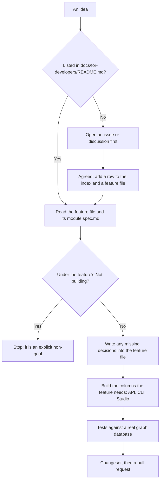

# Contributing to Invana

Thanks for helping build Invana. This guide covers three things:

1. [Local setup](#local-setup): get the engine, Studio and a graph database running on your machine.
2. [Contributing a feature](#contributing-a-feature): how a feature goes from idea to code.
3. [Raising a pull request](#raising-a-pull-request): branches, commits, changesets, checks and review.

## Local setup

### Prerequisites

| Tool | Version | Used for |
|---|---|---|
| Python | 3.14+ | the engine |
| Node.js | 22+ | Studio |
| [uv](https://docs.astral.sh/uv/) | latest | Python packages |
| [pnpm](https://pnpm.io/) | latest | Node packages |
| Docker and Docker Compose | latest | Postgres, the graph databases and the dev containers |

### Quick start

```bash
# 1. Clone, then install every dependency and the pre-commit hooks
git clone https://github.com/invana/invana.git
cd invana
make setup

# 2. Start Postgres, Neo4j, the engine and Studio (hot-reload dev containers)
docker compose up -d

# 3. Run migrations and create the default superuser
make engine-init

# 4. Load the sample graph (air routes) into Neo4j
uv run --directory engine invana loader ../demos/airways/air-routes \
    --uri bolt://localhost:7687 \
    --connector invana.graph.connectors.OpenCypherConnector \
    --username neo4j \
    --password testpassword
```

Open Studio at <http://localhost:8300> and sign in as `admin` / `change_me_please`. The engine API is at <http://localhost:8200>.

`make help` lists every command.

### What is in the repo

| Path | What it is | Stack |
|---|---|---|
| `engine/` | The engine: API, CLI, app-state database, query engine, runtime | Python, FastAPI, SQLAlchemy, uv |
| `studio/` | Studio, a pnpm and Turborepo workspace | React 19, TypeScript, Vite, TailwindCSS 4 |
| `studio/apps/studio/` | The app that composes the packages, plus the Playwright e2e suite (`e2e/`) | |
| `studio/packages/` | `core`, `ui`, `canvases`, `assistant`, `shell`, and one package per product (`datasets`, `modeller`, `explorer`, `projects`, `agents`) | |
| `integrations/` | One pip package per graph database (`invana-neo4j`, `invana-memgraph`, …). Each imports only `invana.graph` | Python |
| `demos/` | Sample data: `airways`, `arabidopsis` | |
| `docs/for-developers/` | **The scope.** The feature index, module specs and one file per feature | Markdown |
| `docs/products/` | The five products plan and the migration runbook | Markdown |
| `docs/docs/` | The public docs site | MkDocs Material |

### Local infrastructure

`docker compose up -d` starts the core stack:

| Service | What it is for | Port(s) |
|---|---|---|
| postgres | App-state database | 5432 |
| neo4j | Default graph database | 7474, 7687 |
| engine | FastAPI, hot-reload (your working tree is bind-mounted) | 8200 |
| studio | Vite dev server, hot-reload (bind-mounted) | 8300 |

The `engine` and `studio` containers are built from development images. Your working tree is bind-mounted into them, dependencies live in named volumes, and both start in reload mode. They are not used for production builds.

Other graph databases and the observability stack are opt-in through Compose profiles:

```bash
docker compose --profile memgraph up -d     # or janusgraph, arcadedb
docker compose --profile extra-dbs up -d    # every extra database
docker compose --profile telemetry up -d    # HyperDX: traces, logs, metrics on 8080
```

Pass the same `--profile` to `down` or `stop`, or use `docker compose down --remove-orphans`.

For Gremlin databases (JanusGraph, Neptune, TinkerGraph), load data with `--connector invana.graph.connectors.GremlinConnector` and a `ws://…/gremlin` URI.

### Running the engine and Studio on your host

Iteration is faster without containers. Stop the `engine` and `studio` containers (or never start them), keep Postgres and Neo4j running, then:

```bash
make dev                                         # both at once
cd engine && uv run invana start --reload        # or the engine alone
cd studio && pnpm dev                            # or Studio alone
```

> **Running Studio in the container?** Its `node_modules` is a Docker volume, so a `pnpm install` on your host does not reach it. Install inside the container too: `docker compose exec studio pnpm install`.

### First-time bootstrap

Every screen except sign-in needs a user. `make engine-init` runs the migrations and creates the root superuser:

| Field | Value |
|---|---|
| username | `admin` |
| email | `hi@invana.local` |
| password | `change_me_please` |

These are well-known defaults. **Change the password after your first sign-in.**

To choose your own values, run the CLI:

```bash
uv run --directory engine invana init                    # interactive
uv run --directory engine invana init --non-interactive \
  --username admin --email hi@invana.local \
  --password "change_me_please" --first-name "Admin"
```

- The command is idempotent. If any superuser exists, it changes nothing.
- Email is optional. Sign-in accepts the username or the email.
- More accounts come from `invana users` or from Studio: user menu → **Invitations**.

After pulling someone else's migration, run `make engine-migrate` (or `docker compose exec engine uv run invana migrate` for the container).

### Environment variables

`.env.example` at the repo root is the template for every optional variable, for both the engine and Studio. Copy it to `.env`.

| Variable | Needed when | Notes |
|---|---|---|
| `INVANA_SECRET_KEY` | production | JWT signing key. Development falls back to an insecure default and warns at startup |
| `INVANA_ENCRYPTION_KEY` | production | Fernet key for connector and LLM-provider secrets at rest |
| `INVANA_AUTH_*` | optional | TTLs, bcrypt rounds, password length. See `engine/src/invana/settings.py` |
| `VITE_API_BASE_URL` | optional | Studio's API base, default `http://localhost:8200` |

Generate the two production keys:

```bash
python -c 'import secrets; print(secrets.token_urlsafe(48))'
python -c 'from cryptography.fernet import Fernet; print(Fernet.generate_key().decode())'
```

Where each file is read from:

| You run | Engine reads | Studio reads |
|---|---|---|
| Docker Compose | root `.env` | root `.env` |
| On your host | `engine/.env` | `studio/apps/studio/.env.local` |

### Ports

| Service | Port | Override |
|---|---|---|
| Engine | 8200 | `INVANA_PORT` or `invana start --port` |
| Studio | 8300 | `studio/apps/studio/vite.config.ts` |
| Postgres | 5432 | `docker-compose.yml` |

### Engine extras

`uv sync` is exact: it removes anything you don't ask for. The full developer install is:

```bash
cd engine && uv sync --dev --extra all
```

Extras are `server`, `telemetry` and `all`. A partial sync fails at import time, and the error points at the wrong thing:

| Missing | Symptom |
|---|---|
| `--extra telemetry` (with telemetry on) | `ImportError: OpenTelemetry packages are required …` |
| `--extra server` | `ModuleNotFoundError: No module named 'fastapi'` |
| `--dev` | tests cannot import `httpx` or `pytest` |

If an import that worked yesterday fails today, re-run the full sync first.

### Working against a local design-kit

Studio's components come from the published `@invana/*` packages, so you don't need a design-kit checkout. To try a kit change before it is released:

```bash
cd studio
INVANA_DESIGN_KIT=../../../../design-kit pnpm dev
```

- The path is relative to `studio/apps/studio/`.
- `@invana/styling` resolves to its source. The other packages resolve to their `dist`, so run `pnpm build` in design-kit after editing them.
- A local link is never committed. A kit change reaches `main` through a kit release and a version bump.

### Docs

```bash
make docs          # serve on http://localhost:8000
make docs-build    # build the static site
```

## Contributing a feature

Invana is built from written decisions. **The design is written down before the code.**



### Rules for a feature

| Rule | What it means |
|---|---|
| Only what the index lists | [`docs/for-developers/README.md`](docs/for-developers/README.md) is the scope. Anything not listed there is out of scope, even if another doc describes it |
| Respect *Not building* | Every module spec and feature file ends with a *Not building* table. Don't implement those items or scaffold for them |
| Read the feature file first | `docs/for-developers/modules/<module>/features/<feature>.md` has the user story, journeys, surfaces and engine shapes |
| Decisions before code | A decision about one feature goes in that feature's Decisions table. A decision that spans a module goes in its `spec.md`. Write them in the present tense, with no history |
| Build every column it needs | The index tracks `API`, `CLI` and `Studio` separately. A feature ships when each column it needs is ✅ |
| Follow the slice order | The `Slice` column is the build order. [the-sequence.md](docs/for-developers/the-sequence.md) says what is next |
| Use the product's words | [terminology.md](docs/for-developers/terminology.md) pins the terms, and names the ones we don't use |

### Studio features

- **Start from the user's journey, not the components.** Name the actor and the goal. Map the steps, including the empty, loading, error and permission-denied states. Draw it as a mermaid flowchart in the feature file. Only then name the routes, pages and components.
- **Compose from `@invana/design-kit`.** Don't build custom components in Studio. If the kit lacks something, add it to the kit with a story first. The only exception is a Studio-only composition of kit components, which goes in `@invana-studio/ui`.
- **Use tokens only.** No literal colours, and no hard-coded control heights.
- **Graph rendering goes through `@invana/canvas`.** No PixiJS code in Studio.
- **Keep package boundaries.** `pnpm check-boundaries` enforces them. A product package never imports another product.

### Engine features

- Every new table or column comes with an Alembic migration: `make engine-migration msg="add foo table"`.
- A change to the API or schema changes the golden files. Regenerate them deliberately with `cd engine && uv run python -m tests.golden.update`, and review the diff. CI fails if they drift.
- Connectors live in `integrations/` and import only `invana.graph`.

### Tests

| Rule | Detail |
|---|---|
| Same standards as source | Tests are linted, formatted and type-checked like the code they test, e2e specs included |
| Few tests, but meaningful | A few positive and negative cases per behaviour, not many random ones |
| No mocks | Engine tests run against real graph databases and Postgres. Mock only when a reviewer asks for it |
| Coverage | 80% minimum for both the engine and Studio |
| Where | Engine: `engine/tests/<module>/`. Studio units: `*.test.tsx` next to the code. Studio e2e: `studio/apps/studio/e2e/` |

> **Engine and connector tests clear the graph database they run against.** Run them against a database you don't mind losing, and reload the sample data afterwards.

## Raising a pull request

### 1. Branch from an up-to-date `main`

```bash
git switch main && git pull
git switch -c feat/datasets-retraction
```

| Prefix | For |
|---|---|
| `feat/` | a new feature |
| `fix/` | a bug fix |
| `docs/` | documentation only |
| `refactor/` | a code change with no change in behaviour |
| `chore/` | maintenance, dependencies, tooling |

Never commit to `main` directly. Work reaches `main` only through a pull request.

### 2. Commit with Conventional Commits

The `commit-msg` hook ([commitizen](https://commitizen-tools.github.io/commitizen/)) rejects any message that doesn't follow the format.

**Format:** `<type>(<optional scope>): <description>`

| Type | Use when |
|---|---|
| `feat` | adding a feature |
| `fix` | fixing a bug |
| `docs` | changing documentation only |
| `style` | formatting, with no logic change |
| `refactor` | changing code without fixing or adding anything |
| `perf` | improving performance |
| `test` | adding or updating tests |
| `build` | changing the build system or dependencies |
| `ci` | changing CI configuration |
| `chore` | maintenance |
| `revert` | reverting a commit |
| `bump` | bumping versions |

```
feat(datasets): retract a version and flag what cites it
fix(connectors): handle Neo4j connection timeout
docs: add the change log to the feature index
```

Scopes are optional. Use the module or package name (`engine`, `studio`, `datasets`, `connectors`).

#### What the hooks check

`make setup` installs three git hooks. A failing hook stops the commit or the push until you fix the errors.

| When | Checks | Scope |
|---|---|---|
| `git commit` (message) | Conventional Commits format | the message |
| `git commit` | `ruff check --fix` and `ruff format`; the engine import layers; connectors import only `invana.graph`; Biome | the staged files |
| `git push` | `ruff check` and `ruff format --check` over the whole engine and every integration | when the push touches `engine/` or `integrations/` |
| `git push` | `tsc` over every package and the e2e specs; `pnpm lint` (Biome, where a warning fails too; package boundaries, retired names, kit overlap); `knip` | when the push touches `studio/` |
| Pull request to `main` (CI) | The lint checks above, plus a changeset check | the whole repo |

- **Cloned before the push hook existed?** Run `make setup` once more to install it.
- **Don't bypass the hooks.** On every branch except a pull request to `main`, they are the only check. `--no-verify` skips them, and the errors come back when the PR runs CI.
- Run the push checks without pushing: `uv run pre-commit run --hook-stage pre-push --all-files`.

### 3. Add a changeset

Every user-facing change needs one:

```bash
pnpm changeset
```

This adds a file to `.changeset/` that describes the change and its semver impact. Invana releases as one version, so pick the bump for the whole product.

### 4. Run the checks before you open the PR

| Check | Command |
|---|---|
| Lint everything | `make lint` |
| All tests | `make test` |
| Studio types | `cd studio && pnpm check-types` |
| Studio package boundaries | `cd studio && pnpm check-boundaries` |
| Studio dead code | `cd studio && pnpm knip` |
| Studio e2e | `cd studio && pnpm test:e2e` (needs the stack running and signed in) |
| Engine golden files | `cd engine && uv run pytest tests/golden -q` |

### 5. Open the pull request

```bash
git push -u origin feat/datasets-retraction
```

Open the PR against `main` and fill in every section of the [template](.github/PULL_REQUEST_TEMPLATE.md):

| Section | What to write |
|---|---|
| Summary | What the PR does, in one or two lines |
| Type and Component | Tick what applies |
| Changes | The key changes, and the feature file or decision each one implements |
| Testing | What you tested and how. Say so if something was not run |
| Checklist | Conventional commits, tests, lint, changeset, docs |
| Screenshots | Required for any Studio change |
| Related Issues | `Fixes #123` or `Relates to #456` |

### 6. Review and merge

- CI runs the lint checks and the changeset check on the PR, and they must pass. Tests and golden files don't run on PRs; run them yourself (step 4). A maintainer can run the full suite from the Actions tab.
- At least one approving review is required.
- Reviewers check the code against the feature file. If the code does something the file doesn't say, update the file in the same PR.
- PRs are squash-merged. The PR title becomes the commit message, so it must also follow Conventional Commits.

## Code of Conduct

Be respectful and constructive. We follow the [Contributor Covenant](https://www.contributor-covenant.org/).
