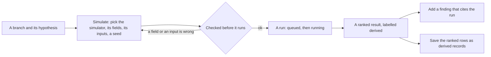

# Simulations

Before you commit to an option, try it. A simulation runs a **simulator** over pinned loads on a
project **branch**, and ranks what is likely to work. Invana checks the simulator's fields, pins its inputs, runs it
and labels the result — the simulator does the science; Invana never computes a figure itself.

## How a simulation works

| Part | What it means |
|---|---|
| **A simulator is a plugin** | Each simulator plugin contributes one simulator. With none installed, *Simulate* is not shown |
| **It runs on a branch** | A branch is one option of a project, with its hypothesis. Simulate it before you pursue, park or drop it |
| **Fields** | The simulator declares its fields; Studio draws one control for each. A missing or mistyped field is refused before a run opens |
| **Inputs are pinned** | Each input is pinned by its load — the load's id and its file's content hash. A load undone since is refused before any record is read |
| **Reproducible** | The seed is kept — Invana picks one when you give none. The same simulator version, fields, inputs and seed give the same result |
| **A simulation is a run** | It runs under the Graph's rules, with its own run page, steps and tokens, in the same journal as every other run |
| **Always derived** | Every result says its rows are predictions, not observations. Saved, the ranked rows become records of a kind, labelled derived and citing the simulation's inputs |
| **A record, never edited** | A simulation is kept as it ran. To change it, simulate again |

## From a result to a decision

| Step | What happens |
|---|---|
| **Add a finding** | A finding on the branch cites the simulation's run, for or against its hypothesis |
| **See the impact** | The project's *Impact* tab walks 1, 2 or 3 hops out from the records an option's findings cite, so you see who a decision reaches before you commit |
| **Decide** | The decision cites the findings; the trail runs back through the simulation to the loads it read |

## Who can simulate

| Role | Can |
|---|---|
| **Admin** | Simulate on any branch |
| **Operator** | Simulate with *Can work on projects*; otherwise *Simulate* is disabled and says why |

## Simulators today

| Simulator | Predicts | Status |
|---|---|---|
| **Genomic prediction** | Options ranked by how many meet every target — its method is in the plugin's own documentation | ✅ |

A new simulator is a plugin written against the simulator contract in the Plugin SDK.

## Not yet

| Item | When |
|---|---|
| Parameter sweeps · game theory | After 1.0 |
| What-if values per node | A simulator's job, when one models it |
