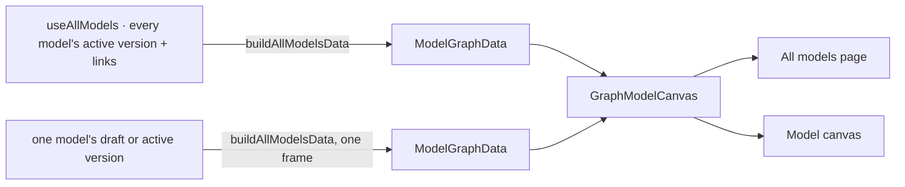

# GraphModelCanvas — models as frames, stitches across them

Every model drawn as a group frame holding its node types. A model's own edge types stay inside its
frame, and the stitches between models are the only edges that cross one. It is the modeller's only
canvas: *All models* ([stitch-models.md](../modules/connect-and-model/features/stitch-models.md) ST57) draws every model on it, and the model canvas ([model-editor.md](../modules/connect-and-model/features/model-editor.md) ME26) draws one.

The board is canvas's `SchemaBoard` (`@invana/canvas-ui`) — its config, Detail levels, schema cards,
hover cards and connect gesture, the same component the canvas Storybook's
`canvas-demos/by-casestudies/global-model/GlobalModel` story renders. What is Studio's own is the
stitch: every stitch is dashed, a staged one wears `--color-success`, its hover card reads the rule,
a type's card counts its stitches, and a drag declares one through the page's veto and declare card.

## Where it lives

```
studio/packages/canvases/src/model/
  GraphModelCanvas.tsx    SchemaBoard, with the stitch seams and the Studio chrome props
  style.ts                the dashed stitch, and the staged one's success colour
  preview.tsx             the edge hover card — kind, staged, rule, match
  types.ts                ModelGraphData · ModelTypeData · ModelEdgeData · Detail · hueSlotForName
```

The component does not know its callers. It takes data and seams; each caller keeps its own adapter
(`buildAllModelsData`). It takes **no children**: a host adds nothing to the canvas but its opt-in
stitch gesture (GM2, GM12).

## The component

```tsx
<GraphModelCanvas
  data={data}                      // ModelGraphData
  title="All models"
  selected={{ kind: "node", id }}  // optional
  onSelect={(s) => …}              // optional
/>
```

| Prop | Type | Required | What it does |
|---|---|---|---|
| `data` | `ModelGraphData` | ✅ | frames, types and edges. Stitches get their dash in `style.ts`, then it goes to `SchemaBoard` |
| `title` | `string` | — | the header title; left out, the header has none |
| `message` | `string` | — | shown once in the message line |
| `initialDetail` | `Detail` | — | `high` by default — circles, which *All models* opens on. A single model passes `medium` — cards (GM4) |
| `selected` | `{ kind: 'node' \| 'edge', id } \| null` | — | the node or edge drawn selected |
| `onSelect` | `(selection) => void` | — | one node or edge clicked, or `null` on an empty click |
| `height` | `number` | — | for a host that gives no height of its own |
| `stitching` | `{ onStitch, panel, onClosePanel }` | — | turns on the stitch gesture (GM12). Left out, there is no Stitch tool |
| `backend` | `'webgpu' \| 'webgl'` | auto | the page's render backend (GM13); a change remounts the canvas |

`stitching`:

| Field | Type | What it does |
|---|---|---|
| `onStitch` | `(sourceId, targetId) => string \| null` | a drag landed. Return the refusal the message line says, or `null` to accept and set `panel` |
| `panel` | `ReactNode \| null` | the declare card while one is open. Non-null opens the dock on it; back to `null` closes the dock |
| `onClosePanel` | `() => void` | the dock closed without the card closing itself |

### Data shape

| Field | Type | Note |
|---|---|---|
| frame `id` | `string` | *All models* and the model canvas use `model:<modelId>` |
| frame `type` | `MODEL_FRAME_TYPE` · `MODEL_EMPTY_TYPE` | canvas's `SCHEMA_FRAME_TYPE` / `SCHEMA_FRAME_EMPTY_TYPE`; the empty one is a sized frame, not a group (ST29) |
| frame `data` | `{ name, description, version, hue }` | `name` is the tab; `hue` is a categorical slot, `1`–`8` |
| type `type` | `Model.Type` | the board binds one look per type |
| type `parentId` | `string` | its frame |
| type `data` | `ModelTypeData` — a `SchemaTypeData` | `label` · `model` · `frame?` · `hue` · `description` · `icon` (`lucide/<name>`) · `propertyCount` · `stitchCount` · `identity?` · `badge?` (`anchored`) · `properties[]` |
| `properties[]` | `{ name, type, identity?, tags? }` | `identity` when a stitch keys on it; `tags` are those stitches |
| edge `type` | `string` | the edge type, `SAME_AS` for an anchor |
| edge `data.kind` | `edge` · `anchor` · `relationship` | decides the stroke (GM9) |
| edge `data` | `title` · `model?` · `staged?` · `description?` · `rule?` · `match?` | the hover card |

### The three Detail levels

| Level | Member structure | ELK node size |
|---|---|---|
| **High** | `labelDot`: an icon circle ringed in its model's hue | 60 × 84 |
| **Medium** | `labelCard`: icon, name, model, two-line description, `N properties · key x`, the *anchored* badge | 264 × 116 |
| **Low** | `schema:<Model.Type>` from `schemaCardStructure`: a header (`Model · N stitches`), then one row per property (type chip, name, `key`, type) | 300 × 240 |

A Detail or data change runs one sequence (`useDetailTemplates`): `stopLayout` → `update(detailConfig(...) +
activeLayout)` → `runLayout('elk', { fitCamera })`. The types draw as the solve ends (ME25).

### What it renders

`SchemaBoard`'s parts, configured:

| Part | |
|---|---|
| Theme | `theme="tokens"` — `CanvasThemeSync source="tokens"` (GM11) |
| Header | title · `GraphControlsToolbar` (layout section off) · **Detail** · Settings dock; the kit's 30px bar |
| With `stitching` | the connect tool and **Shift**-drag (GM12); the declare card docks on the right |
| Hover | canvas's `renderSchemaNode` for a type; Studio's `renderModelEdge` for an edge |

## The callers



| Surface | File | Around the canvas, never on it |
|---|---|---|
| *All models* | `models/stitch/AllModelsCanvas.tsx` | a staged bar with **Commit** / **Discard**, and a bar for stitches bound to an older version. It turns `stitching` on, refuses a drag inside one model or onto a model with nothing published, and docks `DeclareStitchCard` |
| Model canvas | `models/model-editor/ModelCanvas.tsx` | the model bar (**Node type**, **Edge type**), the selected type's form beneath, the read-only footer |

## Decisions

| # | Decision |
|---|---|
| GM1 | **The modeller's one canvas is canvas's `SchemaBoard`.** Its config, Detail levels, schema cards, hover cards and connect gesture are canvas's; the GlobalModel story renders the same component. Both modeller surfaces draw on it, so a model reads the same alone and among the others |
| GM2 | **A host adds nothing to the canvas.** No children, no toolbar items, no camera hooks. What a page needs beyond the drawing (a staged bar, a type form) sits outside the canvas, in the page's own layout. Selection is one channel in and out; the stitch gesture (GM12) is the other |
| GM3 | **ELK, and only ELK.** `ElkLayout` `layered` lays out every modeller canvas — *All models* and a single model alike. There is no Layout switch and no d3-force layout: force only pulls a model's types together, so its frames overlap, and a second layout is a second drawing of one model to learn |
| GM4 | **Detail is High, Medium or Low, and each is a config patch** (`SCHEMA_DETAIL`). A patch carries the frame styling and padding, the type binding and the ELK spacing for its node size, and the layout re-runs after it. ***All models* opens on High — circles; a single model opens on Medium — cards**, since one model's handful of types has room for names and counts |
| GM5 | **No config names a model or a type.** The board's `*` binding expands into one binding per `Model.Type` in the data (`detailConfig`) |
| GM6 | **Low's schema cards are built from the data.** `schemaCardStructure` writes one card per type from its own properties: a 300px card, 22px rows, one type-chip table. A card's height is its row count. Studio's subtitle names the model and counts its stitches |
| GM7 | **Hues are slots of the theme's categorical ramp.** Every colour lookup binds `data.hue` (`1`–`8`) with `categorical: true`, and the ramp is `--color-data-N` through the token sync, so a theme change recolours with no host re-read. **A model's slot comes from its name** (`colorSlotByString`), never its place in the list, so a model keeps its hue when another is added, deleted or re-sorted; **a type's slot comes from its own name**, so it wears the colour the Explorer paints it (ST17) |
| GM8 | **A frame is washed in its model's hue.** The frame styling binds its fill and border to `data.hue` — a 10% wash and a 60% border — on a tabbed rect with the name on the tab and the collapse toggle hidden. The empty frame is the same without `group` |
| GM9 | **Every stitch is dashed; a model's own edge type is solid.** A stitch, anchor or relationship, joins two models' types by a rule, and a dash keeps it from reading as an edge the model declares. A staged stitch is dashed in `--color-success`. The dash is set per edge, because a resolver has to return *some* dash for every edge and cannot return "none" |
| GM10 | **Every run fits the camera, gliding with the nodes.** `fitCamera` on each run the board starts — on new data and on a Detail switch |
| GM11 | **No theme toggle on the canvas, and every colour it paints is Studio's.** `CanvasThemeSync source="tokens"` hands the canvas one theme whose palette is the live tokens — backdrop, cards, text, hairlines, rings and the categorical ramp — on every theme change. A second toggle would let the canvas disagree with the page it sits in. The header is Studio's 30px bar (`!h-[30px]`), the height of the kit's tab strip |
| GM12 | **Stitching is the board's connect gesture, switched on by the host.** A plain drag moves a type; **Shift**-drag from one type onto another draws a stitch, and the **Stitch mode** toggle — the header's one link icon — keeps that on without Shift. The drag asks the host, which refuses in words (the message line) or hands back the declare card, which docks on the right. The dock has no header toggle of its own: it opens on an accepted drag and closes when the card does. The drag never adds an edge to the store; a stitch is a declared row that returns as data, dashed and staged. Docked, not modal, because the two frames the stitch is about stay in view while the keys are named (ST34) |
| GM13 | **The canvas starts on the page's render backend.** Both hosts pass the graph page's `backend` through, the one Explorer draws on, so a user who pins WebGL gets it here too. The backend is fixed at init, so the canvas is keyed on it |
| GM14 | **The board takes the Model tab's full height.** The tab is a `fill` row, and the kit's board renderer gives a fill row's panel `fill`, so the canvas is the tab edge to edge and the fit frames what is on screen |

## Not building

| Not building | Why |
|---|---|
| Host children, host toolbar items, host camera logic | GM2 |
| Writing a model from a canvas gesture — drag-to-connect an edge type, add on the canvas, a context menu | GM2. The model canvas's bar and form write (ME1). The stitch drag declares a stitch, not a model (GM12) |
| Zoom-driven collapse or an altitude track | GM1. Detail is how the drawing changes altitude (ST15) |
| A per-type icon chosen by the canvas | the API carries no icon for a type yet. Every type is `lucide/box` until one does |
| The union list drawn on this canvas | it is stated, not drawn (ST6, ST16) |
| A Layout switch, or d3-force, on a modeller canvas | ELK is the one layout; force overlaps the frames (GM3) |
| A theme toggle on the canvas | GM11 |
