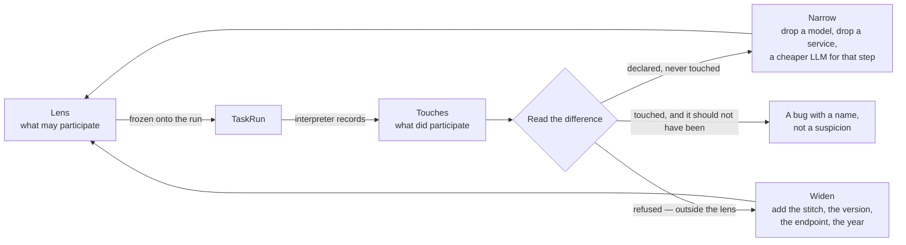

# Governance — what may participate, what did, and how a person tunes it

**Status: RFC, concluded — D1–D19 are settled and dispersal has begun.** Nothing here is built. This file maps one design space — *which things
are allowed to shape a decision, which ones actually did, and how someone changes that* — and states
the options rather than the answer. When a question below settles it moves into the feature file it
governs ([§12](#12-where-each-decision-lands)), in present tense, and the option table that produced
it is not kept. This file is then deleted.

System design: [governance-and-lens.md](../../specs/system-design/governance-and-lens.md) — what is settled, the layers and the address, the lens record and its rules per layer, egress, the touch record, composition, what it adds to the record and *Not building*. This file keeps the loop (§1), sub-world reasoning (§4), cost (§8), the drawings (§§9–11), where each decision lands (§12), the drawing decisions (§14), and the retired rows of §0, §3 and §13.

> **As** someone accountable for an answer, **I want** to say which models, which slices of them,
> which LLMs and which outside systems may take part — and then see which ones actually did — **so
> that** I can narrow the lens until the decision is one I would defend, or widen it until the
> question can be answered at all.

| | |
|---|---|
| Governs | [operate](modules/operate/spec.md) · [ask](modules/ask/spec.md) · [agents](modules/agents/spec.md) · [connect-and-model](modules/connect-and-model/spec.md) · [graph-connectors](modules/graph-connectors/spec.md) · [explore](modules/explore/spec.md) |
| Depends on | [System design › orchestration](../../specs/system-design/orchestration.md#the-records) — `Todo · Flow · Task · TaskRun · Lens` |
| Drawn in | the `Task Plan & Task Run` design canvas — `QueryPlan` · `QueryRun` artboards |
| Slice | not assigned — this is design, not delivery |

**Auditing is the read half. Governing is the write half, and it is the reason to build the read half
at all.** A record of what a run touched, with no way to change what the next run may touch, is a
receipt. The two halves are one loop ([§1](#1-the-loop)), and the **lens** is where it closes.

---

## Contents

| § | | Settles |
|---|---|---|
| [0](#0-what-is-already-settled--the-retired-row) | What is already settled | the one retired row; the rest is system design |
| [1](#1-the-loop) | The loop | declare → run → read → retune, and why neither half stands alone |
| [3](#3-the-lens-generalises--what-stayed) | The lens generalises | where Worlds sat and the settings tabs before the change — retired |
| [4](#4-sub-worlds--narrowing-what-a-decision-may-rest-on) | Sub-worlds | three grains — type, property, record — and why modelling is a governing act |
| [8](#8-cost--what-was-spent-and-what-was-not) | Cost | spent, avoided, and by layer |
| [9](#9-one-continuous-flow) | One continuous flow | no wrap, no *continues below*, and bands that expand |
| [10](#10-the-detail-surface) | The detail surface | the step board, and the bands it grows |
| [11](#11-plan-and-run-are-two-drawings) | Plan and run | the same layers, deliberately different ground |
| [12](#12-where-each-decision-lands) | Where each decision lands | question → feature file |
| [13](#13-what-this-adds-to-the-record) | What this adds | the drawing rows — bands, the flow strip, the lens editor |
| [14](#14-decisions-settled) | Decisions, settled | the drawing decisions and where Worlds sat |

---

## 0. What is already settled — the retired row

The rest of this section moved to [System design › governance and the lens](../../specs/system-design/governance-and-lens.md#what-it-rests-on).

| Settled | Where | What it means here |
|---|---|---|
| The agent binds the provider; the composer never picks one | [PM1 · C8](modules/agents/features/providers-and-models.md) | [§3.2](../../specs/system-design/governance-and-lens.md#llm) is a real tension with this and is written as one |

- Superseded: an agent binds no provider; the cast names the model and the Graph resolves the credential.

---

## 1. The loop



| Half | Is | Without the other half |
|---|---|---|
| **Declare** — the lens | what may take part | a policy nobody can check. *Configured* is not *enforced* |
| **Record** — the touches | what did take part | a receipt. You read what happened and change nothing about what happens next |

**The diff between them is the product.** Declared-and-never-touched is waste you can cut.
Refused-as-outside-the-lens is the answer you are not getting, with the exact reason.
Touched-but-not-declared is impossible if enforcement works, which is what makes the record proof
rather than logging.

---

## 3. The lens generalises — what stayed

The lens record, `kind`, the glob, and each layer moved to [System design › governance and the lens](../../specs/system-design/governance-and-lens.md#the-lens). Kept here: where Worlds sat in the old navigation, and the settings tabs before the change — both retired.

#### Where Worlds lives

**`Runs · Plans · Catalogue · Worlds` — a fourth drawer in the Tasks stack**
([D18](#14-decisions-settled)), not a `leftNav` icon of its own. A run is made of a plan, the
callables in it, **and the world it ran against**, so the stack already holds everything an execution
is composed from.

It is the same argument [SR12](modules/operate/features/see-what-ran.md) makes for Runs: *this run →
its world → retune → run again* stays in one column and never closes what you came from — which is
exactly what `Retune` on the run board needs ([§10](#10-the-detail-surface)). A fifth icon would
also be the shape [SR7](modules/operate/features/see-what-ran.md) warns about, where an icon per kind
turned one journal into four panels.

**What this stretches:** the stack now means *what executes* **and** *what it may see*, and four
drawers is where a stack starts wanting a scroll.

**Graph settings changes with it** ([D19](#14-decisions-settled)):

| Tab | Was | Is |
|---|---|---|
| **LLMs** | configure providers; one is the Graph default | configure providers. **`is_default` is dropped** — the cast is the answer to *which model when nobody said*, and two mechanisms picking a model is what D2 removed |
| **Agents** | the ceiling, and each agent's bound provider | the ceiling. The provider field is gone; an agent carries a **lens** instead |
| **Guardrails** | — | **not a settings tab.** Superseded by [GV17](modules/govern/spec.md): Govern is its own `leftNav` item and Guardrails is its second drawer, beside the Worlds it bounds |

---

## 4. Sub-worlds — narrowing what a decision may rest on

**A lens is used for two different reasons, and they are one record with two surfaces.**

| Use | Reads as | Wants |
|---|---|---|
| **A bound** — compliance | *this run may not see X* | enforcement, a refusal with a reason, an audit trail |
| **A world** — reasoning | *decide as if only these factors existed* | a name, a library, and the ability to run one question in two worlds and compare |

Same record, same enforcement, same freeze onto the run. The second is why `Lens.key` exists: a
sub-world is worth naming because you will use it again, and because the interesting act is running
the same question in two of them.

**Modelling is therefore a governing act.** What a model declares — its types, its properties, its
axes — is what a sub-world can be cut along. A property nobody modelled cannot be excluded from a
decision, and an axis nobody declared cannot be sliced. The model is not merely the thing being
governed; it is the vocabulary governance is written in.

### Three grains of narrowing

| Grain | Removes | The generating model is shown | *Cannot answer* reads |
|---|---|---|---|
| **Structural — type** | a model, a type, a relationship | never sees that it exists | *this world has no Publisher* |
| **Structural — property** | one property of a type | the type, without that field | *this world does not carry revenue* |
| **Extensional — records** | rows, by a composed predicate | the type and the field; the slice bounds what returns | *outside the slice — H1 2026 only* |

**Property-level is what makes "only certain factors" literal.** *Decide without seeing price* is a
structural narrowing of one property, and it is the difference between asking a model to ignore
something and making it unable to use it. An instruction not to consider price is a suggestion; a
schema with no price field is a bound.

### Each grain is enforced somewhere different

| Grain | Enforced by |
|---|---|
| **type** | the schema handed to the generating model, and the validator refusing a query that names an excluded type |
| **property** | the same, one level down; the validator rejects **any** reference to the property anywhere in the query; and the connector **rewrites a whole-node return** into a permitted projection ([D3](#14-decisions-settled)) |
| **records** | the predicate composed into the query by the connector |

**The whole-node return is the hole, and the query is what gives way.** A property excluded from the
schema but still present on the stored record arrives anyway if the query returns whole nodes. So
`run_query` **rewrites the projection** — a Cypher map projection, a Gremlin `valueMap` with keys —
into the permitted set, and the validator rejects any query that names an excluded property
explicitly. Both halves are needed: rewriting alone does not stop `avg(d.revenue)`, and rejection
alone does not stop `RETURN d`.

**Rewriting is deterministic, and that is the point.** Refusing the query and asking the generating
model to project explicitly would make the bound depend on a model complying after being told twice
— and a stubborn one burns the retry budget and fails a run that could have been answered. Stripping
the excluded keys from returned rows is weaker still: it leaks through any aggregate, where the value
arrives in a column named for the function and there is no key to strip.

**The rewrite is recorded, never silent.** The trace carries `query.generated` and `query.executed`
as two digests, so *the generated query, exactly as executed* stays true by showing both and saying
which ran.

### A selector, in full

```jsonc
{ match: "graph_data/model/Observations@v2", allow: true,
  properties: { exclude: ["revenue", "contract_value"] },   // structural, per property
  select: {                                                  // extensional, per record
    time: { between: ["2026-01-01", "2026-06-30"] },
    geo:  { in: ["IE", "DE", "FR"] },
    dims: { channel: {in: ["retail"]} }
  } }
```

### Only declared axes are selectable

**A model declares its axes; a lens may only select on what a model declared.** Without this rule a
selector is arbitrary property filtering, which is a query — and a lens that can express a query is a
second place to write one.

| Axis | The model declares | The lens selects with |
|---|---|---|
| `time` | which property carries **valid time** — when the fact was true | `between` · `since` · `at` |
| `geo` | which property carries the region, and its vocabulary (ISO-2, a region code) | `in` · `not_in` |
| `dims` | named properties marked selectable, with their type | `in` · `eq` · `range` |

**This is new on the model, and it is the real cost of this section.** Declaring an axis says *this
property is how people slice this entity*, and it belongs beside the model, not in every lens that
wants to use it.

### Valid time is not `as_of`

The lens already has `as_of`, and conflating the two would be the classic bug.

| | Is | Answers | Exists? |
|---|---|---|---|
| `as_of` | **transaction time** — the global model as it stood at a moment | *what did we know on 1 March* | yes, today |
| `select.time` | **valid time** — when the fact was true in the world | *what was true in H1* | new |

**They are not the same kind of thing, which is why they stay two fields**
([D7](#14-decisions-settled)). `as_of` sits on the **Lens** and resolves which published
versions and stitches are in view — lens-wide metadata resolution, and what makes a replay
reconstructible. `select.time` sits on a **rule** and composes a predicate into the query, only where
that model declared a valid-time axis. Nesting `as_of` under `select` for symmetry of shape would
imply two models could resolve at two different transaction times, which is a world that never
existed.

They compose, and the composition is the useful one: *what we knew on 1 March about what was true in
H1*. **A model with a declared valid-time axis is what makes a temporal sub-world possible at all** —
no declaration, no time selector, and a lens asking for one is refused naming the model rather than
silently ignored.

### Enforced by composition, never by filtering afterwards

| | Is | Governance? |
|---|---|---|
| **Compose** — the predicate is folded into the query the connector executes | the model literally cannot return a row outside the slice | **yes** |
| **Filter** — rows come back and are dropped | the counts, the aggregates and the schema the model saw are all outside the slice; only the display is inside it | **no** — a display filter wearing a bound's name |

**So a selector is a connector-contract concern**, not a Studio one: `run_query` composes the
effective predicate into the dialect it speaks
([the-connector-contract](modules/graph-connectors/features/the-connector-contract.md)). Both halves
are needed — the generating model is **told** the slice, so it does not write a query returning
nothing, and the runtime **composes** it anyway, so a model ignoring the instruction cannot escape.

### Outside the world is *cannot answer*, not a smaller number

If the world holds H1 2026 and the question asks about 2025, the honest answer is *outside the lens —
this run was grounded in Observations@v2, H1 2026 only*, recoverable by widening. Answering from H1
data and saying nothing would be the worst outcome of adding sub-worlds: a confident wrong number
produced by a setting nobody surfaced. This is
[§0.9](orchestration.md#09-grounding-a-run--the-lens)'s existing split, now reachable three more ways
— one per grain.

### A named lens is the sub-world, and `subgraph` stays taken

A lens with structural and extensional narrowing over a set of models **is** the persistent, named,
reusable world. `Lens.key` already exists for exactly that, so the product needs no new record — and
it must not grow a new word: **`subgraph` already means an emission**, one of the five things a step
produces ([terminology § 4](terminology.md)). A narrowed view of the graph is a **Lens**, named. A
temporal graph is a Lens whose `select.time` is set.

---

## 8. Cost — what was spent, and what was not

### Spent

Settled: `task_runs.cost_usd`, derived at settle, `NULL` when unpriced
([SR40](modules/operate/features/see-what-ran.md)), drawn against its ceiling rather than as a total
([SR20](modules/operate/features/see-what-ran.md)). Unchanged.

### Not spent — where carelessness becomes dishonesty

"A cache hit costs less" is two claims and only one is a fact.

| Claim | Is | Drawn as a number? |
|---|---|---|
| The prefix was 18.2k tokens billed at 0.1× — **9.1k** were not billed | a **fact**; the provider reports cached and fresh input separately | yes |
| This answer-cache hit saved **$0.024** | a **counterfactual**; the run that did not happen has no cost | no — [OB4](modules/operate/features/observability.md) forbids estimating silently |

| Recorded | Kind | Drawn as |
|---|---|---|
| `tokens_cached_in` | fact, from the provider | `18.2k of 19.3k input served from cache` |
| `cost_usd` | fact, derived | `$0.017 of $2.00`, with a meter |
| answer-cache saving | **estimate**, from the plan's observed median | only on the **plan** drawing, inside the observed layer — never on a run, where it reads as something that happened |

#### Observed numbers are a layer, and it is off by default

A declared number (`timeout 8s`, `max 3 rounds`) is part of the definition and moves only when someone
edits the plan. An observed one (`hit rate 38%`, `p50 1.1s`) summarises a window of runs and moves on
its own. They are different objects, so they are not distinguished by a chip
([D14](#14-decisions-settled)) but by a **layer the reader switches on** — and when it is on,
the window and sample size are stated **once, at the top**, which is the thing a per-figure marker
could never carry.

Off by default, the plan reads as a definition. On, every observed figure — including the estimated
saving above — is visibly in the same layer, which is what keeps the one permitted counterfactual
from looking like a fact. **What this costs:** *declared 8s, observes 1.1s* is one of the most useful
readings of a plan, and it takes a toggle to get to.

### The governing figure

The tuning loop needs one number the product does not have: **spend by layer, then by participant.**
*The llm layer is 94% of the bill and the `extract` role is half of it* is what turns a board into
an edit to the cast. It is a grouping of `cost_usd` by the address the touches already carry — no new
source ([OB1](modules/operate/features/observability.md)).

---

## 9. One continuous flow

**The flow is drawn as one continuous left-to-right strip. No wrap, no *continues below*.** A wrapped
flow asks the reader to reconstruct the order; a flow that continues below asks them to hold two
drawings in their head and asserts nothing about where the break falls.

**Across is time; down is the participant. A task is a bar, never a column heading**
([D20](#14-decisions-settled)). The strip *is* the Gantt: a task name written along the top cannot
say how long anything takes, and it forces one column per task whether or not the task engages
anything. What the axis counts is the drawing's tense —

| Tense | Surface | The axis counts | A bar is |
|---|---|---|---|
| **declared** | a plan ([LB17](modules/workflows/features/the-library.md)), a skill's Flow tab ([SK16](modules/skills/features/authoring-a-skill.md)) | `step` — the plan's own order, one unit per Task | what the plan **will** engage, and for how many steps it holds the participant |
| **touched** | a run ([D16](#14-decisions-settled)) | `elapsed` — the wall clock, from the run opening | what it **did** engage, drawn where it happened and as long as it took |

| Surface | Width | How |
|---|---|---|
| Design canvas artboard | as wide as the flow needs | one row, six bands, horizontal scroll on the canvas |
| Studio flow panel | the viewport | the layer labels freeze in a left column; the strip scrolls horizontally under them |

### A band expands into its sublayers

Collapsed, `graph data` is one band. Expanded, it is one row per model touched, and a step that read
three models draws in three rows. The same for `llm` — one row per provider, or per model.

**`graph data` and `llm` are expanded by default; the other four bands are collapsed**
([D5](#14-decisions-settled)) — about nine rows for a typical flow.

| State | Rows | For |
|---|---|---|
| Collapsed | 6 | every band the same height. Predictable, and it hides the participants |
| **Default** | 4 + the models + the llms | *which models and which LLMs is this decision resting on*, without opening anything |
| Expanded, all | one row per participant touched | the audit read, one click away |

They are the two bands where multiplicity is real; cache, human, third party and agent almost always
carry one participant or none, so expanding them buys a row of whitespace each. The asymmetry is
stated rather than derived, and it is the one place the six bands do not behave alike.

**The disclosure is a control, and a shut band keeps its tasks**
([D21](#14-decisions-settled)). Folding a band takes its participant rows away and drops every task
it spends onto the band's own line, so the shut strip is **six lines with every task still placed in
time** — the overview a reader opens with. `collapse all` does it to every band that has
participants to fold. Nothing is hidden either way: folding moves a task up a row, it never drops
it, so a band's count and the bars on its line always agree.

| Reading | Answers |
|---|---|
| folded | *what is this busy with, and when* |
| open | *which participant each task spends* — the list a world is checked against |
| hovering a task | both, for that one task — the participant, when it runs and for how long, and the rule that refused it |

**A task carries a hover card, so a bar can stay a bar.** The participant a row
truncates or a fold took away is one hover from any task, which is what makes folding safe rather
than lossy; the alternative is a second line on every bar for every fact somebody might want.

**A band caps its rows and shows `+ n more`.** Without a cap a 200-lane fan-out turns `graph data`
into 200 rows and the strip stops being a drawing.

The plan drawing expands to the participants the lens **permits**; the run drawing expands to the
ones it **touched**, with refusals drawn as struck rows in place.

**A row nothing spent is muted, never dropped** ([D22](#14-decisions-settled)). A band no task
touched recedes to the muted ground with its chip and its note, and so does a participant row under
an open band: `role: extract`, declared and never reached, reads as *this run did not get that far*
rather than as an ordinary empty row. Dropping the row would say nothing at all — and *this plan
never reaches for a cache* is a finding, not an absence.

**Refused is not unspent.** A row whose only task was refused keeps its full weight. Being stopped
from reaching a participant and never reaching for one are the two facts this drawing exists to
separate, so the mute follows *nothing happened here* and never *something was denied here*.

### The strip is the run board's default

**The board opens on the six bands**, `graph data` and `llm` expanded
([D16](#14-decisions-settled)). The unrolled tree, the nesting and the sequence are **toggles over
the same trace** — no second fetch, no second spec
([SR30](modules/operate/features/see-what-ran.md)). The Gantt is not among them: the strip is one
([D20](#14-decisions-settled)), so there is no second drawing of duration to keep in step.

Nothing is lost by demoting the Gantt here: [SR13](modules/operate/features/see-what-ran.md) already
splits the surfaces — *the drawer is an overview, the board is the detail* — and the Gantt is the
drawer's overview, so *where did the time go* is answered before this page is opened. The question
this page now answers is *what was this grounded in, what did it touch, and what was refused*.

### A replan is a divider, not a second strip

**One strip, with a vertical rule at the frontier** ([D15](#14-decisions-settled)), labelled
with the revision and what triggered it. Steps from the superseded revision that never ran draw as
outlines rather than disappearing, and the bands run unbroken so a participant can be tracked across
the boundary.

It matches the record: a replan appends a revision to one `plan_snapshot` and may never alter a
settled node ([§0.11](orchestration.md#011-replan--changing-the-plan-under-a-live-run)), so there is
one run, one `seq` and one set of touches. Two strips would draw two runs where the record has one,
restart the bands, and turn *what had it already touched when it changed course* into a manual diff
between two pictures — which is the question a replanned run is opened to answer.

### Nothing is encoded as height

The vertical axis inside a band is spent on participants, so a card's height carries no meaning
([D6](#14-decisions-settled)). What the row does not say, the card badges:

| Drawing | The llm band's rows are | The card badges |
|---|---|---|
| `flow` | **roles** — `extract` · `decide` · `judge`, which is what a plan names | nothing; the cast has not resolved yet |
| `task_run` | **models** — `haiku-4.5` · `opus-5`, which is what resolved | the **role**, which the row does not carry |

This is [§11](#11-plan-and-run-are-two-drawings)'s *plan names roles, a run names what resolved them*,
drawn — the two drawings differ in exactly the way the record differs, and in no other way.

### This contradicts SR32, and the contradiction is the decision

[SR32](modules/operate/features/see-what-ran.md) says `TaskFlowWidget` wraps steps into rows. That was
written for a flow with no vertical axis — wrapping was the only way to use the width. With bands the
vertical axis is spent, and expansion needs all of it.

### The unification worth noticing

**They share a mechanic, not a shape.** `Gantt` has time on x and a task per row; the layer flow
has `seq` on x and a band or participant per row. Both scroll horizontally under a frozen label
column and both take the trace unchanged — but the Gantt's rows *are* its data, while the flow's rows
**group** its data, expanding, collapsing and capping at `+ n more`; and a step sits in exactly one
Gantt row while lighting several flow rows.

So they are **two components over one primitive** ([D13](#14-decisions-settled)): the
frozen-label-column scroller moves into `@invana/ui`, and `Gantt` and `TaskLayerFlow` are built
on it. Each keeps one row model, one expansion behaviour and one meaning for clicking a row — and
`Gantt`, which three surfaces already depend on ([SR21](modules/operate/features/see-what-ran.md)),
is not widened to carry the newest drawing in the product.

---

## 10. The detail surface

**Clicking a step opens `task_run:<step_id>`, breadcrumbed under its run.** That address exists
([SR36](modules/operate/features/see-what-ran.md)) and the shell is already one per kind
([SR18](modules/operate/features/see-what-ran.md)). This RFC adds bands; it adds no surface.

| Band | Renders | Absent when |
|---|---|---|
| **Touches** | the ledger, grouped by layer then sublayer; each row an address, a direction, a volume; refusals in line with their reason | nothing recorded |
| **Slice** | the selector actually composed into the query, and the query digest | not a `graph_data` step |
| **Egress** | what crossed the boundary, to which system, in which classes | nothing left |
| **Attempts** | one row per attempt — started, duration, error, wait before the next, which one stuck | one attempt, the common case |
| **Model** | provider · model · role · temperature · max_tokens · input split fresh/cached · output | not an llm step |
| **Cache** | key digest · hit or miss · ttl · what it skipped | no cache fronts this step |

Every one obeys [SR34](modules/operate/features/see-what-ran.md).

### Two bands at run level

| Band | Renders |
|---|---|
| **Layers touched** | six chips, lit or dark, each expanding to the participants under it |
| **This run's lens** | the rules as frozen, each with *allowed · touched · refused* counts, the slices in force, and **Retune** opening the lens editor |

**`Retune` is where the loop closes in the UI.** Everything else on the page is read-only
([SR8](modules/operate/features/see-what-ran.md)); this control does not change the run, it changes
what the next one may do.

---

## 11. Plan and run are two drawings

| Aspect | `flow` | `task_run` |
|---|---|---|
| Answers | what will happen, and under what rules | what did happen, and when |
| Ground | cool grid paper — reads as a document | warm plain — reads as a live surface |
| Colour means | **category** — llm, tool, human, control. No status hue at all | **status**. Category demotes to a chip |
| Layers | the same six bands | the same six bands |
| Participants | what the lens **permits**, and the plan's **roles** | what **resolved** — `claude-opus-5`, `Observations@v2` sliced to H1 |
| Loops | drawn once, with the criterion and the bound | unrolled — one column per iteration taken |
| Fan-out | one templated node, `× n subtasks` | n real lanes, each with its own state, model and cost |
| Time | budgets — timeout, backoff, ceiling | actuals — duration, waits, spend |
| Failure | a retry *policy* and an escalation route | the *attempts*, and which route was taken |
| Numbers | `obs` aggregates across runs | this run's figures |
| Motion | **none, ever.** If it moves, people read it as running | only while a node or edge is genuinely live |

**Plan names roles; a run names what resolved them.** That row is what makes the pair governable: the
plan stays portable, and the lens is visibly what turned `decide` into `opus-5` and `Observations` into
`Observations@v2, H1 2026, IE·DE·FR` on this particular run.

---

## 12. Where each decision lands

| § | Question | Lands in |
|---|---|---|
| [3](#3-the-lens-generalises--what-stayed) | The lens generalises | where Worlds sat and the settings tabs before the change — retired |
| [3.2](../../specs/system-design/governance-and-lens.md#llm) | role in the plan, cast in the lens | [providers-and-models](modules/agents/features/providers-and-models.md) + [the-catalogue](modules/workflows/features/the-catalogue.md) |
| [4](#4-sub-worlds--narrowing-what-a-decision-may-rest-on) | declared axes on a model | [domain-models](modules/connect-and-model/features/domain-models.md) — an axis is modelling, not lensing |
| [4](#4-sub-worlds--narrowing-what-a-decision-may-rest-on) | composition, not post-filtering | [the-connector-contract](modules/graph-connectors/features/the-connector-contract.md) |
| [4](#4-sub-worlds--narrowing-what-a-decision-may-rest-on) | a named lens is the subgraph; `subgraph` stays an emission | [terminology](terminology.md) §3 and §8 |
| [8](#8-cost--what-was-spent-and-what-was-not) | cost by layer and participant; the `obs` marker | [observability](modules/operate/features/observability.md), beside OB4 |
| [9](#9-one-continuous-flow) | one strip, expanding bands, superseding SR32 | [see-what-ran](modules/operate/features/see-what-ran.md) — SR32 is rewritten |
| [10](#10-the-detail-surface) | the new bands, and `Retune` | [see-what-ran](modules/operate/features/see-what-ran.md), beside SR31 |
| [11](#11-plan-and-run-are-two-drawings) | the two drawing languages | [canvases](modules/explore/features/boards.md) + [the-screens](the-screens.md) |
| — | the lens editor | a **new feature** — a row in [README](README.md) and its own file, before any code |

---

## 13. What this adds to the record

| Added | Where | Kind | Notes |
|---|---|---|---|
| `Touches` · `Slice` · `Egress` · `Attempts` · `Model` · `Cache` bands | `stepBoardSpec` | spec composition | pure functions of the trace ([SR30](modules/operate/features/see-what-ran.md)) |
| `Layers touched` · `This run's lens` bands | `runBoardSpec` | spec composition | `Retune` is the only non-read control |
| Layer-banded, expandable flow strip | `TaskFlowWidget` | component change | replaces the wrap |
| The lens editor | a new Studio surface | new feature | rules, slices, cast, egress |

The settled rows moved to [System design › governance and the lens](../../specs/system-design/governance-and-lens.md#what-it-adds-to-the-record).

---

## 14. Decisions, settled

The engine decisions moved to [System design › governance and the lens](../../specs/system-design/governance-and-lens.md). Kept here: the decisions about the drawings (§9–§11) and where Worlds sat, which is retired.

- **D22 — a row nothing spent is muted, never dropped** ([§9](#9-one-continuous-flow)). A band no task touched recedes with its chip and its note, and so does a participant row under an open band — *declared and never reached* is a finding, and a row that is not drawn says nothing at all. The mute follows *nothing happened here*: a row whose only task was **refused** keeps its full weight, because being stopped from reaching a participant and never reaching for one are the two facts the strip exists to separate.
- **D21 — a band folds, and its tasks come with it onto one line** ([§9](#9-one-continuous-flow)). The expansion in [D5](#14-decisions-settled) is a **control**, not only a default: every band with participants carries a disclosure and the header carries `collapse all`. A shut band does not hide its work — the tasks drop onto the band's line, which is the overview the drawing otherwise cannot give: six lines, every task still placed in time. The alternative, dropping the tasks with the rows, would make *folded* mean *not shown* and cost the reader the one thing folding is for.
- **D20 — time is the x axis, a participant is the row, and a task is a bar** ([§9](#9-one-continuous-flow)). Task names were the columns once and are not: a name along the top cannot say how long anything takes, and it forces a column per task whether or not it engages anything. A plan's time is its order and a run's is the wall clock, so the strip absorbs the Gantt toggle ([D16](#14-decisions-settled)) instead of standing beside it, and *declared versus touched* stays a comparison rather than two vocabularies.
- **D18 — Worlds is the fourth drawer of the Tasks stack**, not a `leftNav` icon ([§3.0](../../specs/system-design/governance-and-lens.md#guardrail-and-world)).
- **D16 — the layer strip is the run board's default**, the other drawings toggles over one trace ([§9](#9-one-continuous-flow)).
- **D15 — a replan is a revision divider inside one strip**, never a second strip ([§9](#9-one-continuous-flow)).
- **D14 — observed numbers are a switchable layer on the plan drawing**, off by default, stating their window and sample once ([§8](#8-cost--what-was-spent-and-what-was-not)).
- **D13 — two components over one shared primitive**: the frozen-label scroller moves into `@invana/ui`, and `Gantt` is not widened ([§9](#9-one-continuous-flow)).
- **D6 — nothing is encoded as height**; the plan's llm rows are roles, the run's are models, and the card badges the other ([§9](#9-one-continuous-flow)).
- **D5 — `graph data` and `llm` expand by default, the other four bands collapse**, and a band caps its rows ([§9](#9-one-continuous-flow)).

**Every decision D1–D19 is settled**, and the first act of dispersal is done:
[modules/govern/](modules/govern/spec.md) now holds the module spec, [worlds](modules/govern/features/worlds.md)
and [guardrails](modules/govern/features/guardrails.md), with the journeys as sequence diagrams and
GV1–GV16 · WO1–WO6 · GR1–GR7 in present tense. What remains is not a decision but an act: each one is written into the feature file that owns it
([§12](#12-where-each-decision-lands)), in present tense, and this file is deleted. Two of them
rewrite text that is present tense today, and D19 touches a third:
[SR32](modules/operate/features/see-what-ran.md) (the flow wraps into rows),
[PM1](modules/agents/features/providers-and-models.md) (an agent binds one provider) and
[PM4](modules/agents/features/providers-and-models.md) (at most one default per Graph, enforced by a
partial unique index — **the index is dropped with the column**). Those are rewrites, not additions,
and the third carries a migration.
