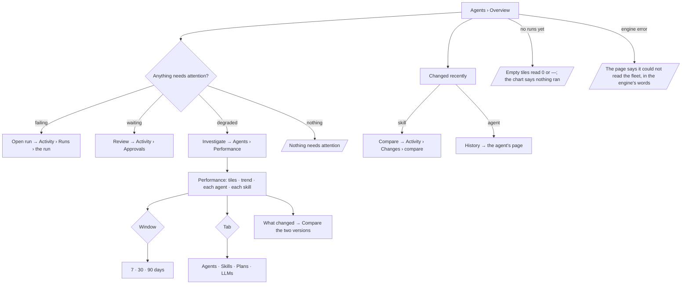

# Watch the fleet

What broke, what waits on a person, what slowed down and what changed — across every agent, skill,
plan and model of a Graph — with speed, success and tokens against each one's own baseline, and a
degradation named the day it ships.

| | |
|---|---|
| Index | [5.10](../../../README.md#5--agents) · Slice **C10** |
| Module | [Agents](../spec.md) |
| API / CLI / Studio | ✅ / — / ✅ |
| Related | [envelope-and-budget](envelope-and-budget.md) · [pinned-model-versions](pinned-model-versions.md) · [change-log](../../operate/features/change-log.md) · products: [agents.md](../../../../products/agents.md) AG-01 · AG-15 |

> **As** a builder, **I want** what broke, waits, slowed down or changed, and speed, success and
> tokens per agent and skill, **so that** I tend agents before users notice and regressions are caught
> the day they ship.

## Capabilities

| # | Capability | Notes |
|---|---|---|
| C1 | Overview tiles | Runs today (against the same day last week) · failed today · waiting on a person · p95 run time over 7 days (against the 7 before) · tokens this month against the agents' month budgets · success rate over 7 days |
| C2 | Needs attention | A plan or agent failing on its latest runs · an approval waiting on a person · a degraded agent — each with the one act that answers it |
| C3 | Runs a day | 30 days, succeeded over failed, root runs only |
| C4 | Changed recently | The newest agent and skill versions with who, when and the effect after — runs, failed, and p95 against the version before |
| C5 | Performance tiles | Success rate · p50 · p95 · runs · tokens per run · degraded — over 7, 30 or 90 days, each against the window before |
| C6 | Per agent, skill, plan and model | One row shape per subject: runs · success · p50 · p95 · trend · tokens per run · signal |
| C7 | Degradation | p95 of the subject's last 3 runs each above 1.5× its 7-day baseline; names the change that came before the first slow run |
| C8 | Trend | p95 a day for the most degraded agent (else the busiest), its baseline and the publishes in the window marked |
| C9 | Who pins a model | Every model version a Graph offers, with the agents, skill versions and eval judges pinned to it |

## Journey

## Seams

| Seam | What the user sees |
|---|---|
| While loading | The kit's spinner line in the page body; the header and its act are drawn at once |
| No run yet | Tiles read `0` or `—`; *Runs a day* reads *Nothing ran in the last 30 days*; Needs attention reads *Nothing needs attention* |
| No agent has a month budget | *Tokens this month* reads the tokens alone, with *no month budget* |
| A degradation with no change before it | It is named by its numbers alone — *p95 7.4s, up from 4.6s* |
| A version with fewer than 3 runs after it | Changed recently shows its runs and failed, and no p95 change |
| Reload | The window and the tab ride the URL (`?window=` · `?tab=`) |
| A member without access | The routes need Graph membership, like every Agents read; a non-member gets the shell's no-access page |

## Surfaces

| Surface | Shape |
|---|---|
| `/agents/overview` (board `agents.overview`) | Header *Overview* · `n agents · n skills` · *New agent*; six `MetricTile`s; *Needs attention* beside *Runs a day*; *Changed recently* under them. Full width — the rail item opens no `leftSection` |
| `/agents/performance` (board `agents.performance`) | Header *Performance* · `n degraded · n failing`; tabs *Agents · Skills · Plans · LLMs* and a 7 · 30 · 90 days control; six tiles; the trend beside *What changed*; *Each agent* and *Each skill* tables (one table per other tab) |
| `/agents/llms[/:provider]` (board `agents.llms`) | Header *LLMs* · `n endpoints · n model versions` · *Add endpoint*; a notice when a pinned version is no longer offered; *Model versions* — model · version name · endpoint · pinned by · status. An endpoint opens its detail in a sheet; *Add endpoint* opens the form there |

## Engine

| Route | Returns |
|---|---|
| `GET …/agents/overview` | `FleetOverview` — `agents` · `skills` · `tiles` · `attention[]` · `daily[]` (30) · `changes[]` (≤ 5) |
| `GET …/agents/performance?window=7d\|30d\|90d` | `FleetPerformance` — `window_days` · `tiles` · `agents[]` · `skills[]` · `plans[]` · `models[]` · `trend` |
| `GET …/llm/pins` | `ModelPins` — `items[]`: `address` · `agents[]` · `skills[]` · `judges[]` |

| Shape | Fields |
|---|---|
| `FleetMeasure` | `value` · `prior` |
| `OverviewTiles` | `runs_today` · `runs_week_ago` · `failed_today` · `failed_latest` · `waiting` · `waiting_latest` · `p95_ms` (`FleetMeasure`) · `tokens_this_month` · `max_tokens_month` · `success` |
| `AttentionItem` | `kind` (`failing` · `waiting` · `degraded`) · `title` · `detail` · `run_id` · `approval_id` · `agent_id` · `at` |
| `DayCount` | `date` · `succeeded` · `failed` |
| `RecentChange` | `record_kind` (`agent` · `skill`) · `record_id` · `name` · `version` · `previous` · `at` · `actor_name` · `summary` · `runs` · `failed` · `p95_change` |
| `FleetTiles` | `success` · `p50_ms` · `p95_ms` · `runs` · `tokens_per_run` (each `FleetMeasure`) · `degraded` · `failing` |
| `PerformanceRow` | `id` · `name` · `version` · `runs` · `success` · `p50_ms` · `p95_ms` · `p95_prior_ms` · `tokens_per_run` · `tokens_per_run_prior` · `failing` · `signal` (`degraded` · `failing` · null) · `degradation` |
| `Degradation` | `p95_ms` · `baseline_p95_ms` · `since` · `change` (`RecentChange` or null) |
| `PerformanceTrend` | `subject_kind` · `subject_id` · `name` · `baseline_p95_ms` · `points[]` (`date` · `p95_ms`) · `marks[]` (`date` · `label`) |
| `ModelPin` | `address` · `agents[]` (`id` · `name`) · `skills[]` (`id` · `name` · `version`) · `judges[]` (`subject_kind` · `subject_id` · `name`) |

## Decisions

| # | Decision |
|---|---|
| FP1 | **Computed at read, from the run rows.** No counter, no rollup table: the numbers come from `task_runs` roots in the window, the way the plan page's are, so they cannot disagree with the runs they count. Percentiles are computed in Python — SQLite has none, and dev and prod must agree. |
| FP2 | **A run is a root.** Steps never count as runs; a root's tokens are its own and its direct steps', with eval runs (`role = evaluate`) left out, as the agent meters count them. |
| FP3 | **Run time is queued → finished.** What a person waits for. A run still going has none and is left out of p50 and p95. |
| FP4 | **Success is succeeded over settled.** Cancelled and running roots are in *runs* and out of the rate. |
| FP5 | **Degraded:** a subject's last 3 settled runs each took more than 1.5× the p95 of its runs in the 7 days before the first of them, with at least 5 runs in that baseline. The change named is the newest agent or skill version published before the first slow run, among the agent's own and its bound skills', and inside that 7-day baseline — an older one is not named. p50 and p95 are over succeeded and failed roots only. |
| FP6 | **Failing:** a subject whose latest settled runs failed, counted back to the first that did not. Two or more is a signal, and it outranks *degraded* on the same subject. The Performance tiles' `degraded` and `failing` count agents only. |
| FP7 | **Subjects.** An agent is `task_runs.agent_id`; a skill is each skill version id in `skills_applied` on the root or its direct steps (the union), at the version the run applied; a plan is one row per ref `key@version` — the TaskPlan's key, else `plan_origin` `template:<ref>`, and a keyless one-off plan is absent; a model is `task_runs.model_version` on the root or its steps. A run with none of one is absent from that table, not filed under *unknown*. |
| FP8 | **The window's prior is the same length before it.** A tile's arrow compares the two. A skill row's prior is its previous version's runs inside the window when it ran there, else the window before. A change under 2% reads *flat*; a skill row's *vs previous* names `v(N−1)`. |
| FP9 | **Waiting on a person** is pending approvals plus roots paused on a question (`needs_input` · `awaiting_input`), among the roots of the last 90 days — the window the page loads; *Changed recently*'s p95 change reads the same 90 days. |
| FP9a | **Needs attention lists failing plans first, then agents.** An agent whose latest failure is a listed plan's run is not listed again. Overview's `agents` counts persistent, non-retired agents; `skills` counts all. Trend marks read `<name> v<n>`. |
| FP10 | **The month budget on Overview is the sum of the agents' `max_tokens_month`.** Null when no agent declares one — *no month budget*, never zero. Budgets are declared, not enforced ([EB7](envelope-and-budget.md#decisions)). |
| FP11 | **Tokens, never currency.** No cost tile, column or projection; `cost_usd` is not read. |
| FP12 | **Pins are read where they live.** `agents.model_pin` (ephemeral agents included, retired ones not), the current published `skill_versions.model_pin`, and an eval set's `judge_model_pin`, grouped by address. A pin to an address the Graph no longer offers is still listed — it is the one that refuses runs. |
| FP13 | **Overview, Performance and LLMs are pages, not panels.** Their rail items open no `leftSection`; the page fills `mainSection` in place of the Workbook, as an expanded Settings does. The Workbook's pages come back with the next rail item that has a panel. |
| FP14 | **Every act on these pages is a link to where the act already lives.** *Open run* → Activity › Runs; *Review* → Activity › Approvals; *Investigate* → Performance; *Compare* → the change log's compare, previous version as `a` and the new one as `b` (a skill's first version has nothing to compare and offers no act); *History* (a later version) and *Open* (an agent's first) → the agent's page (`?page=agent:<id>`, its first tab — the tab is not in the URL); *New agent* → the Agents list's new-agent form. Nothing is decided on these pages. |
| FP15 | **The LLMs page is the endpoint list.** The Agents panel is one section — agents; LLMs is a rail item and a page of its own. An endpoint's detail and the new-endpoint form open in a sheet over the page, at `/agents/llms/<provider>` and `/agents/llms/new`. |
| FP16 | **A model's status is what the Graph offers.** `offered`; `no longer offered` for a removed model that something still pins; `not offered` for a pin to an address the Graph never offered. Invana tracks no provider release feed, so *a newer version is available* is not said; the page's notice names a pinned version that is no longer offered and who pins it. |

## Not building

| Not building | Because |
|---|---|
| *Alert me when it degrades* (a notification on degradation) | A degradation is computed at read; no event is raised for a notification rule to match. Raising one is an engine change of its own |
| A provider release feed (*a newer version is available*) | Invana does not poll vendors; a person adds the version they want |
| Cost per run, per agent or per model | Tokens only |
| *Roll back to vN* on Performance | Rollback lives on the skill's History, gated by its evals |
| Custom windows or date ranges | 7, 30 and 90 days answer *since it shipped* |
| A CLI | `invana performance` is in the product plan, not this slice |
