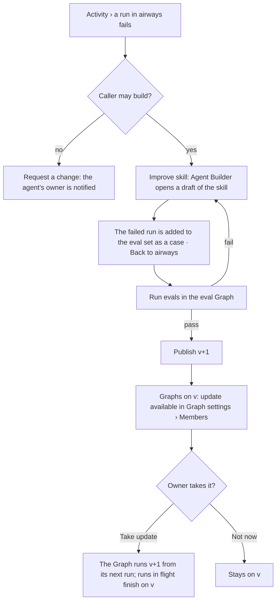
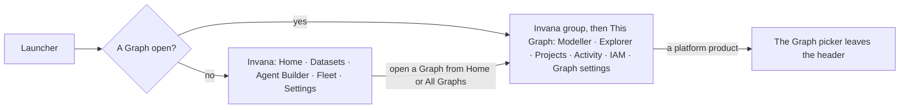

# The Agent Builder and the agents catalogue

Invana is deployed like a database server: one deployment per organisation. The deployment is where things are **defined and limited**; Graphs **invite and use** them. The product has **two places**. The **platform** — Home, Datasets, the **Agent Builder**, **Fleet** and **Settings** — carries no Graph picker. **A Graph** — Explorer, Modeller, Projects, IAM, **Graph settings** and **Activity** — carries it. The hierarchy is fixed: an agent carries skills, a skill calls functions, and functions are code. The Agent Builder keeps the **agents catalogue** — every agent and skill the deployment owns, each versioned. A Graph **invites agents** from it the way it invites people: the agent then works on that Graph's data and decisions, at a pinned version, with the access the Graph gives it. Each Graph's tokens, lanes and worker pools are set in Settings; the Graph reads them. A Graph never edits an agent, never sees its definition, never adds a skill on its own, and has no Agents product. Graphs are repositories inside one install, not tenants.

| | |
|---|---|
| Index | [5.16](../../../README.md#5--agents) · Slice **S-TBD** |
| Module | [Agents](../spec.md) |
| API / CLI / Studio | 🔵 / 🔵 / 🔵 |
| Related | [author-an-agent](author-an-agent.md) · [import and export](import-export.md) · [workers](workers.md) · [instructions, publish and roll back](../../skills/features/instructions-publish-rollback.md) · [evals](../../skills/features/evals.md) · [policies](../../identity-and-access/features/policies.md) · [products README › Two places](../../../../products/README.md#two-places) |

Product spec: [AG-F02 · The agents catalogue](../../../../../specs/products/agents/features/AG-F02-the-agents-catalogue/feature.md) — AG-35 and AG-40; the stories, their criteria, journey, states and product decisions live there. This file keeps the engine and code shape.

## Two places

| Place | Products | Holds | Runs? |
|---|---|---|---|
| **Platform** | Home · Datasets · **Agent Builder** · **Fleet** · **Settings** | Agents and skills as versioned definitions and how each version does across Graphs · worker pools · LLM providers, plugins, MCP, remote agents · each Graph's tokens, lanes and pools · the eval Graph | No |
| **A Graph** | Explorer · Modeller · Projects · IAM · **Graph settings** · **Activity** | The agents invited here as members, each with its pinned version, access and status · every run, approval, ledger row, spend and eval made here | Yes — only here |

| Product | Rail | Feature |
|---|---|---|
| Agent Builder | Overview │ Agents · Skills · Functions · Library │ Performance · Import and export | this file · [5.17](import-export.md) |
| Fleet | Pools · Workers · Capacity · Join tokens | [5.15](workers.md) |
| Settings | Graph limits │ LLM providers · Plugins · MCP servers · Remote agents | this file (C9) · [5.1](providers-and-models.md) · [5.7](concurrency-and-contention.md) |
| Graph settings | General · Connection │ Members · Usage | this file (C6–C8, C10) |
| Activity | Runs · Approvals · Ledger │ Schedules · Events · Inbox · Rules · Channels | [10.x runs](../../work/spec.md) · [shell › Activity](../../../../products/shell.md#activity) |
| IAM | as built ([iam.md](../../../../products/iam.md)) | an agent's *Access* in Members is its IAM policies |

## Capabilities

| # | Capability | Notes |
|---|---|---|
| C9 | Limits per Graph, set on the platform | An install Admin sets each Graph's monthly tokens, lanes and worker pools in Settings › Graph limits; Graph settings › Usage shows spend against them, read-only |
| C11 | Overview and Performance across Graphs | The Builder's Overview shows every agent version's health and what needs attention; Performance compares versions against their baseline. Both read stored per-run columns |

## The core agents

| Agent | Product | Knows | Skills |
|---|---|---|---|
| Explorer assistant | Explorer | Turning a question into a query, running it, answering on the board with citations | Graph query (Cypher or Gremlin, by the connector) · natural-language query · cite |
| Modeller assistant | Modeller | Drafting models from what the database holds, explaining types, proposing changes | Models and drafts · graph query |
| Data assistant | Datasets | Uploads, previews, binding columns, import-run triage | Imports and bindings · dataset checks |

## Journeys

### A run goes badly, the skill improves, the Graph takes it

### Moving between the two places

## Seams

| Seam | What the user sees |
|---|---|
| A Graph near its monthly tokens | Graph settings › Usage shows spend against the limit; at the ceiling a run pauses and asks, as today; only an install Admin raises it in Settings |
| A platform product opened from a Graph | The Graph picker leaves the header; the launcher's *This Graph* group goes back |

## Surfaces

| Surface | Shape |
|---|---|
| Agent Builder › **Overview** (`builder.overview` · `.map` · `.table` · `builder.home`) | Every agent version's health across Graphs, what needs attention, how they are wired |
| Agent Builder › **Agents · Skills · Functions · Library** (`builder.agents` · `builder.agent*` · `builder.skills` · `builder.skill*` · `builder.functions*` · `builder.library*` · `builder.templates*`) | Agents and skills with versions and their builders; functions read-only; libraries proposed and approved |
| Agent Builder › **Performance** (`builder.performance*`) | Each agent, skill and model version against its baseline |
| Agent Builder › **Import and export** (`builder.import`) | [5.17](import-export.md) |
| Settings › **Graph limits** (`settings.graph_limits`) | Each Graph's monthly tokens, lanes and pools |
| Graph settings › **Members** (`graph.settings.members` · `.invite` · `.update`) | People and agents in one list: *Invite person* · *Invite agent* (modal from the catalogue) · *Access* · *Pause* · *Remove* · *Take update* |
| Graph settings › **the agent in this Graph** (`graph.settings.agent` · `.runs` · `.access`) | Overview · Runs · Access; *Edit in Agent Builder* |
| Graph settings › **Usage** (`graph.settings.usage`) | Tokens, lanes and pools against the limits; spend by member |
| Activity › **Runs · Approvals · Ledger** (`activity.*`) | The Graph's runs, what waits on a person, the ledger; *Improve skill* on a run (`builder.skill.from_run`) |
| New Graph › **Team** · **Review** (`shell.graph.new.team` · `.review`) | People above, Agents below: core *Included*, catalogue agents ticked |
| Launcher (`shell.launcher.open` · `shell.launcher.platform`) | *Invana* first, then *This Graph* when one is open |

Drawn on [Invana Products](https://claude.ai/artifact/HcPfkMUYUtEbRaZFaYnHtg).

## Engine

| Table | Change | Notes |
|---|---|---|
| `agents` · `skills` · their versions | Lose `graph_id` | Install rows; a published version is immutable |
| `flows` (a skill version's plan) | `graph_id` nullable — null for a plan | The planner reads only the function vocabulary, so a plan is the same in every Graph |
| `skill_bindings` | Unchanged — skill ↔ agent, at the install | |
| `graph_agents` (new) | `graph_id` · `agent_id` · `agent_version` · `status` · `invited_by` | One row per agent per Graph — a member, like `graph_members` |
| `graph_limits` (new) | `graph_id` · `monthly_tokens` · `lanes` · `pools` | Set in Settings; read by the Graph |
| `llm_providers` | Lose `graph_id` | An agent's model version must exist in every Graph that adds it |
| `work` tasks · runs · ledger | Record `graph_agent_id` and `agent_version` | What ran, where, at which version; Overview and Performance aggregate these stored columns |

| Endpoint | Does |
|---|---|
| `GET · POST /api/v1/catalogue/agents` · `/skills` · `GET /functions` | The catalogue; write is install Admin |
| `GET /api/v1/catalogue/agents/{id}/performance` | A version's stored numbers across Graphs, against its baseline |
| `GET · POST /api/v1/u/{username}/{graphSlug}/agents` · `PATCH · DELETE …/agents/{agent}` | Invite, set access, pause, remove |
| `POST /api/v1/u/{username}/{graphSlug}/agents/{agent}/update` | Move to the latest published version |
| `GET · PUT /api/v1/u/{username}/{graphSlug}/limits` | Read (members) · set (install Admin) |
| `GET /api/v1/graph-limits` | Every Graph's limits and this month's spend, for Settings › Graph limits (install Admin) |
| CLI | `invana catalogue agents list` · `invana agents add <name>` · `invana agents update <name>` |

## Decisions

| # | Decision |
|---|---|
| WD1 | **A Graph is a repository, not a tenant.** People, the agents catalogue, datasets, plugins, LLMs and workers are install-wide; a Graph owns one database connection, its models, its members' roles, the agents added to it, and every run and eval made in it. Every sign-in lands on Invana home; an install with one Graph shows no Graph switcher; the first Graph is made by first-run set-up |
| WD3 | **Core ships with the engine**, versioned with its release. Core agents are named `<Product> assistant`, except the Datasets product's, which is the **Data assistant**. There is no Agents assistant: a Graph has no Agents product |
| WD6 | **Only an install Admin builds and publishes** agents and skills. Retiring stops new adds; Graphs keep their version |
| WD13 | **Two places, never one page with a scope switch.** Platform products carry no Graph picker; Graph products carry it. The launcher lists *Invana* first and *This Graph* only when a Graph is open; each product keeps its own rail |
| WD14 | **LLM providers are install-wide**, so an agent's pinned model version exists in every Graph that adds it |
| WD16 | **The deployment defines and limits; the Graph invites and uses.** LLM providers, plugins, MCP and each Graph's tokens, lanes and pools are Settings; worker pools are Fleet. Graph settings › Usage shows the limits and the spend; the Graph changes none of them |
| WD18 | **A Graph has no Agents product.** An agent is a member in Graph settings › Members; its page in the Graph shows version, access, runs and spend here. Runs, approvals and the ledger are the Graph's **Activity** |
| WD19 | **The Builder reads, never runs.** Overview and Performance read how each version did across Graphs from stored per-run columns; nothing is run from the Builder except evals in the eval Graph |
| WD21 | **Platform products route off any Graph**: `/builder/<section>` · `/fleet/<section>` · `/settings/<section>`; a person's own settings are `/profile`. Graph products route under `/u/:user/:graph/<product>/…`, Graph settings at `…/settings/<section>` |

## Not building

| Not building | Because |
|---|---|
| An Agents product in a Graph | Agents are members; their work is Activity |
| Per-agent budgets | Spend is per Graph |
| Workers owned by a Graph | Machines are the platform's (Fleet); a Graph's scale is the pools and lanes it is given |
| Building without an install Admin | Every Graph runs what the catalogue publishes |
| Rendering as a skill | Answers take their shape from templates, chosen by code from the result |
