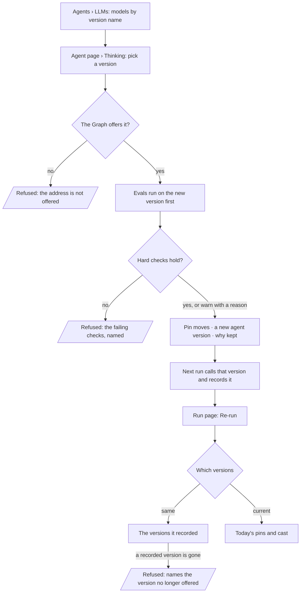

# Pin a model version

An agent, a skill version and an eval set's judge each name the exact model version they think with —
the provider's own version name — and every run records the version it called, so a provider release
changes nothing until a person moves the pin, and any run can be re-run on the versions it used.

| | |
|---|---|
| Index | [5.9](../../../README.md#5--agents) · Slice **B02** (P-17) |
| Module | [Agents](../spec.md) |
| API / CLI / Studio | 🟡 / 🟡 / 🟡 |
| Related | [providers-and-models](providers-and-models.md) · [author-an-agent](author-an-agent.md) · [evals](../../skills/features/evals.md) · [change-log](../../operate/features/change-log.md) · products: [agents.md](../../../../products/agents.md) AG-14 · [shell.md](../../../../products/shell.md) SH-18 |

> **As** a builder, **I want** the LLM models agents think with pinned to an exact version name, **so
> that** an upgrade never changes an agent by surprise.

## Capabilities

| # | Capability | Notes |
|---|---|---|
| C1 | Models listed by exact version name | `llm_models.model_id` is the provider's version name (`claude-opus-5-5`), never an alias |
| C2 | An agent pins a model | `agents.model_pin` — an address `llm/<provider name>/<model_id>`; null means the cast decides |
| C3 | A skill version pins a model | Set on the draft, frozen with the version at publish |
| C4 | A judge pins a model | On the eval set ([evals](../../skills/features/evals.md)); it must differ from the model under test |
| C5 | Every run records its version | `task_runs.model_version` — the exact name the run called; null for a run that called none |
| C6 | Moving a pin is a change | It mints an agent version (or is part of a skill version), with a why, in the change log |
| C7 | Re-run on the same versions | A root run re-runs on the versions it recorded, or on the current ones — the caller chooses |

## Journey

## Seams

| Seam | What the user sees |
|---|---|
| A pinned version the provider removes | Runs refuse at open, naming the pin; nothing falls back to another model |
| A pin the lens does not allow | Refused at open as a governed refusal, naming the bound |
| A run from before versions were recorded | `model_version` is empty — *not recorded*; re-run on same versions is refused for it |
| An agent with no pin | The cast decides, exactly as before; the run still records what it called |
| Re-run while the original run is still live | Refused: re-run a settled run only |

## Surfaces

| Surface | Shape |
|---|---|
| Agents › LLMs | A page of its own: models by version name, each row naming the agents, skill versions and eval judges pinned to it (`GET …/llm/pins`), and a notice for a pinned version the Graph no longer offers ([5.10](fleet-performance.md)) |
| Agent page › Thinking | *Model version*: none, or an exact version; moving it is its own act with a why, gated (C03) |
| Skill page › Instructions | The draft's model version, published with the next version (C03) |
| Run page | *Re-run…* on the header of a settled root ask → the re-run dialog: *Ran with* (model version · agent version · world), *The same versions — reproduce it* · *Current versions — compare*, Cancel · Re-run. A re-run's page carries *Compare with the original* (SH-18, C09) |
| CLI | `invana llms list` · `models <endpoint>` print the addresses a pin takes; `invana agents pin <agent> --model <address>` passes the eval gate on the new pin first |

## Engine

| Column | On | Is |
|---|---|---|
| `model_pin` | `agents` | String255, nullable — `llm/<provider name>/<model_id>`; null = the cast decides |
| `model_pin` | `skill_versions` | String255, nullable — frozen at publish like the prose |
| `model_version` | `task_runs` | String255, nullable — the `model_id` the run called |
| `rerun_of_run_id` | `task_runs` | FK `task_runs`, nullable — the root run this one re-ran |

| Route | Does |
|---|---|
| `PATCH …/agents/{id}` `{model_pin, why}` | Moves the pin — a new agent version; `details.diff.model_pin` |
| `PATCH …/skills/{id}/draft` `{model_pin}` | Sets the draft's pin; it publishes with the version |
| `POST …/runs/{run_id}/rerun` `{versions: same \| current}` | Opens a new root run for a settled ask; `same` re-uses `model_version`, the world and the lens snapshot; `current` freezes today's |

| Resolution at open | Order |
|---|---|
| The model a step calls | a person's pick for this one ask → the skill version's pin → the agent's pin → the cast. Each must be a model the Graph offers and the lens allows |

## Decisions

| # | Decision |
|---|---|
| PV1 | **A pin is an address, the same string a cast holds** — `llm/<provider name>/<model_id>`. One shape for *which model*, resolved by one function, so a pin and a cast cannot disagree about what a name means. |
| PV2 | **A pin never resolves an alias.** The `model_id` sent to the provider is the pinned string, character for character. A provider alias (`claude-opus-latest`) is refused as a pin, because pinning it pins nothing. |
| PV3 | **A pin narrows, the lens still bounds.** A pin outside what the lens allows is a governed refusal at open, naming the bound — a pin is a resolution, never a widening. |
| PV4 | **No fallback.** A pinned version the Graph no longer offers refuses the run; it never silently calls another model. |
| PV5 | **The run records the version it called**, on `task_runs.model_version`, beside `params.llm_model_id`. The row id says which endpoint; the string is what history keeps when the row is gone. |
| PV6 | **Moving a pin is a change.** For an agent it is an `agent.update` with `details.diff.model_pin` and a why; for a skill it is part of the next version. Evals run on the new version before the move, under the [eval gate](../../skills/features/evals.md). |
| PV7 | **Re-run is a new root run**, linked by `rerun_of_run_id`; it never touches the original. `same` replays the recorded versions and refuses, naming it, when one is gone; `current` reads today's pins and cast. |
| PV8 | **A person's pick for one ask is innermost.** The composer's model pick names the model for that ask only; it outranks the pins, and it is lens-checked like them. It moves no pin and mints no version. |
| PV9 | **The skill pin is the plan's.** A run whose plan was drawn from a skill version calls that version's pin; a run on a generated plan reads the agent's. |
| PV11 | **Studio cannot clear a pin.** `PATCH …/agents/{id}` reads `model_pin: null` as *unchanged*, so Thinking offers a move between versions and no *none* once one is set ([agents.md › Decisions](../../../../products/agents.md#decisions) *Model pins*). |
| PV10 | **Re-run takes a settled ask.** An `nl` or `ql` root that is no longer queued, running or waiting. It opens as a run of its own, in no session, so the original reply is never rewritten; every task an ask runs reads its session as optional, and a model call's audit event points at the run when there is no session. `same` pins the recorded `model_version` and copies the frozen lens; the plan is drawn afresh. Replaying plan revision 0 and the offered skill versions waits for the run page that shows them (SH-18). |

| PV12 | **Re-run is the run page's act, and only where the engine takes it.** *Re-run…* is on the header of a root `nl` or `ql` run that has settled; a step, an import or a live run has none. It opens a dialog whose *Re-run on* is a segmented control — *The same versions — reproduce it* · *Current versions — compare* — the control the Share dialog uses for its one choice; the request is `POST …/runs/{id}/rerun {versions}`, and a 409 is shown in the dialog in the engine's own words (`version_not_offered` names the version). |
| PV13 | ***Ran with* shows what the run recorded, nothing else**: the model version (or *not recorded*; a `ql` run *calls no model*), the agent and its version, the world as frozen. The skill version and dataset versions are not on the run record, so they are not drawn; *current* names no versions ahead of time, because they are resolved when the run opens. |
| PV14 | ***The same versions* is disabled, with its reason, on an `nl` run that recorded none** — the refusal the engine would give, said before the click. |
| PV15 | **A re-run opens its own page; a re-run on current versions opens the comparison when it finishes.** The browser that asked holds the pair in memory and opens `compare:<re-run>:<original>` once the new run settles on its page. A reload loses only the automatic opening: a re-run's page always carries *Compare with the original*. The comparison's trail is *Graph › Activity › Runs › run:<a> · run:<b>*. |

## Not building

| Not building | Because |
|---|---|
| Alias resolution or *latest* tracking | a pin that moves by itself is the surprise this feature removes |
| Automatic fallback to another model | a silent model change is a change nobody approved |
| Traffic splitting across two versions | rollout is draft → publish to every bound agent |
| Currency per model | tokens only |
