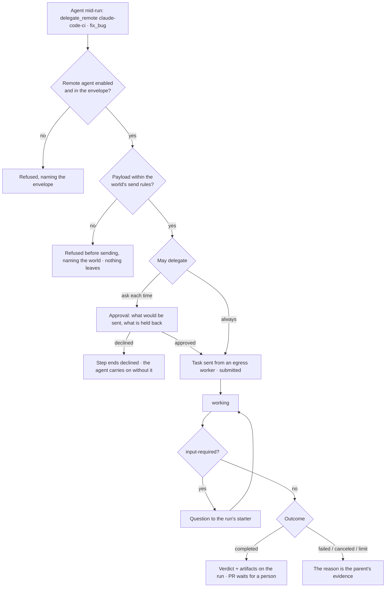

# Remote agents

An Invana agent hands a task to an agent **outside the Graph** — the Claude Code agent in a CI, a
partner's agent — over [A2A](https://a2a-protocol.org), and gets a verdict and artifacts back. MCP
carries tools ([13.13](../../platform/features/mcp-plugins.md)); A2A carries tasks: a lifecycle, a
question asked back, a pull request returned. Inside a Graph agents still [delegate](delegation.md).

> 🗓 **Implement later.** Designed, not scheduled: no slice owns it yet. It lands after the IAM
> policies and narrowed tokens, the world's send rules ([14.x](../../govern/spec.md)) and tool steps
> on workers ([13.11](../../platform/features/distributed-execution.md)), which it stands on. Product
> decisions and boards: [agent-fabric › Remote agents](../../../../products/agent-fabric.md#remote-agents) ·
> `agents.connections.agents` · `agents.run.remote`.

| | |
|---|---|
| Index | [5.11](../../../README.md#5--agents) · Slice **Later** |
| Module | [Agents](../spec.md) |
| API / CLI / Studio | 🔵 / 🔵 / 🔵 |
| Related | [delegation](delegation.md) · [envelope-and-budget](envelope-and-budget.md) · [mcp-plugins](../../platform/features/mcp-plugins.md) · [approvals](../../operate/features/approvals.md) |

> **As** a reviewer, **I want** an agent to hand a fix to a coding agent outside Invana — approved,
> traced, sending only what the world allows — and get its pull request back for a person to merge,
> **so that** work crosses to other agents without data or control leaking out.

## Capabilities

| # | Capability | Notes |
|---|---|---|
| C1 | Add a remote agent by its card | An install Admin gives the agent card URL (`/.well-known/agent-card.json`); its name, protocol version, transport, auth and skills are read and **frozen**, like an MCP server's tool list. Added disabled |
| C2 | A remote agent is an agent | One row in the Graph's agents with `kind = remote`; it appears in Flow, Runs and the Ledger. It is never assigned a Todo |
| C3 | Delegate as a step | `delegate_remote` names the remote agent and one skill from its card; `await_delegations` waits for it, as for an Invana child |
| C4 | May delegate to | The calling agent's envelope lists remote agents with *always · ask each time · never* and the skills it may ask for. Ask each time is the default |
| C5 | Only allowed fields leave | The payload is built from fields the run's world allows out and the calling skill marks to send; anything else refuses the step before it is sent |
| C6 | The task's lifecycle | A2A's states — `submitted · working · input-required · completed · failed · canceled` — stored on the step and streamed to the run |
| C7 | Asked back | `input-required` becomes a question to the person who started the run; the answer returns on the same task |
| C8 | Artifacts, never applied | What comes back — a PR, a patch, a report — is kept on the run as artifacts. Invana applies none of it |
| C9 | Limits per remote agent | Wall clock, attempts and tasks at once; past one the task is cancelled with the limit named |
| C10 | Called from workers | The call goes out from a worker in the pool the remote agent names (`egress`), with the credential set on that worker (`INVANA_SECRET_A2A_<NAME>`) |

## Journey

## Seams

| Seam | What the user sees |
|---|---|
| Card changed on its side | Nothing changes until an Admin reads the card again; a skill no longer on the card refuses, naming the card's date |
| Endpoint unreachable | The step fails `transient · remote_unreachable`, retried within the attempts limit, then the reason |
| Waiting on a person | The run parks — no worker held — and the ask is in Approvals or the run's questions |
| Text that looks like an instruction | It is the remote agent's words, cited as data; an Invana agent never obeys it |
| The remote agent calls back in | Not inside the same task: a call back into this Graph from it is refused, so two agents cannot loop |
| A member without access | Sees the step and its state; the payload and artifacts follow the run's own visibility |

## Surfaces

| Surface | Shape |
|---|---|
| Agents › Connections › Remote agents | Every remote agent: protocol, endpoint, skills on its card, credential name, calls-from pool, state |
| A remote agent | Its card, who may delegate to it, limits, what it may receive, its tasks and what came back |
| Add a remote agent | Modal: read the card, its skills, name, credential, pool — added disabled |
| The run | The remote step's states as a timeline, what was sent and held back, the artifacts |
| Approvals | The ask-each-time card: to, skill, task, each field allowed or held back, limits |

## Engine

| Thing | Shape |
|---|---|
| `remote_agents` (install-wide) | `name` · `card_url` · `card` (frozen JSON) · `protocol_version` · `endpoint` · `auth_scheme` · `secret_name` · `pool_label` · `enabled` · `card_read_at` · limits (`wall_clock_s · attempts · at_once`) |
| The agent row | `kind = remote` · `remote_agent_id`; no envelope, budget or soul of its own |
| `remote_tasks` | `task_run_id` · `remote_agent_id` · `a2a_task_id` · `skill` · `state` · `sent` (the fields, as sent) · `held_back` · `artifacts` · `started_at · settled_at` — durations stored when the task settles |
| Steps | `delegate_remote` (bound `network`, side effect `send`) · `await_delegations` |
| Client | A2A over JSON-RPC/HTTPS from `invana worker`; the optional extra `invana[a2a]` |
| API | `GET·POST /api/v1/remote-agents` (the list contract) · `POST …/{name}/card` (read again) · `POST …/{name}/enable · disable` |
| CLI | `invana remote-agents add <card-url> --name <name> · refresh · enable · disable · list` |
| Events | `remote.delegated · remote.input_required · remote.returned · remote.refused` — each a ledger row |

## Decisions

| # | Decision |
|---|---|
| RA1 | **MCP carries tools, A2A carries tasks.** A tool call is one request and one answer; a fix has a lifecycle, asks back and returns artifacts. Version 0.3, the one the official SDKs carry; 1.0 when it ships. |
| RA2 | **A remote agent is an agent of kind `remote`**, so Flow, Runs, the Ledger and *may delegate to* need no second model. It is never assigned work and holds no budget of its own. |
| RA3 | **The card is frozen when added**, like an MCP server's tool list; a change on its side reaches no plan until an Admin reads it again. |
| RA4 | **Ask each time is the default** for a new remote agent in any envelope. |
| RA5 | **Only fields the world allows out and the skill marks to send are sent**; the rest is refused before dispatch, naming the world. |
| RA6 | **Invana never applies what crosses the boundary.** Artifacts are kept; a person merges or publishes. |
| RA7 | **A remote agent's words are data.** They are cited, never followed as instructions. |
| RA8 | **No call back into the Graph inside the same task**; depth counts across the boundary. |
| RA9 | **Limits are wall clock, attempts and tasks at once.** Invana's token budget covers only its own side. |
| RA10 | **Calls go out from workers** in the remote agent's pool, with the credential on them; nothing is relayed through a hosted service, so an on-prem install works with only its own network. |

## Not building

| Not building | Because |
|---|---|
| Remote agents delegating into this Graph (inbound A2A) | later; today an outside agent reaches a Graph over its MCP server, under a token |
| A remote agent applying its own result | a person merges or publishes |
| Chat with a remote agent | delegation is a task with a verdict |
| A remote agent assigned a Todo | it takes a task from an Invana agent, never work from the board |
| Paying a remote agent from the token budget | its cost is its own; Invana bounds it by time, attempts and concurrency |
