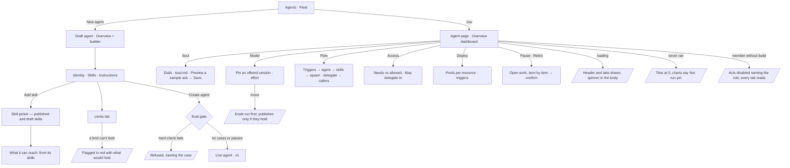

# The agent page

An agent is built and read on one page, the way a skill is: **Overview · Runs · Instructions · Soul ·
Model · Flow · Access · Limits · Deploy · Evals · History**. A new agent is a draft on that page — the
builder — until *Create agent* makes it live; a live agent's Overview is its dashboard.

| | |
|---|---|
| Index | [5.13](../../../README.md#5--agents) · Slice **F04** |
| Module | [Agents](../spec.md) |
| API / CLI / Studio | 🟡 / — / ✅ |
| Related | [author-an-agent](author-an-agent.md) · [envelope-and-budget](envelope-and-budget.md) · [delegation](delegation.md) · [lifecycle](lifecycle.md) · [soul](soul.md) · [pinned-model-versions](pinned-model-versions.md) · [the-skill-page](../../skills/features/the-skill-page.md) · [the-agents-shell](the-agents-shell.md) · products: [agent-fabric.md](../../../../products/agent-fabric.md) AF-05 · AF-06 · AF-21 |

> **As** a builder, **I want** to build an agent the way I build a skill — on a page — and read a
> published agent's numbers, voice, model, reach, limits and lifecycle in one place, **so that** an
> agent changes deliberately and I see when it gets worse.

## Capabilities

| # | Capability | Notes |
|---|---|---|
| C1 | New agent | *New agent* (Agents, Fleet) creates a **draft** agent and opens its page on Overview — the builder |
| C2 | The builder | Overview of a draft: Identity (name, model version, voice) · Skills (bound, *Add skill*) · Instructions (editor) on the left; What it can reach · Limits · Estimate on the right. *Create agent* publishes it — through the eval gate when it has eval cases |
| C3 | A live agent's Overview | Runs · Served · p95 a run · Tokens this month · Helpers spawned tiles; Runs a day and Tokens a day over 30 days; Exits by reason; Recent runs |
| C4 | Runs | The one runs list, filtered to this agent (`?f.agent_id=`), with its status tabs |
| C5 | Instructions | `instructions.md` — draft, publish through the eval gate, roll back ([instructions-publish-rollback](../../skills/features/instructions-publish-rollback.md)) |
| C6 | Soul | Voice dials, the soul editor and a sample ask previewed before saving ([soul](soul.md)) |
| C7 | Model | The pinned model version (offered versions only) and its effort; the versions it has run on; a move runs the evals first |
| C8 | Flow | Triggers → the agent → its skills → the agents it spawned, with *From the instructions* and *Who it can talk to*. Delegation targets join with F05, outside callers with I02 |
| C9 | Access | The functions its skills need against what its envelope allows, with why a function is refused. *May delegate to* joins with delegation (F05); policies with IAM (I01) |
| C10 | Limits | Budget (a run, a month), delegation (may create helpers, depth, children a run, runs at once), effort (steps, replans, questions) and what happens at each limit. Escrow, *in all* and the exit rules join with F05 |
| C11 | Deploy | Where its steps run (resource → pool, free slots), triggers (schedule · can be assigned · unattended · an event) |
| C12 | Evals | The agent's eval set, runs and gate ([evals](../../skills/features/evals.md)) |
| C13 | History | Every change with its reason; a soul, a model move and an instructions publish each a row |
| C14 | Lifecycle | Make default · Pause · Retire in the head; Pause and Retire name every piece of open work and what happens to it, Retire takes a reason |

## Journey

## Surfaces

| Tab | `?tab=` | Body | Reads / writes |
|---|---|---|---|
| Overview | `overview` (default) | `AgentBuilder` on a draft · `AgentDashboard` on a live agent | `GET …/agents/{id}` · `…/agents/{id}/overview` · `…/skills-and-callables` · `…/meters` |
| Runs | `runs` | `AgentRunsTab` | `GET …/runs?f.agent_id=` |
| Instructions | `instructions` | `AgentInstructionsTab` | `PATCH/DELETE …/draft` · `POST …/publish` · `…/rollback` |
| Soul | `soul` | `AgentSoulTab` | `PATCH …/agents/{id}` · `POST …/soul/preview` |
| Model | `model` | `AgentModelTab` | `GET …/llm/providers` · `…/agents/{id}/overview` (versions run on) · `PATCH` `model_pin` · effort |
| Flow | `flow` | `AgentFlowTab` — `LayeredCanvas` + side cards | `…/skills-and-callables` · `…/lineage` · schedules |
| Access | `access` | `AgentAccessTab` | `…/skills-and-callables` · `workflow_spec.delegate_to` |
| Limits | `limits` | `AgentLimitsTab` | `PATCH` `budget` · `workflow_spec` ceilings · `effort` |
| Deploy | `deploy` | `AgentDeployTab` | `GET …/agents/concurrency` (pools) · schedules · `PATCH` `policy` |
| Evals | `evals` | `EvalSetPanel` (subject `agent`) | `…/evals/agent/{id}` |
| History | `history` | `AgentHistoryTab` | `GET …/agents/{id}/activity` |

| Board | Draws |
|---|---|
| `agents.agent.new` | the builder: a draft named, two skills, instructions, reach, limits, estimate; *Test on a sample* · *Create agent* |
| `agents.agent.detail` · `.runs` | a live agent's dashboard; its Runs |
| `agents.agent.soul` · `.model` · `.flow` · `.access` · `.limits` · `.deploy` | those tabs |
| `agents.agent.retire` | the Retire dialog over Overview: open work and what happens to each, *Why* |

## Seams

| Seam | What the user sees |
|---|---|
| While loading | The head and tabs at once; the kit's spinner in the body |
| Reload | `?page=agent:<id>&tab=<tab>` reopens the same tab; the unsaved buffer is lost, a draft agent is kept |
| A draft agent | Head chip `draft`, meta *pins <model> · not deployed*; acts *Test on a sample* · *Create agent*; Runs and Evals read *Not run yet* |
| Never ran | Tiles read 0, the charts *Not run yet* |
| Retired | Head chip `retired`; every act disabled; the page still reads |
| Member without `build` | Acts disabled naming the role; every tab reads |
| The engine fails | The tab names what it could not read in the engine's words |

## Engine

| Shape | Fields |
|---|---|
| `AgentStatus` | `draft` · `active` · `paused` · `retired` |
| `POST …/agents` | `AgentCreate` + `model_pin`; writes `status = draft`, instructions as given, skills bound through the bind check |
| `POST …/agents/{id}/create` | body `why?` → `AgentRead` with `status = active`; `409` unless `draft`; runs `evals.gate(subject_kind="agent")` — `eval_required` · `eval_failed` · `eval_running` · `eval_warned` (needs `why`) |
| `GET …/agents/{id}/overview?window=30d` | `AgentOverview` — `agent_id` · `days` · `since` · `runs` · `runs_prior` · `served` · `served_rate` · `served_rate_prior` · `p95_ms` · `p95_prior_ms` · `tokens_this_month` · `max_tokens_month` · `spawned` · `daily[]` (date, runs, tokens) · `exits[]` (exit, runs, last_run_id, last_title) · `recent[]` (id, title, agents, tokens, duration_ms, exit, finished_at) · `models[]` (model_version, first_at, runs, served_rate, p95_ms) |
| An exit | the run's `outcome` when it has one (`answered` · `conversed` · `cannot_answer` · `failed` · `cancelled`), else its `status`. Exit-rule reasons (time limit, no progress, loop) join with F05 |
| `GET …/schedules?f.agent_id=` | the schedules that start this agent — Flow's and Deploy's triggers |
| Runs | `GET …/runs?f.agent_id=` — the agent's root runs |

A draft is never offered work: opening a run on it, assigning it a Todo, scheduling it or making it the
default is refused with `409` naming the state, as for `paused`.

## Decisions

| # | Decision |
|---|---|
| AP1 | **The agent page has eleven tabs: Overview · Runs · Instructions · Soul · Model · Flow · Access · Limits · Deploy · Evals · History.** Thinking folds into Model (effort) and Limits (steps); Skills & callables folds into Overview (skills) and Access (functions); Activity becomes Runs and History |
| AP2 | **The open tab is `?tab=` beside `?page=`**, written on every switch, so a link, a board route or a reload opens the same tab. Opening another page drops it |
| AP3 | **A new agent is a `draft`.** `POST …/agents` writes `status = draft`; a draft is never offered work, assigned a Todo, run by a schedule or made default. *Create agent* (`POST …/agents/{id}/create`) moves it to `active` through the eval gate. The Agents list's *Drafts* is `?f.status=draft`; *All* leaves out retired, as before |
| AP4 | **The builder is the draft's Overview**: Identity · Skills · Instructions left, What it can reach · Limits · Estimate right. Reach is the bound skills' needs ([AG30](author-an-agent.md#decisions)) |
| AP5 | **A live agent's Overview is a dashboard of stored numbers** — served by `GET …/agents/{id}/overview`; Studio formats, never derives (CLAUDE.md rule 13) |
| AP6 | **Edits keep one buffer across tabs and Save sends only what moved** ([AG33](author-an-agent.md#decisions)); binding a skill, the instructions and the model pin stay their own writes |
| AP7 | **The head is `RecordHeader variant="page"`**: crumb `Agents`, the name, a state chip (`draft` · `authored · vN` · `paused` · `retired`), a meta line (model · runtime), and the acts — a draft: *Test on a sample* · *Create agent*; live: *Make default* · *Pause* (or *Resume*) · *Retire* · *Run now* |
| AP8 | **Pause and Retire name every piece of open work and what happens to it** ([lifecycle](lifecycle.md) LC8–LC10); Retire takes a *Why*, kept in History |
| AP9 | **Flow is drawn from records, never from a model call**: triggers are the agent's schedules (`?f.agent_id=`) and its `policy.can_be_assigned`; skills are its bindings with their steps; spawned agents are the lineage's `spawned` edges. *From the instructions* lists each instruction line that names a bound skill or a spawn. The canvas foot says *Drawn from <agent>'s instructions and skills. A run may replan within them — who it may spawn never widens.* |
| AP10 | **Access shows what is enforced today**: every function its skills need and every function its envelope allows, as one table — *Its skills need* · *Its envelope* · *Effective* (allowed · refused) · *Why not* (*not in its envelope* · *no skill needs it*). Policies, *started by* and *world* join with IAM (I01); *May delegate to* with F05 |
| AP11 | **Limits is a form of the stored limits** — `budget.max_tokens_run` · `max_tokens_month` · `max_depth` · `max_children` · `max_concurrent_runs`, `policy.can_spawn`, `effort.max_steps` · `max_replans` · `max_clarifications` — each beside the unit it bounds, and *When it reaches a limit* says what each does. A run budget above the month budget is flagged under the field |
| AP13 | **Deploy reads the Graph's pools** (`GET …/contention`): *Where its steps run* lists each resource its functions declare (`resources` on the manifest) with the pool that serves it and its free slots; triggers are its schedules (each opens Activity › Schedules), *Can be assigned* and *Unattended* (`policy.can_be_assigned` · `policy.unattended`). An event trigger joins with workers (F06) |
| AP14 | **Model's *Versions it has run on* is `overview.models`**, this agent's runs grouped by the recorded `model_version`; a move is `PATCH model_pin` with a reason, gated by the agent's evals |
| AP12 | **A tab whose engine read is missing draws what exists and leaves the rest out**, never derived; the gaps are the build's hand-off |
| AP15 | **`draft` is a stored status value, not a schema change** — `agents.status` is a string column, so no migration. Seeded and spawned agents are written `active`; only `POST …/agents` writes `draft`. *Pause* and *Resume* refuse a draft with `409` (a resume would skip the gate); *Retire* takes one |
| AP16 | **Create's gate reads the agent as it is**: the candidate is its instructions with its `model_pin`, and with no eval set it passes `unchecked`. Success emits `agent.activate` carrying the gate's verdict and the `why` |
| AP17 | **The Overview's window is `days` UTC calendar days ending today** (`7d` · `30d` · `90d`), so `daily` has exactly `days` rows, zero-filled; the prior window is the same length before it. Counted over the agent's root runs, eval runs left out. `served_rate` is Verify's `yes` over the runs Verify gave a verdict (null when none did); `p95_ms` is queued-to-finished over settled runs, the same reading Agents › Performance uses. `recent` is the ten newest runs whatever the window; a run's `agents` is the agent plus each distinct agent its steps delegated to. `models` groups the window's runs by every `model_version` their root or steps recorded; `first_at` is that version's first run by this agent, all time |

## Not building

| Item | Why |
|---|---|
| Policies it holds, started-by and world columns on Access | IAM (I01) |
| Callable over MCP on Deploy | This Graph's MCP server (I02) |
| Remote agents in Flow and Access | 5.11, later |
| Deleting an agent | Lineage must resolve ([lifecycle](lifecycle.md)) |
| Assistant proposals marked on the builder | F05's assistant work |
| Escrow, *in all*, exit rules, refused-at-a-ceiling counts, *May delegate to* | Delegation with escrow, ceilings and exit reasons (F05) |
| An event trigger and pool labels on Deploy | Workers (F06) |
| *Test on a sample* on the builder | Test runs are a skill's (the skill page's Tests); an agent's arrive with F05's runs |
