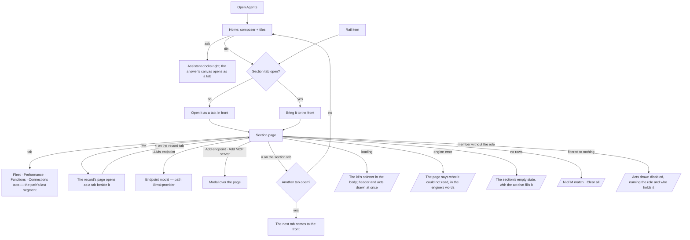

# The Agents shell

Agents is a rail and a workbook — no leftSection. Every section opens as a page in a tab of its own:
Home, Fleet, Performance, Agents, Skills, Functions, Connections, LLMs and Settings.

| | |
|---|---|
| Index | [5.12](../../../README.md#5--agents) · Slice **F03** |
| Module | [Agents](../spec.md) |
| API / CLI / Studio | — / — / ✅ |
| Related | [fleet-performance](fleet-performance.md) · [providers-and-models](providers-and-models.md) · [concurrency-and-contention](concurrency-and-contention.md) · [the-catalogue](../../workflows/features/the-catalogue.md) · [mcp-plugins](../../platform/features/mcp-plugins.md) · [list-contract](../../platform/features/list-contract.md) · products: [agent-fabric.md](../../../../products/agent-fabric.md) AF-01 · AF-02 · AF-17 · AF-19 · AF-20 · AF-23 · AF-25 · [shell.md](../../../../products/shell.md) |

> **As** a builder, **I want** every Agents section one click away on a rail, each a full-width page
> I can keep open beside the others, **so that** catalogues, numbers and forms read as pages, and
> nothing is squeezed into a side column.

## Capabilities

| # | Capability | Notes |
|---|---|---|
| C1 | The rail | Home · Fleet, Performance · Agents, Skills, Functions, Connections, LLMs · Settings (the gear at its foot). Lit for the section in the path |
| C2 | Sections are tabs | A rail item opens its section as a tab of the workbook, or brings its tab to the front; a tab closes with ×. With no tab open the workbook shows Home |
| C3 | Home | The composer centred — *What should your agents do?* — the person's recent asks, and a tile for every section with its count |
| C4 | Fleet | Tabs Overview · Map · Table. Overview is the fleet dashboard ([5.10](fleet-performance.md)); Map draws agents → skills → function namespaces; Table is every agent's numbers over 7 days |
| C5 | Performance | Tabs Agents · Skills · Plans · LLMs, over 7, 30 or 90 days ([5.10](fleet-performance.md) C5–C8) |
| C6 | Agents | One table of the authored agents — `All · Live · Drafts`, search, kind and status — on the [list contract](../../platform/features/list-contract.md); a row opens the agent's page |
| C7 | Skills | One table of skills — `All · Published · Drafts`, search; a row opens the skill's page |
| C8 | Functions | Tabs Functions · Packaged plans · Generated plans · Templates · Plugins. Functions groups the catalogue by namespace with a bound filter; a row opens the function's page; a plan opens as its flow; *Promote a plan* opens the promote dialog |
| C9 | Connections › MCP servers | Every MCP server an install admin added: URL, its tools (reads and sends), the credential's variable name, when the list froze, enabled or disabled, *Refresh tools*; the selected server's tools as functions. *Add MCP server* is a modal |
| C10 | LLMs | Endpoints as cards and every model version with who pins it; a pinned version no endpoint offers is a warning naming the agents. An endpoint's details and adding one are modals |
| C11 | Settings | The Graph's runs-at-once ceiling, queue or refuse at it, what runs now and every queued run with why it waits; the pools until Workers holds them |

## Journey

## Surfaces

| Rail | Path | Tabs (path) | Body | Reads |
|---|---|---|---|---|
| Home | `/agents/home` (the product's root lands here) | — | `AgentsHome` under the assistant's start | agents, skills, catalogue, plugins (`kind=mcp`), LLM providers — each list's `total`; fleet performance `tiles.degraded`; concurrency |
| Fleet | `/agents/fleet` | Overview · `map` · `table` | `FleetPage` | `GET …/agents/overview` · `…/agents` · `…/skills` · `…/agents/performance?window=7d` |
| Performance | `/agents/performance` | Agents · `skills` · `plans` · `llms` | `PerformancePage` | `GET …/agents/performance?window=` |
| Agents | `/agents/agents` | — | `AgentsListPage` | `GET …/agents` (list contract), `…/agents/performance?window=7d` |
| Skills | `/agents/skills` | — | `SkillsListPage` | `GET …/skills` (list contract) |
| Functions | `/agents/functions` | Functions · `plans` · `generated` · `templates` · `plugins` | `FunctionsPage` | `GET …/catalogue` · `…/flows` · `…/templates` · `/api/v1/plugins` |
| Connections | `/agents/connections/mcp` (`/agents/connections` lands here) | MCP servers | `ConnectionsPage` | `GET /api/v1/plugins?kind=mcp` · `GET /api/v1/plugins/:name` · `POST /api/v1/plugins/mcp` · `…/mcp/:name/refresh` · `…/:name/enable·disable` |
| LLMs | `/agents/llms[/:provider]` | — | `LlmsPage` + `EndpointDialog` · `AddEndpointDialog` | `GET …/llm/providers` · `…/llm/pins` |
| Settings | `/agents/settings` | — | `AgentsSettingsPage` | `GET/PUT …/agents/concurrency` · pools |

| Record page | Opens from | Board kind |
|---|---|---|
| An agent | Agents, Fleet, Performance | `agent` |
| A skill | Skills, Performance | `skill` |
| A function | Functions › Functions, a plugin's page | `task_type` |
| A plugin | Functions › Plugins | `plugin` |
| A plan | Functions › Packaged plans · Generated plans | `plan_runs` |
| A template | Functions › Templates | `template` |

## Seams

| Seam | What the user sees |
|---|---|
| While loading | The page's title, its tabs and its acts at once; the kit's spinner where the rows will be |
| Reload | The path names the section, its tab and an open endpoint; `?page=` names a record tab in front. Other open tabs are this browser session's and do not survive a reload |
| A rail move | Brings the section's tab to the front; a record tab in front steps back behind it |
| No rows | Agents: *No agents yet*; Skills: *No skills yet*; Connections: *No MCP servers* with *Add MCP server*; LLMs: *No endpoints* with *Add endpoint* |
| Filtered to nothing | *N of M match* and *Clear all* ([list-contract](../../platform/features/list-contract.md)) |
| Member without the role | Every act drawn disabled with *Needs the `<role>` role — ask `<holders>`*; reading stays open |
| The engine fails | The page names what it could not read in the engine's words, in place of the rows |

## Decisions

| # | Decision |
|---|---|
| AS1 | **No leftSection in Agents.** Every section is a page in `mainSection`; the host draws no left column for any Agents path |
| AS2 | **A section is a tab.** A rail move opens the section as a workbook tab or brings its tab to the front, and steps any record tab in front behind it. The tab carries × |
| AS3 | **Home is the workbook with nothing open.** It is not a tab; closing the last tab returns to it. Its chips are the person's own recent asks, never invented suggestions |
| AS4 | **A section's tabs are the path's last segment** — `/agents/fleet/map`, `/agents/functions/templates` — and are not a breadcrumb level |
| AS5 | **A row opens its record's page as a tab of its own, after the section's tab**, as the boards draw it (`Functions │ graph.read.get_neighbors ×`) |
| AS6 | **Fleet › Map is agents → skills → function namespaces**, drawn from the agents' bound skills and each skill's offered plan. Pools join the map when Workers holds them |
| AS7 | **Fleet › Table is Performance's agent rows over 7 days** — runs, success, p95 against the window before, tokens a run, the signal |
| AS8 | **LLMs: an endpoint's details and adding one are modals.** The endpoint modal is in the path (`/agents/llms/:provider`), so a link opens it; adding one is not |
| AS9 | **Connections shows only MCP servers.** *This Graph's server* arrives with I02 and *Remote agents* with 5.11; neither tab is drawn before it works |
| AS10 | **A tile's count is a list's `total` or an engine field**, never a count Studio makes; a tile with no such number names the section in words |
| AS11 | **Settings keeps the pools** until Workers holds them; the ceiling is the page's first card |
| AS13 | **`+` on the strip opens ⌘K**, which lists the sections, the agents and skills, and the recent runs — the one way to open anything, not a second menu |
| AS12 | **The rail holds only built sections.** Runs, Workers, Approvals and Ledger join it with their phases; until then runs are read in the shell's Activity |

## Not building

| Item | Why |
|---|---|
| A leftSection in Agents | The rail and its pages replace it |
| Invented suggestions on Home | A suggestion the assistant cannot serve is a promise nobody keeps |
| Tabs for Connections › This Graph's server and Remote agents | They arrive with the features that serve them |
| A Swarms or Schedules section | A large run is a run; schedules live in the shell's Activity |
| Restoring every open tab after a reload | The path and `?page=` restore what is in front; the rest is the session's |
