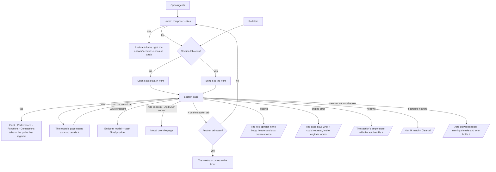

# The Agents shell

Agents is a rail and a workbook — no leftSection. Every section opens as a page in a tab of its own:
Home, Fleet, Performance, Agents, Skills, Functions, Connections, LLMs and Settings.

| | |
|---|---|
| Index | [5.12](../../../README.md#5--agents) · Slice **F03** |
| Module | [Agents](../spec.md) |
| API / CLI / Studio | — / — / ✅ |
| Related | [fleet-performance](fleet-performance.md) · [providers-and-models](providers-and-models.md) · [concurrency-and-contention](concurrency-and-contention.md) · [the-catalogue](../../workflows/features/the-catalogue.md) · [mcp-plugins](../../platform/features/mcp-plugins.md) · [list-contract](../../platform/features/list-contract.md) · products: [agent-fabric.md](../../../../products/agent-fabric.md) AF-01 · AF-02 · AF-17 · AF-19 · AF-20 · AF-23 · AF-25 · [shell.md](../../../../products/shell.md) |

> **As** a builder, **I want** every Agents section one click away on a rail, each a full-width page
> I can keep open beside the others, **so that** catalogues, numbers and forms read as pages, and
> nothing is squeezed into a side column.

## Capabilities

| # | Capability | Notes |
|---|---|---|
| C1 | The rail | Home · Fleet, Performance · Agents, Skills, Functions, Connections, LLMs · Settings (the gear at its foot). Lit for the section in the path |
| C2 | Sections are tabs | A rail item opens its section as a tab of the workbook, or brings its tab to the front; a tab closes with ×. With no tab open the workbook shows Home |
| C3 | Home | The composer centred — *What should your agents do?* — the person's recent asks, and a tile for every section with its count |
| C4 | Fleet | Tabs Overview · Map · Table. Overview is the fleet dashboard ([5.10](fleet-performance.md)); Map draws agents → skills → function namespaces; Table is every agent's numbers over 7 days |
| C5 | Performance | Tabs Agents · Skills · Plans · LLMs, over 7, 30 or 90 days ([5.10](fleet-performance.md) C5–C8) |
| C6 | Agents | One table of the authored agents — `All · Live · Drafts`, search, kind and status — on the [list contract](../../platform/features/list-contract.md); a row opens the agent's page |
| C7 | Skills | One table of skills — `All · Published · Drafts`, search; a row opens the skill's page |
| C8 | Functions | Tabs Functions · Packaged plans · Promoted plans · Templates · Plugins. Functions groups the catalogue by namespace with a bound filter; a row opens the function's page; a plan opens as its flow; *Promote a plan* opens the promote dialog |
| C9 | Connections › MCP servers | Every MCP server an install admin added: URL, its tools (reads and sends), the credential's variable name, when the list froze, enabled or disabled, *Refresh tools*; the selected server's tools as functions. *Add MCP server* is a modal |
| C10 | LLMs | Endpoints as cards and every model version with who pins it; a pinned version no endpoint offers is a warning naming the agents. An endpoint's details and adding one are modals |
| C11 | Settings | The Graph's runs-at-once ceiling, queue or refuse at it, what runs now and every queued run with why it waits; the pools until Workers holds them |

## Journey

## Surfaces

| Rail | Path | Tabs (path) | Body | Reads |
|---|---|---|---|---|
| Home | `/agents/home` (the product's root lands here) | — | `AgentsHome` under the assistant's start | agents, skills, catalogue, plugins (`kind=mcp`), LLM providers — each list's `total`; fleet performance `tiles.degraded`; concurrency |
| Fleet | `/agents/fleet` | Overview · `map` · `table` | `FleetPage` | `GET …/agents/overview` · `…/agents` · `…/skills` · `…/agents/performance?window=7d` |
| Performance | `/agents/performance` | Agents · `skills` · `plans` · `llms` | `PerformancePage` | `GET …/agents/performance?window=` |
| Agents | `/agents/agents` | — | `AgentsListPage` | `GET …/agents` (list contract), `…/agents/performance?window=7d` |
| Skills | `/agents/skills` | — | `SkillsListPage` | `GET …/skills` (list contract) |
| Functions | `/agents/functions` | Functions · `plans` · `promoted` · `templates` · `plugins` | `FunctionsPage` | `GET …/catalogue` · `…/flows` · `…/templates` · `/api/v1/plugins` |
| Connections | `/agents/connections/mcp` (`/agents/connections` lands here) | MCP servers | `ConnectionsPage` | `GET /api/v1/plugins?kind=mcp` · `GET /api/v1/plugins/:name` · `POST /api/v1/plugins/mcp` · `…/mcp/:name/refresh` · `…/:name/enable·disable` |
| LLMs | `/agents/llms[/:provider]` | — | `LlmsPage` + `EndpointDialog` · `AddEndpointDialog` | `GET …/llm/providers` · `…/llm/pins` |
| Settings | `/agents/settings` | — | `AgentsSettingsPage` | `GET/PUT …/agents/concurrency` · pools |

| Record page | Opens from | Board kind |
|---|---|---|
| An agent | Agents, Fleet, Performance | `agent` |
| A skill | Skills, Performance | `skill` |
| A function | Functions › Functions, a plugin's page | `task_type` |
| A plugin | Functions › Plugins | `plugin` |
| A plan | Functions › Packaged plans · Promoted plans | `plan_runs` |
| A template | Functions › Templates | `template` |

## Seams

| Seam | What the user sees |
|---|---|
| While loading | The page's title, its tabs and its acts at once; the kit's spinner where the rows will be |
| Reload | The path names the section, its tab and an open endpoint; `?page=` names a record tab in front. Other open tabs are this browser session's and do not survive a reload |
| A rail move | Brings the section's tab to the front; a record tab in front steps back behind it |
| No rows | Agents: *No agents yet*; Skills: *No skills yet*; Connections: *No MCP servers* with *Add MCP server*; LLMs: *No endpoints* with *Add endpoint* |
| Filtered to nothing | *N of M match* and *Clear all* ([list-contract](../../platform/features/list-contract.md)) |
| Member without the role | Every act drawn disabled with *Needs the `<role>` role — ask `<holders>`*; reading stays open |
| The engine fails | The page names what it could not read in the engine's words, in place of the rows |

## Decisions

| # | Decision |
|---|---|
| AS1 | **No leftSection in Agents.** Every section is a page in `mainSection`; the host draws no left column for any Agents path |
| AS2 | **A section is a tab.** A rail move opens the section as a workbook tab or brings its tab to the front, and steps any record tab in front behind it. The tab carries × |
| AS3 | **Home is the workbook with nothing open.** It is not a tab; closing the last tab returns to it. It never offers invented suggestions (AS17) |
| AS4 | **A section's tabs are the path's last segment** — `/agents/fleet/map`, `/agents/functions/templates` — and are not a breadcrumb level |
| AS5 | **A row opens its record's page as a tab of its own, after the section's tab**, as the boards draw it (`Functions │ graph.read.get_neighbors ×`) |
| AS6 | **Fleet › Map is agents → skills → function namespaces**, drawn from the agents' bound skills and each skill's offered plan. Pools join the map when Workers holds them |
| AS7 | **Fleet › Table is Performance's agent rows over 7 days** — runs, success, p95 against the window before, tokens a run, the signal |
| AS8 | **LLMs: an endpoint's details and adding one are modals.** The endpoint modal is in the path (`/agents/llms/:provider`), so a link opens it; adding one is not |
| AS9 | **Connections shows only MCP servers.** *This Graph's server* arrives with I02 and *Remote agents* with 5.11; neither tab is drawn before it works |
| AS10 | **A tile's count is a list's `total` or an engine field**, never a count Studio makes; a tile with no such number names the section in words |
| AS11 | **Settings keeps the pools** until Workers holds them; the ceiling is the page's first card |
| AS12 | **The rail holds only built sections.** Runs, Approvals and Ledger sit between LLMs and Settings with a divider before them; Workers joins with its phase. Runs and Approvals carry a badge — live runs (the Runs tiles' `live`), asks for you (the asks page's `for_you`) — counted by the engine. A product hands the shell its counts through `useNavBadges`, keyed by rail item; a count of 0 draws no badge |
| AS13 | **`+` on the strip opens ⌘K**, which lists the sections, the agents and skills, and the recent runs — the one way to open anything, not a second menu. With nothing typed it shows the product's sections, its first records and the Graph's newest runs as *Recent*; sections carry no counts (the palette reads no totals) |
| AS14 | **Packaged plans are `origin=packaged`; Promoted plans are `origin=promoted · authored`.** A one-off `generated` plan belongs to its Todo and is never listed ([LB6](../../workflows/features/the-library.md)), so no tab is named for it. Each tab sends its own origin filter to `/flows`; neither filters in the browser. The path is `/agents/functions/promoted` |
| AS15 | **Functions' tabs share one URL search (`?q=`) and each sends only its own filters.** Switching tabs keeps the search and drops filters the next tab does not know |
| AS16 | **Home's tiles open their section as a tab** through the same openers as every row; an open LLM endpoint's crumb is its name, never its id; a function's page is crumbed `Functions › graph.read.query` |
| AS17 | **Home draws no recent chips, no views and no Graph subtitle.** A session records only the Explorer or Modeller surface, so no ask can be told apart as an Agents ask; Home shows the composer and the tiles until a session records the Agents surface |
| AS18 | **Performance's trend and *What changed* are on its Agents tab only.** Skills is tiles + *Each skill* (Skill · Versions · Runs · Success · Against prior · p95 · Tokens / run); LLMs is tiles + *Each model version* (Version name · Runs · Success · p95 · Tokens / run) |
| AS19 | **A list page shows only the columns the engine returns.** A prototype column with no engine field is left out, never derived; the missing fields are listed in the build's hand-off. Agents shows the spawned-helpers count in its toolbar; Skills reads *Runs 30d* from Performance's 30-day skill rows; Fleet's Overview and Table list every agent, `—` where nothing ran |
| AS20 | **Fleet's Overview on a Graph nothing has run on leads with *Start here*** — *Ask the assistant to build one* and *Write a skill first* — above the Agents card. *New agent* joins it with the agent builder (F04) |
| AS21 | **Fleet › Map's console has one tab, Table**: what the map draws, switched by type (Agents · Skills · Namespaces). Steps · Ledger · Log join it with runs and the ledger (F05) |
| AS22 | **A click on the map selects; it does not navigate.** The selected agent shows in an inspector over the map with its skills and *Open*, which opens its page as a tab (AS5 holds for every *Open* and every list row) |
| AS23 | **Fleet › Table switches Agents · Skills.** Agents is AS7's rows; Skills is Performance's skill rows over the same window. Namespaces and Pools are not drawn — the engine has no per-namespace numbers, and pools join with Workers |
| AS24 | **A library row is one version of a plan** (`nl-single@1`, `nl-single@2`), as `/flows` lists it; a plan's versions read as one row when the engine lists the live version per key |
| AS25 | **The assistant on the right is closed until asked** — `?right=assistant` is the occupant, on Agents as everywhere. Over an Agents page it is closed, a pill reads *Ask about <page> ⌘J*; ⌘J opens or closes it from any page |
| AS26 | **Home's composer carries the context chips `Agents · <Graph>`** in place of the ask kind, world and agent: an Agents ask is a question about the product, not a query of the Graph |
| AS27 | **A function's page reads *Used by N plans*, each output's fan-out rule and *Must come after* from the Graph's catalogue entry**, since the install-level function read carries neither; opened outside a Graph it says so in their place |
| AS28 | **Library columns name what the engine returns**: a plan's *Layers* (no bounds on a flow row), a skill's *Plan* (its offered plan's steps and layers, not function keys), an endpoint model's *tier · power* (`cost_rank` is a rank, never a price) |
| AS29 | **Fleet › Map's console starts folded**, so the map has the whole height. `?console=table` opens it on the Table, and its fold and show acts write that param, so a reload keeps it |
| AS30 | **The Map legend's heading counts the types it lists** — *3 node · 2 line types*. A state is a tone of a node type, not a type of its own |
| AS31 | **On a Graph nothing has run on, Fleet's Overview is the tiles, *Start here* and the Agents card.** *Needs attention*, *Runs a day* and *Changed recently* draw once something has run |
| AS32 | **Fleet › Table's *Agents · Skills* switch and *Find in the fleet* share one toolbar row.** The search shows on Agents only: it is the agents list's `?q=` |
| AS33 | **The closed assistant's pill sits in a row of its own under an Agents page**, never over its content; over a data canvas it floats at the bottom right |
| AS34 | **A count tile prints the whole count, grouped** (*8,314*) — the number its table prints, never rounded to *8.3k* |
| AS35 | **A plan's Overview leads with *The plan*: Origin · Owner · Matches · May run.** *May run* is the agents permitted to call it (`used_by`), whether or not they have run it; each chip opens its agent. Owner reads *the library · reusable* for a listed plan |
| AS36 | **Every page under Functions is crumbed `Functions › <name>`, and `Functions` leads back** to the tab it belongs to (a plan to *Packaged* or *Promoted plans* by its origin, a plugin to Plugins, a template to Templates), with the section icon where the head takes one. The board head (`@invana/boards` `HeaderSpec`) has no icon field yet, so a plan's head draws none |
| AS37 | ***Promote a plan* is one act, in the Functions head**, gated to the `build` area; the *Promoted plans* empty state opens that same dialog |
| AS38 | **A plugin's Functions card heads its column *Function*** and draws each bound as a `BoundChip`, as the catalogue does |
| AS39 | **LLMs' *Model versions N* counts a fully shown list**: every endpoint is read whole, and the rows join endpoints' models with the pins (agents, skills, judges) and the worlds' cast. An engine-owned count arrives with a `GET …/llm/versions` page that serves the rows themselves (F04) |

## Not building

| Item | Why |
|---|---|
| A preview of an MCP server's tools before *Add* | The engine has no endpoint that lists a server's tools without saving it; *Add* saves, then the tools show |
| Who holds the install Admin role in a refusal | The holders read covers Graph roles only; the refusal names the role (*Needs the install Admin role*) |
| The product line in the status bar (*airways · 7 agents · 3 live runs · 3 waiting on you*) and *Console · Assistant · Builder* | The shell's status bar has no product slot yet; it arrives with the shell's status-bar work, fed from engine fields |
| Card nodes, minimap and zoom on Fleet › Map | `LayeredCanvas` in panel mode has none; they arrive with a fleet kind in canvas |
| A leftSection in Agents | The rail and its pages replace it |
| Invented suggestions on Home | A suggestion the assistant cannot serve is a promise nobody keeps |
| Tabs for Connections › This Graph's server and Remote agents | They arrive with the features that serve them |
| A Swarms or Schedules section | A large run is a run; schedules live in the shell's Activity |
| Restoring every open tab after a reload | The path and `?page=` restore what is in front; the rest is the session's |
