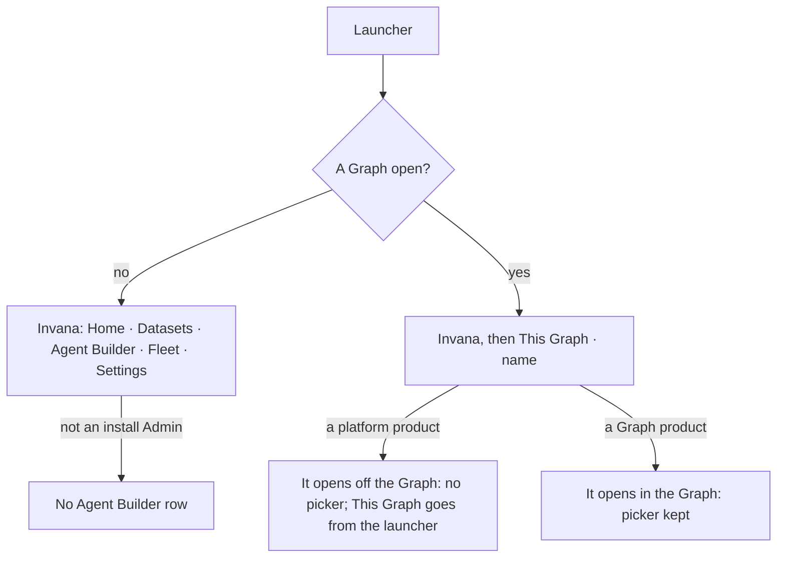
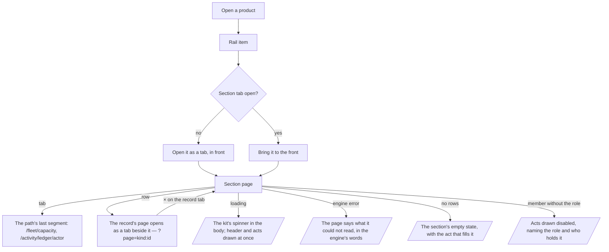

# The rail-and-workbook shell

The platform's **Agent Builder**, **Fleet** and **Settings**, and a Graph's **Activity**, are each a rail and a
workbook — no leftSection. Every rail item opens its section as a page in a tab of its own; a row opens its
record's page as a tab beside it. The launcher lists the platform's products under *Invana* and, while a
Graph is open, the Graph's under *This Graph · name*.

| | |
|---|---|
| Index | [5.12](../../../README.md#5--agents) · Slice **F03 · S-TBD** |
| Module | [Agents](../spec.md) |
| API / CLI / Studio | — / — / 🟡 |
| Related | [5.16](install-wide-agents-and-skills.md) · [workers](workers.md) · [fleet-performance](fleet-performance.md) · [providers-and-models](providers-and-models.md) · [concurrency-and-contention](concurrency-and-contention.md) · [the-catalogue](../../workflows/features/the-catalogue.md) · [mcp-plugins](../../platform/features/mcp-plugins.md) · [list-contract](../../platform/features/list-contract.md) · products: [agent-builder.md](../../../../products/agent-builder.md) · [platform.md](../../../../products/platform.md) · [shell.md](../../../../products/shell.md) |

> **As** a builder or an install Admin, **I want** every section of the Agent Builder, Fleet and Settings one
> click away on a rail, each a full-width page I can keep open beside the others, **so that** catalogues,
> numbers and forms read as pages, and nothing is squeezed into a side column.

> **As** a member of a Graph, **I want** the Graph's runs, approvals and ledger in one product beside its
> schedules, events and inbox, **so that** everything that ran or waits in this Graph is in one place.

## Capabilities

| # | Capability | Notes |
|---|---|---|
| C1 | Products declare their place | `scope: "platform"` routes off any Graph (`/<product>/…`) and draws no Graph picker; `scope: "graph"` routes under `/u/:user/:graph/<product>/…` and draws it |
| C2 | The launcher | *Invana* — Home · Datasets · Agent Builder · Fleet · Settings — then, while a Graph is open, *This Graph · name* — Modeller · Explorer · Projects · Activity · IAM · Graph settings. A member who cannot build (not an install Admin) sees no Agent Builder. The open product is ticked |
| C3 | The rail | The open product's sections, grouped, lit for the section in the path |
| C4 | Sections are tabs | A rail item opens its section as a tab of the workbook, or brings its tab to the front; a tab closes with ×. Fleet and Settings always show their section; the Builder shows Overview with no tab open |
| C5 | Fleet | Rail Pools · Workers · Capacity · Join tokens; one *Workers* page whose tabs are those four; *Add workers*; a pool and a worker open as tabs ([5.15](workers.md)) |
| C6 | Settings | Rail Graph limits │ LLM providers · Plugins · MCP servers · Remote agents — only what is built is drawn; Plugins lists every plugin and switches a tool plugin; a plugin opens as a tab |
| C7 | Activity | Rail Runs · Approvals · Ledger │ Schedules · Events · Inbox · Rules · Channels, in a Graph; a run opens as a tab; a change's compare opens inside Events |
| C8 | Agent Builder | Rail Overview │ Agents · Skills · Functions · Library │ Performance · Import and export ([5.16](install-wide-agents-and-skills.md)) |

## Journeys

## Surfaces

| Product | Rail | Path | Tabs (path) | Body | Reads |
|---|---|---|---|---|---|
| Fleet | Pools · Workers · Capacity · Join tokens | `/fleet/pools` (`/fleet` lands here) · `/fleet/workers` · `/fleet/capacity` · `/fleet/tokens` | the rail's four | `WorkersSectionPage` | `GET /api/v1/workers/…` |
| Settings | Plugins | `/settings/plugins` (`/settings` lands here) | — | `PluginsPage` | `GET /api/v1/plugins` · `POST …/:name/enable·disable` |
| Activity | Runs · Approvals · Ledger │ Schedules · Events · Inbox · Rules · Channels | `/u/:user/:graph/activity/runs` (`…/activity` lands here) · `…/approvals[/alerts]` · `…/ledger[/actor·record·refusals·export]` · `…/schedules[/:schedule]` · `…/events` · `…/changes/:kind/:record` · `…/inbox` · `…/rules` · `…/channels` | Approvals: Waiting · `alerts`; Ledger: Rows · `actor` · `record` · `refusals` · `export` | `RunsListPage` · `ApprovalsPage` · `LedgerPage` · `SchedulesTab` · `EventsTab` · `ComparePage` · `InboxTab` · `RulesTab` · `ChannelsTab` | each section's list endpoint on the Graph |
| Agent Builder | Overview │ Agents · Skills · Functions · Library │ Performance · Import and export | `/builder/<section>` | per [5.16](install-wide-agents-and-skills.md) | — | the catalogue endpoints |
| Profile | — | `/profile` | Profile · Access tokens | `ProfileSettingsPage` | `GET /api/v1/auth/me` |

| Record page | Opens from | Board kind | In |
|---|---|---|---|
| A worker pool | Fleet › Pools, a worker's page | `worker_pool` | Fleet |
| A worker | Fleet › Workers, a pool's page | `worker` | Fleet |
| A plugin | Settings › Plugins | `plugin` | Settings |
| A run | Activity › Runs, a schedule's firing, the Inbox, the bell | `run` | Activity |
| An agent · a skill · a function · a plan · a template | the Builder's lists | `agent` · `skill` · `function` · `plan_runs` · `template` | Agent Builder |

## Seams

| Seam | What the user sees |
|---|---|
| While loading | The page's title, its tabs and its acts at once; the kit's spinner where the rows will be |
| Reload | The path names the section and its tab; `?page=` names a record tab in front. Other open tabs are this browser session's and do not survive a reload |
| A rail move | Brings the section's tab to the front; a record tab in front steps back behind it |
| A platform product opened from a Graph | The Graph picker leaves the header; the launcher's *This Graph* group goes until a Graph is opened again |
| No Graph open | The launcher lists only *Invana*, with *Open a Graph to see its products* under it |
| A member who cannot build | No Agent Builder in the launcher |
| No rows | Pools: *No pools yet* with *Add workers*; Plugins: *No plugins*; each Activity section its own empty state |
| Member without the role | Every act drawn disabled with *Needs the `<role>` role — ask `<holders>`*; reading stays open |
| The engine fails | The page names what it could not read in the engine's words, in place of the rows |

## Decisions

| # | Decision |
|---|---|
| AS40 | **The rail and workbook serve the platform's products and a Graph's Activity, not one Agents product.** The same shell — rail, workbook, no leftSection — carries the Agent Builder (Overview · Agents · Skills · Functions · Library · Performance · Import and export), Fleet (Pools · Workers · Capacity · Join tokens), Settings (Graph limits · LLM providers · Plugins · MCP servers · Remote agents) and, in a Graph, Activity (Runs · Approvals · Ledger). Routes follow the product: `/builder/…` · `/fleet/…` · `/settings/…` off any Graph, `/u/:user/:graph/activity/…` in one ([5.16](install-wide-agents-and-skills.md) WD13, WD18) |
| AS41 | **The launcher has two groups.** *Invana* lists Home (the shell's Graphs page, `/graphs`) and every `scope: "platform"` product; *This Graph · name* lists every `scope: "graph"` product, only while a Graph is open. With none open the menu ends *Open a Graph to see its products*; in a Graph, *A platform product leaves the Graph · its picker goes*. A product with `audience: "builders"` is listed only for an install Admin |
| AS42 | **Until the Agent Builder ships, the Agents product stands in its row.** Its routes stay a Graph's; it is listed under *Invana* with `audience: "builders"`, and opens in the open Graph, or the Graphs list when none is |
| AS43 | **A platform product draws its workbook in the shell's `mainSection`**, with the product's rail as `leftNav`. Its section is the first tab and cannot close; a record opens as a closable tab named by `?page=`. No assistant docks on a platform product: the assistant's sessions are a Graph's |
| AS44 | **Activity is drawn by the product host**, like IAM: its sections are workbook tabs, a run is the `run` record page beside them, and a section's panel key is prefixed `activity-` so none collides with another product's |
| AS45 | **A person's own settings are at `/profile`**, off any Graph, from the user menu |
| AS46 | **Activity has no Home.** `…/activity` lands on Runs; its last open section tab carries no ×, so the workbook is never empty. An old `?panel=runs`, `approvals`, `ledger`, `events` or `activity&section=<tab>` link lands on its Activity path |
| AS47 | **A run is read only in Activity.** From Agents, a run and a link to Runs, Approvals or Ledger go to the Activity of the same Graph; from an Activity run page, an agent, skill, function, plan or template opens in Agents. Activity's sections table is the shell's, so the Runs, Approvals and Ledger pages and Activity's rail name a section the same way |
| AS1 | **No leftSection.** Every section is a page in `mainSection`; no rail-and-workbook product draws a left column |
| AS2 | **A section is a tab.** A rail move opens the section as a workbook tab or brings its tab to the front, and steps any record tab in front behind it. The tab carries × |
| AS3 | **Home is the workbook with nothing open.** It is not a tab; closing the last tab returns to it. It never offers invented suggestions (AS17) |
| AS4 | **A section's tabs are the path's last segment** — `/agents/fleet/map`, `/agents/functions/templates` — and are not a breadcrumb level |
| AS5 | **A row opens its record's page as a tab of its own, after the section's tab**, as the boards draw it (`Functions │ graph.read.get_neighbors ×`) |
| AS6 | **Fleet › Map is agents → skills → function namespaces**, drawn from the agents' bound skills and each skill's offered plan. Pools join the map when Workers holds them |
| AS7 | **Fleet › Table is Performance's agent rows over 7 days** — runs, success, p95 against the window before, tokens a run, the signal |
| AS8 | **LLMs: an endpoint's details and adding one are modals.** The endpoint modal is in the path (`/agents/llms/:provider`), so a link opens it; adding one is not |
| AS9 | **Connections has two tabs: *This Graph's server* (the landing tab, [13.16](../../platform/features/this-graphs-mcp-server.md)) and *MCP servers*.** *Remote agents* arrives with 5.11 and is not drawn before it works |
| AS10 | **A tile's count is a list's `total` or an engine field**, never a count Studio makes; a tile with no such number names the section in words |
| AS11 | **Pools are Fleet's.** Fleet holds every pool and worker; a Graph's at-once ceiling is its own setting, never a pool |
| AS12 | **The rail holds only built sections.** Settings draws Plugins alone until Graph limits, LLM providers, MCP servers and Remote agents move in; Activity's Runs and Approvals carry a badge — live runs (the Runs tiles' `live`), asks for you (the asks page's `for_you`) — counted by the engine. A product hands the shell its counts through `useNavBadges`, keyed by rail item; a count of 0 draws no badge |
| AS13 | **`+` on the strip opens ⌘K**, which lists the sections, the agents and skills, and the recent runs — the one way to open anything, not a second menu. With nothing typed it shows the product's sections, its first records and the Graph's newest runs as *Recent*; sections carry no counts (the palette reads no totals) |
| AS14 | **Packaged plans are `origin=packaged`; Promoted plans are `origin=promoted · authored`.** A one-off `generated` plan belongs to its Todo and is never listed ([LB6](../../workflows/features/the-library.md)), so no tab is named for it. Each tab sends its own origin filter to `/flows`; neither filters in the browser. The path is `/agents/functions/promoted` |
| AS15 | **Functions' tabs share one URL search (`?q=`) and each sends only its own filters.** Switching tabs keeps the search and drops filters the next tab does not know |
| AS16 | **Home's tiles open their section as a tab** through the same openers as every row; an open LLM endpoint's crumb is its name, never its id; a function's page is crumbed `Functions › graph.read.query` |
| AS17 | **Home draws no recent chips, no views and no Graph subtitle.** A session records only the Explorer or Modeller surface, so no ask can be told apart as an Agents ask; Home shows the composer and the tiles until a session records the Agents surface |
| AS18 | **Performance's trend and *What changed* are on its Agents tab only.** Skills is tiles + *Each skill* (Skill · Versions · Runs · Success · Against prior · p95 · Tokens / run); LLMs is tiles + *Each model version* (Version name · Runs · Success · p95 · Tokens / run) |
| AS19 | **A list page shows only the columns the engine returns.** A prototype column with no engine field is left out, never derived; the missing fields are listed in the build's hand-off. Agents shows the spawned-helpers count in its toolbar; Skills reads *Runs 30d* from Performance's 30-day skill rows; Fleet's Overview and Table list every agent, `—` where nothing ran |
| AS20 | **Fleet's Overview on a Graph nothing has run on leads with *Start here*** — *Ask the assistant to build one* and *Write a skill first* — above the Agents card. *New agent* joins it with the agent builder (F04) |
| AS21 | **Fleet › Map's console has one tab, Table**: what the map draws, switched by type (Agents · Skills · Namespaces). Steps · Ledger · Log join it with runs and the ledger (F05) |
| AS22 | **A click on the map selects; it does not navigate.** The selected agent shows in an inspector over the map with its skills and *Open*, which opens its page as a tab (AS5 holds for every *Open* and every list row) |
| AS23 | **Fleet › Table switches Agents · Skills.** Agents is AS7's rows; Skills is Performance's skill rows over the same window. Namespaces and Pools are not drawn — the engine has no per-namespace numbers, and pools join with Workers |
| AS24 | **A library row is one version of a plan** (`nl-single@1`, `nl-single@2`), as `/flows` lists it; a plan's versions read as one row when the engine lists the live version per key |
| AS25 | **The assistant on the right is closed until asked** — `?right=assistant` is the occupant, on Agents as everywhere. Over an Agents page it is closed, a pill reads *Ask about <page> ⌘J*; ⌘J opens or closes it from any page |
| AS26 | **Home's composer carries the context chips `Agents · <Graph>`** in place of the ask kind, world and agent: an Agents ask is a question about the product, not a query of the Graph |
| AS27 | **A function's page reads *Used by N plans*, each output's fan-out rule and *Must come after* from the Graph's catalogue entry**, since the install-level function read carries neither; opened outside a Graph it says so in their place |
| AS28 | **Library columns name what the engine returns**: a plan's *Layers* (no bounds on a flow row), a skill's *Plan* (its offered plan's steps and layers, not function keys), an endpoint model's *tier · power* (`cost_rank` is a rank, never a price) |
| AS29 | **Fleet › Map's console starts folded**, so the map has the whole height. `?console=table` opens it on the Table, and its fold and show acts write that param, so a reload keeps it |
| AS30 | **The Map legend's heading counts the types it lists** — *3 node · 2 line types*. A state is a tone of a node type, not a type of its own |
| AS31 | **On a Graph nothing has run on, Fleet's Overview is the tiles, *Start here* and the Agents card.** *Needs attention*, *Runs a day* and *Changed recently* draw once something has run |
| AS32 | **Fleet › Table's *Agents · Skills* switch and *Find in the fleet* share one toolbar row.** The search shows on Agents only: it is the agents list's `?q=` |
| AS33 | **The closed assistant's pill sits in a row of its own under an Agents page**, never over its content; over a data canvas it floats at the bottom right |
| AS34 | **A count tile prints the whole count, grouped** (*8,314*) — the number its table prints, never rounded to *8.3k* |
| AS35 | **A plan's Overview leads with *The plan*: Origin · Owner · Matches · May run.** *May run* is the agents permitted to call it (`used_by`), whether or not they have run it; each chip opens its agent. Owner reads *the library · reusable* for a listed plan |
| AS36 | **Every page under Functions is crumbed `Functions › <name>`, and `Functions` leads back** to the tab it belongs to (a plan to *Packaged* or *Promoted plans* by its origin, a plugin to Plugins, a template to Templates), with the section icon where the head takes one. The board head (`@invana/boards` `HeaderSpec`) has no icon field yet, so a plan's head draws none |
| AS37 | ***Promote a plan* is one act, in the Functions head**, gated to the `build` area; the *Promoted plans* empty state opens that same dialog |
| AS38 | **A plugin's Functions card heads its column *Function*** and draws each bound as a `BoundChip`, as the catalogue does |
| AS39 | **LLMs' *Model versions N* counts a fully shown list**: every endpoint is read whole, and the rows join endpoints' models with the pins (agents, skills, judges) and the worlds' cast. An engine-owned count arrives with a `GET …/llm/versions` page that serves the rows themselves (F04) |

## Not building

| Item | Why |
|---|---|
| A preview of an MCP server's tools before *Add* | The engine has no endpoint that lists a server's tools without saving it; *Add* saves, then the tools show |
| Who holds the install Admin role in a refusal | The holders read covers Graph roles only; the refusal names the role (*Needs the install Admin role*) |
| The product line in the status bar (*airways · 7 agents · 3 live runs · 3 waiting on you*) and *Console · Assistant · Builder* | The shell's status bar has no product slot yet; it arrives with the shell's status-bar work, fed from engine fields |
| Card nodes, minimap and zoom on Fleet › Map | `LayeredCanvas` in panel mode has none; they arrive with a fleet kind in canvas |
| A leftSection in Agents | The rail and its pages replace it |
| Invented suggestions on Home | A suggestion the assistant cannot serve is a promise nobody keeps |
| The *Remote agents* tab of Connections | It arrives with 5.11, the feature that serves it |
| A Swarms or Schedules section | A large run is a run; schedules live in the shell's Activity |
| Restoring every open tab after a reload | The path and `?page=` restore what is in front; the rest is the session's |
