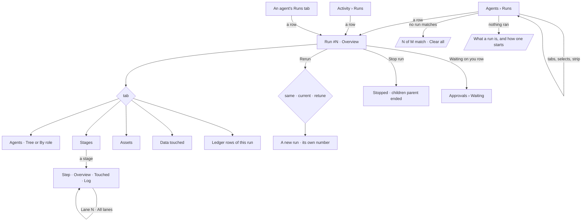

# Runs and the run page

Every run in a Graph is listed in one place — **Agents › Runs** — and read on one page, the same for one
agent, nine or seven hundred: **Overview · Agents · Stages · Assets · Data touched · Ledger**. A run can
be rerun as it was, on today's versions, or retuned.

| | |
|---|---|
| Index | [5.14](../../../README.md#5--agents) · Slice **F05** |
| Module | [Agents](../spec.md) |
| API / CLI / Studio | 🟡 / — / 🟡 |
| Related | [see-what-ran](../../operate/features/see-what-ran.md) (the journal's records and the step drill-in) · [delegation](delegation.md) (escrow, ceilings, exit reasons) · [approvals](../../operate/features/approvals.md) · [the-ledger](../../operate/features/the-ledger.md) · [the-agent-page](the-agent-page.md) · [list-contract](../../platform/features/list-contract.md) · products: [agent-fabric.md](../../../../products/agent-fabric.md) AF-07 · AF-08 · AF-09 · AF-16 · AF-24 · AF-26 |

> **As** a reviewer or an operator, **I want** every run in one list and each run read the same way at
> any size — its numbers, who spawned whom, each stage's input and output, what it produced and touched,
> and every act it made — **so that** I know where a run stands and can audit or rerun any of it.

## Capabilities

| # | Capability | Notes |
|---|---|---|
| C1 | One runs list | Agents › Runs: every root run, newest first. Tiles Live · Waiting on you · Served 24 h · Not served 24 h · Tokens 24 h. `All · Live · Waiting · Ended`, Agent · Started by · From selects; the applied-filters strip |
| C2 | A run row | `#number` · root agent · asked · From (Explorer · Todo · Schedule · Project · API) · started by · size (agents) · tokens · time · status (the exit reason once ended) |
| C3 | The run page head | `Runs › Run #N · <root agent>`, status, *what started it* (`Todo by ravi · "…"`, `asked in Explorer by meera · session "…" · Open the session`), `N of M tokens` with a meter, Compare · Rerun · Stop run |
| C4 | Overview | Tiles Elapsed · Tokens · Agents · Steps · Assets · Records touched; *Agents over time* — a bar per agent with its state in words; *Steps a minute*; *Waiting on you* |
| C5 | Overview of a large run | More than 50 agents: tiles Agents · Live · Queued · Finishing a minute · Tokens · ETA; *Agents finished a minute*; *Agents live* against the live limit; *By role* |
| C6 | Agents | Who spawned whom on a canvas: the Todo or session, the root agent, every helper with its state and `tokens/escrow`; a pending delegation ask drawn dashed. Views: **Tree** · **By role** (one card per role with a status bar, and one cell per agent) |
| C7 | Stages | One card per stage (a function in plan order) with calls, lanes, time and counts in → out on each edge. Selecting a stage opens the step under the canvas: Overview (tiles · Input · Output) · Touched · Log, and *Lane N · All lanes* when it fanned out |
| C8 | Assets | Every emission, file, branch and Todo the run produced — kind, produced by (function · agent), size, where |
| C9 | Data touched | Graph data (type · read · written · refused), Web (domain · pages · refused and why), LLM (model · calls · tokens in · out), Secrets (name · used by · where) |
| C10 | Ledger | The run's ledger rows — the Rows tab of [the ledger](../../operate/features/the-ledger.md), filtered to the run |
| C11 | Rerun | One dialog: *The same versions — reproduce it* · *Current versions — compare* · *Retune* (agent version · model version · run budget · world). A rerun is a new run with its own number |
| C12 | Stop run | Cancels the run and its children; each child ends `parent ended`, the root `stopped` |
| C13 | An Explorer answer is a run | Run by the Graph's assistant agent on behalf of whoever asked; its head names the session and opens it |

## Journey

## Seams

| Seam | What the user sees |
|---|---|
| Nothing has run | The list's empty state: what a run is, and that an ask, a Todo or a schedule starts one |
| A filter matches nothing | *0 of M runs match* with *Clear all* |
| A run in flight | Status `running`, elapsed `so far`, the bars open-ended; the page refetches every 5 s while it runs |
| A run with one agent | Agents draws the root alone; *By role* is offered only past 50 agents |
| A run whose steps were pruned | Stages says the trace has been pruned; the tiles keep their stored numbers |
| A member who cannot open the run | It is not listed; a link to it reads *not found* |
| Stop on a run that has ended | The button is absent |
| Rerun on a run still going | *Rerun* waits — it is offered once the run has ended |

## Surfaces

| Surface | Shape |
|---|---|
| `agents.runs` | `/agents/runs` — `SectionPage` *Runs* with the five tiles (`MetricTile`), `SegmentedControl` `All · Live · Waiting · Ended` (`?f.state=`), three `FilterSelect` chips (`?f.agent_id=` · `?f.started_by=` · `?f.origin=`), each showing its value or *any*, the strip, a kit `Table`. A row opens `?page=run:<id>` as a workbook tab titled `Run #N` |
| `agents.runs.filtered` | the list the assistant opened (`&via=assistant`): the head reads *N of M runs match*, then the strip with its chips marked *set by the assistant*, then the table — no tiles, no filter row. Removing a chip drops `via` and the full list returns |
| `agents.run.*` | `?page=run:<id>&tab=overview|agents|stages|assets|touched|ledger` — `RecordHeader variant="page"` with the crumb `Runs`, then `Tabs` |
| `agents.run.step` | `&tab=stages&step=<step run id>` — the step panel under the stage canvas; `&lane=all` for every lane |
| `agents.run.rerun` | the Rerun `Dialog` over the run page (`&rerun=1`) |
| `agents.run.many*` | the same page for a run past 50 agents; `&view=role` on Agents for *By role* |
| Activity › Runs | the shell's journal; a row opens the run page in Agents |

## Engine

| Thing | Shape |
|---|---|
| `task_runs.number` | a per-Graph number for a root run, `1, 2, 3…`, unique with `graph_id`; set when the run is created. Steps and child runs carry none |
| `task_runs.exit_reason` | why a run ended, set when it settles: `served · cannot_answer · budget_declined · time_limit · step_limit · no_progress · loop · parent_ended · stopped · failed` |
| `task_runs.escrow_tokens` · `escrow_returned` | on a child run: tokens moved from its parent's remaining budget, and what went back when it ended ([delegation](delegation.md)) |
| `GET …/runs` | `Page[TaskRunSummary]`; items add `number` · `agent_name` · `origin` · `started_by_name` · `agents` · `exit_reason`. Filters add `state` (`live · waiting · ended`) and `exit_reason` (a reason, or `not_served` for every ended run that did not serve) |
| `GET …/runs/stats` | adds `served` · `not_served` · `not_served_by_reason {reason: n}` · `served_share` · `waiting_approvals` over the window, and `largest_live_run_id` · `largest_live_agents` standing now |
| `GET …/runs/{id}/overview` | `RunOverview` — head, tiles, `agents_over_time[]`, `steps_per_minute[]`, `waiting[]`, and for a large run `finished_per_minute[]` · `live_over_time[]` · `live_limit` · `eta_s` · `by_role[]` |
| `GET …/runs/{id}/agents` | `RunAgents` — `nodes[]` (run id, parent, agent, role, depth, status, exit reason, tokens, escrow, state words), `asks[]` (pending delegation), `roles[]` |
| `GET …/runs/{id}/stages` | `RunStages` — `stages[]` in plan order: function, status, calls, lanes, duration, p95, tokens, `in_count`, `out_count`, `line`, `step_ids[]` |
| `GET …/runs/{id}/assets` | `RunAssets` — `items[]`: name, kind, produced by, size, where, `step_run_id` |
| `GET …/runs/{id}/touched` | `RunTouched` — `graph[]` · `web[]` · `llm[]` · `secrets[]` |
| `POST …/runs/{id}/rerun` | `versions: same · current · retune`; a retune takes `agent_version` · `model_version` · `max_tokens_run` · `lens_id` |
| `POST …/runs/{id}/cancel` | Stop run |

## Decisions

| # | Decision |
|---|---|
| RP1 | **Agents › Runs is the one runs list.** Activity › Runs stays the shell's journal for every product and its rows open this page; an agent's Runs tab is this list with `f.agent_id`. |
| RP2 | **A root run has a number.** `#2291` is how people quote a run; the uuid stays its identity. The number is per Graph, given at creation, never reused; steps and children have none, so the numbers people see are the runs they started. |
| RP3 | **A run's status is its exit reason once it ends.** `served`, `budget declined`, `no progress` — the reason an agent ended is the word a row shows, recorded when the run settles, never derived in Studio. A running run says `running`, a held one `waiting`. |
| RP4 | **`state` groups statuses for the list's tabs.** `live` is queued or running, `waiting` is held on a person (`awaiting_input` · `needs_input` — a question, or a step held on an approval), `ended` is every terminal status. |
| RP5 | **From is the run's origin in the reader's words.** Explorer (an ask from a session), Todo, Schedule, Project, API — mapped from `triggered_by` and the session; a delegation is never a root, so it is never a From. `f.origin` takes the same words, on Runs and on an agent's Runs tab. |
| RP6 | **Size is how many agents the run used**, the root and every child run with an agent, counted by the engine. |
| RP7 | **One page at any size.** The tabs never change with size; past 50 agents the Overview swaps to the large-run reading and Agents offers *By role*. |
| RP8 | **Every number on the page is the engine's.** Tiles, bars, per-minute counts, ETA and per-role p50/p95 come from the run's read endpoints; Studio formats them. |
| RP9 | **The ETA is a rate, not a forecast model.** Agents still to finish divided by the last ten minutes' finishing rate; absent when nothing finished in that window. |
| RP10 | **Stages are the plan's functions in order, each stage the steps of one step key.** Counts on an edge are the stage's `out_count`, the rows or items its steps returned. |
| RP11 | **A step opens under the stage canvas, inside the run** — Overview (tiles · Input · Output) · Touched · Log, the components [see-what-ran](../../operate/features/see-what-ran.md) already draws. A fanned-out stage opens on its first lane with *All lanes* beside it. |
| RP12 | **Rerun is one dialog wherever a run is read.** Same versions reproduces it; current versions compares; retune changes agent version, model version, run budget or world. A rerun opens its own page; the comparison is the Compare act. |
| RP13 | **Stop run is the one write on the run page.** It cancels the root; children end `parent ended`, the root `stopped`, and both are ledger rows. |
| RP14 | **Waiting on you lists the run's pending asks** routed to the reader; each opens Approvals › Waiting. |
| RP15 | **A run's workbook tab is titled `Run #N`**, with the run icon; the uuid stands in only until the number is read. The assistant's pill reads the same title |
| RP16 | **The Agents Tree and the Stages canvas draw cards**, not circles: an agent card carries its state line and its tokens against its escrow; a stage card carries its function, calls, lanes and time. Both canvases carry the board's view chip and its zoom · fit · lock controls. An agent card prints its tokens against its escrow as text — a canvas card has no meter element — and neither canvas draws a minimap |
| RP17 | **A number the engine has not recorded is absent, never 0** — a run with no token count shows `—` in its head; an LLM row with no model version reads *not recorded* as muted text |
| RP18 | **An ended run holds no asks.** When a run ends, each of its pending asks is closed `expired` and leaves Waiting on you and Approvals › Waiting |
| RP19 | **A link to a step opens its run on Stages with that step under the canvas**; a link that names a tab keeps it |

## Not building

| Not building | Because |
|---|---|
| An icicle view of Agents | Tree and By role answer *who spawned whom* and *how is each role doing*; an icicle repeats By role's cells without a question of its own |
| Saved reports of a run page | a settled run is immutable and its page reads it at any time; a report would be a second copy |
| A per-step *Re-run* | a step reruns with its run; a lone step out of its plan has no inputs to trust |
| *Select them* on a large run's cells | a selection that acts on many agents is a rerun of the run, retuned |
