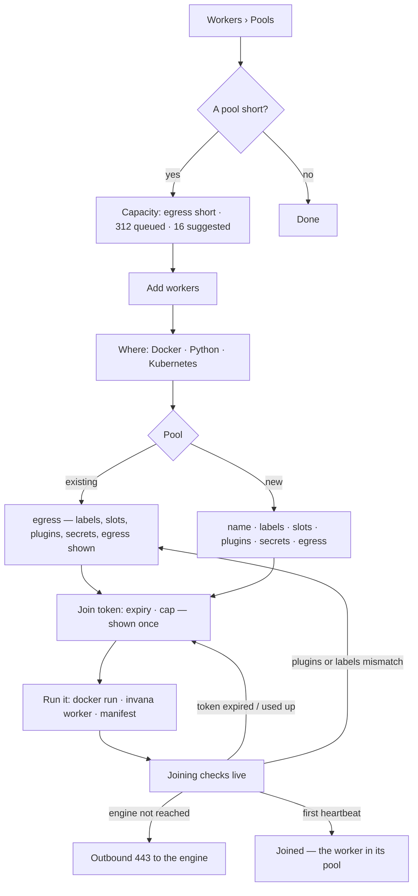
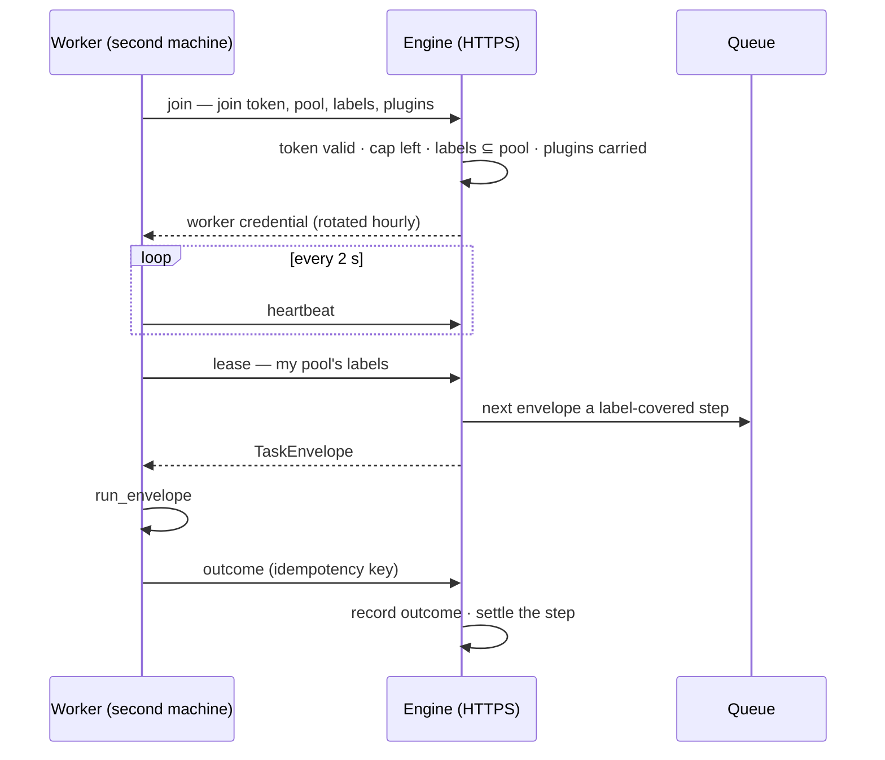

# Workers and pools

Agents are records; **workers** run their steps. A worker belongs to one **pool** — a labelled set of
Docker hosts, Python machines or a Kubernetes Deployment — and any worker in a pool whose labels cover
a step's resources may run it. A person adds workers with one command and scales every pool by hand;
the engine says where steps wait and how many workers would clear them.

| | |
|---|---|
| Index | [5.15](../../../README.md#5--agents) · Slice **F06** |
| Module | [Agents](../spec.md) |
| API / CLI / Studio | 🔵 / 🔵 / 🔵 |
| Related | [distributed-execution](../../platform/features/distributed-execution.md) 13.11 (the envelope, the executor) · [tool-plugins](../../platform/features/tool-plugins.md) 13.12 (`invana worker` today) · [concurrency-and-contention](concurrency-and-contention.md) 5.7 (a Graph's slot pools — a different thing) · [tokens](../../identity-and-access/features/tokens.md) · options: [workers-and-orchestration](../../../building-engine/workers-and-orchestration.md) · products: [agent-fabric.md](../../../../products/agent-fabric.md) › Workers, AF-10 · AF-11 · [scale-out.md](../../../../products/scale-out.md) |

> **As** an install admin or operator, **I want** every worker in every pool, what each is running,
> where steps wait for want of workers, and to add workers on my own machines with one command,
> **so that** capacity is a command away and I add it where it is short.

## Capabilities

| # | Capability | Notes |
|---|---|---|
| C1 | Pools | Name · runs on (Docker · Python · Kubernetes) · labels (`cpu · llm · egress · gpu · code`) · workers · set by (*by hand* · *N replicas*) · slots busy / total · queued · oldest · state (*keeping up* · *short* · *no workers* · *healthy*) |
| C2 | Pools page | Tiles Workers (*N starting · N lost*) · Slots busy (*n / m*, %) · Queue (*oldest N s*) · Envelopes a minute (*± vs 7-day*) · Lost · 24 h; *Workers · last 30 min* chart; Worker events (when · pool · change · why) |
| C3 | A pool | Every worker: node · state (busy · idle · starting · lost · draining) · running now (`function · #run · agent`) · slots · heartbeat · CPU · up. `All · Busy · Idle · Starting · Lost` chips; **Drain** |
| C4 | A worker | Slots · steps 1 h (*N failed*) · p95 a step · up; *Running now* (step · run · agent · for); CPU last 30 min; its log; **Drain this worker** |
| C5 | Capacity | Per pool: ready steps · oldest · workers · suggested; a callout on a short pool; *Suggested* = ready steps ÷ slots a worker over the last 10 min, computed by the engine every 30 s |
| C6 | Join tokens | Token · pool · made by · expires (*never · in a cluster secret* allowed) · joined *n of cap* · last used · **Revoke** |
| C7 | Add workers | Five steps in one modal: **Where** (Docker · Python · Kubernetes) → **Pool** (existing or new; labels, slots a worker, plugins, secrets, egress) → **Join token** (expiry, cap; shown once) → **Run it** (the command or manifest) → **Joined** (checks live) |
| C8 | Joining checks | Token used · engine reached (*from IP*) · plugins loaded · labels match the pool · first heartbeat — each as it happens, with what to check when one fails |
| C9 | A worker dials out | HTTPS to the engine with its credential; no inbound port, no database credential |
| C10 | Lost and unroutable | No heartbeat 30 s → lost, its steps redelivered with the same idempotency key; a step no live pool covers waits as *unroutable*, naming the missing label |

## Journeys

## Seams

| Seam | What the user sees |
|---|---|
| No workers anywhere, executor `inline` | Pools empty state: *Steps run inside the engine on this install. Add workers to run tool steps on other machines.* and **Add workers** |
| A pool with no worker | State *no workers*; Capacity row *no workers — start one*; a step waiting on it is named on its run's Overview (*waiting on workers · gpu*) |
| Waiting on the join | The Joined step polls; *First heartbeat · waiting · 12 s*; past 2 min the *Nothing after 2 minutes?* checklist |
| A token shown once | Join token step and the Run it command carry the secret; after the modal closes the Join tokens tab shows its prefix only |
| A lost worker | Row *lost*, *N steps redelivered*; a Worker event *no heartbeat 30 s · N steps redelivered* |
| A member who is not an install admin | Workers is readable; Add workers, Drain and Revoke are disabled with *Install admins add and scale workers* |
| Reload | Tab and pool/worker are in the URL; the Add workers modal reopens at step 1 (a minted token is not shown again) |

## Surfaces

| Board | Route | Draws |
|---|---|---|
| `agents.pools` | `/agents/workers` (tab `pools`) | C1 · C2 |
| `agents.pool.detail` | `/agents/workers/pools/<pool>` | C3 |
| `agents.pool.worker` | `/agents/workers/pools/<pool>/workers/<worker>` | C4 |
| `agents.pool.capacity` | `/agents/workers` (tab `capacity`) | C5 |
| `agents.workers.tokens` | `/agents/workers` (tab `tokens`) | C6 |
| `agents.workers.add` · `.pool` · `.token` · `.run.docker` · `.run.python` · `.run.k8s` · `.waiting` · `.joined` | `/agents/workers?add=<step>` | C7 · C8 |

The *Workers* tab of the Workers page lists every worker across pools (C3's table without a pool filter).

## Engine

The queue is procrastinate behind the engine's worker gateway — [13.11](../../platform/features/distributed-execution.md)
DE9 · DE10; the options are compared in [workers-and-orchestration](../../../building-engine/workers-and-orchestration.md).

| Record | Columns |
|---|---|
| `worker_pools` | id · name (unique, install-wide) · runs_on (`docker · python · kubernetes`) · labels[] · slots_per_worker · plugins[] · secrets[] (names) · egress[] (domains) · set_by (`hand · replicas`) · replicas · created_by_id · created_at |
| `workers` | id · pool_id · name · node · version · labels[] · plugins[] · slots · state (`starting · busy · idle · draining · lost · stopped`) · credential hash · credential_rotated_at · joined_via (token id) · joined_at · last_heartbeat_at · from_ip |
| `worker_events` | id · pool_id · worker_id? · change (`joined · lost · drained · stopped · replicas`) · why · actor_id? · at |
| `worker_stats` | pool_id · at (30 s buckets) · workers · slots · slots_busy · ready · oldest_s · envelopes · suggested — written by the engine; every number C2 · C5 show |
| Join token | an IAM token (11.x tokens) of a service account, narrowed to joining one pool; `cap` and `expires_at` on the token row |

| Route | Does |
|---|---|
| `GET /api/v1/workers/pools` · `POST` · `GET/PATCH …/pools/{id}` | pools with their stored numbers (list contract) |
| `GET /api/v1/workers` · `GET …/workers/{id}` · `POST …/workers/{id}/drain` | workers, one worker, drain |
| `GET /api/v1/workers/capacity` · `GET /api/v1/workers/events` | C5 · events |
| `POST /api/v1/workers/join-tokens` · `GET` · `DELETE …/{id}` | mint (secret once) · list · revoke |
| `POST /api/v1/workers/join` | join token → worker credential |
| `POST /api/v1/workers/heartbeat` · `POST …/lease` · `POST …/outcome` | the worker's dial-out loop |

| CLI | Does |
|---|---|
| `invana worker --engine <url> --token <join> --pool <name> [--labels …] [--slots N]` | joins and runs; env `INVANA_ENGINE_URL · INVANA_JOIN_TOKEN · INVANA_POOL · INVANA_LABELS · INVANA_SLOTS` |
| `invana worker install-service` | a systemd / launchd unit for the same command |

## Decisions

| # | Decision |
|---|---|
| WK1 | **Workers and pools are install-wide;** a Graph's Workers page shows every pool, and a run's waits name the pool. 5.7's `llm · graphdb · heavy` are a Graph's slot pools, not worker pools; UI copy says *pool* only for worker pools on this page |
| WK2 | **A join token is an IAM token owned by a service account, narrowed to joining one pool.** It is minted, listed and revoked from Workers › Join tokens and shows in IAM › Tokens. The worker it admits is not a principal: it receives its own pool credential, rotated hourly, and runs steps under the agent's access, never its own |
| WK3 | **Only an install admin** adds pools, mints join tokens, drains and revokes; members read Workers |
| WK4 | **A worker dials out over HTTPS and holds no database credential.** It leases envelopes, heartbeats and returns outcomes through the engine's `/api/v1/workers/*` routes |
| WK5 | **The engine stores every number Workers shows** in `worker_stats` every 30 s; *Suggested* is ready steps ÷ slots a worker over the last 10 min, clamped at zero |
| WK6 | **Lost is 30 s without a heartbeat** (heartbeat every 2 s); a lost worker's leased envelopes are redelivered with the same idempotency key and a `lost` event is written |
| WK7 | **Routing is by labels:** a step's function declares resources; a pool covers it when its labels ⊇ them. A step no live pool covers waits as *unroutable* naming the missing label. The step waits its own limit plus the queue allowance, then fails `transient · worker_unavailable` naming the label — waiting without a limit needs durable runs (scale-out phase 1) |
| WK8 | **In F06 tool steps run in workers;** the NL chain and planning stay in the engine until their steps hand over through outputs (scale-out phase 1) |
| WK9 | **Every pool is scaled by hand.** Invana never starts machines; *Set by* records replicas a person declared for a Kubernetes pool |
| WK10 | **Drain** stops a worker taking leases; it finishes what it holds, then reports `stopped` |
| WK11 | **A join token is a `personal_access_tokens` row with the `invana_join_` prefix,** held by the install's `workers` service account (made on the first mint, a member of no Graph) and carrying `worker_pool_id` · `join_cap` · `joins`. The auth edge refuses it on every route but `POST /api/v1/workers/join`. Join tokens are install-wide, so they list on Workers › Join tokens and not on a Graph's IAM › Tokens |
| WK12 | **The queue is named for the step's resources:** a tool step defers onto `tools.<labels>` (its function's `resources`, sorted, joined by `+` — `tools.cpu`, `tools.cpu+egress`). A lease takes the next job from every queue the pool's labels cover. Each joined worker is a procrastinate worker row; the gateway fetches, heartbeats and finishes jobs under its id, so procrastinate's stalled-job query finds a lost worker's jobs |
| WK13 | **A worker credential is an `invana_wkr_` secret,** stored as its sha256 on the worker row; a heartbeat an hour after the last rotation returns a new one, and the previous one is honoured until the next rotation |
| WK14 | **The gateway sweep runs in the engine** under `INVANA_EXECUTOR=procrastinate` on Postgres: every 5 s it marks workers silent 30 s `lost`, redelivers their jobs and writes the event; every 30 s it writes one `worker_stats` row a pool |
| WK15 | **A remote step's context is its args, its step id, its idempotency key, the secrets its plugin declares (from the worker's environment) and the artifacts it records** — no database session, no graph connection. Tool steps need nothing more; the artifacts ride back with the outcome |
| WK16 | **A lease long-polls for up to 20 s** and answers `204` when nothing is ready; heartbeats carry the worker's busy slots and CPU, which C3 · C4 show |
| WK17 | **Workers is an Agents rail section** (`/agents/workers`, tabs Pools · Workers · Capacity · Join tokens); a pool and a worker open in the path under it, and Add workers is a modal whose step is `?add=` |

## Not building

| Not building | Because |
|---|---|
| Autoscaling, KEDA, Auto Scaling groups, a Helm chart, cloud APIs | agent-fabric › Not building; Capacity says how many, a person adds them |
| Agents asking for workers or starting machines | a person adds and scales workers |
| Pinning an agent or run to a worker | placement is per step, by labels |
| One-shot containers, a Claude Code runtime | not in v1 |
| Policies on workers | workers run any agent's steps; access belongs to the agent (iam.md) |
| Fair share, the three classes, the LLM limiter, leased orchestrators | scale-out phases 2–4, after F06 |
