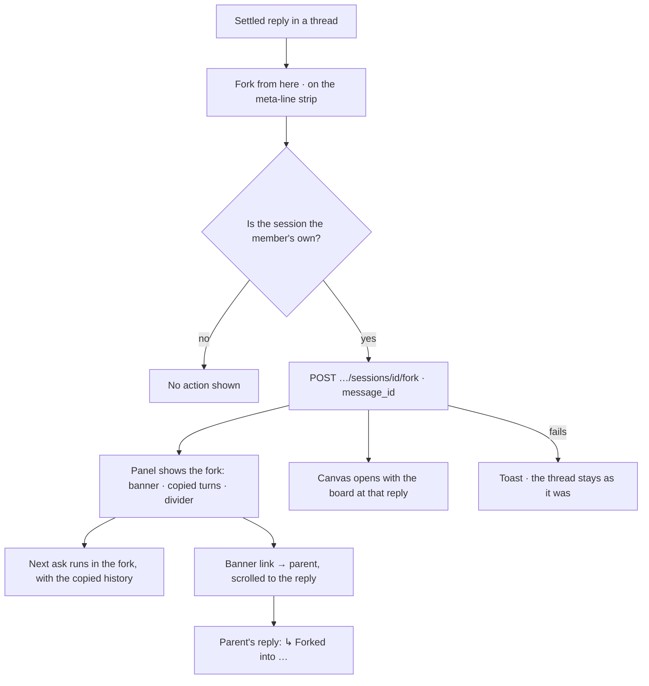

# Fork a session

Branch a thread at one of its replies: a new session that holds the conversation up to that reply and
the board as it stood there, and that says where it came from.

| | |
|---|---|
| Index | [3.14](../../../README.md#3--ask) · Slice **S-TBD** |
| Module | [Ask](../spec.md) |
| API / CLI / Studio | 🔵 / — / 🔵 |
| Related | [the-assistant](the-assistant.md) · [the-answer-surface](the-answer-surface.md) · [boards](../../explore/features/boards.md) |

> **As** someone working through a question, **I want** to try another direction from an answer
> without losing the thread I am in, **so that** I can compare where each path leads — and later see
> which path got me to what I found.

## Capabilities

| # | Capability | Notes |
|---|---|---|
| C1 | Fork from any settled reply | *Fork from here* on the reply's meta-line strip ([AS16](the-answer-surface.md#decisions)) |
| C2 | The fork stands on its own | It holds copies of the turns up to the reply; its next ask carries that history, and nothing after it |
| C3 | The fork starts with that reply's board | The board version captured at the reply; the parent's current board when none was |
| C4 | The fork names its parent | A line at the top of the thread, linking to the parent at the reply it branched from |
| C5 | The parent names its forks | Under the reply a fork was taken at, one line per fork |
| C6 | The history shows lineage | A fork glyph and *from &lt;parent&gt;* on a fork's row; *N forks* on a parent's |

## Journey

## Seams

| Seam | What the user sees |
|---|---|
| While the fork is created | The action shows a spinner; the panel switches once the session exists |
| Fork created, board version missing | The fork opens with the parent's current board |
| A reload in the fork | Banner, copied turns and board come back — all are rows |
| Parent deleted | The fork keeps its turns; the banner reads *Forked from a deleted session*, with no link |
| A fork of a fork | Each names only its own parent; the chain is followed one link at a time |
| A reply still running, refused or failed | No *Fork from here* — only a settled answer can be branched from |
| Someone else's session | No *Fork from here* |
| Forking fails | A toast; nothing is half-made, the request is one transaction |

## Surfaces

| Surface | Shape |
|---|---|
| Reply meta-line strip | *Fork from here* (`GitBranch`), after *Share*; folds into `⋯` by width like the rest |
| Fork banner | Top of the thread: `↳ Forked from <parent title> · at "<question>"` — the parent link opens it at that reply |
| Copied turns | Rendered as any turn, above a divider *Forked here*; new turns follow below |
| Forked-into line | Under the parent's reply: `↳ Forked into <fork title>`, one per fork, each opening it |
| Session list row | Fork glyph before the title; meta line adds `from <parent title>`; a parent adds `N forks` |

## Engine

| Thing | Shape |
|---|---|
| `sessions.forked_from_session_id` | Parent session; `ON DELETE SET NULL` |
| `sessions.forked_from_message_id` | The parent's reply it branched at; `ON DELETE SET NULL` |
| `sessions.forked_seq` | The last copied `seq` — every turn at or below it is a copy |
| Route | `POST …/sessions/{id}/fork` · body `{ message_id }` → `201` the new session (with its canvas id) |
| Copy | Every message with `seq ≤` the reply's, field for field, `run_id` kept — so emissions and citations still resolve to the parent's runs |
| Carried over | `surface` · `agent_id` · `lens_id` · `max_tokens_run` |
| Title | The forked reply's question |
| Board | A new canvas for the fork, its snapshot the parent board's latest version with `message_id` = the reply, else its current snapshot |
| Session read | Adds `forked_from: { id, title, message_id } \| null` and `forks: [{ id, title, message_id }]` |
| Session list | Adds `forked_from_title` and `fork_count` |
| Events | `session.forked` (`session_id`, `parent_id`, `message_id`) |

## Decisions

| # | Decision |
|---|---|
| FK1 | **A fork copies the turns; it does not point at them.** The fork's rows are its own, so its thread renders, reloads and feeds the model's history like any session, and deleting the parent takes nothing from it. Copied replies keep their `run_id`: the run is the record of what was asked and returned, and it stays one record. |
| FK2 | **Lineage is explicit and one link deep.** A session knows its parent and the reply it branched at; the tree is those links followed. Sessions a person started from scratch are never linked by inference — grouping unrelated sessions is what a project is for. |
| FK3 | **The fork starts with the board at the reply.** The version captured at that reply is what the conversation had drawn by then; a later board would put on the canvas what the copied turns never asked for. With no version at the reply, the parent's current board is the fallback. |
| FK4 | **A deleted parent leaves the fork whole.** Deletes are hard; the link columns go null and the banner says the parent is gone. A delete is never blocked by forks. |
| FK5 | **Only one's own sessions are forked.** Sessions are scoped to their member; forking another's would need a sharing story that does not exist. |
| FK6 | **Only a settled answer is a fork point.** A running, refused or failed reply has nothing to branch from. |

## Not building

| Not building | Because |
|---|---|
| A lineage tree view | v2: the banner, the forked-into lines and the list glyph show each link; the tree waits for real chains to draw (the `lineage` board kind is the likely home) |
| Merging a fork back | two threads are two histories; comparing outcomes is reading both |
| Inferred links between unforked sessions | lineage is what the person did, not what the system guesses (FK2) |
| Forking another member's session | FK5 |
| Forking mid-run | FK6 |
