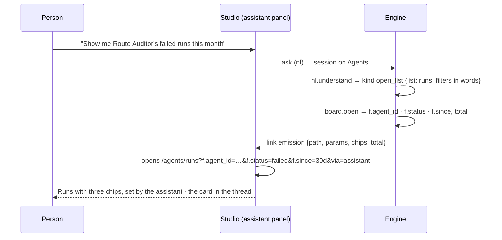

# The assistant opens boards

Ask the assistant for a list — *show me Route Auditor's failed runs this month* — and it opens that list
with the filters set, marked *set by the assistant*, and its reply carries a link to the same view.

| | |
|---|---|
| Index | [3.15](../../../README.md#3--ask) · Slice **F05** |
| Module | [Ask](../spec.md) |
| API / CLI / Studio | 🟡 / — / 🟡 |
| Related | [the-assistant](the-assistant.md) · [list-contract](../../platform/features/list-contract.md) · [the-run-page](../../agents/features/the-run-page.md) · [the-ledger](../../operate/features/the-ledger.md) · products: [agent-fabric.md](../../../../products/agent-fabric.md) › Lists, filters and the assistant · AF-26 |

> **As** anyone, **I want** the assistant to open a list with filters, **so that** I read the rows
> instead of building the filter by hand — and trust what the list leaves out because the chips say so.

## Capabilities

| # | Capability | Notes |
|---|---|---|
| C1 | An ask for a list is understood as one | Intent kind `open_list`: which list (`runs` · `agents` · `approvals` · `ledger`) and its filters in words |
| C2 | One function resolves it | `board.open` turns the words into the list contract's filters — an agent's name to its id, *failed* to a status, *this month* to `since=30d` — and counts the rows with the list's own query |
| C3 | The reply carries the link | A `link` emission: the list's label, one chip per filter, the row count — *Runs · 3 filters · 2 runs*. Opening it opens the list as a workbook tab with `&via=assistant` |
| C4 | The page opens by itself | When the ask was made from Agents, Studio opens the link on arrival; elsewhere the card is the way in |
| C5 | Filters it cannot resolve are said, not dropped | *No agent named "Route Auditer"* in the reply; the link opens with what did resolve |

## Journey

## Seams

| Seam | What the user sees |
|---|---|
| An unknown agent name | The reply names it; the link carries the other filters |
| Nothing matches | The card reads *0 runs*; the list opens on *0 of N match* with *Clear all* |
| A list it cannot open | The ask is answered as an ordinary question |
| No LLM endpoint | The assistant cannot understand the ask; the same refusal any ask gets |

## Surfaces

| Surface | Shape |
|---|---|
| The link card | in the assistant thread: an icon, `<List> · N filters`, the count — one `Button variant="outline"` |
| The list | the list page with the strip; chips marked *set by the assistant* because the URL has `via=assistant` |

## Engine

| Thing | Shape |
|---|---|
| Intent | `open_list` joins `INTENT_KINDS`; `refs` carry `{list, agent, status, since, started_by, origin, verdict}` as words |
| Flow | packaged `board.open` — `nl.understand → board.open`; `INTENT_TEMPLATES[("nl", "open_list")]` |
| Function | `board.open` (`core.pure`, bound none): in `{list, filters}`, out `{path, params, chips[{field, title, value, label}], total, unresolved[]}`; emits a `link` emission. The word table and name resolution live in `runtime/managers/board_open.py` |

## Decisions

| # | Decision |
|---|---|
| OB1 | **The assistant opens a list through the list contract, never around it.** `board.open` writes the same `f.<field>` params a person sets, so a list the assistant opened reads, reloads and clears like any other. |
| OB2 | **The engine resolves names to ids**, under the asker's rights; Studio never matches an agent name. |
| OB3 | **The count is the list's own `total`**, computed by the same query the list runs. |
| OB4 | **Words map to the list's values in one table in the engine**: *failed* → `status=failed`; *didn't serve* / *not served* → `exit_reason=not_served`; *this month* · *30 days* → `since=30d`; *this week* → `7d`; *today* → `24h`. |
| OB5 | **On Agents the page opens itself**; the card stays in the thread as the way back. |
| OB6 | **A list joins `board.open` by registering itself** — its key, label, path, row noun, its `ListSpec` and a counter that runs the list's own query. The runtime registers Runs and Agents; Activity registers Approvals and the ledger, so the runtime never imports the band above it. A chip carries `{field, title, value, label}`, the list contract's applied filter. |
| OB7 | **A seeded agent gains what a release ships.** On each seed, the Explorer and Coordinator agents receive the functions and packaged flows added since they were last given any (`workflow_spec.shipped`); what an owner removed is not given back. |

## Not building

| Not building | Because |
|---|---|
| The assistant changing data while it opens a list | opening is a read; it drafts, a person applies |
| Free-form boards the assistant composes | it opens the boards that exist, with filters |
