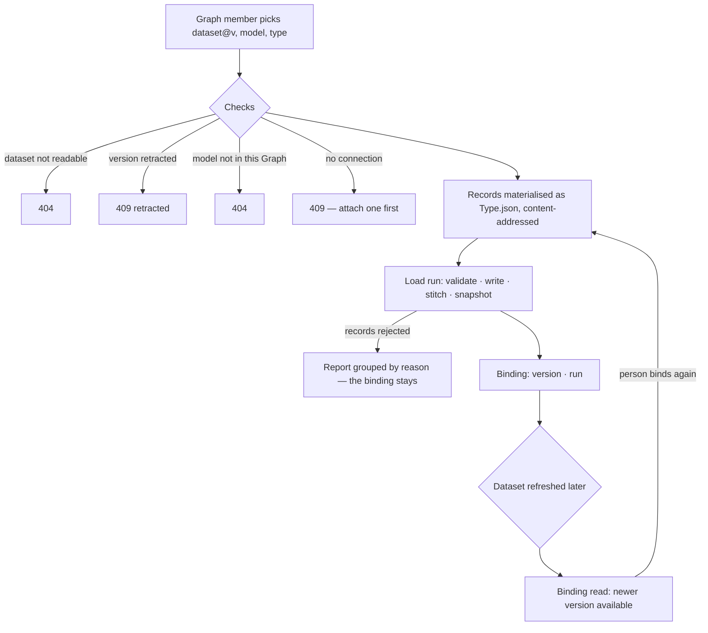

# Bind a dataset version into a model

A Graph takes one exact version of an install-wide dataset into one of its models; the bind is an ordinary
import run, so its records land validated, with provenance, and the trace is the one every load has.

| | |
|---|---|
| Index | [2.6](../../../README.md#2--bring-data-in) · Slice **B03** (P-08) |
| Module | [Bring data in](../spec.md) |
| API / CLI / Studio | 🟡 / 🟡 / ✅ |
| Related | [datasets](datasets.md) · [load-data](load-data.md) · [retract-and-refresh](retract-and-refresh.md) · products: [datasets.md](../../../../products/datasets.md) DS-11 · DS-F11 |

> **As** a modeller, **I want** to bind a dataset version into my Graph's model, **so that** its tables
> become a graph I can ask.

## Capabilities

| # | Capability | Notes |
|---|---|---|
| C1 | Bind | A version, a model of the Graph, a node type — opens a load run |
| C2 | The Graph's bindings | Each with its version, run, retracted flag and newer version |
| C3 | Move a binding | Bind the same dataset, model and type to another version |

## Journey

## Seams

| Seam | What the user sees |
|---|---|
| While the load runs | The binding exists with its run; the run's own page streams it |
| A load that rejects records | The run reports them grouped by reason, as any import does |
| Binding the version already bound | A new load of the same version — idempotent writes, a fresh run |
| A newer version exists | `newer_version` on the binding; the graph keeps the bound one |

## Surfaces

| Surface | Shape |
|---|---|
| `datasets.bind` | Studio — `BindDialog` from the dataset header: Graph → model · type from the model's active version, columns against the type's properties, then *Open the run* |
| `invana datasets bind <ds>@v --graph --model --type` | CLI |

## Engine

| Table | Columns |
|---|---|
| `dataset_bindings` | `id` · `graph_id` · `model_id` · `dataset_id` · `dataset_version_id` · `type_name` (unique `graph_id, model_id, dataset_id, type_name`) · `run_id` · `bound_by_id` · `bound_at` |

| Route (`/api/v1/u/{username}/{graphSlug}/dataset-bindings`) | Returns |
|---|---|
| `GET ""` | `DatasetBindingListResponse` |
| `POST ""` `{dataset: "publisher/name@v", model, type}` | 201 `DatasetBindingRead` — the run is submitted |

| Shape | Fields |
|---|---|
| `DatasetBindingRead` | `id` · `graph_id` · `model_id` · `model_name` · `type_name` · `address` (`publisher/name@v`) · `version` · `run_id` · `bound_by_id` · `bound_at` · `retracted: Retraction?` · `newer_version?` |

| Event | Details |
|---|---|
| `dataset.bind` (`target_kind = dataset`, `graph_id` set) | `address` · `version` · `version_id` · `model_id` · `type_name` · `run_id` · `from_version?` |

| Setting | Default |
|---|---|
| `INVANA_DATASET_DIR` | `.invana/datasets` — where a bound version's records are written as `<content hash>/<Type>/nodes/<Type>.json` |

## Decisions

| # | Decision |
|---|---|
| BV1 | **A binding is a row of the Graph**, one per Graph, model, dataset and type. Binding again moves that row to the new version and records `from_version`. |
| BV2 | **A bind is a load.** The version's records are written once as the load folder `INVANA_DATASET_DIR/<content hash>/<Type>/nodes/<Type>.json` — content-addressed, so a version is materialised once per type, and one folder per type because a load reads every file in `nodes/` — with the key column as `id`, and `open_load_run` opens the ordinary import run named `publisher/name@v`. Validation, provenance, stitching and the trace are the load's. |
| BV3 | **Who binds:** a member of the Graph who can read the dataset. Roles (P-18) narrow this to Builder and above. |
| BV4 | **A retracted version cannot be bound** (DR4); the binding of one bound earlier stays and is flagged. |
| BV5 | **A version's effect after is its bind loads.** `basis = "bound"` counts the runs the `dataset.bind` events of that version name, in every Graph, and their tokens — read from the events because a moved binding no longer holds its earlier version — loads spend none today, so tokens read 0. |
| BV6 | **The view opens and submits.** The bind opens the run in the request's transaction, commits, and submits it to the runtime — the shape the skill draw and the eval run already have. |
| BV7 | **A load the prologue refuses is 409, naming why** — no published model version, no connection, a read-only one. The version is already materialised by then, which is harmless: the folder is content-addressed and the next bind reuses it. No binding row is written for a refused bind. |
| BV8 | **Studio binds the current version** and lists the Graph's models with their active version's node types; the key column lands as `<Type>.id`. Success links to the load run in that Graph's Activity — the run's page is where the load is followed. |

## Not building

| Not building | Because |
|---|---|
| Unbinding, or removing a bound version's records | the records are the model's once loaded; removing data from a graph is not a load |
| Binding into an edge type | a dataset is a table of records keyed by one column — a node type |
| Binding a whole dataset rather than a version | a result reproduces from an exact version (DT4) |
| Automatic moves to a newer version | consumers stay pinned (DR8) |
