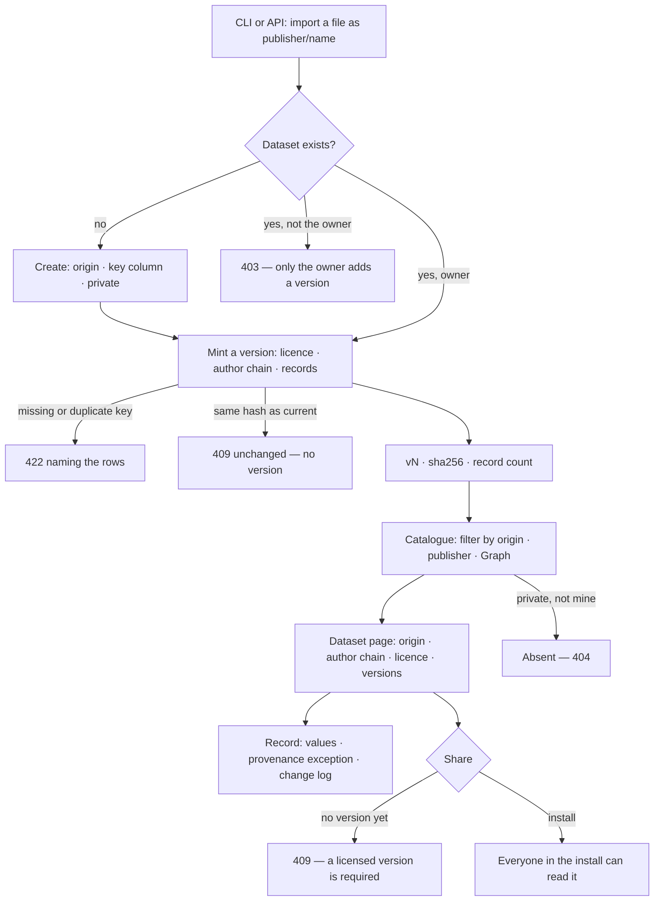

# Datasets

Tables from one source under one authorship, kept install-wide above Graphs — labelled by where they came
from, licensed, versioned and hashed, so a result can be reproduced from the exact data.

| | |
|---|---|
| Index | [2.4](../../../README.md#2--bring-data-in) · Slice **B03** (P-08) |
| Module | [Bring data in](../spec.md) |
| API / CLI / Studio | ✅ / 🟡 / ✅ |
| Related | [retract-and-refresh](retract-and-refresh.md) · [bind-a-dataset](bind-a-dataset.md) · [change-log](../../operate/features/change-log.md) · products: [datasets.md](../../../../products/datasets.md) DS-01 · DS-02 · DS-03 · DS-04 · DS-12 · DS-F16 |

> **As** a researcher, **I want** one catalogue of datasets, each with its origin, author chain, licence
> and immutable versions, **so that** I reuse what a lab already gathered and know how far to trust it.

## Capabilities

| # | Capability | Notes |
|---|---|---|
| C1 | The catalogue | Every dataset the caller may read, filtered by origin, publisher, bound-in Graph, text |
| C2 | A dataset | `publisher/name`, origin, key column, visibility, sensitivity, the current version's licence and author chain |
| C3 | Versions | Immutable, hashed; each with licence, author chain, columns, record count, source, inputs, why |
| C4 | Records | A version's records, paged by key; one record with its record-level provenance |
| C5 | A record's change log | Every version that changed one record: property, before → after, who, when, why |
| C6 | Share | `private` → `install`; a licence on the current version is required |
| C7 | Sensitivity | `public · internal · confidential · personal` on the dataset, tighter on a column |
| C8 | Change log | `dataset` is a versioned-record kind: history and compare of its versions |

## Journey

## Seams

| Seam | What the user sees |
|---|---|
| A dataset with no version yet | Listed to its owner only; licence and author chain empty; *Share* refused |
| A private dataset of someone else | Absent everywhere — 404, never 403 |
| Reading an install dataset you do not own | Every read works; every write is 403 naming the owner's act |
| A record that differs in origin from its dataset | Its `provenance` shows the exception; every other record inherits the dataset's |
| A record unchanged across versions | Its change log lists only the versions that changed it, and its first |
| A record removed in a later version | The change log ends with `removed`; earlier versions still read it |
| A column labelled looser than the dataset | Refused, naming the column and both labels |

## Surfaces

| Surface | Shape |
|---|---|
| `datasets.catalogue` | Studio `/datasets/catalogue` — `CataloguePage` |
| `datasets.dataset` · `.provenance` · `.versions` · `datasets.record` | Studio `/datasets/catalogue/<publisher>/<name>[/provenance · /records[/<key>] · /versions]` — `DatasetPage` and its tabs |
| `datasets.observe` · `datasets.share` | Studio — `ObserveDialog` · `ShareDialog` on the dataset header, for its writer |
| `invana datasets list · show · import · versions · diff · history · share` | CLI (products/datasets.md › CLI) |

## Engine

| Table | Columns |
|---|---|
| `datasets` | `id` · `publisher` · `name` (unique pair) · `title` · `description` · `origin` · `key_column` · `visibility` · `sensitivity` · `column_sensitivity` (JSON `{column: label}`) · `refresh_schedule` · `refresh_source` · `current_version_id` · `created_by_id` · `created_at` · `updated_at` |
| `dataset_versions` | `id` · `dataset_id` · `version` (unique per dataset) · `content_hash` · `licence` · `author_chain` (JSON) · `columns` (JSON) · `record_count` · `source` · `derived_from` (JSON version ids) · `why` · `published_by_id` · `published_at` · `retracted_at` · `retracted_by_id` · `retraction_reason` |
| `dataset_records` | `id` · `version_id` · `key` (unique per version) · `values` (JSON) · `provenance` (JSON, null when it inherits) |

| Enum | Values |
|---|---|
| `origin` | `official` · `collected` · `generated` · `observed` · `derived` |
| `visibility` | `private` · `install` |
| `sensitivity` | `public` < `internal` < `confidential` < `personal` |
| Author chain `role` | `original` · `collected_by` · `modified_by` · `validated_by` |
| Author chain `kind` | `organisation` · `page` · `person` · `agent` · `run` |

| Route (`/api/v1/datasets`) | Returns |
|---|---|
| `GET ""` `?origin=&publisher=&bound_in=<user/graph>&q=` | `DatasetListResponse` |
| `POST ""` | 201 `DatasetRead` — no version yet |
| `GET · PATCH /{publisher}/{name}` | `DatasetRead` — PATCH: title, description, visibility, sensitivity, column sensitivity, refresh (not a version) |
| `GET · POST /{publisher}/{name}/versions` | `DatasetVersionListResponse` · 201 `DatasetVersionRead` |
| `GET /{publisher}/{name}/versions/{v}` | `DatasetVersionRead` |
| `GET /{publisher}/{name}/versions/{v}/records` `?offset=&limit=&provenance=` | `DatasetRecordPage`, ordered by key; `provenance=true` keeps the records with their own provenance, and `total` counts them |
| `GET /{publisher}/{name}/records/{key}` `?version=` | `DatasetRecordRead` — the current version when omitted |
| `GET /{publisher}/{name}/records/{key}/history` | `RecordChangeLog` |
| `GET /{publisher}/{name}/history` · `/history/compare?a=&b=` | `RecordHistory` · `ChangeCompare` (10.6 shapes; compare carries `records`) |

| Shape | Fields |
|---|---|
| `DatasetCreate` | `publisher?` · `name` · `title?` · `description?` · `origin` · `key_column` (default `id`) · `sensitivity` (default `internal`) · `column_sensitivity?` |
| `DatasetVersionCreate` | `licence` · `author_chain` · `records` (list of objects) · `source?` · `derived_from?` (`publisher/name@v` refs) · `why?` |
| `AuthorStep` | `role` · `kind` · `name` · `ref?` · `result?` |
| `DatasetRead` | the row · `address` · `current_version` (number) · `licence` · `author_chain` · `record_count` · `content_hash` |
| `DatasetVersionRead` | the row · `address` (`publisher/name@v`) · `derived_from` (refs) · `retracted` · `retracted_inputs` (refs) |
| `DatasetRecordRead` | `key` · `version` · `values` · `provenance` |
| `RecordChangeLog` | `key` · `items: RecordChange[]` newest first |
| `RecordChange` | `version` · `at` · `actor_id` · `why` · `kind` (`added` · `changed` · `removed`) · `properties: {property, before, after}[]` |

| Event | `target_kind = dataset`, `graph_id` null | Details |
|---|---|---|
| `dataset.create` | a dataset, no version | `address` · `origin` |
| `dataset.version` | mints a version — the change log's action | `version` · `content_hash` · `record_count` · `why` |
| `dataset.update` | metadata — not a version | `changed` · `diff` |

## Decisions

| # | Decision |
|---|---|
| DT1 | **Above Graphs.** `datasets` has no `graph_id`; its routes are `/api/v1/datasets/…`, its events carry `graph_id` null. A Graph reaches a dataset only by binding a version ([bind-a-dataset](bind-a-dataset.md)). |
| DT2 | **The address is `publisher/name`**, two lowercase slugs (`[a-z0-9][a-z0-9-]*`, ≤ 63), unique as a pair and fixed at create. `publisher` defaults to the creator's username; an official dataset names the organisation that publishes it. A version is `publisher/name@v`. |
| DT3 | **Origin is set at create and never changes.** Records inherit it. Gap-filled estimates are a separate `generated` dataset, never a version of the collected one. |
| DT4 | **A version is immutable**: licence (required), author chain, columns, record count, source, inputs, why and its records. A fix is a new version. Creating a dataset mints nothing; the first import is v1. |
| DT5 | **The content hash is `sha256:` over the records**: canonical JSON (sorted keys, compact separators) of the records ordered by key. A version whose hash equals the current version's is refused `409 unchanged` — an identical version would split *where it is used* for no reason. |
| DT6 | **Every record has a key**, read from `key_column`. A record without one, or two with the same, refuses the whole version naming the first five. Values are scalars (string, number, boolean, null); a nested value is refused naming the column — a dataset is tables. |
| DT7 | **Record-level provenance is stored only where it differs.** A record's `_provenance` object (`origin` · `source` · `note`) is lifted out of its values into `dataset_records.provenance`; every other record reads the dataset's. |
| DT8 | **The author chain has at least one `original` step**, except an `observed` dataset, whose empty chain is the importing person. A `derived` version names at least one input in `derived_from`; an input is a version of another dataset the caller may read. |
| DT9 | **Visibility is `private` or `install`.** A private dataset is absent (404) to everyone but its creator. Sharing to `install` needs a current version — the licence lives on it. |
| DT10 | **Only the creator writes** — versions, metadata, share — and, until roles land (P-18), an install Admin (`is_superuser`). Another reader's write is 403, because they can already see the dataset. |
| DT11 | **Sensitivity is a label, not a version.** The dataset carries one; a column may be tighter, never looser — a looser column is refused naming it. Changing either is `dataset.update`. |
| DT12 | **`dataset` is the sixth change-log kind**, read by `ChangeLogManager` with `graph_id` null under the dataset's own routes. The minting action is `dataset.version`. Compare carries `licence`, `author_chain` and `columns` as fields and a one-line records summary (`n added · n removed · n changed`). Effect after is `basis = "bound"`: the load runs that bound that version ([BV5](bind-a-dataset.md)). |
| DT13 | **A record's change log is read from the versions, never stored** — the same rule as CL1. For one key, each version whose values or provenance differ from the version before is an entry, its who/when/why the version's. Properties are compared by name; a property absent on one side reads as null. |
| DT14 | **The API takes records in the request body; a file is the CLI's.** `invana datasets import` reads CSV (header row) or JSON (a list of objects), creates the dataset when absent, and mints a version through the same manager. |
| DT15 | **Studio writes a version the way the API takes one: whole.** Observations by form and a validation fix read every record of the current version, make the change, and publish the result as the next version; a record's provenance exception is re-sent as `_provenance`. The engine publishes whatever it is sent and does not check the version a write started from, so Studio re-reads the dataset before publishing and refuses when a newer version has appeared — this narrows the window in which two writers drop each other's change; a base-version check on publish is the engine's to add. Studio creates no dataset — the empty catalogue shows `invana datasets import`. |
| DT16 | **The engine counts provenance exceptions.** `?provenance=true` on a version's records filters to the records whose provenance differs from the dataset's, and the page's `total` is their count over the whole version. The Provenance tab shows that count and lists the first page of them. |
| DT17 | **A version may be pushed as a draft.** `POST /api/v1/datasets/{publisher}/{name}/versions/drafts` takes the same body as minting a version and stores it with `state = draft`: it takes the next number, is listed with its state, is never current, and no binding, finding cite or simulation input may name it. Its owner publishes it with `POST …/versions/{v}/publish`, which makes it current through the same gates a minted version passes. A narrowed token's `data.version.draft` is this route ([tokens](../../identity-and-access/features/tokens.md) PT12). |

## Not building

| Not building | Because |
|---|---|
| A `lab` visibility | there is no lab or team record; `private` and `install` until one exists |
| Deleting a dataset or a version | versions are cited; a withdrawn one is retracted ([retract-and-refresh](retract-and-refresh.md)) |
| Guardrails reading sensitivity labels | the lens's `graph data` layer reads them when a guardrail first names one; the labels are stored and served now |
| Per-cell provenance | record level plus the change log covers it |
| Documents datasets | P-05, products DS-F10 |
| Validation status and the review queue | products DS-F7; standards and conformance are [2.7](standards.md) |
| Sharing across installs · `pack`/`unpack` | the open registry, later |
| Streamed or chunked upload over HTTP | bulk loads go through the CLI |
