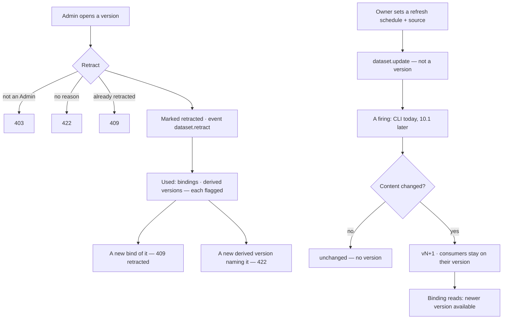

# Retract and refresh a dataset

A withdrawn version is kept and marked, and everything that cites it is flagged; a dataset on a refresh
schedule mints new versions while its consumers stay pinned to the one they chose.

| | |
|---|---|
| Index | [2.5](../../../README.md#2--bring-data-in) · Slice **B03** (P-08) |
| Module | [Bring data in](../spec.md) |
| API / CLI / Studio | ✅ / 🟡 / 🟡 |
| Related | [datasets](datasets.md) · [bind-a-dataset](bind-a-dataset.md) · [schedules](../../operate/features/schedules.md) · products: [datasets.md](../../../../products/datasets.md) DS-03 · DS-14 · DS-F14 · DS-F15 |

> **As** a researcher, **I want** a retracted source kept and flagged with everything that cites it, and a
> dataset that refreshes into new versions, **so that** conclusions built on withdrawn data never go
> unnoticed and nobody's result moves under them.

## Capabilities

| # | Capability | Notes |
|---|---|---|
| C1 | Retract a version | Install Admin only, with a reason; never deleted |
| C2 | Where a version is used | Bindings (Graph · model · type) and derived dataset versions that cite it |
| C3 | Flags | A binding or a derived version on a retracted input says so on every read |
| C4 | Refresh schedule | A cron and a source on the dataset; not a version |
| C5 | Refresh now | Read the source, mint a version when the content changed |
| C6 | Newer version | A binding behind the current version is told so; never moved for it |

## Journey

## Seams

| Seam | What the user sees |
|---|---|
| A retracted version | Still readable: records, history, compare. Its read carries `retracted` with when, who, why |
| A retracted current version | Stays current until the owner mints a newer one |
| A version nothing uses | `used` is empty, not absent |
| A source that cannot be read | The refresh fails naming the source; no version, the schedule stays |
| A source with the same content | `unchanged`; no version |

## Surfaces

| Surface | Shape |
|---|---|
| `datasets.dataset.used` · `datasets.dataset.retracted` | Studio — the dataset's `used` tab, the retraction banner on Overview, *Retract* on Versions for an install Admin |
| `invana datasets retract <ds>@v --reason` · `refresh <ds> --schedule "<cron>" --source <path>` · `refresh <ds> --now` | CLI |

## Engine

| Route (`/api/v1/datasets/{publisher}/{name}`) | Returns |
|---|---|
| `POST /versions/{v}/retract` `{reason}` | `DatasetVersionRead` |
| `GET /versions/{v}/used` | `DatasetVersionUsage` |
| `PATCH ""` `{refresh_schedule, refresh_source}` | `DatasetRead` |

| Shape | Fields |
|---|---|
| `DatasetRetract` | `reason` (1–500) |
| `Retraction` | `at` · `by_id` · `reason` |
| `DatasetVersionUsage` | `address` · `retracted: Retraction?` · `bindings: DatasetBindingRead[]` · `derived: DatasetVersionRef[]` |
| `DatasetVersionRef` | `address` · `version_id` · `dataset_id` |

| Event | `target_kind = dataset` | Details |
|---|---|---|
| `dataset.retract` | `graph_id` null | `version` · `reason` |

## Decisions

| # | Decision |
|---|---|
| DR1 | **Only an install Admin retracts**, with a reason of at most 500 characters. Until roles land (P-18) the Admin is `users.is_superuser`. A publisher's request to retract waits for the Inbox (P-13). |
| DR2 | **Retracting marks the version, never deletes it** — `retracted_at` · `retracted_by_id` · `retraction_reason`, and `dataset.retract`. It is not a version and does not move `current_version_id`. There is no un-retract. |
| DR3 | **Flags are read, not stored.** `used` lists the bindings of the version and the dataset versions whose `derived_from` names it; a binding read and a version read carry their retracted inputs. Findings, decisions and reports join this list with B05, the owners' Inbox item with B08, and a rule that blocks decisions on retracted data with B04. Until then the `dataset.retract` event is the signal. |
| DR4 | **A retracted version is not a new input.** Binding it is `409 retracted`; naming it in a new version's `derived_from` is 422. What already cites it stays, flagged. |
| DR5 | **A refresh schedule is a 5-field cron and a source** on the dataset, set by its owner; setting or clearing it is `dataset.update`, not a version. A schedule without a source is refused. |
| DR6 | **The engine never reads a caller-named path or URL over HTTP** — that is a file-read hole. The API stores the schedule and the source; the firing reads it. 10.1 Schedules is not built, so `invana datasets refresh <ds> --now` is the caller, the same stand-in `invana evals drift` is for nightly drift. |
| DR7 | **A refresh is an import.** It mints through the same act, copying the current version's licence and author chain, with `why = "scheduled refresh"`; identical content mints nothing and reports `unchanged`. |
| DR8 | **Consumers stay pinned.** A binding keeps its version; its read carries `newer_version` while the dataset's current version is newer. Nothing moves a binding but a person binding again. |
| DR9 | **`used` lists bindings only in Graphs the reader belongs to** (an install Admin sees all). A dataset is install-wide; the Graphs that bound it are not, and a Graph the reader cannot open reads as absent. Derived versions are listed when the reader may read their dataset. |
| DR10 | **The flags ride on the reads.** A version read carries `retracted_inputs` (the addresses in `derived_from` that are retracted); a binding read carries its version's `retracted` (`Retraction?`, with when, who, why). |
| DR11 | **Studio shows the refresh schedule read-only.** Setting one is `invana datasets refresh`; Studio draws the schedule and the newer-version notice, and retracts from the Versions tab for an install Admin. |

## Not building

| Not building | Because |
|---|---|
| Un-retract | a mistaken retraction is answered by a new version |
| Firing the schedule from the engine | 10.1 Schedules owns firings; until then the CLI fires it |
| Fetching a URL source | the CLI reads a local path today; a URL fetch is a tool plugin's (P-03) |
| Inbox items and notifications on retraction | P-13 (B08) |
| Flags on findings, decisions and reports | P-10 · P-14 (B05) |
