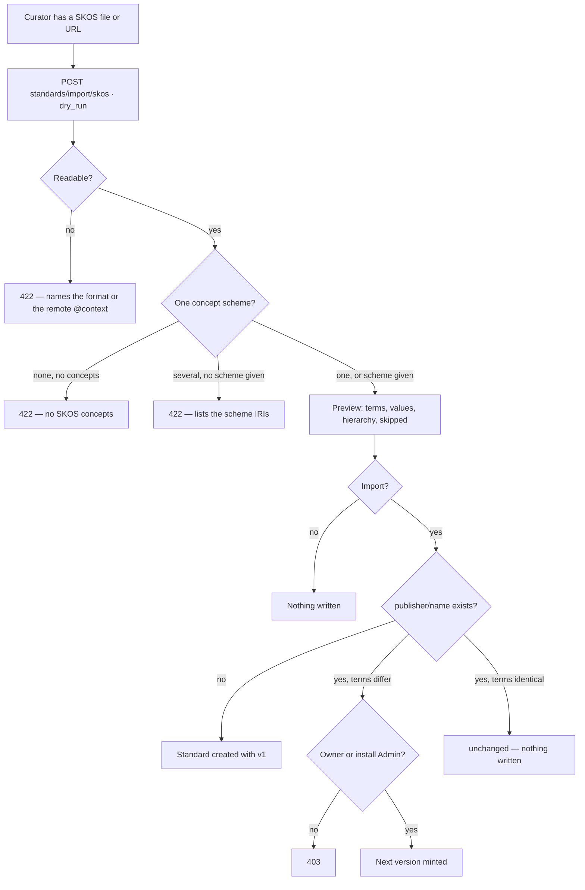

# Import a SKOS vocabulary

A **SKOS** concept scheme becomes a [standard](standards.md): its concepts become terms and their
allowed values, `skos:prefLabel` the names and labels, `skos:notation` the codes, and `skos:broader`
the hierarchy. Each term and value keeps its **source IRI**. Read from JSON-LD, Turtle or RDF/XML;
the first semantic import Invana supports.

| | |
|---|---|
| Index | [2.8](../../../README.md#2--bring-data-in) · Slice **B12** (P-19) |
| Module | [Bring data in](../spec.md) |
| API / CLI / Studio | ✅ / ✅ / 🔵 |
| Related | [standards](standards.md) · [ontology-import](../../connect-and-model/features/ontology-import.md) · products: [datasets.md](../../../../products/datasets.md) DS-15 · DS-F17 |

> **As** a curator, **I want** to import a standard from a SKOS vocabulary, **so that** published
> vocabularies become standards without retyping.

## Capabilities

| # | Capability | Notes |
|---|---|---|
| C1 | Read a vocabulary | JSON-LD · Turtle · RDF/XML — the reading rules are [ontology-import](../../connect-and-model/features/ontology-import.md) OI3 · OI4 |
| C2 | Pick the scheme | One scheme in the file is taken; several need `scheme` (its IRI) |
| C3 | Preview | `dry_run` returns the terms it would publish and the import report; nothing is written |
| C4 | Import | Creates the standard, or mints its next version — the `apply` path ([standards](standards.md) C7); identical terms write nothing |
| C5 | Import report | Mapped counts, skipped constructs with reasons, notes |

## Journey

## Seams

| Seam | What the user sees |
|---|---|
| A flat scheme (no concept has narrower ones) | One term, named after the scheme, whose values are every concept |
| A hierarchical scheme | Each top concept with narrower ones is a term; all its descendants are its values, each naming its `broader` code |
| Top concepts with no narrower ones beside hierarchical ones | They are the values of one term named after the scheme |
| A concept with two broader concepts | Placed under the first by code; the report notes the others |
| No `skos:notation` | The code is the IRI's local name |
| Two concepts with one code in a term | The second is skipped and listed |
| `skos:related`, mapping properties, `altLabel`, collections | Listed as not imported, with their counts |
| Re-importing an unchanged vocabulary | `unchanged = true`, no version |

## Surfaces

| Surface | Shape |
|---|---|
| `datasets.standards.import` | Studio, C08 — upload, preview, import |
| `invana standards import --skos <file\|url> [--scheme IRI] [--publisher p] [--name n] [--format] [--lang] [--why] [--dry-run] [--user u]` | CLI — reads the file or fetches the URL, then the same manager |

## Engine

| Route (`/api/v1/standards`) | Returns |
|---|---|
| `POST /import/skos` `{content, format?, scheme?, publisher?, name?, lang?, why?, dry_run?}` | 201 `SkosImportResult` (200 on `dry_run` or `unchanged`) |

| Shape | Fields |
|---|---|
| `SkosImportRequest` | `content` (≤ 20 MB) · `format?` · `scheme?` (IRI) · `publisher?` (defaults to the caller) · `name?` (defaults to the slug of the scheme's title) · `lang` (default `en`) · `why?` · `dry_run` |
| `SkosImportResult` | `address` (`p/n`) · `scheme_iri` · `title` · `terms: [StandardTerm]` · `standard?: StandardRead` · `version?: StandardVersionRead` · `unchanged` · `report: SkosReport` |
| `SkosReport` | `format` · `triples` · `mapped: {terms, values}` · `skipped: [ImportNote]` · `skipped_count` · `notes: [ImportNote]` · `notes_count` |
| `StandardTerm` | gains `iri?` |
| `TermValue` | gains `iri?` · `broader?` (the code of its broader value in the same term) |

| SKOS | Standard |
|---|---|
| `skos:ConceptScheme` | the standard — `skos:prefLabel` / `dcterms:title` → title, `skos:definition` / `dcterms:description` → description |
| top concept with narrower concepts | a term, `prefLabel` → name, `definition` → description |
| its descendants | the term's values: `notation` → code, `prefLabel` → label, `broader` → `broader` |
| leaf top concepts | the values of a term named after the scheme |

## Decisions

| # | Decision |
|---|---|
| SK1 | **A scheme is a standard; a concept is a term or a value.** A top concept with narrower ones is a term and its descendants are the values; leaf top concepts are the values of one term named after the scheme. A term is `text` and not required. |
| SK2 | **Top concepts** are those the scheme names (`hasTopConcept` / `topConceptOf`); none named, those in the scheme with no broader one. A concept belongs to a scheme by `inScheme`, by being top in it, or — with one scheme in the file — by having none. |
| SK3 | **Hierarchy rides the values.** A value names its `broader` value's code; a term's values are flat. A concept under two broader ones is placed under the first by code, and noted. |
| SK4 | **The import is the `apply` path.** The address defaults to the caller's username and the slug of the scheme's title; terms identical to the current version write nothing (`unchanged`); otherwise a version is minted and the same owner rules hold ([standards](standards.md) ST1 · ST2). `why` defaults to *Imported from SKOS <scheme IRI>*. |
| SK5 | **The source IRI is kept** on each term and value, and is part of the terms' hash. |
| SK6 | **Reading is shared with the ontology import** — formats, detection, the 20 MB cap, never fetching, labels by language ([ontology-import](../../connect-and-model/features/ontology-import.md) OI3 · OI4 · OI10). |
| SK7 | **The preview is the import with nothing written.** |

## Not building

| Not building | Because |
|---|---|
| `skos:related`, `exactMatch` and the other mappings as links | a standard has no links; listed in the report |
| `altLabel` · `hiddenLabel` as synonyms a conformance check accepts | conformance matches codes (ST5); listed |
| `skos:Collection` · SKOS-XL labels | listed, not imported |
| Several schemes into several standards in one call | one call, one scheme; run it once per scheme |
| Fetching URLs | the engine never fetches (OI3) |
| Export back to SKOS | import only for now |
