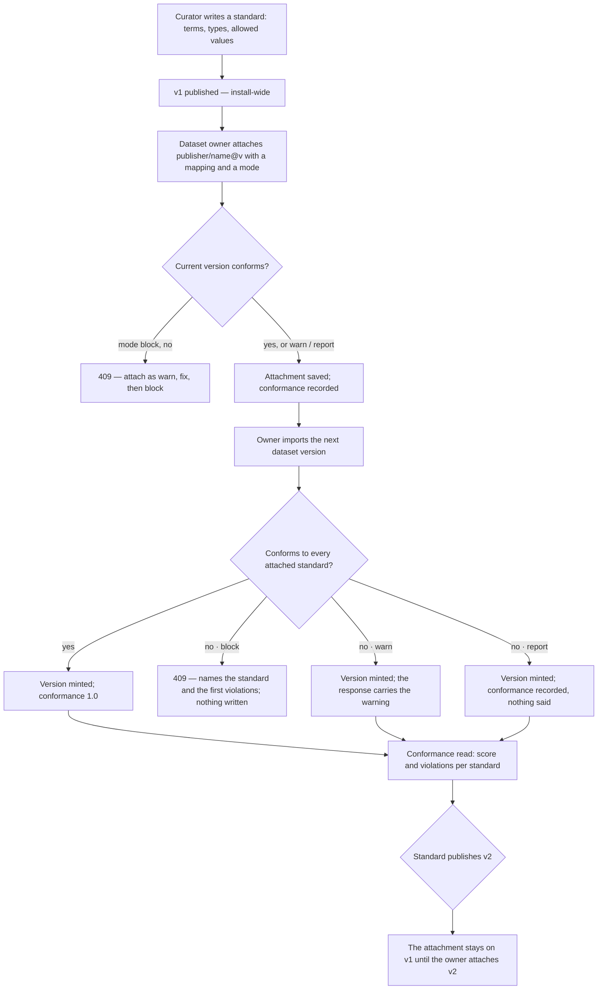

# Standards and conformance

A **standard** is a versioned, install-wide set of terms — each with a type, whether it is required, and
the values it allows. A dataset **claims** a standard by attaching one exact version with a column
mapping and an enforcement mode; every version of the dataset is then scored against it — its
**conformance**.

| | |
|---|---|
| Index | [2.7](../../../README.md#2--bring-data-in) · Slice **B04** (P-12) |
| Module | [Bring data in](../spec.md) |
| API / CLI / Studio | ✅ / ✅ / ✅ |
| Related | [datasets](datasets.md) · [bind-a-dataset](bind-a-dataset.md) · [rules](../../skills/features/rules.md) · products: [datasets.md](../../../../products/datasets.md) DS-08 · DS-09 · DS-F8 · DS-F9 |

> **As** a curator, **I want** a library of standards and to enforce one on a dataset as block, warn or
> report, **so that** data follows the rules our field agreed and bad rows are caught at the door.

## Capabilities

| # | Capability | Notes |
|---|---|---|
| C1 | A standard | `publisher/name`, origin `pack · authored`, readable by everyone in the install |
| C2 | Versions | Immutable, hashed terms; a change is the next version; an identical one is refused |
| C3 | Terms | `name` · `type` · `required` · `values` (allowed codes, with labels) · `description` |
| C4 | Attach | A dataset claims one pinned standard version, with a `term → column` mapping and a mode |
| C5 | Conformance | Per dataset version × standard version: records, conforming, score, violations |
| C6 | Enforce | `block` refuses a non-conforming version · `warn` accepts it and says so · `report` records it only |
| C7 | Apply a file | `invana standards apply --file` creates the standard or mints its next version |
| C8 | Import SKOS | A concept scheme becomes a standard through the same apply path — [skos-import](skos-import.md) |

## Journey

## Seams

| Seam | What the user sees |
|---|---|
| A required term with no mapped column | Every record violates it as `missing` — the score says so, nothing guesses a column |
| A term whose values are not a list | Free values of its type; only `type` and `required` are checked |
| A standard publishes a newer version | The attachment keeps its pinned version; the attachment read names the newer one |
| A dataset with no version yet | Attaching works; conformance starts with the first version |
| Re-attaching with a new mapping or mode | The attachment row moves; conformance of the current version is recomputed |
| A violation list longer than 50 | The first 50 are kept, and the count is the whole |

## Surfaces

| Surface | Shape |
|---|---|
| `datasets.standards` · `datasets.standard` | Studio `/datasets/standards[/<publisher>/<name>]` — `StandardsPage` with *Write a standard*, `StandardPage` with *Used by* |
| `datasets.standard.attach` · `datasets.dataset.conformance` | Studio — `AttachStandardDialog` (from a dataset or a standard) and the dataset's `conformance` tab |
| `datasets.validation` · `datasets.validation.item` | Studio `/datasets/validation[/<publisher>/<name>/<key>/<term>]` — the violation queue and one item |
| `invana standards list · show · apply --file` | CLI |
| `invana standards attach <ds> --standard <p/n[@v]> --mode --map term=column` · `detach` · `check <ds>[@v]` | CLI |

## Engine

| Table | Columns |
|---|---|
| `standards` | `id` · `publisher` · `name` (unique together) · `title` · `description` · `origin` · `current_version_id` · `created_by_id` · `created_at` · `updated_at` |
| `standard_versions` | `id` · `standard_id` · `version` (unique together) · `terms` · `content_hash` · `why` · `published_by_id` · `published_at` |
| `dataset_standards` | `id` · `dataset_id` · `standard_id` (unique together) · `standard_version_id` · `mode` · `mapping` · `attached_by_id` · `attached_at` |
| `dataset_conformance` | `id` · `dataset_version_id` · `standard_version_id` (unique together) · `mapping` · `record_count` · `conforming` · `score` · `violation_count` · `violations` · `checked_at` |

| Term field | Shape |
|---|---|
| `name` | unique in the version |
| `type` | `text · integer · number · boolean · date` (ISO `YYYY-MM-DD`); default `text` |
| `required` | default `false`; a null or empty value is missing |
| `values` | `[{code, label?, iri?, broader?}]`, codes unique; a value conforms when its text equals a code. `broader` names another value's code — the hierarchy a [SKOS import](skos-import.md) brings |
| `description` | free text |
| `iri` | the source IRI, set by a [SKOS import](skos-import.md); part of the hash |

| Violation | Means |
|---|---|
| `missing` | a required term is null, empty, or has no column |
| `not_allowed` | the value is not one of the term's codes |
| `wrong_type` | the value does not read as the term's type |

| Route (`/api/v1/standards`) | Returns |
|---|---|
| `GET ""` `?q · origin` | `StandardListResponse` |
| `POST ""` `{publisher?, name, title?, description?, origin, terms?, why?}` | 201 `StandardRead` — `terms` mints v1 |
| `GET /{publisher}/{name}` | `StandardRead` |
| `GET · POST /{publisher}/{name}/versions` | `StandardVersionListResponse` · 201 `StandardVersionRead` |
| `GET /{publisher}/{name}/versions/{v}` | `StandardVersionRead` |

| Route (`/api/v1/datasets/{publisher}/{name}`) | Returns |
|---|---|
| `GET /standards` | `DatasetStandardListResponse` |
| `POST /standards` `{standard: "p/n[@v]", mode, mapping?}` | 201 `DatasetStandardRead` |
| `DELETE /standards/{publisher}/{name}` | 204 |
| `GET /versions/{v}/conformance` | `ConformanceListResponse` — one per attached standard |

| Route (`/api/v1/datasets`) | Returns |
|---|---|
| `GET /claims` `?standard=p/n` | `DatasetClaimListResponse` — every claim on every readable dataset |
| `GET /validation` | `ValidationQueue` — every violation on a readable dataset's current version |

| Shape | Fields |
|---|---|
| `StandardRead` | `id` · `address` · `publisher` · `name` · `title` · `description` · `origin` · `current_version?` · `terms` · `content_hash?` · `created_by_id` · `created_at` · `updated_at` |
| `StandardVersionRead` | `id` · `address` (`p/n@v`) · `version` · `terms` · `content_hash` · `why?` · `published_by_id` · `published_at` |
| `DatasetStandardRead` | `standard` (`p/n@v`) · `version` · `newer_version?` · `mode` · `mapping` · `attached_by_id` · `attached_at` · `conformance: ConformanceRead?` (the current version's) |
| `DatasetStandardListResponse` | `items` · `total` · `lowest_score?` |
| `DatasetClaimListResponse` | `items: {dataset: DatasetRead, attachment: DatasetStandardRead}[]` · `total` · `by_standard: {p/n: count}` · `unreadable` |
| `ValidationQueue` | `items: {dataset (p/n), standard (p/n@v), mode, column, violation}[]` · `total` · `datasets: {address, publisher, name, title, total}[]` · `unreadable` |
| `ConformanceRead` | `dataset` (`p/n@v`) · `standard` (`p/n@v`) · `mode` · `record_count` · `conforming` · `score` · `conforms` · `violation_count` · `violations: [{key, term, kind, value?}]` · `checked_at` |
| `DatasetVersionRead` · `DatasetRead` · `DatasetBindingRead` | gain `warnings: [str]` — filled only by the act that raised them |

| Event | Details |
|---|---|
| `standard.create` (`target_kind = standard`) | `address` · `origin` |
| `standard.version` | `address` · `version` · `content_hash` · `terms` (count) · `why` |
| `dataset.standard_attach` (`target_kind = dataset`) | `address` · `standard` · `mode` · `score?` |
| `dataset.standard_detach` | `address` · `standard` |

## Decisions

| # | Decision |
|---|---|
| ST1 | **A standard is install-wide and always readable.** It is a shared vocabulary; a private one would be a constraint. Its creator or an install Admin mints its versions; `origin = pack` is an install Admin's to create. |
| ST2 | **A standard version is immutable and hashed** over its terms in order. Minting an identical one is 409 `unchanged`. |
| ST3 | **An attachment pins a standard version.** A newer standard version never moves a dataset's claim; the attachment read names it, and the owner attaches it. |
| ST4 | **The mapping defaults to same-named columns.** A required term with no column is `missing` on every record — never inferred. A mapping that names an unknown term is 422. |
| ST5 | **Conformance is per record.** A record conforms when no term has a violation; `score = conforming / records`, rounded to four places; a version with no records scores 1. |
| ST6 | **The mode is the attachment's.** `block` refuses a dataset version that does not conform — 409 naming the standard and the first violations, nothing written. `warn` mints it and the response's `warnings` says so. `report` mints it and records conformance only. |
| ST7 | **Attaching `block` over a non-conforming current version is 409.** A block claim the current data already breaks would be false; attach as `warn`, fix, then block. |
| ST8 | **Conformance is stored, one row per dataset version × standard version,** recomputed in place when the mapping changes — it is derived, not a versioned record. At most 50 violations are kept; `violation_count` is the whole. |
| ST9 | **Who attaches:** the dataset's owner or an install Admin — the same who mints its versions. |
| ST10 | **Rules read conformance.** A rule's `dataset.conforms` check reads the attachment and its conformance row ([rules](../../skills/features/rules.md) RU16); a dataset that does not claim the standard fails it. |
| ST11 | **The engine reads claims across the install.** `GET /api/v1/datasets/claims` returns every claim on every dataset the reader may read — the catalogue's access rule — with `total` and `by_standard` (claims per standard address), and `?standard=` narrows it to one standard; the catalogue's standard filter, the library's *N datasets claim it* and a standard's *Used by* read it. A dataset whose claims cannot be read is counted in `unreadable`, not hidden. |
| ST12 | **The validation queue is the engine's.** `GET /api/v1/datasets/validation` returns the violations kept on each claim's current-version conformance row, with `total` — the sum of `violation_count`, so a claim with more than 50 violations counts them all — and each dataset's own `total`. Studio narrows by dataset on the page and shows the engine's totals; the item count beside it is only what is listed. A queue item is a violation on a current version; its fix is a new version. |
| ST13 | **A dataset's claims list carries its lowest score.** `DatasetStandardListResponse.lowest_score` is the lowest current-version score across its claims, null when none is scored; the Overview's *Conformance* tile shows it and `total` as the standards claimed. |

## Not building

| Not building | Because |
|---|---|
| The shipped packs' content (TO, MIAPPE, Darwin Core, ISO 3166, IAB) | a pack is a standard file applied by an Admin; curating the files is content work, not engine |
| Model properties that reference a standard's values | constraints, MO-08 |
| Validation queue items from violations | DS-F7 |
| Standards in the change log | a later kind; versions and their hashes are readable today |
| Per-column sensitivity or licence checks here | sensitivity is the dataset's; licences are a rule check |
