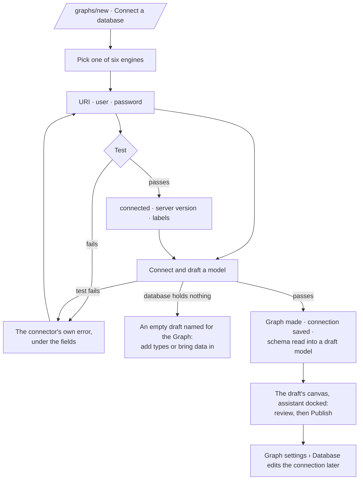

# Connect a database

One Graph binds to exactly one graph database. Set once, tested before it saves, and read-only in its
connector from then on.

| | |
|---|---|
| Index | [1.1](../../../README.md#1--connect-and-model) · Slice **S2** |
| Module | [Connect and model](../spec.md) |
| API / CLI / Studio | ✅ / — / 🟡 |
| Related | [introspect-a-database](introspect-a-database.md) · [domain-models](domain-models.md) |

Product spec: [ST-F01 · This graph](../../../../../specs/products/settings/features/ST-F01-this-graph/feature.md) — ST-14; the story, its criteria, the connection's rules, states and product decisions live there. This file keeps the create-a-Graph flow (for SH-F02), the engine shape and the rows not moved.

## Capabilities

| # | Capability | Notes |
|---|---|---|
| C9 | Connecting drafts a model | *Connect and draft a model* makes the Graph, saves the connection and reads the database into an authored **draft** model in one call; nothing is published |

## Journey

## Surfaces

| Surface | Shape |
|---|---|
| `/graphs/new` — *Connect a database* (`modeller.connect`) | One page: the title and one line (*A new Graph starts here. Point Invana at a graph database; it reads what is there and drafts a model you can review.*), six engine cards in a 3×2 grid (Neo4j · Memgraph · ArcadeDB · JanusGraph · Amazon Neptune · TinkerGraph, each with its query languages), URI, then User and Password side by side, then *Test* · *Connect and draft a model* (primary). The header crumb reads *New Graph* |

## Engine

| Thing | Shape |
|---|---|
| `graph_connections` | 1:1 with Graph — `connector_class` · `uri` · `database` · encrypted `auth` · `read_only` · `server_version` · runtime `status` · `latency_ms` |
| Routes | `GET PUT DELETE …/connection` · `POST …/connection/test` |
| Connect | `POST /api/v1/graphs/connect/test` `{connector_class, uri, auth, database?}` → the test result, with no Graph yet · `POST /api/v1/graphs/connect` `{connector_class, uri, auth, database?, name?}` → `{graph, model_id, discovered: {node_labels, edge_labels, indexes, constraints}}` |
| Events | `graph.create` · `connection.created · updated · tested · deleted` · `model.create` for the drafted model |
| Packaging | one connector package per database; the core depends on none of them |

## Decisions

| # | Decision |
|---|---|
| CD8 | The database name is a column on `graph_connections`, not a key inside the encrypted `auth` blob. It is passed to the connector only when set. |
| CD10 | **Testing a connection is a run.** `test_connection` (bound `network`) proves the connection through the runtime — trigger `user` from the form, `system` from a ping ([orchestration § 4.1](../../../orchestration.md#41-what-is-a-task--and-what-is-not)). The provider row it proves stays configuration. |
| CD11 | **Connecting drafts a model, in one call.** `POST /api/v1/graphs/connect` tests the connection (a failing test refuses with the connector's message and makes nothing), makes the Graph, saves the connection, registers it, and reads the database into a new **authored** model whose draft holds every label, relationship type, index and constraint the connector reports. The draft is ready when the call returns; the Graph's read-only `global` mirror still follows from the registration, as before. Nothing is published (ID1). |
| CD12 | **The connect form names nothing it can derive.** The Graph's name is the database name when one is given, else the URI's host (`bolt://neo4j:7687` → `neo4j`); its slug is that name made URL-safe, suffixed `-2`, `-3` … when the owner already has it. The drafted model is named for the Graph. Both are renamed later — the Graph in Graph settings › Basic, the model from its page. |
| CD13 | **`/graphs/new` is the connect form.** A Graph with no database answers nothing, so there is no name-only Graph: the six engine cards, URI, User, Password, *Test* and *Connect and draft a model*. The database name is left to the connector's default here and is edited in Graph settings › Database (CD8). Success opens the drafted model's canvas with the assistant docked (`…/modeller/models?model=<id>&model_open=1&models_view=schema&right=assistant`). |
