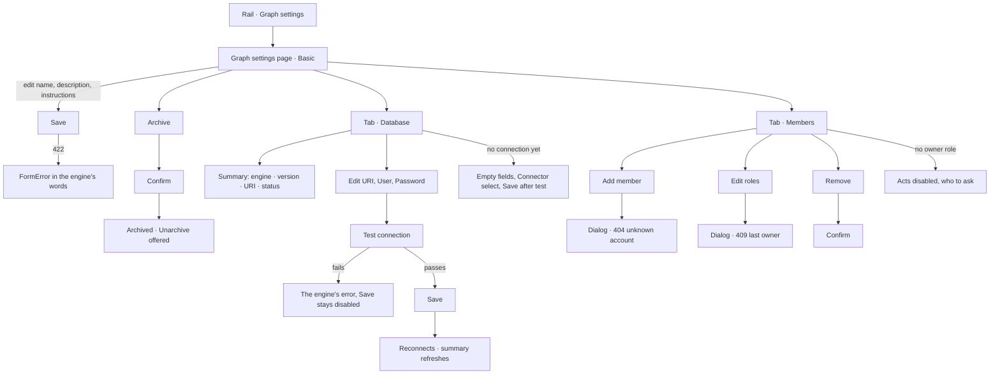

# Graph settings

The Graph's own configuration, as one page of the Modeller: what it is called and what it is for,
the database it reads, and who is on it.

| | |
|---|---|
| Index | [1.12](../../../README.md#1--connect-and-model) · built in **M07** |
| Module | [Connect and model](../spec.md) |
| API / CLI / Studio | ✅ / — / ✅ |
| Related | [connect-a-database](connect-a-database.md) (the connection's rules) · [roles](../../identity-and-access/features/roles.md) (Members, RO17) · [providers-and-models](../../agents/features/providers-and-models.md) (LLMs, in Agents) · [concurrency-and-contention](../../agents/features/concurrency-and-contention.md) (the ceiling, in Agents › Settings) |

> **As** a modeller, **I want** the Graph's name, instructions, connection and members on one page,
> **so that** the Graph is grounded and reachable.

## Capabilities

| # | Capability | Notes |
|---|---|---|
| GS-C1 | Basic | Name, description, instructions — one form, one *Save*; *Archive* / *Unarchive* below it, archive confirmed |
| GS-C2 | Database | The connection's summary card, then URI, User, Password, Database, Server version and Read-only; *Save* after a passing *Test connection*; *Introspect*; the capabilities this server reports |
| GS-C3 | Members | Members and Roles side by side; *Edit* and *Remove* per member row; *Add member* in the page head |
| GS-C4 | Setup | While the Graph's required setup is unfinished, Basic leads with the setup timeline |

---

## Journey

## Seams

| Seam | What the user sees |
|---|---|
| Loading | Tabs and head at once; skeleton rows in the body |
| Graph not found | *Graph not found.* in the body |
| No connection | Database draws the form with a Connector select and no summary card |
| Test not passed | *Save* disabled, *Test the connection to save it.* under the fields |
| Reload | `?tab=` holds the tab; `basic` when absent or unknown |
| No `settings` area | Every act disabled through `ActButton`, with who to ask |

## Surfaces

| Surface | Detail |
|---|---|
| Route | `/u/:user/:graph/modeller/settings?tab=basic\|database\|members` |
| Board kind | `settings` — declared, bound to the Graph, opened when the rail moves onto Graph settings |
| Page | `modeller/src/settings/GraphSettingsPage.tsx` — `SectionFrame` (Graph settings, the Settings icon, one line naming the Graph), tabs, body |
| Tabs | `BasicTab.tsx` · `DatabaseTab.tsx` · `MembersTab.tsx` (+ `MemberDialogs.tsx`) |
| Boards | `modeller.settings` · `modeller.settings.database` · `modeller.settings.members` |

## Engine

| Route | Shape |
|---|---|
| `GET …/` · `PATCH …/` | `GraphRead` · `GraphUpdate {name, description, instructions, status}` |
| `GET …/connection` | `GraphConnectionRead` — gains `auth_username` (the stored user; the password is never returned) |
| `PUT …/connection` | `GraphConnectionCreate` — `auth` with a blank password keeps the stored password |
| `POST …/connection/test` | the same body; a blank password tests with the stored one |
| `POST …/connection/introspect` | the physical mirror |
| `GET/POST/PATCH/DELETE …/members` | [roles](../../identity-and-access/features/roles.md) RO17 |

## Decisions

| # | Decision |
|---|---|
| GS1 | **Graph settings is a page in the main area**, a Workbook tab of kind `settings`, with no leftSection. The rail item names the page; it has no ✕ of its own beyond the Workbook tab's. |
| GS2 | **Three tabs: Basic · Database · Members**, keyed `?tab=basic\|database\|members`. LLMs are the Agents product's (`Agents › LLMs`) and the Graph's concurrency ceiling is `Agents › Settings`; neither is a tab here, although the board draws an LLMs tab. |
| GS3 | **The head is the shared `SectionFrame`**: `Graph settings`, its rail icon, and one line — `<Graph name> — what it is called, the database it reads, and who may change it.` |
| GS4 | **Basic and Database are a centred column** (`max-w-4xl`); Members uses the full width, Members and Roles side by side from `lg`. |
| GS5 | **Database is always editable.** A summary card — engine label and server version, `connector class · URI`, the status dot — then the fields. The connector is a select only before the first save, and fixed after it (connect-a-database). |
| GS6 | **User is read back, the password never.** The read carries `auth_username`; the Password field is blank and *Stored encrypted. Leave blank to keep it.* A save or test with a blank password uses the stored one. |
| GS7 | **Test gates Save.** Any change to URI, User, Password, Database or the connector resets a passing test. |
| GS8 | **Database keeps what the board omits**: Database (optional), Server version (optional), Read-only, *Introspect*, and a collapsed Capabilities row — the model editor's property types come from it. |
| GS9 | **Members as the board lays it out**: one card per table, *Edit* and *Remove* on every member row, *Add member* in the page head. The engine's six roles are listed — `iam-admin` holds what the board's `owner` row also names (members). |
| GS10 | **There is no Info panel.** Its setup timeline leads Basic while required setup is unfinished; its recent sessions are the assistant's. `?panel=info` and *Graph info* land on Graph settings › Basic. |

## Not building

| Not building | Why |
|---|---|
| An LLMs tab | Providers are the Agents product's (GS2) |
| Agent rows in Members | Agents are not members; an agent's access is IAM's |
| Changing the connector after the first save | Everything modelled against it would stop meaning what it means |
| A second connection per Graph | One Graph, one graph database |
