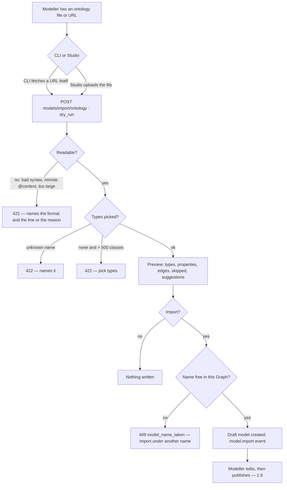

# Import an ontology

A model can start from an ontology a field already published — **RDFS or an OWL subset, schema.org
included** — read from JSON-LD, Turtle or RDF/XML. The import maps what Invana can hold into a
**draft** model, lists what it skipped and why, and keeps each type's and property's **source IRI**.
Nothing publishes until a person does.

| | |
|---|---|
| Index | [1.10](../../../README.md#1--connect-and-model) · Slice **B12** (P-19) |
| Module | [Connect and model](../spec.md) |
| API / CLI / Studio | ✅ / ✅ / ✅ |
| Related | [share-a-model](share-a-model.md) · [domain-models](domain-models.md) · [stitch-models](stitch-models.md) · [skos-import](../../bring-data-in/features/skos-import.md) · products: [modeller.md](../../../../products/modeller.md) MO-15 · MO-F14 |

> **As** a modeller, **I want** to start a model from an ontology — schema.org, RDFS or OWL — and see
> what maps and what is skipped, **so that** modelling starts from what my field already defined.

## Capabilities

| # | Capability | Notes |
|---|---|---|
| C1 | Read an ontology | JSON-LD · Turtle · RDF/XML, the format given or detected from the text |
| C2 | Pick types | `types` names classes by name, local name or IRI; none picked imports every class (≤ 500) |
| C3 | Preview | `dry_run` returns the model it would create and the import report; nothing is written |
| C4 | Import as a draft | A new model in the Graph with one draft version — the share-a-model import path, `import_source = ontology` |
| C5 | Import report | Mapped types, skipped constructs with reasons, notes, stitch suggestions |
| C6 | Source IRIs | Every imported node type, edge type and property key keeps the IRI it came from |

## Journey

## Seams

| Seam | What the user sees |
|---|---|
| A picked type whose properties point at a class not picked | That class comes with it, one level deep; the report says which property brought it |
| A property whose range mixes a class and a literal | An edge type to the class; the report notes the literal ranges dropped |
| A property whose class range is outside the import | Skipped, and listed with that reason |
| `rdfs:subClassOf` | Flattened: each type carries its ancestors' properties; the report names each inherited one's source |
| `owl:sameAs` · `owl:equivalentClass` · `owl:equivalentProperty` | Suggestions only — nothing is stitched until a person confirms one ([1.6](stitch-models.md)) |
| A name that is not an identifier (`date of birth`) | Made one (`date_of_birth` for a property, `DateOfBirth` for a type); a clash gets `_2` and a note |
| Types this database cannot hold | The draft still lands; `publishable = false` names them — as for any import |
| A large file | Parsed off the event loop; above 20 MB of text it is refused |

## Surfaces

| Surface | Shape |
|---|---|
| `modeller.models.new.ontology` · `…ontology.preview` | Studio, C08 — Models `⋯` › *From an ontology*: one dialog, pick then preview, *Open as a draft* (`model-editor/components/OntologyImportDialog.tsx`) |
| `invana models import --graph g --ontology <file\|url> [--types A,B] [--as name] [--format] [--lang] [--dry-run]` | CLI — reads the file or fetches the URL, then the same manager |

## Engine

| Route (`/api/v1/u/{username}/{graphSlug}/models`) | Returns |
|---|---|
| `POST /import/ontology` `{content, format?, types?, name?, lang?, dry_run?}` | 201 `ActionResponse[OntologyImportResult]` (200 on `dry_run`) |

| Shape | Fields |
|---|---|
| `OntologyImportRequest` | `content` (≤ 20 MB) · `format?` (`turtle · json-ld · rdf-xml`) · `types?: [str]` · `name?` · `lang` (default `en`) · `dry_run` |
| `OntologyImportResult` | `model?` · `version?` (absent on a dry run) · `draft: SchemaExport` · `report: OntologyReport` · `unsupported_property_types` · `publishable` |
| `OntologyReport` | `format` · `triples` · `mapped: {node_types, edge_types, property_keys}` · `types: [MappedType]` · `skipped: [ImportNote]` · `skipped_count` · `notes: [ImportNote]` · `notes_count` · `suggestions: [StitchSuggestion]` |
| `MappedType` | `name` · `iri` · `kind` (`node · edge`) · `came_with?` (`Person.birthPlace`) · `properties: [str]` · `inherited: [{property, from_type}]` |
| `ImportNote` | `iri?` · `subject` · `kind` · `message` — lists keep 200, the count is the whole |
| `StitchSuggestion` | `kind` (`same_as · equivalent_class · equivalent_property`) · `name` · `iri` · `target_iri` |
| `PropertyKeyCreate/Response` · `NodeTypeCreate/Response` · `EdgeTypeCreate/Response` | gain `source_iri?` |

| Table | Column |
|---|---|
| `property_key_definitions` · `node_type_definitions` · `edge_type_definitions` | `source_iri` (nullable, ≤ 2048) — copied with the version, exported in the artefact |

| OWL / RDFS | Invana |
|---|---|
| `owl:Class` · `rdfs:Class` (not a datatype) | node type; `rdfs:label` → name, `rdfs:comment` → description |
| datatype property, or a property whose ranges are literals | property key on each domain type; XSD / schema.org datatype → Invana type |
| object property, or a property with a class range | edge type, domain → range, subclasses included on both ends |
| `rdfs:domain` · `rdfs:range` · `schema:domainIncludes` · `schema:rangeIncludes` | the property's types; an `owl:unionOf` list is read as its members |
| `rdfs:subClassOf` | flattened, inherited properties noted with their source |

| XSD / schema.org | Invana type |
|---|---|
| `string` · `anyURI` · `token` · `Text` · `URL` | `string` |
| `integer` · `int` · `long` · `nonNegativeInteger` … · `Integer` | `integer` |
| `decimal` · `float` · `double` · `Number` · `Float` | `float` |
| `boolean` · `Boolean` | `boolean` |
| `date` · `Date` · `dateTime` · `DateTime` · `time` · `Time` · `duration` | `date` · `datetime` · `time` · `duration` |
| anything else literal, or ranges that disagree | `string`, with a note |

| Event | Details |
|---|---|
| `model.import` | `name` · `package_id` · `content_hash` · `source = ontology` · `unsupported` · `skipped` (count) |

## Decisions

| # | Decision |
|---|---|
| OI1 | **Invana keeps its own model; an ontology maps into it.** Import only — the source IRI kept on every type and property is what makes an export cheap later. |
| OI2 | **The import is a draft, through the share-a-model path.** A new model with one draft version, `import_source = ontology`, a fresh `package_id`; a taken name is 409 `model_name_taken`. |
| OI3 | **The engine never fetches.** The request carries the text. The CLI reads a file or downloads a URL itself; a JSON-LD document naming a remote `@context` is 422 — inline it. `owl:imports` is listed, not followed. |
| OI4 | **The format is given or detected** — `{`/`[` is JSON-LD, `<` is RDF/XML, anything else Turtle. A parse error is 422 naming the format. At most 20 MB of text. |
| OI5 | **Subclassing is flattened.** Each type carries its ancestors' properties as its own; `parent_type` stays empty. The report names each inherited property's source type. |
| OI6 | **Picked types bring what they point at, one level.** The class ranges of a picked type's object properties come in with their own properties; their edges reach only types already in the import. Not picking imports every class, refused above 500. |
| OI7 | **A mixed range is an edge** when one of its classes is in the import, else a property when it has a literal range, else skipped. |
| OI8 | **Equivalence is a suggestion.** `owl:sameAs`, `owl:equivalentClass` and `owl:equivalentProperty` come back in the report; nothing is stitched. |
| OI9 | **What Invana cannot hold is skipped and listed** — restrictions, cardinalities, `intersectionOf` · `complementOf` · `oneOf`, inverse / transitive / symmetric / functional properties, `subPropertyOf`, property chains, `disjointWith`, individuals, annotation properties. |
| OI10 | **Labels pick a language** — the asked one, then untagged, then any, in that order; names are made identifiers, a clash gets `_2`. |
| OI11 | **A source IRI is provenance, not shape.** It is in the content hash only when set, so an artefact without IRIs hashes as before. |
| OI12 | **The preview is the import with nothing written** — same mapping, same report. |
| OI13 | **Studio reads the ontology; the engine still never fetches.** The Source is *schema.org* (its current JSON-LD release), a URL, or a file; the browser reads it and sends the text. A server that does not let a browser read it is named, with *download the file and choose File*. |
| OI14 | **One dialog, two steps — pick, then preview.** The text lives in the dialog's memory only; nothing survives a reload, because a 20 MB document has no place in a URL. *Back* keeps the picks. |
| OI15 | **The picker is the all-classes preview.** After a read, a `dry_run` with no types lists the classes with their property counts; none picked imports every class. Which types a pick pulls in is shown on the preview (`came_with`), not before it. |
| OI16 | **Above 500 classes the picker takes names.** The engine refuses the all-classes preview there and no route lists classes, so the user names the types (name, label or IRI); an unknown name is the engine's 422. |
| OI17 | **The preview reads as a mapping** — source → becomes → note: node types (properties, *came with*, inherited), edge types (source → target), stitch suggestions (*you confirm it in Stitches*), skips with their reasons. A taken name is asked for again beside the name field; a type the database cannot hold is named, and the draft still lands. |

## Not building

| Not building | Because |
|---|---|
| SHACL shapes, GQL graph types | next in the semantic-imports order, after this |
| Export to OWL / JSON-LD | import only for now (OI1) |
| Reasoning, inference, restrictions as constraints | Invana's model is not a reasoner; they are listed (OI9) |
| Fetching URLs, `owl:imports` | the engine never fetches (OI3) |
| Upgrading an imported model from a newer ontology | an ontology import always creates; a later version is a new import or an edit |
| Confirming a suggestion into a stitch | a person does it in Stitch models (1.6); the report only proposes |
| Records from an ontology's individuals | a model, not data — records come in through 2.1 |
| A listed picker above 500 classes | no route lists classes; the picker takes names there (OI16) |
