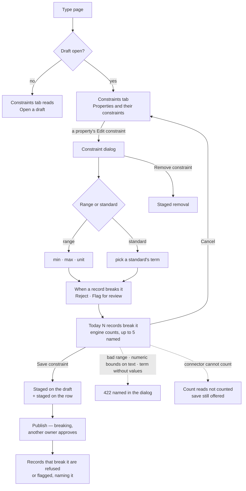

# Constraints on properties

A modeller bounds one property's values on one type — a **range** with a unit, or **a standard's
values** — and says what happens to a record that breaks it: **Reject** or **Flag for review**. The
engine checks it wherever a record lands, names the constraint when it refuses, and says how many
records in the graph break it today before the constraint is saved.

| | |
|---|---|
| Index | [1.11](../../../README.md#1--connect-and-model) · Slice **M04** |
| Module | [Connect and model](../spec.md) |
| API / CLI / Studio | ✅ / — / ✅ |
| Related | [the-model-page](the-model-page.md) (the type page) · [publish-review](publish-review.md) · [standards](../../bring-data-in/features/standards.md) · [load-data](../../bring-data-in/features/load-data.md) · products: [modeller.md](../../../../products/modeller.md) MO-08 · MO-F7 · [datasets.md](../../../../products/datasets.md) › Standards and checks |

> **As** a modeller, **I want** ranges on a property, and values named by a standard, **so that**
> impossible values never land.

## Capabilities

| # | Capability | Notes |
|---|---|---|
| C1 | A range on a property | `80 – 180 days` on `Variety.maturity_days`; either bound may be open (PC3) |
| C2 | A standard's values on a property | `CO_338 · Seed type` — the property takes only that term's codes (PC4) |
| C3 | Reject or flag | Reject refuses the record; Flag lets it land and lists it (PC5) |
| C4 | Checked where records land | A load's validate step — every import and every dataset bound to the Graph — and an Explorer board's data edits (PC6) |
| C5 | The refusal names the constraint | `Variety.maturity_days breaks its constraint 80 – 180 days: 1100` (PC7) |
| C6 | What breaks it today | Before saving: how many records in the graph break it, with up to five of them (PC8) |
| C7 | Versioned with the model | A constraint is a draft change, staged and published like any other; adding or narrowing one is breaking (PC9) |

## Vocabulary

| Word | Means |
|---|---|
| **Constraint** | One property's bound on one type: a range or a standard's values, with what happens when it breaks. Not the database's key, unique and exists rules, which the type page lists beside it as **database constraints** |
| **Range** | `min` · `max` (either may be empty) and a unit label |
| **Standard's values** | The codes of one term of one pinned standard version (`publisher/name@v` · term) |
| **Breaks** | A value outside the range or not among the codes. A missing value never breaks a constraint — required-ness is the key's job |

## Journey

## Seams

| Seam | What the user sees |
|---|---|
| While the count loads | The dialog's line reads *Counting the records that break it…*; Save stays enabled |
| The count fails, the database is not connected, or the connector is Gremlin | The engine's reason (*The Graph's database is not connected.* · *This database cannot count them here.*) — the constraint still saves |
| A body the engine refuses (inverted range, numeric bounds on text, a term without values) | The refusal's message in place of the count; Save shows it again |
| No standards with values | The standard select lists *No standard has a term with values* and is disabled |
| No draft | The tab reads; each row's *Edit constraint* is replaced by the summary alone, and the head offers *Open a draft* |
| Reload | `model_type=<name>&type_tab=constraints` reopens the tab; the dialog does not survive a reload |
| A reader without write | The tab reads, no edit acts (as every type tab) |

## Surfaces

| Surface | Where | Reads |
|---|---|---|
| Constraints tab | The type page, `type_tab=constraints` | the version tree (mappings' `validation_rules`, `constraints`) |
| *Properties and their constraints* | First panel: property · type · constraint · from · edit | each mapping's range/standard rule and the database constraints naming the property |
| *Database constraints* | Second panel: name · type · properties · delete, *Add constraint* | `constraints` of the type |
| Constraint dialog | Opened from a row's *Edit constraint* | `GET …/property-constraints/standards` for the picker · `POST …/property-constraints/check` for *today* · `PUT …/property-constraints` to save · `DELETE …/property-constraints/{id}` |
| Artboard | `modeller.model.type.constraint` | — |

## Engine

| Route | Body / query | Returns |
|---|---|---|
| `PUT /api/v1/u/{u}/{g}/models/{model}/versions/{draft}/property-constraints` | `PropertyConstraintSet` | `ActionResponse[PropertyConstraint]` — the mapping's rule, replaced |
| `DELETE …/versions/{draft}/property-constraints/{rule_id}` | — | `ActionResponse[None]` |
| `POST …/versions/{version}/property-constraints/check` | `PropertyConstraintSet` | `ConstraintCheck` — what breaks it in the graph now |
| `GET …/property-constraints/standards` | — | `StandardChoice[]` — every standard's current-version terms that carry values |

`PropertyConstraintSet`

| Field | Type | Notes |
|---|---|---|
| `type` | str | the node or edge type's name |
| `property` | str | a property the type maps (its own or inherited) |
| `kind` | `range` \| `standard` | |
| `min` · `max` | number \| null | range only; one at least |
| `unit` | str \| null | range only, ≤ 32 chars |
| `standard` | str \| null | `publisher/name`, standard only — its current version is pinned |
| `term` | str \| null | standard only |
| `on_break` | `reject` \| `flag` | default `reject` |

The rule (`validation_rules` row) gains

| Column | Type | Notes |
|---|---|---|
| `rule_type` | enum + `standard` | |
| `unit` | str(32) \| null | |
| `standard_version_id` | FK `standard_versions` \| null, `SET NULL` | the pinned version |
| `standard_ref` | str(160) \| null | `publisher/name@v`, kept when the version row is gone |
| `term` | str(255) \| null | |
| `on_break` | `reject` \| `flag` | default `reject` |
| `params` | JSON | range `{min, max}` · standard `{values: [code…]}` copied at save |

`ConstraintCheck` — `counted: bool` · `breaking: int | null` · `samples: [{record, value}]` (≤ 5) ·
`label` (the constraint as the refusal names it) · `reason: str | null` (why it was not counted).

`StandardChoice` — `standard` (`publisher/name`) · `title` · `version` · `term` · `values` (count).

## Decisions

| # | Decision |
|---|---|
| PC1 | **A constraint lives on the type's property mapping, as a validation rule.** `rule_type` is `range` or `standard`; it is copied into every draft, diffed and published with the model, so a constraint is versioned like a property. A rule on the property key itself (every type) is still read and enforced; Studio authors on the type. |
| PC2 | **One constraint per property per type.** Saving replaces that mapping's range, enum or standard rule; pattern and length rules stay beside it. A constraint on an inherited property is written on the type that inherits it, as the type's own mapping of that key. |
| PC3 | **A range is numeric.** The property's type is an integer or float type, else 422 `range_needs_number`; at least one bound; `min ≤ max`, else 422 `range_inverted`. The unit is a label carried into the refusal, never converted. |
| PC4 | **A standard's values are copied at save from its current version.** A standard version is immutable, so the copy cannot drift; the rule keeps the pinned version and its address. A newer standard version reaches the model only when someone saves the constraint again. A term without values is 422 `term_has_no_values`; an unknown standard or term is 422. Standards are authored in Datasets — the Modeller references them. |
| PC5 | **Reject or flag, chosen per constraint; reject is the default.** Reject: the record is refused. Flag: the record lands, and its break is listed — in a load's report as `flagged` with the constraint named, and in the constraint's count of what breaks it today. A data edit with a flagged break goes through. |
| PC6 | **Checked at record write, bind and validation by one check.** The model's `SchemaValidator` applies it, so the validate step of every load (an import, a dataset bound to the Graph — binding runs that load) and the publish-time migration scan read the same rule; an Explorer board's data edits check each set value against the same rules before writing. |
| PC7 | **A refusal names the constraint.** Code `breaks_constraint`, message `<Type>.<property> breaks its constraint <label>: <value>`; the label is `80 – 180 days`, `≥ 10 g`, `≤ 70` or `CO_338 · Seed type` (`publisher/name · term`). |
| PC8 | **The engine counts what breaks it today; Studio formats.** `check` runs one count query on the Graph's database for the type's label (Cypher connectors) and returns the count and up to five records (`id`, value). It runs on the unsaved body, so the dialog can say it before Save. It is a read: nothing is stored, nothing written. A connector without Cypher returns `counted: false` with the reason. |
| PC9 | **Adding or narrowing a constraint is breaking; removing one is additive.** As every validation rule: a new or changed rule on a published property is `rule_added`, breaking, and goes through publish review with its migration scan, which counts the records that would fail. |
| PC10 | **The Constraints tab is the property's view.** *Properties and their constraints* lists every property the type maps: property · type · constraint (the database constraints naming it, then the range or the first three values and `+N`) · from (*model* for a database constraint or none, *model · constraint* for a range or values, `<standard> · <term>` for a standard's values) · *Edit constraint on <property>* (a pencil) while a draft is open. An inherited property's dialog opens empty and writes the type's own constraint; its parent's stays. The tab counts `Constraints · N` — properties carrying a constraint plus database constraints. The Properties tab's *constraint* cell carries the same label. *Database constraints* below keeps the key, unique and exists rules, with *Add constraint* and delete. |
| PC11 | **The dialog is the board's.** Title the property, subtitle `<Type> · constraint`; *Range* min `to` max unit; *Or use a standard* (none, or a standard's term); *When a record breaks it* Reject · Flag for review; the *today* line; *Cancel* · *Save constraint*, and *Remove constraint* when the property has one. Picking a standard empties the range, typing a bound sets the standard back to none. |

## Not building

| Not building | Because |
|---|---|
| Flagged breaks as Datasets › Validation items | the queue is a dataset version's standard violations, with a fix that publishes the next version; a Graph record has no such version — flagged breaks are counted and reported |
| Unit conversion | the unit is a label; a value is compared as written |
| Pattern, length and enum rules in the dialog | the board authors a range or a standard; those rules stay readable on Mappings |
| Constraints from SHACL | Later (MO-F15) |
| Authoring a standard here | Datasets owns standards ([standards](../../bring-data-in/features/standards.md)) |
| A CLI for constraints | a model file already carries `validation_rules`; `invana models import` sets them |
| Counting breaks on Gremlin databases | no count query is written for Gremlin; `counted: false` says so |
