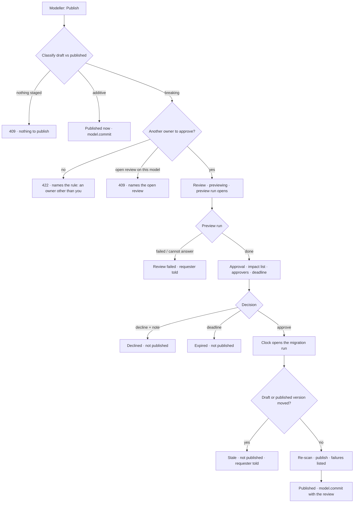
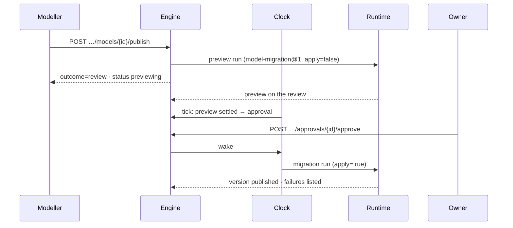

# Publish review

Publishing a model says whether the change is **additive** or **breaking**. An additive change publishes
now. A breaking one is previewed as a **migration run** — affected counts, sample before/after, records
that would fail — and publishes only after **another member** approves it. Nothing changes silently.

| | |
|---|---|
| Index | [1.9](../../../README.md#1--connect-and-model) · Slice **B10** |
| Module | [Connect and model](../spec.md) |
| API / CLI / Studio | ✅ / ✅ / ✅ |
| Product | [modeller.md › Decisions](../../../../products/modeller.md#decisions) — *Publish review* · *Breaking data changes* · MO-05 · P-16 |
| Related | [domain-models](domain-models.md) · [model-editor](model-editor.md) · [approvals](../../operate/features/approvals.md) · [change-log](../../operate/features/change-log.md) · [roles](../../identity-and-access/features/roles.md) |

> **As** a modeller, **I want** to know before I publish whether a change breaks what is already in the
> graph, and to have someone else agree to a breaking one, **so that** publishing never surprises anyone.
>
> **As** an owner asked to approve, **I want** to see what will change, how many records it touches and
> which would fail, **so that** I approve a change I understand.

## Capabilities

| # | Capability | Notes |
|---|---|---|
| C1 | Classify a draft | Each change against the published version, marked additive or breaking with a reason. A draft is breaking when any one change is |
| C2 | Publish an additive draft directly | `POST …/publish` and the existing commit both publish it now |
| C3 | Refuse a breaking draft on the direct paths | Commit and activate answer 409 `breaking_publish_needs_review` with the breaking changes |
| C4 | Request a review | Opens a preview migration run; the review waits for it |
| C5 | Preview | Per touched type: total, scanned, affected, would fail, up to three samples before and after |
| C6 | Approval by another member | The approval names the Graph's other owners, carries the impact list, and follows [approvals](../../operate/features/approvals.md) — reminder at half-time, *expired, not published* at the deadline |
| C7 | Migration after approval | The clock opens the apply run: it checks nothing moved, re-scans, publishes, and lists the records that fail |
| C8 | Who reads it | Datasets bound to a touched type and stitches on a touched type, listed in the impact |
| C9 | Dry run | `invana models publish --dry-run` classifies and previews; it publishes nothing and opens no review |

## What is breaking

| Change | Breaking | Reason shown |
|---|---|---|
| Node or edge type removed | yes | *removed type* |
| Property removed from a type, or a property key removed | yes | *removed property* |
| Property key type changed | yes | *changed type* |
| Cardinality `LIST`/`SET` → `SINGLE`, or `LIST` → `SET` | yes | *narrowed property* |
| Edge endpoint type removed | yes | *narrowed endpoints* |
| Edge multiplicity changed | yes | *changed multiplicity* |
| `unique` · `exists` · `relationship_*` constraint added, or one changed | yes | *narrowed property* |
| `node_key` added, removed or changed | yes | *changed key* |
| Validation rule added or changed on a property | yes | *narrowed property* |
| Type's validation mode, parent or abstract flag changed | yes | *changed type* |
| Anything added · cardinality widened · a non-key constraint removed · an index · a description | no | *additive* |

## Journey

## Seams

| Seam | What the user sees |
|---|---|
| While the preview runs | The review reads *previewing* with its run; nobody is asked yet |
| A Graph with no other owner | Refused before anything opens, naming the rule and the owners |
| A named approver who is not an owner, or is the requester | Refused, naming them |
| No connection, or the database is down | The preview run fails; the review is *failed* and the requester is told — it is never sent for approval without its numbers |
| A guardrail denies the model | The preview run ends *cannot answer*; the review is *failed* with that reason |
| More records than the scan reads | *first 1,000 of 52,310* — counts are of what was scanned, never extrapolated |
| The draft is edited while under review | The migration run finds it changed: *stale, not published*. A new publish starts a new review |
| Someone else publishes first | Same: *stale* — the approver approved a change against a version that is no longer current |
| Approval declined or expired | The draft stays a draft; nothing is published |
| Records that fail the new version | Listed on the migration run; they are not changed or deleted |
| Reload | The review, its runs and its approval are rows; every state survives |

## Surfaces

| Surface | Shape |
|---|---|
| Publish confirm | `modeller.draft.publish` — reads `GET …/draft/review`; additive shows the staged changes, the projection and *Who reads*, then *Publish vN*; breaking shows *— breaking*, the changes, *Who reads*, a why and *Request approval* (`packages/modeller/src/models/model-page/ModelsDialogs.tsx`) |
| Review | `modeller.draft.migration` — the same confirm after the request: the preview run, the migration table, then *waiting on approval*, linked to the runs and Approvals |
| Comparing bar | `modeller.global_model.diff` — over the global canvas when a model has a draft: its counts and *Review and publish* (`packages/modeller/src/models/model-page/DraftCompareBar.tsx`) |
| Activity › Approvals | The approval's `payload` is the impact list, frozen at request |
| CLI | `invana models publish --graph g --name m [--dry-run] [--why …] [--approver u …] [--user u]` — `--user` is required without `--dry-run` (a review names its requester); the preview runs inline, then one clock step raises the approval |

## Engine

| Thing | Shape |
|---|---|
| `GET …/models/{id}/draft/review` | `{classification: additive · breaking, base_version, changes: [{kind, target_kind, type, property, breaking, reason}]}` — reads only |
| `POST …/models/{id}/publish` | `{why?, version?, approvers?: [username], deadline_s?}` → `{outcome: published · review, version?, review?}` |
| `GET …/models/{id}/publish-reviews` · `…/{review_id}` | the model's reviews, newest first · one |
| `model_publish_reviews` | `graph_id` · `model_id` · `version_id` (the draft) · `base_version_id` · `draft_hash` · `classification` · `changes` · `preview` · `result` · `why` · `requested_by_id` · `approval_id` · `preview_run_id` · `run_id` · `published_version` · `status` · `reason` · `created_at` · `updated_at` |
| `status` | `previewing · pending · migrating · published · failed · declined · expired · stale` |
| Task type | `migrate_model` (bound `schema_write`, in `invana.core.schema_write`) — `apply=false` previews, `apply=true` publishes |
| Packaged flow | `model-migration@1`, one step |
| Run | `ask_kind = model_migration`, no agent, no world, the Graph's guardrails frozen on it |
| Approval | `subject_kind = model_publish`, `subject_id` = the review |
| Clock | One more step after approvals expire: settle previews, open approved migrations, close finished ones |
| Events | `model.review` (`status` in details) on request and on each end that is not a publish; a publish is `model.commit` with `review_id` and `why` |

## Decisions

| # | Decision |
|---|---|
| PB1 | **Classified change by change, against the published version.** A draft is breaking when any one change is breaking; the list in *What is breaking* is the whole rule. A model with no published version is additive — there is nothing in the graph it can break. |
| PB2 | **There is one way past a breaking change: a review.** Commit and activate refuse a breaking draft with 409 `breaking_publish_needs_review` and the changes. A SemVer override does not bypass it. |
| PB3 | **The preview is a migration run** — `model-migration@1` with `apply=false`, under the Graph's guardrails. It asks the guardrails to **admit** the model's published version, and only `allow` admits: a preview over a slice would undercount what the change touches. |
| PB4 | **The scan reads at most 1,000 records per touched type** and says how many it read beside the total. Counts are of what was scanned, never extrapolated. Uniqueness is checked across the scanned records; every other failure is the [validator](../../../../../engine/src/invana/apps/modeller/validator.py)'s, per record, against the draft. |
| PB5 | **Approvers are owners other than the requester.** By default all of them; a request may name some, and each must be an owner and not the requester. With none, the request is refused before anything opens. The approver list, not the role, then decides ([AP2](../../operate/features/approvals.md#decisions)). |
| PB6 | **The approval's payload is the impact list, frozen when the preview settles** — the changes, the preview, the readers. The approver approves what was shown ([AP5](../../operate/features/approvals.md#decisions)). The deadline defaults to 72 hours (1 hour to 30 days). |
| PB7 | **A review publishes exactly what was approved, or nothing.** The migration run checks the draft's content hash and the published version against the ones recorded at request; either moved → `stale`, nothing published. |
| PB8 | **Data is never rewritten.** The migration run changes what the model says; records that no longer fit are listed on the run, not altered or deleted. Datasets › Validation reads that list when it exists. |
| PB9 | **One open review per model.** A second request while one is `previewing`, `pending` or `migrating` is 409 naming it. |
| PB10 | **The clock moves a review.** It settles previews into approvals, opens the migration run after an approval, and marks a review `failed` when either run ends without its result. Approving or declining wakes it, so the run opens (or the review ends) within a tick. |
| PB11 | **A reviewed publish is the same publish.** SemVer bump, content hash and `model.commit` (with `review_id` and `why`), so the [change log](../../operate/features/change-log.md) reads it like any other. |
| PB12 | **Who reads it** is the datasets bound to a touched type and the stitches on a touched type. Runs do not pin model versions, so a run is not a reader. |
| PB13 | **Studio asks the engine before it confirms.** The Publish confirm branches on `draft/review`, a commit refused with `breaking_publish_needs_review` re-reads it, and Studio names the readers from the stitches and dataset bindings on the model; the rules are in [modeller.md › Decisions](../../../../products/modeller.md#decisions) *Publish asks the engine first* · *The review in the confirm* · *Compare on the map*. |
| PB14 | **`draft/review` counts its changes.** It returns `added` (kinds ending `_added`), `removed` (ending `_removed`) and `changed` (the rest) beside `changes`, so the Comparing bar formats three numbers and counts nothing. |

## Not building

| Not building | Because |
|---|---|
| Rewriting or deleting records to fit the new version | data is imported against a version, not rewritten by one ([domain-models](domain-models.md)) |
| A loosened guardrail as a breaking publish | guardrails are not part of a model version and save on their own path ([guardrails](../../govern/features/guardrails.md)) |
| Withdrawing a review | decline it, or change the draft — it goes stale |
| Extrapolated counts | a number nobody read is a guess |
| Drift re-runs after a reviewed publish | the evals drift trigger fires from the HTTP publish only; the clock does not reach it |
