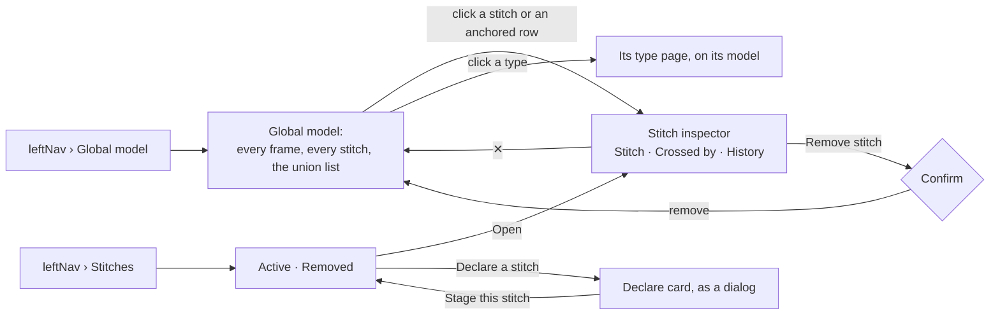

# Stitch models

Two domain models meet through a **declared** link — an anchor (same entity) or a relationship (an
edge between two of them). Either way the link carries **a key on each side**, because the two models
were authored apart and almost never spell the same fact the same way. Their union is the global
model, derived at read time.

| | |
|---|---|
| Index | [1.6](../../../README.md#1--connect-and-model) · Slice **S7** |
| Module | [Connect and model](../spec.md) |
| API / CLI / Studio | ✅ / ✅ / ✅ |
| Related | [the-model-page](the-model-page.md) · [domain-models](domain-models.md) · [load-data](../../bring-data-in/features/load-data.md) |

Product spec: [MO-F03 · Link and share models](../../../../../specs/capabilities/model/features/MO-F03-link-and-share-models/feature.md) — the stories, their criteria, journey, states and product decisions live there. This file keeps the engine and code shape.

## Three worked stitches

The finance Graph holds six models. These are every shape a stitch takes; nothing else is one.

| # | Stitch | Kind | Source key | Target key | Endpoints from |
|---|---|---|---|---|---|
| W1 | `NewsArticles.Company ≡ MarketData.Stock` | anchor | `Company.ticker` | `Stock.nse_symbol` | the keys |
| W2 | `Brokerage.Order -[FOR]-> MarketData.Stock` | relationship | `Order.instrument_isin` | `Stock.isin` | the keys |
| W3 | `Observations.Observation -[ABOUT]-> MarketData.Stock` | relationship | — | — | the `obs` dataset |

**W1** is the case a single shared property name cannot express. Two teams authored two models apart;
one wrote `ticker` and the other wrote `nse_symbol`, and neither is going to rename its published
version because the other exists. The anchor says they are the same Company, matched `exact`; both
nodes stay (ST2).

**W2** is a foreign key that is *already a property* of the records — `Order` arrived carrying
`instrument_isin` and nothing else. There is no dataset of `(order, stock)` pairs to load and there
never will be, so the edge is found by reading the key on each side. The types differ, so this is not
an anchor: `Order` is not a `Stock`.

**W3** is the other half: the edge is its own fact, with its own rows, arriving in a dataset like any
other data (ST4). `Observation` carries no key pointing at `Stock` — what it points at was decided
when the observation was written, one row per edge.

## Fixtures

`demos/airways/` ships three datasets that are one story from three angles — **air-routes** is the
network, **news-articles** is what gets written about it, **twitter** is what gets said about
that. Each carries a `graph-model.json` to import and publish, and the keys they join on are
read out of the neighbouring dataset at generation time rather than retyped, so every rule
resolves against rows that exist.

| Shape | Fixture | Resolves |
|---|---|---|
| **W1** — a key on each side | `NewsArticles.Country.iso_code ≡ AirRoutes.country.code` | 44 / 44 |
| Anchor, `case_insensitive` | `Twitter.Hashtag.tag ≡ NewsArticles.Topic.tag` — `RouteLaunch` ≡ `routelaunch`, with six hashtags no story was filed under, so the preview shows an overlap rather than a clean union | 10 / 16 |
| **W2** — a foreign key already on the records | `Twitter.Tweet -[LINKS_TO]-> NewsArticles.Article` on `linked_url` ≡ `url`; six more like it | 65 / 65 |
| **W3** — endpoints from a dataset | `Twitter.Tweet -[ABOUT]-> NewsArticles.Article`, from `twitter/stitches/ABOUT.json` | 22 rows |

Counts are **distinct key values**, as `…/model-links/preview` reports them — 26 airlines
share 24 hub codes. `invana records check demos/airways` counts every rule without a
database; the full matrix is [demos/airways](../../../../../demos/airways/README.md).

**Only two of the ten are anchors.** An anchor is type-level, so it is true only when *every*
node of one type is a node of the other: a country is a country, and a hashtag names the
topic a story was filed under. A city is not an airport and an airline's social account is
not the airline, so those are relationship links. Anchoring them collapsed `Account` into
`Airline` in the derived union and cost `Publisher` its Twitter side — the union is where a
type-level over-claim shows up, because that is the one place an anchor is read as a claim
about every node rather than about the rows that happen to match.

## Surfaces

Stitching has two surfaces of its own on the Modeller's rail: the **global model**, where a stitch is
drawn, declared and inspected, and the **Stitches** page, where every stitch in the Graph is listed —
active, staged and removed (modeller.md).

| Surface | Shape |
|---|---|
| **Stitches** page | `/modeller/stitches`, the `stitches` board: `Stitches` · *N active* · *Declare a stitch* · a search, then **Active** and **Removed**. A row is the rule over `kind · status · N joined / N edges · crossed by N queries`; *Open* lands on the global model with the stitch inspected (ST59 · ST61) |
| **Stitch inspector** | The global model page's right column while `?stitch=<id>` is set: the pair and its kind, tabs Stitch · Crossed by · History, *Open in a draft* · *Remove stitch* (ST60) |
| A model's outline › **Stitches** | The links touching this model, listed from **either** side — `Article ≡ Stock` is the same fact whichever model you are looking at. A row reads `NewsArticles.Company ≡ MarketData.Stock` over `Company.ticker = Stock.nse_symbol · exact · active`: the pair, then the rule it resolves on, then its state. `add` opens the declare card, which carries **both kinds** itself (ST11) |
| **Declare card** | One card, titled *Declare a stitch*, with the kind as a segmented control inside it. Opened from the Stitches drawer with the selected type **pre-filled** as **Source**, or from a drag on *All models* with both sides pre-filled as **Source** and **Target**. Both kinds name the key on each side; anchors add `Match`, relationships add `Edge` and an `Endpoints` choice — *These keys* or *Its own rows* (ST27). Its button says **Stage this stitch**, because that is what it does (ST21). Docked in the canvas's right panel on *All models*, a dialog from the drawer (ST34) |
| Preview | Resolve counts before declaring, fired as soon as both keys are named (ST35) — `1,284 of 1,310 resolve`, and under it the sentence that names both keys. A rule that matches nothing says so before it is committed, not after, and *Show the N* lists the source keys that matched nothing |
| Refusals | A pair already stitched comes back as its own card naming the **rule the existing stitch carries**, with *Open the existing stitch* (ST36) |
| **Global model** | `/modeller/global-model`, the `global_model` board — every published model on one full-bleed canvas in `mainSection`, drawn on [`GraphModelCanvas`](../../../building-studio/graph-model-canvas.md) — the canvas Storybook's GlobalModel story (ST57). Each model is a group frame with its node types inside; a stitch is the only edge that crosses one (ST14), and every stitch is dashed while a model's own edge type is solid. **Detail** (High · Medium · Low, opening on High — circles), Settings sit in its header and it wears Studio's theme (GM11), and ELK lays it out (ST20); hovering a type shows its properties and hovering a stitch shows its rule. A drag moves a type, as in the story; **Shift**-drag a type onto a type in another model to declare, and the declare card docks on the right. The **Stitch mode** toggle in the header keeps stitching on without Shift. Double-clicking a frame collapses it and the graph re-lays out (ST19). A bar above the canvas carries the staged stitches with **Commit** and **Discard**, and a second bar the stitches bound to a version no longer drawn; **counts are not on the canvas** (ST37). It has no leftSection; its chrome floats over the canvas — the horizontal toolbar, the info bar with *Show* · *Lens* · *Detail*, the minimap (ST24) |
| **The union list** | The derived union, in the global model page's right column: node types with their models, the anchored stitches, edge types. It belongs to no single model, so no model's outline holds it (ST6) |
| **CLI** | `invana stitches apply --graph <username>/<slug> --file <bundle>/stitches.json` declares every rule a bundle states — staged, and reported one per line as *declared*, *already declared* or *skipped* with the reason. `--commit` flips the set in the same run; `--dry-run` prints the plan and writes nothing. `invana stitches list · commit · discard` are the drawer's own writes, on the command line (ST39), and `invana stitches resolve` counts what each declared stitch matches against the live database (ST43) |

Entering it (ST24):

The union list **states** the union — every node and edge type, which models contribute it,
and whether it is anchored. It does not draw it: `GlobalType` carries no endpoints, so an edge type
in the union does not say what it connects. Drawing it needs `source`/`target` on the payload.

## Engine

| Thing | Shape |
|---|---|
| `model_links` | `kind (anchor\|relationship)` · `status (staged\|active)` · both model version ids · both type names · `source_property` · `target_property` · `identity_match` · `edge_type` and `source_model_id` (relationship only) · `edges` (counted after each solve, ST62) |
| Global model | derived on read: union of published versions plus their **active** links. `staged_count` and `mirror_label_count` ride beside the counts, never inside them (ST21, ST7) |
| Routes | `GET …/model-links?status=` · `GET …/model-links/removed` (ST61) · `GET …/model-links/{id}` (ST63) · `POST …/model-links` (stages) · `POST …/model-links/commit` · `POST …/model-links/discard` · `DELETE …/model-links/{id}` · `POST …/model-links/preview` |
| Preview | `POST …/model-links/preview` takes `source_type` · `source_property` · `target_type` · `target_property` · `identity_match` and returns `StitchPreview` — the totals, `resolved`, the two unresolved counts, up to 25 `unresolved_sample` keys, and a `verdict` naming both keys. One shape for both kinds |
| Refusals | `key_required_on_each_side` · `edge_type_required` · `edge_type_on_anchor` · `source_model_on_anchor` · `endpoints_required` · `keys_and_source_model` · `version_is_draft` · `type_not_in_version` · `link_already_declared` (409, carrying the existing stitch's rule) |
| Events | `model_link.declare · commit · discard · remove` · `todo.stitch` |
| Solving | `modeller.solve.solve_link` — one MERGE per stitch, run on commit over everything already in the graph (ST44) and again at the end of every import over what that import wrote (ST47). Every edge it writes carries `_inv_origin`, `_inv_stitch_id`, `_inv_rule`, `_inv_at` (ST46) |
| CLI | `invana stitches list · apply · commit · discard · resolve`. `apply` reads the bundle manifest `invana records check` validates, resolves each `<dataset>` to a published version (ST40) and calls the same `declare` the route calls — one path into `model_links`, whoever walks it |

Declaring, committing and discarding are the engine's three writes; removing is the fourth and is immediate, staged or not — there is nothing to preview about a fact being withdrawn.

## Decisions

| # | Decision |
|---|---|
| ST5 | A stitch is its own Todo kind. |
| ST6 | The global model is **stated, not drawn**: counts that name what they were derived from, then every node and edge type with the models contributing it. `GlobalType` carries no endpoints, so there is no graph to lay out — drawing it needs `source`/`target` on the payload first. |
| ST7 | The physical mirror's label count sits beside the derived counts and is never added into them. |
| ST9 | Stitching has two rail items, Global model and Stitches. The canvas is where a stitch is seen and declared by a drag; the list is where every stitch of the Graph is read in words, including the removed ones. |
| ST12 | **Stitches** is a **drawer in the Model panel's stack** (model-editor.md ME13), so stitch hands the model a section rather than rendering one. `useStitchesSection()` returns the section and the declare dialog; the model places the first in its stack and the second beside it. The `add` control is the drawer header's own menu — anchor or relationship — which is what ST11 always described and now is natively. |
| ST13 | **The surface is called Stitches.** A person stitches two models together; `model_links` is what the engine stores once they have. The drawer, the section header, the crumb and the status line all read *Stitches*; the nouns inside it stay **anchor** and **relationship link**, and the word *link* stays in the engine — `model_links`, `…/model-links`, `model_link.declared`. *Links* as a surface name collided with the everyday hyperlink and named the record rather than the act. |

| ST14 | **Every model draws on one canvas — *All models*.** A model is a **group frame**: `@invana/graph`'s own group, a node carrying `style.group`, with its node types pointing at it through `parentId`. The frame is a `tabbed-rect`, so the model's name rides the tab *on* the boundary rather than floating inside the drawing. A **stitch is the only edge allowed to cross a frame**: an edge whose endpoints sit in two different groups is a stitch by construction, and an edge inside one frame is that model's own edge type. Nothing declares the difference twice. |
| ST15 | **Detail is the altitude, not zoom.** The landscape is read at one of three levels — circles, cards or schema cards — chosen in the canvas header ([GM4](../../../building-studio/graph-model-canvas.md#decisions)). The landscape opens on circles; a single model's canvas opens on cards ([MP19](the-model-page.md#decisions)). Zoom only moves the camera; frames stay open, because a zoom that also reshapes the drawing is a control nobody can predict. |
| ST16 | **It reads versions, never the union.** *All models* fans out over the models list and each model's **active version**, plus `…/model-links` — every endpoint it needs is on those payloads already. It never calls `…/global-model`, whose `GlobalType` carries no endpoints, so **ST6 stands unchanged**: the union list is still stated, not drawn. Two surfaces, two questions, two payloads. |
| ST17 | **A model and each of its types wear their own hue, from the data palette.** A frame's wash and border wear the `--color-data-N` slot the model's name hashes to; on the global model every node type inside it — the ring, the icon, the card's header — wears the **model's** slot too, so the frames read as models at a glance, as the board draws them. On one model's canvas, where the page is already the model, a type wears the slot its own name hashes to, the colour the Explorer paints it ([GM7](../../../building-studio/graph-model-canvas.md#decisions)). Names, not list positions, so a hue survives reordering ([GM8](../../../building-studio/graph-model-canvas.md#decisions)). A stitch wears the edge token and never a model's hue, because it belongs to neither of them. |
| ST20 | **ELK lays the frames out, and it is the only layout.** `ElkLayout`'s compound-group mode packs a group's members *inside* its box, sized from the group's own padding and header band. There is no Layout switch and no d3-force: force only pulls a model's types together, so its frames overlap ([GM3](../../../building-studio/graph-model-canvas.md#decisions)). ELK solves in the worker its layout package ships. |
| ST21 | **A stitch stages on its own row, not on a draft.** `model_links.status` is `staged` or `active`. Declaring writes a **staged** row; `Commit` flips every staged row in the Graph to active in one action, `Discard` deletes them. The derived global model unions **active links only**, so a staged stitch changes no answer until it is committed. This is deliberately *not* the model's staged set: that one is the live diff between a draft and the version it replaces and records nothing (`staging.py`), and a stitch belongs to no version, so it has no draft to diff. What the two share is the property that matters — the staged set lives on the server, so it survives a reload and anyone opening the Graph sees it (ME4). |
| ST22 | **The global model has no leftSection.** The canvas is full-bleed; the union list and the stitch inspector are its right column. A model is reached from the canvas, never from a list beside it. |
| ST23 | **Zoom and fit are the header's own controls.** `GraphControlsToolbar` zooms, fits and locks; the page adds no altitude track and no camera logic of its own. |
| ST24 | **The global model is its own board, `global_model`, and the Modeller's landing.** Its chrome floats over the canvas: the horizontal toolbar top-left, the info bar beside it (`Global model` · counts · *Show* all models or one · *Lens* · *Detail*), the minimap with zoom bottom-left. A type clicked opens its type page on its model ([the-model-page](the-model-page.md#decisions)). |
| ST25 | **Every solve frames the drawing.** A run glides the camera with the nodes (`fitCamera`), so a Detail switch reframes what it redrew; between runs the camera is the reader's. |
| ST29 | **A frame is drawn at the size the solver reserved for it.** A model with **nothing published** is not a group — ELK sizes a group from its members and reserves nothing for one with none — so it is a `model.empty` node: the same tabbed frame at 220×80, with no `group`. A frame with members is sized by `autoFit` alone. |
| ST30 | **The fit frames the graph layer, not every layer.** `fitView` unions every world layer, and the dot pattern behind the frames is one — framing that union is how the landscape ended up in a corner of its own canvas. The camera fits `GraphLayer.getBounds()`, and only on a **settled** solve (model-editor.md ME24): a stopped run leaves every frame on the origin, and fitting that frames a point. |
| ST31 | **The drawing rebuilds only when its data does.** `<GraphLayer data>` replaces the drawing when its reference flips, so `GraphModelCanvas` keys its data on content, and `useAllModels` reads its versions through `combine`, whose result is structurally shared — `useQueries` hands back a new array on every render. |
| ST32 | **A frame is the story's `modelFrame`, in its model's hue.** A `tabbed-rect` with the model's name on its tab, a 10% wash and a 60% border in the model's hue; its collapse toggle is hidden (`showToggle: false`), so a frame is always open. |
| ST33 | **A frame follows the theme.** Its title is the theme's `heading` role, and its hue and the members' hues are read live from `--color-data-N` whenever the theme changes, then put back over the layer's own theme pass ([GM7 · GM8](../../../building-studio/graph-model-canvas.md#decisions)). |
| ST34 | **The declare card is docked beside the canvas, not modal.** The gesture that opens it on *All models* is a drag between two frames, and a scrim over those frames hides the two types the stitch is about — so it docks in the canvas's right panel, beside Settings ([GM12](../../../building-studio/graph-model-canvas.md#decisions)). From the Stitches drawer there is nothing behind it worth keeping in view, so there it is a dialog — the same card. |
| ST39 | **A bundle's stitches declare from the CLI.** `invana stitches apply --graph <username>/<slug> --file <bundle>/stitches.json` reads the manifest `invana records check` already validates (load-data.md LD12) and declares each rule against the Graph — **staged**, exactly where the declare card leaves one (ST21), with `--commit` to flip the set in the same run. A bundle that states eleven rules in a file and then asks a person to retype them into a card is a bundle whose rules exist twice, and the two copies disagree the first time one of them is edited. Nothing is inferred on the way in (ST1): the CLI declares what the manifest says, so both paths write the same rows. |
| ST40 | **The manifest names folders; a stitch binds versions, so the CLI resolves one to the other.** A rule says `news-articles:City.code` and a link needs a published version id. `<bundle>/<folder>/graph-model.json` carries the artefact's `package_id`, which is the model's identity wherever it landed (share-a-model.md SM2), so a folder resolves to its model by package, then by name for a model authored rather than imported. **A folder declares its own model and nothing else has to remember the binding** (load-data.md LD23). Whatever it resolves to must carry a **published version**, and a model with only a draft is skipped naming the model (ST8) — that is a step somebody forgot, and saying which one is the whole difference between a message and an error. |
| ST41 | **Applying twice declares nothing twice.** A rule whose pair is already stitched comes back `link_already_declared` (ST36) and the CLI reports it as *already declared*, not as a failure: a manifest is applied again after every edit to it, and re-running is the ordinary case, not the exceptional one. The exit code is non-zero only for a rule that could not be declared at all — no published version, a type the version does not carry, a rule the engine refuses — so a pipeline can branch on it exactly as it branches on `records check`. |
| ST42 | **A relationship whose endpoints are rows binds the model whose records ship them.** `"rows": "ABOUT.json"` names a file inside a folder and `model_links.source_model_id` names a model, so the CLI binds the model of the rule's **source** — the one whose folder carries `stitches/ABOUT.json`. Binding the target instead would read the rows out of the wrong folder and resolve every endpoint backwards, which is why the test asserts the side and not merely that something was bound. A folder whose model this Graph does not hold is skipped naming the model (ST40). Keys are never sent beside it (ST27). |
| ST43 | **A declared stitch can be counted again, against the database.** `invana stitches resolve` runs the same query the declare card runs, once per declared stitch, and reports `resolved/total` beside the rule. Before a stitch exists the count belongs to the card; after it exists it belongs here, because a rule nobody can re-check is a rule nobody trusts — and the data a rule was judged against is not the data it will run against next month. It opens the connection to read and writes nothing; offline, against a bundle's files, the same count is `invana records check`. |
| ST44 | **Committing a stitch writes its edges.** `Commit` is the moment a person says *this belongs in the union*, and a union the graph does not reflect is a claim nothing can traverse (C4). So the commit runs the stitch: for each active row, one MERGE joining the two keys — `MATCH (a:City), (b:airport) WHERE a.code = b.code MERGE (a)-[:SERVED_BY]->(b)`. The counts come back with the commit, and a stitch that wrote nothing says so rather than reporting success. |
| ST45 | **What each kind writes.** A keyed **relationship** writes its own `edge_type`. An **anchor** writes `SAME_AS`, in the source→target direction, read undirected — both nodes stay (ST2), and *queries traverse the link* is only true if there is a link to traverse. A **model-sourced** relationship writes nothing here: its rows are its own fact and arrive with the records (ST4, C7), so solving it would invent edges nobody loaded. |
| ST46 | **A stitch-made edge says it is one.** Every edge a solve writes carries `_inv_origin = "stitch"`, `_inv_stitch_id`, `_inv_rule` — the rule spelled out, `City.code = airport.code` — and `_inv_at`. A cross-model edge is otherwise indistinguishable from a record somebody loaded, and these are not records: nobody wrote them down, a rule derived them. It is also what makes the rest mechanical — a withdrawal finds exactly its own edges (ST48), and a re-solve recognises its own work. |
| ST47 | **An active stitch is standing, so every import solves it.** The import run's third step is already called `stitch` (load-data.md LD6): besides resolving the edges the dataset deferred, it now solves the Graph's **active** stitches over the records that import just wrote, scoped by the job's own provenance stamp. A rule solved once is a rule that is wrong by the next load — the tweet that arrives tomorrow has to reach the airport it names without anybody re-running anything. Staged stitches are not solved: nothing that is not in the union may write to the graph. |
| ST48 | **Removing a stitch removes what it wrote.** `MATCH ()-[r]->() WHERE r._inv_stitch_id = $id DELETE r` — withdrawing the fact withdraws the edges derived from it, because an edge whose rule no longer exists is one nobody can explain. Discarding a **staged** stitch deletes nothing: it never wrote anything. |
| ST49 | **Solving is a MERGE, so it is idempotent.** Committing twice, solving twice, importing the same dataset twice — none of them writes a second edge, and that is precisely what makes ST47 safe to run at the end of every load. It also means a solve can be interrupted and re-run rather than needing to be undone. |
| ST51 | **A model-sourced stitch is run by loading its rows.** Committing a keyed rule joins two keys; committing a rule whose endpoints are rows reads `stitches/<EDGE_TYPE>.json` out of the folder those records were loaded from and writes those rows. **Where the files are is a fact about a load, not about the model**, so it is read back from the run that loaded them rather than stored a second time (task-model-migration § 6.7). Every later import of those records writes them again, and the MERGE makes both no-ops after the first (ST49). Without this a W3 stitch is a rule pointing at data nobody ever loads: declared, and never true. |
| ST52 | **A loaded stitch edge is marked exactly like a derived one.** It carries `_inv_origin = "stitch"`, the stitch id and the rule, *and* the record provenance an import stamps (`_inv_model_id`, `_inv_record_id`, `_inv_file`, `_inv_run_id`). It is both: a record somebody loaded and an edge that exists because a stitch says so — so a withdrawal takes it (ST48), and the journal can still say which file and which row it came from. |
| ST53 | **A stitch touches the model version on each side of it.** Solving writes edges between two models, so the step that solves (an import's `stitch` — ST47 — or `commit_stitches` — ST44) engages both sides' published versions, `graph_data/model/<Name>@<version>`, and records one touch per model with the edges written into it ([GV35](../../govern/spec.md#4-cross-feature-decisions)). An import that loads Tweets and solves `tweet_article@about` touches `Tweets@1.0.0` and `Articles@1.0.0`, and the board's *What each step engaged* shows both on the `stitch` row. A model the step checked but wrote nothing into gets no touch: a load's `stitch` checks every active stitch, and one scoped to records this load did not write merges nothing. A side a guardrail refuses skips that stitch — struck in place, the others still solved — because the records the load already wrote are not wrong for it. |
| ST54 | **Committing is a run, whoever commits.** The Stitches drawer and `invana stitches commit` / `apply --commit` open `stitch-commit@1` — one step, `commit_stitches` — under the Graph's guardrails (no agent, no world, as a load), and the drawer awaits it. Nothing else calls `stitching.commit_stitches`, and its `admit` is required, so no path writes a stitch's edges without asking the lens. Nothing staged, no connection and a read-only connection refuse before a run exists. `commit_stitches` declares no `requires`: what it commits is the staged set, and staging is usually a person's earlier act rather than a step in this plan. |
| ST55 | **Removing an active stitch is a run, and a refusal keeps the rule.** Its edges are withdrawn by `stitch-withdraw@1` — one step, `withdraw_stitch` — under the Graph's guardrails, and the rule row goes only once they are gone. A guardrail denying either model refuses the whole removal, naming the rule: withdrawing the rule while keeping its edges would leave edges that name a stitch nobody can see, which is the one outcome ST48 exists to prevent. A connection that is missing, read-only or unreachable refuses or fails the same way — the rule stays until its edges can go. A **staged** stitch never wrote an edge, so removing it deletes the row and opens no run. |
| ST56 | **Previewing a rule is a run, because counting reads the graph.** The declare card's count and `invana stitches resolve` open `stitch-preview@1` under the Graph's guardrails; `preview_stitches` (`graph_read`) sends the preview and written-edge counts through the run's lens like any other read. A rule naming a type or key the guardrails deny comes back **refused, with the reason** — `409 preview_refused` in the drawer, `refused — …` in the terminal — never counted around. |
| ST57 | ***All models* is the global model canvas, and every stitch on it is dashed.** The page passes `buildAllModelsData`'s `ModelGraphData` to [`GraphModelCanvas`](../../../building-studio/graph-model-canvas.md) and adds no behaviour, layer or overlay of its own — the canvas is the canvas Storybook's GlobalModel story, and so is the model canvas (ME26). It switches on the canvas's own stitch gesture (ST19). A stitch — anchor or relationship — is dashed, and a model's own edge type is solid, so the one kind of edge that crosses a frame never reads as one the model declares ([GM9](../../../building-studio/graph-model-canvas.md#decisions)). |
| ST62 | **A stitch's edge count is counted, not summed.** `model_links.edges` is set from `written_query` after every solve that writes — the commit's and each import's stitch step — because a MERGE counts what it matched as well as what it created. `null` until the stitch first solves. |
| ST63 | **One stitch is read whole.** `GET …/model-links/{id}` answers the stitch with `declared_by` · `declared_at` and `history[]` (its declare and commit events) and each end's `records`; the list answers `edges` without the history. |
