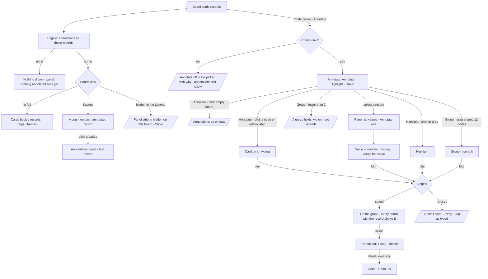

# Annotate the data

What people and the assistant say about the graph's records, kept with the records: a note on a node or a
relationship, on one of its values, around a set of them. Any board that loads the records shows what is on
them.

| | |
|---|---|
| Index | [4.8](../../../README.md#4--explore) · Slice **—** (not scheduled) |
| Module | [Explore](../spec.md) |
| API / CLI / Studio | 🔵 / — / 🔵 |
| Related | [graph-canvas](graph-canvas.md) · [boards](boards.md) · [walkthrough](walkthrough.md) · [selection-and-the-panel](selection-and-the-panel.md) · [the-answer-surface](../../ask/features/the-answer-surface.md) · design canvas *Explorer · Annotate* (<https://claude.ai/artifact/Mqr1mcEde4MN4Hdf5kmK2B>) |

> **As** an analyst, **I want** to note what the data says on the records themselves — a node, a
> relationship, one of its values, a path or a cluster — **so that** whoever loads those records next
> sees it, and a walkthrough can point at it.

## Capabilities

| # | Capability | Notes |
|---|---|---|
| C1 | Annotate a record | A node or a relationship; the card is drawn in the graph beside it, linked by a dashed line, and laid out with the data |
| C2 | Annotate a value | One property of a record; the annotation keeps the value it was written against and says so when the value changes |
| C3 | Highlight | A set of nodes or a path: the nodes ringed, the relationships among them marked |
| C4 | Group | A labelled frame around two or more nodes, recomputed from where they are |
| C5 | Belongs to the graph | Stored by the engine against record ids; any board that loads a record shows its annotations |
| C6 | The Annotations panel | What is on this board, what is elsewhere in the graph (with *Load*), one record's values each annotatable, one annotation's detail |
| C7 | Hide and show | The Legend's *Annotations* section: all · by you · by others · by the assistant · highlights · groups; *In full* or *Badges*; saved with the board |
| C8 | Who | Contributors and up write; every member reads; a person deletes only their own |
| C9 | The assistant annotates | An answer, or *Explain this*, writes annotations into its session with evidence; a person adds what holds to the graph — **slice 2** |
| C10 | Authored walkthrough steps | Steps that show chosen annotations, between the answers — **slice 3** ([walkthrough](walkthrough.md)) |

## Journey

## Seams

| Seam | What the user sees |
|---|---|
| Loading | Records draw first; annotations arrive after, without moving anything |
| A record loaded later | Its annotations appear with it |
| Part of a group or highlight loaded | Drawn around what is here, dashed, *3 of 7 on this board* |
| A record hidden in the Legend | Its annotations hide with it; the panel lists them dimmed |
| A value changed since | *Was 71% when noted* on the card and in the detail |
| A viewer | Every annotation shows; Annotate is off in the picker: *You can view annotations — ask an admin to annotate* |
| Someone else's annotation | Shows their initials; delete is off: *Only Priya Nair can delete it* |
| Save fails | The card keeps its text and says *Couldn't save · Try again* |
| Crowded board | A new card takes the nearest spot clear of every node and card; the next layout run places every card with the data, so none overlaps a node or another card |
| Hidden on the board | Saved with the board; the panel says how many are hidden, with *Show* |
| Present | A walkthrough step shows its own annotations whatever the Legend hides |

## Surfaces

| Surface | Where | Component | Reads / writes |
|---|---|---|---|
| Annotation layer | the board | canvas-ui `AnnotationsProjection` — cards, links, rings and count pills as graph elements, a group's frame on graph's `GroupFramesLayer` under them — and `AnnotationsOverlay` for the editor, the group name and the format bar, over `GraphBoard` | `annotations` prop |
| Annotate tools | the row, in Annotate | canvas-ui `ANNOTATE_TOOLS` (annotate · highlight · group) | `onAnnotationCreate` |
| Format bar | over the selected annotation | canvas-ui `AnnotationFormatBar` | `onAnnotationUpdate` · `onAnnotationDelete` |
| Annotations panel | the rail | canvas-ui `AnnotationsViewPanel` (list · record · detail) | the same callbacks |
| Legend section | the Legend panel | canvas-ui `LegendViewPanel` *Annotations* | `annotationView` · `onAnnotationViewChange` |
| Card, row, author mark | — | the card in the graph: `@invana/graph` `annotationTemplates()`; the panel's row and author mark: `@invana/ui` `AnnotationRow` · `AuthorMark` (`AnnotationCard` kept for off-board surfaces, slice 2) | — |
| Host | Explorer board | Studio `useAnnotations` | `GET/POST/PATCH/DELETE …/annotations`; the hides in the board's `styling.annotations` |

## Engine

| Endpoint | Body / query | Returns |
|---|---|---|
| `GET /api/v1/u/{username}/{graphSlug}/annotations` | `record` (repeatable) · `session` · `scope` = `session` · `graph` (default) · `all` · `limit` · `offset` | `AnnotationListResponse` — `items`, `total` |
| `POST …/annotations` | `AnnotationCreate` | `AnnotationDetail`, 201 |
| `PATCH …/annotations/{id}` | `AnnotationUpdate` | `AnnotationDetail` |
| `DELETE …/annotations/{id}` | — | 204 |

`annotations`

| Column | Type | Notes |
|---|---|---|
| `id` | uuid | |
| `graph_id` | fk graphs, cascade | |
| `kind` | `note` · `value` · `highlight` · `group` | |
| `records` | json | `[{id, kind: node·edge, label}]`, in the order written |
| `prop` | string? | the property a `value` annotation is on |
| `value_then` | json? | the value when written |
| `text` | text | |
| `label` | string | a group's name |
| `color` | `amber` · `blue` · `green` · `red` · `grey` | a token, never a hex |
| `author_kind` | `user` · `assistant` | |
| `created_by_id` | fk users, set null | the person, or the session's owner for the assistant |
| `session_id` | fk sessions, set null | where it was written |
| `message_id` | fk session_messages, set null | the reply that wrote it (assistant) |
| `reach` | `session` · `graph` | |
| `promoted_by_id` | fk users, set null | who added an assistant annotation to the graph |
| `evidence` | json? | `{query, record_count, query_language}` (assistant) |
| `created_at` · `updated_at` | timestamps | |

`annotation_anchors` — one row per record an annotation is on, so *what is on these records* is one indexed lookup

| Column | Type | Notes |
|---|---|---|
| `annotation_id` | fk annotations, cascade | |
| `graph_id` | string | indexed with `record_id` |
| `record_id` | string | the database's element id |

`AnnotationCreate`

| Field | Type | Rule |
|---|---|---|
| `kind` | enum | |
| `records` | `[{id, kind, label}]` | `note` and `value`: exactly one · `highlight`: one or more nodes · `group`: two or more nodes |
| `prop` | string? | required for `value`, refused otherwise |
| `value_then` | any? | |
| `text` | string | required for `note` and `value` |
| `label` | string? | |
| `color` | enum? | default `amber`; `blue` for a group |
| `session_id` | string? | the caller's own session in this graph |

`AnnotationUpdate`: `text?` · `label?` · `color?` · `reach?` (only `session` → `graph`).

| Refusal | Status | When |
|---|---|---|
| `role_required` | 403 | a viewer writes |
| validation | 422 | the record count for the kind, `prop` on a non-value, empty text |
| not found | 404 | another graph's annotation, another person's session, or a session-only annotation from someone else's session — absent, never forbidden |
| permission denied | 403 | changing or deleting another person's annotation |

## Decisions

| # | Decision |
|---|---|
| AN1 | **An annotation is on data.** Every annotation names the records it is about; nothing floats free on the board. Free shapes, arrows and text are not annotations |
| AN2 | **One noun.** *Annotation*, with an author. The kinds — note, value, highlight, group — are the anchor's shape; the product never says *note* or *callout* as a separate thing |
| AN3 | **It belongs to the graph.** Stored by the engine against the records' ids, not on a board. A board shows the annotations of the records it has loaded |
| AN4 | **Stored in the app database, never written to the customer's graph.** Authorship and sessions are app state; a read-only database can be annotated |
| AN5 | **Anchored by the database's element id.** A record deleted or re-created under a new id leaves its annotation listed as *its record was deleted*, with what it said |
| AN6 | **A value annotation keeps the value it was written against.** When the record's value differs, the annotation says *Was X when noted*; it never rewrites itself |
| AN7 | **Reach.** People's annotations reach the graph. The assistant's start in their session and reach the graph when a person adds them (slice 2) |
| AN8 | **Who.** Contributors and up write; every member reads; only the author changes or deletes a person's annotation |
| AN9 | **Hidden is the board's.** The Legend's eyes and *In full / Badges* are saved in the board's `styling.annotations`, so everyone who opens the board sees the same; a viewer's toggles stay theirs and are not saved |
| AN10 | **Colours are tokens.** `amber` `--warning` · `blue` `--primary` · `green` `--success` · `red` `--destructive` · `grey` `--muted-foreground` |
| AN11 | **An annotation is part of the graph.** A card, its link, a highlight's rings and a badge's pill are graph elements, and a group's frame is painted on a layer under the graph; the board draws them from the host's annotations — never data: they are not saved, counted, typed, exported or undone. Layouts place cards like any node, so the layout considers them and an image export carries them. A group is a frame round its records, read off their places every frame; it is not a node, never re-parents them and no layout places it. Hiding annotations removes them, and the records stay where they are |

## Delivery

| Slice | What | Status |
|---|---|---|
| 1 | People's annotations: engine table and routes, the layer, the tools, the Annotations panel, the Legend section, Studio wiring, stories; cards drawn in the graph (AN11) | built — committed as the baseline, then the drawing moved into the graph |
| 2 | The assistant's annotations: session reach, Add to the graph / Dismiss, evidence, gaps, *Explain this*, *From* (this session · + the graph · all sessions), conflicts | not started |
| 3 | Authored walkthrough steps that show chosen annotations | not started — reverses [walkthrough](walkthrough.md) *Not building* rows on editing and reordering steps |

### Drawn, not built yet (slice 1)

| Gap | Why it waits |
|---|---|
| A card placed clear of the board's chrome | a new card avoids nodes and cards, not the row, rail, open panel or dock; it can sit under an open panel until the next layout run |
| *Load* on an annotation elsewhere in the graph | the engine has no load-records-by-id route the board can call; the panel omits *Load* until it does |
| Moving a card by hand that survives a reload | a card can be dragged; its place is not stored with the annotation yet |
| A deleted record listed as *its record was deleted* | the engine does not yet check the graph for the record; such an annotation lists as *elsewhere* |

## Not building

| Item | Why |
|---|---|
| Free shapes, arrows, freehand ink, text on the board | They are about the board, not the data (AN1) |
| Comment threads, replies, mentions | A conversation about data is the chat's |
| Writing annotations into the graph database | AN4 |
| Live co-editing of one annotation | Last save wins |
| Resizing or rotating a group | It is the box around its records |
