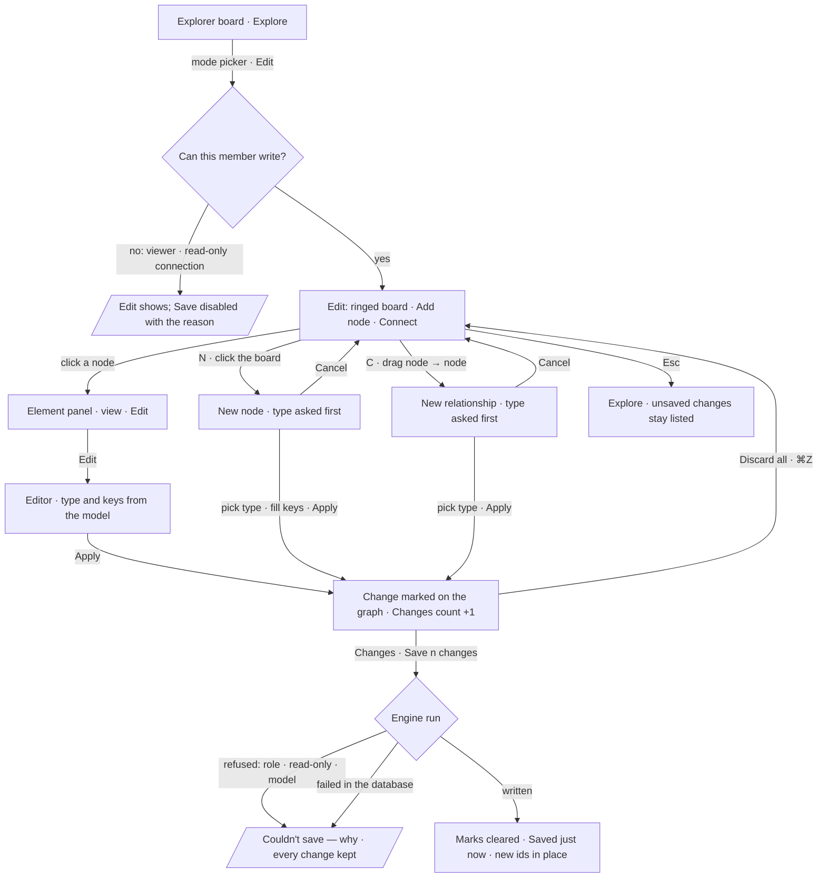

# Edit the graph's data

Nodes and relationships added, changed and deleted on the Explorer's board, against the graph's model,
held on the board until saved, and saved to the database as one run.

| | |
|---|---|
| Index | [4.7](../../../README.md#4--explore) · Slice **—** (not scheduled) |
| Module | [Explore](../spec.md) |
| API / CLI / Studio | 🔵 / — / 🔵 |
| Related | [selection-and-the-panel](selection-and-the-panel.md) · [graph-canvas](graph-canvas.md) · [boards](boards.md) · [model-editor](../../connect-and-model/features/model-editor.md) · Invana Products EX-20 · EX-21 ([explorer.md](../../../../products/explorer.md)) |

> **As** an analyst who can contribute to a graph, **I want** to add, change and delete nodes and
> relationships on the board, with only the types and keys the graph's model has, **so that** a fix
> or an addition reaches the graph without an import, and still fits its schema.

## Capabilities

| # | Capability | Notes |
|---|---|---|
| C1 | Edit mode | The board's mode picker: Explore · Edit. Edit rings the board, adds *Add node* (N) and *Connect* (C), and *Edit* in the Element panel |
| C2 | The Element panel | The clicked node or relationship, read-only, with Focus and — in Edit — Edit in its bar; editing swaps the view for its form in place (EX-21) |
| C3 | Types and keys from the model | The type is picked from the model's types; a type's keys are its rows; *Add property* lists the keys not set yet; each key appears once; changing the type swaps the keys and names the ones dropped |
| C4 | Drawing asks for the type | A dropped node or a drawn relationship opens as *New node* / *New relationship*, its id made up and its type asked first; Cancel takes it off |
| C5 | Unsaved until saved | Added · edited · deleted are marked on the graph and listed in the rail's Changes panel with its count; each change reverts on its own; Discard all; Undo and Redo move it (EX-20) |
| C6 | Save is one run | *Save n changes* sends the board's changes as one batch; the engine checks them against the model, writes them in one transaction where the database allows, and the board marks them saved |
| C7 | Refusals say why | A member without the role, a read-only connection, a database that cannot write, a change the model refuses — each says so and keeps every change |

## Journey

## Seams

| Seam | What the user sees |
|---|---|
| The model is loading | Edit is available; the editor's Type reads *Loading the model…* and Apply waits |
| The graph has no published model | Edit shows no editor: *Publish a model to edit this graph's data*, with *Open the Modeller* |
| A type the model no longer has (an old element) | Its keys stay, tagged *not in the model*; the type can be changed to one the model has |
| A key the model no longer has | Kept on the element, tagged *not in the model*; no new key outside the model can be added |
| The model changes while editing | The next editor opened reads the new version; an open editor keeps the keys it opened with |
| A viewer (no contributor role) | Edit mode shows; Save is disabled — *You can change this board, not the graph* — and the changes stay on the board |
| A read-only connection | As a viewer, with the connection's reason |
| A database with no data writer (ArcadeDB, TinkerGraph today) | Save refused — *Saving to this database isn't supported yet*; changes kept |
| Saving | Rows dim, *Saving…*, the list cannot change until the run settles |
| A save fails | *Couldn't save* with the run's reason and *Try again*; nothing is half-saved where the database runs transactions |
| Reload with unsaved changes | They are lost; the board warns before leaving while any are unsaved |
| Expand neighbours in Edit | What the engine brings in is never an unsaved change |
| Two members edit the same element | Last save wins; the Changes panel does not merge |

## Surfaces

| Surface | Where | Component | Reads / writes |
|---|---|---|---|
| Mode picker | the board's top-left row | canvas-react `BoardModes`, canvas-ui `BoardModePicker` | — |
| Edit tools | the row, in Edit | canvas-react `CreateNodeBehaviour` · `DrawEdgeBehaviour` | the graph store |
| Element panel | the rail, top-right | canvas-ui `ElementViewPanel` with `schema`, `strictSchema` | the active model version |
| Changes panel | the rail, with its count | canvas-ui `ChangesViewPanel` over `UnsavedChangesBehaviour` | `unsaved.save` → the save route |
| The model, as the panel reads it | host | `elementSchemaOf(version)` | `GET …/schemas/active-version` (`useActiveVersionQuery`) |
| Save | host registers `unsaved.save` | `useSaveDataEdits` | `POST /api/v1/u/{username}/{graphSlug}/data-edits` |

## Engine

**The route opens a run.** Nothing writes outside the runtime ([orchestration](../../../orchestration.md) §4.1a):
the route checks the role and the batch against the model, then opens a run of the flow
`data-edit@1`, whose one task `apply_data_edits` writes through the connector's data writer.

| Endpoint | Body | Returns |
|---|---|---|
| `POST /api/v1/u/{username}/{graphSlug}/data-edits` | `DataEditBatch` | `DataEditResult` once the run settles, or 422 / 403 / 409 with the refusal |

`DataEditBatch`

| Field | Type | Notes |
|---|---|---|
| `model_version_id` | string | the version the editor read; a batch against an older version is checked against the active one |
| `edits` | `DataEdit[]` | applied in order |

`DataEdit` — one per change, tagged by `op`

| `op` | Fields | Notes |
|---|---|---|
| `add_node` | `ref`, `type`, `properties` | `ref` is the board's id; returned mapped to the database id |
| `add_edge` | `ref`, `type`, `source`, `target`, `properties` | `source` / `target` are database ids or `ref`s of nodes added earlier in the batch |
| `update_node` | `id`, `type?`, `set`, `unset` | a new `type` relabels the node; `unset` removes keys |
| `update_edge` | `id`, `set`, `unset` | a relationship's type does not change: delete and draw again |
| `delete_node` | `id` | takes its relationships with it |
| `delete_edge` | `id` | |

`DataEditResult`

| Field | Type | Notes |
|---|---|---|
| `run_id` | string | the `data-edit@1` run |
| `ids` | `{ ref: id }` | each added element's database id |
| `applied` | int | edits written |

| Refusal | Status | Code |
|---|---|---|
| Not a contributor | 403 | `role_required` |
| Read-only connection | 409 | `read_only_graph` |
| No published model | 409 | `no_model` |
| A type or key the model does not have | 422 | `not_in_model`, naming the edit and the key |
| The same key twice in one edit | 422 | `duplicate_key` |
| A database with no data writer | 409 | `writes_unsupported` |
| The database refused | 502 | `write_failed`, with the database's message |

## Decisions

| # | Decision |
|---|---|
| DE1 | `data` is a third kind that writes, and only in Edit mode: a node or a relationship is placed by a gesture, every field is a form ([SP2](selection-and-the-panel.md#decisions)) |
| DE2 | Edits stage on the board as unsaved changes — the board's history since the last save — and reach the database only on Save, as one batch |
| DE3 | Save is a run (`data-edit@1`), never a direct write from a route; the route only checks and opens it |
| DE4 | The model is the schema: the engine refuses a type or a key the active model version does not have, whatever the client sent. The client's strictness is a courtesy, not the check |
| DE5 | A key appears once per element, in the editor and in the batch |
| DE6 | Writing needs the **contributor** role; a read-only connection refuses as loads do |
| DE7 | The panel reads the model from the active version's types and their effective property keys, with each key's data type — nothing about the model is written into Studio |
| DE8 | Added elements carry the board's id until saved; the result maps each to its database id and the board takes it |
| DE9 | A blank value is not saved; removing a row unsets the key |
| DE10 | Cypher databases write the batch in one transaction; a Gremlin database writes edit by edit and stops at the first refusal, reporting what was applied |

## Not building

| Item | Why |
|---|---|
| Editing in Explore mode | Explore looks and asks; writing is a mode you enter on purpose |
| Merging two members' edits | Single-editor boards with last-save-wins are honest at this scale ([spec](../spec.md) Not building) |
| Bulk edit of a selection | One element at a time in the panel; bulk changes are an import |
| Keys outside the model in Studio | The model is the schema (DE4); adding a key is the Modeller's job |
| Editing data on any other board kind | `model` and `plan` write their own things; the rest stay read-only |
| Undo after Save | A saved change is in the database; reverting it is another edit |
