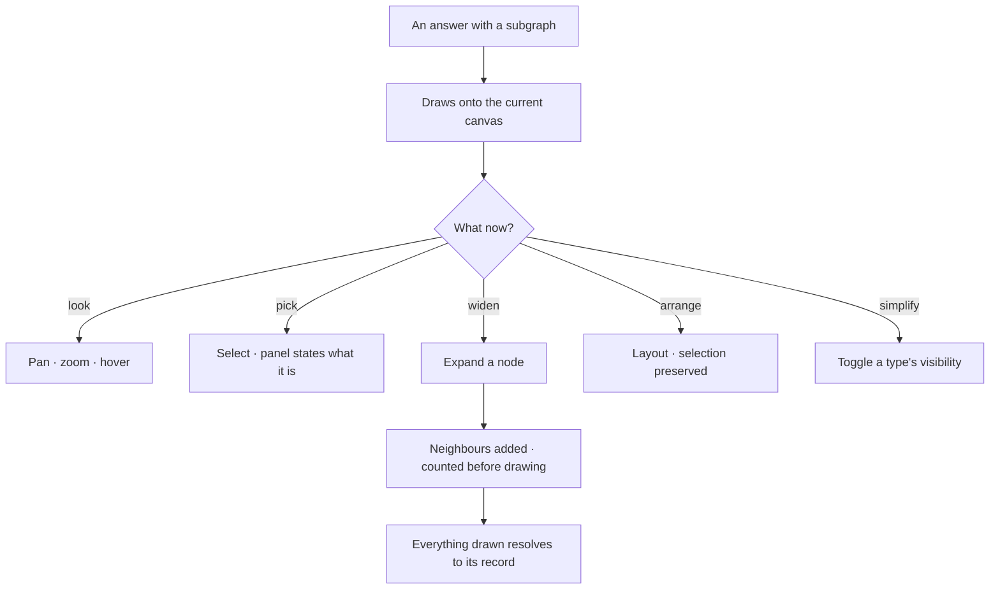
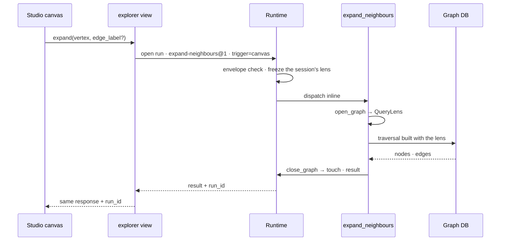

# Graph canvas

The drawing surface: pan, zoom, select, hover, style — at a hundred thousand nodes without the browser
giving up.

| | |
|---|---|
| Index | [4.1](../../../README.md#4--explore) · Slice **S9b** |
| Module | [Explore](../spec.md) |
| API / CLI / Studio | ✅ / — / ✅ |
| Related | [boards](boards.md) · [selection-and-the-panel](selection-and-the-panel.md) |

> **As** someone looking at a result, **I want** to move around it and pick things out of it, **so
> that** I am reading a structure instead of a list of ids.

## Capabilities

| # | Capability | Notes |
|---|---|---|
| C1 | Pan · zoom · fit | Trackpad, wheel, touch; one-finger pan on touch |
| C2 | Select — click, shift-click, brush | One selection concept, whatever the canvas kind |
| C3 | Hover reveals | Label and key properties without a click |
| C4 | Colour by type | Derived from the model, consistent across canvases |
| C5 | Layers toggle | Background · graph · minimap, per canvas; the minimap also has its own toolbar toggle (GC23) |
| C6 | Layouts | Four presets — **Network · Tree ↓ · Flow → · Radial** — each with its options, applied without losing what is selected (GC22) |
| C7 | Expand a node | Pull in its neighbours, added to what is drawn — never replacing it |
| C8 | Large results stay usable | Counted first, drawn progressively, capped with the cap stated |

## Journey

## Seams

| Seam | What the user sees |
|---|---|
| Expanding a very connected node | The count first, and the option to cap or filter by type |
| A node no longer in the graph | Kept, marked missing — never silently dropped |
| Nothing selected | The panel says what a selection would show |
| WebGPU unavailable | Falls back to WebGL, and says so once |
| A huge answer | "24,477 nodes" before the draw, with a cap the user can raise |
| A dense result, zoomed out | Edges drawn faint, about 1 in 10 drawn, and the footer says *About 1 in 10 relationships drawn · zoom in for all*; zooming in draws them all |
| A large result still laying out | The footer counts the solve (*Laying out 2159 nodes · 80 / 149*); past 400 ms a toast says the graph appears when it settles, with *Cancel* |
| A very large board | Tree ↓, Flow → and Radial are disabled past 3,000 nodes, the cap and the board's count on each card; Network still runs |

## Surfaces

| Surface | Shape |
|---|---|
| Canvas | The drawing, and one fixed place for each piece of chrome over it (GC24) |
| Board | canvas-ui `GraphBoard`, through `ExplorerCanvas` (`@invana-studio/explorer`) — GC27 |
| Row | Top-left: the mode picker, then the mode's tools (GC21) — `BOARD_ROW_ITEMS` · `BOARD_VIEW_ROW_ITEMS` |
| Layout | Right-click the board › *Layout…* opens the Layout card at the pointer: four preset cards, then that preset's options, *Reset to …* and *Run again* (GC22) — `BoardLayoutPopover` |
| View dock | Bottom-left: the minimap over − · zoom ▾ · + · fit · lock (GC23) — `BOARD_DOCK_ITEMS` |
| Rail | Top-right: Legend · Styling · History · Versions · Element · Changes · Export, one floating panel at a time (GC24) — `defaultBoardPanels` plus Studio's *Versions* |
| Canvas | [Invana Products](https://claude.ai/artifact/HcPfkMUYUtEbRaZFaYnHtg) › Explorer — EX-16 (`explorer.layout*`) and the chrome on every Explorer board |
| Layers | A card over the canvas, opened from the page strip ([boards.md](boards.md) CV6): layers, then node/edge types with counts and visibility |
| Status strip | What is drawn: types, counts, the canvas name |

## Engine

| Thing | Shape |
|---|---|
| Expansion | `POST …/explorer/expand/*` — a launcher for the `expand-neighbours@1` run (GC6 · GC12); neighbours of a node, filtered by type, counted first |
| Canvas elements | what is drawn, persisted per canvas |
| Rendering | one package; Studio never touches the renderer directly |

### An expansion, as a run

## Decisions

| # | Decision |
|---|---|
| GC1 | Drawing adds to the canvas; it never replaces what is there. |
| GC2 | Selection is one concept across every canvas kind. |
| GC3 | Expansion states the count before it draws. |
| GC4 | Colour by type comes from the model, not from per-node styling. Every node **and relationship** type has a default colour — the `--color-data-N` slot its name hashes to (`colorByString` in `@invana/styling/color`) — which an explicit per-type colour overrides. The canvas and the Types panel's dots read the same function, so the panel always matches the drawing. |
| GC5 | A missing element is shown as missing. |
| GC6 | **An expansion is a TaskRun.** Expanding a node dispatches `expand_neighbours` (bound `graph_read`) through the interpreter like every other read — not a direct query from the canvas ([orchestration § 4.1a](../../../orchestration.md#41a-nothing-executes-outside-the-runtime)). What a person saw, and therefore reasoned from, is recorded; a Graph whose reads are invisible cannot explain an answer that came out of one. |
| GC7 | **Interactive runs do not flood the journal.** An expansion carries `trigger = canvas`, is filtered out of Runs by default, and has its own retention ([§ 4.1b](../../../orchestration.md#41b-interactive-runs)). The count-before-it-draws promise of GC3 is the run's own estimate step, so the ceiling that refuses a 40,000-node expansion is the envelope's, not a number in the UI. |
| GC8 | **A force layout does not animate its settle; a switch between presets glides.** The Network preset runs with `animate: false`: the graph is drawn once, at its settled positions, on every query and expansion — a settle-animation repaints the whole graph per tick and moves nodes out from under the cursor. Switching presets is one move from old positions to new, so under 2,000 nodes the nodes glide there in 400 ms or less; a larger board snaps. |
| GC9 | **Expand is one callable.** Expand-all, by edge type and by node type are `expand_neighbours` with optional `edge_label` / `neighbor_label` — same bound, same failure mode, so one entry ([orchestration § 0.6](../../../orchestration.md#06-the-catalogue--what-a-plan-may-name): cut at the bound and the failure mode). It ships as the builtin plan `expand-neighbours@1`, read-only in the library ([LB32](../../workflows/features/the-library.md)). |
| GC10 | **An expansion honours all three grains of the lens.** A denied edge or node type is never traversed, an excluded property is never returned, and the slice predicate is composed into the traversal — nothing is filtered after the query. The lens reaches the connector as **structured input to the traversal builder** ([CC22](../../graph-connectors/features/the-connector-contract.md)), which is why an expansion is governed on Gremlin too. |
| GC11 | **An expansion runs under the canvas session's lens** — its world, its agent and the Graph's guardrails — the same one an ask on that canvas runs under, so the two can never disagree about what is in view. Every expand request carries the `lens_id` of the world the canvas has picked, exactly as an ask's `SendMessage` does; the session's agent composes its own world into the lens, but the agent is **not** the run's performer — `agent_id` stays null, so an expansion spends no agent budget, never waits on the agent's `max_concurrent_runs`, and is not listed among the runs the agent performed. With no session, the lens is the picked world and the Graph's guardrails. |
| GC12 | **The canvas awaits its run, and the turn is the run.** The expansion is dispatched inline ([RP31](../../platform/features/runtime.md)) and the response keeps its shape, plus `run_id`. When the request names a session, the turn — the user row and the assistant reply — is written **before** the run opens, its step is queued under that reply and the reply carries `run_id`, so the session's Tasks tab lists it like any ask; the reply is settled from the run's output when it ends, and an expansion that returned nothing is still a turn, because it still ran. The Runs journal keeps it off by default (GC7). A run the Graph's ceiling queues answers `409 expand_queued` with its `run_id` rather than waiting. |
| GC13 | **Outside the lens is said, never shown as empty.** The fine-tune menu offers only the edge and node types the lens allows, and an expansion that reaches a denied type is refused naming the rule — *this world has no Publisher* — never answered with zero neighbours. |
| GC14 | **A canvas holds only what the current world returns.** The world is enforced at the read, and the canvas never learns what it left out — no *excluded* state, no count of what is hidden. Reopening a canvas runs `resolve_elements` (`graph_read`, trigger `system`) under the picked world: it answers **present** (in the graph and in this world) and **missing** (gone from the graph, kept and marked per GC5). An element the world excludes is in neither list and is **not drawn**; clearing the world brings it back, and the saved snapshot is never rewritten. The check matches on the element id and is built by the connector for either dialect, never a hard-coded Cypher query. |
| GC15 | **A third-party node is badged on the canvas, drawn or kept.** The badge reads from the element's provenance — the drawn object before **Keep**, `_inv_origin = "third_party"` after — so it is there on reload and on every board the element reaches, and its tooltip carries the reference — the link, for the internet ([BG7](../../ask/features/beyond-the-graph.md#decisions)). |
| GC16 | **A type's styling is stored as the patch the Styling card edits.** `styling.nodeTypes.<type>` holds `color` · `size` · `labelKey`, and `edgeTypes.<type>` holds `color` · `width`. `labelKey` is a root-relative dot path — `id`, `type`, or `data.<property>` — so a label can be a node's own id or type as well as a property; unset is the default label. Studio paints it and repaints on every edit; the card only edits, so a board keeps its styling while the card is closed. |
| GC17 | **No two nodes overlap, however large the result.** The Explorer's force layout keeps a hard floor between nodes — each node's drawn radius plus 22 px for its bottom label — and runs ~150 iterations (`alphaDecay 0.035`, `alphaMin 0.005`), enough for that floor to hold across ~2,000 nodes. Repulsion is `-600` capped at 600 px and edges rest at 150 px, so a hub's fan opens out while distant clusters stay pulled together by their edges. |
| GC18 | **Size by connections is on by default, toggled from the Styling panel's bar.** `NodeCentralityBehaviour` sizes each node by its connection count on a square-root curve, radius 8 to 28, so a hub reads as a hub. It is derived on every draw, never saved, and it holds for the visit, like *Tools*. Flipping it re-runs the layout, because spacing follows size (GC17). While it is on, it wins over a type's `size` (GC16). |
| GC19 | **A layout that is still solving says so.** The solve runs off-screen and reports its progress every 10 iterations. The footer's message line counts it on every run (*Laying out 2159 nodes · 80 / 149*), then says *Graph ready*. A run still going after 400 ms also raises one loading toast — *Arranging 2159 nodes · The graph appears when the layout settles* — with *Cancel*, which stops the solve and draws the nodes where they are. The toast carries no count, so one number moves in one place, and a quick expansion never flashes one. |
| GC20 | **A dense result is drawn thinner, never cut.** Past 200 relationships, edges fade to `√(200 / n)` opacity, never below 0.15, so a hub's fan stays readable instead of a solid block of colour; a hovered, selected or highlighted edge is drawn solid. From 500 relationships, while the zoom is below 50%, an even sample of about 1 in 10 is drawn — every hub keeps its share, unlike ranking by connections, which would keep only the largest hub's — and the footer's view zone says *About 1 in 10 relationships drawn · zoom in for all* for as long as it holds, so a missing line is never read as a missing relationship (GC5). The thresholds live in one module the canvas and the footer both read. Spacing does not fix a dense overview: fitting to screen scales it away (GC17). |
| GC21 | **The row is the mode, then the mode's tools.** Top-left, one hairline row: the mode picker (Explore · Edit · Annotate · Focus · Present), then *Select ▾* (Select · Lasso · Box); in Edit *Add node* · *Connect*; in Annotate *Annotate · Highlight · Group* ([4.8](annotations.md)); in Edit and Annotate *Undo · Redo · Redraw*. Focus shows the picker alone and fades it while the pointer rests; Present shows the picker and `◀ n/N ▶` ([WT4](walkthrough.md#decisions)). Every other verb — layout, fit, hide, focus, expand, export — is on the right-click menus and ⌘K ([explorer.md](../../../../products/explorer.md)). |
| GC22 | **A layout is a preset: layout, edges, labels and spacing switched together.** The user picks a card, not an algorithm, and the board changes shape as one. Colour is never part of a preset — that is the theme, and colour by type (GC4) is the same on every layout.  **Network** — d3 force (GC17), straight edges, labels below. **Tree ↓** — ELK `layered`, top to bottom, orthogonal edges, labels below. **Flow →** — ELK `layered`, left to right, curved edges routed by ELK (`SPLINES`, drawn as ELK's own curve — its points are the curve's control points; with no route, a horizontal S-curve), labels right of the node. **Radial** — ELK `radial` around the centre, curved outward edges, labels outward.  **Options** sit under the cards and belong to the active preset: *Direction* (↓ → ← ↑; Tree and Flow), *Edges* (Straight · Curved · Orthogonal; Curved on a top-to-bottom layout is a vertical S-curve), *Spacing* (Compact · Comfortable · Roomy), *Root* (Automatic · Selection; Tree and Flow) or *Centre* (Radial). Automatic root is the drawn nodes with no incoming relationship, else the selection, else the most-connected node; ELK breaks a cycle by reversing one of its edges. A changed option is stored over the preset and *Reset to …* appears. The board keeps `layout: { preset, overrides }` (CV4). Switching keeps the selection (C6) and glides (GC8). The three ELK presets are disabled past **3,000 nodes**, each card saying *Draws up to 3,000 nodes · this board has 24,477*; ELK reports no progress, so the footer reads *Laying out N nodes · Flow →* with no count. |
| GC23 | **The bottom-left is the view's dock: the minimap over its bar, one width.** The minimap (200 × 116) sits over a 32 px bar — − · the zoom field ▾ · + · fit · lock — 12 px from the board's edge. It shows in the work modes only; *Minimap* on the board menu toggles the same `minimap` layer the Layers card lists (C5). |
| GC24 | **Each piece of chrome has one place, and the persistent ones never share it.** Top-left: the row (GC21). Top-right: the rail and its one floating panel — Legend (with its *Annotations* section), Styling, History, Versions, Element, Annotations ([4.8](annotations.md)), Changes (Edit, or any mode while something is unsaved), Export. A click on an element opens Element. Bottom-left: the dock (GC23). Bottom-centre: the walkthrough presenter, only while presenting ([WT4](walkthrough.md#decisions)). The rail and the dock show only in the work modes. |
| GC25 | **The board's layout holds across answers.** Every draw — a new answer, an expansion, a reopened board — runs the board's preset with its options, never a fixed force layout. Studio applies presets through the canvas's own preset act, so a switch is one undo step and a walkthrough step can replay it. A layout that ran outside it would be lost on the next query and invisible to history. |
| GC26 | **A route is the layout's, not the edge's.** The bends a layout draws (ELK's orthogonal elbows, its splines) live with the layout run and are cleared when another layout runs; they are never saved on the edge. A board saved with routes on its edges has them dropped when it opens, so switching it to Network shows straight edges. |
| GC27 | **The board is canvas's; Studio supplies its seams.** `GraphBoard` (canvas-ui) is the board — modes, row, dock, menus, rail, layout, editing, its own conduct (a mode change puts tools down, a click opens Element, leaving with unsaved changes asks). `ExplorerCanvas` passes what only Studio has: the design-kit type palette (GC4), the theme tokens, the query run's telemetry spans and the slow-layout toast as callbacks, *Expand…* as a node-menu entry, the model, provenance, *Ask about* and the save as Element and Changes panel options, and *Versions* as its own panel. A gap in the board is closed in canvas, never in Studio ([refactor-plan §2.6](../../../building-studio/refactor-plan.md)). |

## Not building

| Not building | Because |
|---|---|
| Per-node colour and size saved on the element | colour-by-type plus per-canvas settings covers it |
| Physics tuning controls | two layouts that work beat ten knobs that do not |
| Editing data from the canvas | data arrives by import; the canvas reads |
| A callable per expand variant | GC9 — one bound, one failure mode, one entry |
| Filtering an expansion after the query | GC10 — a display filter wearing a bound's name |
| An *excluded* mark for elements outside the world | GC14 — the canvas is never told what the world hides; it is simply not drawn |
| A preset that changes colour | colour is the theme's; a type keeps its colour on every layout (GC4 · GC22) |
| User-authored presets | four presets with options cover the shapes a graph has; saving a fifth is a feature nobody has asked for yet |
| Raw ELK properties in the UI | options are named for what they do; `layoutOptions` stays the canvas package's escape hatch |
| A vertical toolbar | GC21 — it takes the board's left edge, where labels need room |
