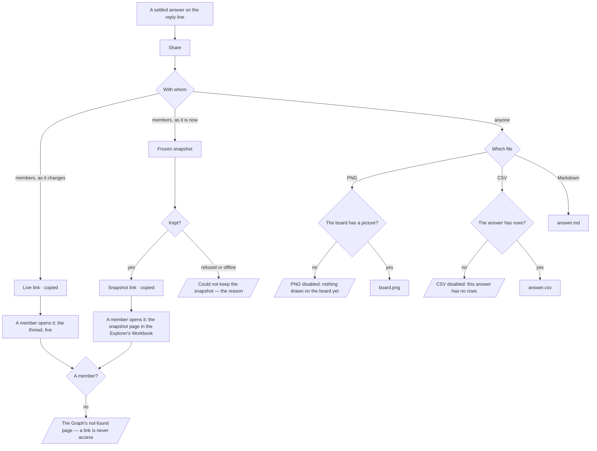

# Share an answer

An answer is shared with the Graph's members as a live link or a frozen snapshot, and with anyone else
as a file — never as access.

| | |
|---|---|
| Index | [4.5](../../../README.md#4--explore) · Slice **C09** (EX-15) |
| Module | [Explore](../spec.md) |
| API / CLI / Studio | ✅ / 🔵 / ✅ |
| Related | [boards](boards.md) · [the-console](the-console.md) · [the-answer-surface](../../ask/features/the-answer-surface.md) · [roles](../../identity-and-access/features/roles.md) · products: [explorer.md](../../../../products/explorer.md) EX-15 |

> **As** an analyst, **I want** to share an answer as a live link or a frozen snapshot, or export it,
> **so that** others see what I found, with its citations.

## Capabilities

| # | Capability | Notes |
|---|---|---|
| C1 | Live link | The thread's own path — the same board and chat, as they are when it is opened |
| C2 | Frozen snapshot | The answer as it stands now — the board's records, the answer, its citations, the dataset versions — kept and never re-read |
| C3 | PNG | The board as last drawn |
| C4 | CSV | The answer's rows — what the console holds for it |
| C5 | Markdown | The question, the answer, its rows, its citations, the world and the data, in one file |
| C6 | Members only | Both links open for a member of the Graph; anyone else gets a file |

## Journey

## Seams

| Seam | What the user sees |
|---|---|
| Waiting for the snapshot to be kept | *Copy snapshot link* reads *Keeping…* and is disabled; the dialog stays open |
| The answer is still running, failed or was stopped | No *Share* on the reply — there is nothing settled to share |
| The answer drew no records | The snapshot keeps the answer and says *No records*; CSV is disabled with its reason |
| Nothing drawn on the board yet | PNG is disabled with its reason; the snapshot still keeps the records |
| A viewer | Shares like any member: keeping a report is an `ask`-area write, which every role holds ([roles](../../identity-and-access/features/roles.md)). A refusal the engine does return is shown in the dialog in its own words |
| A non-member opens either link | The Graph's not-found page, like any other path in it |
| The run's records are pruned later | The snapshot is unchanged — it holds the document, not a pointer to the run |
| Reload after sharing | Nothing to restore: the links are copied, the snapshot is in the run's *Reports* |

## Surfaces

| Surface | Shape |
|---|---|
| Reply line | *Share* beside *Add to a project*, on a settled answer with a run — the assistant's `useShareAnswer` slot, filled by the action `explorer.shareAnswer` |
| Share dialog | `@invana-studio/explorer` `share/ShareAnswerDialog` — *With members*: Live link · Frozen snapshot, and what a snapshot holds; *Export*: PNG · CSV · Markdown; the note that outside people get a file; Cancel · Copy link |
| Snapshot page | `/u/:user/:graph/explorer?page=run:<runId>@<versionId>` — the Workbook's frozen-report page; listed under the run board's *Reports* |
| CLI | `invana views list` · `export <view> --format png\|csv\|md` — not built (🔵) |

## Engine

No new route, table or column. The snapshot is a report on the answer's run.

| Route | Used for |
|---|---|
| `POST …/boards/run/{runId}/versions` `{cause: report, label, snapshot, banner?, message_id}` | Keep the snapshot; create-or-get of the run's board happens server-side |
| `GET …/boards/run/{runId}/versions/{versionId}` | Open it — the frozen-report page |
| `GET …/runs/{runId}/emissions` | The answer's records, read once when the dialog opens |
| `GET …/dataset-bindings` | The dataset versions bound when the snapshot is taken |
| `GET …/boards?…` · `…/boards/{id}/banner` | The thread's board and its last picture, for PNG and the snapshot's thumbnail |

| Snapshot document (`BoardSpec`) | Holds |
|---|---|
| Header | The question; chips: *Snapshot*, the world as frozen; the time it was taken |
| `narrative` | The answer's sentence |
| One panel per emission | `table` (rows) · `metric` · `bars` (a chart's series) · `table` titled *Board* (a subgraph's nodes — name, type, id — with the node and edge counts) · `narrative` (prose) · `text` (an empty answer's statement) |
| `citations` | One source per emission: its query language, record count |
| `list` | The dataset versions bound when it was taken, `publisher/name@v` |

## Decisions

| # | Decision |
|---|---|
| SA1 | **Share sits on the reply line, beside *Add to a project*,** on a settled answer with a run — the same condition as keeping it. The assistant owns the button; the dialog is the Explorer's, reached through the action registry (`explorer.shareAnswer`), so the assistant imports no product. |
| SA2 | **The live link is the thread's own path** — `/u/:user/:graph/explorer/:session`, the address a thread already has. Sharing it writes nothing. |
| SA3 | **A snapshot is a report on the answer's run.** It is a `board_versions` row of the run's declared board (`run:<id>`), cause `report`, label `Snapshot — <question>`, `message_id` the reply. The document is composed in the browser from what the member is looking at and stored whole; it is never re-read against the run. No new engine kind, route or table. |
| SA4 | **The snapshot link opens the frozen-report page in the Explorer** — `/u/:user/:graph/explorer?page=run:<runId>@<versionId>`. The path names no thread: a thread in the path opens its own board and takes the focus from the snapshot. The run board's *Reports* lists it with every other kept reading. Its trail is *Graph › Sessions › <question>*, the question read off the report's title. |
| SA5 | **The snapshot keeps the board as its records, not as a picture.** The answer's subgraph is a *Board* table of its nodes — name, type, id — with the node and edge counts, readable at any size and in either theme; it becomes a drawn `subgraph` panel once the kit renders that block. The version also carries the board's last picture as its thumbnail. |
| SA6 | **PNG is the board as last drawn** — the board's banner, the picture Studio captures after every change. Disabled, with its reason, while the board has none. |
| SA7 | **CSV is the answer's rows**: every table emission's rows, else the subgraph's nodes (`id`, `label`, then their properties), else the chart's series and the metric as `label`, `value` — the records the Markdown export writes. Disabled, with its reason, only when the answer has none of these. |
| SA8 | **Markdown is built in the browser**: the question as the heading, the answer, each emission (tables as Markdown tables, capped at 200 rows with the rest counted), the queries as citations, the world, the dataset versions, the run and when it was shared. |
| SA9 | **An export carries only what the member already sees.** The rows are the run's, read inside its frozen lens, so the guardrails bounded them when the run read them; an export never reads the graph again. |
| SA10 | **The dataset versions are the Graph's bindings when the snapshot is taken.** A run does not record which dataset versions it read; the snapshot says *bound when this was taken*, not *read by this answer*. |
| SA11 | **A link is never access.** There is no public link; both open only for members, and a non-member gets the Graph's not-found page. Outside people get a file. |
| SA12 | **When a snapshot was taken reads in the reader's own time**, in the app's one short form (`Oct 2, 9:29 PM`) — the same form the re-run dialog uses for a run. Only the Markdown export says UTC, because the file travels outside the Graph. |

## Not building

| Not building | Because |
|---|---|
| A public or anonymous link | membership is the access model ([boards](boards.md) Not building) |
| A snapshot that refreshes | a frozen snapshot that changes is a live link |
| Sharing into Slack, email or a channel | delivery is notifications' ([10.7](../../operate/features/notifications.md)); a link can be pasted anywhere |
| A per-snapshot member list | a snapshot is as private as the Graph — or the project — it is in |
| PDF export | Markdown and the browser's print cover it |
| Export from the CLI | `invana views export` waits for saved views in the engine |
