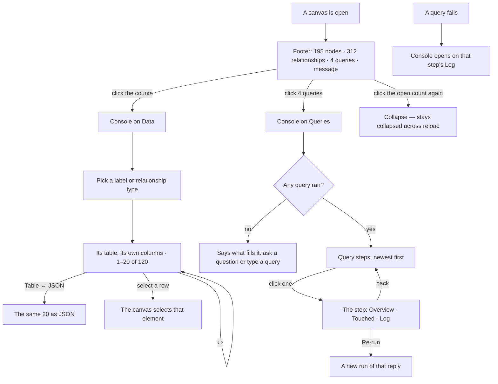

# The console

What is drawn, and the queries that drew it. The canvas holds records that queries put there; the
console is where both are readable without leaving the canvas.

| | |
|---|---|
| Index | [4.4](../../../README.md#4--explore) · Slice **S12f** |
| Module | [Explore](../spec.md) |
| API / CLI / Studio | ✅ / — / ✅ |
| Related | [graph-canvas](graph-canvas.md) · [selection-and-the-panel](selection-and-the-panel.md) · [the-answer-surface](../../ask/features/the-answer-surface.md) · [write-queries](../../ask/features/write-queries.md) · [see-what-ran](../../operate/features/see-what-ran.md) |

> **As** someone exploring a Graph, **I want** the data on the canvas and every query this session
> ran, **so that** I can read the rows and check what ran without losing the picture.

## Capabilities

| # | Capability | Notes |
|---|---|---|
| C1 | Data | Everything on the canvas, one table per node label and per relationship type |
| C2 | Table or JSON | The same page of records, as a table or as the JSON they arrived in |
| C3 | Paged | 20 records a page, with an inline pager; the count is stated in full |
| C4 | Queries | Every query step this session ran, newest first |
| C5 | A query's detail | The step as the run page shows it — Overview · Touched · Log, its input, output and time — inside the console |
| C6 | Opened from the footer | The footer's counts are the console's toggles; there is no other button |
| C7 | It spans the canvas only | The left panel and the chat stay full height |
| C8 | It collapses, and stays collapsed | Its own param, so opening it never costs the left panel or the right side ([E8](../spec.md)) |
| C9 | It follows the canvas tab | Switching canvas switches what Data holds; Queries is the session's |
| C10 | Re-run | Runs a query step again, as a new run of the reply that ran it |

## Journey

## Seams

| Seam | What the user sees |
|---|---|
| Nothing on the canvas | The footer reads `0 nodes · 0 relationships`; Data names what would fill it, not an empty grid |
| Nothing has run | `0 queries`; Queries says to ask a question or type a query |
| A query returned no rows | Its row reads `0 rows`, and its detail still shows the query. Nothing found is a fact, never a failure |
| A query failed | Its row carries the failed mark and the footer's `queries` a dot; the console opens on that step's Log |
| A query still running | Its row is live — running, with its elapsed time; Data's counts are provisional and marked as such |
| Many labels | The label list scrolls; each label states its count, so the largest is visible without opening it |
| A label whose records differ in properties | Its table's columns are the union of that label's properties; a missing value is an empty cell |
| The canvas was restored from a version | Data holds what was restored; Queries holds the session's queries, which did not draw it, and says the canvas was restored |
| Reload | Which tab, label, page and step are open survives; the rows come back from the canvas and the runs, never a re-run |
| Console open, no canvas | The console closes with the canvas |
| The assistant is off | Queries still lists the typed queries; Data is unchanged |

## Surfaces

| Surface | Shape |
|---|---|
| Region | `AppLayoutV2` `bottomSection`, `bottomSpan: "main"` — under the canvas, beside nothing |
| Toggle | The footer's left zone: `195 nodes · 312 relationships` opens Data, `4 queries` opens Queries. Each is a link-styled `Button` (`variant="link"`); the open one reads as pressed, and a second click collapses |
| Tabs | `TabbedPanel` — Data · Queries; `headerActions` hold Collapse |
| Data · labels | A list down the console's left, nodes then relationships: label, count. Selecting one fills the table |
| Data · table | `Table` of the selected label, its own columns, 20 rows. `headerContent` holds Table/JSON (`SegmentedControl`) and the pager (`1–20 of 120 ‹ ›`). A cell is capped and truncated, with the whole value as its hover. A row selects its element on the canvas |
| Data · JSON | `TypographyPre` of the same page |
| Queries · list | One row per query step: status glyph · the query, one line · language · when · duration · rows · the question that ran it. Newest first |
| Queries · detail | The run page's step body (`operate.runs.detail.step.*`) — Overview · Touched · Log — fitted to the console, with *All queries* back and Re-run. Re-run is disabled while a run is in flight |
| Param | One value: `?console=data`, `data:<node\|relationship>:<label>:<page>`, `queries`, `queries:<reply id>`. Absent is collapsed. One param, so it never collides with the Workbook's `?page=` or a run page's `&step=`; independent of `?panel=` and `?right=`, written through `useUpdateSearchParams` (`@invana-studio/core`) |
| Code | `studio/packages/assistant/src/console/` — `ConsolePanel`, `useConsoleParam`, `consoleRecords`. The footer's counts and message line are `ConsoleCounts` · `MessageLine` · `ViewLine` in `@invana-studio/explorer`; a query's detail is `QueryStepBoard` in `@invana-studio/shell`, which composes the run page's `stepBoardSpec` |

## Engine

| Thing | Shape |
|---|---|
| Data | The canvas's own records — client-side, no route |
| Queries | One per reply that ran a query: its run's `execute_graph_query` step, or the step that failed before it — read from the replies the session already holds; no route |
| Step detail | The run's trace, through the route the run page reads ([see-what-ran](../../operate/features/see-what-ran.md)) — the same record, not a copy |
| Persistence | Client-side, in the URL. Neither tab is a stored artefact |

## Decisions

| # | Decision |
|---|---|
| CO1 | The console spans the **canvas only**. The panel and the chat describe the selection and the conversation; the console describes the draw, and a region that changes neither must not shorten both. |
| CO2 | **Read-only.** A second editable query surface would be a second place a query can be written, and the two would disagree about which one ran. |
| CO3 | A **third axis, a third param**. `?console=` moves independently of `?panel=` and `?right=`, for the reason E8 gives. |
| CO4 | **The footer is the toggle.** Its counts are what the console opens on, so the count and its rows are one thing; no strip button, no second control. |
| CO5 | Selecting a row **selects on the canvas** — the same selection object ([E3](../spec.md)); a row and a drawn node are two views of one record. |
| CO6 | **Data is the whole canvas**, not the latest reply. The canvas is what the person is looking at; a reply's own records are cited on the reply. |
| CO7 | **One table per label.** Labels carry different properties, so one table of every node is mostly empty cells; a label's table has that label's columns. |
| CO8 | **20 records a page.** The count is stated in full; the page keeps the table readable and the JSON short. |
| CO9 | **Queries is the session's query steps** — not its plans, not its other steps, not other sessions. Sessions live in the chat; runs live in Activity. |
| CO10 | **A query's detail is the run page's step.** One component, two places — the console never redraws a step its own way. |
| CO11 | **A failure opens on its Log.** A failed query opens the console on that step's Log tab ([AD25](../../ask/features/the-assistant.md#decisions)); there is no toast. |
| CO12 | **Collapsed is the param's absence.** A reload, a panel switch and a new tab all keep it. |
| CO13 | **A query is a reply.** A reply runs one query step, retried in place; its row is keyed by the reply, so a typed query, an ask and a failure before execution are each one row. |
| CO14 | **The footer says what a mode does.** Picking Select, Box or Lasso puts its gesture in the message line (*Shift + drag a rectangle…*); the message line never carries an action. |
| CO15 | **The footer counts a layout while it solves.** The message line reads *Laying out N nodes · done / total* until the solve settles, then *Graph ready* — the canvas is empty for a reason, and the line says which ([GC19](graph-canvas.md#decisions)). What the pointer is over still takes the line first. |
| CO16 | **The footer says when edges are thinned.** While a dense result is zoomed out past the thinning threshold, the view zone leads with *About 1 in 10 relationships drawn · zoom in for all* ([GC20](graph-canvas.md#decisions)); it goes the moment every edge is drawn again. |

## Not building

| Not built | Because |
|---|---|
| An editable query box | [Write queries](../../ask/features/write-queries.md) owns authoring. The console shows what ran |
| Row export | Answers are records ([3.3](../../ask/features/the-answer-surface.md)); export belongs to the emission |
| A REPL or terminal | Nothing here is a shell |
| A tab per canvas kind | Data and Queries are true of every kind |
| Sorting and filtering the table | The order is the order the canvas holds. A grid that re-sorts silently disagrees with the canvas |
| Plans and non-query steps in Queries | The run page owns a run; the console lists queries |
| Queries from other sessions | Activity › Runs is the journal |
