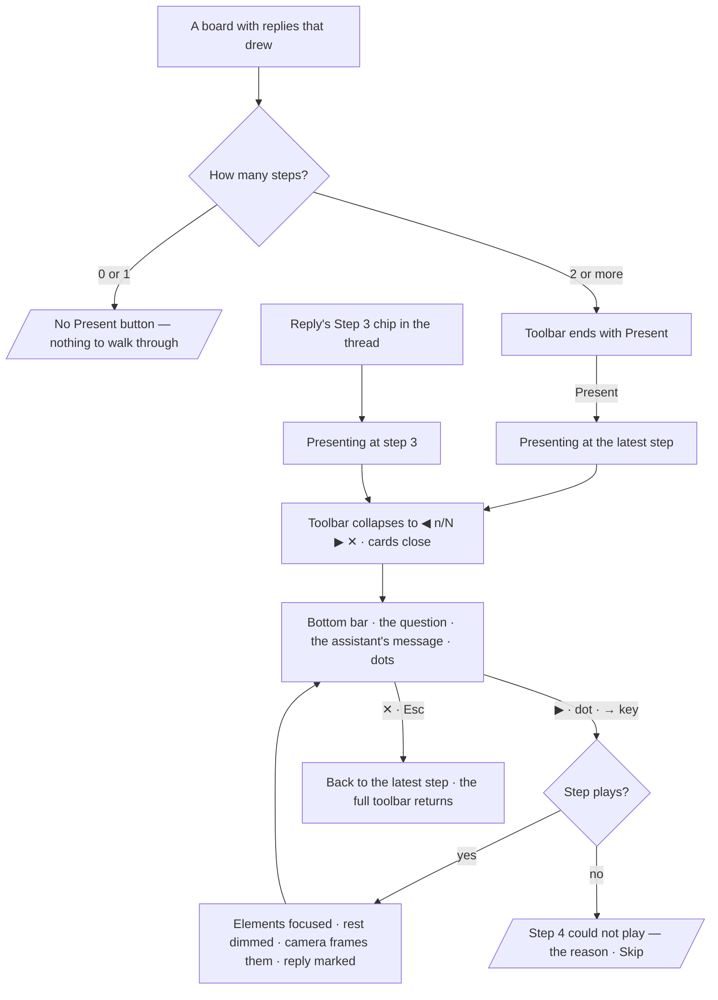

# Walk through an answer

A session's answers, replayed on the board one step at a time — each step the reply that drew it,
highlighted on the canvas and in the thread.

| | |
|---|---|
| Index | [4.6](../../../README.md#4--explore) · Slice **—** (not scheduled) |
| Module | [Explore](../spec.md) |
| API / CLI / Studio | 🔵 / — / 🔵 |
| Related | [graph-canvas](graph-canvas.md) · [boards](boards.md) · [share-an-answer](share-an-answer.md) · [the-answer-surface](../../ask/features/the-answer-surface.md) |

> **As** an analyst, **I want** to step through how a board was built, one answer at a time, **so
> that** I can show someone else how I got there and see which question drew what.

## Capabilities

| # | Capability | Notes |
|---|---|---|
| C1 | A step per answer | Every reply that changed the canvas is one step, in thread order |
| C2 | Present | One *Present* button at the end of the toolbar; nothing else of the walkthrough shows until it is pressed |
| C3 | Presenting | The toolbar collapses to its stepper; Layers · Styling · History close; the legend, the zoom bar and the minimap stay ([GC24](graph-canvas.md#decisions)) |
| C4 | Step ↔ reply | The current step's reply is marked in the thread; a reply's *Step n* chip starts presenting at that step |
| C5 | Your changes | Edits made by hand between two replies are one step of their own |
| C6 | Kept with the board | Reopen, share or snapshot a board and its walkthrough comes with it |

## Journey

## Seams

| Seam | What the user sees |
|---|---|
| A board with 0 or 1 steps | No *Present* button and no chips; nothing to walk |
| A reply that drew nothing (table, prose, refusal) | It adds no step and carries no chip |
| At an earlier step | Only while presenting; the board is read-only and there are no edit tools to reach. ✕ returns to the latest step |
| A step that cannot play (an element gone from the graph) | The presenter says which step and why, and offers *Skip*; missing elements are kept and marked ([GC5](graph-canvas.md#decisions)) |
| A step still playing | ◀ ▶ and the dots are disabled and the message is dimmed until the canvas settles; held keys do not queue |
| A member with view access only | Can present; there is nothing to edit either way |
| Reload while presenting | Opens at the latest step, not presenting; presenting is not saved state |
| A shared snapshot | Plays the walkthrough as it was when the snapshot was taken |
| A long message | The bar shows four lines and scrolls inside itself; the board above it is never covered past the bar's height |

## Surfaces

| Surface | Shape |
|---|---|
| Present | The toolbar's last group ([GC21](graph-canvas.md#decisions)): one labelled *Present* button, only with two or more steps |
| Presenting toolbar | The same toolbar, collapsed to `◀ n/N ▶ ✕`. A compact `PlaybookStepper` in `@invana/canvas-ui` — **owed**, with a story |
| Presenter bar | Bottom-centre in the space right of the bottom-left dock, 540 px wide, only while presenting: the question as the user's bubble (or *Expanded LHR* · *Your changes* with their icon), the assistant's message beside its avatar, one dot per step. No buttons — ◀ ▶ ✕ are the toolbar's. `PlaybookPresenterBar` (`@invana/canvas-ui`) grows a compact variant for this; its labelled Previous / Next go, not to a Studio override |
| Thread mark | The current step's reply has a `--primary` rail on its left edge and is scrolled into view |
| Step chip | `Step n` on the reply's meta line, left of `N records` ([AS16](../../ask/features/the-answer-surface.md#decisions)) |
| Your changes line | A thin rule across the thread between the two replies it falls between — *Your changes · layout, hid 2 nodes, moved 3* — with its `Step n` chip |
| Canvas | [Invana Products](https://claude.ai/artifact/HcPfkMUYUtEbRaZFaYnHtg) › Explorer — EX-17 (`explorer.present*`) |
| Presenting | The toolbar folds to the stepper; Layers · Styling · History close; the legend, the zoom bar and the minimap stay ([GC24](graph-canvas.md#decisions)) |

## Engine

| Thing | Shape |
|---|---|
| Step | The canvas's `StepSpec`: `id` · `title` · `narration` · `data` (the delta the reply drew) · `view.focus` (its elements; the rest dimmed) · `view.camera` (the framing when it settled) · `meta.reply_id` |
| Stored | The board document carries `walkthrough: PlaybookSpec`, written with the board's autosave and versioned with it (CV2) |
| Route | None new: the walkthrough reads and writes with the board (`…/boards/{id}`) |

## Decisions

| # | Decision |
|---|---|
| WT1 | **The product word is Walkthrough.** *Playbook* already names a Skill ([terminology](../../../terminology.md)). `playbook` stays the canvas package's own word for the mechanism, the way `exportState` stays the renderer's (CV11). |
| WT2 | **A step is a reply that changed the canvas.** Its title is the question as the user asked it. Its narration is the assistant's **message** — the reply's words, whole — never the answer's blocks: a table, chart or card stays in the thread, because on the board the drawing is the answer. Its data is what the reply drew, its settings carry the layout preset and options in force ([GC22](graph-canvas.md#decisions)), its focus is those elements with the rest dimmed, and its camera is the framing when the draw settled. A reply that drew nothing — a table, prose, a refusal — is not a step. An expansion is a reply ([GC12](graph-canvas.md#decisions)), so it is a step titled *Expanded LHR* with its reply as the message. A preset switched by hand is part of the *Your changes* step that follows (WT7). |
| WT3 | **Outside presenting, the walkthrough is one button.** With two or more steps, the toolbar ends with *Present*; with fewer it is not there. There is no stepper, position or *Latest* control on the board until presenting starts. |
| WT4 | **Presenting collapses the toolbar and is read-only.** The toolbar becomes `◀ n/N ▶ ✕` and nothing else; the form cards close; the legend, the zoom bar and the minimap stay. The bar at the bottom centre carries the question, the assistant's message and the dots, and no buttons of its own. ← → and PageUp / PageDown step while focus is on the board or the bar. ✕ or Esc returns to the latest step and the full toolbar. Presenting writes no board version, and it is not restored on reload. |
| WT5 | **An earlier step is only ever seen while presenting.** Stepping happens only in presenting, which is read-only, so an earlier state can never be edited. Editing it would fork the history; a fork is [*Fork from here*](../../ask/features/fork-a-session.md), not an edit. |
| WT6 | **A step and its reply point at each other.** While presenting, the current step's reply is marked and scrolled into view. Every step's reply carries a `Step n` chip; clicking it starts presenting at that step. The thread and the board can never be on different steps. |
| WT7 | **Hand edits between two replies are one step.** Expand-free edits — layout, hide, style, move — made since the last step become one *Your changes* step. It is appended when the next reply arrives or presenting starts, through `history.sinceLastStep`, so the work is adopted rather than replayed. |
| WT8 | **The walkthrough is kept with the board.** It is part of the board document and versioned with it, so a reload, a live link and a frozen snapshot ([share-an-answer](share-an-answer.md)) all carry it. Restoring a version restores its walkthrough. |

## Not building

| Not building | Because |
|---|---|
| Auto-play on a timer | a walkthrough is talked over; the presenter sets the pace |
| Editing a step's title or narration in Studio | a step is its reply; rewording it would make the walkthrough disagree with the thread |
| The answer's blocks in the presenter bar | the board is the drawing; tables and charts stay in the thread (WT2) |
| Reordering or deleting steps | the order is the thread's order (WT6) |
| Animating a force settle between steps | [GC8](graph-canvas.md#decisions) — the camera moves; nodes glide only when a step changes the preset |
| Exporting a walkthrough as slides or video | share the board; it plays there (WT8) |
