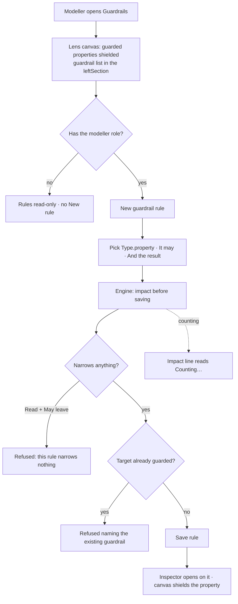
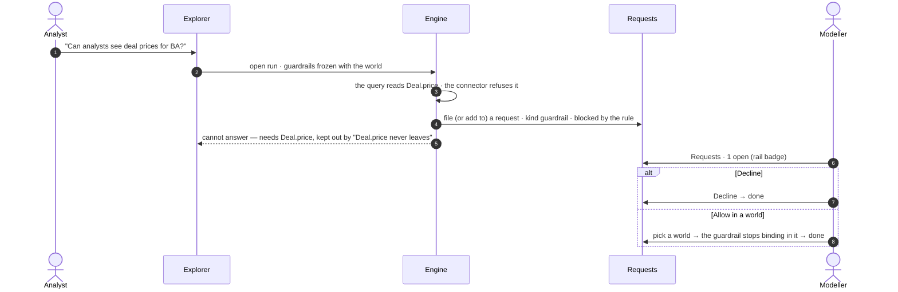

# Guardrails

What no run in this Graph may see or send, whatever world it runs in. A Graph's guardrail is **one
property rule** — *when a run touches `Deal.price`, it may read it in counts only, and the result
stays in the Graph* — set by a modeller, always in force, and the reason behind every request a
refusal files.

| | |
|---|---|
| Index | [14.2](../../../README.md#14--govern) · Slice **S16** · built in **M05** |
| Module | [Govern](../spec.md) |
| API / CLI / Studio | ✅ / ✅ / ✅ |
| Related | [worlds](worlds.md) (what narrows within these) · [requests](requests.md) (what a refusal files) · [audit-and-activity](../../operate/features/audit-and-activity.md) (every edit is an event) |

> **As** a modeller accountable for what this Graph may do with its data, **I want** one rule per
> protected property that says what a run may do with it, **so that** protected data stays protected
> and I can hand the list to an auditor.

## Capabilities

| # | Capability | Notes |
|---|---|---|
| G1 | One rule, one property | *When a run touches* `Type.property` (either side may be `*`) · *It may* Read · Read in counts only · Never read · *And the result* May leave · Stays in the Graph |
| G2 | Always in force | Every run in the Graph carries every guardrail, in every world, except a world a request allowed it in ([GR21](#decisions)) |
| G3 | Impact before saving | *2 worlds and 1 schedule read `Deal.price`* — the engine counts it before the write |
| G4 | A refusal names the guardrail and files a request | The run ends in *cannot answer* naming the rule; the ask lands in [Requests](requests.md) |
| G5 | The guardrail's own reading | Rule · Refusals · History, beside the lens canvas |
| G6 | Editing is a permission | The `modeller` Graph role; everyone else reads every rule |
| G7 | Every edit is an event | `lens.create` · `lens.update` · `lens.delete` with before and after |

---

## Journey 1 — set a guardrail

## Journey 2 — a run meets a guardrail

---

## Seams

| Seam | What the user sees |
|---|---|
| No guardrails set | The canvas shields nothing; the list reads *No guardrails — every property may be read and may leave* |
| Saving while the impact is counting | *Save rule* waits; the impact line reads *Counting…* |
| A target nothing declares | Refused at save naming the type or the property |
| Read + May leave | Refused: *this rule narrows nothing* — a guardrail that permits everything is not one |
| A second rule on one target | Refused naming the guardrail that already holds it |
| No modeller role | Read-only: no *New rule*, no edit or delete in the inspector, a line naming who may edit |
| A guardrail edited mid-flight | Runs in flight keep the lens they froze; the next run gets the new rule |
| A deleted world in `allowed_in` | Dropped from the list on delete; the guardrail binds everywhere else unchanged |

---

## Surfaces

| Surface | Route | Shape | Components |
|---|---|---|---|
| Guardrails page | `/modeller/guardrails` | leftSection: the Govern panel (Model · Worlds · Guardrails tabs over models, worlds and guardrails); main: the lens canvas under the guardrails alone — every guarded property shielded | `GlobalModelBoard` · `@invana/ui` `Tabs` · `SearchInput` |
| One guardrail | `/modeller/guardrails/:guardrail` | The same page with the guardrail inspector in the page's right column; `?request=<id>` adds the request bar over the canvas | `RecordHeader` · `Tabs` · `PropertyList` |
| Guardrail inspector | — | **Rule**: Applies to (each type carrying the property) · the rule as a sentence · Refused this week (who · where · when) · *Edit rule* · *Delete*. **Refusals**: every request it filed. **History**: its events | `PropertyList` · `Button` |
| Request bar | — | *`<who>` asked from `<where>`: "`<ask>`" · blocked by `<guardrail>`* · *Decline* · *Allow in a world* | `Alert` · `Button` |
| Rule dialog | — | *New guardrail rule*: *When a run touches* (a picker over `Type.property`) · *It may* · *And the result* (`ToggleGroup`s) · *Impact before saving* (warning `Alert`) · *Cancel* · *Save rule* | `Dialog` · `@invana/forms` · `ToggleGroup` · `Alert` |

---

## Engine

| Thing | Shape |
|---|---|
| Record | `lenses` row · `kind = guardrail` · `scope = graph` · `target` (`Type.property`, `*` either side) · `access` (`read` · `counts` · `never`) · `leaves` (bool) · `allowed_in` (world ids) · `name` generated from the rule · `rules` compiled from the rule at save, never authored |
| Compiled rules | `never` → `graph_data/model/**` allow, `properties.exclude: [<target>]` · `counts` → `graph_data/model/**` allow, `properties.counts_only: [<target>]` · `leaves = false` → `llm/**` and `third_party/**` allow with `may_send` without `property_values` |
| Enforcement | The connector **rejects** any reference to an excluded property and rewrites whole-element returns without it; a `counts_only` property may be filtered, counted and aggregated, is left out of whole-element returns, and a bare return of it is refused (`lens_property_counts_only`) |
| Agent's own bound | `scope = agent:<id>` stays a layered lens, authored on the agent's page ([AG6](../../agents/features/author-an-agent.md)) |

| Route | Returns |
|---|---|
| `GET …/guardrails` | `GuardrailPage` — `items: GuardrailRead[]` (`id · name · target · access · leaves · allowed_in[{id,name}] · types · refused_7d · created_at · updated_at`), `total`, `may_edit` |
| `GET …/guardrails/{id}` | `GuardrailDetail` — the row, `applies_to[{model,type,property}]`, `refusals[{request_id, who, where, at}]` + `refusals_total`, `history[{action, actor, at, details}]` |
| `GET …/guardrails/targets` | `[{target, model, type, property}]` — what the picker offers, from published versions |
| `POST …/guardrails/impact` | `{worlds[], schedules[], sentence}` for `{target, access, leaves}` |
| `POST · PATCH · DELETE …/guardrails[/{id}]` | the rule; `PATCH` takes `access` · `leaves` · `allowed_in` |
| CLI | `invana govern apply` reads `guardrails: [{target, access, leaves}]` |

---

## Decisions

| # | Decision |
|---|---|
| GR1 | **A Graph's guardrail is one property rule.** Target, what a run may do with it, whether the result may leave — nothing else. One rule per target, so an auditor reads one line per protected property. |
| GR2 | **A guardrail compiles into the lens grammar at save.** `rules` is derived from the property rule and stored beside it, so enforcement, `lens_snapshot` and the touch record keep one path ([GV1](../spec.md)). |
| GR3 | **In-flight runs keep the lens they froze.** A guardrail is never applied retroactively. |
| GR4 | **A refusal names the guardrail and files a request.** The run ends *cannot answer* naming the rule, and the ask is in [Requests](requests.md) with the guardrail as its blocker. |
| GR5 | **Readable by every member, editable with the `modeller` role.** Without it every authoring control is absent, not disabled, and a line says who may edit. |
| GR6 | **The widest state is a sentence, not an empty list.** |
| GR7 | **Every edit is an ordinary audited event** in `core/events`. |
| GR8 | **The layered grammar is one rule shape.** A rule of a world or an agent's own guardrail matches an address `<layer>/<sublayer>/<name>` and allows or denies it; `properties` and `select` are legal on `graph_data` alone, and a rule that sets them elsewhere is refused at save naming the layer. `properties` carries `exclude` and `counts_only`, each a property name or a qualified `Type.property`. |
| GR9 | **A pattern is resolved against the live catalogue as it is typed**, listing what it would match — a pattern that matches nothing is almost always a typo. |
| GR10 | **Layer-specific limits live under `options`** (`max_age_s` on a cache rule, `max_rounds` on a human one), so the top-level keys are the same on every layer. |
| GR11 | **`may_edit` rides on the guardrail list**, so the rules and the right to edit them arrive in one read. |
| GR12 | **Without the permission every authoring control is absent, not disabled**; a line says the rules are editable by a modeller. |
| GR13 | **A world that cannot open says so where it is picked** — one naming a model version the Graph no longer publishes is refused at the chip, naming the version. A wildcard resolves like any other pattern. |
| GR14 | **A guardrail is read in its inspector beside the lens canvas**, not on a board of its own: one rule needs no auditor's page, and the canvas shows what it shields. |
| GR15 | **A closed layer refuses by name, and the name is the world and the layer.** No rule fires when a layer was never opened, so the refusal names which world closed which layer and `rule_matched` stays empty. |
| GR16 | **Read in counts only** lets a query filter, count and aggregate the property and never return its value — the value is used to compute, not to reason ([GV11](../spec.md)). |
| GR17 | **Stays in the Graph** cuts `property_values` from every model and third-party crossing in the run. The egress grammar is per class, not per property, so the cut is wider than the one property — it fails closed. |
| GR18 | **The name is generated from the rule** — `Deal.price never leaves`, `*.email never read`, `Deal.price in counts only` — so the list and the rule cannot disagree. |
| GR19 | **A rule that narrows nothing is refused.** *Read* with *May leave* permits everything. |
| GR20 | **Impact is counted by the engine before the write**: the worlds in which the property is visible today and the schedules that run in them, or in no world. |
| GR21 | **Allow in a world** puts the world in the guardrail's `allowed_in`: runs asked in that world do not carry this guardrail. It is the one exception a guardrail has, it is named on the inspector, and it is an audited edit made by resolving a request. |
| GR22 | **The layered Graph guardrail is retired.** The migration re-expresses each one as property rules: an `llm` egress without `property_values` becomes `*.* · Read · Stays in the Graph`; a property exclusion becomes `<Type>.<property> · Never read`. A `third_party` deny has no property form and is dropped — the layer has no participant configured in any Graph. |
| GR23 | **An agent's own guardrail stays a layered lens.** It bounds one agent's layers (no egress, one model) and is authored on the agent's page; the Modeller's Guardrails lists the Graph's alone. |
| GR24 | **Promote is gone.** A world is a set of layered rules and a guardrail is one property rule; one cannot become the other by a field change. |

---

## Not building

| Not building | Because |
|---|---|
| Per-property egress | the prompt's egress classes are per class; a per-property cut needs the grounding block split by property |
| Approval for a guardrail change | the event is the record |
| Guardrails that expire | a bound with a timer is a bound nobody is watching |
| Retroactive application | `lens_snapshot` is what makes an answer reconstructible (GR3) |
| Templates of guardrails | a starting set that fits nobody is edited blindly |
| A guardrail on a layer (`third_party/**` deny) | a guardrail is one property rule (GR1); a layer bound is a world's or an agent's |
