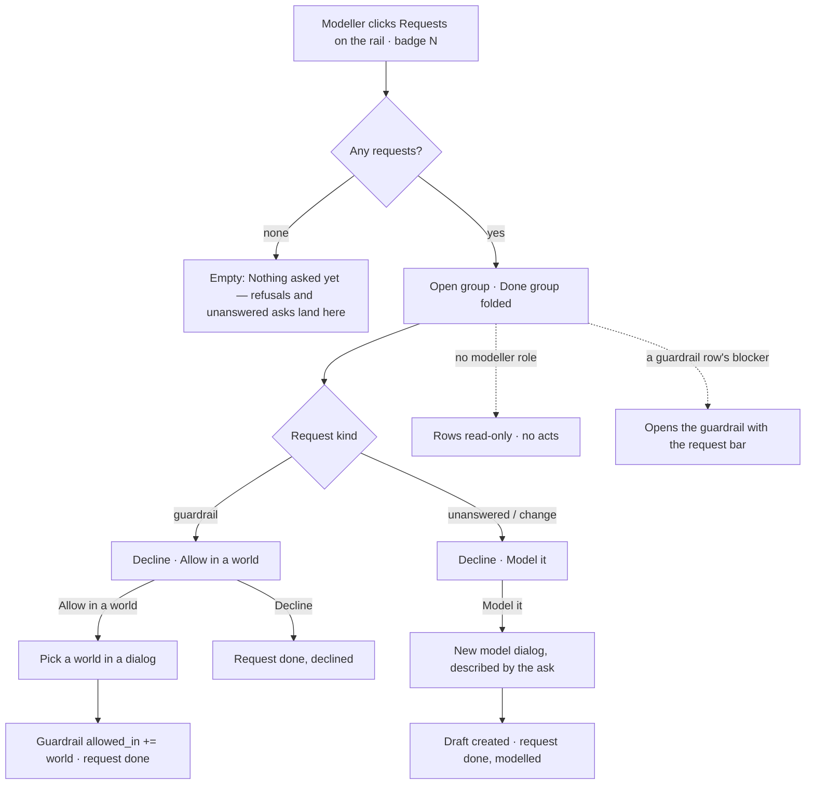

# Requests

One inbox of what analysts and agents asked to be modelled or allowed — a guardrail refusal, an ask
the Graph could not answer, or an explicit *Ask for a change* — each resolved by *Decline*, *Allow in a
world* or *Model it*.

| | |
|---|---|
| Index | [14.3](../../../README.md#14--govern) · built in **M05** |
| Module | [Govern](../spec.md) |
| API / CLI / Studio | ✅ / ✅ / ✅ |
| Related | [guardrails](guardrails.md) (what files most of them) · [worlds](worlds.md) (where *Allow* lands) · [the-model-page](../../connect-and-model/features/the-model-page.md) (where *Model it* lands) |

> **As** a modeller, **I want** one inbox of what people and agents asked to be modelled or allowed,
> **so that** gaps get fixed, not lost.

## Capabilities

| # | Capability | Notes |
|---|---|---|
| RQ-C1 | Filed where the ask fails | A guardrail refusal, an ask that ends *cannot answer · outside this graph*, and `POST …/requests` (Explorer's *Ask for a change*, the CLI) |
| RQ-C2 | Repeated asks are one request | The same open ask by the same person or agent adds to `asks`, never a second row |
| RQ-C3 | Three resolutions | *Decline* · *Allow in a world* (a guardrail request) · *Model it* (any other) |
| RQ-C4 | Open count on the rail | The Requests icon carries the engine's open count |

---

## Journey

---

## Seams

| Seam | What the user sees |
|---|---|
| Loading | The page head and two group skeletons |
| Nothing asked yet | *Nothing asked yet — refusals and asks the Graph could not answer land here* |
| No modeller role | Rows without *Decline* · *Allow* · *Model it* |
| Allow on a request whose guardrail was deleted | Refused: *its guardrail is gone* — decline it instead |
| The world picked was deleted meanwhile | Refused naming the world |
| Resolved by someone else first | 409 *already resolved*; the list re-reads |

---

## Surfaces

| Surface | Route | Shape | Components |
|---|---|---|---|
| Requests page | `/modeller/requests` | Head *Requests* · `N open` chip · *From Explorer's "Ask for a change" and from asks the Graph could not answer*; **Open** then **Done** (folded) groups; a row is the title over `who · from where · blocked by <guardrail> / the Graph could not answer "<ask>" / N asks it could not answer · when`, acts at the right; a done row reads its resolution with a `done` chip | `RecordHeader` · `Collapsible` · `Button` · `Badge` |
| Allow dialog | — | *Allow in a world*: pick a world · *Allow* | `Dialog` · `Select` |
| Rail badge | `leftNav` | the open count | `useNavBadges` |

---

## Engine

| Column | Shape |
|---|---|
| `requests.id` · `graph_id` | UUID · FK `graphs` cascade |
| `kind` | `guardrail` · `unanswered` · `change` |
| `title` · `detail` | the ask as asked · what the run said |
| `source` | `explorer` · `agent` · `schedule` · `api` |
| `asked_by_id` · `agent_id` · `run_id` · `session_id` | who asked, through what |
| `guardrail_id` · `blocked_by` | the guardrail (FK `lenses`, `SET NULL`) and its name frozen at filing |
| `asks` · `last_asked_at` | repeated asks of the same open request |
| `status` · `resolution` | `open` · `done` · `declined` · `allowed` · `modelled` |
| `resolution_note` · `world_id` · `model_id` · `resolved_by_id` · `resolved_at` | what resolving did |

| Route | Returns |
|---|---|
| `GET …/requests?status=&kind=` | `RequestPage` — `Page[RequestRead]` with `open` (the count the badge reads) |
| `POST …/requests` | `{title, detail?}` → a `change` request by the caller |
| `POST …/requests/{id}/resolve` | `{action: decline · allow · model, world_id?, model_id?, note?}` → `RequestRead` |
| CLI | `invana requests list` · `invana requests resolve <id> --decline · --allow <world> · --model [<model>]` |
| Events | `request.create` · `request.resolve` |

---

## Decisions

| # | Decision |
|---|---|
| RQ1 | **A request is filed by the engine where the ask fails**, never by Studio deriving it from a run: a guardrail refusal in `graph.read.query`, a *cannot answer · outside this graph* when the run was asked by a person or an agent (not an eval or a test). |
| RQ2 | **The same open ask is one request.** Matched on Graph, kind, the asker (person or agent) and the ask's text; `asks` counts, `last_asked_at` moves. |
| RQ3 | **Allow in a world edits the guardrail**, not the world: a world narrows within the guardrails and cannot widen one, so the exception lives on the guardrail ([GR21](guardrails.md#decisions)). |
| RQ4 | **Model it opens New model described by the ask**; creating the draft resolves the request as *modelled* with the model. |
| RQ5 | **Resolving needs the `modeller` role**; every member reads the inbox. |
| RQ6 | **The open count is the engine's** — `RequestPage.open` — never a count of the listed rows. |
| RQ7 | **Done rows say what was done** — `declined`, `allowed in EU · H1 2026`, `modelled in Fares` — from `resolution_note`, written by the engine at resolve. |

---

## Not building

| Not building | Because |
|---|---|
| Explorer's *Ask for a change* button | Explorer's surface (`explorer.answer.guardrail`); the route is here and the button lands with Explorer's phase |
| Assigning a request to a person | one inbox for the Graph's modellers; the event names who resolved it |
| Reopening a done request | asking again files a new one |
| Notifications per request | the rail badge carries the count |
