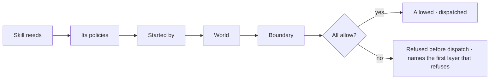
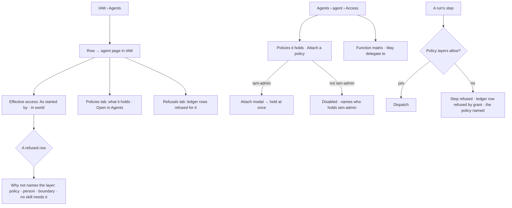

# Effective access

What a principal may actually do is the intersection of every layer that bounds it. The engine checks
each step before it dispatches it, and a refusal names the layer and the policy.

| | |
|---|---|
| Index | [11.8](../../../README.md#11--identity-and-access) · Slice **I01** |
| Module | [Identity and access](../spec.md) |
| API / CLI / Studio | ✅ / — / ✅ |
| Related | [policies](policies.md) · [people and groups](people-and-groups.md) · [the agent page](../../agents/features/the-agent-page.md) · [delegation](../../agents/features/delegation.md) · [the ledger](../../operate/features/the-ledger.md) · [govern](../../govern/spec.md) · products: [iam.md](../../../../products/iam.md) IAM-07 · [agent-fabric.md](../../../../products/agent-fabric.md) › Agents *Access* |

> **As** an owner, **I want** every agent's policies and effective access, read-only, with why each
> function is allowed or refused, **so that** I see why an agent can or can't.
>
> **As** a builder, **I want** the agent's Access tab to list its policies and every function its
> skills need against them, **so that** a refusal never surprises me in a run.

## The layers

| Layer | Reads | Applies when |
|---|---|---|
| Skill needs | the functions the agent's bound skills' plans name | read views only — a step is in the plan because something needs it |
| Its policies | the agent's attachments, direct and through its groups; a spawned agent reads its root agent's | the run has an agent |
| Started by | the person's managed policies (their Graph roles, direct and through groups) and attachments | the run has a person who started it |
| World | the run's frozen lens, which carries the Graph's guardrails | always — enforced by the lens as each step touches a participant |
| Boundary | every saved boundary policy | there is one |

## Capabilities

| # | Capability | Notes |
|---|---|---|
| C1 | Refused before dispatch | Each step's function and resource are checked against the policy layers before the step runs; a refusal fails the step `refused` and names the policy |
| C2 | Spawned agents narrow | A spawned agent holds its parent's access, never attachments of its own; a delegated (authored) agent holds its own |
| C3 | An agent never does more than its starter | The starter layer bounds every step of a run a person started |
| C4 | IAM › Agents | Every agent, read-only: kind · policies · functions allowed · refused in 7 days · owner, kind tabs `All · Authored · Seeded` (*seeded* is the product's word for an agent that ships with Invana) |
| C5 | An agent's effective access | Tabs **Effective access** · Policies · Refusals. The matrix — action · resource · skill needs · its policies · started by · world · boundary · effective · why not — as started by a chosen person (or a run) in a chosen world |
| C6 | Who it may delegate to | Each agent it may delegate to, the policy that allows it, and *always* · *asks its owner* · *never* |
| C7 | The agent's Access tab | Policies it holds (*Attach a policy*, the same act as in IAM) · the function matrix · May delegate to |

## Journey

## Seams

| Seam | What the user sees |
|---|---|
| An agent holding no policy | Every function needing a statement reads *refused · holds no policy*; Access leads with *Attach a policy* |
| No person started the run (a schedule's clock, a seed) | Started by reads `—` and does not refuse |
| Starter's role narrower than the agent's | *Refused by the person who started it — priya holds viewer* |
| A boundary refuses | *boundary no-pii-out* |
| A function no skill needs | Listed when a policy allows it, *no skill needs it* |
| A world chosen | The world column reads the lens for the row's layer; the dispatch check leaves the lens to the run |
| Member without iam-admin | Reads every agent's access; *Attach a policy* is disabled with the reason |

## Surfaces

| Surface | Shape |
|---|---|
| `iam.agents` | Page *Agents*: *An agent holds policies like a person does — it is built in Agents. Workers hold none — they only run steps*; kind tabs; table agent · kind · policies · functions allowed · refused · 7 d · owner; *Build an agent in Agents* |
| `iam.agent.effective` | Agent page in IAM (`?page=iam_agent:<id>`), `RecordHeader variant="page"` crumb *Agents › name*, *Open in Agents*; tabs Effective access · Policies · Refusals; *As started by* and *in world* selects; matrix grouped by layer; *Who it may delegate to* |
| `agents.agent.access` | The agent page's Access tab: *Policies it holds* (policy · kind · allows · owner, *Attach a policy*), the function matrix (function · its skills need · its policies · started by · world · effective · why not), *May delegate to* |
| `GET …/iam/agents` | `Page[AgentAccessRow]`: `agent_id` · `name` · `kind` · `version` · `policies[]` · `functions_allowed` · `refused_7d` · `refused_line` · `owner` |
| `GET …/iam/agents/{id}/effective` | `?started_by=<user>&run_id=&world_id=` → `{agent, started_by?, world?, policies[], rows[], delegates[], allowed, refused}` |
| `GET …/iam/agents/{id}/refusals` | `Page` of the agent's refused ledger rows |

## Engine

| Thing | Shape |
|---|---|
| Holdings | `HoldingsManager.policies_for(session, graph_id, principal)` — principal `("person", user_id)` · `("agent", agent_id)` · `("token", token_id)`; returns saved policies held directly, through groups, by an unexpired attachment and (for a person) as managed roles |
| The gate | `runtime/access.py::AccessGate.check(db, run, step, vars)` before each dispatch; raises `TaskFailure(cls="bound", cause="policy_refused", evidence={refused_by: "grant", layer, policies})` |
| A step's resource | graph functions: `graph/<Type>/*` when the args name a type, else the layer alone · llm-bound: `llm/<provider>/<model>` of the run's endpoint · `web.*`: `third_party/web/<host>` of its `url` · `mcp.<server>.<tool>`: `third_party/mcp/<server>/<tool>` · `mail.*`: `third_party/mail/*` · `work.spawn_agent` · `work.delegate`: `agent/<name>` · `work.create_task`: `project/*` |
| Reads | `runtime/managers/access.py::AccessReadManager` — `agents` · `effective` · `refusals` · `test` · `impact` · `limit_usage` |
| Refused 7d | a count of the agent's ledger rows with verdict `refused` in seven days, in SQL |

## Decisions

| # | Decision |
|---|---|
| EA1 | **Effective access = skill needs ∩ its policies ∩ started by ∩ world ∩ boundary.** A policy layer allows when at least one policy the principal holds allows the action on the resource with its conditions met. |
| EA2 | The dispatch check runs the policy layers — its policies, started by, boundary — before every step whose function has a bound. The world is the run's lens and keeps enforcing as each step touches a participant. Skill needs are the plan: a step is in a plan because a skill, a packaged plan or a replan within the skill's allowlist put it there. |
| EA3 | When a step's resource is not known before it runs — a query names no type — the check is at the layer: a statement allows when its action matches and one of its resources is in the step's layer. A resource the args name is checked exactly. |
| EA4 | A refusal fails the step `refused` with the message *`<policies>` do(es) not allow `<function>` on `<resource>`* (policies), *`<person>`, who started run #N, holds `<roles>`* (started by), or *boundary `<name>`* (boundary); the ledger row's `refused_by` is `grant` and its rule is that message. |
| EA5 | A spawned agent holds its parent's access — the root authored agent's policies — never its own attachments. A delegated agent holds its own. The run's starter is the root run's. |
| EA6 | An agent's groups pass their policies to it, as a person's groups do. |
| EA7 | A run no person started (the clock with no schedule author, a seed) has no starter layer. |
| EA8 | The envelope's allow-list stays the planner's list of functions an agent may plan with; the matrix's *Why not* says *not in its envelope* when the envelope is what refuses. |
| EA9 | Existing agents keep what they could do: the migration attaches `viewer` to every agent, `contributor` to one whose envelope allows a `work_write` function, and `modeller` to one whose envelope allows a graph-write, schema-write or ingest function. A new agent is created holding `viewer`. |
| EA10 | *May delegate to* keeps the agent's own setting (always · ask · never) under its policies: `always` runs only when a policy allows `work.delegate` on `agent/<name>`; without one it asks the owner; `never` refuses. |
| EA11 | IAM › Agents lists every non-spawned agent; spawned agents are counted on their parent. *Functions allowed* is the number of catalogue functions with a bound its policies and the boundary allow, each checked at its matrix row's resource — whether or not a skill needs it. The agent's own page prints the same number (`functions_allowed`) beside its count of refused rows. |
| EA12 | The effective matrix's rows are the union of its skills' needs and the functions its policies allow, grouped by layer; a row's resource is the narrowest one a statement allowing it names in that layer — most path segments without a wildcard, then longest (`graph/Fare/*` over `graph/*`). |
| EA13 | The agent's Access tab and IAM's agent page read the same endpoint; attaching from either is `POST …/iam/policies/{name}/holders` and needs iam-admin. |

## Not building

| Not building | Because |
|---|---|
| An access ask raised by a refusal | a refused step names the policy; asks for access arrive with Approvals' budget and access kinds later |
| The token layer at dispatch | runs are started by a person's session in I01; calls over a Graph's MCP server carry the token's policy (I02) |
| Projects as resources gating todo pick-up | private projects are [9.7](../../work/features/private-projects.md) |
| Policies on workers | workers run any agent's steps; access belongs to the agent |
| Explicit deny or precedence | default deny plus boundaries |
