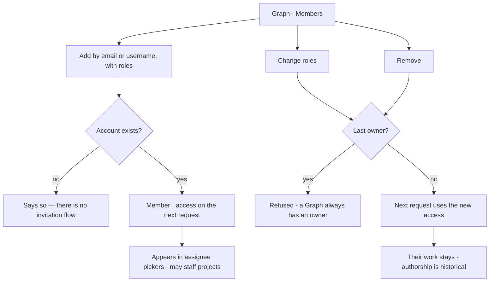

# Membership

You are a member of a Graph, or you are not. A member reads everything in it; what they may change
is the [Graph roles](roles.md) they hold.

| | |
|---|---|
| Index | [11.4](../../../README.md#11--identity-and-access) · Slice **S1** · roles **B11** |
| Module | [Identity and access](../spec.md) |
| API / CLI / Studio | ✅ / ✅ / ✅ |
| Related | [roles](roles.md) · [sessions](sessions.md) · [projects-and-tasks](../../work/features/projects-and-tasks.md) · [envelope-and-budget](../../agents/features/envelope-and-budget.md) |

> **As** someone who owns a Graph, **I want** to add the people who work on it with the roles their
> work needs, **so that** access is a list I can read rather than a matrix I have to maintain.

## Capabilities

| # | Capability | Notes |
|---|---|---|
| C1 | Add and remove members | By email or username; they must already have an account |
| C2 | Each member holds Graph roles | `viewer` · `contributor` · `builder` · `modeller` · `owner` — [roles](roles.md) |
| C3 | The creator is the first owner | Their username is the Graph's URL namespace |
| C4 | Checked per request | Removal or a role change takes effect on the next call |
| C5 | Staffing follows membership | Being staffed on a project fills a picker; it grants nothing |
| C6 | Agents are not members | They are principals inside the Graph, bounded by an envelope |
| C7 | Every change is an event | Who added, removed or re-roled whom, when |

## Journey

## Seams

| Seam | What the user sees |
|---|---|
| Removing or demoting the last owner | Refused — a Graph without an owner cannot be managed |
| Adding someone already a member | Refused (409); change their roles instead |
| Removing someone with open tasks | Their tasks stay, assigned, and the list says who is gone |
| Removed mid-session | The next request is refused; the UI says access changed |
| An agent "member" | Not a thing — agents are separate, and the panel says so |

## Surfaces

| Surface | Shape |
|---|---|
| Graph → Members | One list with each member's roles; add in the header, change roles and remove on the row |
| Assignee picker | Members and staffed agents |
| Activity | Membership changes alongside every other write |
| CLI | `invana members list · add · set-roles · remove --graph <user>/<slug>` |

## Engine

| Thing | Shape |
|---|---|
| `graph_members` | `graph_id` · `user_id` · `roles` · `created_at` |
| Guard | membership and roles resolved per request, never from a token claim |
| Routes | `GET · POST …/members` · `PATCH · DELETE …/members/{member}` · `GET …/access` |
| Events | `member.add · remove · roles` |

## Decisions

| # | Decision |
|---|---|
| MB1 | Membership is the right to read a Graph; the roles a member holds are the right to change it ([roles](roles.md)). |
| MB2 | Membership and roles are resolved per request. |
| MB3 | A Graph always has an owner, and so always has a member. |
| MB4 | Removing a member never removes their work or their authorship. |
| MB5 | Agents are principals, not members. |
| MB6 | Members are addressed by username in routes and by email or username when added. |

## Not building

| Not building | Because |
|---|---|
| Invitations to people without accounts | an invitation flow is a product of its own |
| Per-canvas access | the Graph is the boundary; per-project access is B05's |
| Transferring ownership | the URL namespace is the creator's username; moving it is a rename problem. A second owner is a role, not a transfer |
