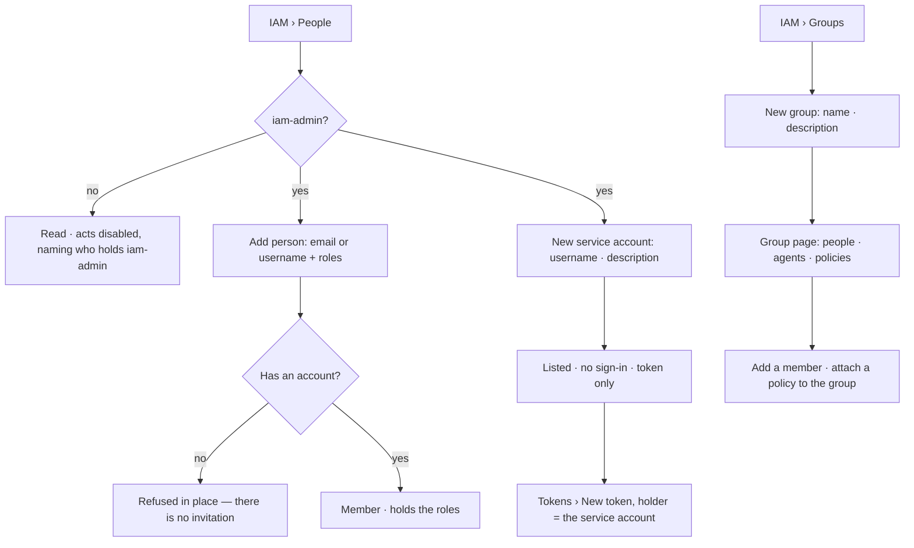

# People and groups

The principals of a Graph in one place: its members, its **service accounts** (a person with no sign-in
that owns tokens for scripts) and its **groups**, with the policies each holds.

| | |
|---|---|
| Index | [11.9](../../../README.md#11--identity-and-access) · Slice **I01** |
| Module | [Identity and access](../spec.md) |
| API / CLI / Studio | ✅ / — / ✅ |
| Related | [membership](membership.md) · [roles](roles.md) · [policies](policies.md) · [tokens](tokens.md) · products: [iam.md](../../../../products/iam.md) IAM-08 |

> **As** an owner, **I want** people, service accounts and groups, and the policies each holds,
> **so that** a team is granted once.

## Capabilities

| # | Capability | Notes |
|---|---|---|
| C1 | People | Members and service accounts, tabs `All · People · Service accounts` with counts: name · email · groups · policies · tokens · signs in with |
| C2 | Add person | A modal: an existing account by email or username, with managed policies (the Graph roles) — the membership act |
| C3 | Service accounts | *New service account*: a username and a description. It has no password and no sign-in; it is a member holding `viewer` and owns tokens an iam-admin mints for it |
| C4 | Groups | Group · people · agents · policies; *New group* is a modal |
| C5 | A group holds policies | Every member — person or agent — holds what the group holds; a group may hold managed policies, so a team gets `builder` once |
| C6 | Group members | People and agents are added to and removed from a group on its page |

## Journey

## Seams

| Seam | What the user sees |
|---|---|
| A service account signing in | Refused as an unknown password — it has none |
| A username already taken | Refused in place, naming it |
| A group with no members | Its row reads `—`; its policies reach no one |
| Removing a member from the Graph | Their group memberships and attachments in this Graph go with them |
| Deleting a group | Its attachments go; members keep their own |
| Member without iam-admin | Reads both pages; *Add person*, *New group*, *New service account* disabled with the reason |

## Surfaces

| Surface | Shape |
|---|---|
| `iam.people` | Page *People* — *Members of airways, and service accounts — a person with no sign-in that owns tokens for scripts*; kind tabs, table name · email · groups · policies · tokens · signs in with; *Add person* · *New service account* |
| `iam.groups` | Page *Groups* — *Attach a policy once, to a team*; table group · people · agents · policies; *New group* |
| Group page | `?page=iam_group:<name>`: members (person or agent, *Add member*, remove) and the policies it holds (*Attach a policy*) |
| `GET …/iam/people` | `Page[PersonRow]` (`f.kind` person · service): `user_id` · `username` · `name` · `email?` · `kind` · `groups[]` · `policies[]` · `tokens` · `signs_in_with` |
| `POST …/iam/service-accounts` | `{username, description?}` → `PersonRow` |
| `GET·POST …/iam/groups` · `GET·PATCH·DELETE …/iam/groups/{name}` | `GroupRow` `{id, name, description, people[], agents[], policies[], people_count, agents_count}` |
| `POST …/iam/groups/{name}/members` · `DELETE …/iam/groups/{name}/members/{id}` | `{member_kind: person·agent, member_id}` |

## Engine

| Thing | Shape |
|---|---|
| `users.is_service_account` | true for a service account; its `password_hash` is unusable and `email` is null |
| `groups` | `id` · `graph_id` · `name` (unique per Graph) · `description` · `created_by_id?` · `created_at` |
| `group_members` | `group_id` · `member_kind` person·agent · `member_id` · `added_by_id?` · `added_at`; unique per group and member |
| Managers | `apps/iam/managers`: `GroupManager` · `ServiceAccountManager`; people reads compose members, groups, holdings and tokens |
| Events | `group.create` · `group.update` · `group.delete` · `group.member.add` · `group.member.remove` · `service_account.create` |

## Decisions

| # | Decision |
|---|---|
| PG1 | A service account is a `users` row with `is_service_account` and no usable password, created inside one Graph and a member of it holding `viewer`. Its username is global, like any username. Only tokens act as it. |
| PG2 | Signs in with reads *password* for a person and *no sign-in · token only* for a service account; single sign-on is not built. |
| PG3 | A group belongs to one Graph and holds people and agents. Its policies — managed included — pass to every member at check time; nothing is copied. |
| PG4 | A person's Graph roles stay on their membership (`graph_members.roles`): holding a managed policy directly is that set. A group's managed policies are attachments. A person's effective roles are both, unioned. |
| PG5 | *Add person* is the membership act ([membership](membership.md)) and needs iam-admin; Graph settings › Members keeps its table and reaches the same routes. |
| PG6 | The People list's tokens column is the count of the person's live tokens that reach this Graph, computed by the engine. |

## Not building

| Not building | Because |
|---|---|
| Invitations | a member is added directly ([membership](membership.md)) |
| Sign-in providers | password sign-in first; SSO is install setup, later |
| Nested groups | one level carries teams; nesting is where reading access gets hard |
| Service accounts across Graphs | a service account is made in one Graph; another Graph adds it as a member |
