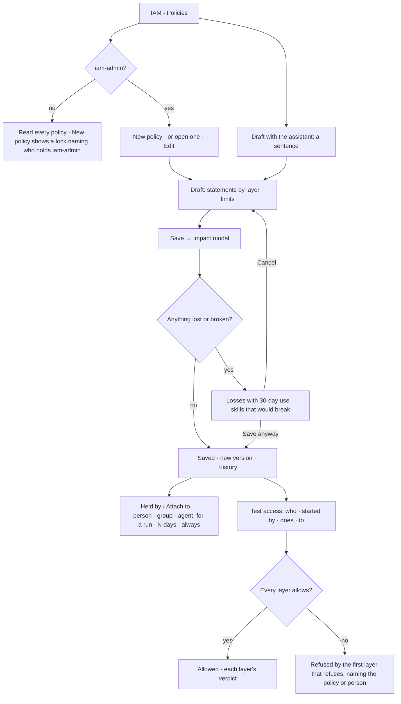

# Policies

A **policy** says what may be done, to which resources, within which limits. People, groups, agents
and tokens hold policies; nothing is allowed that no policy a holder has allows.

| | |
|---|---|
| Index | [11.7](../../../README.md#11--identity-and-access) · Slice **I01** |
| Module | [Identity and access](../spec.md) |
| API / CLI / Studio | ✅ / ✅ / ✅ |
| Related | [effective access](effective-access.md) · [people and groups](people-and-groups.md) · [tokens](tokens.md) · [roles](roles.md) · [the IAM product](the-iam-product.md) · [approvals](../../operate/features/approvals.md) · products: [iam.md](../../../../products/iam.md) IAM-01 · 02 · 03 · 04 · 05 · 06 · 10 · 11 |

> **As** an iam-admin, **I want** a policy as statements grouped by layer, with conditions and limits,
> its impact before I save it and a way to test it, **so that** I grant exactly what is needed and never
> break an agent by accident.
>
> **As** a member without iam-admin, **I want** to read every policy and know who may change them,
> **so that** I know who to ask.

## Capabilities

| # | Capability | Notes |
|---|---|---|
| C1 | One list of every policy | Kind tabs `All · Managed · Custom · Inline · Boundary` with counts, search; columns policy · kind · what it allows · statements · held by · changed |
| C2 | Statements by layer | `allow` · actions (function globs) · resources (`layer/…` globs) · conditions, grouped under the layer the resources name |
| C3 | Conditions | `fields` (only · except), `depth` (at most N spawn levels), `until` (an instant). Nothing else |
| C4 | Limits | Tokens a month · tokens a run · live agents at once · agents a run (descendants) · depth · worker-seconds an hour · pools it may use · *May ask for more*. Each row shows its ceiling and what is used now, computed by the engine |
| C5 | Held by | Every holder — person, group, agent, token — how (direct · via a group · for run #N), who attached it and when it ends. *Attach to…* is a modal |
| C6 | History | Every saved version: who, when, why, statement and limit counts |
| C7 | Draft and save | A new or edited policy is a **draft** until saved; saving shows its impact first |
| C8 | Impact | Who gains, who loses, which skills would break — computed by the engine against what holders can do today, with each loss's use in the last 30 days |
| C9 | Draft with the assistant | A sentence becomes a draft policy, marked *Draft by the assistant — nothing changes until you save* |
| C10 | Test access | A modal: who · started by · does · to → allowed or refused, every layer that decided. The engine's own check, run without running anything |
| C11 | Policies as files | `invana iam apply · list · show` — a YAML file per policy, versioned like a skill |
| C12 | Read-only without iam-admin | Every member reads policies; changing one needs `iam-admin`, and the refusal names who holds it |

## Journey

## Seams

| Seam | What the user sees |
|---|---|
| No custom policy yet | Policies lists the six managed ones and the boundary if there is one; *New policy* leads |
| Member without iam-admin | Reads every policy; *New policy*, *Edit*, *Attach to…* disabled with *Needs the iam-admin role — ask sam*; a New policy tab shows the lock |
| A managed policy | Read-only: its statements show, *Edit* is absent, it says *managed — built in* |
| An inline policy | Belongs to one token; edited only by minting a new token |
| Saving would break a skill | The impact modal names the skill, its version and the agent, before anything changes |
| A name already used | Refused in place, naming the policy |
| A statement outside the grammar | Refused in place: an unknown layer, an empty action, a condition that is not fields · depth · until |
| Deleting a held policy | Its holders are listed and lose it on confirm; a managed policy cannot be deleted |
| A limit above another policy's ceiling | Allowed — each policy's ceiling stands alone, and the tightest one a holder has binds |

## Surfaces

| Surface | Shape |
|---|---|
| `iam.policies` | Page *Policies*: kind tabs with counts, *Find a policy*, kit `Table`; *New policy* (`ActButton area="iam"`) |
| `iam.policy.statements` | Policy page, `RecordHeader variant="page"`: crumb *Policies › name*, kind badge, `vN · held by … · owner …`; *Test access* · *Edit*. Tabs **Statements** · Limits · Held by · History (`?tab=`). Statements is one table, rows grouped under a layer row (layer · its line · N rows) |
| `iam.policy.limits` | Limits table (limit · per · ceiling · used now · meter) beside *When a limit is reached* and *Agents set their own* cards |
| `iam.policy.held_by` | Kind tabs `All · People · Groups · Agents`, table kind · holder · how · attached by · ends; *Attach to…* modal (holder, for this run · N days · always) |
| History | Versions table: version · saved by · when · why · statements · limits |
| `iam.policy.draft` | The policy page of a draft: banner *Draft by the assistant — nothing changes until you save*, statements in a dashed table, Held by, *Discard* · *Review impact* |
| `iam.policy.impact` | Modal *Save name?* — holders with gains/loses, the resource and its 30-day use, a destructive line per skill that would break; *Cancel* · *Save anyway* |
| `iam.policy.test` | Modal *Test access*: Who · Started by · Does · To; the verdict line; table checked · by · says |
| `iam.policies.denied` | A *New policy* tab for a member without iam-admin: lock, *You can read policies, not change them*, who holds iam-admin, *Open policies read-only* |
| CLI | `invana iam list · show <name> · apply <file.yaml> [--why]` |

## Engine

| Thing | Shape |
|---|---|
| `policies` | `id` · `graph_id` · `name` (unique per Graph, `[a-z0-9-]`) · `kind` managed·custom·inline·boundary · `status` draft·saved · `description` · `statements` JSON · `limits` JSON · `version` · `owner_id?` · `drafted_by` person·assistant · `created_by_id?` · `updated_by_id?` · `created_at` · `updated_at` |
| `policy_versions` | `policy_id` · `version` · `statements` · `limits` · `description` · `saved_by_id?` · `saved_at` · `why?` |
| `policy_attachments` | `policy_id` · `graph_id` · `holder_kind` person·group·agent·token · `holder_id` · `attached_by_id?` · `attached_at` · `ends_at?` · `run_id?` · `via` direct·ask · `approval_id?` |
| A statement | `{effect: "allow", actions: [glob], resources: [glob], conditions: {fields?: {only?|except?: [name]}, depth?: {max: int}, until?: ISO instant}}` |
| A resource | `graph/<Type>/<key>[ · field]` · `llm/<provider>/<model>` · `third_party/web/<host>` · `third_party/mcp/<server>/<tool>` · `third_party/mail/*` · `cache/*` · `human/*` · `agent/<name>` · `project/<key>` · `dataset/<publisher>/<name>` |
| Matching | A glob's `*` matches any run of characters, dots and slashes included. The action `llm.call` matches every function whose bound is `llm` |
| Limits | `{tokens_month?, tokens_run?, live_agents?, descendants?, depth?, worker_seconds_hour?, pools?: [name], may_ask_more?: bool}` |
| Pure evaluator | `core/policy.py` — `Statement`, `parse_statements`, `allows(statements, action=, resource=, bound=, field=, depth=, now=)`, `layer_of(resource)`, `LAYERS` |
| Managers | `apps/iam/managers`: `PolicyManager` (list · get · create · update · save · delete · versions · ensure_managed · apply_file), `HoldingsManager` (holders · attach · detach · policies_for), `GroupManager`, `ServiceAccountManager`, `IamTokenManager` |
| Reads that compose runtime | `runtime/managers/access.py`: impact · test access · effective access · limit usage — they read skills, agents, the catalogue and the ledger |
| Routes | under `/api/v1/u/{username}/{graphSlug}/iam`: `GET overview` · `GET·POST policies` · `GET·PATCH·DELETE policies/{name}` · `POST policies/{name}/save` · `POST policies/{name}/impact` · `GET policies/{name}/versions` · `GET·POST policies/{name}/holders` · `DELETE policies/{name}/holders/{id}` · `GET policies/{name}/limits` · `POST policies/drafts` · `POST test` |
| Events | `policy.create` · `policy.update` · `policy.save` · `policy.delete` · `policy.attach` · `policy.detach` — each a ledger row through the event hook |
| Area | Every `iam…` write is the `iam` area, the `iam-admin` role ([roles](roles.md)); `iam/tokens` is `ask` (anyone mints their own) and the manager refuses minting for another holder without iam-admin |

## Decisions

| # | Decision |
|---|---|
| PO1 | A policy is a Graph's record. Its statements are `allow` only — default deny; there is no `deny` statement. A refusal names the policies that were checked. |
| PO2 | Six **managed** policies exist in every Graph, written by the engine and read-only: `viewer` · `contributor` · `builder` · `modeller` · `owner` · `iam-admin`. They are the Graph roles: holding `builder` is holding the role, and its statements say what a run its holder starts may do. `ensure_managed` writes them when a Graph is created and rewrites their statements on every start, so the code is their source. |
| PO3 | Managed statements: **viewer** — `graph.read.*` · `graph.stitch.preview` on `graph/*`; `llm.call` on `llm/*`; `web.*` · `science.*` · `mail.read` on `third_party/*`. **contributor** — `work.*` on `agent/*` and `project/*`; `graph.write.edits` on `graph/*`. **builder** — `work.spawn_agent` · `work.delegate` on `agent/*`. **modeller** — `graph.write.*` · `graph.stitch.*` · `model.*` · `data.*` on `graph/*`. **owner** — `*` on `*`. **iam-admin** — no function statement; it is the `iam` area. A function whose bound is `none` touches nothing and needs no statement. |
| PO4 | A resource names its layer as its first segment. The layers, in display order: `graph` (*graph data* — records in the Graph), `llm` (models it may think with), `third_party` (the web and MCP servers), `cache`, `human`, `agent` (who it may spawn and delegate to), `project`, `dataset`. The Statements table groups rows by the layer of a statement's first resource. |
| PO5 | Conditions are `fields` (`only` or `except` a list of property names), `depth` (`max` spawn levels; 0 is a lead agent) and `until` (the statement stops allowing at that instant). A condition the engine cannot evaluate for a check — a field on a call that names none — does not allow. |
| PO6 | A custom or boundary policy is created as a **draft**; a draft decides nothing — every access check skips it. A custom draft may be attached to the holders it is meant for, so its impact is drawn against them; the holding takes effect when the draft is saved. *Save* bumps the version (a draft is v0; its first save writes v1), writes a `policy_versions` row and takes effect on the next check. Editing a saved policy saves a new version at once, after its impact; there is no draft of a saved policy. |
| PO7 | **Saving shows impact.** `POST …/impact` with the candidate statements and limits returns, per holder (agents, people, and the members and agents of holding groups), each action × resource it gains or loses and the loss's ledger count over 30 days; and every bound skill whose needs the holding agent would stop covering. It also returns `writes_version`, the version the save writes, which the modal's title prints. The modal's *Save anyway* saves; *Cancel* keeps the draft. |
| PO8 | Limits live in policies. The **tightest** ceiling across a holder's policies binds. An agent's own budget, children, depth and live-at-once sit under them: saving an agent setting above a ceiling is refused, naming the policy and the ceiling. At run time the run's budget and ceilings are the smaller of the agent's and the policies'. *Used now* is computed by the engine: tokens this month and per-run p95 from settled runs of the holding agents, live agents and descendants from running runs. Worker-seconds and pools are stored and shown; Workers (F06) meters and enforces them. |
| PO9 | Reaching a tokens-a-month ceiling refuses a new run before it starts, naming the policy; reaching live-agents-at-once queues as the run's own live ceiling does. *May ask for more* is stored for Approvals' budget asks. |
| PO10 | **Draft with the assistant** sends one sentence to `POST …/policies/drafts`; the engine asks the Graph's model once for statements in the grammar, validates them, and saves a draft with `drafted_by = assistant`, named from the sentence. Nothing is held until a person saves and attaches it. A model reply outside the grammar is refused, naming the line. |
| PO11 | **Test access** is `POST …/iam/test` with who (person · agent · token) · action · resource (with an optional `· field`) · started by · world. It runs the same evaluator dispatch runs ([effective access](effective-access.md)) and returns every layer's verdict and the first one that refuses. It writes nothing. |
| PO12 | A policy file is YAML: `name` · `kind` (custom · boundary) · `description` · `statements` · `limits`. `invana iam apply` creates or saves a new version (with `--why`), refuses a managed or inline name, and prints the impact first; `list` and `show` read. |
| PO13 | A boundary policy bounds every holder in the Graph without being attached. Several boundaries all apply. With none, the boundary layer allows. |
| PO14 | Deleting a custom or boundary policy deletes its attachments; a managed policy is never deleted. |
| PO15 | Without iam-admin every act is drawn disabled, never hidden (RO14). The policy list, a policy's tabs and Test access stay open to every member. |
| PO16 | The *Policies* list's *Held by* line and counts are the engine's (`held_by` on each row); Studio prints them. |
| PO17 | The *Policies* list reads managed → custom → inline → boundary, then by name, when the Graph's policies fit one page; a longer list, or another sort, pages by name or by last change alone. A managed policy has no *Changed* — it is built in. |
| PO18 | The Limits tab's rows are label · per: *Tokens* a month · *Tokens* a run (used reads `p95 <n>` over 30 days) · *Live agents* at once · *Agents a run* descendants (used reads `<n> in #<run>`, the largest live tree) · *Depth* spawn levels · *Worker-seconds* an hour · *Pools* it may use. |

## Not building

| Not building | Because |
|---|---|
| `deny` statements | default deny plus a boundary covers it ([iam.md](../../../../products/iam.md)) |
| Conditions beyond fields, depth and until | time windows, IPs and tags are unproven |
| Install-wide policies | everything is per Graph |
| The assistant's proposal card in the conversation | the draft opens as its own tab with the banner; the conversation is the shared assistant's |
| Worker-seconds and pools enforced | Workers (F06) meters them |
| A draft of a saved policy | an edit is reviewed by its impact and saved as a version |
