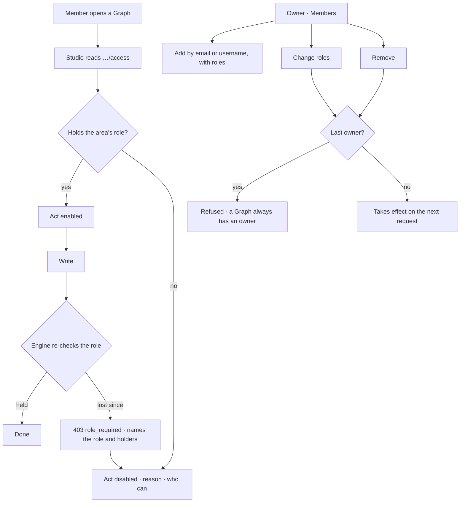

# Roles

A member of a Graph holds one or more **Graph roles**. Every member reads everything in the Graph;
a role is what lets them change a part of it. The install has one role above Graphs, the **install
Admin**.

| | |
|---|---|
| Index | [11.6](../../../README.md#11--identity-and-access) · Slice **B11** |
| Module | [Identity and access](../spec.md) |
| API / CLI / Studio | ✅ / ✅ / ✅ |
| Product | [shell.md › Decisions](../../../../products/shell.md#decisions) — *Roles per Graph* · *Without the role* · P-18 |
| Related | [membership](membership.md) · [search](../../platform/features/search.md) · [guardrails](../../govern/features/guardrails.md) · [rules](../../skills/features/rules.md) · [datasets](../../bring-data-in/features/datasets.md) |

> **As** the owner of a Graph, **I want** to give each person the part of the Graph they work on,
> **so that** an analyst can ask and read without being one click from republishing the model.
>
> **As** a member without a role, **I want** a refused act to say which role it needs and who holds
> it, **so that** I know who to ask instead of hitting a dead end.

## Capabilities

| # | Capability | Notes |
|---|---|---|
| R1 | Six Graph roles | `viewer` · `contributor` · `builder` · `modeller` · `owner` · `iam-admin` |
| R2 | Several at once | A member holds a set; `owner` implies the other four; every member reads |
| R3 | Enforced on every graph-scoped route | One policy table, applied by the one membership dependency |
| R4 | A refusal names the role and who holds it | 403 `role_required` with `role`, `area` and `holders` |
| R5 | Studio can draw acts disabled before trying | `GET …/access` returns my roles and every area's role, holders and whether I may |
| R6 | My roles ride on `/auth/me` | Each Graph in `graphs[]` carries `roles` |
| R8 | Roles are managed policies | Each role is a managed [policy](policies.md) of the same name; a group can hold one ([people and groups](people-and-groups.md)) |
| R9 | iam-admin | A sixth role: people, groups, policies and others' tokens — the `iam` area |
| R7 | Install Admin | `users.is_superuser`: install rules, standards, any dataset, retraction. Never a way into a Graph |

## What each role may change

Reading is never gated: every `GET` on a Graph is open to every member. A role governs the writes
(`POST · PUT · PATCH · DELETE`) of an **area**.

| Area | Role | Writes it covers (paths under `/api/v1/u/{username}/{graphSlug}`) |
|---|---|---|
| `ask` | viewer | `sessions…` · `explorer…` · `boards…` · `runs/{id}/answer · cancel · rerun · resume` · `connection/ping` · `notifications/read` · `approvals…` |
| `work` | contributor | `projects…` · `tasks…` · `schedules…` |
| `build` | builder | `agents…` · `skills…` · `evals…` · `flows…` · `projection-templates…` · `runs/{id}/emissions/{id}/template` |
| `model` | modeller | `models…` · `model-links…` · `rules…` · `projects/{key}/rules` · `govern…` · `dataset-bindings` · `connection/introspect` |
| `settings` | owner | the Graph itself (`PATCH` · `DELETE`) · `connection…` · `setup…` · `default-agent` · `llm…` · `notifications…` (rules and channels) · `alert-rules…` |
| `iam` | iam-admin | `members…` · `iam…` except `iam/tokens`, which is `ask` |

## Journey

## Seams

| Seam | What the user sees |
|---|---|
| Role removed mid-session | The next write is refused with the role it needed and who holds it |
| Demoting or removing the last owner | Refused, naming the rule — a Graph always has an owner |
| Adding someone without an account | Refused — there is no invitation flow |
| Adding with no roles | They are a viewer; `viewer` is stored, never an empty set |
| A guardrail edit | Needs `modeller`; reading the guardrails stays open to every member |
| An install Admin who is not a member | Reaches no Graph route — superuser is not membership |
| A write route the table does not name | Needs `owner`, and the route test fails until the table names it |

## Surfaces

| Surface | Shape |
|---|---|
| `GET …/members` | every member with `user_id` · `username` · `first_name` · `last_name` · `roles` · `added_at` |
| `POST …/members` | `{user, roles}` — `user` is an email or a username |
| `PATCH …/members/{member}` | `{roles}` — replaces the set |
| `DELETE …/members/{member}` | removes the membership; their work stays |
| `GET …/access` | `{roles, areas: [{area, role, allowed, holders}]}` |
| `/auth/me` | `graphs[].roles` |
| CLI | `invana members list · add --role · set-roles --role · remove` ([13.3](../../platform/features/command-line.md)) |
| Studio · access | `useAccess()` (shell) reads `GET …/access` once per Graph, key `["access", owner, graph]`; `gateOf` (core) turns an area into allowed · role · holders · reason |
| Studio · a gated act | `ActButton area=…` (shell) — the kit `Button`, or disabled with the reason as tooltip and accessible description; `gateItem(item, gate)` does the same for a panel header action |
| Studio · a read-only surface | `ReadOnlyNotice area noun` (shell) — *You can read this skill. Editing needs the builder role — ask ravi.* (board `agents.skills.detail.readonly`) |
| Studio · Members | Graph settings › **Members** tab (Modeller, board `modeller.settings.members`): member · roles · since, *Edit* roles, *Remove*, *Add member*; a **Roles** key below it |

## Engine

| Thing | Shape |
|---|---|
| `graph_members.roles` | JSON list of role names, never empty; replaces `can_edit_guardrails` |
| `apps/graphs/roles.py` | `GraphRole`, `AREAS`, `area_for(method, path)`, `holds(roles, role)` — pure |
| `GraphMemberManager` | `members` · `add` · `set_roles` · `remove` · `holders` · `access` |
| Guard | `require_graph_member` reads the matched route and method, resolves the area, refuses without its role |
| Refusal | `403 {error: "role_required", area, role, holders, message}` |
| Events | `member.add` · `member.remove` · `member.roles` with `{username, roles}` |
| Migration | `069`: add `roles`; the Graph's creator gets `owner`, every other member `contributor · builder · modeller`; drop `can_edit_guardrails` |

## Decisions

| # | Decision |
|---|---|
| RO1 | A member holds a **set** of Graph roles, stored as a JSON list on `graph_members`. `viewer` is the floor and is stored when no other role is given; the set is never empty. |
| RO2 | `owner` implies `contributor`, `builder` and `modeller`; the other three are peers. Every member reads. |
| RO3 | Reads are never gated by role. A role governs the writes of one **area**, and the area is read off the route: a path prefix after the Graph, with a short list of narrower prefixes that win over a broader one (`projects/{key}/rules` is `model`, not `work`). |
| RO4 | The policy is one table in `apps/graphs/roles.py`, applied by `require_graph_member` from the matched route — no route names its own role. A write route the table does not name needs `owner`, and `tests/graphs/test_roles.py` walks every graph-scoped route and fails on one without the gate or a write the table does not name. |
| RO5 | Asking is a viewer's act: sessions, Explorer expansions, boards, and answering, cancelling, re-running or resuming a run. A run spends tokens, and so does an ask; the bound on spend is the agent's envelope, not a role. |
| RO6 | LLM providers are `settings`: they hold credentials and decide what the Graph spends tokens on. Pinning a model on an agent stays `build`. |
| RO7 | Guardrails are a Modeller's. `can_edit_guardrails` is retired; `may_edit_guardrails` on the lens list is `holds(roles, modeller)`. |
| RO8 | A Graph always has an owner. Removing or demoting the last one is refused (409), naming the rule. |
| RO9 | A refusal is `403` with `role_required`, the area, the role and the usernames that hold it, so Studio and the CLI can say who to ask. |
| RO10 | The install Admin is `users.is_superuser`, which already gates install rules, standards, every dataset and retraction. It grants no Graph role and no Graph access. |
| RO11 | The CLI holds database credentials and acts as the `--user` it names; role enforcement is the API's. `invana members` refuses what the manager refuses — an unknown role, a person with no account, the last owner. |
| RO12 | Existing members keep what they had: the creator becomes `owner`, everyone else `contributor · builder · modeller`. |
| RO13 | Studio reads `…/access` once per Graph (60 s stale) and draws from it. Until it loads, or when it fails, every act is enabled: the engine re-checks every write and its refusal still names the role and the holders. |
| RO14 | An act without its role is **disabled, never hidden**. Its tooltip and accessible description read *Needs the `<role>` role — ask `<holders>`.* The reader is left out of the holders; past three names it reads *a, b or N others*. |
| RO15 | What is gated is the **entry act** of an area — the button that opens an authoring dialog or writes straight away (*New agent*, *Edit instructions*, *Publish*, *New project*, *Save*). A dialog's own submit is not gated again: its entry already was. Area by product follows the engine table: Agents' agents, skills, evals, plans, templates and plugins → `build`; LLM providers → `settings`; Modeller's models, stitches, rules and guardrails → `model`, its Graph settings and Members → `settings`; Projects' projects, findings, decisions, todos → `work`; Activity's schedules → `work`, rules and channels → `settings`. Asking is every member's. Datasets are install-scoped and keep B03's checks; a plugin's enable and disable are install-wide (`/api/v1/plugins…`) and gated by no Graph role. *Save as dataset* on a simulation is gated as `work`, the act that starts it, though the dataset route itself is install-wide. |
| RO16 | A detail surface whose main act is gated opens with one line, `ReadOnlyNotice`: *You can read this `<noun>`. Editing needs the `<role>` role — ask `<names>`.* Shown only where the board draws it — a skill, an agent, a model, a project — not on every list. |
| RO17 | Graph settings gains a **Members** tab: one row per member — name, roles as badges, *since* — and for an owner *Edit* (the five roles as a checkbox set; `viewer` always held) and *Remove* (confirmed). *Add member* takes an email or a username and roles. Below it a **Roles** key: role · what it may change. The last owner's refusal (409) and an unknown account (404) show in the dialog, in the engine's words. Without `owner` the tab reads, its acts disabled per RO14. |
| RO19 | **The roles are the managed policies** `viewer · contributor · builder · modeller · owner · iam-admin` ([policies](policies.md) PO2). A member's directly held ones are `graph_members.roles`; a group's are attachments; the guard checks their union. |
| RO20 | `iam-admin` is a peer role: `owner` does not imply it. The Graph's creator holds `owner` and `iam-admin`. A Graph always has an iam-admin — removing or demoting the last one is refused (409), as for the last owner. |
| RO21 | Members moves to the `iam` area: adding, re-roling and removing a member needs iam-admin, from IAM › People or Graph settings › Members. |
| RO18 | Graph settings' connection tab is labelled **Database** (its `?tab=graph` key unchanged), so the strip reads Basic · Database · Members as the product names them. |

## Not building

| Not building | Because |
|---|---|
| Per-record permissions | an area is the unit; a finer grain is unproven |
| Private projects | Per-project access sits on top of these roles — [9.7](../../work/features/private-projects.md) |
| Custom roles | a custom [policy](policies.md) carries what a role cannot; the six roles stay the product's words |
| Role-aware agents | agents are principals bounded by an envelope ([MB5](membership.md)) |
| Hiding a product a role cannot read | every role reads every product today |
| Invitations | as in [membership](membership.md) |
| *Request access* on a read-only surface | there is no access-request flow (no invitations); the notice names who to ask |
| Agents in the Members table | agents are principals bounded by an envelope, not members holding roles |
